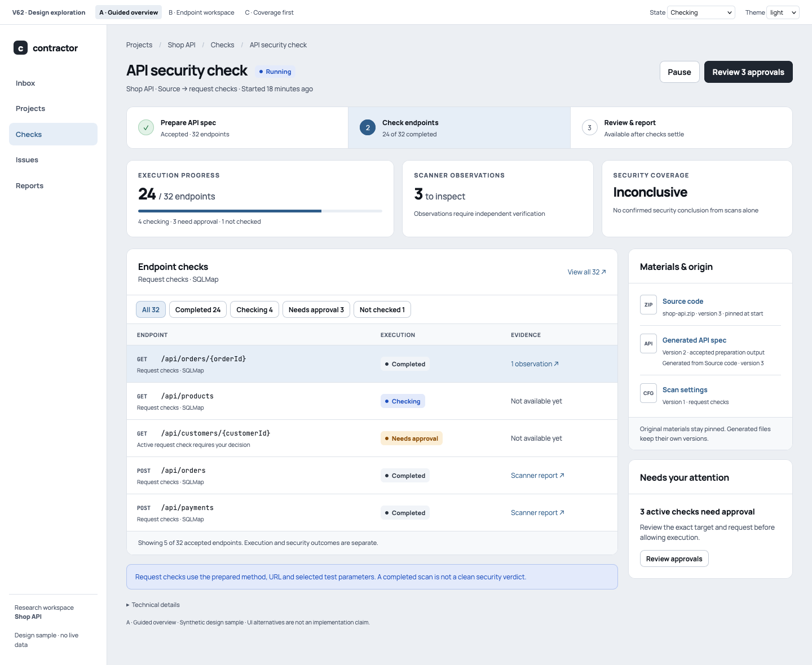
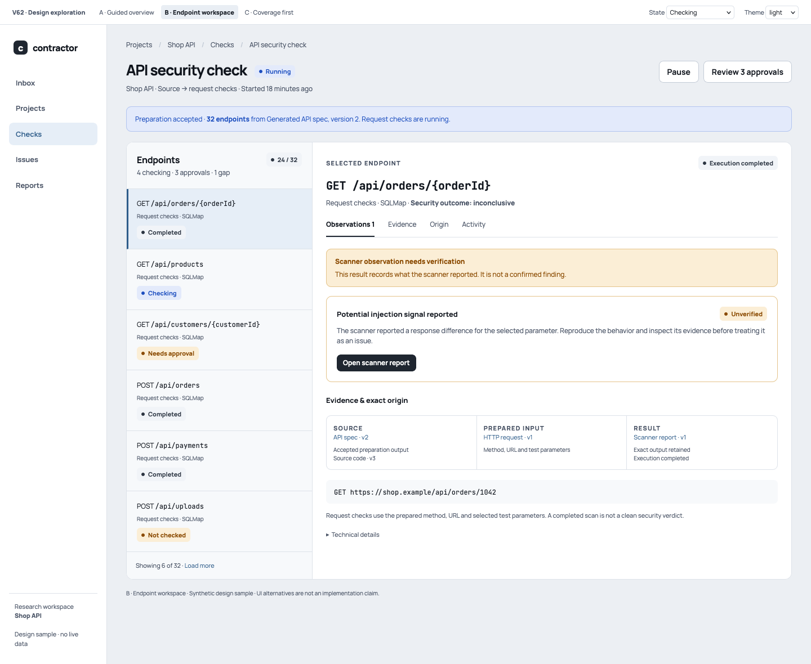
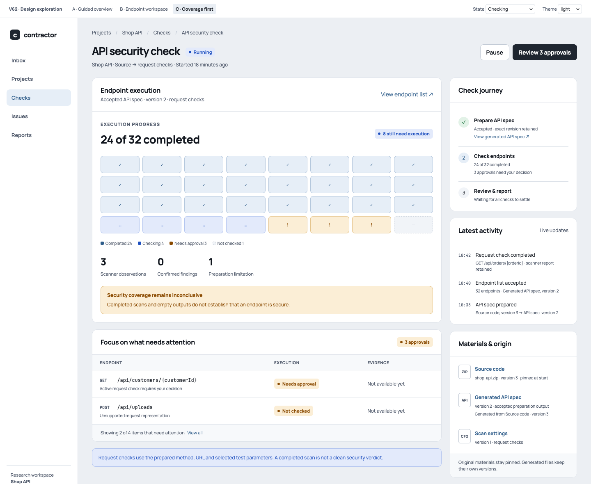

# V62 preparation and scan journey: fresh UI alternatives

Date: 2026-10-21. Status: **A overview + B endpoint detail accepted by the user on 2026-10-21; UI implemented; production-process release verification pending**.

[UI design index](README.md) · [V62 plan](../../plans/2026-09-20-audit-workflow-composition.md)
· [UI implementation task](../../../tasks/v62-011-audit-composition-ui.yml)

These alternatives refresh the older Studio sketches for the remaining V62
delivery. They use current V3B fonts, neutral controls and theme tokens. This
is the ordinary user's Check journey, with no graph editor or new composition
engine. The existing Studio remains a separate advanced surface.

## Shared scenario and contract

All three desktop alternatives show the same synthetic Shop API check:

- Source code version 3 is pinned at start. Preparation produces accepted API
  spec version 2; generated inventory accepts 32 endpoints from that exact output.
- 24 endpoint executions are completed, four are checking, three await approval
  and one is not checked. These sum to the 32 accepted endpoints.
- Three scanner observations need inspection; no finding is confirmed. Scanner
  execution completion and security coverage remain separate. The accepted scan
  coverage remains inconclusive (ASC-R127 to ASC-R134, UIJ-R63).
- Source input, generated API spec, prepared scanner input and retained scanner
  report have separate exact provenance. Synthetic version labels stand in for
  the exact ArtifactRefs supplied by the API. Technical IDs stay in details.
- Before inventory acceptance there is no endpoint denominator, no Round and no
  coverage percentage (ASC-R41 to ASC-R51). Preparation shows activity without
  fabricated percentage progress. A failed attempt's output is diagnostic only,
  never an accepted preparation artifact (ASC-R44).
- The main sample is SQLMap request mode. Nuclei URL mode is a separate check
  type: its copy names URL templates and explicitly excludes replay of the
  OpenAPI method, request body and authenticated session (ASC-R119 to ASC-R124).
  The mockup does not combine both into one invented scan profile.

The prototype has no network calls or Server mutations. The only active
controls switch design variant, sample state and theme. Other controls illustrate
their intended placement. Real revisions, controls, stale reads and owner checks
remain the responsibilities of V62-010–012; these pictures do not prove readiness.

## A: guided overview

[Open HTML](mockups/v62/a.html) · [Desktop render](screenshots/v62/a-overview.png)
· [390 px](screenshots/v62/a-overview-mobile.png)



A simple preparation → endpoint checks → review/report strip anchors the page.
Execution progress, scanner observations and security coverage have separate
summaries. Endpoint rows sit beside materials and pending approvals.

Recommended starting point for the main Check page: the smallest change to
the existing UI and easiest explanation of the new preparation phase. Its cost
is another navigation step to inspect an individual endpoint's evidence.

## B: endpoint workspace

[Open HTML](mockups/v62/b.html) · [Desktop render](screenshots/v62/b-workspace.png)
· [390 px](screenshots/v62/b-workspace-mobile.png)



A persistent endpoint list and selected detail follow the existing V3B pane
pattern. The detail puts observations, retained evidence and the exact input
chain together. An observation has an inspect action, not a fabricated finding
confirmation control.

Best for repeated researcher triage. It can complement A as the endpoint detail
view. It is denser, and preparation itself is less visible once checks begin.

## C: coverage first

[Open HTML](mockups/v62/c.html) · [Desktop render](screenshots/v62/c-coverage.png)
· [390 px](screenshots/v62/c-coverage-mobile.png)



A compact matrix shows the complete small sample inventory, with explicit
execution-state labels and an attention list. The side column carries the
journey, events and materials. Completed cells use the neutral blue execution
palette; they are not green claims of security.

Best for monitoring a small check. For real large inventories the matrix would
need bounded paging or aggregation; it must never imply unloaded rows were
inspected. This is the largest additional UI surface of the three alternatives.

## Preparation, failure and scan-mode examples

- [Preparation running](screenshots/v62/a-preparing.png): endpoint count and
  coverage are explicitly unavailable, with accepted source and settings visible.
- [Preparation failed](screenshots/v62/a-failed.png): no accepted worklist or
  successful result; diagnostic output is separate from accepted materials.
  The design offers inspection and a new check, without inventing an unsupported
  in-place retry action on a terminal Audit.
- [Nuclei URL checks](screenshots/v62/a-url-checks.png): URL-specific execution
  labels and limitations instead of claiming exact request replay.

Each HTML alternative accepts `?state=preparing|running|failed` and
`&theme=light|dark|black`; `&mode=url` selects the Nuclei copy. Default is a
running SQLMap request check in light theme. Failed preparation is a separate
sample snapshot and does not mutate the accepted running sample.

Theme examples: [A dark](screenshots/v62/a-overview-dark.png),
[A black](screenshots/v62/a-overview-black.png),
[B dark](screenshots/v62/b-workspace-dark.png),
[B black](screenshots/v62/b-workspace-black.png),
[C dark](screenshots/v62/c-coverage-dark.png),
[C black](screenshots/v62/c-coverage-black.png).

## Scope and implementation handoff

V62-010 owns committed preparation/provenance API projections. V62-011 owns
the chosen layout, truthful unknown/error states, normal controls and result
navigation. V62-012 proves the generated-source journey across real process
and browser boundaries. Existing active-check policy remains authoritative;
approval counts here illustrate a policy that requires decisions.

This exploration accepts neither a universal workflow editor nor V64 ranking,
cross-round dependencies or a new diagnostics/storage subsystem. The user accepted A for the Check overview and B for endpoint details on
2026-10-21. Implement one connected Check experience using those two views;
C remains an unselected exploration.

## Reproduce the renders

With UI dependencies installed (the existing Manrope and JetBrains Mono fonts),
run from the repository root:

```sh
node docs/design/ui/mockups/v62/render.mjs
```

The script uses installed Firefox (`FIREFOX_BIN` may select its executable),
an isolated temporary profile and local file URLs. It writes 15 PNGs: three
desktop variants in all three themes, three 390-pixel layouts, preparation,
failure and a URL-mode example. No model, external target, database or live
Server is used. Saved images were rendered with Firefox 158.0.1.

## Implementation evidence (2026-10-21)

The V62 preparation overview now uses A, and endpoint details use B. The UI
shows committed generated inventory, separate original/accepted materials,
request-versus-URL scan provenance and receipt-authorized saved reports. Source
Run deletion does not remove accepted materials. Completion of a scanner is
shown in the information palette, separately from security coverage.

The browser evidence below exercises the production React components against
contract-validated synthetic API responses. It covers start without a Round,
preparation, inventory acceptance, approvals, exact report navigation, failure,
keyboard focus, all three themes and 390 px. It does not substitute for the
Server/Scheduler/Runtime release journey.

- [Overview, light](screenshots/v62/implementation/overview-light.png) ·
  [dark](screenshots/v62/implementation/overview-dark.png) ·
  [black](screenshots/v62/implementation/overview-black.png) ·
  [390 px](screenshots/v62/implementation/overview-mobile.png).
- [Endpoint, light](screenshots/v62/implementation/endpoint-light.png) ·
  [dark](screenshots/v62/implementation/endpoint-dark.png) ·
  [black](screenshots/v62/implementation/endpoint-black.png) ·
  [390 px](screenshots/v62/implementation/endpoint-mobile.png).
- [Preparation](screenshots/v62/implementation/preparing.png) ·
  [failed preparation](screenshots/v62/implementation/preparation-failed.png).

Reproduce with a local UI development server and `playwright test
e2e/audits.spec.ts`. `CONTRACTOR_UI_E2E_BASE_URL` selects that server;
`CONTRACTOR_V62_SCREENSHOT_DIR` selects the image destination. The screenshots
use Chromium 151.0.7922.34 through the pinned Playwright installation.
