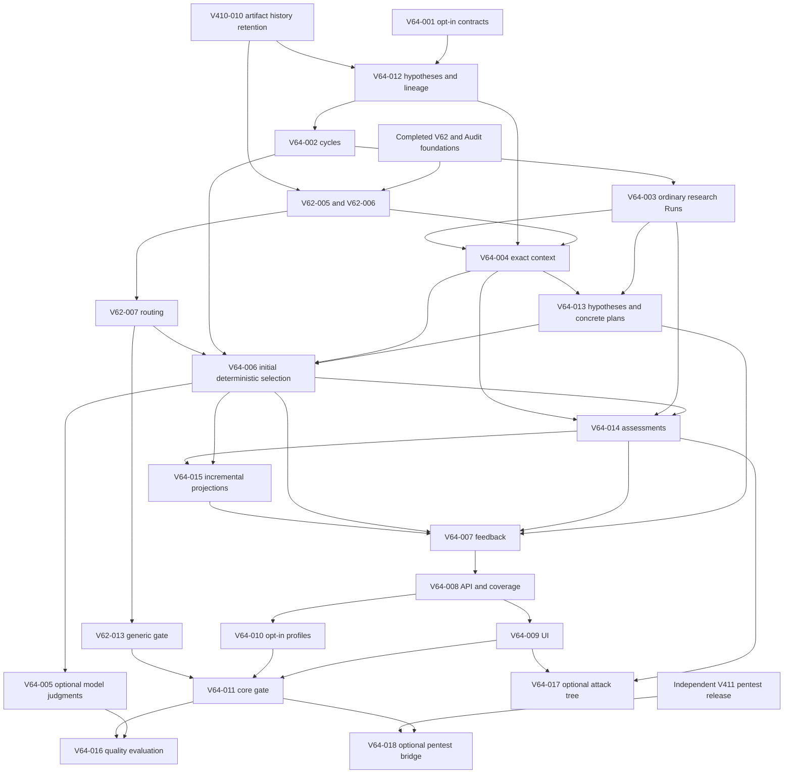

# Optional Audit hypothesis search

Superseded planning baseline. On 2026-10-31 the user requested the common Audit task graph and diagrams for review before implementation. [Proposal 0050](../../proposals/0050-audit-common-hypothesis-model.md) and the [current task plan](../../plans/2026-10-31-audit-redesign.md) govern the replacement. V64-003/006/007 are archived as merged into V64-002/012/013; remaining pending work has an explicit user-review gate. The stages and graph below retain the historical research-only plan, not current implementation instructions.

Pentest integration update, 2026-10-30: the current V64-018 task replaces the
original proof-specific bridge with composition of ordinary HTTP checks,
evidence and reports. Archived V411-008/009/012 are historical context, not
prerequisites or implementation instructions. The current V411/V412 task files
and proposal 0033 section 14 supersede the original pentest scope edits below;
this update does not change the core V64 research plan.

Date: 2026-10-24. Design: [proposal 0045](../../proposals/0045-audit-hypothesis-search.md).
The user queued V64-001–018 and V62-005/006/007/013 on 2026-10-24.
As of 2026-10-30, V62-005/006/007/013 are completed and V64-001–018 remain
pending. The current task files own status, dependencies and acceptance;
V64-018 follows the revised ordinary HTTP integration scope. V61 and V62-008
remain deferred. This documentation update implements no capability.

## 1. Earlier delivery outcome and boundaries

An explicitly selected research profile generates hypotheses from guides and
selected Project materials, chooses useful experiments, records scoped results
and changes its later choices using accepted evidence. Hypotheses, revisions
and lineage belong to the Audit. Ordinary AuditItems, Workflows and Runs execute
the selected work. The Scheduler retains execution ownership.

An authorized person can also submit or revise a hypothesis. Human-submitted
hypotheses receive high verification priority by default. Authorship and requested attention
are authenticated, audited Server metadata; a model or uploaded producer
document cannot claim them. Requested attention is independent of evidence
support, model confidence and finding severity. At the next eligible selection,
feasible high-attention human work precedes comparable automated work. Scope,
prerequisites, budgets and review still apply; blocked requests retain their
attention and expose the blocking reason rather than becoming low priority.

The old zero-hypothesis deterministic inventory boundary is superseded.
Fixed assertion checks use common hypotheses created from their selected
source without generation/ranking calls or a separate research phase.
Direct Runs and supporting non-assertion operations need no hypotheses.
The old task boundaries below require reconciliation with this common core.

The first research release uses a deterministic selection policy. Generation
can use deterministic adapters or ordinary Workers; optional model ranking is
a separate delivery path. The first release does not require live Project
sitemap access, autonomous pentest proof, an attack tree, zero-Worker Planner
execution, or a general research scheduler.

The earlier [V64 plan](../../plans/2026-09-20-audit-check-prioritization.md) and
[proposal 0034](../../proposals/0034-audit-check-prioritization.md) describe the
previous integration target and the implemented pure core. Their minimum-ten,
complete-pool and fixed-membership constraints do not govern this plan.
V64-000 stays completed. Later consumers may revise or remove obsolete pure-core
APIs in their own implementation changes; historical completion is not a
requirement to preserve an unused interface.

## 2. Delivery stages

| Stage | Tasks | Reviewable outcome |
| --- | --- | --- |
| A. Shared iterative composition | V62-005, V62-006, V62-007, V62-013 | An ordinary later-round check consumes exact retained results through profile-owned routing. The generic gate requires no hypothesis domain or V64 implementation. |
| B. Research identity and execution boundary | V64-001, V64-012, V64-002, V64-003 | Strict opt-in, trusted hypotheses/revisions, bounded lineage and a durable pre-Round research intent with ordinary Run execution and truthful pause/resume. Direct execution has no research dependency. |
| C. Deterministic feedback | V64-004, V64-013, V64-006, V64-014, V64-015, V64-007 | Guide-only and material-based starts produce hypotheses and concrete plans; the initial selector admits ordinary checks before assessment import and incremental refresh extend the working path. Accepted evidence then changes a later choice. |
| D. Usable core release | V64-008, V64-009, V64-010, V64-011 | API/UI explain hypotheses, lineage, selection and coverage. A separately selected profile passes real-store/process/browser gates and preserves the original direct paths. |
| E. Optional model ranking | V64-005, V64-016 | Bounded model judgments can replace a deterministic evaluation policy; repeated equal-budget experiments measure whether that helps. Neither task blocks the core release. |
| F. Optional attack-tree analysis | V64-017 | A versioned analytical projection has declared AND/OR evidence semantics, bounded evaluation and a real reader. It does not execute or authorize work. |
| G. Optional pentest research integration | V64-018 | A separately selected research-enabled pentest profile connects the released search and pentest paths and passes its own integration gate. Both base paths remain independently usable. |

These stages describe useful outcomes, not additional hidden dependencies.
Remaining pending tasks may be selected once their declared prerequisites are
complete, following the normal task ownership and in-progress rules. The shared
iterative-composition stage is already completed. No further reactivation
decision is required for the pending research scope. Pending does not mean that
implementation has started or that an acceptance criterion has passed.

Keep the existing `audit-check-prioritization` milestone identity and V64-011
exit, replacing its old top-N outcome with the deterministic optional research
core outcome. The completed V62-005/006/007 belong to
`audit-iterative-composition-2026-10`, whose completed exit is V62-013.
Optional ranking, attack-tree analysis and pentest research integration have separate outcomes
and exits V64-016, V64-017 and V64-018; they are not conditions of the core exit.

## 3. Task map and dependency graph

The IDs below are the task boundaries. Renaming their files or titles must also
update references, while preserving the IDs and completed history.

| Task | Revised or new scope | Direct prerequisites |
| --- | --- | --- |
| [V62-005](../../../tasks/done/v62-005-audit-round-result-snapshots.yml) | **Completed:** Immutable complete, bounded settled-round snapshots and authorized child inputs | V62-004, V410-010 |
| [V62-006](../../../tasks/done/v62-006-audit-retained-dependencies.yml) | **Completed:** Exact retained dependencies with original-to-child mappings and existing holds/lifecycle | V62-004, V410-010 |
| [V62-007](../../../tasks/done/v62-007-audit-check-routing.yml) | **Completed:** Generic trusted continuation admission and profile-owned method routing | V62-005, V62-006 |
| [V62-013](../../../tasks/done/v62-013-audit-iterative-composition-release.yml) | **Completed:** generic iterative-composition process gate, including source deletion and unchanged direct paths | V62-005, V62-006, V62-007 |
| V64-001 | Strict opt-in/domain contracts, trusted human origin/requested attention, capability gates and direct-path guarantees | V64-000, V62-001, V25-011 |
| V64-012, new | Audit-owned registry, immutable revisions, sparse lineage, producer ingestion and authorized audited human create/revise | V64-001, V410-010 |
| V64-002 | Durable cycle/decision metadata, reservations, atomic admission and owned lifecycle | V64-001, V64-012, V62-002 |
| V64-003 | Ordinary pre-Round research Run intents, submission, collection and recovery | V64-002, V62-003 |
| V64-004 | Bounded exact context with an actual research-phase caller, selected materials/grounds and dependency materialization | V64-003, V64-012, V62-005, V62-006 |
| V64-013, new | Cold generation, concrete ExperimentPlan authoring/storage and trusted acceptance | V64-003, V64-004, V64-012 |
| V64-006 | Initial bounded indexed deterministic selection, high-attention human lane and ordinary research source admission | V64-000, V64-002, V64-004, V64-013, V62-007 |
| V64-014, new | Sparse many-to-many assessment import for admitted research items and conflict-aware reduction | V64-003, V64-004, V64-012, V64-006 |
| V64-015, new | Extend the working selector with incremental readiness/priority, dirty propagation and scale evidence | V64-012, V64-014, V64-006 |
| V64-007 | Feedback progression, explicit reconsideration and bounded next-cycle control | V64-003, V64-006, V64-013, V64-014, V64-015 |
| V64-008 | Research API including authorized human hypothesis/attention commands, coverage/provenance and report inputs | V64-007 |
| V64-009 | Human hypothesis entry/revision and attention UI, research list/detail/lineage and truthful states | V64-008 |
| V64-010 | Separate opt-in profiles, complete catalog wiring and operator guide | V64-007, V64-008 |
| V64-011 | Core process/browser gate, including retained human attention under large pools and blocked prerequisites | V64-009, V64-010, V64-015, V62-013 |
| V64-005 | Optional bounded model judgments that cannot lower authorized human attention | V64-003, V64-004, V64-006 |
| V64-016, new | Optional model-ranking quality evaluation and its independent delivery evidence | V64-005, V64-011 |
| V64-017, new | Optional attack-tree projection/evaluation with a concrete reader | V64-014, V64-008, V64-009 |
| V64-018, new | Optional research-enabled ordinary HTTP checks, evidence/report composition and independent gate | V64-011, V411-015, V411-016, V411-020 |

The table is the exact dependency list; the diagram summarizes the main paths.
V410-010 is an ArtifactStore retention prerequisite, not a dependency on the
live sitemap product. V64 does not depend on the whole V410 series. V62 has no
V64 dependency. Base V411 pentest execution has no V64 dependency. The bridge
depends on both released capabilities, never the reverse.

## 4. Integration and ownership decisions

V64-003 replaces the old zero-Worker Planner task. Generation and optional
evaluation are ordinary Workflow executions using the existing Run
intent/submission/collection foundations. Research is not repeated `prepare`:
preparation remains once per Audit. The new pre-Round phase is durable before
a Round exists, and resume reconciles its original intent and accepted batches.
It adds no Scheduler phase, queue, Worker lease or new general receipt store.

V64-002 owns cycles and decisions; V64-012 owns hypotheses and lineage.
V64-013 owns concrete ExperimentPlan authoring, storage and trusted acceptance.
V64-006 admits those plans through the ordinary research source adapter.
V64-014 owns assessment contributions; V64-015 extends indexed projections.
These responsibilities must not collapse into one store/controller task.
ArtifactStore continues to own exact payloads, forks and retention. Existing
Run/Audit execution remains the source of technical execution state.

V64-012 wires its producer writer into the existing accepted Audit output
importer and supplies the smallest authorized human create/revise and read
path in the same change. Default non-research outputs bypass the importer
hook. Human operations record the authenticated actor, exact requested change,
revision and attention request under existing owner/idempotency rules. Changing
the proposition, scope or expected property creates a successor; an edit
cannot silently change accepted evidence. V64-008 completes the public command
and inspection contract, and V64-009 provides the user flow. V64-012 does not
wait for those later tasks to create its first real writer and reader.
V64-004 attaches context assembly to the working
research phase supplied by V64-003. V64-013 then supplies immutable plans with
exact hypothesis membership, a registered method, prerequisites, controls or
interpretation rules, permitted effects, capabilities and bounded cost.

The order V64-013 -> V64-006 -> V64-014 -> V64-015 is intentional. The initial
selector uses bounded indexed eligibility and admits ordinary research checks
without a dependency on an unfinished assessment/projection subsystem.
Assessment import then runs against actual admitted item/attempt associations.
Incremental refresh extends that existing selector and its existing ingestion,
result and lifecycle callers. V64-007 closes the feedback loop only after all
four are available. This avoids a hidden dependency from assessment fixtures
back to an admission path that itself waits for those assessments.

V64-006 keeps authenticated human attention as an independent selection
dimension with an indexed high-attention lane. The optional V64-005 evaluator
can assess usefulness, uncertainty or feasibility inputs but cannot overwrite
the user's attention request. A human hypothesis is not trusted as a true
security claim: it follows the same experiment/evidence assessment contract.
New requests affect a later eligible selection and never append work to an
already accepted Round. V64-008/009 expose requested attention, selected/deferred
state and exact blocking reasons separately from model assessments.

Each persistence task must land a real production writer and reader in the
same change. A future selector or UI named in prose is not a caller. Task
acceptance must identify the actual service/import/read path exercising each
table and exported operation; test-only repositories and unattached endpoint
scaffolding do not satisfy this condition. Contract tasks use actual strict
validators and supported capability checks rather than unused public types.

V62-007 routes trusted finding receipt/ordinal continuations through
profile-owned bindings. Its tests cover ordinary verify, replay and applicability
routes without depending on the Hypothesis registry or enabling autonomous
pentest. V64-006 supplies the future trusted hypothesis/plan adapter; V411
consumes the existing finding receipt/ordinal adapter.
After V64-006 is implemented, V64-018 composes its trusted research source
with ordinary HTTP checks, selected evidence and reports. It does not introduce
the first research admission path or depend on an archived proof subsystem.

An ExperimentPlan can target several exact hypothesis revisions. Results
contain separate bounded contributions for those associations. Assessment
reduction must not copy one Item assessment to every hypothesis, or use finding
batch order to resolve contradictory evidence. A new hypothesis discovered
during execution enters a later admitted candidate set. Reusing existing
evidence for a later question requires an explicit interpretation plan and
exact provenance, not a new target action by default.

Every context pins selected guide/Skill, rubric, policy and Workflow content
descriptors and digests. Dependencies are retained and materialized as child
Run inputs before scheduling; embedded JSON references alone do not grant
access. Live Project reads, when separately authorized in future, cannot
silently change accepted context or the Audit baseline.

## 5. Revised and untouched work

| Work | Planning action |
| --- | --- |
| V64-000 | Leave completed record and implementation evidence untouched. Reuse its useful validation/selection ideas without treating its old policy as universal. |
| V64-001–011 | Use the revised scopes and dependency graph above; status is pending under the explicit 2026-10-24 instruction, with earlier deferrals retained as history. |
| V64-012–018 | Keep the new tasks pending with explicit consumers, limits, failure outcomes, lifecycle and runnable verification commands. |
| V64-001/012/006/005/008/009/011 human-input boundary | Define authenticated human origin and requested attention; implement audited create/revise, deterministic attention precedence, protection from model demotion, API/UI entry and real-process priority/blocked-state evidence. |
| V62-005/006/007 | Completed shared contracts; retain the generic iterative-composition boundary with no V64 dependency. |
| [V62-013](../../../tasks/done/v62-013-audit-iterative-composition-release.yml) | Completed generic gate; source-pinned process evidence proves composition independently of research and pentest. |
| Completed V62 tasks | Keep their history and once-per-Audit preparation guarantees; do not reopen completed implementations merely because a later extension uses them. |
| Seven related unfinished task files | Apply only the exact boundary clarifications in the table below; retain their statuses and dependencies. |
| V410-010 | Consume its completed shared ArtifactStore retention contract; do not introduce a parallel retention mechanism. |
| Other V410 and V413 tasks | Keep independently deliverable; research does not require live sitemap collection or Runtime cache work. |
| Other V411/V412 tasks | Current task files own the 2026-10-30 revised scopes and dependencies; archived recipe/effect/proof tasks do not reactivate. No V64 dependency is added to the base HTTP path. |
| V61 and V62-008 | Leave deferred unrelated capabilities outside this plan. |
| Task index, audit epic, backlog and plan links | Preserve current completed/pending/archived statuses and reviewed dependency edges. The original 22-task activation is historical; task files own current readiness. |

The following historical scope edits are retained for traceability and are
superseded for pentest work by the 2026-10-30 task revision. The original
planning revision's related-task scope edits were exactly the
following seven files. The status follow-up may also correct prerequisite-status
notices without changing those tasks' scope, status or dependencies:

| File | Boundary clarification |
| --- | --- |
| `tasks/done/v411-008-stateful-actions-cleanup.yml` | Reserve test objects, mutations and cleanup for admitted target actions. Storing a hypothesis consumes no target-resource allowance. |
| `tasks/done/v411-009-http-recipes-predicates.yml` | Separate a changed immutable recipe/plan from technical retry; the executor needs exact inputs, not the research registry. |
| `tasks/done/v411-012-pentest-admission-rounds.yml` | Keep receipt/ordinal admission independently usable. V64-018 specializes the ordinary V64-006 research adapter for the same pentest proof checks. |
| `tasks/v411-015-http-pentest-workflow-presets.yml` | Keep the two base HTTP presets free of research bindings; separately named research-enabled presets belong to V64-018. |
| `tasks/v411-016-pentest-proof-report.yml` | Keep bounded base proof reporting independent; the optional research projection belongs to V64-018 and cannot expand reports over the whole pool. |
| `tasks/v411-020-pentest-http-release-gate.yml` | Prove the non-research receipt-based release without V64; the combined research/pentest gate belongs to V64-018. |
| `tasks/v55-009-scan-candidate-ranking.yml` | Refresh the old V64 design reference while preserving scanner-candidate ranking, its status, dependencies and deterministic fallback. |

An old deferral's model-ranking evidence rationale is historical context, not
a new requirement to prove model benefit before deterministic research can
be reviewed. The explicit 2026-10-24 instruction queued the reviewed scope,
superseding its earlier reactivation conditions; completed V62 records retain
their current status.
Optional ranking has its own comparison gate in V64-016. Ranking, attack-tree
and pentest-bridge tasks are pending optional paths, not core prerequisites.

No V64-019 live-Project adapter is created by this plan. Selected exact Project
materials already provide the first consumer path. A later adapter requires a
concrete reader, authorization/projection contract and useful-result evidence;
its absence does not block any core task.

## 6. Acceptance by stage and failure boundary

Every task states expected and maximum counts/bytes, work per transaction or
controller slice, pagination, retry and cancellation outcomes. Normalize the
proposal's design budgets in the owning limit registry and shared fixtures
before implementation. Do not satisfy a work bound with an input count while
reading an unbounded dependency closure.

The generic composition gate exercises exact result selection, explicit absent
results, retention across source Run deletion, original-to-child mappings,
profile-owned routes, review races, restart and cancellation against real
PostgreSQL and processes. A static inventory still takes the existing path.

The research core gate exercises guide-only, description-only and
description-plus-OpenAPI inputs; declarations are not live observations.
The first useful feedback fixture must change the next selected experiment
because of accepted earlier evidence, with the full source-to-result chain.
One experiment has distinct scoped outcomes for multiple hypotheses, and one
hypothesis has conflicting outcomes from several experiments. Their projection
is independent of arrival order. Missing credentials, invalid controls and
timeouts remain unknown/blocked rather than becoming refutations.

A human-created high-attention hypothesis must remain selectable ahead of
comparable feasible automated work even in a large pool. Test owner-authorized
creation and semantic revision, forged human attribution from a model output,
attention changes racing a frozen cycle, and explicit blocked/approval/budget
conditions. Blocked human work keeps its attention and truthful reason;
ranking cannot demote it or convert the request into evidence support. These
cases exercise actual API/selection/process/UI paths, not only stored fields.

Recovery cases cover no-Round pause/resume, deadline exhaustion with the
existing paused state, competing claims, lost acknowledgements, cancellation
drain and source deletion. Accepted batches and identities survive restart;
reconciliation cannot duplicate a budget debit, Run or target effect. New
observations do not invalidate a frozen selection merely by arriving. A
changed authority or failed exact prerequisite does prevent admission.

Direct model-free Runs and existing deterministic Audit profiles are exercised
through their actual process paths with zero generator/ranker calls and zero
hypothesis/cycle records. Test original item membership, coverage and
retry/cancel behavior. Research failures must not introduce a dependency or
waiting condition on those paths.

Optional ranking evaluation compares fixed order, deterministic contextual
selection and model-assisted selection under equal budgets and repeated frozen
samples. Report unique validated problems, false support, coverage, repeated
uninformative work, unknown/refuted correctness, ranking overhead and starvation.
Ground truth stays outside scanned materials. Protocol tests do not establish
model quality, and a single live sample is not improvement evidence.

The attack-tree gate proves compatible-context AND/OR evaluation, explicit
unknowns, bounded DAG traversal and separate provenance/dependency semantics.
Tree suggestions reenter normal candidate admission and budgets. The tree
cannot create Run dependencies, enlarge scope or confirm a finding.

V64-018 owns its real integration gate: an opted-in research hypothesis admits
an ordinary HTTP check through the existing trusted research source, retains
exact source/context and selected evidence, contributes to the ordinary report,
and survives recovery. Registered verify/replay methods keep their ordinary
meaning and confer no special proof authority. The non-search HTTP profile and
non-HTTP research profile still work independently. Do not claim this combination
is verified merely because V64-011 and V411-020 pass separately.

Each gate maps cases to executable owners and rejects missing prerequisites,
mandatory skips and zero-test selections. Record real commands and results
only during implementation verification; this plan creates no success evidence.
