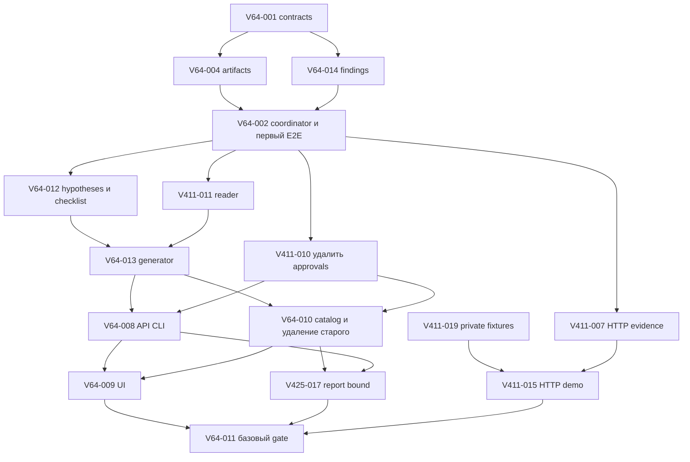

# План переработки Audit

Дата: 2026-10-31. **План для ревью пользователя. Реализацию не начинать до
следующего разрешения после просмотра [схем и деталей](../proposals/0050-audit-common-hypothesis-model.md).**
Исключение по последующему решению пользователя от 2026-10-31: реализация
контрактного этапа V64-001 разрешена, включая подтверждённые лимиты и pause/cancel.
Отдельным решением от 2026-11-01 пользователь разрешил исправления V64-020/021/022;
они реализованы и проверены без запуска зависимых implementation-задач.
Текущие правила продукта остаются в `docs/spec/`; task files задают будущую
реализацию после ревью. Нормативные изменения выполняются вместе с кодом.

По запросу пользователя «Сформируй задачи» от 2026-10-31 оформлен пакет из
**16 существующих задач в pending**: 12 задач ядра, 3 для HTTP-сценария и одна
регрессия лимита отчёта. Сохранены ID и история перепланирования; новых
дублирующих задач нет. В задачах зафиксированы goal/demonstration, scope,
зависимости, критерии приёмки и будущие проверки. Основной каркас согласован;
оставшиеся помеченные предложения о конкретных лимитах и pause/cancel
относятся к первому контракту V64-001. Удаление approvals согласовано:
отдельного перехода со старой approval policy и режима совместимости нет.
Пользователь делегировал V64-001 отдельному агенту; этот документ и последующее
уточнение задачи сами по себе не запускают остальные implementation-задачи.

## Базовый результат

Один Audit выполняет exploratory работу без гипотезы, передаёт exact output
между обычными Workflow, сохраняет Project finding/evidence, публикует полезный
материал в Project, получает новую гипотезу из обычного Workflow и проверяет её
с автоматической привязкой. Fixed checklist работает тем же путём. Пауза,
перезапуск, потерянный ответ и дедупликация сохраняют идентичность и историю.
UI показывает цель, работу, гипотезы, результаты проверок и отдельно findings,
источники и пробелы. Подтверждение/опровержение — результат проверки; finding
в AppSec создаётся при выявленной проблеме. Это принятое пользователем
уточнение от 2026-10-31, заменяющее раннее отождествление любого вывода с finding.

Пользователь 2026-10-31 подтвердил общий каркас: принятое задание → обычный
Workflow/Run → результат и материалы. Исследование, проверка и генерация
используют один путь. Приведённый сквозной пример не задаёт обязательных стадий:
начать можно с checklist/ручной гипотезы, с генерации по материалам или с
exploration; finding и вызов генератора не обязательны для завершения Audit.
Workflow запускает Audit controller через RunService после принятия задания.

Новый collector, Scheduler или research admission не создаются. Меняются
существующие Audit service/controller, Runtime result assembly и owner APIs.

## Исправления после реализации V64-001

Ревью реализации от 2026-11-01 выявило три локальных дефекта контракта.
V64-001 остаётся завершённой историей; исправления отслеживаются отдельно с
`introduced_by: V64-001` в том же milestone и входят в зависимости базового gate.

| Задача | Исправление | До какого consumer |
| --- | --- | --- |
| [V64-020](../../tasks/done/v64-020-accept-empty-hypothesis-proposals.yml) | Явный ответ генератора «новых предложений нет» успешно принимается; генерация остаётся необязательной, текст гипотезы — непустым | V64-013 |
| [V64-021](../../tasks/done/v64-021-validate-effective-audit-input-requiredness.yml) | Обязательность Workflow input проверяется после переопределения выбранного материала | V64-002 |
| [V64-022](../../tasks/done/v64-022-bound-hypothesis-seed-bytes.yml) | Размер содержимого начальных и генерируемых гипотез проверяется до принятия; полный документ отдельно остаётся ограничен 32 KiB | V64-012 |

Исправления валидаторов завершены, без новых состояний, сервисов и
автоматического запуска генератора. Зависимые implementation-задачи этим не запускаются.

## Основные задачи

| Порядок | Задача | Конкретный результат |
| --- | --- | --- |
| 1 | [V64-001](../../tasks/done/v64-001-audit-priority-contracts.yml) | Общие строгие program/task/result contracts, owning boundaries, fixtures, лимиты и карта удаления/cutover |
| 2 | [V64-004](../../tasks/v64-004-audit-priority-context.yml) | Audit workspace, exact handoff и публикация в Project через существующий ArtifactStore с реальным caller |
| 2 | [V64-014](../../tasks/v64-014-audit-hypothesis-assessments.yml) | Одна Finding model в Project: существующая дедупликация, источники/evidence, единые чтение и изменение; удаление Audit finding lifecycle |
| 3 | [V64-002](../../tasks/v64-002-audit-priority-store.yml) | Один coordinator, обычные Runs, pause/recovery и первый сквозной exploratory сценарий |
| 4 | [V64-012](../../tasks/v64-012-audit-hypothesis-registry.yml) | Fixed/manual hypotheses, результаты проверок с автоматической exact association, необязательный finding, простой выбор работы и checklist coverage |
| 4 | [V411-010](../../tasks/v411-010-pentest-program-availability.yml) | Удаление оставшихся item/report approvals и Audit control policy; использование готовых Project Finding-команд |
| 4 | [V411-011](../../tasks/v411-011-project-findings-reader.yml) | Реальный обычный consumer выбранных Project findings и exact snapshots/evidence |
| 5 | [V64-013](../../tasks/v64-013-audit-hypothesis-generation.yml) | Обычный Workflow генерации по материалам, findings и результатам, включая опровержения/пробелы; следующая итерация тем же путём |
| 6 | [V64-008](../../tasks/v64-008-audit-priority-api-coverage.yml) | API/CLI чтение цепочки исследования, управление и публикация материалов |
| 6 | [V64-010](../../tasks/v64-010-audit-priority-profile.yml) | Перенос shipped программ и удаление старых ZIP/round/admission/review механизмов после миграции callers |
| 7 | [V64-009](../../tasks/v64-009-audit-priority-ui.yml) | Общий UI-путь исследования, без approval inbox и ручного ввода системных связей |
| 7 | [V425-017](../../tasks/v425-017-machine-report-ceiling-test.yml) | Регрессия retained report ceiling на новом выбранном assembler |
| 8 | [V64-011](../../tasks/v64-011-audit-priority-release.yml) | Базовый real-store/process/browser gate и доказательство контроля сложности |

Одинаковый порядковый номер показывает независимые после prerequisites работы,
а не назначение параллельных агентов. Точные зависимости находятся в tasks.
Каждая реализация поставляет свой реальный production caller; инфраструктура
без caller не является завершённой задачей.

После завершённой V64-001 задачи V64-004 и V64-014 независимы. Первая даёт
Audit scope и передачу материалов, вторая переносит findings и их источники
в Project через существующий Run → Project fork и сохраняет текущие правила
дедупликации. Смысловое сопоставление в V64-014 не входит. V64-002 зависит от
обеих задач и даёт раннюю сквозную демонстрацию через реальные компоненты.
После неё добавляются гипотезы, генерация и общий API/UI.

В V64-014 explicit problem publication требует exact evidence, а proposal без
evidence остаётся обычным результатом. Оценки источников и прежние duplicate
corrections сохраняются отдельно; общая оценка Project отсутствует до явной
пометки пользователя. Сам finding и все текущие аналитические поля существуют
в одном экземпляре на уровне Project; Audit показывает ссылки/выборки.
V64-014 переносит существующие команды изменения и удаляет Finding-specific reviews,
V411-010 завершает удаление остальных согласований Audit. Приёмка
V64-014 включает конкурентное поступление одного qualified key и страницы
большой истории, а не только fixture из двух Runs.

Реализация `codex/project-problem-findings` отклонена пользователем 2026-11-01:
добавление Project header рядом с живыми изменяемыми Audit findings не выполняет
переход scope. Код сохранён в Git-теге
`archive/v64-014-project-problem-findings-2026-11-01`, в main не включён.
V64-014 остаётся pending с обновлённым контрактом одной сущности.

Небольшой private HTTP fixture V411-019 имеет уже завершённые prerequisites;
он готовится независимо от контрактной цепочки и используется ранним HTTP demo.

### Минимальный шаг V64-004

Уточнение пользователя от 2026-11-01: начать с явно выбранных артефактов;
автоматически переносить отчёт со всем содержимым по его ссылкам пока не нужно.
Audit получает обычный scope в ArtifactStore. Handoff и публикация используют
существующие exact fork/read/CAS/retention операции. Несколько обычных inputs
Workflow поддерживаются и дальше; универсального dependency manifest нет.

Первый production caller уже существует: `auditimport.Importer.collectRoleSuccess`
сохраняет объявленный output, `PinnedSubmissionBuilder.resolveRoleInputs`
выбирает принятый exact output, а `RunService.CreateAudit` создаёт input fork
следующего Run. V64-004 переводит эти операции на Audit scope и добавляет
минимальную owner-authenticated публикацию материала в Project. Текущий
контроллер используется только как существующее место вызова; его замена —
V64-002. Новый coordinator в V64-004 не реализуется.

Приёмку доказывает новая обязательная группа `workspace` в существующих
composition matrix/runner: handoff, публикация после удаления источника,
replay, collision/CAS и authority/lifecycle fences. Старые preparation/Round/
approval случаи эту группу не заменяют. Составной sitemap snapshot с его
явно выбранными исходными файлами остаётся в уже существующей V410-025,
вне базового V64-011; дополнительных задач и платформенных механизмов нет.

Диаграмма показывает основную цепочку функций и сокращает транзитивные рёбра;
исправления контракта перечислены отдельно выше. YAML — точный граф. HTTP demo не зависит
от generator, UI, sitemap, sandbox, browser, callback или ranker. Первый generic
exploratory E2E в V64-002 появляется раньше полного базового exit.

## HTTP часть базового сценария

- [V411-019](../../tasks/v411-019-pentest-target-fixtures-and-proof-scorers.yml)
  сохраняет небольшой vulnerable/fixed target с private independent oracle.
- [V411-007](../../tasks/v411-007-trusted-http-capture.yml) связывает реальные
  invocation-owned HTTP exchanges с обычной приёмкой результатов и evidence.
- [V411-015](../../tasks/v411-015-http-pentest-workflow-presets.yml) даёт ранний
  обычный HTTP Workflow поверх lean Audit без гипотезы по умолчанию.

Результат проверки сохраняется как обычный output; отдельный assessment ledger
не создаётся. Подтверждение гипотезы о баге может дать finding, опровержение —
результат без новой карточки проблемы. Для положительного свойства нарушение
выявляется при опровержении: одной полярности verdict недостаточно. Независимые
подтверждения проблемы сохраняют источники, а отрицательная перепроверка не
удаляет finding и не объявляет его исправленным. Нужные exact гипотезы и evidence остаются readable у Project finding
после удаления source Audit. Метаданные автоматически получаются из trusted
per-item context и не авторствуются моделью.

В proposal 0050 отдельно предложен простой способ формулировки гипотез:
объект/участник, условия и проверяемое поведение. Для поиска проблем удобна
формулировка предполагаемого нарушения. Это рекомендация для ревью, не новый
обязательный тип или schema. Отрицательный опыт не обобщается за пределы
проверенного scope; генератор получает также опровержения и неполные результаты.

## Переработка прежних задач

| Прежняя задача | Новое место ответственности |
| --- | --- |
| [V64-003](../../tasks/done/v64-003-planner-only-priority-execution.yml) | Архив: ordinary Run execution/recovery включены в V64-002 |
| [V64-006](../../tasks/done/v64-006-audit-priority-selection.yml) | Архив: базовый deterministic selection и checklist включены в V64-012 |
| [V64-007](../../tasks/done/v64-007-audit-priority-controller.yml) | Архив: общий loop в V64-002, обычная генерация/feedback в V64-013 |
| V64-014 research assessment ledger | Project finding intake/contributions без второго ledger |
| V411-010 optional-versus-required review | Удаление formal approvals, а не ещё один policy mode |

Архивирование означает объединение scope, не выполнение acceptance. Никакие
completed task records не переписаны. Все новые pending scope имеют явный
planning-review gate; старое `context.decision_needed` о самом перепланировании
больше не заменяет реальные scope и acceptance.

## Смежные задачи

- V411-014/016/017/018 используют ordinary tasks, общие findings, retained
  evidence, API/UI и снимки отчётов. Старые review/prepare/result-admission
  предпосылки заменены. V411-020 становится composed HTTP extension gate после
  V64-011; дополнительные sitemap/sandbox сценарии не блокируют ранний HTTP demo.
- V410-006/007 остаются отдельной sitemap-веткой вне V64-011. SMT владеет
  discovery/reconciliation; при подключении к Audit используются обычные
  задания и общие exact input/output механизмы. V411-014/020 сохраняют
  зависимости от существующих sitemap-задач; базовый HTTP demo от них
  не зависит. Самостоятельное перепланирование sitemap в этот пакет не входит.
- V417-005 сохраняет trusted context/results через compaction на новом пути;
  V417-009 обновляет Audit ветку process gate. Обычный Worker/Planner scope не
  расширяется и не становится prerequisite базового Audit.
- V425-005/015 сохраняют самостоятельные non-Audit дефекты. Для Audit списки
  колонок/SQL сверяются с удалением review links, package routes и report state.
  Удалённый код не чинится и не оптимизируется ради прежнего списка.

## Последующие расширения

V64-005/016 — optional ranking и повторяемое сравнение с deterministic baseline.
V64-015 сначала измеряет, нужен ли дополнительный frontier; отказ от лишней
projection является допустимым результатом. V64-017 — optional analytical
attack tree без scheduling authority. V64-018 только компонует ordinary
generator с уже работающими HTTP tasks; отдельного admission adapter там нет.
Они остаются pending, но не входят в dependency closure V64-011.

Deferred V62-008/V61-004 не активируются. Browser/callback/scanner adapters,
живые quality experiments и чужие in-progress работы сохраняют свою область.
При миграции их consumer fixtures согласуются с новым контрактом, но базовый
сценарий не требует их реализации.

## Проверка готовности плана и реализации

План проверяется на schema/layout, известные IDs, отсутствие циклов и
зависимостей от archived задач, корректные `covers`, required design links,
неизменность чужих in-progress/deferred файлов и свежий generated BACKLOG.
Это не запуск будущих acceptance commands.

В реализации обязательны реальные PostgreSQL и Server/Runtime processes,
проверяемые негативные случаи, повторные ответы/claims, pause/deadline/cancel,
source/parent purge, strict cross-language/public fixtures и полный suite каждого
затронутого package. Новый test-audit-basic-e2e регистрируется в release graph,
нулевой выбор/mandatory skip — ошибка. Существующие fixture/export/source ZIP
сохраняются там, где у них самостоятельный реальный caller.

Cutover выполняется по одному строгому target contract без compatibility
reader. Старая модель удаляется после миграции её callers. Приёмка V64-011
сравнивает LOC, авторитетные представления, states, loops и receipt/lease owners.
Новая pending задача не разрешает начинать код до пользовательского ревью.
