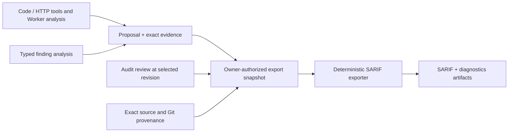
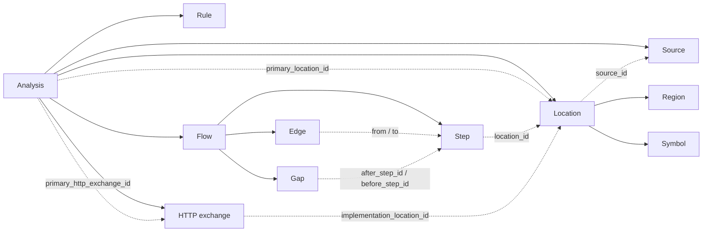
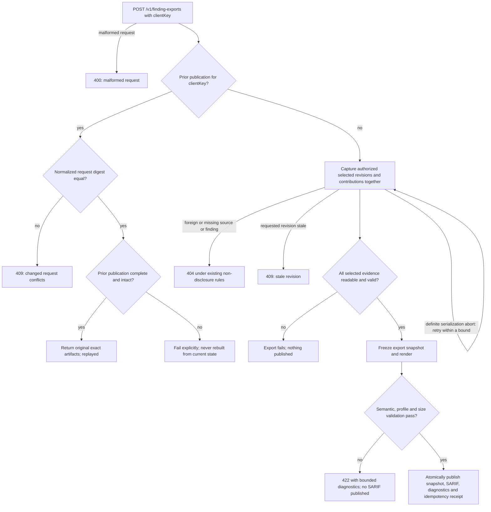

# Structured finding analysis, correlation and SARIF export

Proposal 0028 · Status: **Partially folded: correlation backend; UI and export remain draft.**

Versioned producer fingerprints, exact-source structural anchors, automatic
retained duplicate marks, bounded duplicate-candidate search and cross-Audit
comparison/member APIs are folded into the owning
[findings specification](../spec/findings/findings.md#automatic-correlation-across-audits)
(FND-R163 through FND-R183). These use deterministic code without matching LLM
calls and preserve every independent Audit result. Correlation UI remains a
target of this proposal until its owning UI contracts are amended.

Typed finding analysis, its resolver, export snapshots, SARIF rendering, the
`github-code-scanning` profile and `POST /v1/finding-exports` remain target
design. The finding proposal schema, complete model-visible
`security-findings@1` tool declarations and finding collection format stay
unchanged; hidden publisher metadata and owner API projections implement the
correlation slice. Existing code-analysis, annotation and HTTP tools retain
their published contracts. Capability/version changes are explicit amendments
to owning specs. Upload, source maps, fixes, suppression sync, native
security-score classification and complete-scan replacement remain deferred
beyond [Delivery and conformance](#delivery-and-conformance).

## Ownership and decisions

This proposal owns portable structured analysis attached to a finding,
resolution against exact evidence, versioned correlation fingerprints,
automatic duplicate marks, cross-Audit comparison and deterministic SARIF
2.1.0 export. Audit admission, human duplicate decisions, review, coverage,
Workflow execution and
Runtime placement remain owned by their existing contracts
([Audits](../spec/audits/audits.md),
[Review and reports](../spec/audits/review-and-reports.md),
[Runs](../spec/execution/runs.md),
[Control plane](../spec/execution/control-plane.md)). Existing findings,
collections, code-analysis, annotation and HTTP tools retain their published
contracts ([Findings](../spec/findings/findings.md),
[Code analysis](../spec/tools/code-analysis.md),
[HTTP and Caido](../spec/tools/http-caido.md)).

The design has three boundaries:

1. A producer publishes a proposal and exact evidence through `finding(...)`.
   An optional typed analysis document describes locations, paths and HTTP
   exchanges using that evidence.
2. An owner-authorized Server service freezes an explicit selection, applicable
   review revisions, evidence and source provenance into an export snapshot.
   It resolves identities and validates references before rendering.
3. A pure Go exporter transforms the frozen snapshot into SARIF. It performs no
   model reasoning, source discovery, tool execution, network access or review
   mutations. API, CLI and UI share this service.

A separate deterministic correlation path derives producer keys and structural
anchors, automatically marks exact repeated observations and compares Audits
within one Project. It preserves each finding and its independent analyst
triage. Weaker matches remain candidates. This slice has no LLM or required
manual confirmation and can ship before the analysis resolver/SARIF exporter.



The interchange target is [SARIF 2.1.0 with Errata 01][sarif]. A separate
`github-code-scanning` profile applies the documented [GitHub consumer
restrictions][github-sarif]. Generic validity does not imply consumer
suitability.

## Existing data and matching boundaries

The existing producers and records below are owned by their own contracts; the
table states what this design may use from each and what each does not supply.

| Existing producer or record | Available data | Permitted use and missing information |
| --- | --- | --- |
| Current FindingProposal | Typed source/web locations, explicit unknown subject and selected outgoing HTTP exchange snapshot | Preserves producer claims and actual request bytes; does not resolve source identity or implement SARIF export. |
| Audit finding and decision | Finding/review revisions, state, applicable analyst rating, duplicate target | Supplies triage at one revision; does not rewrite proposal claims. |
| FindingCollection v1 | Exact proposals/evidence, receipts, captured review IDs/state | Reuses retention and explicit selection. It does not contain full decisions or analyst severity. |
| `source-analysis@1` | An explicitly opened archive, paths and line windows | Resolves against that exact archive. A search hit is not a resolved symbol or data-flow edge. |
| Shallow `code-analysis@1` | Definition path, name, lines, column, language and parser node type | Describes a declaration in an effective workspace snapshot, not necessarily the vulnerable expression. |
| Trailmark graph tools | Allocation-local symbol IDs, symbol locations, call relationships and bounded paths | Provides call-graph evidence. Reachability does not establish argument propagation, sanitizer behavior or exploitability. |
| `taint-annotations@1` | Structured comments and declaration/annotation lines after mutation | Preserves Worker assertions. Comments alone do not establish an ordered source-to-sink path. |
| `http-tools@1` | Latest 128 outgoing exchanges in memory and existing response-body artifacts | A finding snapshots a selected request; a bare allocation request ID is not durable evidence. |
| `caido@1` | Request/response projections and retained raw exchange artifacts | Requires an exact artifact and versioned decoder; external request IDs remain provenance. |
| Git artifact import | Exact source version, repository URL and resolved commit | Attribution follows version lineage; equal content digests do not merge repository identities. |

Every join uses an explicit identity: receipt, contribution, exact artifact
revision, document-local location ID or edge endpoints. Bare symbol names,
basenames, similar descriptions, equal CWE values, shared Runs and private
graph IDs never create durable relationships.

## Compatible typed analysis evidence

Keep the `contractor.audit.finding-proposal.v1` proposal schema, the
`security-findings@1` Toolset with its `security-findings-code@1` and
`security-findings-http@1` creation facades, and the
`contractor.findings.collection.v1` collection format unchanged, as defined in
[Findings](../spec/findings/findings.md#proposal-contract) and
[Finding Toolsets](../spec/findings/findings.md#finding-toolsets). Introduce an
ordinary evidence document:

```text
media type: application/vnd.contractor.finding-analysis+json
schema: contractor.finding.analysis.v1
```

A proposal may reference zero or one such document. It and all its
dependencies must be explicitly present in that proposal's `evidence_refs`.
Existing Artifact tools can author the document. Optional Runtime capture
helpers may automate authoring without making source workspaces mandatory for
`finding(...)`.

Dependencies use exact ArtifactRefs, not `evidence-1` ordinals: intake assigns
ordinals after sorting the complete evidence set. Publish dependency artifacts,
then analysis, then call `finding(...)` with all refs. The resolver maps refs
through the containing receipt's evidence table. The document cannot choose
another scope, grant access or cause recursive external fetches.

Existing immutable receipts are never enriched in place. A proposal without analysis can
be exported as it is, or a new proposal can carry structured evidence and become
an explicit contribution/presentation choice under the existing Audit contract.

Analysis is a producer claim. Schema validity, matching file digests and a
Server-produced export establish structural consistency and provenance, not
the truth of the vulnerability. User-supplied bytes cannot mint trusted tool
observations or analyst decisions.

### Document shape

Objects are closed. Unknown keys/versions, duplicate JSON keys, invalid Unicode,
non-finite numbers and dangling references fail. IDs use the Audit identifier
grammar, except `Rule.id`, which also permits `/` and is at most 160 ASCII
bytes. Optional fields are omitted; required arrays remain arrays when empty.
Persist new analysis documents as RFC 8785 canonical JSON.

| Object | Fields |
| --- | --- |
| Analysis | `schema`, `client_key`, `sources`, `locations`, `flows`, `http_exchanges`; optional `rule`, `primary_location_id`, `primary_http_exchange_id` |
| Rule | `id`, `version`, `name`, `description`; optional `help_uri` |
| Source | `id`, `kind: archive\|file`, exact `artifact_ref` |
| Location | `id`, `source_id`, `path`, `file_digest`; optional `region`, `symbol` |
| Region | `start_line`; optional `end_line`, `start_column`, `end_column` |
| Symbol | `name`; optional `qualified_name`, `language`, `kind`, `signature` |
| Flow | `id`, `kind: call-path\|data-flow\|execution-trace`, `description`, `completeness: complete\|partial`, `steps`, `edges`, `gaps`, `evidence_refs` |
| Step | `id`, `roles`, `message`, `evidence_refs`; optional `location_id`, `value`, `value_state` |
| Edge | `from`, `to`, `relation`, `basis: producer-asserted\|tool-reported`, `evidence_refs`; optional `argument_binding` |
| Gap | `after_step_id`, `before_step_id`, `reason` |
| HTTP exchange | `id`, exact `evidence_ref`, `decoder`; optional `operation`, `implementation_location_id` |

The references between objects, as named by the fields above:



`client_key` equals the containing proposal's client key; the receipt supplies
authoritative invocation identity. Array IDs are unique within their containing
object. Both primary IDs must resolve when present. Correlation components
live only in the optional fingerprint evidence defined in
[Versioned producer keys](#versioned-producer-keys) and
[structural anchors](#structural-anchors-from-exact-source); analysis does not
maintain a second discriminator or fingerprint formula.

`Rule.id` denotes the check/issue family, for example
`contractor/sql-injection`. It is stable across Runs; finding ID, Workflow
version, title and subject key are separate. `Rule.version` identifies the
definition. Pinned producer configurations supply this metadata. Different
definitions for one rule ID in an export fail with `rule_definition_conflict`;
the exporter does not invent another ID to hide the conflict. `help_uri`, if
present, is a bounded absolute HTTPS documentation URI without userinfo and is
never fetched during export.

Absent rules use the built-in `contractor/unclassified` descriptor. Standard
references remain classifications; a CWE number or prose does not implicitly
select a rule. Versioned mappings are covered in
[Rule, rating and SARIF mapping](#rule-rating-and-sarif-mapping).

### Source and coordinate contract

An archive source references exact retained ZIP bytes admitted by the existing
source-archive validator. `Location.path` selects a regular member. A file
source references exact UTF-8 bytes; its path is a logical producer-supplied
path with no implicit repository attribution. Both refs are selected evidence.
`file_digest` is SHA-256 of exact file bytes, distinct from the ZIP digest.
All locations of one file source must agree on its logical path. Source
identity includes artifact scope/version; equal file bytes from different
sources remain distinct unless that exact source identity is shared.

Paths are relative, case-sensitive POSIX paths. Reject absolute paths, drive
prefixes, backslashes, control characters, empty/dot/dot-dot components and
archive symlinks. Preserve case and Unicode spelling, independently of the
exporting host. URI encoding escapes path components, including spaces, `#`
and `%`, without changing their source identity.

Lines and columns are one-based. Columns count Unicode code points and end
columns are exclusive. An absent end line means the start line when columns
are present. An end column requires a start column. Coordinates must be ordered
and fit the exact text or its valid exclusive end position. Empty files may
have file locations but no invented line 1. CRLF is one terminator and tabs are
one code point, not display width. Emit `run.columnKind: unicodeCodePoints`.

Adapters must specify upstream coordinate conventions. Tree-sitter byte columns
require decoding the exact UTF-8 line before conversion. Trailmark column units
require a pinned-adapter fixture; unproven columns are omitted with a
diagnostic. Do not copy zero-based columns directly. A definition location
cannot be relabeled as an exact sink expression or call argument.

Resolution is deterministic:

1. Resolve the source in the containing receipt; check recorded digest, media
   type and size against actual bytes.
2. Resolve the exact file/member without searching other archives/directories.
3. Check the file digest, UTF-8 and region bounds.
4. Retain supplied symbol metadata as descriptive context. It cannot override
   contradictory physical coordinates or establish a call edge.
5. Freeze the validated location and exact source identity.

Absent coordinates stay absent. Supplied invalid coordinates fail; they never
trigger a guessed fallback location.

### Effective workspaces and annotations

ZIP digest, file digest and `WorkspaceSnapshot.digest` are different identities.
Graph IDs are bound to the effective workspace and erased on release. Resolve
them while valid into portable file/symbol projections; never persist them as
the identity of a finding location.

Before publishing workspace evidence, retain the exact source representation
the observation describes. After edits, the initial Run input is not
necessarily that representation. A copied tool response remains
producer-supplied unless a trusted capture adapter records tool/version,
normalized arguments, snapshot, bounded output and coverage at the operation's
snapshot boundary. Current model-facing graph responses are not durable
observation receipts.

Annotations shift lines. Post-insertion coordinates address the annotated
source; earlier graph locations address the earlier snapshot. First release
performs no diff, line-offset, fuzzy-symbol or basename remapping. The producer
retains pre-edit source/coordinates or exports annotated source as its own
root. A future source-map adapter must verify both endpoint digests and
mappings before attributing edited coordinates to an original commit.

## Structured source-to-sink paths

### Path kinds and edge claims

`call-path` records reachability through call edges, including `paths_between`
and `entrypoint_paths_to` results. Declaration locations can describe this
path, but do not establish argument propagation.

`data-flow` records a claimed transfer of a particular value between
expressions or parameters. Steps identify input, propagation, transformations,
checks and sink argument as available. An optional `argument_binding` is
`{caller_value, callee_parameter}` with bounded descriptive strings. Equal
variable names or adjacent calls do not create this binding automatically.

`execution-trace` records a sequence from retained instrumentation/execution
evidence. A static call path or unrelated HTTP requests ordered by time cannot
be reclassified as an execution trace.

Step roles are `source`, `propagation`, `call`, `return`, `validation`,
`sanitizer`, `sink`, `observation`. Optional `value_state` is `unknown`,
`tainted`, `derived`, `validated` or `clean`. Neither `validated` nor a
sanitizer role establishes safety; preserve the claimed effect and limitations
in the step message and evidence.

Edge relations are `call`, `return`, `argument`, `assignment`, `transform`,
`control` or `observation`. A `tool-reported` basis requires retained output
from a recognized versioned decoder that reports that relation. A plain copied
document still has producer-supplied origin unless capture provenance is
trusted. Tool edge confidence does not become finding confidence or
confirmation.

### Connectivity, ambiguity and completeness

Steps are ordered. Each adjacent pair has exactly one explicit edge or gap;
edge/gap endpoints are consecutive step IDs. Branches and alternative paths
are separate Flows. Repeated visits to one location use distinct step IDs,
allowing loops without changing location identity.

A complete data-flow starts with a located source, ends with a located sink,
has evidence for every edge and contains no gaps. These are structural
requirements, not proof of the claimed semantics. Missing dispatch resolution,
required argument binding or coordinates makes that portion partial and
explicit. An unlocated step has gaps to its neighbors and cannot bridge located
steps. For other kinds, complete describes the represented sequence, not
whole-program or whole-Audit coverage.

The exporter never discovers a missing edge or chooses an overloaded function
by name. Original coverage/truncation flags remain limitations. A bounded list
can contain complete individual paths while being incomplete as a list of
alternatives.

Example: for `handler -> service -> execute`, the baseline Trailmark projection
is a call path. A data-flow additionally identifies the request value,
actual/formal bindings, transformations and sink argument with explicit
evidence. A retained `@trace` comment supports a claim; `calls=execute` alone
cannot resolve an overloaded callee or prove that a particular value reaches
it.

### Rendering paths and primary locations

A complete located sequence of at least two steps becomes one `codeFlow` with
one `threadFlow`. Step order supplies `executionOrder`, starting at 1. Preserve
native flow kind and evidence basis in Contractor properties. Step roles map
to `kinds`; messages retain validation/sanitization qualifications. A single
located step remains a related location and native flow record.

Split partial paths into contiguous located segments at gaps. Segments of at
least two steps may become separate code flows, visibly labeled as partial
segments. Isolated locations remain related locations. Retain the complete
native path/gaps and an incomplete-trace message. Never connect the two sides
of a gap for presentation. Diagnostics distinguish segment counts from
findings.

`primary_location_id` explicitly selects the result location. Taint producer
instructions should choose the actionable sink expression, or the vulnerable
entry point when that is where the fix belongs. The exporter never chooses
the first graph node, final declaration or first evidence file automatically.
Other validated relevant locations become related locations.

### Matching existing taint annotations

An annotation adapter reads exact retained source and uses the structural
declaration/adjacent-block rules of the taint annotations in
[Code analysis](../spec/tools/code-analysis.md#structural-resolution-and-placement).
Its target is
`(source identity, path, declaration, explicit trace target)`. A bare symbol
or comment elsewhere in the file cannot select a declaration. Multiple targets
on one declaration remain separate analysis contexts.

| Annotation data | Native projection | Additional evidence required |
| --- | --- | --- |
| `@trace target=...` | Explicit analysis context, retained as explanatory evidence | The target string alone does not identify a repository, source expression or rule. |
| `args=name:state` | Step `value` and `value_state` claim at that declaration | Caller-to-parameter transfer needs an explicit binding and location. |
| `calls=...` | Claimed relevant callees | Resolve each callee explicitly; list order does not establish a sequential data-flow or unique overloaded target. |
| `@validate arg=... kind=...` | Validation step with argument and claimed check in its message | Evidence must establish the relevant predicate/effect; syntax does not prove safety. |
| `@sink kind=... arg=...` | Sink role, value and claimed sink category | Select the actual sink expression when available; no automatic CWE or rule assignment. |

Marker/declaration coordinates belong to the annotated file. Precise expression
coordinates require a retained structural or source observation, and joining
another snapshot still follows
[Effective workspaces and annotations](#effective-workspaces-and-annotations).
Parsed comments remain producer assertions even when the annotation tool
originally inserted them successfully.

## HTTP, OpenAPI and non-code findings

An exchange references retained evidence and an exact code-backed decoder ID.
Initial decoder implementations cover the current HTTP body and Caido exchange
envelopes, with fixtures for their media types and schemas. Unknown decoders
fail instead of invoking heuristic text parsing.

The HTTP body decoder exposes only available response fields; a body artifact
does not recover the request, session credentials or headers. Caido parsing
preserves truncation/malformed-data limitations; a preview never becomes a
complete exchange. Multiple exchanges remain distinct. Only an explicit primary
exchange supplies the result's `webRequest`/`webResponse`.

Optional `operation` is `{document_ref, pointer, method, path_template}`. The
exact OpenAPI document is selected evidence; its JSON Pointer must resolve to
the supplied method/path operation. An `operationId` in the source document is
descriptive, not a globally unique join key. The exchange-to-operation relation
remains a producer assertion unless a retained versioned matcher establishes
it. Target/deployment markers, source commit and specification revision remain
separate facts.

`implementation_location_id` explicitly links the exchange to a validated code
location. Handler names, paths and operation IDs never infer this relation.
HTTP target, specification location and implementation location are distinct.
An OpenAPI physical region requires coordinates in that exact document; a JSON
Pointer alone does not supply YAML line numbers.

Generic export supports HTTP-only, configuration, architecture and
missing-evidence findings without code coordinates. An arbitrary evidence file
cannot become a primary code location merely to satisfy a consumer.

The first HTTP projection includes method, sanitized URI, response status and
content type when known. It excludes bodies, query values, userinfo and
credentials/cookies. Record omitted field names and reason codes, never removed
values. Full exchanges remain ordinary access-controlled evidence. Export does
not query Caido or replay requests. Authored finding text is not claimed to be
automatically secret-free.

## Frozen selection, presentation and identity

Reuse the owner checks, exact resolution, contribution expansion,
repeatable-read capture and atomic artifact publication mechanisms of
[collection publication](../spec/findings/findings.md#collection-publication)
and [reader preparation](../spec/findings/findings.md#reader-preparation) in
Findings. A v1 collection alone is not a reviewed
export snapshot: decision IDs do not contain analyst severity/rationale, and
one receipt can have reviews in several Audits.

Schema `contractor.findings.export-snapshot.v1` freezes:

- normalized request, snapshot time, exporter version and profile/policy
  versions;
- one typed result identity per selected Audit finding revision or direct
  receipt, and exact expanded contribution membership;
- presentation proposal/analysis, original text and exact refs/digests;
- trusted receipt/verification origins, including Run/invocation, Workflow
  version and resolved closure digest when available, independently of the
  exporter version and producer-supplied instrument claims;
- applicable review state, verdict, analyst severity, decision/rationale and
  assessment identity, preserving absence;
- resolved locations, source/file hashes, origin lineage and trusted Git
  metadata captured from exact artifact versions;
- rule definitions, classification mappings, native flow/HTTP data, rendered
  projections, limitations, diagnostics and provenance/evidence references.

The snapshot contains all rendering inputs. Re-rendering never reads current
reviews, mutable bindings or current source. Raw evidence refs remain
provenance, not promises of eternal availability or implicit download
capabilities. All selected evidence must be readable and validated before
freezing the snapshot.

### Findings, contributions and receipts

One Audit finding yields one result regardless of contribution count. Its
`FirstProposal` is the default presentation proposal. A request may select an
explicit contributing receipt instead; membership and revision are validated
together. That proposal supplies title, description, rule, main location and
paths. Other contributions remain supporting evidence/provenance and never
silently replace presentation fields or append conflicting paths. The selected
finding's applicable decision supplies triage.

A directly selected receipt yields one proposal result with receipt identity.
It has no invented finding ID or authoritative review. Other Audit reviews may
remain observations, but none is implicitly chosen as its effective decision.

Explicitly selecting both a receipt and its containing finding yields two
differently typed results; UI displays the overlap. Duplicate explicit
selectors are invalid under collection request rules; shared receipts in
contribution expansion are retained once and linked to each selected finding.
Similar content does not deduplicate distinct selected identities.

A duplicate finding retains its ID and target link. Selection does not select
its target implicitly, copy the target's rating or turn it into another
confirmed vulnerability.

### Repository attribution and correlation

Generic output supports multiple deterministic virtual source roots derived
from exact source identity, with no Runtime host paths. Plain file artifacts
and ordinary uploaded archives have no inferred Git identity. Populate
`versionControlProvenance` only from trusted Git import/fork lineage of the
exact source version ([Git import](../spec/artifacts/git-import.md) provenance),
captured in the snapshot.

For generic output, a root key is SHA-256 of the RFC 8785 array
`[scope.kind, scope.id, ref.namespace, ref.name, ref.revision, source.kind,
artifact_digest]`. Its base URI is `contractor-source://<hex-root-key>/`.
Declare bases in `originalUriBaseIds`; file URIs are relative paths paired with
their root's `uriBaseId`. These are logical addresses, not endpoints to fetch.
The GitHub profile uses a single synthetic `file:///src/` base for its
explicitly bound repository and keeps the original source identities in
properties.

Generated/annotated archives do not inherit a commit by sharing a Run or paths.
First release requires verified exact-version Git origin for repository
attribution; edited workspace attribution and source maps are deferred.
Repository identity uses the normalized repository URL of
[Git import](../spec/artifacts/git-import.md); SSH/HTTPS aliases do not become
equal by guessing. Any future alias mapping must be explicit and versioned.

Native result IDs, grouping hints and consumer fingerprints have distinct jobs.
Finding/receipt IDs and revisions stay in Contractor properties. Run/allocation
IDs never identify issues across scans. Automatic correlation is separate
from the human Audit duplicate relation and never rewrites analyst decisions.

SARIF consumes the qualified registered producer/issue-anchor key from the
fingerprint projection defined below. It does not recompute another rule or
infer a key from analysis prose. Missing qualified evidence remains an ordinary
finding; omit the SARIF issue fingerprint and report `fingerprint_unavailable`.

## Deterministic fingerprints and automatic duplicate marks

### Identity, automatic marks and analyst decisions

The requested target is deterministic fingerprinting/search and automatic
marking of repeated findings, including discoveries in different Audits of one
Project. No LLM call, embedding, model ranking or model-authored discriminator
participates in these operations. A finding may originate from a model; its
prose is not a matching input. The backend contract is now owned by FND-R163 through FND-R183; the UI and
export sections below remain target design.

| Fact | Authority and effect |
| --- | --- |
| Delivery replay | Existing allocation/invocation/submission identity and canonical digest return the original receipt; changed bytes conflict. |
| Observation | Each independent proposal/receipt and destination Audit finding keeps its own ID, source, evidence, assessment, triage and rating. |
| Automatic duplicate mark | Server equality under a registered deterministic key contract groups matching observations and automatically projects a duplicate label, including across Audits in the same Project. No analyst confirmation is required. |
| Weaker candidate | A structural site or scope/family overlap lacking a complete issue key is shown as a possible match, without an automatic duplicate label. |
| Analyst triage | Existing human TP/FP/severity/reopen and same-Audit manual duplicate decisions remain independent of automatic marks. |

Automatic duplication is a first-class system-owned `correlation` projection,
not the existing human-owned `state: duplicate`/`duplicateTargetId`. The latter
continues to mean the existing same-Audit analyst decision. A finding can be
`confirmed` in one Audit, `rejected` in another, and automatically correlated
with both observations retained. Automatic marks never clear or copy ratings,
expire reviews, skip verification, choose the first proposal as truth or turn
an unreviewed observation into a confirmed vulnerability.

This distinction preserves independent Audit results for comparison. It is
not a second approval flow: automatic labels appear without a human mutation.
The new projection needs explicit amendments to owning findings/review/UI
specs during implementation; existing contracts stay normative until then.

### Unchanged Worker tool contract

Keep complete model-visible declarations of all finding facades and
`list_findings` unchanged: names, descriptions, required/optional arguments,
defaults, constraints, tool selection and success/error result shapes. No new
preparation call, descriptor-authoring instruction, fingerprint or search tool
is required from the model. Deterministic producer/publisher code builds
private descriptors and anchors from existing inputs/evidence and trusted
bindings. Hidden Runtime/Server metadata and owner API/UI projections may
extend. If optional matching inputs are missing, ambiguous or exceed their
own finite preparation budget, preserve the valid ordinary finding and record
an internal unavailable reason; genuine integrity/storage failures retain their
normal error class. Independent calls keep their own receipt, replay keeps its
original receipt and model-visible evidence/result fields remain unchanged.
`list_findings` retains every selected collection entry, including duplicates.
Pin provider declarations and representative result/reader/error fixtures
before publisher changes; compare the actual provider builder and production
Runtime/Server outcomes against those fixtures, not self-derived expectations.

### Versioned producer keys

The initial code-backed adapter is `pinned-sarif-native/v1`: an owner-pinned
SARIF 2.1.0 Stage input and one exact Git source must both be selected as
ordinary finding evidence. The Server derives an internal descriptor from
those existing inputs; no new Worker arguments or responses are introduced.
The supported native projection requires the exact rule ID as title, literal
report message as description, one source location and no additional issue
claims; path/line coincidence never binds an unrelated model finding to a
producer record. Rephrased or enriched observations stay unavailable for this
native adapter. The message is validated against the selected record and is
never hashed. Full native `fingerprints` and exact record selection qualify
only within the identical imported commit and source digest. Partial keys or
unproven runtime scanner reports stay unavailable. This adapter records a
report claim, not verified scanner execution or vulnerability confirmation.
The owning implemented contract is FND-R163 through FND-R167 in
[findings](../spec/findings/findings.md).


Use one versioned code-backed adapter registry. Each producer adapter declares
its namespace, stable rule identity, native key semantics, supported asset
kinds, comparison domain, implementation version and fixtures. Its key must
identify a particular issue instance; a rule ID, CWE, title, sink or an item
ordinal alone is insufficient. Obtain components from an exact retained
machine report and trusted invocation/configuration binding. Accept no key,
producer identity or cross-version stability claim invented by a model.

A receipt selects zero or one optional producer descriptor. This ordinary
evidence document selects the deterministic extraction:

```text
media type: application/vnd.contractor.finding-fingerprint+json
schema: contractor.finding.fingerprint.v1
required: schema, adapter_id, report_ref, record_locator, asset_ref
```

`report_ref` and `asset_ref` are exact selected evidence ArtifactRefs;
`record_locator` is a validated JSON Pointer into that report whose permitted
record shape is fixed by the adapter. A locator's ordinal may locate the
record but never becomes the issue key. The descriptor contains neither a
supplied hash nor authored `correlation_key`, `input`, `context`, title or
precondition summary. It grants no access or authority. Reuse the existing
proposal/collection schemas and `evidence_refs`; no required model tool
argument or alternate intake is introduced.

The Server verifies the evidence closure, decodes the report with the pinned
adapter, checks producer provenance and extracts its rule/key components.
The first implementation must wire a real supported producer/report path and
the authorized detail reader in the same change, rather than introducing a
registry with only test callers. If no existing report has an admissible native
key, that report is explicitly unavailable until a deterministic adapter and
its semantics are implemented; there is no synthetic key from report prose.
Adapters qualify a native key for either an exact source/target snapshot or
cross-snapshot matching. That qualification is part of the registered scheme,
not a caller option.

The first asset kind is a repository resolved through trusted Git provenance
of the exact selected source. HTTP/native target keys require an independently
specified stable target and authentication-context identity before automatic
use; shared URLs do not qualify. Do not guess repository aliases or lineage
for edited or uploaded source. For Git sources, exact snapshot identity is the trusted resolved commit plus
the exact selected source content digest, retaining exclusion/coverage metadata
in provenance. Snapshot-limited schemes retain that identity in the key; cross-snapshot schemes may omit it only under their
explicit tested contract.

Compute lowercase hex SHA-256 of RFC 8785 arrays. The producer formula is:

```text
["contractor/producer-issue/v1", asset_identity, adapter_namespace,
 key_scheme, rule_id, comparison_domain, native_issue_key]
```

`comparison_domain` is either `["snapshot", exact_snapshot_identity]` or
`["cross-snapshot", scheme_version]`. The adapter validates the complete native
key; unrelated fields never silently disappear. Namespace, scheme and rule IDs
use the existing Rule ID grammar and 160-byte bound. The descriptor is at most
16 KiB, its locator at most 1024 UTF-8 bytes and the canonical native key at
most 4096 bytes; all are strict closed values with duplicate-key rejection.
Unknown schemas/schemes fail, rather than invoking a legacy/fallback reader.

Severity, title, prose, result order, Run IDs and parser/model judgments do not
enter a producer issue key. Coordinates are report provenance unless the
registered native scheme explicitly has snapshot-bound position semantics;
such a scheme must not claim cross-snapshot stability. Semantic key changes
need a new scheme, rather than silently comparing old/new versions.

### Structural anchors from exact source

A separate adapter parses exact retained source with pinned Tree-sitter
language/grammar and a versioned normalizer. It has no dependency on a live
workspace, allocation-local graph IDs, finding-analysis export or a model.
The first parser profiles cover Python, JavaScript and TypeScript, using the
already pinned Runtime parsers; unsupported languages report unavailability
and remain ordinary findings. Each supported profile needs its own fixtures.

An optional ordinary selector contains only factual source selection:

```text
media type: application/vnd.contractor.finding-anchor+json
schema: contractor.finding.anchor.v1
required: schema, source_ref, file, region
```

The source must be in the exact receipt evidence closure. File/path and region
follow this proposal's source/coordinate contract; selectors are at most
16 KiB. Code-finding publication can deterministically build one from an
explicit file/region and unambiguous exact source binding; ambiguous sources,
whole-function locations or several possible actionable nodes yield an
unavailable reason. A model does not choose an AST hash, parser version,
qualified symbol or control-context identity. Raw supplied coordinates remain
producer claims; structural validation proves source consistency only.

Locate the precise actionable node through a documented language profile;
retain enclosing qualified symbol/signature and its structural child path.
Serialize ordered node kinds, field names, meaningful punctuation and exact
identifier/literal values. Drop source offsets and syntax-insignificant trivia
only. Preserve spaces inside literals, significant indentation/tokens,
preprocessor/compiler directives and semantically relevant comments. Do not
rename variables, rewrite expressions, simplify conditions, remap edited lines
or resolve symbols by fuzzy names. Parser errors in the selected context,
ambiguous nodes, malformed source or unsupported constructs fail availability
explicitly; they never select a convenient first node.

Compute the structural site key:

```text
["contractor/structural-site/v1", repository_identity, file,
 language_profile_version, grammar_version, qualified_symbol_signature,
 structural_child_path, canonical_node_digest]
```

The node digest is SHA-256 of the profile's canonical AST bytes, so retained
derivations need not embed full source trees. AST child positions describe the
exact parsed tree, not scanner-result rank.
Keep exact source/file digests and coordinates as provenance. Record whether a
site key can be compared across snapshots; even identical normalized nodes
in different snapshots are only candidate matches initially, because caller,
control, dependency or deployment context may have changed.

A site match alone cannot automatically duplicate findings: independent inputs
or paths may share the same sink. Automatic structural matching requires an
additional registered machine-derived issue-context scheme. Its inputs are
exact node/input/operation/control selectors extracted from retained source
and structured producer/check metadata, not free text or inferred CWE
semantics. A node-local check can use a registered `node-local/v1` context only
when its deterministic check contract establishes that the issue instance is
local to that node. A flow-sensitive check needs its complete available
machine-derived input/control/operation context; absent or ambiguous context
leaves a site candidate. Do not implement an incomplete generic taint analyzer
just to manufacture this context.

For qualified structural issues compute:

```text
["contractor/snapshot-issue-anchor/v1", repository_identity,
 exact_snapshot_identity, stable_rule_id, structural_site_key,
 issue_context_scheme, machine_issue_context_digest]
```

This exact-snapshot key automatically matches different Audits of the same
baseline when all components agree. Structural cross-snapshot automatic
matching is deferred; matching sites remain visible as candidates. Line shifts
or formatting may preserve the site key, but a changed snapshot intentionally
changes the snapshot-qualified issue key. File renames or changed AST paths
may reduce recall, which must be reported rather than guessed away.

Runtime performs parsing/canonicalization off the event loop under existing
file/archive limits, at most 32 selected anchors and 8 MiB of distinct source
per proposal. Retain a small versioned derivation inline on the existing receipt containing
selector, exact digests, adapter/grammar versions, canonical components,
availability and optional context proof. Its source is already selected exact
evidence. This keeps publication counts and receipt replay unchanged; export
can materialize the projection later. The Server verifies its
trusted deterministic producer binding before using a structural auto-key;
an owner-authored imitation can be evidence but cannot mint that binding.
The authenticated Runtime publisher carries this derivation in a hidden,
closed `derived_anchors` private-submission field produced only by the helper;
it is not a model-visible tool argument. The Server verifies exact refs,
digests, adapter/version and the allocation/invocation binding and stamps the
trusted provenance in the existing intake transaction. Generic Artifact writes
cannot mint this binding. Add the private Go/Python wire extension and shared
negative fixtures in the same change; do not create another receipt or
signature/key-distribution subsystem. Go validates the closed derived record
and authenticated provenance rather than reimplementing AST canonicalization.
Parsing never occurs while holding intake/group locks.

### Intake, group membership and automatic marking

Keep computed keys and their basis in an immutable receipt-owned projection,
committed atomically with the existing intake receipt/report projection.
Missing optional evidence and unsupported/ambiguous cases preserve a usable
proposal with reasons such as `producer_key_unavailable`,
`anchor_ambiguous`, `anchor_language_unsupported` or
`issue_context_unavailable`. Malformed selectors, forged refs or a declared
adapter/derived record that disagrees with its exact evidence are permanent
validation errors and commit nothing. Existing rows receive an explicit
`not_recorded` projection in a strict migration; historical receipts are not
reparsed or enriched in place.

A destination Audit finding derives its primary automatic key from its first
receipt: the single qualified producer issue key first, otherwise exactly one
distinct qualified snapshot structural issue key, otherwise none. Multiple
structural issue keys yield `primary_key_ambiguous` and candidate evidence;
never pick an arbitrary first anchor or combine independent issue keys.
Freeze that choice on admission;
later supporting contributions cannot silently regroup it. Retain all other
keys as candidate reasons. There is no transitive union of different schemes
or keys: a finding with two hints must not bridge two independent issues.

The Project-scoped group key is SHA-256 of:

```text
["contractor/finding-group/v1", project_id, primary_key_algorithm,
 primary_key_value]
```

Store the small immutable group attributes on the existing Audit finding row,
with a scoped `(project_id, group_key, finding_id)` index; no global issue,
cluster/membership table, second receipt or background dedup controller is
needed. Existing admission and source/parent lifecycle transactions own those
fields; result/provenance mutation paths also maintain their revision fences. A matching admission automatically joins the equality group without
suppressing the new finding. The system-owned finding-detail/list projection
exposes `groupKey`, `basis`, `automaticDuplicate`, representative identity,
`hasOtherObservations`, matched domain and policy version, independently of
manual triage. Membership is durable; the automatic label is derived from it,
so it cannot remain stale after a peer is removed.

Choose the lexicographically smallest retained finding ID as representative
inside the declared comparison scope. Its selection is deterministic for the
same member set, carries no priority or truth claim and is never a global
finding ID. Other members are automatically marked duplicates; the
representative exposes that other observations exist. Disabled/unqualified
schemes under the current explicit policy cannot emit an automatic label; their
retained observations and diagnostic basis remain readable. No group-size count or
unbounded peer hydration is needed for a detail read: indexed first/next
probes suffice. Deleting a representative deterministically promotes another
retained member without rewriting its triage, identity or evidence. Scope and
representative are always returned together; a representative chosen for two
selected Audits can differ from the Project-wide presentation representative.

Membership insertion/removal and any summarized finding-result or retained
provenance change advance a dedicated Project correlation revision on the
existing Project row. It has production readers in Project-scoped candidate
and member APIs. In particular, triage/assessment and source-retention changes
must advance it even when keys stay unchanged, so pages cannot mix ratings or
origins. It is separate from analyst finding revisions. Parse and
resolve evidence before this short lifecycle transaction; retain existing
lock order and event/retry mechanisms. The implemented `qualified-snapshot/v1` policy presents these fields in one
statement snapshot with two scoped index probes per distinct page group.
Statement triggers advance the opaque Project fence once per affected Project;
imports keep Run then Audit authority and acquire the Project with
`FOR NO KEY UPDATE NOWAIT` before artifact retention. Contention uses the
existing finite `40001` retry/503 class. Use existing admission/purge event
invalidation without emitting a decision or fanning out mutations to peers.
Audit finalization/accepted reports retain their frozen content; current
Project correlation may change as other Audits discover or remove peers.

### Bounded search and comparison across Audits

Expose owner-authorized reads through the existing service/client boundaries:

```text
GET /v1/audits/{auditId}/findings/{findingId}/duplicate-candidates
    ?scope=project&targetAuditId=...&sourceReceiptId=...&limit=20&cursor=...
GET /v1/projects/{projectId}/finding-comparisons
    ?leftAuditId=...&rightAuditId=...&limit=20&cursor=...
GET /v1/projects/{projectId}/finding-correlations/{groupKey}/members
    ?auditId=...&limit=20&cursor=...
```

Candidate scope defaults to `project`; `scope=audit` restricts it to the
source Audit. An optional target Audit must belong to the same owned Project.
`sourceReceiptId` selects an actual contributing receipt, defaulting to the
immutable first receipt. Selecting another contribution can reveal candidates
but does not change the finding's frozen primary group key. Never search
another Project/owner, import proposals, invoke a model/scanner or write marks
from a GET; admission already persisted matching membership automatically.

Order candidate reasons by fixed tier, then creation time and finding ID:
primary automatic-key equality; other qualified producer-key equality;
structural-site equality with explicit snapshot/context limitations; exact
scope/non-null subject/tagged rule or CWE-family overlap. Each target appears
once at its strongest tier. The response distinguishes already automatic
marks from weaker candidates. A secondary/site/family match never silently
joins primary groups or copies analyst decisions. Direct cross-producer
matches need an explicit versioned common rule/context mapping; no mapping is
guessed from similar names or descriptions.

Comparison selects exactly two distinct owned Audits in one Project. Rows
represent exact primary-key groups present in both sides, only the left side,
or only the right side; findings without usable auto-keys remain separate
`unmatched` observation rows with unavailability reasons. Preserve every
member and its Audit, Workflow/configuration digest, baseline, receipt,
current triage/assessment, separate analyst/proposal severity and origin.
Distinguish independent discoveries from the same receipt imported twice.
Structural-only or cross-snapshot suggestions are separate candidate links,
never exact intersection rows. Do not label absent matches as fixed/new
vulnerabilities or a clean scan. Different coverage, profiles and baselines
remain visible comparison limitations.

Groups have stable key identities without depending on presentation order.
Rows contain at most one preview per side and links/cursors to all members;
never keep only the first finding or lose additional discoveries. Successful
pagination accounts for every selected observation exactly once through its
group membership or unmatched identity. If the same receipt occurs in two
Audits it is one source observation with two Audit-local results, both shown.
Unique-group counts, raw finding counts, independent discovery counts and
confirmed findings are distinct metrics. Exact whole-comparison totals are
not required on page reads; any UI running totals are visibly partial until
all pages are consumed. Summary/complete-scan claims need their own bounded
snapshot contract before being added.

Candidate matching compares the explicitly selected source contribution with
each target's immutable first receipt, while retaining existing primary-group
equality independently. Other supporting receipts remain selectable sources;
there is no unbounded target-contribution fanout. Exact tiers seek their group
directly. Weaker tiers examine at most 897 compact matching-input rows per
request and retain examined-row/tier progress, including empty pages.

Default page size is 20, maximum 100 and JSON at most 256 KiB. One request
examines at most 1,000 matching/index contribution rows; candidate/member
pages hydrate at most 100 summaries, comparison pages at most 200 one-per-side
previews. A summary is an explicitly labeled bounded preview, not the full
proposal/evidence. Keep at most 8 reason pairs per candidate with
`reasonsTruncated`; cursors retain work progress, and empty work-bound pages
can still have `hasMore`. Advance past a represented group's extra reasons
using indexed group seeks; do not scan its entire membership to move forward.
Return explicit errors for individual mandatory content that cannot fit,
rather than dropping observations. No list builds the entire parent Audit,
Project, equality group or pairwise matrix in memory.

Cursors bind owner/Project, selection/filter/policy and source finding/receipt
where relevant. Project-wide candidate/member pages fence Project correlation
revision; Audit-limited pages fence the affected Audit revisions. Two-Audit
comparison/member traversal fences both selected Audit revisions and uses only
that pair's membership/representatives, so an unrelated Audit's update does not
invalidate it. All visible selected finding/result/provenance mutations must
advance the relevant existing Audit revisions. Read and recheck fences around
batched hydration. A change returns `409 finding_correlation_stale` and requires
restarting; pages never mix membership, triage or ratings from different
revisions. Missing or foreign sources use existing 404/non-disclosure rules.
Use generated clients/validators and register limits/errors once during
implementation.

Prove indexed bounded work against a 100,000-finding Audit, a Project fixture
with 100 Audits/1,000,000 findings, high-multiplicity groups and many unrelated
rows. Test deterministic row/hydration budgets and query plans rather than
wall-clock speed assertions. Parent cardinalities never multiply request work.

### UI, export and independent Audit results

Show automatic duplicates and their machine basis directly in finding and
comparison views, without a confirmation dialog. The UI reflects the Server's
system mark, allows expanding every retained member and keeps manual triage
visible as a separate fact. Hashes, parser/adapter details and exact components
belong under Technical details. Weaker rows say “Possible match” and explain
why they are not automatically marked. Loading, unavailable, partial, empty,
stale and failed reads remain distinct; no match does not prove independence.

The comparison chooses two Audits and displays shared groups, one-sided groups
and unmatched observations with baseline/profile/coverage context. It follows
every group/member/candidate page, including empty progress pages. Switching
Audits or source receipts cancels old reads and clears their cursors. Stop
retrying stale cursors, preserve honest stale data on read failures and use
existing backoff. Existing human triage may still be used independently; this
slice introduces neither required manual duplicate confirmation nor a new
review endpoint/target-revision mutation.

FindingCollection v1 remains unchanged and preserves its selected receipts
and review observations. Exports preserve all explicitly selected identities.
Freeze
applicable automatic-key/membership basis, comparison scope/policy/revision
and system marks in new export snapshots. Later group changes never rewrite
accepted reports or prior snapshots. Generic SARIF fingerprints reuse the
resolved registered key; a structural-site hint must not masquerade as a
qualified issue fingerprint. Keep automatic correlation in namespaced
properties separately from manual duplicate targets and ratings. Automatic
duplication does not suppress a selected result, change its SARIF kind/level,
copy severity or imply `baselineState`, suppression or remediation.

### Failure, lifecycle and reversal conditions

| Operation/outcome | Required behavior |
| --- | --- |
| Intake/admission success | Persist every observation, its computed projection and primary group membership atomically with existing receipts/admission; matching observations are automatically labeled by the Server read projection. |
| Identical submission replay | Return the same exact receipt/projection/membership without another observation, group revision advance or event. |
| Unsupported/ambiguous key or anchor | Save an ordinary finding with an explicit unavailable/candidate-only reason, never ask a model to fill components. |
| Malformed, foreign or forged evidence | Permanent document/reference/non-disclosure class; no partial receipt/group fields. |
| Storage conflict | Existing bounded transaction retry and retryable 503 storage_transaction_conflict with Retry-After; deterministic rejection is permanent. |
| Ambiguous commit | Reconcile the existing submission/admission receipt or natural key before retry; no second append/receipt mechanism. |
| Candidate/comparison read | No mutation; bounded complete page or explicit work progress, revision conflict, unavailable or error. |
| Changed comparison inputs | 409 finding_correlation_stale; restart without claiming new/fixed issues or mixing histories. |
| Cancellation/deadline | Cancel and join parser/read/transaction work before cleanup; parsing and intake/read deadlines are independent, and an uncertain commit is reconciled. |

Receipt projections follow source-held/audit-held/discarded retention and exact
Artifact access rules. Source Run deletion preserves evidence and derived keys
held by an Audit; discard clears sensitive projection data and leaves only
existing tombstone provenance. Audit purge removes its group membership and
advances affected Audit/Project correlation revisions in bounded batches, preserves other Audits and
releases only its own holds/decisions. Project purge removes all owned keys,
rows and artifacts through existing lifecycle authority. Group membership
creates no new cross-Audit evidence hold or deletion dependency. A missing
peer cannot leave a dangling FK or stale stored automatic label; representatives
are presentation projections over remaining authorized observations.

Producer adapters own native-key precision and declared stability; parser
profiles own structural reproducibility/ambiguity; the correlation service
owns policy/version, membership/read bounds and truthful comparison metrics.
Revisit qualification only with representative repeat/miss/false-match
fixtures and a deterministic contract. Known limits are renamed/moved code,
unsupported parsers, missing issue context and cross-snapshot structural
changes. No LLM fallback, semantic text matching, transitive heuristic merging,
notification suppression or automatic remediation inference is in scope.
A demonstrated false automatic match blocks qualification of that scheme in
the next explicit policy version until regression fixtures and deterministic
semantics justify it; historical snapshots and original observations remain
readable. Policy/version changes must invalidate current comparison cursors
and cannot silently rewrite frozen results.

## Rule, rating and SARIF mapping

This table defines Contractor's projection policy; [SARIF][sarif] owns the
underlying object definitions.

| Contractor data | Export field/policy |
| --- | --- |
| Export implementation | `tool.driver.name = Contractor`, actual exporter version |
| Stable check definition | `tool.driver.rules[]`, `result.ruleId`, matching `ruleIndex` |
| Title, description, limitations | `message.text`; optional equivalent Markdown |
| Explicit primary location | `locations[0]` |
| Other relevant locations | `relatedLocations`, stable result-local IDs |
| Portable symbol | Location `logicalLocations`, known descriptive fields only |
| Exact file hash | `artifacts[].hashes["sha-256"]`, without the `sha256:` prefix |
| Native paths | `codeFlows` under [Structured source-to-sink paths](#structured-source-to-sink-paths); explicit unresolved data |
| Primary HTTP exchange | `webRequest` / `webResponse` under [HTTP, OpenAPI and non-code findings](#http-openapi-and-non-code-findings) |
| Known versioned classifications | `taxonomies` / `taxa`; original tuples retained |
| IDs, review, evidence, native details | Namespaced `properties.contractor` |

Preserve hypothesis, preconditions, proposed checks and limitations from the
complete original proposal in Contractor properties; messages include the
relevant explanatory text. Evidence references include exact scope/ref/digest
and origin, not just a mutable artifact name. Generated Markdown escapes link
labels and uses only validated documentation or explicitly configured UI URLs;
it does not publish credentials or signed access tokens in evidence links.

Classification adapters preserve `(scheme, version, requirement_id)`. CWE and
ASVS may both classify one finding. Unsupported tuples remain original refs
with `classification_unmapped`; do not guess or discard them. Include
referenced taxonomy entries with identities/versions, without embedding entire
catalogs. Classification does not assert causal checklist origin; only trusted
Audit backtrace establishes that origin. Which `CWE@4.20` references Audit
import retains, without treating CWE as a pinned Audit standard, is specified
in [AUD-R103](../spec/audits/audits.md).

The generic review/level policy is:

| Selected result | `kind` | `level` |
| --- | --- | --- |
| Confirmed, applicable analyst severity present | `fail` | informational/low → `note`; medium → `warning`; high/critical → `error` |
| Confirmed, applicable analyst severity absent | `fail` | `warning` with `severity_unrated`; native rating absent |
| Proposed, needs-evidence, rejected or duplicate | `review` | `none` |
| Direct proposal receipt | `review` | `none` |

Native state, verdict, rating and the distinct proposal `severity_suggestion`
remain visible in the message and Contractor properties. Proposal severity is
never an analyst rating. The unrated display default does not store a medium
severity. Rejection is not a successful check, and duplication is not a new
confirmed failure.

Do not infer `suppressions`, `baselineState`, fixes or pass results from
triage. They require separate suppression, comparison, remediation or
check-result contracts. Exporting confirmed findings does not establish that
other items were tested or passed.

## GitHub Code Scanning profile

The profile applies [GitHub's supported subset][github-sarif] separately from
generic schema validation:

- Pin one target repository, full commit and stable analysis category. All
  results must be confirmed, with primary source location/start line in that
  repository at that commit.
- Referenced physical code-flow/related locations must resolve in that target.
  Cross-repository paths, HTTP-only results, unresolved origins and edited
  archives fail compatibility. Do not invent files or remap snapshots to
  commits.
- Use repository-relative URIs and a declared deterministic root. Freeze target
  and category. The category identifies scope/check family; it does not
  contain a finding ID or per-execution Run ID.
- Compute `partialFingerprints.primaryLocationLineHash` from pinned source with
  a version-pinned implementation compatible with
  [GitHub's algorithm][github-fingerprints]. Freeze the implementation revision
  and fixtures; an arbitrary line SHA-256 is not advertised as compatible.
- Keep analyst severity in messages/properties and use the result level of
  [Rule, rating and SARIF mapping](#rule-rating-and-sarif-mapping). First
  release omits rule-level `security-severity`: ratings may differ among
  findings of one rule, so a shared score would misrepresent them. Native
  GitHub security-score classification is deferred.

No selected findings are silently skipped. Compatibility failure returns
diagnostics and publishes no SARIF. The user can explicitly narrow the
selection or choose generic output. Upload is a separate integration.

A subset export is not a complete scan of a category. A future uploader must
define coverage and replacement semantics before updating repository alert
inventory. Exporting one finding does not assert that absent findings were
fixed.

## Service and publication contract

Proposed boundaries:

```text
internal/findinganalysis       typed evidence codec and semantic validation
internal/findingexport         authorized selection, frozen projection/publication
internal/findingexport/sarif   pure profile rendering and validation
```

Use internal `ResolvedFinding`/`ExportSnapshot` types independent of SARIF.
They are projections, not another mutable finding store. Reuse ArtifactStore
and existing finding/Audit read boundaries; Scheduler and Planner gain no
branches.

The target endpoint is `POST /v1/finding-exports`, with existing owner auth and
browser Origin/CSRF controls ([Public API](../spec/api/public-api.md)). The
target public shape is:

```json
{
  "clientKey": "audit-report-sarif-1",
  "format": "sarif",
  "profile": "generic",
  "sources": [
    {
      "kind": "audit",
      "id": "audit-1",
      "receiptIds": [],
      "findings": [
        {
          "findingId": "finding-2",
          "revision": 3,
          "presentationReceiptId": "receipt-4"
        }
      ]
    }
  ]
}
```

`sources` follows the collection selection semantics of
[collection publication](../spec/findings/findings.md#collection-publication)
and [reader preparation](../spec/findings/findings.md#reader-preparation) in
Findings; `presentationReceiptId` is optional for Audit findings only.
UI/CLI can enumerate confirmed findings before submitting exact IDs/revisions.
GitHub additionally requires `target: {repositoryUri, commit, category}`;
generic requests reject `target`. OpenAPI and generated clients will be
updated during implementation.

Return `snapshot`, `artifact`, `diagnostics` as exact descriptors with
`{ref, digest, mediaType, sizeBytes}`, plus `snapshotAt`, `selectedCount`,
`resultCount`, `warningCount`, `replayed`. SARIF is an ordinary
`application/json` artifact downloaded with `.sarif`. CLI exposes
`--format sarif --output <path>`; UI uses the same download and diagnostic
projection.

Atomically publish snapshot, SARIF, diagnostics and paired idempotency receipt
in the owner's existing artifact bindings:
`finding-export-snapshots/<clientKey>`, `finding-exports/<clientKey>`,
`finding-export-diagnostics/<clientKey>`, `finding-export-receipts/<clientKey>`.
No allocation or asynchronous job is needed for the bounded first release.

Replay compares normalized request digests and returns original exact artifacts
before reading current findings or selecting a new renderer version. Changed
requests conflict. Incomplete/corrupt prior publications fail explicitly; they
are not rebuilt from current state. New keys allow new snapshots.

Reuse collection transaction/retry discipline to capture revisions/contributions
together. Only authorized selected refs are read. Definite serialization aborts
can retry within a bound, rechecking requested revisions. Concurrent source
deletion or missing evidence cannot produce a successful partial export.



Sort results by typed identity, rules by ID, roots/artifacts by exact identity
and classifications by their full tuple. Preserve step order. Assign indexes
after sorting. Use captured time/version, no render-time clock or random GUIDs.
Emit deterministic UTF-8 JSON with one trailing LF. The same snapshot and
pinned renderer/profile produce identical bytes on Linux and macOS.

## Bounds and diagnostics

First release reuses the collection selection and evidence bounds defined in
[Findings](../spec/findings/findings.md#document-identity-and-bounds)
(FND-R97, FND-R98). Source
archives selected as evidence count toward those bounds; they cannot be fetched
outside the budget. Oversized selections require explicitly smaller evidence
packages or a separately specified limit increase.

Per analysis: at most 1 MiB, 32 sources, 256 locations, 32 flows, 128 steps
per flow, 32 HTTP exchanges, 16 KiB per text field and nesting depth 32.
Snapshot and SARIF are each at most 16 MiB. Aggregate validation precedes
publication; per-object maxima do not promise their Cartesian product fits.
Source snippets and HTTP bodies are not embedded by default; native messages
remain bounded.

GitHub profile limits must remain below supported consumer retention ceilings
for results, locations and flow steps. Freeze numeric limits with the profile
implementation/fixtures; reject selections that would otherwise be truncated.
Original tool coverage/truncation still remains visible.

Diagnostics contain a code, severity, typed selection identity and bounded
field/document locator, without raw source, credentials or decoder exceptions.

| Condition | Outcome |
| --- | --- |
| Proposal without analysis | Generic output; `analysis_missing` warning |
| Absent primary location, qualified fingerprint or classification mapping | Generic output with specific warnings |
| Partial path / original tool truncation | Preserve gaps/limitations; warning |
| Missing evidence, digest mismatch, duplicate analysis, invalid coordinates/refs/edges | Entire export fails |
| Conflicting definitions of one rule | Entire export fails; `rule_definition_conflict` |
| GitHub incompatibility | Entire export fails with per-selection diagnostics |
| Foreign/missing source or finding | 404 under existing non-disclosure rules |
| Stale revision / changed idempotency request | 409 |
| Malformed request | 400 |
| Semantic/profile/size validation failure | 422, bounded diagnostics |

Warnings never remove selected results: successful `resultCount` equals the
normalized selected identity count. Zero selections may produce an empty
generic run. GitHub rejects an empty selection because this endpoint does not
establish a complete clean scan.

## Worked matching example

An Audit finding has two receipts. Its presentation receipt references analysis
and exact source ZIP. The applicable analyst decision rates it high.

```text
input: src/http/orders.py:42, request.args["sort"]
call:  src/http/orders.py:44, repository.list_orders(sort)
sink:  src/store/orders.py:87, connection.execute(query)

request-sort (data-flow):
  input [source, value=sort, state=tainted]
    -- argument propagation, explicit evidence -->
  call [propagation, value=sort, state=derived]
    -- callee binding / SQL construction, explicit evidence -->
  sink [sink, value=query, state=derived]
```

Locations resolve by source ref, member, file digest and region. Evidence must
support each asserted transfer, including argument binding and SQL
construction; the diagram itself is not an observation. Select sink explicitly
as primary. Output has one result, `kind: fail`, `level: error`, stable rule ID,
primary sink and one ordered code flow. Native severity remains high; both
receipts remain provenance. Intermediate expression steps can make the coarse
example precise.

If only `handler -> list_orders -> execute` is available, emit a call path.
If a transfer is unresolved, emit a partial data-flow with a gap. If
annotations shift line 87, require the corresponding annotated snapshot or
original pre-edit coordinates; do not adjust it by guessing.

For an HTTP-only broken-authorization finding, preserve the exchange
projection, review and evidence without a fake code location. Generic export
succeeds; GitHub reports missing repository coordinates. A valid OpenAPI link
enriches the result but does not automatically resolve its implementation.

## Delivery and conformance

The independent correlation delivery is: producer-key codecs/adapters and an
authorized detail reader; deterministic structural anchors; primary membership
and automatic system marks; indexed cross-Audit candidates/comparison/member
reads; then the comparison UI. Each stage has a production consumer. It can
finish before SARIF and requires no LLM or manual duplicate confirmation.
Existing human triage remains independent. Owning specs and API/event/fixture
contracts are amended with each implementation, not silently reinterpreted.

The analysis/export delivery remains:

1. **Native analysis/resolver:** schema and semantic validation, source/region
   checks, paths/gaps and shared Go/Python fixtures. Existing
   proposal/collection fixtures stay byte-identical. Add Artifact-based
   producer instructions and examples without requiring a new tool.
2. **Generic service/export:** frozen review/contribution/presentation
   selection, rendering, atomic replay, OpenAPI, CLI/UI download. Include
   findings without analysis and HTTP-only findings from this stage.
3. **Structured producers:** optional snapshot-bound Runtime capture for code,
   annotations and HTTP. Capability/version changes are explicit amendments to
   owning specs. Trusted capture claims require exact snapshot provenance.
4. **GitHub profile:** target validation, compatible fingerprints and consumer
   limits. Upload, source maps, fixes, suppression sync, native security-score
   classification and complete-scan replacement are deferred.

Implementation acceptance includes:

- qualified producer-key fixtures and pinned per-language structural vectors,
  significant syntax/literal preservation, trivia/offset invariance,
  ambiguity/unavailable diagnostics and no model-generated key components;
- distinct independent inputs/paths sharing a sink stay separate without a
  complete machine issue context; cross-snapshot structural matches remain
  candidates, while qualified native stability follows its registered scheme;
- real-store repeated delivery, concurrent equal-key admissions, automatic
  labels across independent Audits, imported receipt versus independent
  discovery and unchanged native IDs, analyst verdicts and severity;
- representative deletion/promotion, source retention/discard, populated
  Audit/Project purge and no foreign-key/evidence dependency across Audits;
- indexed 100,000-finding Audit and 1,000,000-finding Project fixtures,
  high-multiplicity groups, full bounded traversal and no N+1/parent scans;
- exact two-Audit group intersection, one-sided/unmatched observations,
  comparison of different baselines/profiles and revision-fenced concurrent
  membership/triage changes, without interpreting non-observation as a fix;
- automatic marks without confirmation, separate human triage, independent
  per-Audit results, all-member navigation and 390 px light/dark/black themes;
- generated files validated against the locally pinned official
  [SARIF schema][sarif-schema] and semantic rules, without schema downloads
  during export;
- golden data-flow, call-path, partial-flow, no-analysis and HTTP-only examples;
- identical output after selector/map reorder and on Linux/macOS;
- contribution/presentation choices, overlapping selections, multiple Audit
  reviews of one receipt and replay after triage/source deletion;
- Unicode column conversion, CRLF, tabs, URI escapes, same basename in multiple
  roots, overloads, stale graph IDs and annotation-induced coordinate changes;
- partial/alternative paths, unresolved nodes, original truncation and no
  promotion of producer assertions or sanitizer claims;
- distinct analyst/proposal severity, reject/duplicate/reopen semantics,
  unrated findings and conflicting rule metadata;
- owner isolation, dependency closure, malformed/cyclic refs, archive traversal
  and expansion bounds, aggregate limits and oversized source inputs;
- atomic concurrent publication, stale revisions, idempotent races, transaction
  aborts and corrupt/missing retained artifacts;
- GitHub target/cross-repository mismatch, absent locations, fingerprint
  compatibility and zero silent consumer truncation.

[sarif]: https://docs.oasis-open.org/sarif/sarif/v2.1.0/errata01/os/sarif-v2.1.0-errata01-os-complete.html
[sarif-schema]: https://docs.oasis-open.org/sarif/sarif/v2.1.0/errata01/os/schemas/sarif-schema-2.1.0.json
[github-sarif]: https://docs.github.com/en/code-security/reference/code-scanning/sarif-files/sarif-support
[github-fingerprints]: https://github.com/github/codeql-action/blob/main/src/fingerprints.ts
