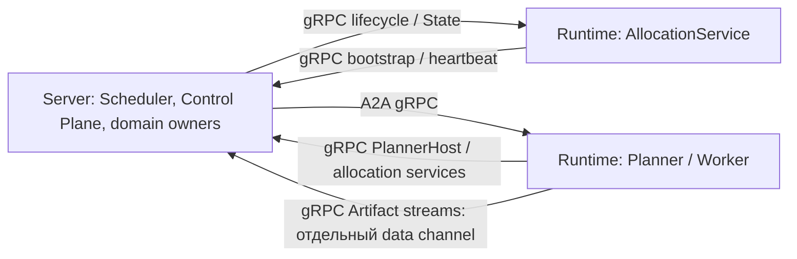

# Server ↔ Runtime: переход на gRPC с сохранением A2A

Обновлено 2026-11-27. База: `main @ 9fd3ac96d32c696fa39988df85e32f6bb6d1d83b`.
Статус: **переход разрешён пользователем; задачи созданы; подтверждена транспортная
предпосылка mTLS; пользователь выбрал локальный TLS-адаптер. Первый сквозной путь registration → lifecycle → A2A gRPC
принят. Полный control/State также принят: Go/PostgreSQL, Runtime, wire, lint
и 71 process-сценарий прошли.
Остальные семейства и полная release-приёмка ещё не завершены.** Исторический разбор ниже
сохранён как контекст; его рекомендация оставить HTTP больше не является планом.

## Решения и результат

Пользователь 2026-11-27 поручил спланировать задачи и перевести взаимодействия
Server ↔ Runtime на gRPC. **A2A сохраняется.** Прямое соединение через overlay —
уже существующая архитектура, а не новый результат миграции. NAT, исходящий
управляющий туннель и удаление A2A не входят в работу. Более ранняя идея удалить
A2A была отменена пользователем. Deployment, live-model experiments и слияние
в `main` этим поручением не выполняются.

Результат для эксплуатации: существующие Run, Planner, Worker и инструменты
работают через одну семью RPC-транспортов, без собственного HTTP/1.1 parser в
Runtime и без дублирующих legacy routes. A2A остаётся стандартным протоколом
Task/Message/Agent Card, используемым официальными SDK. Protobuf generation
уменьшает ручное описание форм сообщений; доменные проверки остаются у владельцев.
Ускорение Run не заявляется: сравнительных измерений нет.

Ниже конкретная декомпозиция и реализация контрактов — **предложение агента**,
а не отдельные требования пользователя. Неопределённость в TLS решается первой,
до изменения гарантии или добавления обходного слоя.

## Текущая граница и целевой транспорт

| Направление | Сейчас | План |
| --- | --- | --- |
| Runtime → Server: bootstrap, registration, heartbeat | `internal/controlplane/http.go`, `control_client.py` | Именованные unary control RPC |
| Server → Runtime: prepare/finalize/abort/release/State | `runtime_client*.go`, `runtime_*`, `server.py` | Именованные unary lifecycle/State RPC |
| Server → Runtime: Planner и Worker invocation | `internal/planner/a2a`, `a2a_server.py`; JSON-RPC | Официальный A2A gRPC binding; Task/context/tenant сохраняются |
| Runtime → Server: Planner host operations, recovery, findings, Audit, sitemap | `internal/httpapi/privateartifacts` | Именованные allocation-scoped RPC к тем же domain owners |
| Runtime → Server: Artifact list/metadata/access | Тот же private Artifact handler | Unary RPC, прежние grants, pagination и exact refs |
| Runtime → Server: Artifact bytes | HTTP body и conditional headers | Поток chunks, явные revision preconditions и terminal receipt |

На базе проверки: Go `a2a-go/v2 v2.7.0`, Python `a2a-sdk 1.1.2`,
protobuf Go `v1.36.12`, Python `6.33.6`; grpc Go уже косвенная зависимость
`v1.85.0`. Проверка использует dev extra `a2a-sdk[grpc]==1.1.2`:
grpcio `1.85.4`, grpcio-tools/reflection `1.81.2` закреплены в Runtime lock.
Production extra переключается вместе с первым рабочим caller. Private Artifact handler имеет
16 route declarations; это не только четыре CRUD-операции над файлами.
`_https.py` содержит 620 строк собственного HTTPS-клиента. Не весь этот объём
автоматически исчезнет: решение mTLS ниже определяет оставшуюся TLS-обвязку.

Существуют прямые соединения в обе стороны. HTTP/2 multiplexing не превращает
один клиентский channel в возможность произвольных обратных RPC.
Public HTTP/WebSocket API, Gateway/target HTTP и OTLP сохраняют свои протоколы.

## Обязательная предпосылка: проверка peer

Нынешний Runtime требует одновременно CA chain, DNS/IP hostname и Control Plane
URI SAN (`SEC-R5–8`), причём проверка роли происходит до первого request byte
(`CTL-R163`). Go дополнительно привязывает Runtime endpoint к ожидаемому SPKI
principal. Сертификат другого Runtime, подписанный тем же CA для того же hostname,
не должен стать достаточным для выдачи ему control/Artifact данных.

Go TLS позволяет сохранить это через существующий `VerifyConnection`.
Документированный Python `grpc.ssl_channel_credentials` принимает roots, key и
certificate chain, но не предоставляет пользовательский peer-verification hook.
Server-side interceptor с `auth_context` не решает проверку **удалённого Server
на Python-клиенте**. Отдельный предварительный TLS dial тоже не доказывает
identity соединения, по которому gRPC затем пошлёт запрос.

[V490-001](../../tasks/done/v490-001-grpc-security-interop.yml) сначала проверяет это
на собственных loopback сертификатах. Эксперимент
[`v490-001-grpc-peer-probe.py`](../../tasks/evidence/v490-001-grpc-peer-probe.py)
не меняет зависимости проекта и не использует deployment PKI. Его успешное
воспроизведение ограничения **не является успешной приёмкой транспорта**.

Эксперимент на grpcio 1.85.0 подтвердил ограничение: правильные CA/hostname без
Control Plane URI SAN допускают запрос. Неверные hostname и CA отвергаются.
[Результат](../../tasks/evidence/v490-001-grpc-peer-probe.json) не проверяет
Go/A2A interoperability; это следующая проверка после выбора решения.

Выбор до production implementation:

1. **Сохранить PKI и точные проверки; ограниченный локальный TLS adapter.**
   Официальный grpcio обслуживает HTTP/2/gRPC, существующий SSLContext проверяет
   фактическое сетевое соединение и передаёт байты через защищённую локальную
   границу. Это не NAT-туннель и не отдельный сервис. Но добавляются relay lifecycle,
   backpressure, локальная authority и проверки отсутствия plaintext listener.
   Нельзя включать его как незаметную деталь: это дополнительный компонент.
2. **Изменить PKI так, чтобы штатная проверка цепочки доказывала роль Server.**
   Например, отдельный доверенный issuer Control Plane с необходимыми issuance
   ограничениями. Нужны точный trust/issuance design, изменения provision/rotation,
   спецификации и отрицательные проверки. Простая раздача общего root с двумя
   intermediate CA не даёт ограничения роли. Это отдельная предпосылка, меняющая
   существующее правило одной CA и роль URI SAN.

Рекомендация агента для сохранения текущих гарантий — сначала оценить малый TLS
adapter; если он заметно раздувает транспорт, предпочесть явно согласованный PKI
design. Не ослаблять проверку до CA+hostname, не использовать небезопасный override,
не вводить custom native grpcio fork. Пользователь 2026-11-27 выбрал первый вариант: ограниченный TLS-адаптер внутри
Runtime при сохранении PKI. Локальная граница — Unix sockets в process-owned
каталоге 0700, без plaintext TCP listener; HTTP/2 и gRPC обрабатывает grpcio.
Admission, backpressure и shutdown/join входят в обязательную проверку.

## Реализация первого сквозного пути

`api/v1alpha1/runtime.proto` задаёт registration и allocation lifecycle с явным
presence. Configs, provenance, Agent Card и отчёты представлены именованными
JSON-документами внутри типизированного envelope: это сохраняет config digest,
точные значения tool arguments и выборочное отбрасывание повреждённой telemetry.
Это не универсальный JSON RPC. Старые HTTP registration/lifecycle и JSON-RPC
A2A handlers удалены; пока не переведённые семейства имеют собственные маршруты.

Проверки прежнего HTTP A2A connection experiment заменяются native gRPC тестами:
reuse и cancellation в official SDK, bounded admission/idle/age, отсутствие
mutation replay, реальная проверка SPKI и renewal при новом соединении. HTTP
framing assertions не переносятся в HTTP/2; ими владеет gRPC implementation.

## Контракт, который нужно сохранить

- A2A использует официальный `.proto`/SDK. Tenant остаётся allocation identity,
  отдельно от Task/context/invocation. Worker/Planner loops и headless интерфейсы
  не зависят от транспорта. Streaming/push features не добавляются в этой миграции.
- Собственные RPC имеют одно описание `.proto`, pinned generation и generated
  Go/Python types. Нельзя создать универсальный HTTP request envelope или
  положить весь старый API в `bytes json` и считать ручные DTO удалёнными.
  JSON остаётся там, где он и есть доменный документ или A2A DataPart.
- Обязательное presence моделируется явно, включая различие пустой коллекции и
  отсутствующего значения там, где оно значимо. Closed enum, unknown fields,
  диапазоны, UTF-8 bytes, blank text и cross-field invariants проверяются на обеих
  сторонах общими fixtures. Protobuf default values не заменяют required validation.
- JSON-specific проверки duplicate keys/case aliases/null остаются для JSON
  документов. Бинарный protobuf имеет собственные правила повторных tags и merge:
  V490-001 фиксирует точную политику до генерации, не обещая равенства синтаксисов.
  Не писать второй protobuf parser ради переноса JSON-грамматики.
- Canonical config digests, signed/hashed JSON и Artifact bytes сохраняются.
  Детерминированная protobuf serialization не становится canonical digest format.
  Пределы A2A Struct numbers остаются прежними; transport switch их не снимает.
- Ошибки сохраняют stable domain code, retryable и requestId в typed details.
  `InvalidArgument`, `Unauthenticated`, `PermissionDenied`, `FailedPrecondition`,
  `Aborted`, `ResourceExhausted`, `Unavailable`, `DeadlineExceeded`, `Cancelled`
  сопоставляются с фактическими исходами, а не только с прежним HTTP status.
  `Unavailable` после mutation не означает, что запись не состоялась.
- Нет blanket retries/hedging. Original heartbeat seq/ack, finalize/abort ID,
  Planner sequence, mutation receipts и Artifact CAS остаются механизмами
  reconciliation. Новый receipt store и durable message queue не нужны.
- Channel liveness/PING не продлевает allocation lease. Certificate checks,
  max connection age, channel admission, message/aggregate limits и deadline
  ownership фиксируются в owning specs. Heartbeat/control не ждёт bulk transfer.
- Capacity остаётся 1–4 allocations/process, один A2A Task/Worker. Release одной
  allocation не закрывает активную работу sibling slots. Disconnect не создаёт
  same-Stage resume: после потери процесса действует обычный interruption/retry.
- Artifact storage, authorization, atomic publication, current/exact revision,
  contentCacheKey и четыре transfer slots сохраняются. Целевой chunk budget
  предлагается 256 KiB, полный payload по-прежнему ≤64 MiB; перед реализацией число
  получает один owning limit и fixture. Upload header передаётся один раз, затем
  упорядоченные chunks и terminal receipt; partial stream не публикует revision.
  Уточнение агентского предложения 2026-11-27: существующий ArtifactStore принимает
  полный payload под четырьмя transfer permits. Этот доменный буфер ≤64 MiB
  сохраняется; входящие chunks пишутся прямо в него, без очереди всех protobuf
  сообщений и второй полной транспортной копии. Полностью потоковое хранилище
  потребовало бы отдельного изменения storage/validation boundary и не входит
  в текущий переход транспорта.

## Решения wire для первой реализации

- Собственный package `contractor.runtime.v1alpha1`; сервисы ControlPlane,
  RuntimeLifecycle, Allocation и Artifact имеют именованные методы. A2A остаётся
  `lf.a2a.v1.A2AService` официального SDK. Нет собственного универсального invoke.
- `proto3 optional` используется для scalar presence; message presence — штатная.
  Required repeated/map представлены presence-bearing message, если omission
  отличается от пустого значения. Semantic validators проверяют presence до
  преобразования в domain types. Nullable domain value получает явную ветку `oneof`.
- Неизвестные поля собственных messages рекурсивно обнаруживаются через reflection,
  неизвестные enum values — через существующие closed-domain validators.
  Управляющие данные отвергаются целиком. Явные существующие salvage boundaries
  сохраняются: неверная optional telemetry/resources или отдельная adapter metrics
  entry помечаются/отбрасываются по OBS-R36 и CTL-R136, не теряя основной final report.
  Универсальный interceptor не должен превращать такую ошибку в отказ всей finalize.
  Повторные protobuf tags обрабатываются стандартным protobuf merge/last-value
  правилом. JSON duplicate keys/case aliases остаются запрещёнными для JSON
  документов; не создаётся собственный binary parser.
- `.proto` описывает wire envelope; канонические подписанные/дигестируемые JSON
  конфигурации и содержимое Artifact остаются доменными документами. Нельзя
  считать JSON-обёртку всего старого RPC типизированной миграцией.
- Правила размера содержимого сохраняются; транспортный max-message задаётся
  явно, отдельно от compact-JSON domain bounds. Lifecycle payload ≤1 MiB,
  A2A envelope ≤4 MiB, Planner operation/reply ≤4 MiB; передача Artifact имеет
  chunks ≤256 KiB и прежний aggregate ceiling 64 MiB. В 002/004/005 owning limits
  и проверка фактического protobuf frame фиксируются одновременно с их codecs.
- Stable error details содержат code/retryable/requestId без raw exception text.
  Malformed input → InvalidArgument; missing TLS identity → Unauthenticated;
  отказ в правах → PermissionDenied; чужой/несуществующий grant сохраняет
  доменную маскировку NotFound (Planner/recovery — FailedPrecondition); stale/domain precondition →
  FailedPrecondition; транзакционный конфликт → Aborted; capacity →
  ResourceExhausted; временная инфраструктурная недоступность → Unavailable.
  NotFound, Cancelled и DeadlineExceeded имеют отдельные исходы. Domain code
  различает случаи внутри одного gRPC status; неизвестные/невалидные details не
  дают разрешения повторить mutation. Existing operation receipts решают ambiguity.
- Pinned Go/Python tooling генерирует stubs воспроизводимо; проверка generation
  входит в lint. Runtime lock закрепляет grpcio вместе с официальным A2A extra.
  Ни schema changes, ни dependencies не обновляются автоматически ради "latest".
  Первая генерация использует `grpcio-tools==1.81.2` (`libprotoc 33.5`),
  `protoc-gen-go@v1.36.12`, `protoc-gen-go-grpc@v1.6.2`; собственные `.proto`
  не копируют официальную A2A-схему.

## Проверка выбранного TLS-адаптера

`runtime/tests/test_grpc_interop.py` выполняет реальные Go/Python вызовы через
loopback TLS и private Unix sockets. Официальные SendMessage/GetTask/CancelTask
проходят с существующим `ContractorAgentExecutor`; чужой tenant отвергается.
Wrong-role сертификаты того же CA отвергаются в обоих направлениях до вызова
защищённого handler; Go дополнительно отвергает неверный ожидаемый Runtime SPKI.
Ответ `UNAVAILABLE` после принятой mutation оставляет ровно один вызов handler.

Прототип допускает восемь forwarding owners, буфер каждого направления 64 KiB,
connect/handshake budget 3 s и close budget 0.5 s. Девятое соединение отвергается;
shutdown отменяет и присоединяет owners **до** ожидания закрытия listener.
Это ограниченный test-only proof: admission до TLS handshake, 300 s connection
lifetime и полное allocation cleanup остаются production-приёмкой 002/003.
Прототип не выдается за готовый защищённый listener.

Выявленные особенности SDK: DataPart передаётся после нормализации вложенных
maps в JSON-совместимые значения; Go SDK не принимает `map[string]string`
непосредственно как protobuf Struct. CancelTask может вернуть Task ещё в WORKING:
подтверждение остановки принадлежит существующим abort/finalize, а не A2A reply.
Проверка вызывает отмену реального executor и наблюдает завершение владельца.

## Задачи и последовательность

| Задача | Проверяемый результат | Зависит от |
| --- | --- | --- |
| [V490-001](../../tasks/done/v490-001-grpc-security-interop.yml) | Решён TLS prerequisite, официальные SDK совместимы, определены binary validation и generation | — |
| [V490-002](../../tasks/done/v490-002-grpc-run-slice.yml) | Первый настоящий Run: registration → prepare → A2A gRPC → finalize/release, плюс cancel | 001 |
| [V490-003](../../tasks/done/v490-003-grpc-control-lifecycle.yml) | Полный control/State, четыре slots, lease, shutdown, lost replies и restart | 002 |
| [V490-004](../../tasks/done/v490-004-grpc-allocation-services.yml) | Planner callbacks, Audit, sitemap, finding reads/selections и Artifact metadata на gRPC | 003 |
| [V490-005](../../tasks/done/v490-005-grpc-artifact-streams.yml) | Artifact и finding evidence streams с CAS, receipt, bounded memory и cleanup | 004 |
| [V490-006](../../tasks/v490-006-grpc-release.yml) | Удалён старый транспорт, обновлены consumers/specs/ops, пройден release gate | 005 |

001 — ограниченная проверка предпосылки, не отдельный транспортный framework.
Первый feature deliverable 002 проходит реальные компоненты до полноценного
release, а не начинает с массовой генерации всех схем. Сосуществование разных
**семейств** протоколов между задачами — порядок разработки; переключателя
old/new для одной операции и legacy fallback не остаётся. Каждая перенесённая
операция обновляет потребителей и спецификацию сразу. Финальная сборка согласованна
на обеих сторонах; rolling mixed-version compatibility не добавляется.

Уточнение разбивки агентом 2026-11-27: finding submission вместе с выбранным HTTP
evidence уже допускает 64 MiB и использует Artifact transfer admission. Его перенос
входит в 005 вместе с bulk streams; finding reads/selections остаются в 004.
Это сохраняет пределы существующих операций без увеличения control channel.
Audit documents до 8 MiB и Planner operations до 4 MiB требуют собственных
ограничений сообщений и прежней доменной валидации в 004.

Нужны полные suites затронутых packages, real PostgreSQL для persistence,
process tests для A2A/control, wire, API и architecture checks. Финальный exit —
`make release-verify`, public API/PostgreSQL и architecture. Named heavy-I/O fixtures
остаются выключены без явного opt-in пользователя и не считаются passing coverage.

Проверить зависимые планы перед cutover: OpenCode V469 использует существующий
A2A boundary, который сохраняется; его ссылки на конкретный JSON-RPC adapter
обновляются по фактическому переносу, без реактивации deferred задач. Runtime
Planner P2 остаётся отложенным, P3/P4 guarantees не расширяются. Не менять
параллельный незакоммиченный V486 portable kit в основном checkout; перед
интеграцией сообщить владельцу об изменившихся bootstrap/probe requirements.

## Источники проверки библиотек

- [Python gRPC credentials API](https://grpc.github.io/grpc/python/grpc.html)
- [gRPC retry и transparent retry](https://grpc.io/docs/guides/retry/)
- [gRPC deadlines](https://grpc.io/docs/guides/deadlines/)
- [Protobuf field presence](https://protobuf.dev/programming-guides/field_presence/)
- [Protobuf serialization is not canonical](https://protobuf.dev/programming-guides/serialization-not-canonical/)
- [A2A specification](https://a2a-protocol.org/v1.0.0/specification/)

---

# Historical assessment: 2026-10-23

Proposal 0038 · Status: **Draft; no decision taken.**

On 2026-10-23 the user asked whether the Server ↔ Runtime Agent interaction
should move to gRPC. This proposal records the current boundary, what gRPC
would and would not change, the alternatives, a recommendation and the
conditions under which the transport question should be reopened. It creates
no implementation commitment. Figures were measured on `main @ af9fd522`.

The public API (`/v1`, [OpenAPI](../../api/openapi/contractor-public-v1.yaml)),
the Runtime's calls to the LLM Gateway and OTLP export are out of scope.

## Current boundary

Every channel uses mTLS ([security](../spec/platform/security.md)).

| Direction | Operations | Transport | Owner |
| --- | --- | --- | --- |
| Runtime → Server, control | `POST /private/v1/agents/register`, `POST /private/v1/agents/{instanceID}/heartbeat` | HTTP + JSON | `internal/controlplane/http.go` |
| Runtime → Server, allocation services | artifacts list, get, metadata and put (`If-Match`/`If-None-Match`, bodies up to 64 MiB), finding proposals, gateway recovery | HTTP + JSON, binary bodies | `internal/httpapi/privateartifacts` |
| Server → Runtime, allocation lifecycle | prepare, finalize, abort, release, `GET …/agent-state` | HTTP + JSON | `internal/controlplane/runtime_client.go`, `runtime/src/contractor_runtime/server.py` |
| Planner → Worker | `StageContentRequest` in, `WorkerCompletion` out, as A2A DataParts; the Planner polls `GetTask` with an adaptive interval of at most 2 s ([PLN-R114](../spec/execution/planners.md)) | A2A JSON-RPC (`a2a-go` v2.5.0, `a2a-sdk` 1.1.2) | `internal/planner/a2a`, `runtime/src/contractor_runtime/a2a_server.py` |

The private contract ([CTL-R6–R10, CTL-R149, CTL-R152,
CTL-R153](../spec/execution/control-plane.md)):

- 16 JSON Schemas in [`api/v1alpha1`](../../api/v1alpha1/), 3,539 lines, the
  canonical shapes (CTL-R8);
- hand-written strict models on both sides: `internal/contracts` and its six
  subpackages, 5,797 lines of Go, and `contractor_runtime/contracts`, 3,088
  lines of Python;
- shared valid, invalid and generated cases in
  [`api/testdata/v1alpha1`](../../api/testdata/v1alpha1/) (required members,
  forbidden nulls, mutations, blank text), run on both sides by
  `make test-wire-cross-language`.

Message rate is low: registration, heartbeats and a handful of lifecycle calls
per Stage. Performance does not motivate a transport change.

## Why the question comes up

The boundary's defect history has two kinds of drift between the Go and Python
models:

- **Shape:** Go read missing required members as zero values (V368-002),
  duplicate keys and case aliases were accepted (V368-007), explicit nulls of
  optional members were accepted (V371-003), the Worker State endpoint served
  bodies its schema rejects (V371-002).
- **Value:** blank-text and byte counting differed (V368-008), the capability
  grammar had three copies (V367-007), diagnostic byte bounds differed
  (V372-027), integers above 2^53 cannot cross the A2A DataPart exactly
  (V371-004 bounded every WorkerCompletion integer to 2^53-1;
  [WRK-R164](../spec/execution/worker.md)).

Generating both models from one description removes the first kind by
construction. The second kind needs value rules that both languages evaluate
the same way, whatever the transport.

## What gRPC would change

| Concern | gRPC with binary protobuf | Today |
| --- | --- | --- |
| Model duplication | Go and Python types generated from one `.proto` | Schemas plus two hand-written models |
| Required members | proto3 has no required members; presence exists only for `optional` fields, so every requirement stays a hand-written check | Strict decoder rejects missing members (CTL-R149) |
| Unknown members | Kept as unknown fields, not rejected | Rejected (CTL-R7) |
| Enums | Open: an unknown numeric value is preserved | Closed |
| Value rules (UTF-8 byte bounds, blank text, ID grammars, ranges) | Not expressible in the IDL; needs protovalidate (CEL rules) in Go and Python, or hand-written code | JSON Schema with `x-maxBytes`, per-language code, shared cases |
| 64-bit integers | Exact | Exact on the HTTP channels; not across the A2A DataPart |
| Deadlines and cancellation | Propagated with the call | Per-call HTTP timeouts on each side |
| Streaming | Server and bidirectional streams | None; heartbeat and Worker State are request/response, A2A results are polled |
| Artifact transfer | Chunked streams, precondition fields of our own, 4 MiB default message limit | Native HTTP: binary bodies, ETags and conditional requests |
| Debugging and tests | Needs grpcurl or reflection; raw-HTTP tests rewritten | curl; tests drive raw HTTP |
| Runtime dependencies | `grpcio` with native wheels, which is not in the Runtime lock today; the Runtime's resident memory is tracked ([runtime memory](../operations/runtime-memory-2026-09-19.md)) | None new |

The Planner ↔ Worker channel stays A2A in every option. The A2A specification
defines a gRPC binding and both SDKs in use ship one (`a2a-go` package
`a2agrpc`, `a2a-sdk` extra `grpc`), but a DataPart remains a protobuf
`Struct` or `Value`, whose numbers are doubles. Moving A2A to gRPC
therefore does not lift the 2^53 limit of V371-004; carrying the
`WorkerCompletion` as bytes, or bounding its integers, does.

## Options

**A. gRPC for control and allocation services, A2A unchanged.** Two RPC
stacks on one boundary. Removes model duplication for the control messages
only, rewrites both servers, clients, artifact transfer and the process tests,
and still needs value validation and an unknown-field policy.

**B. gRPC everywhere, including the A2A gRPC binding.** One transport, but the
largest rewrite, and it depends on both A2A SDKs' gRPC bindings for the
Planner path. The A2A payload limits above remain.

**C. One IDL, transport unchanged.** Keep HTTP + JSON and the routes; generate
the Go and Python models from one source.

- **C1: JSON Schema as the source.** The schemas are already canonical (CTL-R8).
  Generate the Python and Go types and their structural validators; `maxLength`,
  `pattern` and `enum` map to generated checks, `x-maxBytes` and the blank-text
  rule need a generator extension or remain shared hand-written functions held
  by the existing cases.
- **C2: protobuf as the source, ProtoJSON on the wire.** The protobuf runtime
  is already loaded in both processes (`google.golang.org/protobuf` is a direct
  Go dependency, `protobuf` comes with `a2a-sdk`), so C2 adds no runtime
  dependency. Python `json_format` (protobuf 6.33.6 in the Runtime lock)
  rejects unknown members and duplicate keys by default, but it accepts the
  original proto field name as an alias of the JSON name and treats `null` as
  an absent member; the ProtoJSON mapping specifies the same for Go. Both break
  CTL-R149, so C2 still needs the strict JSON pre-pass (`strictjson`, the
  Runtime codec) in front of the generated decoder. ProtoJSON writes 64-bit
  integers as JSON strings, which changes the wire format of every such member.

**D. Status quo.** Keep the hand-written models, guarded by the shared cases
and the cross-language gate that V368–V372 completed.

## Recommendation

Keep the transport (D) and run C as a bounded experiment. Do not adopt A or B
now:

- most open defects at this boundary are value rules, which gRPC does not
  check, and proto3's defaults (no required members, open enums, kept unknown
  fields) are looser than the project's strictness rules;
- the A2A channel and its payload limits stay as they are under A, and B only
  moves them to another binding;
- artifact transfer relies on HTTP semantics that gRPC would have to rebuild;
- the strict JSON decoders and the cross-language gate were completed in
  V368–V372; replacing them now discards that work for a boundary with no load
  problem.

## Experiment for option C

Create a task before starting (`tasks/templates/chore.yml`, epic
`api-contracts`) and compare C1 and C2 on one schema that has required,
optional and nullable members, an enum, a map, byte-bounded strings and
integers, for example [`allocation.schema.json`](../../api/v1alpha1/allocation.schema.json).

Measure, for each variant:

- hand-written model lines removed on each side;
- whether every case of `required-member-cases.json`, `mutation-cases.json`
  and `blank-text-cases.json` for that schema still gets the same verdict from
  the schema, the Server and the Runtime;
- files touched to add one optional member end to end, before and after;
- Runtime resident memory at startup, measured as in the runtime memory report.

Adopt the better variant for all 16 schemas only if it removes the
hand-written models without weakening any shared case. Otherwise record the
result here and keep D.

## Decision record

| Item | Content |
| --- | --- |
| Guarantee kept | One strict private contract: Server and Runtime reach the same verdict on every shared case (CTL-R149, CTL-R152, CTL-R153), and a change of the contract needs compatible builds (CTL-R10). |
| Alternatives | A, B, C1, C2, D above. |
| Evidence | Channel inventory and line counts on `af9fd522`; defect tasks V367-007, V368-002, V368-007, V368-008, V371-002, V371-003, V371-004, V372-027; `json_format` behaviour read from the locked protobuf 6.33.6; `grpcio` absent from the Runtime lock. |
| Reversal condition | Any trigger below. |

## Reopening the transport question

Owner: `execution-core` (Control Plane), with `planner-worker` for A2A and
`api-contracts` for the wire contract. Reopen A or B when one of these holds:

1. **Runtime Agents must run where the Server cannot connect to them**: behind
   NAT, in another network or at a customer site. Today the Server calls each
   Runtime for the allocation lifecycle and Worker State, and the Planner calls
   each Worker over A2A, so every Runtime must accept inbound connections. A
   Runtime-initiated bidirectional stream would carry the Server's commands
   over the connection the Runtime opened. This is the strongest trigger.
2. **Scale:** tens to hundreds of Runtime Agents, or live Worker state that must
   be pushed instead of polled.
3. **A third language** implements the private boundary.
4. **Both A2A SDKs in use make the gRPC binding their primary transport**, so
   that staying on JSON-RPC becomes the costly path.

При итоговой проверке обнаружен существовавший на baseline `main` drift
offline scorer dependency pin после V489-001. Он исправлен отдельно в
[V490-008](../../tasks/done/v490-008-offline-eval-dependency-pin.yml): обновлён
pin текущего Go dependency closure, без изменения scorer, моделей, truth или
существующих Eval-регистраций. Полная release-приёмка остаётся V490-006.
