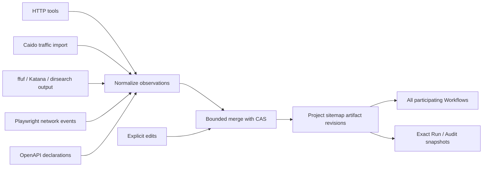
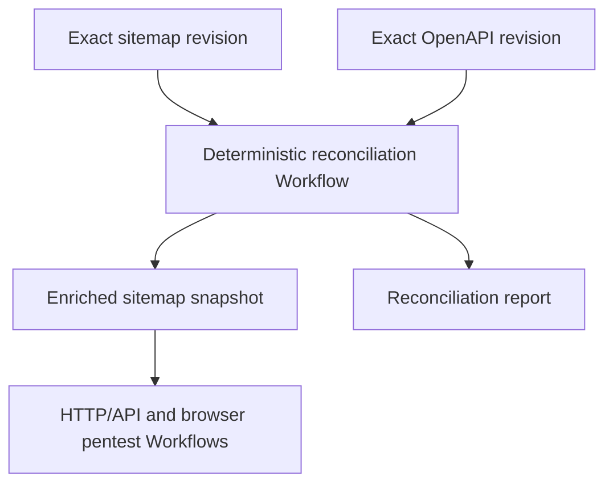

# Live Project sitemap over ArtifactStore

Proposal 0042 · Status: **Draft design; not implemented.** Recorded on
2026-10-23; implementation task breakdown added on 2026-10-24. This document
records the user's selected direction and proposed contracts. The pending tasks
in section 12 do not establish implementation or reactivate deferred work.

Review update, 2026-10-27: automatic HTTP/scanner contributions are bounded
best effort, isolated from tool outcomes and Run contracts. Earlier generic
collection-completeness statuses, loss markers and required automatic-collection
completion policies below are superseded. Concrete source facts, such as a
scanner's explicit report truncation, and errors of explicitly requested imports,
mutations or snapshots retain their own meaning. The normative contracts are in
[Project sitemap](../spec/artifacts/project-sitemap.md). Structured imports first
reuse ffuf, Katana and selected Caido reports; another format needs a concrete
caller. Reconciliation extends the existing import operation and produces only
artifacts required by its declared consumer. No new collection job framework,
duplicate gate registry or mandatory duplicate map/patch/report package is needed.

Metadata-policy decision, 2026-10-27: the user removed sitemap-specific secret
filtering and matching-secret transport to preserve useful metadata and simplify
the boundary. Valid paths, names, finite structural values, notes and tags remain
intact regardless of keywords, opaque appearance or known credential matches.
The existing `sitemap-safe-projection@1` identifier remains. The user also
confirmed that ordinary owner-selected Run inputs authorize their complete
selected content. General credential handling, HTTP evidence redaction and
telemetry redaction are unchanged.

Observation-aggregation decision, 2026-10-29: the user removed execution and
principal attribution from sitemap metadata. Current summaries aggregate source,
deployment, parameter names and HTTP outcome/status with first/last timestamps;
Run, credential revision, session generation and identity/context fields are not
retained and do not consume summary capacity. There is no context quota. Runs
remain operation/receipt authority and exact evidence file locators. Actual HTTP
and browser authentication/session isolation remains owned by their transports.
This decision supersedes any earlier attribution/context wording in this proposal;
[SMT-R5](../spec/artifacts/project-sitemap.md#smt-r5) is normative.

Shared-map decision, 2026-10-28: the user removed the earlier sitemap
blackbox/source-assisted split. All permitted readers see the same accumulated
Project metadata; source availability and observed-versus-declared provenance
remain factual distinctions, not visibility classes. Current Project/operation
grants and exact-file permissions remain. Optional `snapshotInputs` only select
original Run files eligible for retention during snapshot creation; reads and
pages do not resolve those files or carry a view policy digest.

This complements the frozen surface and evidence contracts in
[proposal 0033](0033-autonomous-pentest-audits.md). A live sitemap is shared
research context; it does not replace that proposal's exact proof inputs.

## 1. Outcome and decisions

A Project has one shared sitemap artifact. HTTP/API and browser pentest Runs
read its current revision and contribute observations while they execute.
An explicit surface-discovery Workflow is useful for populating it quickly,
but every contributing Worker uses the same collection mechanism.

| Decision | Direction |
| --- | --- |
| Sharing | The user selected a live Project map, visible to other running Workflows. |
| Storage | Use ordinary ArtifactStore bindings, immutable revisions, CAS, admission and retention policy; the sitemap owns document semantics, not a separate storage budget, ledger or deletion mechanism. |
| History retention | Apply the same policy automatically to every logical artifact in UserScope, ProjectScope and RunScope: default 1 GiB / 2,000 retained revisions per binding, evicting oldest unpinned history while protecting current and all live retention dependencies. |
| Automatic input | HTTP tool traffic and selected Caido traffic contribute without a model writing the final map. |
| Explicit input | Provide tools to add, annotate, remove and restore entries, and import structured scanner output. |
| Additional sources | OpenAPI, ffuf, Katana and Playwright feed the same observation format. Dirsearch can use an explicit import adapter. |
| Audit composition | The user proposed deterministic Audit steps to reconcile sitemap with OpenAPI. Implement them as ordinary model-free Workflows using the same reducer. |
| Simplicity | Start with HTTP endpoint groups and bounded examples. DOM graphs, browser journey graphs and a universal crawler framework are outside the first slice. |
| Browser availability | A pentest Audit may make its browser branch optional and report a coverage gap when the capability is absent. A busy compatible Runtime is a capacity wait, not evidence that the capability is absent. |
| Sandbox | Pentesters can use the existing networked Podman sandbox, preinstalled tools and downloads inside its writable workspace. |
| Sandbox egress | The user explicitly deferred per-engagement sandbox egress filtering. It does not block this design. The Runtime/code-execution area owns the deferred decision; reopen when the user requests scope-enforced sandbox execution or before claiming that guarantee for a deployment. |

The guarantees below apply to metadata collection and sharing. An entry is not
evidence that a vulnerability was verified or an endpoint was tested fully.

## 2. Existing contracts and necessary changes

- [ArtifactStore](../spec/artifacts/artifact-store.md) already owns scoped
  bindings, exact revisions, CAS, input forks and retention. Use a dedicated
  ordinary Project binding such as `sitemap/map`; do not change the create-only
  publication of `outputs/<slot>` or depend on proposal 0035.
- Individual committed revisions are not currently evictable: DEL-R4/DEL-R5
  allow only controlled scope purge. This proposal requires a shared trusted
  ArtifactStore retention operation for every logical binding in UserScope,
  ProjectScope and RunScope, delivered independently by V410-010 before the sitemap
  service. There is no registration or opt-in by artifact kind. Accounting, pin
  checks and eviction are common artifact responsibilities; they do not inspect
  sitemap JSON, MIME type or hard-coded binding names. Reuse existing transfer
  admission, caller-owned transactions, exact metadata reads, CAS, receipts and
  reference-safe cleanup. Update the normative deletion exception and immutable
  triggers through this trusted owner, after covering every exact-reference
  lifecycle. The current implementation remains unchanged until that task.
- Runtime Artifact access is currently allocation-bound to the current Run.
  A sitemap tool adapter needs a narrow server-authorized operation against
  this Run's owning Project sitemap. Existing tools do not already grant live
  Project reads or writes. Project identity comes from trusted allocation
  context, never a model-supplied Project ID.
- [HTTP/Caido](../spec/tools/http-caido.md) currently keeps ordinary traffic in
  bounded allocation memory, with durable exchanges selected for findings.
  Derive sitemap metadata before buffer eviction. Do not treat an allocation
  request ID or a Caido ID as an exact durable artifact ref.
- [Scanners](../spec/tools/scanners.md) already produce bounded ffuf
  observations. Katana's current implementation also exports bounded observed
  same-origin GET targets. Neither export proves complete application discovery.
- [Audit mapping](../spec/audits/scans.md) already passes exact prepare outputs
  across rounds and retained discovery outputs within one round. Live Project
  context is an explicit additional read surface, not an implicit mutable
  replacement for an Audit's baseline.
- Full HTTP traffic export remains deferred under
  [proposal 0036](0036-compressed-http-traffic-export.md). Sitemap metadata
  collection does not reactivate complete request/response archival.

## 3. One artifact and one deterministic reducer



The model selects investigations and can supply descriptions and grouping
suggestions. Code validates observations, assigns identity, merges contributions
and assembles the artifact. Normal HTTP traffic does not require an additional
model tool call to record each request.

The initial artifact is a strict versioned JSON document, with entries,
grouping rules, suppression markers, source summaries and collection gaps.
It has no executable instructions or session-credential fields. Published
exact revisions remain immutable; the Project binding advances through CAS.

Every adapter uses `sitemap-safe-projection@1` before constructing public
keys, examples or artifact bytes. This projection normalizes the metadata model;
it does not detect or redact secrets. Apply shared URL/host syntax and byte bounds,
normalize origins and preserve concrete paths and parameter names. Exclude URL
userinfo, fragments and nonstructural query values because they are outside the
map model; raw headers and body values are never inputs. Retain finite configured
structural values, valid notes and tags without keyword, opaque-token or
known-secret matching. HTTP observation frames and private collection requests
carry attempt metadata only, with no matching-secret list or secret-count bound.
Unknown or conflicting structural selections produce an explicit omission rather
than a fabricated member. Manual descriptions and structured imports use the same
normalization. Record the projection version and structural omission reasons.
The sitemap boundary does not inherit proposal 0033's HTTP evidence-redaction
contract; that contract remains with its owning evidence and telemetry paths.

A missing binding means an empty map that can be created conditionally.
An existing malformed or unsupported document is an explicit error, not an
empty map or permission to replace it. The reducer validates on read and write.

## 4. What an entry represents

An entry groups one HTTP operation using:

```text
normalized origin + HTTP method + route key + configured structural values
```

The route key is an exact concrete path until an explicit OpenAPI path or
configured path-template rule supplies a justified grouping. Parameter-name
sets and outcomes remain bounded variants under
the group. They are available to the pentester without multiplying a node for
every input value.

| Data | Meaning |
| --- | --- |
| Origin, method, route | Stable operation grouping, with its grouping rule provenance. |
| Parameter shapes | Observed names, locations, multiplicity and body content types; declarations stay distinguishable. |
| Declarations | Exact OpenAPI revision and operation pointer, or an explicit manual declaration. |
| Observations | Trusted source ID/kind and deployment, parameter names, HTTP outcome/status and minimum/maximum observation times. No Run or principal attribution. |
| Concrete members | A separately bounded inventory of concrete operation keys and their observation summaries; representative examples are not this inventory. |
| Examples | A bounded selection of concrete request descriptors and exact retained evidence refs when available. |
| Manual metadata | Notes, tags, grouping overrides and exclusion state. |
| Completeness | Source limits, discarded variants, unavailable response/evidence, parser failures and pending collection. |

Store declarations and observations separately. A schema operation can be
declared and never observed; a live endpoint can be observed and undeclared.
Sitemap observations carry no principal or authentication assertion. Repeated
Runs and sessions observing the same source/deployment and behavior update its
time range. Actual identity and session isolation remain transport concerns;
adding a synthetic unknown-user key would reintroduce unnecessary fragmentation.
Different source/deployment and HTTP behavior remain distinct bounded summaries.

Normalize origins using the project's shared URL rules and preserve concrete
path case, trailing slashes and encoded reserved characters. Grouping never
rewrites a retained concrete request. Query order, duplicate values and bodies
may matter to security testing even when they do not create a new sitemap node.
Only explicitly configured finite structural query values belong to map identity;
a metadata descriptor must not claim to be the complete original request.

## 5. Source adapters

| Source | Collection boundary | Limits of the observation |
| --- | --- | --- |
| HTTP tools | Observe the actual attempted request and available outcome, including redirects as separate hops. | A timeout is an attempted request, not a received response. A redirect target seen only in Location is a declaration until visited. |
| Caido | Automatically project requests inspected or generated by selected tools; add a bounded incremental history import for additional traffic selected by the Project's Caido context. | Do not import the entire shared Caido instance implicitly. A history row or passive sitemap node may have no retained exchange. |
| ffuf | Convert accepted report matches, preserving exact report provenance and truncation flags. | Matches may be wildcard/soft-404 responses. The current 100-match export cannot establish coverage of discarded matches. |
| Katana | Convert its structured observations and existing target output through the same reducer. | Preserve current GET-only and observed-response restrictions unless a separate adapter change extends them. |
| Playwright | An optional managed browser collector emits request/response/failure metadata at BrowserContext level. | No DOM extraction or user-journey graph is required. Arbitrary sandbox scripts are covered only when they use the helper, supply a structured export, or their traffic is imported from Caido. |
| OpenAPI | Import exact operations, parameters and path templates from an explicitly selected document. | Declarations do not prove deployment, reachability or runtime authorization. |
| Sandbox tools / dirsearch | Import an exact structured output artifact with an explicit format/version. | Do not infer reliable endpoints from free-form stdout or execute tools merely to import their results. |

Use exact report refs and immutable source timestamps for repeatable imports.
HTTP/Caido/Playwright contributions sharing an available correlation tag refer
to the same exchange; preserve their source attribution. Without correlation,
merge their endpoint group without claiming an exact physical request count.

Caido history import processes bounded pages and retains a checkpoint. It must
not rescan the whole history after each request. Provider gaps, expiring history
or missing stable continuation become explicit collection gaps. Choosing the
exact provider continuation requires validation against the pinned Caido API.

Playwright is optional. Do not require a browser or install a second crawler to
collect HTTP, OpenAPI, Katana or ffuf data. The existing networked sandbox
allows experiments with exporters before a managed Playwright integration.

## 6. OpenAPI contribution and bounded grouping

OpenAPI supplies both initially declared nodes and path-template grouping.
Reuse the existing normalized OpenAPI operations and reference-resolution rules
rather than implementing a second parser with different method/path semantics.
Resolve the deployment origin explicitly; an unbound server variable or
ambiguous origin is reported, never guessed. No remote reference fetch occurs
as a side effect of sitemap import.

For example, importing `GET /users/{id}` lets observed `/users/123` and
`/users/456` appear under that operation while retaining concrete examples and
their source/deployment summaries. A declared concrete route such as `/users/me` takes
precedence over a compatible template. Ambiguous template matches remain
separate/ambiguous until resolved; the model does not choose their identity.

Adding a schema after traffic reindexes group membership deterministically.
Existing retained member/observation IDs and evidence refs survive regrouping.
Regrouping uses the concrete-member inventory, not the representative examples.
Discarded members remain an aggregate with an explicit regrouping gap: a later
fixed route or template cannot recover their membership or assign their past
observations to a new group. New observations may establish new membership.
Member-scoped notes and exclusions follow that member. A group-scoped edit
records its rule and member selection when made; splitting or merging cannot
silently widen it to unrelated members. An incompatible mapping is an explicit
conflict requiring resolution, while existing exclusions remain effective.

Each schema source has a stable Server-authorized `sourceId` with explicit
deployment attribution, independent of its mutable binding name. A replacement
names the expected source generation, exact source ref/digest and grouping
policy digest; creation requires that source to be absent. A new exact schema
updates only that source's declarations and rules, preserving independent
observations. Generation order is assigned by accepted publication, never
inferred from document timestamps, version labels or model-supplied IDs.

Parameter declarations and observed parameter shapes are separate. Preserve
extra live parameters and missing declared parameters. OpenAPI security
requirements are expectations, not proof that access control works. A schema
generated from source has its own declared/inferred provenance and is not an
independent measurement of the deployed application.

### Deterministic reconciliation as an Audit Workflow

Provide an ordinary `sitemap-openapi-reconcile` Workflow, usable independently
and as an Audit role. Its computation uses `passthrough@1` with a `tool@1`
Worker selecting a newly registered reconciliation tool. The generic
model-free execution mechanism exists; the reconciliation tool and Workflow
do not. Audit Controller does not gain OpenAPI parsing or a new semantic step
kind.



The pure computation accepts exact map/schema refs and bytes, an explicit
origin binding and a versioned grouping policy. It:

1. Validates both documents and builds the declared-operation index.
2. Adds declared-only operations and attaches their exact schema pointers.
3. Matches observed operations to declared concrete paths or templates.
4. Regroups retained concrete members where the match is unambiguous, preserving
   their examples, observation identities and applicable manual edits/exclusions;
   discarded members retain explicit unresolved regrouping gaps.
5. Reports observed-but-undeclared, declared-but-unobserved, ambiguous matches
   and differences in observed parameter shapes, media types and outcomes.
6. Emits a canonical enriched map, a bounded source-update patch and a report
   naming input refs/digests, policy version and unresolved gaps.

These are descriptive comparisons. An undeclared endpoint is not automatically
a vulnerability, and an unobserved declared operation is not proof of absence.
Generate an updated OpenAPI document only through a separately selected
Workflow with its own output contract; the default reconciliation result is
the enriched map and comparison report.

The same exact inputs and policy produce the same canonical computation
outputs. Publication timestamps and the revision allocated to the Project
binding are separate from that deterministic result. Required tool outputs
must be explicit artifact slots; do not place a potentially large sitemap in
the bounded tool completion/report envelope.

For a shared map update, the Workflow's publication path applies its typed
patch through the ordinary sitemap reducer/CAS boundary. If another Worker
added observations after the input snapshot, preserve them and reapply the
source/grouping change only while its per-source preconditions still match.
A concurrent replacement of the same source or its policy is a conflict, as
is a conflicting manual edit; an old pinned schema must not be reinterpreted
as the current source merely because its patch finishes last. Resolving that
conflict requires an explicitly authorized new source selection and a new
invocation/patch. Retrying the same Workflow preserves its exact input intent
and expected predecessor; it cannot adopt the latest generation as a new
precondition while continuing to publish its old schema. The original private
computation result may still be retained without updating the shared source.
Existing keyed receipts replay an already accepted source transition
without another generation or publication. The report retains both computation
input refs and the actual Project revision updated; never claim that a rebased
live update is byte-identical to the original snapshot computation.

An Audit can select the Workflow as:

- **Preparation:** reconcile before building the first inventory, using
  `audit-input` or `prepare-output` for OpenAPI. The accepted sitemap output
  can feed inventory and checks through existing `prepare-output` mappings.
- **Round discovery:** reconcile a fresh exact snapshot of the live Project
  map before a round's checks. Its accepted output feeds that round through
  existing `retained-output` mappings. OpenAPI can remain the pinned initial
  input or an accepted preparation output.

Obtaining the fresh Project snapshot uses the explicit Project sitemap
adapter described above, with its read revision recorded. Do not add an
unsupported mapping source to illustrative manifests or infer an earlier
round's output through `retained-output`. Reusing a previous round's individual
check artifacts still belongs to the separate V62-006 dependency contract.
That task is pending under the explicit 2026-10-24 instruction and remains
unimplemented; it is not part of the sitemap slice.

Only run a new reconciliation pass at a declared boundary or when a selected
schema/grouping policy changes. Ordinary HTTP observations already use the
current grouping policy and do not launch one Workflow per request. Schema
or map invalidity leaves the prior shared artifact intact; retries preserve
exact inputs and reconcile publication acknowledgements without target calls.

## 7. Keeping the map small

1. **Separate a map node from a request instance.** Ordinary query values,
   body values, timestamps and fuzz payloads do not create new nodes. Store a
   small number of examples and distinct shapes instead of all traffic.
2. **Prefer declared or explicit path templates.** OpenAPI and manual rules
   can group IDs. Do not automatically turn every numeric path segment into
   a parameter; `/v1`, years and fixed business routes may be meaningful.
   Heuristic grouping can be suggested for review later.
3. **Allow structural-value exceptions.** Values such as `action=delete`,
   `page=admin` or a GraphQL operation selector may choose different functions.
   Rules can retain these values in the operation key. Do not ignore all
   query values globally or infer structural meaning from a name alone.
4. **Preserve useful diversity.** Select representative examples across
   source/deployment attribution, parameter shapes and outcomes. Response-body equality
   does not prove equal authorization or endpoint behavior.
   Keep a bounded concrete-member inventory independently of the eight examples.
   When its limit is reached, preserve accepted members, summarize omitted
   contributions with bounded counts/gaps, and stop claiming complete member
   identity or lossless future regrouping. Observation summaries and provenance
   are bounded too; the map is not an event log.
5. **Control noise at ingestion as well as display.** Repeated negative fuzz
   probes can be summarized under the scan/root pattern with bounded examples.
   Keep 401/403 observations useful to access-control testing. A 200 status
   alone does not defeat a soft-404 baseline. Any omitted observations are
   counted as omitted by collection policy, not as tested or nonexistent.
6. **Keep resource categorization simple.** Static assets and irrelevant
   third-party resources can be filtered by explicit collection policy.
   JavaScript, source maps, downloads and resource-serving endpoints remain
   selectable; extensions alone cannot prove security irrelevance.
7. **Bound both collection and representation.** Depth, crawl time, request
   count, pages per origin, map entries, bytes, examples and import work each
   need their own limit. Reaching a limit records a gap and a continuation
   point when available; it never silently means discovery is complete.

Group/exclusion rules affect metadata collection and presentation. They do not
change sandbox network authorization or reopen the deferred egress decision.

## 8. Explicit tools and removal semantics

Proposed tool roles (names are illustrative, not registered capabilities):

- `list_sitemap_entries(filters, limit, cursor)` returns previews and the exact
  map revision. Cursor pages stay on that revision; refresh starts a new view.
- `read_sitemap_entry(id, revision)` returns declarations, observations,
  examples, notes, exclusions and gaps for one group.
- `upsert_sitemap_entry(...)` adds a manual declaration or edits notes/tags.
  It cannot fabricate an HTTP observation or replace source facts.
- `remove_sitemap_entry(id, expected_revision, reason)` records a reversible
  suppression marker. Automatic observations do not make it visible again.
- `restore_sitemap_entry(...)` removes that explicit suppression.
- `import_sitemap_source(ref, format, context)` imports bounded structured
  records from an exact accessible artifact, with a deterministic report.
- `configure_sitemap_grouping(...)` manages bounded path-template and
  structural-parameter rules with conflict detection.

An observation-writing template explicitly opts into automatic collection;
reader-only selection grants no collection or edit authority. Precise tool
selection and Server/Runtime wire changes must be specified together before
implementation. A Skill or the presence of an input file grants no live Project
tool authority.

Every contribution, including notes and grouping rules, carries trusted source
kind, producer and deployment provenance. Imports validate ordinary exact-file
authority before reading content. All permitted sitemap list/read, reconciliation
and snapshot operations use the same shared map, without classifying content as
blackbox or source-assisted or rebuilding groups for a consumer. Missing source
files do not hide known routes, and declared routes do not become observed
responses. An owner's explicit ordinary Run input selection supplies the complete
selected context through the existing fork lifecycle.

Current allocation grants and the requested operation still control tool access.
Immutable views and signed cursors name the exact map revision and query, with no
view policy digest or stored policy copy. A context snapshot selects group/member
IDs from that exact revision. Only its transaction resolves the at-most-eight
`snapshotInputs` names to original Run input revisions and freezes needed
permitted bytes. A referenced file without a matching permitted original input
produces a `source-unavailable` gap, or fails when `requireReferencedInputs` is
true. Once a needed exact input is resolved, missing or corrupt content and
storage I/O failures retain ordinary ArtifactStore errors and roll back the
snapshot regardless of that flag. Existing frozen-context replay remains
unchanged; storage failure must not create a different accepted result for the
same selection and key. A metadata descriptor alone never authorizes foreign-Run
bytes. Derived context and its exact lineage holds commit together and do not
claim byte identity with the complete map.

Removing an entry means removing it from the working map, not rewriting prior
artifact revisions or deleting finding evidence. Suppression applies to its
declared group/member identities and survives later reimports/regrouping.
Its explicit membership/rule selection is retained within the marker budget;
an ambiguous split/merge cannot silently restore a member or suppress unrelated
ones. Reject an edit that cannot preserve that selection within the bounds.
Physical artifact deletion and retained historical refs follow ArtifactStore.

## 9. Live updates, concurrency and exact evidence

Collectors submit small batches to a sitemap-specific reducer backed by the
existing Project artifact service. A batch merges observations with current
content and writes using its revision precondition. Never replace the Project
map with the stale complete map a Worker read at startup.

Automatic observation updates are deterministic and idempotent: immutable source
identity, set membership, min/max observation times and bounded representative
selection. Avoid an exact global traffic counter that requires retaining every
request forever. Explicit edit ordering is protected by expected revision;
source replacements additionally enforce their per-source preconditions.

On CAS conflict, reread and reapply the same bounded batch; retry at most three
times within the operation deadline. Reuse existing keyed mutation receipts
where replay needs a committed acknowledgement. Do not add another receipt or
claim table. A lost response never causes target traffic to be sent again.

Coalesce observations by group before uploading, flush by a small count/time
budget, and join the collector during completion/cancellation/release. Reading
the sitemap flushes the caller's pending observations first. Other Runs see
committed batches; uncommitted local events are not claimed as durable.

An initial design may lose a bounded pending batch on Runtime failure; report
that source's collection as incomplete using Run closure/collection status.
The HTTP-tools area owns this accepted metadata-collection limitation. Reopen
if zero-loss collection becomes a user requirement; full-traffic archival is
still a separate decision.

Live map reads are research context. A finding, accepted Stage context or
replay acquires retention for the exact selected map/source revisions and
needed evidence before accepting that dependency. Selection and hold acquisition
must serialize with eviction: if the revision was already removed, return an
explicit unavailable outcome, never substitute the current revision. Do not
imply that a running Audit's immutable input baseline changes when another Run
updates the map. At a Workflow/Audit boundary, export or retain an ordinary
exact sitemap snapshot through the existing artifact mechanism; a provenance
label alone is not a hold.

Paging uses one fully materialized, authorized immutable view per allocation,
with at most 32 MiB encoded content and 128 MiB total retained bytes including
parsed/index state. Cursors bind its view identity, revision and filters. Later
server-side history eviction does not invalidate pages already materialized;
each page still checks current allocation access/fencing, the requested operation
and Project lifecycle, without resolving source files.
Replacement, release or loss of the view returns `409 sitemap_cursor_expired`; never
reload an evicted revision as latest or mix snapshots. This transient view
creates no server-side pin. Selecting proof from it still requires the atomic
retention check above; the view and Runtime disk cache cannot revive a deleted
exact ref or grant offline access.

Reading map metadata does not authorize reading arbitrary foreign-Run refs.
The Server validates ownership and retention of referenced documents and exposes
required exact inputs through the existing authorized fork/materialization path.
Source IDs with no durable bytes remain provenance with unavailable evidence.

## 10. Starting bounds and verification targets

These are proposed starting ceilings, to become shared registry/schema values
only with the implementation. They are not current platform limits:

| Collection | Proposed bound |
| --- | --- |
| Typical Project | 100–1,000 operation groups; 1–10 contributing Workers |
| Current map | 10,000 groups or 32 MiB encoded JSON, whichever comes first |
| Concrete members | 64 per group and 50,000 per map; each member key at most 8 KiB |
| Examples | 8 bounded request descriptors per group; at most 2 KiB each |
| Member summaries/evidence | 16 source/deployment/shape/outcome summaries and 8 exact evidence refs per retained member |
| Source registry / grouping rules / suppression markers | 128 / 256 / 10,000 per map; all count toward the encoded map bound |
| Manual notes/tags | 4 KiB and 16 tags of at most 64 bytes per group/member; all count toward the map bound |
| Batch | 100 normalized observations or 256 KiB |
| Read page | At most 100 entries and 256 KiB |
| Import step | At most one bounded report page/batch before a checkpoint |
| CAS retries | 3 within the owning operation deadline |
| Shared ArtifactStore history policy, per logical artifact in every scope | Default 2,000 currently retained revisions or 1 GiB logical encoded bytes; configurable only up to hard ceilings of 20,000 revisions or 8 GiB; includes current and pinned revisions |
| History maintenance | At most 64 candidate rows examined and 64 revision records removed per transaction; indexed/keyset continuation, no payload reads for candidate selection |
| Materialized reader view | One view per allocation, at most 32 MiB encoded content and 128 MiB total raw/parsed/index state |

Raw parsing, indexing and map reduction run off the Runtime event loop. Parse
one selected view once, not the full map again for each returned page. Current
map size and retained history are separate bounds. History/maintenance settings
belong to the shared ArtifactStore policy and registry; the map applies domain
limits to its JSON shape. There is no sitemap-specific cumulative byte or
publication-count budget per Run.

### Retained history and protected revisions

The history limit is the amount retained now for one logical artifact, identified
by `(scope_kind, scope_id, namespace, name)`, not the sum of its publications over
time. The user selected 1 GiB per artifact, not a shared 1-GiB Project/Run/User
budget. ArtifactStore owns the common parameters and per-binding retained byte
and revision counters in ordinary binding metadata. The policy automatically
covers all bindings in UserScope, ProjectScope and RunScope, including existing
ordinary writers; sitemap does not register a special family or maintain a
parallel quota ledger. Eligibility never depends on filename, MIME type or
payload. Frozen and reserved bindings follow the same protection rules and
retain their existing mutation restrictions.

Charge full encoded bytes and one count per retained binding revision even if
blobs deduplicate. Replacing content, resetting a document or changing its
producer Run does not reset that binding's retained counters. A genuinely new
logical binding, including a fork, has its own independent history allowance;
partitioning into N bindings means N allowances. This policy intentionally does
not bound total Project storage, artifact count or physical database/filesystem
occupancy. It removes historical revisions, never current artifacts merely to
make the whole scope fit 1 GiB.

When admission would exceed either retained-history bound, the trusted
ArtifactStore operation removes the oldest eligible historical revisions in
immutable revision-creation timestamp order, with a deterministic revision
tie-breaker. It protects:

- the resulting current revision of every binding;
- explicit retention pins and exact Run inputs/Skills, StageContext snapshots
  and continuation results, persisted completed Planner sessions and accepted
  Worker results awaiting Scheduler, durable finalizing candidates, accepted
  StageResults and published outputs that still require the revision;
- Audit preparation/evidence/report and finding holds, retained Eval evidence,
  frozen scan-sweep inputs and surviving fork/lineage dependencies.

Pin/hold release follows its owning lifecycle, never quota pressure. Ordinary
metadata references, mutation receipts and successive CAS publications do not
create implicit pins or a predecessor lineage chain. An independently retained
fork does not license severing its source lineage to reclaim space. A read
projection or cache entry is not a durable retention dependency.

Current SQL foreign keys alone do not cover all protected dependencies: exact
Stage/Audit/Eval refs also occur in JSON. V410-010 must inventory and classify
all authoritative owners before enabling eviction for any binding, and maintain
transactional, indexed protection checks through their existing lifecycles. It
cannot scan every Run/Audit JSON document per publication, ignore an unindexed
dependency, or introduce a parallel generic hold/lease system
without a demonstrated missing owner. Protection acquisition and release must
participate in the same serialization as eviction; a racing acquisition either
retains the exact revision or reports that it is unavailable.

### Admission, accounting and failure outcomes

Evaluate the post-publication state under the existing scope-bound Artifact CAS
and transaction boundary, reusing keyed receipts where the operation already has
them. Reserve the new revision, recheck retention dependencies,
evict eligible history, advance current and update retained counters atomically.
The former current may become eligible in this same transaction only if the new
current commits and no other dependency protects the former one; the readable
current is never deleted ahead of a successful replacement. A failed CAS or
rolled-back publication changes neither current nor pins nor retained counters.
A genuine no-op and receipt replay create no revision and charge nothing.

Limit each transaction to the maintenance bounds above, including examined
protected candidates. If enough eligible space may exist but one bounded pass
cannot complete the work, use indexed continuation and bounded maintenance with
an explicit retryable `503 artifact_history_maintenance_pending` outcome with
bounded `Retry-After` and at most three caller attempts inside the original
deadline. Bind continuation and any no-candidate conclusion to the current
protection/eligibility generation, or use an index that preserves current
oldest-eligible ordering. A hold release behind the cursor invalidates/reseeks
that continuation before choosing a younger victim or declaring exhaustion.
Revalidation/reseeking obeys the same scan/attempt bounds. Do not mistake an
unfinished or invalidated scan for all history being pinned. Do not add a
full-history rescan, unbounded transaction or new receipt/claim controller.
Separately committed maintenance may already have removed eligible history even
if a subsequent publication fails; it never removes current or holds, and the
rejected publication itself is not charged.

If the protected post-publication set alone exceeds the byte/count limit, or a
completed bounded eligibility scan proves no sufficient candidates remain,
return `409 artifact_history_protected` without automatic retry. Keep the current
artifact and all holds. Progress then requires an authorized release of
no-longer-needed holds or a permitted budget change; never silently unpin, exceed
the cap or replace the artifact with empty content. Report the cause from trusted
accounting without requiring another revision. For sitemap collectors, target
responses remain valid and a collection retry never resends target traffic.

Retained accounting belongs to ArtifactStore outside replaceable payload bytes
and decreases only with committed eligible eviction or ordinary authorized scope
purge. Shared admission applies automatically to every write, fork and rebinding,
including public/private Artifact APIs, trusted Server writers and first creation.
The sitemap service cannot bypass, replace or separately charge that accounting.
Source/projection validation remains the domain service's responsibility. The
policy adds no cumulative publication-byte/count allowance. The existing RunScope
lifetime revision limit is separate, as described below. All affected public,
private and trusted callers propagate the shared history errors with their
permanent/retryable classification; no sitemap-only codes or receipt store are
introduced. Writes and hold releases use bounded per-binding maintenance with
indexed continuation; there is no unbounded sweep over every scope or payload.
A mutation receipt remains evidence of its original commit after that revision
is evicted: replay confirms that result without republishing or charging again.
Ordinary raw Artifact CAS has no such receipt; preserve ART-R60's response-loss
contract. An already evicted revision cannot prove that a lost-response write
rolled back, and does not authorize an automatic repeat append/publication.
An evicted unheld exact revision uses the existing not-found mapping
(`artifact_not_found` on the private API, `not_found` on the public API). Receipt
consumers cannot assume its payload remains readable or use latest. A missing
physical blob for a still-retained revision remains the distinct existing
content-missing/integrity outcome, not a successful eviction.

Removal of binding history releases its logical quota; it does not promise
immediate physical byte reclamation. Immutable versions/blobs are collected only
when no surviving binding, version, hold or lineage needs them, under the existing
ArtifactStore/blob-storage contracts. Payload cleanup has separately bounded
batches (at most 64 version/blob candidates and 64 MiB encoded payload per pass),
with transactional PostgreSQL deletion and post-commit filesystem unlink as
specified there. Shared blobs remain; failed physical cleanup stays observable
and follows existing recovery, without fabricating reclaimed disk space. This
uses the same automatic history policy for all artifact types and scopes.
Authorized Run/Project/Audit/sweep lifecycle purge keeps its existing gates and
semantics; it is distinct from history eviction. In particular, history eviction
must not reuse the scope purge's authority to sever surviving lineage or remove
current/protected bindings.

### Shared artifact mechanisms and scale verification

There is no separate sitemap byte/count allowance accumulated by producer Run.
Use ordinary ArtifactStore transfer admission, payload limits, scope ownership,
CAS, transaction handling, retention policy, exact references and blob cleanup.
RunScope writes retain ART-R118/LIM-ART-6's existing lifetime 50,000-revision
contract outside `outputs`; history eviction does not refund that admission
counter, which cannot be reconstructed by counting the remaining revisions.
ProjectScope publications do not consume the RunScope limit merely because a
Run produced them. Do not relocate the removed sitemap allowance into another
counter, an Audit budget or a per-binding lifetime limit.

Coalesce observations before publishing and bound each input batch, flush,
parse/reduction, CAS attempt and maintenance pass by their existing row/byte
and operation-deadline limits. Common artifact admission and retryable
backpressure bound active transfer work; collectors do not introduce a second
rate limiter or permanently stop after an arbitrary amount of accepted writes.
Current map size and retained history limit occupancy, not cumulative write I/O.
The generic 64-MiB Artifact payload limit still applies beneath the map's tighter
32-MiB domain document limit. Use existing exact-description batching limits
when checking references, rather than another sitemap metadata-read primitive.

The scale gate must publish more than 256 MiB and more than 256 revisions from
one Run into the Project while staying within the common artifact and retained
history bounds; neither former threshold may reject the next write. Exercise
the same automatic policy on ordinary non-sitemap bindings in UserScope,
ProjectScope and RunScope, without policy-registration setup. Prove independent
limits for different bindings, all writer/error adapters and protection lifecycles,
reclamation after hold release, and the unchanged nonrefundable RunScope limit.
The generic retention feature and its gate belong to V410-010; the sitemap gate
verifies that its normal ArtifactStore calls preserve those guarantees.

Keep the first representation to one bounded artifact. Measure publication
amplification, retained/protected bytes, eviction work, transfer pressure and CAS
contention with 10,000 groups, ten writers, large imports and sequential Runs
publishing well beyond 1 GiB cumulatively. Eligible history must roll within its
cap. If useful workloads fail the existing per-operation/storage budgets, keep
the gate incomplete until a reviewed coalescing or representation remedy is
implemented and verified. Partitioning the same artifact format is an option;
do not add a second persistence subsystem or restore a sitemap-only cumulative
quota to conceal failed scaling. Exact partitioning remains deliberately undecided.

### Supporting Runtime artifact cache

An independent optional optimization can reuse immutable encoded artifacts
between allocations on the same Runtime. It is enabled only by the existing
startup `--workspace-storage local` setting, uses a private directory beneath
its locked `--workspace-work-root`, and creates no cache files in memory or
disabled workspace modes. It adds no placement affinity or cache toggles. The
first production callers are source/workspace ZIP hydration and selected Skill
packages; extracted workspaces and Skill state remain fresh and allocation-owned.
Cookies, Interactsh events, private evidence and arbitrary Artifact reads are
outside this eligibility boundary. An immutable sitemap view may opt in later
through its own explicit eligibility contract; the first cache value does not
depend on the pending sitemap tool.

Each cache lookup first checks the current allocation's access and exact ref
through Server metadata. A separate private-only metadata DTO supplies a required
opaque `contentCacheKey`, stable for the immutable version shared by fork
bindings. The cache keys bytes by Server trust-domain plus this token; scoped
aliases and provenance remain allocation-owned. This requires a narrow planned
exception to ART-R9 and an ART-R116 update, with strict Go/Python fixtures, not
exposure through public read/write DTOs, ArtifactRef or model tools. Equal bytes
from independent versions may miss. The token grants no authority: missing,
purged, denied or unconfirmed metadata never permits an offline hit. A successful
hit records the consuming exact ref; selected Skills still verify their trusted
package digest and manifest identity.

Completed files and full in-flight reservations share a hard 1-GiB logical-byte
budget per Runtime, with 1,024 entry slots and 4 MiB of metadata as independent
ceilings. Filesystem block overhead is not an exact part of that accounting.
Eviction chooses unused least-recently-used entries; cache pressure or local I/O
failure falls back to the ordinary authorized exact fetch. Atomic staging,
local integrity checks, bounded off-event-loop work and joined cancellation
prevent partial files or unowned work from surviving release. The directory is
outside allocation cleanup and every Worker/sandbox mount, with one Runtime
owner under the existing root lock; it is not a distributed cache or a new lease.

Reuse lasts only for one Runtime process lifetime, with a non-sliding 24-hour
TTL and bounded expiry maintenance. Startup clears owned cache state before
serving allocations; stopped or offline hosts cannot promise immediate remote
erasure. Cached bytes create no server-side pin and cannot keep a deleted ref
readable. This optimization reduces repeated downloads; it does not reduce
Server artifact history, shared retention accounting, write amplification,
or the existing whole-payload memory cost, and does not change workspace
freshness or the retention policy above.

[V413-001](../../tasks/done/v413-001-runtime-artifact-disk-cache.yml) records this
completed independent implementation. It does not depend on or expand V407-035's
allocation-local decoded-text cache work.

## 11. Failure outcomes, lifecycle and required tests

- Definite invalid input, incompatible schema and exceeded hard limits return
  stable permanent outcomes. Existing accepted content is preserved.
- Definite retryable storage failures use bounded retry; lost acknowledgements
  reconcile through existing mutation/Artifact identities.
- A collection write failure cannot turn a received HTTP response into a
  target failure. Return/report the response and a separate sitemap outcome;
  never resend it. An enabled required collection/output can leave the Run
  incomplete/failed at its declared completion boundary.
- Valid records from an incomplete scanner report can be imported with its
  gaps. Malformed records are rejected with exact counts/reasons under the
  parser's contract; they never produce invented successful entries.
- Restart, cancellation and deadline exhaustion preserve committed map data
  and join local collectors before allocation cleanup. No publisher outlives
  release. Server-side receipt/policy handling rejects fenced allocations.
- Run deletion leaves self-contained Project map metadata usable; missing
  source traffic is explicit. Retained finding evidence remains independently
  governed by existing holds. Project purge deletes the map through ordinary
  ArtifactStore scope deletion. Manual removal of a map entry does not delete
  findings or their evidence.

Implementation acceptance needs shared Go/Python canonicalization/reducer
fixtures; real PostgreSQL tests for concurrent CAS, receipts, lost responses,
ownership and purge; HTTP/Caido/ffuf/Katana adapter regressions; optional browser
event fixtures; and real-size import/paging/revision-amplification tests.
Include GET versus POST, repeated query parameters, structural values, fixed
`/users/me` versus `/users/{id}`, multiple identities, wildcard responses,
suppression followed by reimport, late schema import, invalid document edits,
partial scanner output and cancellation while publishing.
For every source, test retention of credential-named and opaque paths, parameter
names, structural values, notes and tags, including known-credential matches.
Verify that userinfo, fragments, nonstructural query values, headers and bodies
remain outside the metadata model and that general telemetry redaction remains
unchanged. Exercise the same shared map through every permitted reader, current
operation denial on cached pages, and snapshots with available, missing or
advanced original input bindings. Check complete owner-selected ordinary inputs,
repeated Runs and sessions with identical behavior, distinct source/deployment summaries,
reversed concurrent schema replacements, regrouping after
inventory overflow/discarded incoming members, suppression across split/merge,
and every metadata bound.
Shared artifact/retention tests cover concurrent last-slot admission, mixed and
fully pinned history, current replacement, pin acquisition/release races,
StageContext/StageResult JSON dependencies, fork/lineage and shared blobs,
identical-content revisions, receipt replay after eviction/lost acknowledgement,
reader cursors spanning eviction, and proof selection racing eviction. Verify
bounded scans/maintenance and deletion, a hold released behind a continuation
cursor, Run rollover and binding replacement without resetting that binding's
counters, independent allowances for distinct bindings, and no repeated target
request. Cumulative Project publication beyond 1 GiB must succeed with eligible victims while retained usage
stays bounded. One Run must also pass both former cumulative thresholds without
a sitemap-specific rejection. Keep existing generic RunScope limits on their
actual scope; a Project write must not be charged as a RunScope revision. A cache
hit must not authorize a new read of an evicted or denied exact ref.

## 12. Smallest useful delivery and findings context

The first implementation should deliver one working artifact format, reducer
and reader/editor Toolset, automatic HTTP observation and an exact OpenAPI
import. Feed existing normalized ffuf/Katana reports into that same reducer;
do not add new crawler execution modes or a plugin framework to make imports
possible. Selected Caido tool results can use it without a full history sync.

Incremental Caido history sync and managed Playwright collection can follow
independently. An explicit supported export remains usable meanwhile. Their
absence produces source-specific gaps rather than preventing the HTTP/OpenAPI
map from being useful. Automatic heuristic path learning and response-content
clustering are later options, not prerequisites for the first version.

The pentester also needs a Project-scoped findings reader. The existing
`security-findings@1.list_findings` reads one explicitly prepared immutable
collection, not a live Project-wide list. The proposed live reader contract is
owned by section 7.3 of
[proposal 0033](0033-autonomous-pentest-audits.md): Project-bound authorization,
bounded list/read tools, exact selected revisions, source-mode filtering and
authorized retained evidence access. Reuse the existing finding store and
read semantics; sitemap contains references to relevant findings, not another
copy of their state.

Do not fold findings management, cross-round verification routing, a DOM graph,
browser action replay, arbitrary stdout parsing or complete traffic capture
into the sitemap's first implementation. Those capabilities retain their own
contracts outside this slice; existing deferred task records retain their status.

### Implementation tasks recorded on 2026-10-24

The generic ArtifactStore retention task V410-010 is independently useful and
precedes the seven-task HTTP/OpenAPI sitemap slice. Caido history and managed
browser collection are separately deliverable follow-ups. Each task owns its normative contract updates, production callers,
failure/lifecycle/scale criteria and required checks; this proposal remains
unimplemented until those records are completed with evidence.

| Task | Outcome | Depends on |
| --- | --- | --- |
| [V410-010](../../tasks/done/v410-010-artifact-history-retention.yml) | Bound each artifact's history through automatic shared retention in every scope | None |
| [V410-001](../../tasks/done/v410-001-project-sitemap-store.yml) | Publish a bounded Project sitemap through one authorized reducer | V410-010 |
| [V410-002](../../tasks/done/v410-002-project-sitemap-toolset.yml) | Expose authorized live sitemap tools to Project allocations | V410-001 |
| [V410-003](../../tasks/done/v410-003-http-sitemap-collection.yml) | Collect HTTP observations into the live Project sitemap | V410-002 |
| [V410-004](../../tasks/v410-004-sitemap-structured-imports.yml) | Import bounded scanner and selected Caido observations | V410-002 |
| [V410-005](../../tasks/v410-005-sitemap-openapi-reconciliation.yml) | Reconcile exact OpenAPI declarations with live sitemap members | V410-002, V55-007 |
| [V410-006](../../tasks/v410-006-sitemap-workflow-composition.yml) | Ship ordinary sitemap discovery and reconciliation Workflows | V410-003, V410-004, V410-005, V55-003, V62-004 |
| [V410-007](../../tasks/v410-007-sitemap-release-gate.yml) | Verify the first sitemap slice across scale and lifecycle boundaries | V410-006 |
| [V410-008](../../tasks/v410-008-sitemap-caido-history.yml) | Import selected Caido history incrementally with durable checkpoints | V410-004, V410-007 |
| [V410-009](../../tasks/v410-009-sitemap-browser-collection.yml) | Collect managed Playwright network observations into the sitemap | V410-002, V410-007, V412-001 |

V410-007 is the first-slice milestone exit. V410-010 owns shared history admission,
accounting, exact-reference protection, eviction and all ordinary production
callers in every scope. V410-001 depends on that feature and uses it without a
sitemap quota store or registration hook. The generic feature and the sitemap
slice are independent of pentest implementation; they use completed ordinary
Workflow and Audit contracts and do not depend on V61, iterative V62 or V64
work. The 2026-10-24 move of V62-005/006/007/013 and V64-001–018 to pending
does not add a dependency here; V61 and V62-008 remain deferred.
V410-008 and V410-009 each own their follow-up milestone exit.
V410-009 consumes the managed browser adapter from V412-001, then V412-003
can publish the combined browser program. This dependency does not feed back
into the HTTP/OpenAPI sitemap gate.

## 13. Research and rationale

Primary sources checked on 2026-10-23:

- [ZAP Sites Tree](https://www.zaproxy.org/docs/desktop/start/features/sitestree/)
  groups requests using methods and parameter names; its data-driven content
  concept groups path values that otherwise create many equivalent nodes.
- [ZAP Structural Parameters](https://www.zaproxy.org/docs/desktop/start/features/structparams/)
  explains why a value selecting a logical page must sometimes remain part of
  the structure instead of being discarded as ordinary data.
- [ZAP OpenAPI support](https://www.zaproxy.org/docs/desktop/addons/openapi-support/)
  uses imported path parameters to create data-driven nodes in a Context.
- [Burp crawl settings](https://portswigger.net/burp/documentation/scanner/scan-configurations/crawl-settings)
  documents diminishing returns from deep navigation and separate time,
  location-count and HTTP-request limits.
- [Katana](https://github.com/projectdiscovery/katana) documents query-value
  reduction, similar-path grouping, crawl limits and structured output. These
  upstream options are not a claim that Contractor's pinned adapter exposes
  them or that heuristic grouping is correct for every target.
- [Playwright network events](https://playwright.dev/python/docs/api/class-browsercontext)
  supply request, response, completion and failure observations without
  requiring a separate DOM model.
- [OpenAPI path templating](https://spec.openapis.org/oas/v3.1.1.html#path-templating)
  supplies declared templates and concrete-path matching precedence. Sitemap
  import must still preserve observed/declaration and source/deployment gaps.

The recommendation combines these ideas conservatively: shared artifact
revisions, explicit structural grouping, source-labelled observations and
bounded examples. Revisit heuristic route grouping only after representative
fixtures show that declared/manual rules leave a material cardinality problem
without masking distinct functionality or identity-dependent behavior.
