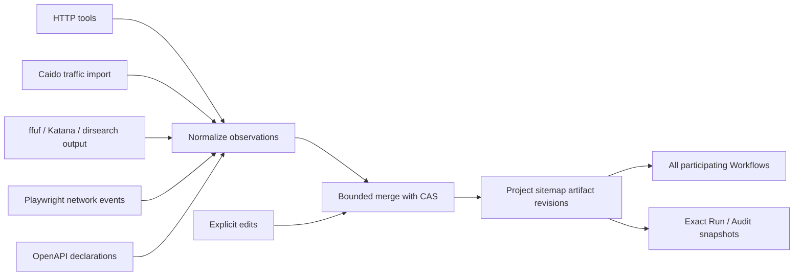
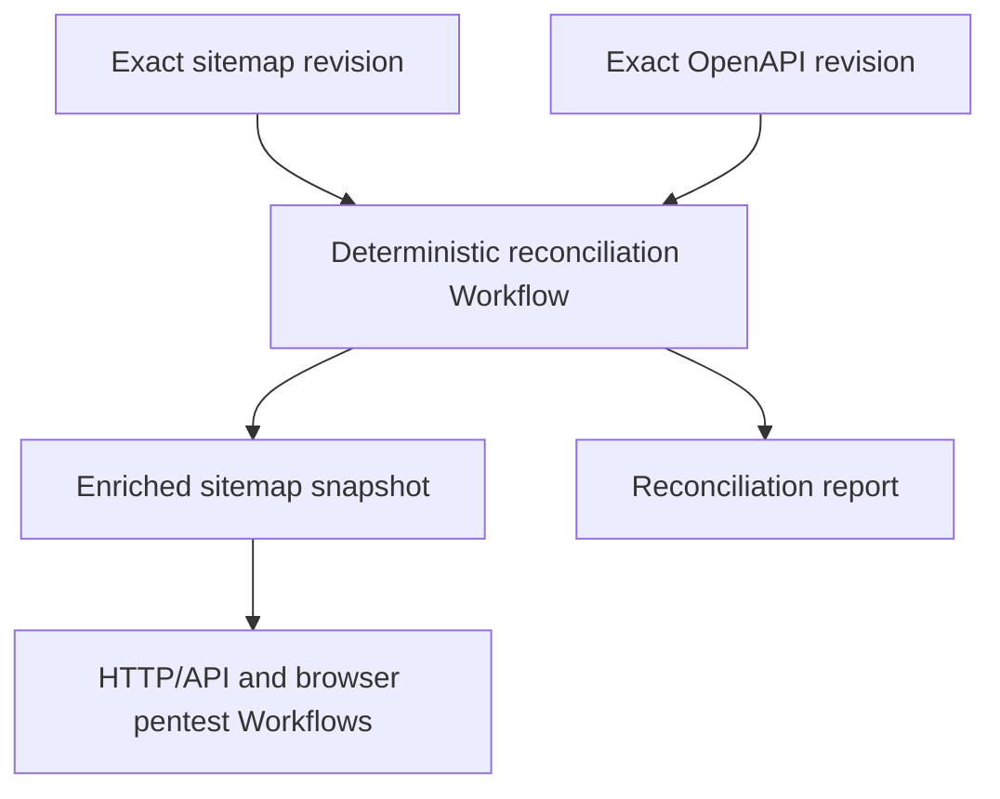

# Live Project sitemap over ArtifactStore

Proposal 0042 · Status: **Draft design; not implemented.** Recorded on
2026-10-23. This document records the user's selected direction and proposed
contracts for review. It creates no implementation tasks and does not reactivate
deferred tasks or other proposals.

This complements the frozen surface and evidence contracts in
[proposal 0033](0033-autonomous-pentest-audits.md). A live sitemap is shared
research context; it does not replace that proposal's exact proof inputs.

## 1. Outcome and decisions

A Project has one shared sitemap artifact. HTTP/API and browser pentest Runs
read its current revision and contribute observations while they execute.
An explicit surface-discovery Workflow is useful for populating it quickly,
but every contributing Worker uses the same collection mechanism.

| Decision | Direction |
| --- | --- |
| Sharing | The user selected a live Project map, visible to other running Workflows. |
| Storage | Use ordinary ArtifactStore bindings, immutable revisions and CAS; do not introduce another sitemap database or event journal. |
| Automatic input | HTTP tool traffic and selected Caido traffic contribute without a model writing the final map. |
| Explicit input | Provide tools to add, annotate, remove and restore entries, and import structured scanner output. |
| Additional sources | OpenAPI, ffuf, Katana and Playwright feed the same observation format. Dirsearch can use an explicit import adapter. |
| Audit composition | The user proposed deterministic Audit steps to reconcile sitemap with OpenAPI. Implement them as ordinary model-free Workflows using the same reducer. |
| Simplicity | Start with HTTP endpoint groups and bounded examples. DOM graphs, browser journey graphs and a universal crawler framework are outside the first slice. |
| Browser availability | A pentest Audit may make its browser branch optional and report a coverage gap when the capability is absent. A busy compatible Runtime is a capacity wait, not evidence that the capability is absent. |
| Sandbox | Pentesters can use the existing networked Podman sandbox, preinstalled tools and downloads inside its writable workspace. |
| Sandbox egress | The user explicitly deferred per-engagement sandbox egress filtering. It does not block this design. The Runtime/code-execution area owns the deferred decision; reopen when the user requests scope-enforced sandbox execution or before claiming that guarantee for a deployment. |

The guarantees below apply to metadata collection and sharing. An entry is not
evidence that a vulnerability was verified or an endpoint was tested fully.

## 2. Existing contracts and necessary changes

- [ArtifactStore](../spec/artifacts/artifact-store.md) already owns scoped
  bindings, exact revisions, CAS, input forks and retention. Use a dedicated
  ordinary Project binding such as `sitemap/map`; do not change the create-only
  publication of `outputs/<slot>` or depend on proposal 0035.
- Runtime Artifact access is currently allocation-bound to the current Run.
  A sitemap tool adapter needs a narrow server-authorized operation against
  this Run's owning Project sitemap. Existing tools do not already grant live
  Project reads or writes. Project identity comes from trusted allocation
  context, never a model-supplied Project ID.
- [HTTP/Caido](../spec/tools/http-caido.md) currently keeps ordinary traffic in
  bounded allocation memory, with durable exchanges selected for findings.
  Derive sitemap metadata before buffer eviction. Do not treat an allocation
  request ID or a Caido ID as an exact durable artifact ref.
- [Scanners](../spec/tools/scanners.md) already produce bounded ffuf
  observations. Katana's current implementation also exports bounded observed
  same-origin GET targets. Neither export proves complete application discovery.
- [Audit mapping](../spec/audits/scans.md) already passes exact prepare outputs
  across rounds and retained discovery outputs within one round. Live Project
  context is an explicit additional read surface, not an implicit mutable
  replacement for an Audit's baseline.
- Full HTTP traffic export remains deferred under
  [proposal 0036](0036-compressed-http-traffic-export.md). Sitemap metadata
  collection does not reactivate complete request/response archival.

## 3. One artifact and one deterministic reducer



The model selects investigations and can supply descriptions and grouping
suggestions. Code validates observations, assigns identity, merges contributions
and assembles the artifact. Normal HTTP traffic does not require an additional
model tool call to record each request.

The initial artifact is a strict versioned JSON document, with entries,
grouping rules, suppression markers, source summaries and collection gaps.
It has no executable instructions or stored session credentials. Published
exact revisions remain immutable; the Project binding advances through CAS.

Every adapter applies `sitemap-safe-projection@1` before constructing public
keys, examples or artifact bytes. It follows proposal 0033's safe-projection
principles but also covers ordinary HTTP tools and imported traffic whose
existing capture does not provide pentest redaction. Remove credentials,
session/login values and their derived values from headers, query, body and
path segments; imported URLs and configured structural values have no exemption.
Retain parameter names, safe shape information and explicitly permitted
non-secret values, with binding placeholders or omission reasons. Do not retain
raw-secret hashes, including in IDs, fingerprints or correlation tags. If a
safe operation/member key cannot be formed, record an omitted observation and
a gap instead of merging distinct secret-bearing paths under a fabricated key.
Manual descriptions and structured imports pass the same boundary. Unknown
sensitive fields are omitted; a model cannot declare them safe. Record the
projection version and omitted locations/reasons without removed values.

A missing binding means an empty map that can be created conditionally.
An existing malformed or unsupported document is an explicit error, not an
empty map or permission to replace it. The reducer validates on read and write.

## 4. What an entry represents

An entry groups one HTTP operation using:

```text
normalized origin + HTTP method + route key + configured structural values
```

The route key is an exact concrete path until an explicit OpenAPI path or
configured path-template rule supplies a justified grouping. Parameter-name
sets, body media types, identities and outcomes remain bounded variants under
the group. They are available to the pentester without multiplying a node for
every input value.

| Data | Meaning |
| --- | --- |
| Origin, method, route | Stable operation grouping, with its grouping rule provenance. |
| Parameter shapes | Observed names, locations, multiplicity and body content types; declarations stay distinguishable. |
| Declarations | Exact OpenAPI revision and operation pointer, or an explicit manual declaration. |
| Observations | Trusted source/context keys, producer Run/invocation, observation time, HTTP outcome and deployment/session attribution when known. |
| Concrete members | A separately bounded inventory of safe concrete operation keys and their observation summaries; representative examples are not this inventory. |
| Examples | A bounded selection of concrete request descriptors and exact retained evidence refs when available. |
| Manual metadata | Notes, tags, grouping overrides and exclusion state. |
| Completeness | Source limits, discarded variants, unavailable response/evidence, parser failures and pending collection. |

Store declarations and observations separately. A schema operation can be
declared and never observed; a live endpoint can be observed and undeclared.
Unknown authentication context stays unknown rather than being labelled
anonymous. User A and user B remain separate observation contexts.

An engagement identity context is keyed by its trusted baseline/engagement
identity plus `identityId`, which is unique only within that engagement.
Ordinary Runs use Run-scoped identity contexts or an explicit Run-scoped unknown
context. Names, roles, credential aliases and matching `user-a` labels never
establish cross-Run equivalence. Equivalence requires an explicit trusted
principal mapping; it does not erase original context keys or credential
revision provenance. Preserve deployment attribution and relevant session/state
generation separately. Unknown deployment or identity is not a match to a known
one. When context limits are reached, record overflow and retain an unknown
aggregate containing only omitted counts/gaps, never outcomes attributed to a
synthetic shared principal; do not combine principals to fit the limit.

Normalize origins using the project's shared URL rules. Within the safe
projection, preserve concrete path case, trailing slashes and encoded reserved
characters. Grouping never rewrites a retained concrete request. Query order,
duplicate values and bodies may matter to security testing even when they do
not create a new sitemap node; this does not authorize retaining removed secret
values or claiming that a redacted descriptor is the original request.

## 5. Source adapters

| Source | Collection boundary | Limits of the observation |
| --- | --- | --- |
| HTTP tools | Observe the actual attempted request and available outcome, including redirects as separate hops. | A timeout is an attempted request, not a received response. A redirect target seen only in Location is a declaration until visited. |
| Caido | Automatically project requests inspected or generated by selected tools; add a bounded incremental history import for additional traffic selected by the Project's Caido context. | Do not import the entire shared Caido instance implicitly. A history row or passive sitemap node may have no retained exchange. |
| ffuf | Convert accepted report matches, preserving exact report provenance and truncation flags. | Matches may be wildcard/soft-404 responses. The current 100-match export cannot establish coverage of discarded matches. |
| Katana | Convert its structured observations and existing target output through the same reducer. | Preserve current GET-only and observed-response restrictions unless a separate adapter change extends them. |
| Playwright | An optional managed browser collector emits request/response/failure metadata at BrowserContext level. | No DOM extraction or user-journey graph is required. Arbitrary sandbox scripts are covered only when they use the helper, supply a structured export, or their traffic is imported from Caido. |
| OpenAPI | Import exact operations, parameters and path templates from an explicitly selected document. | Declarations do not prove deployment, reachability or runtime authorization. |
| Sandbox tools / dirsearch | Import an exact structured output artifact with an explicit format/version. | Do not infer reliable endpoints from free-form stdout or execute tools merely to import their results. |

Use exact report refs and immutable source timestamps for repeatable imports.
HTTP/Caido/Playwright contributions sharing an available correlation tag refer
to the same exchange; preserve their source attribution. Without correlation,
merge their endpoint group without claiming an exact physical request count.

Caido history import processes bounded pages and retains a checkpoint. It must
not rescan the whole history after each request. Provider gaps, expiring history
or missing stable continuation become explicit collection gaps. Choosing the
exact provider continuation requires validation against the pinned Caido API.

Playwright is optional. Do not require a browser or install a second crawler to
collect HTTP, OpenAPI, Katana or ffuf data. The existing networked sandbox
allows experiments with exporters before a managed Playwright integration.

## 6. OpenAPI contribution and bounded grouping

OpenAPI supplies both initially declared nodes and path-template grouping.
Reuse the existing normalized OpenAPI operations and reference-resolution rules
rather than implementing a second parser with different method/path semantics.
Resolve the deployment origin explicitly; an unbound server variable or
ambiguous origin is reported, never guessed. No remote reference fetch occurs
as a side effect of sitemap import.

For example, importing `GET /users/{id}` lets observed `/users/123` and
`/users/456` appear under that operation while retaining concrete examples and
their identity contexts. A declared concrete route such as `/users/me` takes
precedence over a compatible template. Ambiguous template matches remain
separate/ambiguous until resolved; the model does not choose their identity.

Adding a schema after traffic reindexes group membership deterministically.
Existing retained member/observation IDs and evidence refs survive regrouping.
Regrouping uses the concrete-member inventory, not the representative examples.
Discarded members remain an aggregate with an explicit regrouping gap: a later
fixed route or template cannot recover their membership or assign their past
observations to a new group. New observations may establish new membership.
Member-scoped notes and exclusions follow that member. A group-scoped edit
records its rule and member selection when made; splitting or merging cannot
silently widen it to unrelated members. An incompatible mapping is an explicit
conflict requiring resolution, while existing exclusions remain effective.

Each schema source has a stable Server-authorized `sourceId` with explicit
deployment attribution, independent of its mutable binding name. A replacement
names the expected source generation, exact source ref/digest and grouping
policy digest; creation requires that source to be absent. A new exact schema
updates only that source's declarations and rules, preserving independent
observations. Generation order is assigned by accepted publication, never
inferred from document timestamps, version labels or model-supplied IDs.

Parameter declarations and observed parameter shapes are separate. Preserve
extra live parameters and missing declared parameters. OpenAPI security
requirements are expectations, not proof that access control works. A schema
generated from source has its own declared/inferred provenance and is not an
independent measurement of the deployed application.

### Deterministic reconciliation as an Audit Workflow

Provide an ordinary `sitemap-openapi-reconcile` Workflow, usable independently
and as an Audit role. Its computation uses `passthrough@1` with a `tool@1`
Worker selecting a newly registered reconciliation tool. The generic
model-free execution mechanism exists; the reconciliation tool and Workflow
do not. Audit Controller does not gain OpenAPI parsing or a new semantic step
kind.



The pure computation accepts exact map/schema refs and bytes, an explicit
origin binding and a versioned grouping policy. It:

1. Validates both documents and builds the declared-operation index.
2. Adds declared-only operations and attaches their exact schema pointers.
3. Matches observed operations to declared concrete paths or templates.
4. Regroups retained concrete members where the match is unambiguous, preserving
   their examples, observation identities and applicable manual edits/exclusions;
   discarded members retain explicit unresolved regrouping gaps.
5. Reports observed-but-undeclared, declared-but-unobserved, ambiguous matches
   and differences in observed parameter shapes, media types and outcomes.
6. Emits a canonical enriched map, a bounded source-update patch and a report
   naming input refs/digests, policy version and unresolved gaps.

These are descriptive comparisons. An undeclared endpoint is not automatically
a vulnerability, and an unobserved declared operation is not proof of absence.
Generate an updated OpenAPI document only through a separately selected
Workflow with its own output contract; the default reconciliation result is
the enriched map and comparison report.

The same exact inputs and policy produce the same canonical computation
outputs. Publication timestamps and the revision allocated to the Project
binding are separate from that deterministic result. Required tool outputs
must be explicit artifact slots; do not place a potentially large sitemap in
the bounded tool completion/report envelope.

For a shared map update, the Workflow's publication path applies its typed
patch through the ordinary sitemap reducer/CAS boundary. If another Worker
added observations after the input snapshot, preserve them and reapply the
source/grouping change only while its per-source preconditions still match.
A concurrent replacement of the same source or its policy is a conflict, as
is a conflicting manual edit; an old pinned schema must not be reinterpreted
as the current source merely because its patch finishes last. Resolving that
conflict requires an explicitly authorized new source selection and a new
invocation/patch. Retrying the same Workflow preserves its exact input intent
and expected predecessor; it cannot adopt the latest generation as a new
precondition while continuing to publish its old schema. The original private
computation result may still be retained without updating the shared source.
Existing keyed receipts replay an already accepted source transition
without another generation or publication. The report retains both computation
input refs and the actual Project revision updated; never claim that a rebased
live update is byte-identical to the original snapshot computation.

An Audit can select the Workflow as:

- **Preparation:** reconcile before building the first inventory, using
  `audit-input` or `prepare-output` for OpenAPI. The accepted sitemap output
  can feed inventory and checks through existing `prepare-output` mappings.
- **Round discovery:** reconcile a fresh exact snapshot of the live Project
  map before a round's checks. Its accepted output feeds that round through
  existing `retained-output` mappings. OpenAPI can remain the pinned initial
  input or an accepted preparation output.

Obtaining the fresh Project snapshot uses the explicit Project sitemap
adapter described above, with its read revision recorded. Do not add an
unsupported mapping source to illustrative manifests or infer an earlier
round's output through `retained-output`. Reusing a previous round's individual
check artifacts still belongs to the separately deferred dependency contract.

Only run a new reconciliation pass at a declared boundary or when a selected
schema/grouping policy changes. Ordinary HTTP observations already use the
current grouping policy and do not launch one Workflow per request. Schema
or map invalidity leaves the prior shared artifact intact; retries preserve
exact inputs and reconcile publication acknowledgements without target calls.

## 7. Keeping the map small

1. **Separate a map node from a request instance.** Ordinary query values,
   body values, timestamps and fuzz payloads do not create new nodes. Store a
   small number of examples and distinct shapes instead of all traffic.
2. **Prefer declared or explicit path templates.** OpenAPI and manual rules
   can group IDs. Do not automatically turn every numeric path segment into
   a parameter; `/v1`, years and fixed business routes may be meaningful.
   Heuristic grouping can be suggested for review later.
3. **Allow structural-value exceptions.** Values such as `action=delete`,
   `page=admin` or a GraphQL operation selector may choose different functions.
   Rules can retain these values in the operation key. Do not ignore all
   query values globally or infer structural meaning from a name alone.
4. **Preserve useful diversity.** Select representative examples across
   identity contexts, parameter shapes and outcomes. Response-body equality
   does not prove equal authorization or endpoint behavior.
   Keep a bounded concrete-member inventory independently of the eight examples.
   When its limit is reached, preserve accepted members, summarize omitted
   contributions with bounded counts/gaps, and stop claiming complete member
   identity or lossless future regrouping. Observation summaries and provenance
   are bounded too; the map is not an event log.
5. **Control noise at ingestion as well as display.** Repeated negative fuzz
   probes can be summarized under the scan/root pattern with bounded examples.
   Keep 401/403 observations useful to access-control testing. A 200 status
   alone does not defeat a soft-404 baseline. Any omitted observations are
   counted as omitted by collection policy, not as tested or nonexistent.
6. **Keep resource categorization simple.** Static assets and irrelevant
   third-party resources can be filtered by explicit collection policy.
   JavaScript, source maps, downloads and resource-serving endpoints remain
   selectable; extensions alone cannot prove security irrelevance.
7. **Bound both collection and representation.** Depth, crawl time, request
   count, pages per origin, map entries, bytes, examples and import work each
   need their own limit. Reaching a limit records a gap and a continuation
   point when available; it never silently means discovery is complete.

Group/exclusion rules affect metadata collection and presentation. They do not
change sandbox network authorization or reopen the deferred egress decision.

## 8. Explicit tools and removal semantics

Proposed tool roles (names are illustrative, not registered capabilities):

- `list_sitemap_entries(filters, limit, cursor)` returns previews and the exact
  map revision. Cursor pages stay on that revision; refresh starts a new view.
- `read_sitemap_entry(id, revision)` returns declarations, observations,
  examples, notes, exclusions and gaps for one group.
- `upsert_sitemap_entry(...)` adds a manual declaration or edits notes/tags.
  It cannot fabricate an HTTP observation or replace source facts.
- `remove_sitemap_entry(id, expected_revision, reason)` records a reversible
  suppression marker. Automatic observations do not make it visible again.
- `restore_sitemap_entry(...)` removes that explicit suppression.
- `import_sitemap_source(ref, format, context)` imports bounded structured
  records from an exact accessible artifact, with a deterministic report.
- `configure_sitemap_grouping(...)` manages bounded path-template and
  structural-parameter rules with conflict detection.

An observation-writing template explicitly opts into automatic collection;
reader-only selection grants no collection or edit authority. Precise tool
selection and Server/Runtime wire changes must be specified together before
implementation. A Skill or the presence of an input file grants no authority.

Every contribution, including notes and grouping rules, carries trusted
content-kind and source-mode provenance. Imports validate the caller's source
authority before reading content and preserve that classification. Blackbox
list/read, reconciliation and snapshot/export operations exclude unselected
source-derived content before exposure, including previews, paths, parameter
names, descriptions and grouping effects. An explicitly authorized OpenAPI
input remains usable; another Run's source-assisted import does not become an
authorized blackbox input automatically. Source-assisted manual notes are
restricted conservatively unless a trusted classification permits disclosure;
the model cannot relabel them. Form the view using allowed contributions and
rules, or report an unavailable projection if safe reconstruction is impossible.
Never fork the raw mixed-source Project map into a blackbox Run. Retained views
name the original map revision plus the projection policy and selected inputs,
and expose only authorized consumer refs; they do not claim byte identity with
the full map.

Removing an entry means removing it from the working map, not rewriting prior
artifact revisions or deleting finding evidence. Suppression applies to its
declared group/member identities and survives later reimports/regrouping.
Its explicit membership/rule selection is retained within the marker budget;
an ambiguous split/merge cannot silently restore a member or suppress unrelated
ones. Reject an edit that cannot preserve that selection within the bounds.
Physical artifact deletion and retained historical refs follow ArtifactStore.

## 9. Live updates, concurrency and exact evidence

Collectors submit small batches to a sitemap-specific reducer backed by the
existing Project artifact service. A batch merges observations with current
content and writes using its revision precondition. Never replace the Project
map with the stale complete map a Worker read at startup.

Automatic observation updates are deterministic and idempotent: immutable source
identity, set membership, min/max observation times and bounded representative
selection. Avoid an exact global traffic counter that requires retaining every
request forever. Explicit edit ordering is protected by expected revision;
source replacements additionally enforce their per-source preconditions.

On CAS conflict, reread and reapply the same bounded batch; retry at most three
times within the operation deadline. Reuse existing keyed mutation receipts
where replay needs a committed acknowledgement. Do not add another receipt or
claim table. A lost response never causes target traffic to be sent again.

Coalesce observations by group before uploading, flush by a small count/time
budget, and join the collector during completion/cancellation/release. Reading
the sitemap flushes the caller's pending observations first. Other Runs see
committed batches; uncommitted local events are not claimed as durable.

An initial design may lose a bounded pending batch on Runtime failure; report
that source's collection as incomplete using Run closure/collection status.
The HTTP-tools area owns this accepted metadata-collection limitation. Reopen
if zero-loss collection becomes a user requirement; full-traffic archival is
still a separate decision.

Live map reads are research context. A finding or replay pins the exact entry
revision, source document/report revisions and any retained evidence actually
used. Do not imply that a running Audit's immutable input baseline changes when
another Run updates the map. Record selected context revisions separately.
At a Workflow/Audit boundary, export or retain an ordinary exact sitemap
snapshot through the existing artifact mechanism.

Reading map metadata does not authorize reading arbitrary foreign-Run refs.
The Server validates ownership and retention of referenced documents and exposes
required exact inputs through the existing authorized fork/materialization path.
Source IDs with no durable bytes remain provenance with unavailable evidence.

## 10. Starting bounds and verification targets

These are proposed starting ceilings, to become shared registry/schema values
only with the implementation. They are not current platform limits:

| Collection | Proposed bound |
| --- | --- |
| Typical Project | 100–1,000 operation groups; 1–10 contributing Workers |
| Current map | 10,000 groups or 32 MiB encoded JSON, whichever comes first |
| Concrete members | 64 per group and 50,000 per map; each safe member key at most 8 KiB |
| Examples | 8 bounded request descriptors per group; at most 2 KiB each |
| Context summaries | 16 named/unknown observation contexts per group |
| Member summaries/provenance | 16 source/context/outcome summaries and 8 exact provenance refs per retained member |
| Source registry / grouping rules / suppression markers | 128 / 256 / 10,000 per map; all count toward the encoded map bound |
| Manual notes/tags | 4 KiB and 16 tags of at most 64 bytes per group/member; all count toward the map bound |
| Batch | 100 normalized observations or 256 KiB |
| Read page | At most 100 entries and 256 KiB |
| Import step | At most one bounded report page/batch before a checkpoint |
| CAS retries | 3 within the owning operation deadline |
| One Run's map publications | 256 accepted revisions or 256 MiB encoded published bytes, whichever comes first |
| Project-lifetime map publications | Default 2,000 accepted revisions or 1 GiB encoded published bytes; configurable only up to hard ceilings of 20,000 revisions or 8 GiB |

Use a parsed immutable snapshot/index per selected revision for paging; do not
parse the full map again for every returned page. Cache lifetime and bytes are
allocation-owned and bounded. Raw output parsing and map reduction run off the
Runtime event loop. The proposed publication limits above apply independently
of current-document size and must be checked against real workload measurements.

Reserve Project-lifetime quota, and Run quota for a Run-originated write,
atomically with the accepted publication under the existing Project/Artifact
mutation boundary. Charge the complete encoded bytes and one revision for every
committed revision, even when content
deduplication reuses identical bytes. A genuine no-op that creates no revision
uses no quota; receipt replay creates no revision and charges nothing again.
Failed CAS or rolled-back publication consumes no quota. Keep cumulative usage
as trusted Project-owned accounting, outside the replaceable map document;
starting another Run, suppressing entries, replacing/resetting the binding or
partitioning cannot reset it. The quota follows the Project until its purge.
The owning Project service enforces this policy for every publication to the
dedicated sitemap binding, including public Project Artifact API mutations,
forks and rebinding. Those paths must use the same authorized validation and
accounting boundary or reject the mutation; raw generic Artifact writes cannot
bypass it, including before the first sitemap revision exists. Removing/resetting
an accounting marker is not a public operation; only complete Project purge
clears usage. Storage remains ordinary ArtifactStore storage, with domain policy
owned by the Project sitemap service.

Exhaustion preserves the last accepted map and returns a permanent collection
limit outcome. Readers expose exhaustion from trusted accounting; the producer
retains its gap in Run collection status/closure without requiring another map
revision. Target responses remain valid. There is no implicit deletion of old
revisions or reset to an empty map. Historical compaction/expiry would require
a separate ArtifactStore retention contract
that protects exact holds, not a silent implementation detail of this reducer.

Keep the first representation to one bounded artifact. ArtifactStore owners
must measure publication amplification, retained revision bytes and CAS
contention with 10,000 groups, ten writers, sequential Runs approaching the
Project-lifetime quota and large imports. If the measured budgets cannot hold,
partition the same artifact format before implementation is accepted; do not
raise limits or introduce a second persistence subsystem
to conceal failed scaling. Exact partitioning is deliberately undecided.

## 11. Failure outcomes, lifecycle and required tests

- Definite invalid input, incompatible schema and exceeded hard limits return
  stable permanent outcomes. Existing accepted content is preserved.
- Definite retryable storage failures use bounded retry; lost acknowledgements
  reconcile through existing mutation/Artifact identities.
- A collection write failure cannot turn a received HTTP response into a
  target failure. Return/report the response and a separate sitemap outcome;
  never resend it. An enabled required collection/output can leave the Run
  incomplete/failed at its declared completion boundary.
- Valid records from an incomplete scanner report can be imported with its
  gaps. Malformed records are rejected with exact counts/reasons under the
  parser's contract; they never produce invented successful entries.
- Restart, cancellation and deadline exhaustion preserve committed map data
  and join local collectors before allocation cleanup. No publisher outlives
  release. Server-side receipt/policy handling rejects fenced allocations.
- Run deletion leaves self-contained Project map metadata usable; missing
  source traffic is explicit. Retained finding evidence remains independently
  governed by existing holds. Project purge deletes the map through ordinary
  ArtifactStore scope deletion. Manual removal of a map entry does not delete
  findings or their evidence.

Implementation acceptance needs shared Go/Python canonicalization/reducer
fixtures; real PostgreSQL tests for concurrent CAS, receipts, lost responses,
ownership and purge; HTTP/Caido/ffuf/Katana adapter regressions; optional browser
event fixtures; and real-size import/paging/revision-amplification tests.
Include GET versus POST, repeated query parameters, structural values, fixed
`/users/me` versus `/users/{id}`, multiple identities, wildcard responses,
suppression followed by reimport, late schema import, invalid document edits,
partial scanner output and cancellation while publishing.
Include secret canaries in path/query/body/headers and structural keys for every
source, source-assisted to blackbox reads/snapshots, repeated identity labels
across baselines, reversed concurrent schema replacements, regrouping after
inventory overflow/discarded incoming members, suppression across split/merge,
and every metadata bound.
Quota tests cover concurrent last-slot reservations, identical-content new
revisions, receipt replay after a lost acknowledgement, rollover to another
Run, binding replacement/partitioning and exhaustion without losing the map.

## 12. Smallest useful delivery and findings context

The first implementation should deliver one working artifact format, reducer
and reader/editor Toolset, automatic HTTP observation and an exact OpenAPI
import. Feed existing normalized ffuf/Katana reports into that same reducer;
do not add new crawler execution modes or a plugin framework to make imports
possible. Selected Caido tool results can use it without a full history sync.

Incremental Caido history sync and managed Playwright collection can follow
independently. An explicit supported export remains usable meanwhile. Their
absence produces source-specific gaps rather than preventing the HTTP/OpenAPI
map from being useful. Automatic heuristic path learning and response-content
clustering are later options, not prerequisites for the first version.

The pentester also needs a Project-scoped findings reader. The existing
`security-findings@1.list_findings` reads one explicitly prepared immutable
collection, not a live Project-wide list. The proposed live reader contract is
owned by section 7.3 of
[proposal 0033](0033-autonomous-pentest-audits.md): Project-bound authorization,
bounded list/read tools, exact selected revisions, source-mode filtering and
authorized retained evidence access. Reuse the existing finding store and
read semantics; sitemap contains references to relevant findings, not another
copy of their state.

Do not fold findings management, cross-round verification routing, a DOM graph,
browser action replay, arbitrary stdout parsing or complete traffic capture
into the sitemap's first implementation. Those capabilities retain their own
contracts and deferred status.

## 13. Research and rationale

Primary sources checked on 2026-10-23:

- [ZAP Sites Tree](https://www.zaproxy.org/docs/desktop/start/features/sitestree/)
  groups requests using methods and parameter names; its data-driven content
  concept groups path values that otherwise create many equivalent nodes.
- [ZAP Structural Parameters](https://www.zaproxy.org/docs/desktop/start/features/structparams/)
  explains why a value selecting a logical page must sometimes remain part of
  the structure instead of being discarded as ordinary data.
- [ZAP OpenAPI support](https://www.zaproxy.org/docs/desktop/addons/openapi-support/)
  uses imported path parameters to create data-driven nodes in a Context.
- [Burp crawl settings](https://portswigger.net/burp/documentation/scanner/scan-configurations/crawl-settings)
  documents diminishing returns from deep navigation and separate time,
  location-count and HTTP-request limits.
- [Katana](https://github.com/projectdiscovery/katana) documents query-value
  reduction, similar-path grouping, crawl limits and structured output. These
  upstream options are not a claim that Contractor's pinned adapter exposes
  them or that heuristic grouping is correct for every target.
- [Playwright network events](https://playwright.dev/python/docs/api/class-browsercontext)
  supply request, response, completion and failure observations without
  requiring a separate DOM model.
- [OpenAPI path templating](https://spec.openapis.org/oas/v3.1.1.html#path-templating)
  supplies declared templates and concrete-path matching precedence. Sitemap
  import must still preserve observed/declaration and source/deployment gaps.

The recommendation combines these ideas conservatively: shared artifact
revisions, explicit structural grouping, source-labelled observations and
bounded examples. Revisit heuristic route grouping only after representative
fixtures show that declared/manual rules leave a material cardinality problem
without masking distinct functionality or identity-dependent behavior.
