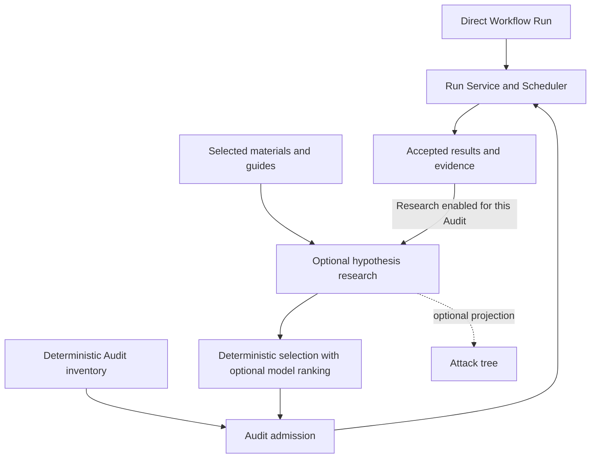

# Hypothesis search within Audits

Proposal 0045 · Status: **Draft design; selected direction, not implemented.**
Recorded on 2026-10-24. This proposal specifies an optional research domain
inside Audit, using ordinary Contractor execution. It revises the future V64
integration direction; it does not enable a capability, change normative
contracts, reactivate tasks or authorize implementation.

Pentest integration revised on 2026-10-30: V64-018 composes existing research
admission with ordinary HTTP checks, selected evidence and reports. It does not
depend on the archived pentest recipe/proof admission task. Earlier references
to specialized 0033 proof/replay are historical design and cannot restore the
removed request journal, recipe DSL or proof authority. The core research
scope and its independent delivery remain unchanged.

An Audit can derive hypotheses from selected Project materials and guides,
choose useful experiments, retain their provenance and use results to select
the next work. Existing deterministic Runs and Audits remain direct execution
paths, without hypotheses, generation or ranking. An attack tree can later
present relationships between research goals, hypotheses and evidence without
becoming a prerequisite for execution.

## 1. Decisions and boundaries

| Decision | Proposed guarantee |
| --- | --- |
| Optional research | A profile explicitly enables search. Absence of that selection preserves the current inventory, admission and execution path, including its deterministic behavior. |
| Domain owner | The research pool belongs to one Audit, with its scope, baseline and budgets. Project supplies materials and explicitly selected historical context. |
| Execution owner | Audit admits immutable work; Run Service creates ordinary Runs; Scheduler owns execution, retries and allocations. Search adds no execution engine or Worker lease. |
| Choice unit | Select an experiment against exact hypothesis revisions, rather than an abstract hypothesis score alone. |
| Sources | A person, guides alone, Project materials and accepted observations can each supply hypotheses. Live observations are not required for a cold hypothesis. |
| Human attention | A human-submitted hypothesis receives high verification priority by default, recorded separately from evidence support and model usefulness judgments. |
| Identity and history | Trusted code assigns identity and validates revisions, sparse relationships, provenance and result membership. Model text does not establish authority or truth. |
| Selection | Feasibility, usefulness assessment and final budget-aware selection are separate. Model ranking is optional even when search is enabled. |
| Storage | Indexed Audit metadata and relationships support selection and UI queries; ArtifactStore owns immutable documents, evidence, forks and retention. |
| Handoff | Every admitted experiment receives a bounded exact context package and materialized authorized dependencies. A manifest alone grants no cross-Run access. |
| Findings | Research candidates need not enter finding intake. FindingProposal, review and evidence contracts retain their distinct meaning. |
| Attack trees | Optional analytical projections over exact hypotheses and results. Causal lineage, AND/OR conditions and execution dependencies have separate semantics. |

### 1.1 Deterministic execution remains first class

The supported paths are:



Direct Runs, model-free Workflows and existing deterministic Audit profiles
must not create hypothesis records, invoke a generator/ranker, wait for a
research phase, or require research context. Their existing input, result,
coverage, retry and cancellation contracts remain authoritative. New shared
code is justified only at a boundary already needed by both paths; an ordinary
check must not acquire a dummy hypothesis to pass through it.

Fixed checklist ranking is a separate opt-in use of selection, not a mandatory
replacement for deterministic inventories. Search itself can use fixed rules
for generation, eligibility and selection. Evaluating an LLM ranker against a
deterministic selector must require changing the selected policy, not the
execution machinery or evidence contract.

This is preservation of supported current modes, not a legacy compatibility
reader. Future contracts remain strict; no aliases or lenient schema fallback
are introduced. A research configuration that is unsupported or incomplete
fails validation before execution rather than silently switching modes.

### 1.2 Alternatives

| Alternative | Strength | Reason for this decision |
| --- | --- | --- |
| Immutable hypothesis batches only | Small pilot; uses ordinary artifacts | A large pool, indexed readiness, lineage queries and repeated selection would otherwise become an implicit database in JSON. Batches remain a useful initial execution strategy. |
| Audit research domain | Explicit hypotheses and selection; reuse of execution | Selected: the pool, selector, context assembler and UI are concrete production readers. |
| General research graph engine | Reusable across unrelated research products | Defer until a second product demonstrates a common execution/search protocol. A hypothesis graph and an optional attack tree do not require that engine. |

## 2. Relationship to existing contracts and proposals

The original behavior review used `63861457417dcfa9b82afe507ede2ed3e2548828`.
The pentest/sitemap integration and delivery status below were reconciled with
the normative contracts and current task records on 2026-10-30.

| Existing mechanism | Reuse or revision |
| --- | --- |
| [Audit ownership and result layers](../spec/audits/audits.md) | Keep Controller/Scheduler/Planner ownership, immutable accepted Rounds and distinct execution, assessment, coverage and triage outcomes. |
| [FindingProposal](../spec/findings/findings.md) | Already permits a hypothesis and unknown subject. It remains a candidate/evidence envelope; it is not the research registry. |
| [Current finding inventory](../../internal/auditdomain/finding_inventory.go) | Receipt/ordinal admission remains a distinct source adapter. Add a trusted hypothesis/experiment source rather than manufacturing finding receipts. |
| [V64 proposal 0034](0034-audit-check-prioritization.md) | This proposal replaces its future integration direction. The implemented pure core is historical fact; fixed membership, full-pool evaluation, minimum ten and exact top-N are not universal search requirements. |
| [Pentest proposal 0033](0033-autonomous-pentest-audits.md) | Use its revised section 14 delivery plan and current normative HTTP scope, supplied-credential, local-limit and evidence contracts. Archived recipe/proof/effect mechanisms are not prerequisites of research integration. |
| [Live sitemap proposal 0042](0042-live-project-sitemap.md) | Optional context source. All permitted readers share the same Project metadata; declared/observed facts and live context versus exact retained evidence remain distinct. Source-file authority is separate, and search does not require live Project access. |
| [Audit composition](../spec/audits/scans.md) | Reuse exact preparation inputs and the completed V62 settled-result, retained-dependency and registered-routing contracts; metadata refs alone never authorize arbitrary cross-Run reads. |

A research-enabled HTTP profile uses separate research-pool and ordinary
execution budgets. Trusted finding receipt/ordinal and an accepted exact
HypothesisRevision/ExperimentPlan are distinct admission sources. Both use
existing authorization, exact dependency and registered-method validation;
neither requires the archived pentest recipe/predicate/proof subsystem.
Verify/replay remain ordinary explicit checks under their registered contracts.

V62-005/006/007 now provide settled result snapshots, retained dependencies and
profile-owned routing through the trusted finding receipt/ordinal adapter.
The future research adapter must also represent early grounding and alternative tests.
The [delivery plan](../plans/2026-10-24-audit-hypothesis-search.md) now records
the revised V62/V64 tasks and targeted V411 boundaries. The planning revision
initially retained deferral. By a later explicit user instruction on
2026-10-24, exactly V64-001–018 and V62-005/006/007/013 were queued as pending,
with unchanged dependencies. V62-005/006/007 and the
[V62-013 iterative delivery exit](../../tasks/done/v62-013-audit-iterative-composition-release.yml)
are now completed. V61 and V62-008 remain deferred.

## 3. Concepts and durable model

| Concept | Meaning and ownership |
| --- | --- |
| Requirement | A selected normative obligation, for example an ASVS requirement. Existing standard packages own its identity and coverage denominator. |
| Scenario | Reusable investigation methodology from WSTG, a Skill or another guide; conditions, relevant inputs and available methods. A catalog descriptor suffices; no Scenario service is required. |
| Hypothesis | A bounded proposition about this Audit's system, with known or explicitly unknown conditions. It may remain unsupported or never become a finding. |
| HypothesisRevision | Immutable exact representation of one proposition and its recorded grounds. Assessments and decisions cite the revision they used. |
| ExperimentPlan | A bounded question, method, controls, inputs, permitted effects and interpretation contract. It can address several exact hypotheses. |
| Observation | Retained output from a particular execution and input context. Observed bytes and producer interpretations remain distinguishable. |
| AssessmentContribution | A scoped interpretation of exact evidence about one exact hypothesis revision. Several contributions can coexist or conflict. |
| SelectionDecision | An immutable explanation of the considered set, evaluations, chosen plans, omissions and budget reservations for a research cycle. |

### 3.1 Hypotheses and revisions

A hypothesis has a trusted Audit-local identity, admission ordinal, owner,
current exact revision descriptor and indexed eligibility/selection metadata.
Its revision document contains:

- the proposition and expected security property;
- bounded subject/scope descriptors, including explicit unknowns;
- applicability evidence, assumptions and missing prerequisites;
- references to requirements, scenarios and selected material revisions;
- grounds classified as declarations, observations, normative expectations,
  analyst assertions or model assumptions;
- relevant alternative explanations and possible next questions.

The security expectation has its own source. A general authorization guide
does not establish that two particular users must be isolated in this system.
The absence of an OpenAPI security declaration is an investigation lead, not
an observation of missing enforcement.

The proposition, semantic scope and expected property are immutable for a
hypothesis identity. Adding grounds or correcting non-semantic metadata can
create another revision; changing the proposition, subject boundary or
expectation creates a successor hypothesis with a relationship. Code enforces
immutability of the designated semantic fields; it does not ask a model to
certify arbitrary edits as equivalent. Accepted assessments keep their exact
revision references. Old contributions are not silently rebound to new bytes.

Project is the parent and material source, not a second mutable owner. Another
Audit imports an explicitly selected snapshot with provenance and reassesses
applicability. No hypothesis spans two active Audits' scopes or budgets.

A person can submit a hypothesis during research setup or later when the
Audit lifecycle permits it. The Server records authenticated authorship,
time, reason and high requested verification priority by default. An explicit
human edit changes that request with revision/conflict checks and history;
accepted experiment and evidence pins remain exact. Changing the proposition
still creates a successor under the rules above. Automated producer text
cannot impersonate human authorship or overwrite the requested priority.
An analyst assertion remains a claim until assessed; human origin does not
increase its evidential strength or automatically create a finding.

### 3.2 Relationships

| Relationship | Meaning | Inference or execution effect |
| --- | --- | --- |
| `derived_from` | An exact material, observation or hypothesis inspired a new proposition | Provenance only; no proof or prerequisite implied |
| `refines`, `split_from` | A narrower proposition or decomposition | Parent is not automatically refuted or supported |
| `alternative_to` | Competing explanations | Aids experiment design; no automatic exclusivity unless the evaluator states it |
| `depends_on` | A plan requires a particular accepted result/input | Eligibility checks exact membership, state and availability |
| `supported_by`, `challenged_by` | An assessment contributes evidence | Preserve scope and interpretation; not a transitive proof rule |
| `supersedes` | A successor replaces a proposed research direction | Retains history and accepted work; does not rewrite the old result |

Relationships are sparse and typed, with trusted endpoint ownership and exact
revisions. Causal lineage is acyclic: creation references earlier accepted
hypotheses, and later semantic changes create successors. Execution dependency
cycles are rejected. Alternative and evidential relationships are not forced
into a tree. Model-authored edges are proposals validated by the Server.

Possible duplicates use a structured fingerprint of proposition family,
subject/identity relation, expectation and context. A matching title, CWE,
URL, embedding or digest of prose is not an authoritative identity. Equivalent
experiments may share execution only through an explicit admitted mapping;
all originating hypotheses and contributions remain attributable.

### 3.3 Experiments and assessment

An ExperimentPlan pins the hypothesis revisions, question, chosen method,
prerequisites, exact context, controls, predicted distinguishing observations,
required capabilities, permitted effects, worst-case budget and evaluator
contract. Early plans can establish applicability or ownership, inspect source
or documents, or distinguish alternatives. An HTTP experiment follows the
current engagement scope, supplied-credential, allocation-local limit and
ordinary evidence contracts. It does not require an executable recipe DSL or
special proof authority from the historical sections of proposal 0033.

Admission maps a selected plan to an ordinary immutable AuditItem. Several
plans can address one hypothesis; one plan can contribute to several
hypotheses if every intended association and question is pinned before
execution. Finding a new hypothesis during a check produces a later candidate,
not an undeclared extra result for the accepted item.

The current [CheckResult](../../internal/auditdomain/types.go) carries one
assessment per item. Add an explicit research assessment attachment/contract
for sparse entries keyed by exact hypothesis revision and accepted experiment
result. Runtime supplies trusted associations; each entry selects authorized
evidence and records conclusion, scope, limitations and interpretation kind.
Do not reinterpret the existing single assessment as support for every linked
hypothesis. A successful prerequisite check does not support the entire claim
of a vulnerability.

Use `supported`, `refuted`, `inconclusive` and `blocked` with their bounded
meaning. Distinguish deterministic predicate, source trace, documentary
evidence, independent replay and model interpretation. Result schema/evidence
validation establishes admissibility, not the truth of model reasoning.

Contributions are append-only. A separate versioned assessment policy builds
the current research view and reports conflicting evidence explicitly; latest
collection order never resolves a contradiction. Do not inherit AUD-R111's
finding current-assessment ordering. Finding triage remains separate, and
ordinary direct findings do not require a preceding Hypothesis.

### 3.4 Separate state dimensions

Eligibility (ready, waiting on a named condition, or deferred), semantic
assessment, applicability and freshness are separate dimensions. Execution
status is read from AuditItem/Execution/Run, not maintained by another queue.
The exact names of future public enums belong in the implementation contract
pass and shared fixtures.

`not-applicable` requires the existing policy-authorized decision and rationale.
No credentials, a failed control, a timeout or missing evidence does not refute
a hypothesis. A changed deployment or relevant input invalidates reuse of a
conclusion where appropriate; it does not alter historical evidence.

## 4. Initial generation and bounded expansion

Start from an exact, explicitly selected material set: description, OpenAPI,
architecture, source, expected access policy, prior findings and observations.
Guide-only generation is valid. Missing materials are recorded, not invented.

1. Parse structural data deterministically and preserve origin references.
2. Derive bounded domain assertions where interpretation is needed; distinguish
   assertions from observed facts.
3. Match scenario families using declared applicability and required input
   kinds. Unknown applicability remains eligible for an information-gathering
   experiment; only established exclusions eliminate a family.
4. Generate a bounded set of directions and hypothesis candidates.
5. Select which directions to expand into concrete experiments under budget.
6. Expand again only for accepted new evidence, a changed relevant condition,
   an unresolved alternative or a specifically selected unexplored direction.

Do not instantiate every guide × operation × identity × payload combination.
Keep compact unexpanded directions, with their source and coverage meaning.
Repeated paraphrases with the same scope and question do not constitute new
information. Rejected batches and omissions have bounded reason records.

Generators can be deterministic adapters, model Workers or combinations.
Models author propositions and limited judgments through typed tooling.
Runtime/Server constructs the final packages, identities, membership and
provenance. Scenario methodology belongs in Skills; per-investigation context
belongs in the objective and inputs. The generator cannot choose arbitrary
Workflow refs, obtain capabilities or submit child Runs.

## 5. Search cycle and orchestration

One active research cycle per Audit captures a context generation and exact
candidate shortlist. Initial research runs before accepting the first worklist.
Later cycles run after a bounded settled-results snapshot, before admission of
the next Round. Existing discovery after Round acceptance can produce context
and future candidates but cannot append to that Round.

```text
capture inputs and results → bounded generation/expansion → validate candidates
  → evaluate eligible experiments → freeze selection decision
  → admit immutable Round → ordinary Runs → collect exact results
  → append assessments and new candidates → next cycle or explicit stop
```

Add an explicit opt-in pre-Round research phase/binding for ordinary generation
and ranking Workflow executions, extending the same intent/submission/
collection foundations used for preparation and the proposed V64 execution.
It is not repeated `prepare`: preparation keeps its once-per-Audit contract.
Generation and evaluation can share a small Workflow or use separate bindings;
they are not new Scheduler phases. Their cost counts against research and
existing Audit Run budgets. A deterministic selector requires no ranking Run.

The research phase is persisted and resumable before a Round exists. Extend
the research-enabled Audit's resume predicate (currently AUD-R171's Round,
preparation or inventory condition) to recognize its valid research intent.
Resume reconciles that intent and its accepted progress; it does not restart
generation with a new identity. The direct execution path's predicate is
unchanged.

The cycle records its source watermark, selected material versions, candidate
revisions, policy/rubric versions and expected output contract. Accepted model
judgments are retained; identical accepted inputs and judgments reproduce the
same selection. Model calls themselves are not promised to be deterministic.
New evidence during selection waits for the next context generation unless a
policy/authority change invalidates admission.

A stale decision means its cycle/decision revision is no longer admissible,
authority or policy has changed, or an exact prerequisite fails validation.
New observations alone do not invalidate the frozen cycle. This prevents a
continuous stream of evidence from starving otherwise valid admission.

Every guide, Skill, rubric, policy and Workflow reference in a research package
pins exact content descriptors and digests, retaining the required dependency
closure. A name/version alone is insufficient, including while CAT-R74 permits
shipped content to change in place before release.

Admission revalidates ownership, exact dependencies, approvals, capability and
budgets, then atomically binds the accepted decision to its Round/items using
existing transaction/idempotency mechanisms. It rejects a stale or foreign
decision. Finding receipt/ordinal and hypothesis/plan sources use explicit
adapters into this boundary; neither gets authority by writing an artifact.

Scheduler retry/escalation stays inside a Run. Audit-level retry creates another
Run only after terminal observation and collection receipt (AUX-R28). A changed
question, method, control or selected input is a new experiment; storage
reconciliation never repeats a target action.

Stop reasons distinguish exhausted selected work, blocked prerequisites,
waiting approval/capacity, research budget exhaustion, Audit deadline and
cancellation. Empty selection does not establish absence of vulnerabilities.
Waiting conditions have an owner and explicit reconsideration trigger; they
do not cause repeated model calls on every controller tick.

## 6. Prioritization and the V64 revision

### 6.1 Three decisions

**Eligibility is deterministic.** Validate scope, allowed effects, required
inputs, dependencies, capability, remaining budget and equivalent active work.
Missing prerequisites can themselves motivate an eligible experiment.

**Usefulness is policy-based.** Consider relevance to Project facts, potential
consequence, quality of grounds, ability to distinguish alternatives, important
unknowns unlocked, novelty, coverage and estimated cost. A model can evaluate
a bounded shortlist with cited input IDs and a reason. Priority, finding
severity and confidence are separate. Missing optional context alone does not
justify treating an area as safe or unimportant.

**Selection is deterministic given accepted evaluations.** Apply budgets,
mandatory coverage and diversity/aging rules, then a stable ID tie-break.
Preserve high-priority-but-deferred candidates as high priority. No numeric
probability of exploitation is assumed from model confidence.

Human-requested verification priority applies before bounded shortlist
formation, so a large automatic pool cannot hide a manual request. Prefer a
feasible high-priority human request over otherwise comparable automatic work,
with stable ordering among human requests. Optional model judgments cannot
lower that requested attention. Scope, prerequisites, capabilities, approval
and remaining budget still control admission; a blocked human hypothesis keeps
its priority and an explicit reason. A concrete manual hypothesis can proceed
to experiment construction without another hypothesis-generation pass.

Estimated cost influences selection but is not a hard spend guarantee. Existing
per-Run limits remain in force. Any new strict aggregate research token/spend
cap requires conservative reservations and reconciliation under the Audit
owner; unknown usage is never charged as zero. Do not claim that generic Audit
execution already provides such an aggregate cap.

The default strategy should be priority-guided expansion with a bounded active
set and an explicit allocation for unexplored applicable areas. Profiles can
favor normative coverage, evidence completion or new investigation. Version
and pin the policy, including any exploration quota; do not leave the model to
invent a policy each cycle. MCTS or learned selection is a later experiment,
conditional on measured benefit against simpler selectors.

### 6.2 Selection record and incremental work

Record the shortlist membership/digest, how it was drawn from the indexed pool,
context generation, candidate evaluations, chosen plans, reservation totals
and per-candidate reasons. Candidates outside the shortlist remain unassessed
for that cycle; do not fabricate low-priority verdicts for them.

Readiness and priority are bounded indexed projections. Events dirty affected
records; paged propagation and rescoring avoid full-history scans. An eligible
query must not hide an unbounded per-row dependency traversal. Aging uses a
persisted bucket/generation so ordering and pagination are reproducible.
Pending propagation does not authorize work before prerequisites are checked.

### 6.3 What changes in V64

| Previous future design | Revised direction |
| --- | --- |
| Only a finite supplied checklist | Optional candidate sources: checklist, guide-derived directions, Project-based hypotheses and result-driven continuations |
| Evaluate every remaining item every pass | Bounded selection context and shortlist; affected-candidate reevaluation; finite full-pool policy remains possible |
| Minimum ten and exactly `min(topN, remaining)` | Policy-selected capacity bounded by cost/readiness and Audit limits; one useful experiment is a valid selection |
| Newly found issues only influence context | Accepted new results can also propose hypotheses and experiments for later Rounds |
| No reconsideration of settled candidates | Explicit new grounds/method/context can admit a new experiment; technical retry remains separate |
| Independent fixed-context model judgments | Deterministic baseline and optional bounded model evaluation under a pinned rubric |

Reuse strict decoding, context binding, deterministic tie-breaking and
separation of priority from confidence where applicable. Reevaluate existing
pure-core APIs against the new contract rather than preserving obsolete
restrictions. This changes no existing package in the proposal-only change.

Do not build a parallel hypothesis ranker alongside the old V64 integration.
Use the replanned pending integration tasks around one opt-in selection
boundary, with specialized policies. Keep the current direct deterministic
path outside research, as required by section 1.1.

## 7. Context between Runs and the worldview

The worldview is a composition of declarations, observed surface, exact
evidence, hypotheses and interpretations. It need not be one mutable document
or a universal semantic graph. A context assembler selects a bounded projection
for the next question and retains provenance and omissions.

Each experiment context pins:

- Audit baseline and source context generation;
- exact hypothesis revisions and ExperimentPlan;
- selected guide/Skill versions and relevant Project material;
- relevant observations, negative results, alternatives and unresolved gaps;
- expected output/evaluator contract and authorization/budget descriptors;
- original source descriptors and consumer-local input mapping.

The trusted owner acquires retention for all required dependencies before
source cleanup and materializes them as authorized inputs before the child Run
becomes schedulable. The [ArtifactStore contract](../spec/artifacts/artifact-store.md)
does not recursively dereference refs embedded in JSON. Such refs are not
access grants; context transport must enumerate and validate its dependencies.

Large archives and evidence remain exact artifacts accessed through scoped
tools rather than being inserted into every model prompt. A summary is derived
context, not a substitute for evidence. Blackbox projection excludes prohibited
source-derived content before summaries, previews and ranking as well as before
execution. Credentials remain references through existing secret handling.

Current generic artifact tools are Run-bound. A live sitemap adapter under
0042 is a separately authorized narrow capability, not universal Project
access. When live context influences an accepted plan or conclusion, retain
the exact used revision. Never mutate the Audit baseline or accepted input
retroactively; missing exact dependencies block work rather than using latest.

The shared V62 delivery provides bounded settled-results snapshots,
retained-dependency transport and profile-owned method routing. Consumers
declare exact retained inputs rather than use same-Round output as a hidden
previous-check channel. Memory remains Run-local
scratch, and create-only Project output slots are not a mutable research pool.

## 8. Optional attack trees

An attack tree can express a goal such as unauthorized cross-tenant disclosure
and connect subconditions with AND/OR. Leaves reference exact hypotheses,
observations or explicit assumptions. Shared subconditions can make the
underlying representation a DAG even when the UI presents a tree.

This is an optional versioned analytical artifact, produced from selected
research state. It owns goal and AND/OR semantics, not hypothesis storage or
execution. A refinement edge is not automatically an AND edge; a provenance
edge does not establish reachability. Context, identities, target generation
and compatible preconditions must match before combining contributions.

Evaluate goal predicates using `true`, `false`, `unknown` only where a declared
evidence rule can support those values. A hypothesis marked `supported` by a
model does not automatically make an attack-tree leaf proven true. An AND node
requires all relevant conditions under compatible circumstances; an OR node
requires at least one. Missing tests remain unknown, not false. Probabilities
are not inferred by multiplying unrelated confidence values.

The tree may suggest a useful missing-condition experiment or inform optional
selection policy. Such suggestions reenter normal candidate admission and
budgets. They cannot create Run dependencies, expand authority or confirm a
finding directly. Deterministic checks and hypothesis search work without a
tree; tree construction is outside the first implementation slice.

## 9. Persistence, limits and lifecycle

### 9.1 Concrete readers and storage

| Durable information | Production reader |
| --- | --- |
| Hypothesis owner, exact current revision and eligibility metadata | Selector, context assembler, research list |
| Sparse typed relationships and result associations | Readiness evaluator, scoped lineage view, assessment reducer |
| Cycle/decision binding and admitted plan association | Audit admission and recovery |
| Immutable hypothesis, plan, context and assessment payloads | Runtime inputs, importer, evidence/review views |

Use existing PostgreSQL, ArtifactStore, ControllerClaims and keyed mutations.
Do not add another general receipt/lease store or duplicate Run state.
Index eligible and due work, dirty generations, relationship endpoints and
accepted result associations. Queries are owner-scoped and paginated.
Hypothesis identity is distinct from a deduplication fingerprint.

### 9.2 Proposed first-release bounds

These are design budgets to validate during the contract/measurement slice,
not current product limits. Normalize them into the platform limit registry
and shared fixtures before implementation. Existing tighter Audit, artifact,
model and request limits always apply as well.

| Collection or operation | Default budget | Proposed ceiling / behavior |
| --- | --- | --- |
| Hypothesis identities over one Audit lifetime | 1,000 | 10,000; settled/superseded nodes still count |
| Revision documents over one Audit lifetime | 10,000 / 64 MiB | 50,000 / 256 MiB; both count and bytes bound work |
| All retained research metadata documents/entries over one Audit lifetime | 25,000 / 256 MiB | 100,000 / 1 GiB; includes revisions, plans, contexts, assessments and decisions, separate from evidence |
| One hypothesis revision | 16 KiB | 32 KiB; evidence payloads separate |
| Stored lineage edges over one Audit | 20,000 | 100,000; per-node causal parents at most 8, causal depth at most 32 |
| Candidate batch from one producer result | 32 | 128 / 1 MiB; explicit omission summary |
| Selection shortlist | 32 | 128; optional model evaluation sees at most 32 candidates per bounded call |
| Selected experiment plans per cycle | 16 | 128 and remaining Audit item/Run/budget ceilings, whichever is tighter |
| Exact hypothesis revisions addressed by one experiment | 1 | 8; at most one scoped contribution per declared revision in an accepted result, up to 8 contributions |
| Admission or projection work per transaction/tick slice | 32 primary records | 128 primary records, 512 total primary/dependency/edge descriptors / 1 MiB metadata; continuation before any bound is exceeded |
| Research list page | 50 | 100 entries / 256 KiB; keyset cursor |
| One lineage response | 50 nodes | 100 nodes / 200 edges / 256 KiB; continuation |
| Check context projection | 16 dependencies / 256 KiB text | 32 refs / 1 MiB text; large payloads separately pinned, not a source archive size limit |

The pool limit does not consume an execution slot. Selected work still obeys
existing per-Round, total-item, batch, submitted-Run, deadline, token, action
and evidence budgets. Generation/ranking Runs consume the relevant Run and
cost budgets too. The aggregate metadata allowance counts every retained
research package and assessment/decision entry; per-document bounds alone
are insufficient. Deduplicate retained exact
evidence accounting through the existing owner.

Do not silently truncate a hypothesis, experiment, dependency list or verdict
set. A producer can return fewer complete candidates and an explicit omission
summary. Exhausting a lifetime quota does not evict accepted evidence or return
the quota when nodes settle. Large high-fan-out changes propagate in bounded
pages; incomplete propagation stays visible and cannot bypass eligibility.

### 9.3 Lifecycle

| Event | Required behavior |
| --- | --- |
| Pause | Stop new selection/admission/submission; follow existing owner-pause behavior for running Stages, draining collection and cleanup |
| Resume | Retain accepted pins/results; recheck eligibility and approval validity without expanding scope |
| Cancel | Fence dispatch, then use existing child-Run cancellation/drain/collection; preserve undispatched work with a reason |
| Non-time budget exhaustion | Stop new work and follow existing budget finalization with explicit gaps (AUD-R163); never report deferred work as tested |
| Audit deadline exhaustion | Preserve existing paused/deadline-exhausted behavior and drain (AUD-R164), rather than completing the Audit; search has no independent deadline state machine |
| New relevant evidence | Dirty affected readiness/priority; preserve old decisions and accepted Rounds |
| Source Run deletion | Retained exact dependencies survive through Audit ownership; an unretained foreign ref was never sufficient |
| Audit/Project deletion | Existing lifecycle gates and cleanup own the operation; research rows/edges cascade and holds release without orphan readers |
| Individual hypothesis withdrawn | Retain exact revisions and dependencies used by accepted work; block future selection through a disposition, not destructive history editing |

## 10. Failure outcomes

| Outcome | Admission/collection behavior |
| --- | --- |
| Valid complete result | Accept once, retain exact dependencies, publish bounded contributions and dirty affected projections |
| Invalid schema, foreign ID/ref or unsupported method | Permanent rejection with reason; no partial accepted node/edge/selection or Run |
| Provider/worker failure | Existing Run retry/failure policy; no semantic refutation |
| Storage serialization/CAS conflict | Bounded retry of the same operation under existing classification and receipt semantics |
| Response lost after possible commit | Reconcile the same key and exact intent; no duplicate hypothesis, debit, Run or target action |
| Missing exact dependency | Explicit unavailable/blocked outcome; no latest substitution |
| Stale selection generation or revoked authority | Reject admission; retain history and reevaluate only under current authorized conditions |
| Timeout | Apply the owning generation/ranking/execution/collection deadline; do not reuse a target deadline to govern unrelated persistence work |
| Cancellation in flight | Join existing work before cleanup; prohibit new dispatch and writes outside the valid owner/cycle fence, while allowing lifecycle-authorized terminal collection and its receipts during drain |
| Succeeded Run with malformed output | Invalid collection; no hypothesis marked supported or completed from Run success |

Malformed generation/evaluation output fails its complete declared batch. If
an implementation uses several bounded batches, each has its own exact input
and accepted progress association. Partial progress cannot masquerade as a
complete selection decision. Typed tools and code assemble these packages;
the model does not emit an authoritative final structured bundle.

## 11. Coverage, UI and observability

Keep the fixed requirement/operation denominator separate from explored
research directions. One hypothesis can cover only part of a requirement;
twenty tested generated hypotheses out of a hundred do not measure total
application security. Unknown applicability and unexpanded directions remain
visible, and documentary/manual requirements retain their review work.

Provide a paginated research view with the claim, grounds, next question,
selection reason, waiting condition, latest scoped assessment and gaps. Show
lineage on demand with continuation; do not render an entire Project graph.
Expose exact versions and receipts under Technical details. Explain why work
was selected, deferred or reconsidered; distinguish hypothesis assessment from
finding confirmation and technical completion.

Record bounded counters for generated/admitted/rejected candidates, selection
cost, experiments, new information, repeated work, starvation and metadata
processing. Telemetry excludes source contents, response bodies and secrets.
Readers poll active work with the existing stale/error behavior and stop on
settled views; an UI state cannot outrun Server acceptance.

## 12. Delivery slices and acceptance evidence

The [staged delivery plan](../plans/2026-10-24-audit-hypothesis-search.md)
records the research task graph: V64-001–018 are pending, while the shared
V62-005/006/007/013 prerequisites are completed as of 2026-10-30. Current task
files own execution status and dependencies. Optional ranking, attack-tree and
HTTP research integration remain pending without becoming core dependencies.
The sequence below states intended outcomes rather than introducing additional
dependency edges or claiming implementation.

1. **Contracts and deterministic boundaries.** Define the opt-in profile,
   hypothesis/plan/assessment/selection/context contracts and limits; revise
   V64 and affected V62/V411 work. Specify all owners and update normative
   documents, API and shared fixtures together when implementation starts.
2. **Small end-to-end search.** Description + OpenAPI + selected guide produce
   hypotheses; a deterministic policy selects ordinary checks; accepted results
   create or refine a later candidate and change the next selected experiment.
3. **Durable context and lineage.** Exercise exact cross-Run handoff, source
   deletion, negative/conflicting outcomes, recovery and scoped lineage UI.
4. **Optional model ranking.** Compare against fixed order and deterministic
   contextual selection on the same budgets and repeated frozen samples.
5. **Optional HTTP integration and analysis.** Compose ordinary HTTP checks,
   selected evidence and reports through V64-018; add attack-tree projections
   only with a real reader and a bounded evaluator.

Required implementation evidence includes:

- A direct model-free Run and existing deterministic Audit run successfully
  without any generator/ranker calls or hypothesis/cycle rows. Search errors
  cannot block those paths. Test their original item membership, coverage and
  retry/cancel outcomes, not only a new flag's default value.
- Deterministic search produces identical selection bytes from identical
  accepted context, candidates and policy, independent of input row order.
- Guide-only, description-only and description+OpenAPI starts; missing inputs
  remain unknown, and declarations are not treated as live observations.
- Several experiments for one hypothesis and one experiment with distinct
  scoped contributions to multiple hypotheses; conflicting evidence survives
  arrival-order changes; no implicit finding confirmation.
- PostgreSQL tests at the declared pool/edge ceilings with sparse ready work,
  plus bounded propagation, pagination and dependency traversal. Check actual
  processed work and query behavior; use benchmarks for timing assertions.
- Lost acknowledgements and competing controller claims create one accepted
  decision, one budget debit and the intended Run association. Test pause,
  cancel, source deletion and unavailable exact refs on the real store/process.
- Pause/resume during initial research before any Round reconciles the same
  durable intent and accepted batches, without duplicated generation or a
  false invalid-state rejection; repeat with Audit deadline exhaustion.
- Every candidate and result boundary rejects foreign, stale, oversized or
  malformed packages, and reports deliberate omissions truthfully.
- Live-model evaluation compares unique validated problems, false support,
  coverage, repeated uninformative work, unknown/refuted correctness, ranking
  overhead and starvation at equal budgets over repeated samples. Ground truth
  remains outside scanned materials. More generated text is not success.

The first useful outcome is a later Run choosing a materially better question
because of an earlier accepted result, with the full source-to-evidence chain
available. General search engines, new global memory and attack-tree execution
are not prerequisites.

## 13. Ownership of open decisions

| Decision to settle before implementation | Owner and evidence |
| --- | --- |
| Public schemas, role binding names and error codes | Audit/configuration owners; strict shared fixtures and explicit unsupported-capability behavior |
| Final numeric budgets and storage projections | Audit/persistence owners; realistic pool/relationship measurements and bounded-work tests |
| Selection rubric, exploration allocation and reconsideration rules | Audit/Eval owners; repeated comparison with deterministic baselines |
| Domain evaluator mapping and conflicting conclusions | Audit/findings owners; many-to-many evidence fixtures, independently reviewed interpretations |
| Attack-tree predicates and presentation | Future analysis/UI owner; compatible-context proofs and a concrete reader before adding storage/API |

Reopen the general-engine decision only when a second product needs the same
protocol. Reopen a search-policy choice when controlled evaluations show a
better useful-result yield or cost. Existing deterministic execution is a
permanent supported mode, not a temporary fallback to remove after search ships.
