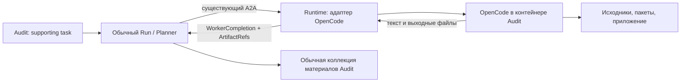
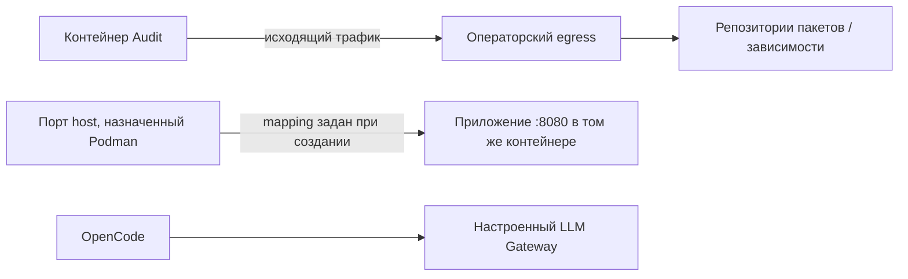
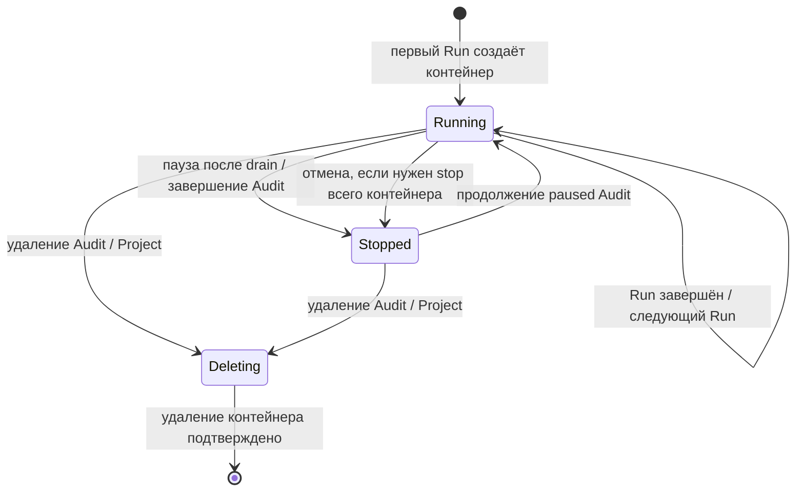

# OpenCode и сохраняемые окружения Audit

Статус: предложение от 29 октября 2026 года, уточнено и разбито на задачи
16 ноября 2026 года. Задачи V469-001–V469-005 имеют статус `pending`;
реализация и активация в Workflow ещё не выполнены. Решения первого среза
ниже заменяют прежние открытые варианты о числе контейнеров, публикации
портов и поведении при паузе/завершении Audit.

Предлагается добавить OpenCode как автономного исполнителя общих задач
за существующей A2A-границей Contractor. Он работает своим инструментарием
в отдельном сетевом rootless Podman-контейнере с UID 0 внутри и записываемой
файловой системой. Тот же контейнер сохраняется как рабочий стенд Audit:
файлы, установленные приложения и запущенные сервисы доступны следующим Run.

Основной сценарий: подготовить приложение, собрать и развернуть сервис
в окружении Audit, проверить его отдельными Runs, затем исправлять и повторно
проверять в той же среде. Завершение allocation освобождает слот Runtime;
окружение и приложение имеют отдельный, принадлежащий Audit жизненный цикл.

## Минимальный первый срез — решение 16 ноября 2026

Пользователь выбрал **один сохраняемый контейнер на Audit и порты, заданные
при его создании**. При паузе и завершении Audit контейнер **останавливается
с сохранением файлов и установленных пакетов до явного удаления Audit**;
продолжение приостановленного Audit запускает тот же контейнер. Это
сохранение диска, а не памяти процессов: приложение поднимает supervisor.
Существующая пауза не отменяет активные Runs: сначала они заканчивают работу,
затем останавливается контейнер. Завершённый Audit не получает новую операцию
возобновления.

Для выполнения минимальными доработками предлагается следующий объём:

- Сохранить обычные Audit, Run, Planner, A2A, сборку WorkerCompletion и
  ArtifactStore. Добавить один Runtime-адаптер OpenCode и явное владение
  контейнером со стороны Audit внутри существующего механизма Podman.
- Начать с supporting tasks: подготовка приложения, проверка запуска,
  доработка и обычные выходные материалы. Существующий `auditimport`
  сохраняет такие outputs без обязательного слота `result` и без создания
  гипотезы или вердикта проверки. Перенос `audit-results@2`, всех toolsets
  и Skills в OpenCode не нужен для этого сценария.
- Одна изменяющая allocation на окружение. Новая allocation получает новую
  OpenCode-сессию; последовательные shared-подзадачи одной allocation
  продолжают её сессию. Файлы сохраняются независимо от истории диалога.
- Один подготовленный Linux host с rootless Podman; конкретная облачная VM
  подходит как тот же host. Создание VM, перенос контейнера, пользовательские
  туннели и поддержка всех вариантов Podman Machine не входят в первый срез.
- Пакеты скачиваются через операторский egress host/container. Controlled
  HTTP bridge и engagement target allowlist не являются зависимостями.
  Shell-трафик не получает гарантий target scope, credential injection и
  учёта HTTP engagement; этот режим нельзя выдавать за controlled transport.
- При невозможности доказать остановку только исполнения OpenCode после
  отмены допускается остановка всего контейнера с сохранением диска.
  Приложение при этом временно недоступно; неизвестный исход блокирует
  следующую allocation до reconciliation.

CLI, конкретная версия OpenCode, доступные бюджеты и дисковые ограничения
проверяются первым прототипом. Это технические предложения плана, а не
дополнительные пользовательские требования. Если для них нужен новый
сетевой или ресурсный сервис, план пересматривается до production-реализации.

### Как проходит работа



Runtime формирует доверенный результат сам. Фраза OpenCode «приложение
работает» остаётся отчётом исполнителя; готовность подтверждает отдельная
проверка. Первый Run устанавливает зависимости и запускает приложение,
следующий получает тот же контейнер без повторного копирования baseline
поверх изменений.



Исходящий доступ для `apt-get update`/скачивания пакетов и входящий порт
приложения — разные настройки. Конкретные DNS/firewall/proxy ограничения
операторского размещения сохраняются. Например, `127.0.0.1:43127` на VM
доступен на этой VM; это не ссылка для браузера на ноутбуке без отдельного
настроенного доступа.

### Что сохраняется между Runs



Схема показывает поведение, а не новый enum API. При неизвестном результате
stop/delete или недоступном host фактический статус остаётся неподтверждённым;
повторное использование и окончательное удаление записи блокируются.
Штатное освобождение allocation оставляет сервис работающим, пока Audit
активен. После паузы сохраняются rootfs и пакеты, но сервис остановлен.

### Задачи и граница готовности

| Задача | Результат | Зависит от |
| --- | --- | --- |
| [V469-001](../../tasks/v469-001-opencode-audit-prototype.yml) | Реальный узкий прототип: два Run, установка пакета, общий контейнер, stop/resume; выбор транспорта и проверка ограничений | — |
| [V469-002](../../tasks/v469-002-opencode-audit-runtime.yml) | Production-путь через существующие A2A/Artifact/Podman, владение Audit и базовый lifecycle | V469-001 |
| [V469-003](../../tasks/v469-003-opencode-audit-recovery.yml) | Проверка рестартов, потерянных ответов, конкуренции и удаления на реальных процессах | V469-002 |
| [V469-004](../../tasks/v469-004-opencode-audit-workflow.yml) | Один готовый Workflow/program, операторский образ и небольшой блок окружения в Audit | V469-003 |
| [V469-005](../../tasks/v469-005-opencode-audit-release.yml) | Общая приёмка на поддерживаемом Linux и воспроизводимые release evidence | V469-004 |

Прототип — первая демонстрация, а V469-005 — выходной критерий milestone.
Ни одна задача не включает отдельный менеджер сервисов или облачную
платформу. Первый прототип фиксирует точные пределы портов, сохраняемых
контейнеров, диска, логов, вывода и времени; до этого зависимые задачи не
считаются готовыми к выполнению. Реальный OpenCode со scripted Gateway
проверяет интеграцию, но не доказывает качество автономной работы модели.

## 1. Зафиксированное направление

| Решение | Предлагаемое поведение |
| --- | --- |
| Исполнитель | OpenCode выполняет работу собственными shell, файловыми инструментами, сессиями и расширениями |
| Контроль работы | Planner выдаёт подзадачи и получает отчёты через существующий A2A Runtime |
| Контейнер | Отдельный rootless Podman-контейнер, сеть включена, workload работает как namespace root, rootfs записываемая |
| Образ | Базовый образ и установка OpenCode определяются операторским Dockerfile |
| Настройки | Отдельная типизированная конфигурация OpenCode рядом с другими инфраструктурными настройками Runtime |
| Сохранение | Сохраняется исходный рабочий контейнер, включая установленное во время работы ПО |
| Владелец среды | Audit; один контейнер, одна изменяющая allocation одновременно |
| Порты | Фиксированный набор при создании контейнера, без forwarder |
| Пауза и завершение | Stop с сохранением диска до явного удаления Audit |
| Размещение | `local` либо конкретный `cloud/<cloudname>/<vmid>` |
| Контекст OpenCode | Одна явно выбранная сессия для последовательных подзадач в одной allocation |
| Гарантии | Полная эквивалентность ADK tooling, наблюдений и бюджетов не предполагается |

Выделение второго контейнера приложения после сборки не является выбранной
моделью. Дальнейшее развитие может добавить такой способ деплоя отдельно,
но первый вариант сохраняет именно среду, которую подготовил OpenCode.

## 2. Существующие границы и необходимые изменения

В Contractor уже есть [A2A WorkerInvoker](../../internal/planner/a2a/client.go)
с SendMessage, GetTask и CancelTask. `streamline@1` передаёт текущую подзадачу
единственному подготовленному Worker; `router@1` выбирает Worker из
подготовленного набора. См. [Planners](../spec/execution/planners.md),
PLN-R7–R8, PLN-R38 и PLN-R114.

На стороне Runtime [A2A-сервер](../../runtime/src/contractor_runtime/a2a_server.py)
принимает строгий StageContentRequest и возвращает WorkerCompletion.
Новая интеграция сохраняет эту внешнюю границу:

```text
Planner: execute_current_subtask
    -> существующий A2A WorkerInvoker
    -> allocation-scoped A2A endpoint Runtime
    -> адаптер OpenCode
    -> OpenCode в сохраняемом окружении Audit
    <- итоговый текст, доступные сведения об исполнении, выходные файлы
    <- Runtime-owned WorkerCompletion
```

Отдельный сторонний A2A-wrapper вокруг OpenCode для этой схемы не нужен.
Внутренний транспорт адаптера — CLI либо private HTTP API закреплённой
версии; прототип выбирает один. Проверка документации 16 ноября 2026:
текущие [CLI](https://opencode.ai/docs/cli/) и
[API](https://opencode.ai/docs/api) относятся к V2, а прежняя документация
`opencode serve` находится в V1. Нельзя смешивать их контракты или подключать
allocation к общему пользовательскому OpenCode-сервису host.

Это расширение архитектуры, а не готовая настройка существующего Runtime:

- [Runtime Agent](../spec/execution/runtime-agent.md), RTA-R1–R5, и
  [AgentTemplates](../spec/configuration/agent-templates.md), TPL-R3–R5,
  сейчас определяют Worker как allocation-local in-process runtime.
- [Code execution](../spec/tools/code-execution.md), EXE-R1, привязывает
  контейнер к allocation. Текущие профили используют read-only rootfs,
  workload с непривилегированным UID и allocation-scoped cleanup.
- [Worker](../spec/execution/worker.md) определяет ADK-зависимые сессии,
  callbacks, наблюдения, бюджеты и сборку результата.

Перед реализацией эти владельцы контрактов должны получить явный новый
вариант. Существующие `adk@1`, `tool@1`, `podman@1` и `podman-network@1`
сохраняют свои правила. Условный ref нового исполнителя — `opencode@1`;
он пока не зарегистрирован и не является допустимой конфигурацией.

## 3. Разделение владения

### 3.1 Окружение Audit

Предлагаемый AuditEnvironment хранит связь с Audit,
закреплённое расположение, точную идентичность контейнера, digest образа
создания, версию конфигурации, состояние и фиксированный mapping портов.
Это логическое имя понятия, а не требование отдельной таблицы или сервиса:
для связи 1:1 сначала рассматриваются поля существующей записи Audit.
Конкретная схема хранения и публичные DTO ещё не выбраны.

Окружение с момента создания принадлежит Audit. Его можно создавать лениво
при первом использовании. Контейнер не становится бесхозным после окончания
первого Run и не требует неявного «пропуска cleanup» для сохранения.

Allocation получает временное право выполнять работу в этом окружении.
В первом варианте изменение одного окружения сериализуется: одновременно
им владеет одна исполняющая allocation. Наблюдающие проверки могут обращаться
к опубликованным сервисам; правила их параллельности определяются отдельно.

Общий срок жизни среды и её фактические изменения относятся к Audit.
Новый Run не должен повторно гидратировать исходный baseline поверх
накопленных файлов. Начальные материалы, изменения и экспорт результатов
требуют явных правил, сохраняющих происхождение артефактов.

### 3.2 Исполнение OpenCode и работа приложения

OpenCode — временное исполнение задания. Приложения запускаются под
supervisor внутри того же контейнера, чтобы штатное завершение OpenCode
сохраняло запущенный сервис.

Окончание Run, завершение allocation и освобождение слота Runtime
не являются удалением окружения. Отмена или потеря lease allocation
останавливает её исполнение OpenCode; дальнейшая судьба среды определяется
владельцем Audit. Точный механизм остановки и границы гарантии при root
внутри контейнера требуют прототипа. Возможность OpenCode управлять всеми
процессами своего контейнера исключает обещание изоляции приложения от
ошибочных действий самого исполнителя.

Нельзя применять прежний allocation watchdog к сохраняемому контейнеру
без изменения владения: текущий cleanup уничтожил бы стенд между Run.
Процесс управления окружениями должен переживать освобождение отдельных
слотов, распознавать Audit-owned контейнеры после рестарта и согласовывать
их состояние с Server. При неизвестном исходе остановки или владения среда
не выдаётся следующей allocation как заведомо свободная.

### 3.3 Сессии

Адаптер явно хранит соответствие allocation и OpenCode session_id.
Последовательные A2A-подзадачи в shared-режиме продолжают ту же сессию;
файлы и установленные приложения сохраняются в окружении независимо от
сессии. A2A Task ID, allocation ID, Run ID и OpenCode session_id остаются
разными идентификаторами.

Продолжение истории OpenCode между allocations не входит в первый срез:
каждая новая allocation получает новую сессию. Неподдерживаемый session mode
отклоняется при admission, а не молча меняется. Существующий allocation-local
контракт сессий описан в [Worker](../spec/execution/worker.md), WRK-R65–R76.

## 4. Конфигурация и образ

Предлагается отдельная типизированная OpenCode-конфигурация в системе
[RuntimeConfig](../spec/configuration/runtime-config.md). Она разрешается
и закрепляется обычным механизмом Runtime labels вместе с остальной
инфраструктурной конфигурацией; расположение выбирается placement labels.
Имена будущих блоков и способ авторинга отдельного документа ещё не выбраны.

| Уровень | Ответственность |
| --- | --- |
| Операторский Dockerfile и deployment | Базовый образ, версия OpenCode, предустановленные приложения, supervisor; заранее собранный образ |
| Конфигурация окружения Runtime | Разрешённые CPU/RAM/PID и дисковые границы, сеть, политика публикации, доступность профиля root workload |
| OpenCode-конфигурация | Минимальные permissions, параметры запуска и сессий; произвольные MCP/расширения вне первого среза |
| Существующая LLM-конфигурация Contractor | Gateway, выбранная модель и credentials |
| Workflow и Planner | Состав работы, инструкции, входные материалы и ожидаемые результаты |

Образ выбирается deployment, а не моделью или произвольными аргументами
задания. В provenance сохраняется фактически использованный digest образа;
установленные затем пакеты меняют writable layer и входят в состояние стенда.
Rootless Podman и namespace UID 0 позволяют устанавливать приложения внутри
контейнера без предоставления root на машине размещения. Поддерживаемый
набор capabilities для установки пакетов и supervisor проверяется отдельно.

Model/Gateway credentials выдаются на время исполнения. Сохраняемая среда
и конфигурация OpenCode не должны делать allocation credentials постоянными
секретами Audit. Секреты, действительно необходимые приложению между Run,
имеют отдельного владельца и срок жизни; их новый механизм передачи
не входит в первый срез. Адаптер использует временную конфигурацию и
удаляет собственные credentials/state после исполнения. Namespace-root
workload может читать выданные ему credentials: очистка адаптера не
обещает удалить произвольные копии, которые workload записал в свои файлы.

## 5. Размещение и сетевая доступность

Для первого варианта выбраны два вида расположения:

- `local` — локальная машина с общей средой Podman;
- `cloud/<cloudname>/<vmid>` — конкретная облачная VM.

Audit закрепляет расположение стенда. Все дочерние Run, которым нужен
доступ к нему, получают совместимое обязательное требование размещения.
Выбор любой VM только по широкому `cloud` или `cloud/<cloudname>` для уже
созданного стенда не подходит.

Используется существующее иерархическое сопоставление placement labels:
[Control Plane](../spec/execution/control-plane.md),
[Run placement](../spec/execution/runs.md), RUN-R107–R109, и
[реализация сопоставления](../../internal/contracts/placement_labels.go).
Публичный запуск использует обычные `labels`; `requiredPlacementLabels`
является производным сохранённым ограничением, а не новым публичным полем.

Label определяет пригодность исполнителя по расположению. Для конкретного
контейнера дополнительно хранится его фактическая идентичность и владелец.
Оператор должен обеспечивать, что выбранный VM label действительно обозначает
одну среду размещения. Для `local` первая версия предполагает одну машину.

Совпадение placement не создаёт сетевого доступа автоматически. Rootless
Podman разных host users также не образуют одну общую сеть. Deployment
обеспечивает согласованный Podman owner/network либо доступ через локальные
публикации. Standby или повторный запуск Runtime на той же VM должен
подтвердить доступ к нужному окружению до приёма задания.

При недоступности выбранного расположения Runs ожидают восстановления
или завершаются согласно принятой политике; перенос на другую VM требует
явной процедуры восстановления стенда. Автоматическая межмашинная миграция
контейнера и распределённая mesh-маршрутизация в первый вариант не входят.

## 6. Фиксированные порты первого среза

Решение пользователя 16 ноября заменяет прежний вариант с `publish_service`
и контейнером-перенаправителем на каждый порт. Операторская конфигурация
задаёт конечный набор container ports и разрешённый bind address до создания
окружения. Для демонстрации достаточно одного HTTP-приложения на TCP-порту.
OpenCode получает эти параметры и запускает приложение на подходящем
интерфейсе контейнера; произвольные Podman flags или host targets не принимает.

Podman назначает host port при создании самого контейнера. Runtime
получает фактический mapping через `podman port`/inspect и сохраняет его
вместе с точной идентичностью окружения. Набор портов неизменен до удаления
окружения; изменение конфигурации не пересоздаёт контейнер с потерей файлов.
Проверка «найти свободный порт», после которой другой процесс делает bind,
не является механизмом резервирования.
[Публикация портов](https://docs.podman.io/en/stable/markdown/podman-run.1.html),
[чтение mapping](https://docs.podman.io/en/stable/markdown/podman-port.1.html).

Новой сущности PublishedService и операций publish/list/inspect/unpublish
в первом срезе нет. Существующее чтение Audit показывает расположение,
mapping и наблюдаемое состояние. Mapping не доказывает готовность приложения;
сведения самого OpenCode о health check остаются отчётом исполнителя.
После рестарта Runtime сверяет реальный mapping, а недоступность или
несовпадение показывает явно. Удаление портов следует удалению контейнера.

Динамическую публикацию можно пересмотреть, когда появится реальный сценарий,
где порты невозможно объявить заранее. До этого добавление порта требует
нового окружения в другом Audit, а не скрытого recreate текущего.

Endpoint всегда несёт расположение и область доступности. Например,
`127.0.0.1:43127` на `cloud/cloudru/vm1` относится к этой VM. Для локальных
на ней Runtime этот адрес может быть доступен напрямую; браузеру на другой
машине потребуется отдельно настроенный туннель или ingress. Автоматический
пользовательский tunnel пока не является принятой частью предложения.

## 7. Отчёт исполнителя и работа планировщика

Адаптер передаёт OpenCode цель, инструкции, материалы и ожидаемые выходы.
OpenCode самостоятельно выбирает последовательность действий. Planner
получает:

- итоговый текст: что сделано, какие проверки исполнитель выполнил,
  оставшиеся вопросы и блокеры;
- зарегистрированные артефакты, идентичность среды и фиксированные endpoints;
- статус завершения исполнения и доступные сведения о времени и usage;
- техническую ошибку при сбое адаптера или невозможности получить результат.

Модель OpenCode не становится автором доверенного WorkerCompletion.
Runtime собирает envelope и точные ArtifactRefs. Публикация выходных файлов
должна отдельно учитывать, что writable environment root виден workload:
неподтверждённый путь или запись за пределами экспортируемого workspace
не превращаются в доверенный артефакт только по тексту ответа.

Успешное завершение OpenCode и утверждение «сервис готов» дают планировщику
отчёт исполнителя. Он может назначить отдельную проверку доступности,
тестирование или доработку. Промежуточные JSON/HTTP-события адаптер может
показывать как progress; отображение в UI и передача промежуточного progress
в рассуждение Planner — разные, пока не выбранные возможности.

Гарантии существующего ADK backend не переносятся автоматически:

- собственные shell и файловые инструменты OpenCode не дают прежних
  детерминированных Contractor observations;
- лимиты model/tool calls и callbacks ADK не ограничивают внутренний цикл
  OpenCode; нужны собственные явно поддерживаемые ограничения;
- отсутствующие usage или сведения о действиях обозначаются как unavailable,
  а не как ноль или выдуманное наблюдение;
- встроенные compaction, summarization, MCP и подагенты OpenCode принадлежат
  его собственной конфигурации и требуют отдельной проверки поведения.

Конкретные расширения WorkerResult, Worker State и capability descriptors
определяются до реализации. Планировщик должен видеть доступные свойства
исполнителя и не требовать ADK-специфичных проекций от OpenCode backend.

## 8. Жизненный цикл и восстановление

| Событие | Направление решения |
| --- | --- |
| Последовательная подзадача в allocation | Та же сессия OpenCode и тот же контейнер |
| Завершение Run/allocation | Исполнитель завершён, слот освобождён, стенд и публикации сохранены |
| Следующий Run Audit | Доступ к тому же стенду на закреплённом расположении |
| Ошибка, отмена Run или потеря allocation lease | Остановка текущего исполнения, сохранение владения средой у Audit; неизвестный исход блокирует повторную выдачу |
| Пауза Audit | Запрет новых Runs, drain текущих, stop контейнера; файлы и пакеты сохранены |
| Продолжение paused Audit | Start того же контейнера; supervisor запускает приложение, новая allocation — новую сессию |
| Терминальный Audit | Stop контейнера; rootfs хранится до явного удаления Audit |
| Явная очистка/удаление Audit | Подтверждённая очистка среды и публикаций; недоступные ресурсы остаются видимыми до reconciliation |
| Рестарт Runtime или Server | Сверка durable ownership с контейнерами, публикациями и активными исполнениями |
| Потеря/замена VM | Среда unavailable; восстановление или явная утрата состояния, без предположения о переносе по одному label |

Нужен один владелец состояния ресурса и один механизм reconciliation.
Создание записывает идентичность операции до внешнего действия;
потерянный ответ сверяется с тем же ресурсом. Обычный allocation orphan
cleanup не удаляет Audit-owned окружения, а сохранённая запись не позволяет
ошибочно принять чужой или пересозданный контейнер за прежний стенд.

## 9. Открытые решения перед реализацией

1. Точный authoring/resolved контракт OpenCode-конфигурации и различие
   между конфигурацией backend и операторской политикой контейнера.
2. CLI или HTTP API, supervisor, остановка исполнения и поведение при
   неподтверждённой остановке в окружении с namespace root.
3. Минимальное хранение идентичности окружения у Audit и read projection
   UI/API; отдельная PublishedService не нужна. Обслуживание host расширяет
   существующего Podman owner, не создаёт второго конкурирующего владельца.
4. Точные конечные пределы портов, сохраняемых контейнеров на host,
   диска, логов, вывода и времени. Один контейнер/Audit и один writer уже выбраны.
5. Ephemeral state/config OpenCode, безопасный экспорт файлов и происхождение
   изменений относительно исходных материалов Audit. Меж-allocation история
   и новый механизм долговременных секретов приложений исключены.
6. Представление неполных наблюдений и usage в WorkerCompletion/State,
   правила Planner для независимой проверки отчёта внешнего исполнителя.

## 10. Проверка будущего прототипа

Минимальный end-to-end сценарий должен показать работу существующего
Planner/A2A пути: OpenCode устанавливает зависимость, собирает сервис,
запускает его в исходном контейнере, публикует endpoint и отчитывается.
После освобождения allocation другой Run того же Audit на том же
расположении обращается к сервису и проверяет сохранённые файлы/пакеты.

Нужны отдельные сценарии продолжения OpenCode-сессии между подзадачами,
конфликтующей выдачи окружения, отмены исполнения при работающем сервисе,
коллизии bind при создании контейнера, потерянного ответа, рестарта владельца,
недоступной VM и очистки Audit. Проверки должны различать освобождение
allocation и удаление среды. Live-model успех на одном примере не доказывает
эквивалентность бюджетов, инструментов или гарантии существующего Runtime.

## 11. Область первого варианта

Первый вариант ориентирован на общие задачи внутри Audit и сохраняемый
локальный стенд либо стенд на конкретной VM. Он переиспользует существующую
A2A-границу и placement, добавляя явное владение средой и отчёт внешнего
исполнителя. Произвольные удалённые A2A-агенты, публичный хостинг,
автоматическая миграция VM, независимый deployment pipeline и полный
перенос ADK guarantees в OpenCode не входят в выбранный первый срез.
