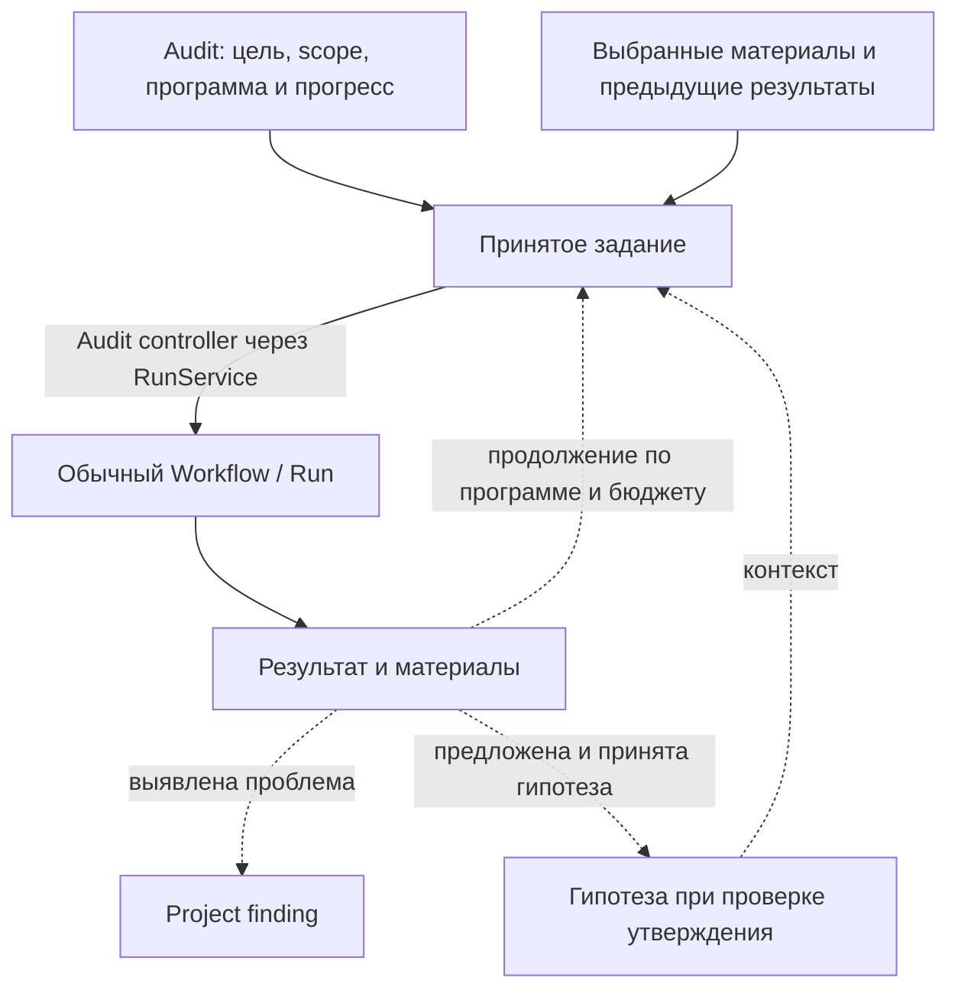
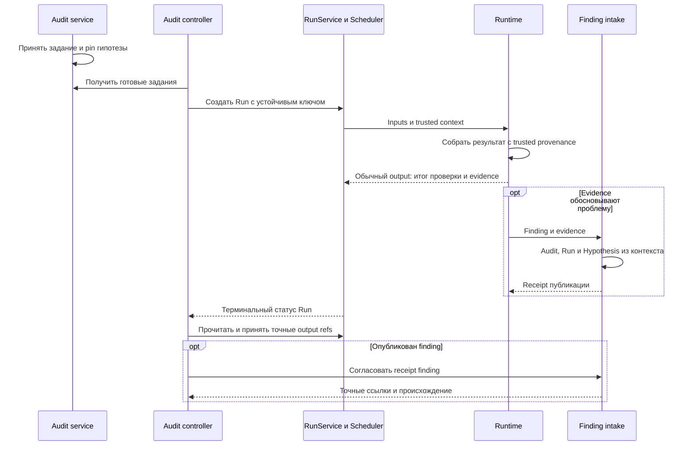
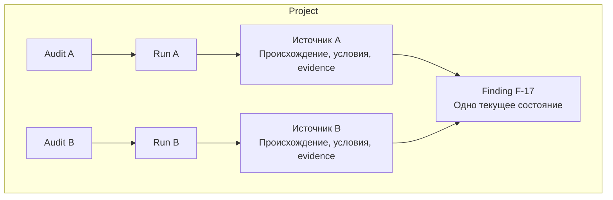
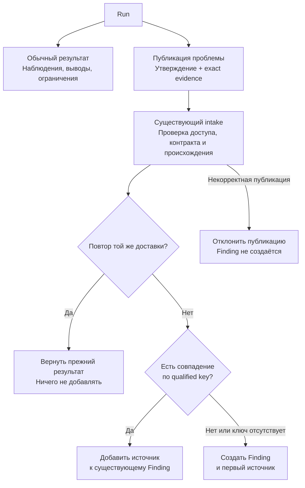
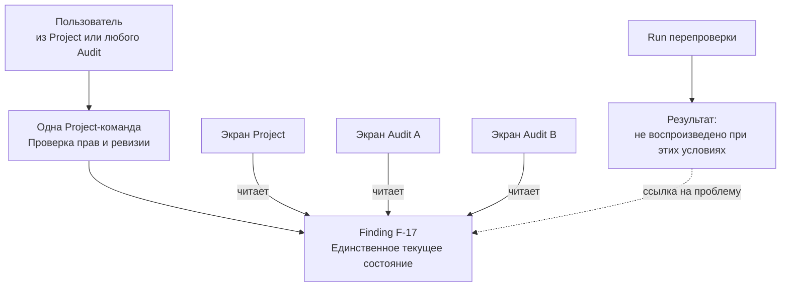
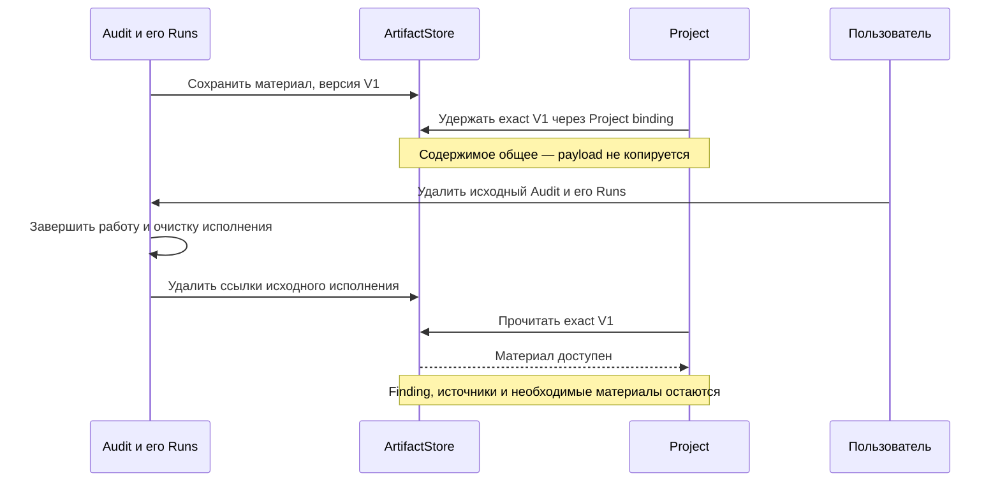
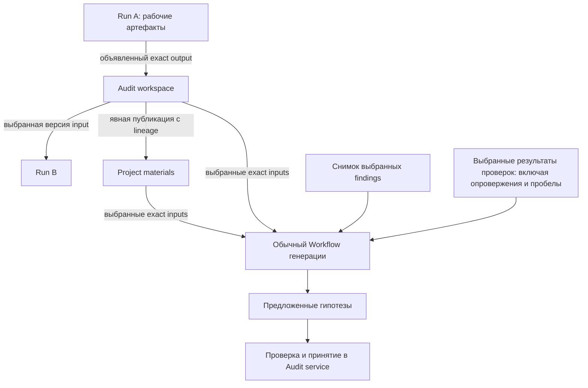

# Переработка Audit как платформы исследований

Дата исходного дизайна: 2026-10-31. **Статус на 2026-11-06: частично
реализован; базовый release gate V64-011 остаётся pending.** Контракт V64-001,
общий coordinator, Project Findings, реестр гипотез, передача материалов,
Workflow-генерация, API/CLI и перенос shipped программ завершены. Общий UI
V64-009 и регрессия лимита отчёта V425-017 остаются pending. Task records
владеют точными статусами, назначениями и проверками; датированные решения
ниже сохраняют историю дизайна.
[Порядок задач](../plans/2026-10-31-audit-redesign.md) · [Текущая спецификация](../spec/audits/audits.md)

Уточнение пользователя от 2026-11-05: материалы и возможности чтения определяются
конфигурацией обычного Workflow; такой Workflow может создавать гипотезы.
Подробный целевой контракт, основания, момент публикации и границы continuation
описаны в [спецификации производства гипотез](../spec/audits/hypotheses.md).
Реализация V64-033/034 с исправлениями V64-035/036 включена в main и заменяет
numbered-source решение V64-013. [Исходное обсуждение](0054-workflow-hypothesis-production.md)
сохранено в истории; текущие контракты принадлежат `docs/spec/`.

Contractor организует исследования с подключёнными инструментами. AppSec —
текущая предметная область. Audit хранит цель и прогресс одного исследования,
запускает обычные Workflow и позволяет остановиться и продолжить работу.
Уменьшение сложности Audit — критерий приёмки переработки.

## Принятые решения и предложения для ревью

Пользователь 2026-10-31 принял следующие направления:

- Все проверки утверждений используют общую модель гипотез. Checklist задаёт
  исходные гипотезы; исследование может создавать новые по ходу работы.
- Общий каркас: принятое задание → обычный Workflow/Run → результат и
  материалы. Исследование, проверка и генерация — назначения обычных Workflow.
  Finding и генератор не являются обязательными ступенями каждого Audit.
- Каждая проверка сохраняет результат: подтверждение, опровержение или
  недостаточность данных с evidence и условиями проверки. Finding в AppSec —
  выявленная проблема с достаточными основаниями; результат проверки может
  обойтись без finding. Это уточнение заменяет раннюю трактовку любого вывода
  как finding. Исследовательская находка может не иметь предварительной гипотезы.
- Нужно сохранять Audit и Run происхождения, связь с гипотезой при её наличии,
  доказательства, дедупликацию и независимые источники результата.
- Ссылку на точную гипотезу система получает автоматически из контекста
  задания. Пользователь и модель не собирают `hypothesis_id + revision`.
- Формальный процесс согласований удаляется: review requests, ожидание
  одобрения и утверждение отчётов. Уточнение пользователя от 2026-10-31:
  отдельный переход со старых approvals и режим совместимости не нужны.
- Полезные артефакты Audit должны публиковаться в Project. Гипотезы в будущем
  тоже могут стать Project-owned: Audit остаётся источником, идентичность и
  история связей сохраняются.
- Генерация гипотез может быть отдельным обычным Workflow по выбранным
  материалам Audit/Project, результатам проверок и существующим findings.
  Опровержения и неполные результаты тоже помогают выбрать следующую работу.
- План и схемы сначала проходят ревью пользователя; затем начинается код.

Предложения этого пакета: сейчас гипотезы принадлежат Audit, findings —
Project; рабочие материалы получают полноценное владение Audit внутри
ArtifactStore. Пользователь 2026-10-31 подтвердил мягкую паузу/drain, Resume
принятой работы и окончательный Cancel. Удаление approvals согласовано и не требует отдельного
решения о продолжении старого approval lifecycle.

Названия публичных ресурсов пока сохраняются. Массовый `Audit → Research`
rename и универсальный framework инструментов в базовый сценарий не входят.
Текущая нормативная спецификация меняется вместе с последующей реализацией.

## Базовый пользовательский сценарий

1. Пользователь выбирает Project, материалы, цель и программу исследования.
2. Audit запускает обычный Workflow без начальной гипотезы. Тот получает
   сведения о приложении и публикует материал и finding с реальными evidence.
3. Следующий Workflow использует точную версию материала. Полезный материал
   можно опубликовать в Project и использовать в другом исследовании.
4. Обычный Workflow генерации получает выбранные Audit/Project материалы,
   результаты предыдущих проверок и снимок findings, предлагает гипотезу и
   следующую проверку.
5. Server принимает допустимую гипотезу и задание. Проверяющий Workflow
   получает гипотезу автоматически; результат связывается с её версией.
6. Подтверждение гипотезы о баге может дать finding; опровержение остаётся в
   истории проверок. UI показывает оба результата, доказательства, источник и
   оставшуюся работу. Исходный checklist сохраняет свой знаменатель покрытия.
7. Пауза, перезапуск Server и потеря ответа не создают повторных Runs или
   результатов. При продолжении используется уже принятая работа.
8. После удаления Audit опубликованные Project-материалы и findings с нужными
   evidence и снимками источников остаются доступны.

Этот сценарий проверяется с реальными Server, Runtime и PostgreSQL,
детерминированным Gateway и небольшим локальным HTTP fixture. Он доказывает
интеграцию и восстановление, но не качество живой модели.

Это объединённая демонстрация возможностей, а не обязательный порядок стадий
Audit. Можно начать с ручной гипотезы/checklist, с генерации по выбранным
материалам или с exploratory задания. Исследование может завершиться без finding
и без вызова генератора; такие результаты сохраняют самостоятельную ценность.

## Общий путь выполнения и владение

Сплошные стрелки показывают общий путь задания. Пунктирные — возможные связи,
а не автоматические триггеры. Гипотеза обязательна при проверке утверждения;
exploratory и supporting работа может выполняться без неё. Генерация тоже
выполняется обычным заданием, а её предложения принимает Audit service.
Программа, доступные inputs и бюджет определяют дальнейшую работу.

| Элемент | Минимальное содержание |
| --- | --- |
| Audit | Project, цель, baseline/scope и программа, управление выполнением, оставшаяся работа, причины остановки |
| Hypothesis | Стабильный ID, точная версия утверждения, scope, основания и происхождение |
| Задание | Audit, выбранный Workflow, точные inputs/parameters, версия гипотезы при наличии, связи с попытками Run, принятый результат |
| Результат проверки | Обычный immutable output задания/Run: supported, refuted либо inconclusive, обоснование, evidence и проверенные условия; для exploratory работы — наблюдения без обязательного verdict |
| Finding | Project, выявленная проблема, subject/context и нужные предметные данные; создаётся при достаточных evidence |
| Источник finding | Audit, задание/Run и его результат, гипотеза при наличии, exact evidence и время/условия наблюдения |
| Артефакт | Обычная версия ArtifactStore с владельцем, media type, digest, lineage и retention |

Это логические обязанности, а не требование новых таблиц или сервисов.
Источники findings используют существующие intake/provenance/receipt механизмы.
Результат остаётся обычным output/артефактом: отдельный assessment ledger,
result service или новая очередь для него не нужны. Технический статус исполнения
берётся из Run; второй набор running/failed/succeeded для AuditExecution не
нужен. Одна попытка может исполнять совместимые задания batch, если это
действительно полезно текущему Workflow.

Итерация — номер и зафиксированная порция выбранной работы. Новые результаты
порождают следующие задания, не переписывая уже принятые inputs. Отдельные
Round controller, research phase и многоэтапный протокол допуска не вводятся.

## Автоматическое происхождение результатов

Пользователь выбирает гипотезу или программу. Server фиксирует её актуальную
на момент принятия задания версию. Модель формирует содержательный вывод и
выбирает допустимые evidence; идентичности и версии подставляет код.

Workflow проверки запускает Audit controller через RunService. Он выбирает
готовое принятое задание с учётом policy, prerequisites и бюджета; Scheduler
дальше исполняет Run. Конкретный checking Workflow уже указан в задании:
он задан программой/checklist, выбран пользователем или предложен producer из
разрешённых bindings. Audit service проверяет предложение до постановки в работу.
Сама гипотеза не является автоматическим триггером запуска, а генератор не
получает право создавать Runs напрямую.

В batch связь определяется для конкретного элемента через доверенную
membership. Список гипотез Run нельзя приписать всем находкам. Дополнительная
исследовательская находка может не иметь гипотезы даже внутри checking Run.
Новая версия гипотезы и повторная попытка не меняют уже принятый pin.

У гипотезы ID независим от владельца. Origin с Audit/Run и источниками остаётся
историческим фактом. Будущий перенос владения в Project локализуется в owner
lookup, доступе, хранении и retention; consumers продолжают использовать ID и
версию. Сейчас реализуется один вариант владения без второго реестра.

## Как формулировать гипотезу

**Предложение для ревью, а не новый обязательный schema/type:** формулировать
гипотезу как одно проверяемое утверждение: «кто/что при условиях C проявляет
наблюдаемое поведение P». Scope задаёт объект, baseline и существенные условия;
основания объясняют, почему это стоит проверить. Способ проверки описывает,
какое наблюдение поддержит утверждение и что позволит его опровергнуть.
Эти сведения помещаются в уже предусмотренные утверждение, scope и основания,
а конкретная последовательность действий принадлежит checking Workflow/заданию.

Для поиска проблем рекомендованная форма — предполагаемое нарушение:
«пользователь A с ролью reader может получить документ пользователя B через
GET /documents/{id} в выбранном baseline». «Проверить авторизацию» — задача,
а «в приложении есть IDOR» — слишком широкое утверждение для одной проверки.
Шаблоны/checklists и генератор могут следовать этому правилу без отдельного
классификатора полярности, формального языка или обязательных подтипов гипотез.
Проверки положительных свойств остаются допустимыми в той же модели.

Невоспроизведение на одном примере не опровергает существование бага во всём
приложении. Результат ограничивается проверенными условиями; когда их
недостаточно для заявленного утверждения, итог — inconclusive с явным пробелом.
Гипотеза не должна содержать выдуманное доказательство как установленный факт.

## Результаты проверок, findings и дедупликация

Связь имеет вид **задание → результат → необязательный finding**. Подтверждение
или опровержение относится к утверждению; finding выделяет значимую находку
по правилам предметной области. В AppSec это проблема, которую обосновывают
evidence. Verdict сам по себе не определяет наличие finding.

| Проверяемое утверждение | Результат | Finding |
| --- | --- | --- |
| В заданных условиях A может прочитать чужой документ | Supported с достаточными evidence | Проблема доступа либо новый источник уже известной проблемы |
| То же утверждение | Refuted в проверенном scope | Нет; результат и evidence остаются в истории |
| В заданных условиях доступ ограничен владельцем | Supported | Нет; свойство подтверждено в проверенном scope |
| То же положительное свойство | Refuted с evidence нарушения | Проблема доступа |
| Любое утверждение | Inconclusive, включая недостаточные условия проверки | Нет автоматического finding; сохраняются причины и пробелы |

Finding — одна сущность Project с одним текущим состоянием. Audit хранит ссылки
на неё и показывает выборку по связанным источникам и проверкам. Изменение finding
видно во всех Audit через ту же запись; отдельного Audit finding с собственной
severity, статусом, review или логикой синхронизации нет. Источник объясняет,
где и как обнаружена проблема, и хранит исторические факты, а не второй finding.
Повтор публикации после потерянного ответа не добавляет новый источник.
Независимые эксперименты сохраняют отдельные источники и evidence, даже когда
допустимая дедупликация показывает их как одну находку.

Дедупликация применяется к проблемам/findings. Результаты независимых проверок
сохраняются отдельно, включая опровержения. Совпадение
названия, CWE или текста не устанавливает идентичность. Используются
проверенные producer/structural keys и существующие правила домена;
семантические подсказки остаются подсказками. Решение о дедупликации сохраняет
все Audit/Run и exact hypothesis associations, а не один «главный Audit».

Уточнение от 2026-11-01: V64-014 переносит владение finding и источниками в
Project, переиспользуя текущие ключи, правила равенства, поиск кандидатов и
исправление дубликатов человеком. Новый алгоритм или Workflow смыслового
сопоставления в этот шаг не входит. Exact evidence сохраняется существующим
Run → Project fork; новый Audit scope из V64-004 для этого не требуется.

Публикация проблемы требует хотя бы одного выбранного exact evidence, отличного
от самого proposal. Server проверяет структуру, доступ и происхождение,
но наличие evidence не означает автоматического `confirmed`. Proposal без evidence
сохраняется обычным результатом с receipt; приём proposal сама по себе не создаёт
карточку проблемы, гипотезу или очередь согласования. При миграции прежние
предположения и их пометки сохраняются без выдуманных evidence или подтверждения.
Обоснованная проблема может появиться без человеческой оценки; её отсутствие
само по себе не исключает публикацию по тем же правилам.

Прежние оценки вроде `confirmed/high` и `rejected` остаются историческими
пометками с условиями, evidence и авторством. Новые результаты проверок — обычные
immutable outputs. Ни пометка, ни результат не имеют отдельного изменяемого
Finding lifecycle и не требуют держать живую строку старого Audit finding.
Текущая оценка Project отсутствует до явной пометки на уровне Project; она не
вычисляется по последнему источнику, представителю группы или максимальной
severity. Различия видны в страницах источников, отдельный статус конфликта не
нужен. V64-014 переносит существующие чтение и команды изменения в Project и
удаляет Finding-specific formal reviews вместе с их callers. V411-010 удаляет
оставшиеся согласования items/reports, используя готовые Project-команды. Исторические duplicate
corrections сохраняют исходные цели и их отображение на Project findings;
схлопнувшаяся в самоссылку пометка остаётся историей, а не активной связью.

Техническая ошибка, отсутствие ответа и недостаточные evidence — незавершённый
результат с причиной. Они не являются опровержением. В обзоре гипотез видны
поддерживающие, опровергающие и несовместимые по условиям выводы; новая запись
не перезаписывает историю по правилу latest-wins.

Повторная проверка известного finding может показать «не воспроизведено при
этих условиях». Этот результат связывается с исходной проблемой, но не удаляет
её историю и сам по себе не объявляет её исправленной. Отрицательные результаты
не попадают в ленту новых проблем; они доступны в истории и входах генератора.

Для AppSec остаются нужные location/severity/classification и необязательные
аналитические пометки. Они не становятся обязательной моделью всех исследований.
Живая модель не объявляется источником абсолютной истины: интерпретация,
измеренный факт и детерминированная проверка имеют явное происхождение.

### Project Finding

Одна проблема хранится как один Finding в Project. Следующие схемы показывают
целевое поведение V64-014: независимые источники, публикацию, изменение текущего
состояния и сохранность материалов при удалении исходного исполнения.

#### Два Audit обнаруживают одну проблему

Источники сохраняют независимые обнаружения. Audit, Task, Run и гипотезу с
точной ревизией, когда она есть, подставляет система. Отдельного изменяемого
finding внутри Audit нет.

#### Публикация и дедупликация

Обычный результат Run сохраняется самостоятельно. Создание finding — отдельное
явное действие через существующий intake.

Слабое сходство остаётся подсказкой. Публикация с evidence сама по себе не
назначает `confirmed`. Некорректная публикация не удаляет уже принятый обычный
результат или proposal и сама по себе не делает Run неуспешным.

#### Изменение состояния и перепроверка

Пользователь меняет finding один раз. Все экраны читают ту же запись.
Перепроверка добавляет результат в историю; текущее состояние автоматически не
меняется. Противоречащие результаты остаются видны вместе с условиями проверки.

#### Удаление исходного Audit

Исторические Audit/Run ID сохраняются в происхождении источника. Для чтения
finding и его evidence живой исходный Audit уже не нужен. Сохранение выбранной
версии в Project использует обычный exact fork с lineage и независимым сроком
владения; новую копию содержимого ради смены scope не создают.

## Артефакты и снимки знаний

ArtifactStore обеспечивает владение и доступ. Runtime получает выбранные
inputs через существующие Run bindings/grants. Ref внутри JSON сам по себе
не даёт права читать произвольный артефакт или рекурсивно переносить данные.
В первом шаге V64-004 передаются явно выбранные артефакты обычными exact forks.
Workflow может иметь несколько входов, каждый из которых выбирается явно.
Ссылки внутри payload не запускают поиск, перенос или удержание зависимостей.
Пользователь 2026-11-01 подтвердил, что автоматическая публикация отчёта вместе
со всем содержимым по его ссылкам пока не в приоритете. Составной sitemap
snapshot с явно выбранными original inputs остаётся отдельным доменным
сценарием V410-025; общего механизма зависимостей для V64-004 не требуется.

Публикация в Project создаёт независимый binding exact версии, сохраняет
lineage и повторно использует ту же immutable version/blob. Это новая binding,
а не физическая копия payload. Source остаётся доступен уже
запущенным consumers. Создание create-only, замена требует явной CAS-предпосылки;
потерянный ответ согласуется с существующим receipt/ключом. Отдельный transfer
job/controller не нужен.

При публикации Project finding удерживаются его evidence и точный снимок
гипотезы, если он нужен для понимания вывода. Удаление Audit не обнуляет исходный
hypothesis ID/revision и не оставляет только ссылку на удалённый текст.
Живой Audit-owned реестр гипотез может быть удалён, а Project finding читает
сохранённый снимок как источник. Это не второй живой реестр гипотез.

## Один цикл координации

Уточнение пользователя от 2026-11-02: выбор операций OpenAPI остаётся
детерминированным предметным преобразованием. Exact OpenAPI/settings получает
обычный Workflow подготовки с Server-operation Stage. Существующий builder
сохраняет правила разбора, выбор операций, условия и пробелы; модуль
`internal/operations` связывает его с объявленными inputs/outputs. Output —
ограниченный список работы с exact материалами, без назначенных Audit/task IDs
и без права создавать Runs. Audit service проверяет этот список, принимает
его порциями через общий путь заданий, назначает идентичности и согласует
повторную доставку. Coordinator запускает отдельные задания по операциям
через RunService; совместимый batch остаётся допустимым. Web-scan сохраняет
одно задание по выбранному target.

Конкретная операция и строгий контракт output → общий приём оформлены как
узкая prerequisite-задача [V64-026](../../tasks/done/v64-026-openapi-prepared-work-operation.yml).
Её реальный producer и validator предшествуют durable-интеграции V64-002;
новых inventory engine, DSL, collector, очереди или receipt/lease store нет.
Это подготовка явно заказанной работы, не обязательная генерация и не
автоматический continuation. Чтение refs внутри произвольного JSON по-прежнему
не даёт права импортировать или удерживать их содержимое.

Программа Audit остаётся небольшим шаблоном исследования:

| Часть | Содержание |
| --- | --- |
| Inputs | Выбранные материалы и их exact версии |
| Allowed Workflows | Именованные разрешённые Workflow с зафиксированными closures |
| Initial work | Исходные exploratory/supporting/generation задания либо гипотезы/checklist с выбранным checking Workflow |
| Continuation | Необязательный обычный Workflow, предлагающий следующие гипотезы и задания |
| Limits и policy | Число задач/итераций/Runs, время, evidence и разрешённые операции |

Второй произвольный граф Workflow внутри Audit не нужен. Следующее задание
создаётся, когда нужные материалы уже приняты, через тот же путь создания
работы. Начальная, ручная и предложенная генератором работа проверяется одним
Audit service. Общий `maxActiveRuns` здесь не появляется: capacity у Scheduler.

Workflow генерации может быть исходным заданием по выбранным материалам —
предыдущий finding для этого не нужен. В роли continuation он вызывается
для зафиксированного нового набора обычных результатов,
когда текущая порция работы закончилась. Его собственный ответ не запускает
бесконечное повторение генератора. Принятый producer Run и использованный набор
источников сохраняются; следующий вызов требует новых входных данных или
явного нового решения. Разрешённые Workflow и бюджет проверяет Server.

1. Прочитать управляющее намерение и ограниченный набор задач/Runs.
2. Собрать завершившиеся результаты, в том числе во время pause/cancel.
3. Передать нормализованные данные существующим владельцам: артефакты в
   ArtifactStore и обычные outputs, выявленные проблемы в finding intake,
   гипотезы в их owner service.
4. Выбрать готовые задания либо один обычный continuation Workflow для нового
   набора принятых результатов.
5. Сохранить намерение запуска и создать обычный Run с устойчивым ключом.
6. При исчерпании работы или явной остановке завершить Audit с правдивыми
   результатами проверок, findings, coverage, пробелами и снимком отчёта.

«Общая приёмка результатов» здесь означает переработку существующей сборки
Runtime и существующих owner API на Server. Нового universal collector нет.
«Обычное создание задания» означает проверку выбранного Workflow, inputs,
scope и бюджета в Audit service с последующим вызовом существующего RunService.
HTTP, checklist и предложенная генератором работа проходят этот же путь.

Provider-specific parsing остаётся в Runtime adapter. Server проверяет общую
нормализованную форму, владельца, источники, ограничения и идемпотентность.
Scheduler продолжает управлять capacity, очередью, Stage retries и allocations.

Выбор работы сначала простой: явное внимание пользователя, prerequisites,
фиксированный порядок и оставшийся бюджет. Принятые результаты и findings могут менять
следующую проверку. Нет повторной генерации на каждом tick без новых данных.
Ранжирование моделью, learned score, большой frontier и attack tree — отдельные
расширения с доказанным caller и измеренной пользой.

## Управление и согласования

| Действие | Предлагаемое поведение |
| --- | --- |
| Start | Зафиксировать inputs, программу, scope, operation policy и бюджет |
| Pause | Запретить новые Runs; текущим позволить завершиться и собрать результат |
| Resume | Продолжить оставшуюся работу на прежних accepted inputs/results |
| Cancel | Запретить новые Runs, отменить и дождаться child work, завершить с частичным итогом |
| Deadline | Мягко приостановить выдачу новой работы с явной причиной |
| Delete | Дождаться cleanup, удалить owner-local данные, сохранить Project publications/findings |

Cancel окончательный. Жёсткое прерывание с последующим Resume в этот вариант
не включено; это отдельное изменение гарантий, если оно понадобится.
Автоматический повтор HTTP-действия после возможной отправки не вводится.

Убираются review requests, expiry/renewal, item approvals и report acceptance.
Остаются разрешённые/запрещённые операции, реальные scope/tool/credential
проверки и прямые необязательные аналитические правки с actor/time/CAS/history.
Неизвестная применимость и отсутствие ручного evidence остаются пробелами.
Отчёт — точный снимок; более поздние пометки не переписывают его bytes.

Уточнение пользователя от 2026-10-31: `approval-required` и весь формальный
approval lifecycle удаляются из целевого контракта. Отдельные перенос
согласований, ожидание выбора новой policy, Resume со старой approval policy
и совместимые варианты API/состояний не вводятся. Обычные ограничения scope,
операций и доступа сохраняются. Карта удаления охватывает старые callers,
поля, состояния, API/UI и storage; необходимые миграции бизнес-данных и точных
отчётных снимков не создают действующих разрешений или фиктивного согласия.

## Что увидит пользователь

| Место | Основное содержание и действия |
| --- | --- |
| Project | Накопленные материалы и findings, список исследований |
| Запуск Audit | Цель, программа, выбранные материалы и разрешённые операции; текущий настроенный model сохраняется |
| Обзор Audit | Что выполняется, что осталось, причина остановки, Pause/Resume/Cancel по фактическому состоянию |
| Материалы | Входы и результаты Workflow; выбранную версию можно опубликовать в Project |
| Гипотезы | Исходные и новые утверждения, версия, основания, история результатов проверок с подтверждениями/опровержениями и пробелами |
| Findings | Выявленные проблемы, evidence и все источники Audit/Run/Hypothesis; простые необязательные аналитические пометки |
| Итог | Снимок отчёта с проблемами и результатами проверок отдельно, исходное coverage и непроверенные области без обязательного утверждения человеком |

Используется существующий UI Project/Audit. Гипотеза и finding связаны
автоматически; системные идентификаторы доступны в Technical details.
Отдельного research studio, графового редактора и approval inbox нет.

## Границы объёма и сложности

Базовый пример мал: два обычных Workflow, несколько findings, две исходные и
одна новая гипотеза. Опубликованные границы задач/итераций/batch и отчётов
сохраняются, пока их изменение явно не принято: до 100 000 tasks на Audit,
10 000 на выбранную порцию, batch до 64 и machine report до 64 MiB с более
строгими применимыми ограничениями владельцев.

Предложение для новых гипотез наследует бюджеты предыдущего draft 0045:
до 10 000 identities, 50 000 revisions, 32 KiB на документ и 256 MiB суммарных
revision bytes. Пользователь подтвердил эти значения 2026-10-31 вместе с mutation slice
128 records / 1 MiB. Контракт закреплён в LIM-ACT/shared fixtures.

Одна mutation обрабатывает до 128 primary records и 1 MiB metadata; списки и
reader responses используют существующие page/byte bounds. Большой родитель
не сканируется целиком ради нескольких ready задач. Реальные read-budget тесты
проверяют это независимо от wall clock. Нового фонового frontier для базовой
очереди нет.

| Текущий механизм | Целевое изменение |
| --- | --- |
| Отдельные research cycles и pre-Round progression | Один coordinator обычных задач |
| Дублирование execution state | Run status плюс необходимые task/result факты |
| Round admission/staging/seals | Небольшие принятые порции задач и номер итерации |
| Внутренние task/result ZIP и переписывание refs | JSON/обычные artifacts и exact input bindings |
| Audit-local findings плюс лишние representatives | Project finding и сохранённые source contributions с дедупликацией |
| Формальный review ledger и report candidates | Operation policy, direct annotations и снимки отчёта |

Каждый механизм удаляется вместе с миграцией его callers. Временная разработка
на feature branch не оправдывает второй постоянный pipeline. В финальном gate
сравниваются production LOC, авторитетные представления, durable states,
controller loops и receipt/lease owners. Перенос файлов сам по себе не считается
упрощением.

## Задачи и ревью

[План](../plans/2026-10-31-audit-redesign.md) задаёт зависимости, базовый exit,
HTTP callers и последующие расширения. V64-003, V64-006 и V64-007 архивированы
как объединённые, а не реализованные. Завершённые V62 остаются историей.
Deferred и чужие in-progress задачи не активированы и не переписаны.

Исходное ревью охватывало владение findings/hypotheses, pause/cancel,
retention при удалении Audit, параметры новых гипотез и базовый сценарий.
Реализованные части описаны действующими specs/API/wire/schema; оставшиеся
этапы и интегрированная готовность проверяются через открытые задачи и V64-011.

## Карта удаления и переноса данных

[Проверяемая карта](0050-audit-removal-map.yml) назначает владельцев текущим
relations, shipped profiles, публичным Audit operations, wire и source paths.
Она не сохраняет approval lifecycle и не выдумывает гипотезы или verdicts
для исторических записей. Обычные source/export archives остаются независимыми.
