# Сравнение HTTP наблюдений и отчётов сканеров для sitemap

Дата: 3 ноября 2026 года. Исходная ревизия:
`1c57d43b030372cd4b4ca77772413213a541048e`.

Статус: предложение и план эксперимента. Пользователь запросил сравнение
2026-11-03; реализация и результаты эксперимента этой записью не заявляются.
Задача: [V410-026](../../tasks/v410-026-sitemap-source-comparison.yml).

Отдельная [оценка встраивания mitmproxy](../../tasks/evidence/v410-027-mitmproxy-embedding.md)
проверяет протокольный движок и переиспользование существующего lifecycle
Contractor. Она не выбирает источник sitemap и не заменяет сравнение ниже.
Обсуждение вариантов внедрения, Caido и прозрачного HTTP/HTTPS из sandbox
сохранено в [отдельном proposal о mitmproxy](0053-mitmproxy-runtime-and-sandbox.md),
включая ветку и коммит исполняемого теста.

Владелец Project должен получать полезную карту исследуемой HTTP-поверхности
независимо от того, нашёл ли scanner проблему. Нужно проверить, достаточно ли
для этого наблюдений общего HTTP transport или отбор результатов самим
scanner существенно улучшает карту. Особый случай — soft-404, SPA fallback,
страницы входа и заглушки, возвращающие `200 OK` для произвольного пути.

## Решения пользователя

На 2026-11-03 приняты следующие направления:

- Максимально объединять ffuf, Katana и Nuclei через существующий `scan@1`
  и общие механизмы Runtime. Отдельный toolset для sitemap discovery не нужен.
- Сравнить HTTP observations и scanner reports до удаления одного из путей.
  Возможная дополнительная проверка ответа scanner'ом — гипотеза для измерения.
- Значения HTTP limits принадлежат engagement. Эксперимент не требует одного
  конкретного allocation, общей allocation для всех инструментов или нового
  механизма, который это гарантирует. Различия фактического числа allocations
  и запросов учитываются в результатах.

Последний пункт не отключает действующие scope, credential, lease и HTTP limit
проверки. Существующие counters остаются allocation-local; суммарный лимит
всего engagement независимо от числа allocations здесь не обещается.

## Текущее устройство

Согласно [SMT-R18–25](../spec/artifacts/project-sitemap.md), обычные HTTP/Caido
tools передают metadata в существующий ограниченный sitemap collector.
Опубликованные отчёты `ffuf-report@1` и `katana-report@1` можно автоматически
спроецировать или явно импортировать через Runtime adapter. Server получает
нормализованные observations и владеет общей identity, grouping и publication.

В [REPORT_FORMATS](../../runtime/src/contractor_runtime/toolsets/common/report_observations.py)
нет Nuclei. Существующего Nuclei report importer для sitemap удалять нечего;
его экспериментальная проекция будет только сравниваемым вариантом в тестах.
Finding, scanner match и зарегистрированный HTTP response — разные факты.

[HTTPTransport](../../runtime/src/contractor_runtime/adapters/http_transport.py)
уже обслуживает controlled HTTP tools и поддержанный HTTP-режим Nuclei.
Scanner использует [локальный proxy bridge](../../runtime/src/contractor_runtime/adapters/http_proxy_bridge.py),
который передаёт отдельные HTTP-запросы тому же transport. Сейчас transport и
bridge не подписаны на sitemap collector, а controlled HTTP tools обходят
обычный observation sink. Поэтому эта связка ещё не является готовым общим
источником sitemap.

Nuclei интегрирован с engagement transport по
[SCN-R259–263](../spec/tools/scanners.md). ffuf и Katana пока имеют собственные
сетевые пути. Интеграция ffuf отдельно запланирована в
[V412-005](../../tasks/v412-005-controlled-scanner-pentest-integration.yml).
Эксперимент не должен незаметно реализовать эту интеграцию, интеграцию Katana
или поддержку engagement для всех standalone Runs.

## Сравниваемые подходы

**Transport observations.** Предлагаемая точка сбора находится в общем
HTTPTransport на уровне физических HTTP attempts, включая доступные ответы,
redirect/retry и отрицательные исходы. Python tools вызывают transport напрямую,
а scanners приходят через bridge. Существующий collector принимает минимальные
metadata и публикует их по прежним best-effort правилам. Это направление
агента, проверяемое экспериментом, а не новое требование спецификации.

**Report projection.** Runtime adapter использует результаты, которые scanner
сохранил после своих matchers, filters, crawl rules и output limits. Для ffuf
и Katana используется текущая проекция. Для Nuclei тестовая проекция связывает
match с действительно указанным в report запросом или URL; одного поля
`matched-at` недостаточно для выдуманного метода, статуса, дополнительных
запросов или физического request count. Непредставимые данные остаются
явно отмеченным ограничением варианта.

```mermaid
flowchart TD
    S[Один запуск scanner] --> T[Фактические HTTP attempts]
    S --> R[Точный scanner report]
    T --> A[Проекция transport observations]
    R --> B[Проекция выбранных report results]
    A --> MA[Изолированная карта A]
    B --> MB[Изолированная карта B]
    O[Независимая разметка target и журнал запросов] --> C[Сравнение]
    MA --> C
    MB --> C
```

Оба варианта по возможности получают данные одного scanner invocation.
Повторно отправлять трафик ради второго способа проекции не требуется.
Различные настройки фильтров — отдельные заранее объявленные invocations.

## Что именно проверяется

Наблюдение `GET /arbitrary → 200` остаётся верным фактом HTTP даже тогда,
когда target обслужил общий fallback. Это не подтверждает существование
отдельного обработчика `/arbitrary`. Поэтому сравнение разделяет две оценки:

1. Точность сохранения наблюдений: какие действительно выполненные запросы,
   ответы и отрицательные исходы представлены или потеряны.
2. Польза для дальнейшего исследования: какие записи соответствуют отдельным
   ресурсам, а какие относятся к fallback, soft-404, заглушке или странице входа.

Вторая оценка использует приватную разметку fixture. Scanner match не является
её заменой. В частности, Nuclei matcher может подтверждать признак в ответе,
ffuf filter — отсекать одинаковую длину тела, а Katana — ограничивать обход;
эти действия нельзя заранее назвать эквивалентной verification.

| Сценарий | Проверяемое различие |
| --- | --- |
| Реальный ресурс и отсутствующий путь с `404` | Базовое совпадение и правила status filtering |
| Одинаковая заглушка `200` на любом пути | Объём fallback в карте и эффект доступных filters |
| Soft-404 с изменяемым телом или длиной | Ограничения простого size/word filtering |
| SPA fallback и один настоящий API resource | Полезные маршруты среди одинаковых HTML responses |
| Login redirect, `401` и `403` | Response observation отдельно от доступности ресурса и matcher result |
| Ответ без Nuclei match и истинный/ложный matcher control | Трафик, который отсутствует в scanner results |
| Несколько запросов в одном Nuclei template | Физические observations отдельно от одного итогового match |
| Timeout, reset и разрешённый pre-send retry | Представление отрицательных исходов без повторного трафика collector'ом |
| Truncated report, body или metadata queue | Раздельные потери трёх границ и существующие source gaps |
| Пересекающиеся наблюдения нескольких инструментов и Runs | Общая SMT identity и отсутствие раздувания источников по allocation |

Используются только флаги и режимы, которые поддерживает текущий adapter.
Отсутствие auto-calibration или другого режима записывается как ограничение,
а не становится скрытой задачей на расширение scanner.

## Минимальный эксперимент

Первый сквозной случай использует настоящий поддержанный Nuclei и production
HTTPTransport/bridge против контролируемого target. Target отдаёт реальный
ресурс и wildcard `200`; один template делает несколько запросов, а matcher
принимает только часть ответов. Test-local instrumentation наблюдает реальный
per-attempt transport path без второго HTTP-клиента и без изменения сетевой
семантики. Оба результата проходят существующий SMT reducer/ArtifactStore
в изолированных Projects на настоящем PostgreSQL.

Затем тот же набор target cases используется с настоящими ffuf и Katana:
сохраняются их reports, текущая проекция и независимый target-side trace.
Последний даёт основу для оценки отброшенных запросов, но не выдаётся за
доказательство прохождения этих scanners через controlled transport. Для
ffuf/Katana результат отдельно показывает `transport integrated: no` до
появления соответствующих production adapters. Так основной сравнительный
вывод не зависит от их ещё не готовой сетевой интеграции.

Перед запусками фиксируются Runtime revision, scanner versions, template и
wordlist digests, fixture revision, начальная карта, настройки filters,
engagement limits и численная таблица измерений. Максимальная матрица —
10 сценариев × 3 scanners × 2 поддержанных профиля × 3 повтора: 180 invocations.
Неприменимые клетки объявляются заранее; обязательные клетки нельзя заменить
skip. Контрольные deterministic cases используются в обычных tests; реальные
engine comparisons запускаются отдельной opt-in командой без LLM/Gateway.

Для каждой клетки записываются:

- Число фактических запросов и allocations, engine outcomes и incomplete cases.
- Наблюдаемые и представленные пары method/path, пропуски, fallback entries,
  отдельные реальные ресурсы и доля отсеянных fallback/потерянных ресурсов.
- Report rows/matches, неопределимые method/status и truncation/omission facts.
- Размер metadata и report artifacts, число map members/groups и публикаций.
- Время и ресурсы как измерения, без flaky wall-clock assertions или заявления
  выигрыша по единственному sample.

Ground truth и target-side журнал остаются в тестовом harness, вне материалов
Worker. В evidence нет credential values, cookies и полных чувствительных
headers/bodies. Test-only нормализатор не становится production importer.

## Границы реализации и сбои

Эксперимент переиспользует `scan@1`, HTTPTransport, collector, SMT reducer,
ArtifactStore и существующие process harnesses. Test-only instrumentation и
Nuclei comparison projection живут в tests. Если для их подключения нужен
production API или дополнительный механизм исполнения, это отдельная
предпосылка с описанием, а не повод вырастить подсистему в этой задаче.

Новые хранилища, provider branches на Server, глобальные counters, обязательная
одна allocation и постоянный selector «transport/report» в продукте не нужны.
Существующие engagement limits применяются там, где transport уже подключён;
различия standalone execution не маскируются выдуманным общим бюджетом.

Malformed/неполный report не стирает уже принятые observations. Автоматический
collector остаётся best effort; storage refusal не меняет HTTP result или
scanner outcome. Потерянный publication acknowledgement восстанавливается
существующим receipt, без повторного scan или target traffic. Cancel/lease
loss/timeout дожидаются process, bridge, streams, instrumentation и collector
до удаления scratch и credentials. Перезапуск sample после ошибки — новый
явно отмеченный sample, а не замена неудачного результата.

Карты и reports используют обычные Project/Run retention и deletion. Точные
inputs и evidence удерживаются существующими forks/holds; ссылка в metadata
сама по себе не удерживает bytes. Эксперимент не меняет SMT identity, grouping,
snapshot semantics или контракт finding.

## Решение по результатам

Результат эксперимента — заполненная матрица и одна из рекомендаций:

- Сделать transport основным источником наблюдаемого HTTP-поведения, сохранив
  явный report import для внешнего или исторического трафика.
- Сохранить report projection там, где её semantic filtering даёт измеримую
  пользу или transport недоступен.
- Использовать transport для фактов HTTP, а полезный отбор scanner оставить
  в его обычном report или существующих annotations, не превращая match в
  новый признак «verified route» внутри sitemap.

Предварительная рекомендация агента — третий вариант. Транспорт сохраняет
фактический ответ, scanner — смысл своего отбора. Это должно быть подтверждено
контрольными случаями, а не принято как результат измерения заранее.

При рекомендации удалить автоматическую report projection необходимо назвать
каждый реальный caller и потерянную семантику, а также решить судьбу явного
импорта отчётов, для которых исходный transport недоступен. Удаление production
пути оформляется последующей конкретной задачей. Эксперимент не добавляет
новую Nuclei report ingestion только затем, чтобы её удалить.

Направление standalone [V410-006](../../tasks/v410-006-sitemap-workflow-composition.yml)
сохраняется: общие scan tools, exact Artifact handoff и Server reconciliation.
Это сравнение не добавляет обязательную зависимость release gate от Audit
редизайна или от единого allocation. См. также
[SMT](../spec/artifacts/project-sitemap.md),
[HTTP transport](../spec/tools/http-caido.md) и
[scanner contracts](../spec/tools/scanners.md).
