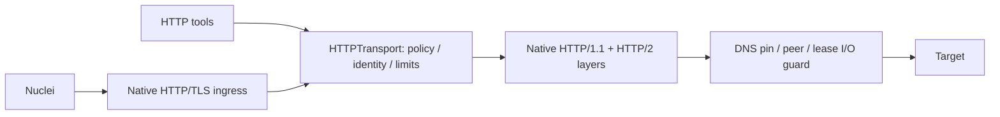

# mitmproxy для HTTP транспорта Runtime и sandbox

Дата: 3 ноября 2026 года; уточнение 4 ноября 2026 года.
Статус: production HTTP принят пользователем и реализован в V410-030;
Caido и прозрачный sandbox routing остаются proposal.

Цель — получить развитую обработку HTTP/TLS и полезные proxy-функции без
собственной реализации протокольного движка, сохранив существующие engagement
policy, credentials, limits и lifecycle Contractor. Дополнительный сценарий —
прозрачно направлять HTTP/HTTPS из Podman sandbox через тот же контроль.

Пользователь запросил оценку встраивания Python-пакета, предложил переиспользовать
существующий sandbox/allocation lifecycle и сохранить обсуждение как proposal.
Последующее уточнение: для sandbox интересует перенаправление трафика портов
80 и 443 на bridge на сетевом уровне, без настройки proxy в каждой программе.
Исторические варианты ниже являются предложениями агента. Production HTTP
уточнён в следующем разделе; удаление Caido пока не выбрано.

## Принятый production срез (4 ноября)

Пользователь попросил полноценно доработать тонкий транспорт после V410-029
и уточнил минимальный протокол: HTTP/1.1 и выше. V410-030 заменяет controlled
httpcore и собственный parser/TLS scanner bridge одним allocation-owned
mitmproxy engine. HTTPTransport сохраняет engagement policy, credentials,
cookie jars, quotas, redirects/retry и результаты. Исходящие соединения
переиспользуются только внутри identity и exact origin; HTTP/2 поддерживает
параллельные streams. HTTP/1.0 отклоняется, HTTP/3 не заявлен.



Ingress и исходящие layers используют один engine. Синтетический ответ ingress
не становится наблюдением target: результат выдаёт только исходящий owner.
Callback и native stream завершаются до удаления их приватного state. История
flows не сохраняется; временная CA и TLS caches удаляются после joined stop.
Встраивание не вызывает `Master.run()`, меняющий общие настройки asyncio.
Нормативный контракт находится в
[HTP-R137–149](../spec/tools/http-caido.md#controlled-audit-http-and-explicit-credentials).
Оценки и прототипы далее описывают состояние до этого среза.

## Ветка и исполняемый тест

Ветка с экспериментом: **`codex/sitemap-source-comparison`**.
На момент записи ветка локальная и не слита в `main`.

- Коммит теста: `6f9679437fcf8430207d7f8820650959bcfff199`.
- Коммит закрытия оценки: `dc13b44a5a5e4eef39e62cc588b3840365132814`.
- [Исполняемый эксперимент](../../scripts/experiments/mitmproxy_embedding.py).
- [Подробная оценка](../../tasks/evidence/v410-027-mitmproxy-embedding.md)
  и [JSON результатов](../../tasks/evidence/v410-027-mitmproxy-embedding.json).
- Завершённая задача оценки: [V410-027](../../tasks/done/v410-027-mitmproxy-embedding-assessment.yml).

Из корня checkout этой ветки:

```sh
uv run --script scripts/experiments/mitmproxy_embedding.py \
  --output /tmp/contractor-mitmproxy-embedding.json
```

Эксперимент закрепляет mitmproxy **12.3.1**, использует Python **3.13** и
локальные HTTP/TLS fixtures. Сохранённые результаты получены на Python 3.13.16,
macOS arm64. Production dependency files и transport не менялись.

## Текущий bridge и ожидаемая польза

Существующий [HTTPProxyBridge](../../runtime/src/contractor_runtime/adapters/http_proxy_bridge.py)
предоставляет scanner локальный explicit HTTP proxy с приватным токеном.
Обычные запросы и HTTPS после `CONNECT` передаются в allocation-owned
[HTTPTransport](../../runtime/src/contractor_runtime/adapters/http_transport.py).
Bridge завершает входящий TLS, а transport независимо выполняет исходящий
запрос. Это IPC-вход в наш HTTP owner; управление scope и credentials находится
за ним.

Собственный входной bridge поддерживает обычный HTTP/1.1, один запрос на
соединение и ограниченный буферизованный обмен. Исходящий transport также
использует HTTP/1.1 и новое соединение на attempt. mitmproxy интересен готовой
обработкой TLS/mTLS, HTTP/2, переиспользованием соединений, streaming,
WebSocket и hooks обработки сообщений.

Пакет в основном Python, но содержит зависимость от Rust extension. Его можно
импортировать в Runtime. Готового клиентского класса, эквивалентного нашему
`await transport.request(...)` со всеми engagement guarantees, он не даёт:
это событийный proxy engine. `DumpMaster` — удобная сборка Master с набором
стандартных addons для консольного запуска. Для встраивания достаточно
обычного `Master` и явно выбранных addons; UI и flow archive не обязательны.

## Что подтвердил эксперимент

Минимальная композиция — `Master`, `Proxyserver`, `NextLayer`, `TlsConfig`
и собственные test hooks. Три последовательных прогона дали одинаковые
результаты: HTTP/1.1, проверяемый HTTPS MITM, upstream mTLS, реальный HTTP/2
на обоих участках, reuse origin connection, SSE streaming и WebSocket echo.
Запрещённый fixture path дал локальный `403` без upstream connection.

Значимые ограничения результата:

- В fixture выбран `connection_strategy="lazy"` и `upstream_cert=False`.
  Для HTTP/2 потребовался явный выбор ALPN в hook. Одной настройки `http2=True`
  оказалось недостаточно для используемого клиента.
- Исключение из policy addon было зарегистрировано движком, после чего запрос
  прошёл к target. Authoritative hook должен явно завершать ошибку отказом.
- Событие response может относиться к синтетическому ответу прокси. Такой
  ответ нельзя выдавать за полученный от target.
- Разрешение зависимостей в disposable Runtime lock добавило 36 universal
  package records, не изменив существующие версии. Совместный import Runtime,
  ADK и движка прошёл; это не проверка полной рабочей нагрузки.
- Реальные scanners, rootless Podman redirect, Caido chain, Linux packaging
  и production DNS/peer/lease/retry conformance этим тестом не подтверждены.

## Два варианта встраивания

| Вариант | Что заменяет | Выигрыш и ограничение | Предварительная оценка |
| --- | --- | --- | --- |
| Только входной bridge | Собственные HTTP parser, TLS listener и connection handling | Готовый frontend; исходящий HTTPTransport сохраняет HTTP/1.1 и buffering | 2–3 рабочих дня, включая lifecycle, отказ при ошибках и проверку реального Nuclei |
| Полный protocol engine под существующим HTTP owner | Входной bridge и часть исходящего HTTP/TLS dispatch | Возможны HTTP/2, reuse и streaming до target; нужно сохранить сетевые гарантии Contractor | 3–5 дней на базовую интеграцию; ещё 2–4 дня на HTTP/2 и streaming end to end |

Оценки относятся к одному разработчику, не измерены разработкой и не включают
прозрачную сеть sandbox. WebSocket как пользовательская capability требует
отдельного конкретного вызывающего Workflow и контракта сообщений.

В первом варианте собственный forwarding hook вызывает нынешний HTTPTransport
и формирует response для engine. Самостоятельный outbound движка должен быть
закрыт; ошибки hook не должны приводить к прямой отправке. Во втором варианте
engine обслуживает исходящие соединения, а Contractor сохраняет authority:
canonical URL, scope, все DNS answers, IP pinning, peer verification, protected
endpoints, exact-origin credentials/cookies, limits, lease и retry boundary.
Текущие требования: [HTP-R137–149](../spec/tools/http-caido.md).

Рекомендация для развитых proxy-функций — проверить второй вариант небольшим
production conformance срезом. Более простой жизнеспособный вариант — оставить
transport и заменить frontend, если его parser/TLS действительно мешает
конкретному клиенту. Если сохранение DNS pinning или проверки перед первой
отправкой потребует fork движка либо повторной реализации его network server,
оценку и сам выбор следует пересмотреть до расширения работы.

## Тонкий HTTPTransport поверх engine

Уточнение обсуждения от 2026-11-03: пользователь предлагает сделать нынешний
HTTPTransport тоньше и передать его функции модулям mitmproxy. Рекомендация
агента — рассматривать его как allocation-owned facade над одним protocol
engine. Протокольную реализацию заменяет mitmproxy; правила Contractor вызываются
из собственного addon и небольшого integration layer. Простое распределение
старого transport по новым файлам не уменьшает поддерживаемую реализацию.

| Ответственность | Предлагаемый владелец |
| --- | --- |
| TCP/TLS, certificates, HTTP parsing/framing, H1/H2, multiplexing, streaming, connection reuse | Protocol engine mitmproxy и выбранные встроенные addons |
| Canonical URL, engagement scope, защищённые endpoints, проверка всех DNS answers | Существующая policy Contractor, вызываемая из admission/connect интеграции |
| Назначенная identity, точные origin credentials/cookies, очистка приватного материала | Существующий allocation-owned session owner; addon применяет выбранную identity к flow |
| Лимиты запросов, concurrency, deadline/lease, решение о redirects/retries | HTTP owner Contractor; engine исполняет разрешённые exchanges |
| Сбор bounded result, evidence и sitemap metadata | Обычные consumers Contractor, использующие flow events без второй полной истории тел |
| Start, cancel, закрытие соединений и join | Существующий allocation lifecycle с engine-specific cleanup |

Логический путь для Python tools — `HTTPTransport.request` как тонкий клиент
общего engine. Scanner explicit ingress и будущий sandbox transparent ingress
подключаются к тому же engine и policy. Готового универсального клиентского
`request` API у Master нет; способ подачи программного запроса нужно проверить
в первом срезе. Если потребуется приватный loopback ingress, это локальный
вход в единственный исходящий engine, а не второй transport до target.

При таком выборе собственные bridge parser/TLS и исходящий httpcore dispatch
перестают быть production путём после прохождения conformance. Из
HTTPTransport уходят создание per-attempt pool, ручная HTTP сериализация
и полная сборка body там, где result contract допускает streaming. Общие
policy/session primitives сохраняются; shared network helpers удаляются только
если у них больше нет других callers.

Конкретные [точки интеграции mitmproxy](https://docs.mitmproxy.org/stable/api/events.html):
`requestheaders` до чтения body, `server_connect` перед соединением,
`server_connected` с фактическим peer, TLS events и `responseheaders`/`response`.
В `server_connect` отказ задаётся через `data.server.error`; исключение addon
само по себе не обеспечивает запрет. С включённым request streaming hook
`request` вызывается уже после передачи тела, поэтому исходный admission нельзя
оставлять только в нём.

Основной стык — непосредственный I/O. В закреплённой версии после
`server_connected` engine продолжает исполнение команд, а socket writes
происходят внутри `proxy.server.ConnectionHandler.server_event` при `SendData`.
Публичного hook на каждую такую запись нет. Проверки lease на connect/TLS/read/write
и правило retry после возможно отправленных bytes требуют доказанной
интеграции на этой границе. Проверка в одном HTTP hook не является её заменой.
Аналогично нужно проверить numeric IP pinning с сохранением Host/SNI, peer
rejection до target HTTP и повторную admission при reused/H2 connections.
Пулы и connection-bound credentials не должны смешивать разные authority/identity.

В [исполняемом прототипе V410-029](../../tasks/evidence/v410-029-mitmproxy-thin-transport.md)
программные HTTP/HTTPS и настоящий Nuclei уже прошли через один native engine.
Переиспользованы настоящие HTTPRoutePolicy, IdentitySession и owned-task join.
Guard в 26 строк оборачивает команды engine перед отправкой: истечение lease
после TCP или TLS setup не позволило target получить HTTP request. Fork и копия
network server для этого среза не понадобились. Три прогона дали одинаковый
результат, включая stop одновременно зависших Python и scanner requests.

Прототип работает с HTTP/1.1 без reuse. Следующий production срез должен
подтвердить exchange ownership при reuse/H2, полные bounds/outcomes,
redirect/retry semantics и привязку idle I/O к текущему allocation lifecycle,
после чего удалить заменённый protocol code. Новая policy framework, второй
HTTP owner и сохранение обоих исходящих transports не входят в рекомендуемую
конечную архитектуру. Версионная связь guard с внутренним API engine остаётся;
если её сопровождение потребует fork, действует условие пересмотра выше.

Тонкий facade уменьшит собственный protocol code и повторную буферизацию.
Начальная память импорта mitmproxy при этом остаётся; оценка её и streaming
выигрыша приведена ниже. Production migration этим уточнением не выбрана.

## Переиспользование lifecycle

Proxy engine должен стать ресурсом существующего HTTP/allocation owner.
`AllocationService._close_http_or_exit` уже задаёт cleanup deadline и fences
Runtime при неподтверждённой остановке. `HTTPTransport.close` завершает HTTP
invocations и streams. Общий `core.async_tasks.join_owned_task` позволяет
дождаться cleanup при повторной отмене; эксперимент использует этот helper.

У проверенной версии `Master.shutdown()` с ожиданием `run()` оставляет listener
и активные соединения. Отключение server закрывает listener, но открытый stream
остаётся. Только явное закрытие и join connection tasks завершило stream и
обнулило active connections. Значит, небольшой engine-specific cleanup нужен;
используемые внутренние API требуют закрепления версии и проверки при upgrade.

Podman `PreparedExecution`, owner RPC и guardian отвечают за контейнеры и
surviving processes. Их перенос в in-process proxy не требуется. Существующие
deadline, join, cleanup/fencing и порядок освобождения ресурсов применимы без
нового lifecycle framework. Для sandbox bridge живёт в границах allocation
и завершается вместе с сетевым доступом контейнера, а не по случайному окончанию
одного scanner invocation.

## Полезные addons

Подключать следует функции с конкретным вызывающим сценарием:

| Функция | Возможное применение |
| --- | --- |
| ProxyAuth | Аутентификация explicit proxy клиента; не замена engagement admission |
| AntiCache и AntiComp | Управляемые условия эксперимента без cache validators или compression |
| ModifyHeaders и ModifyBody | Явные преобразования для выбранного сценария с учётом streaming |
| MapLocal и server-side replay | Локальные fixtures и воспроизводимые тестовые ответы |
| HTTP/TLS/WebSocket hooks | Нормализованные observations и выбранные protocol checks |

StickyAuth/StickyCookie не включаются автоматически: identity и cookie jars
уже принадлежат Contractor. BlockList не заменяет scope/DNS/peer policy.
Изменения запроса должны предшествовать окончательной проверке отправляемого
URL и credentials. Возможности описаны в
[документации mitmproxy](https://docs.mitmproxy.org/stable/overview/features/).

## Расход памяти

После уточнения пользователя выполнена отдельная
[воспроизводимая оценка памяти](../../tasks/evidence/v410-028-runtime-proxy-memory.md)
с [исполняемым тестом](../../scripts/experiments/runtime_proxy_memory.py) и
[JSON результатов](../../tasks/evidence/v410-028-runtime-proxy-memory.json).
Тридцать свежих процессов сравнивают import boundaries и одинаковую локальную
HTTP-нагрузку. Старые +49–56 MiB после произвольного protocol fixture больше
не используются как оценка расхода mitmproxy.

На macOS arm64 импорт CLI занимает около 126 MiB RSS. Попарная прибавка от
минимальных импортов mitmproxy — 38.25–38.64 MiB, до запуска allocation и
трафика. Import DumpMaster оказался тяжелее minimal import примерно на
1.5–1.7 MiB: package initializer загружает модули всех стандартных addons
даже при небольшом активном наборе.

При четырёх одновременных ответах по 8 MiB результаты трёх свежих процессов
для каждого варианта составили:

| Вариант | RSS на границе четырёх ответов | Тела в proxy flows |
| --- | --- | --- |
| Прямой HTTPX, без engine | 129.00–129.06 MiB | — |
| Минимальный engine с buffering | 240.16–241.56 MiB | 32 MiB |
| Тот же engine со streaming от 1 MiB | 171.56–173.23 MiB | 0 bytes |

Все варианты передали одинаковый payload. После cleanup weak references
показали ноль живых proxy flows, хотя RSS buffered варианта оставался высоким.
Эти прогоны используют импортированный Runtime и настоящий loopback HTTP,
но не registered allocation, TLS или нынешний engagement HTTPTransport.
Они не задают production memory limit либо стоимость полной allocation.

Приоритеты оптимизации: streaming без сохранения bodies в flows, предел
одновременно активных exchanges и отсутствие повторных полных копий тела.
Замена только frontend bridge оставит полный буфер нынешнего HTTPTransport;
выигрыш требует изменений всего transport/result path с сохранением evidence.
Для WebSocket отдельно ограничиваются история и размер собираемого сообщения.

Отложенный import engine экономит его начальную память в процессах, которые
его не использовали. Для tool-only Runtime отдельно стоит проверить состав
advertised capabilities: startup probe ADK сейчас всё равно загружает его,
поэтому одного переноса import в `create` недостаточно. Полноценная оценка
такой Runtime сборки остаётся отдельным следующим срезом.

## Caido и порядок прокси

mitmproxy и Caido совместимы. У первого есть
[upstream mode](https://docs.mitmproxy.org/stable/concepts/modes/#upstream-proxy),
у Caido — [настройка upstream proxy](https://docs.caido.io/app/guides/upstream).
Порядок определяет, какой трафик видит общий контроль:

```text
Contractor → mitmproxy → Caido → target
                        └ Replay / Automate → target

Contractor → Caido → mitmproxy → target
              └ Replay / Automate ─┘
```

В первом варианте Caido служит интерфейсом и историей трафика Contractor;
собственные Replay/Automate по этой топологии обходят стоящий перед ним engine.
Caido может изменить запрос после проверок и сам устанавливает последнее
соединение. Прежние гарантии Runtime о DNS/IP/target peer не сохраняются
автоматически. Этот вариант требует явно доверенной границы транспорта.

Второй порядок интереснее, если общий контроль должен охватывать также
Caido-generated traffic. Он требует надёжно связать запрос с разрешённым
engagement и identity; наличие upstream настройки само эту задачу не решает.
Движок mitmproxy должен быть соединён с authority Contractor. Автоматически
образовывать обратную цепочку между двумя прокси нельзя из-за петли.

При двойном HTTPS interception клиент доверяет CA первого прокси, а первый
прокси — CA второго; последний проверяет сертификат target. Добавляются TLS,
буферы и latency. Для начального опыта Caido можно использовать с отключёнными
приостановкой Intercept и автоматическими изменениями. Две записи одного
обмена в двух историях не означают два физических запроса к target.

Рекомендация агента — рассматривать Caido как опциональное рабочее место
человека и источник внешней истории. Его поиск, Replay/Automate и
[workflows](https://docs.caido.io/app/concepts/workflows_intro) не появляются
при минимальном встраивании engine. Сейчас shipped security-analysis Workflow
имеет явные Caido bindings; исключение Caido потребует отдельного изменения
реальных callers. Решение об удалении не принято.

## Прозрачное перенаправление sandbox

Уточнение пользователя: перехватывать исходящий TCP на порты **80 и 443**
на сетевой границе Podman и направлять его в bridge. Это отдельный сценарий
от explicit proxy через `HTTP_PROXY`/`HTTPS_PROXY`.

```text
Программа sandbox без proxy settings
    → TCP 80/443
    → правила redirect в доверенной сетевой границе
    → transparent listener и TLS interception
    → HTTPTransport с engagement authority
    → target
```

Текущий HTTPProxyBridge нельзя просто поставить получателем такого redirect.
На 80 обычная программа отправляет origin-form `GET /path`, а bridge ждёт
absolute URL и proxy authentication. На 443 сразу приходит TLS ClientHello,
тогда как bridge сначала разбирает HTTP `CONNECT` с токеном. Его единичный
временный сертификат также не является полноценным CA с выдачей сертификатов
для произвольных target names.

У mitmproxy есть готовый
[transparent mode](https://docs.mitmproxy.org/stable/howto/transparent/).
Ему нужны redirect и доступ к исходному адресу назначения в соответствующем
network namespace. Поэтому это содержательный довод в пользу готового engine:
можно переиспользовать HTTP authority Contractor за новым transparent frontend,
вместо разработки transparent HTTP/TLS входа самостоятельно.

Podman отвечает за неизменяемую для workload сетевую границу; proxy отвечает
за HTTP admission и forwarding. Для принудительного контроля предлагаются
следующие условия будущего среза:

- Redirect только трафика выбранного sandbox; соединения самого proxy не
  попадают обратно в него. Источник соединения связывается с allocation
  доверенной топологией, поскольку прозрачный клиент не присылает proxy token.
- Остальной egress запрещён по умолчанию либо явно разрешён отдельной
  политикой. Redirect 80/443 сам по себе не закрывает другие порты, IPv6 или
  UDP/443 с QUIC. DNS получает отдельное ограниченное правило; target admission
  всё равно выполняет собственную проверку DNS в Runtime.
- HTTPS-клиент доверяет CA прокси. Приложения с certificate pinning или своим
  trust store требуют отдельной проверки; глобальное отключение TLS verification
  не входит в предложение.
- Workload сохраняет dropped capabilities и не получает `NET_ADMIN`. Настройка
  redirect, защита правил и их cleanup принадлежат доверенному owner снаружи
  исполняемого кода. Отказ или остановка proxy не открывает прямой egress.
- Cleanup закрывает доступ, останавливает контейнер и proxy exchanges, затем
  удаляет принадлежащие allocation правила/каналы без затрагивания чужих правил.

Сейчас `podman@1` использует `--network=none`, а `podman-network@1` — фиксированный
rootless `pasta`. Proxy routes и target credentials в них не передаются;
engagement admission не допускает нынешний networked profile. Граница описана
в [EXE-R24 и EXE-R123–126](../spec/tools/code-execution.md) и
[SEC-R89](../spec/platform/security.md). Её изменение потребует отдельной задачи
и согласованного контракта; это не готовая настройка текущего профиля.

Открытый инженерный выбор — где установить redirect и сохранить original
destination при rootless Podman/pasta, не ослабляя container isolation и не
требуя неподтверждённых host privileges. Рекомендация — сначала узкий Linux
spike на настоящем поддерживаемом Podman с HTTP/HTTPS, попыткой обхода и
остановкой proxy. Если потребуется новая привилегированная network-служба,
её стоимость и ownership оцениваются отдельно. Более простой вариант для
proxy-aware программ — закрытая сеть с единственным доступным explicit proxy;
`network=none` с выделенным Unix-socket каналом также можно рассмотреть, но он
не реализует запрошенный прозрачный redirect обычных TCP-приложений.

## Связь с sitemap и последующие решения

Выбор engine независим от [сравнения transport observations и scanner reports](0052-sitemap-transport-and-report-comparison.md)
в [V410-026](../../tasks/v410-026-sitemap-source-comparison.yml). Ни proxy, ни его
response hook сами по себе не отличают реальный ресурс от soft-404 или SPA
fallback. Текущего Nuclei report importer для sitemap нет; удалять его не нужно.
Для эксперимента достаточно observation hook нынешнего transport.

Сохраняется направление пользователя от 2026-11-03: ffuf, Katana и Nuclei
максимально объединяются под существующим scan toolset. Значения лимитов
приходят из engagement; гарантировать один allocation или строить новое общее
accounting ради этого proposal не требуется. Нынешние counters allocation-local.

До выбора implementation остаются открытыми: frontend или полный engine;
первый конкретный protocol caller; необходимость Caido и порядок цепочки;
реализуемость transparent redirect на поддерживаемом rootless Podman. Ветка
выше содержит оценочный тест, а не production bridge replacement или sandbox
network integration. Эта запись не запускает их реализацию.
