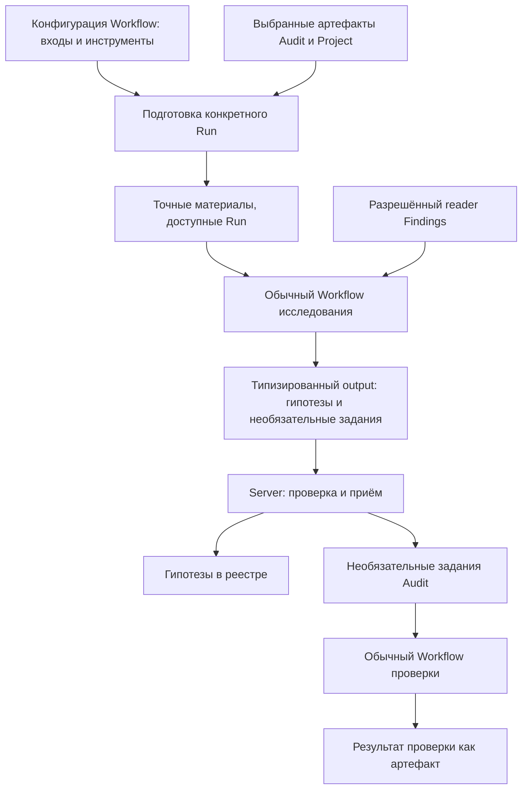
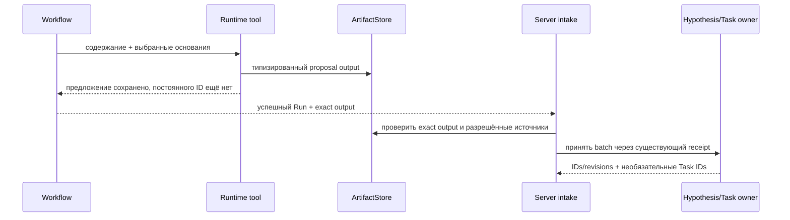
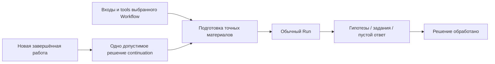

# Гипотезы как результат обычного Workflow

Current normative owner: [Workflow hypothesis production](../spec/audits/hypotheses.md).
This proposal retains the design discussion; runtime contracts live with their owners.

Дата: 2026-11-05. Статус: целевая спецификация для корректировки реализации;
новое поведение ещё не реализовано. Документ уточняет
[общую модель Audit](0050-audit-common-hypothesis-model.md), а не заменяет её.

[Инструкция по реализации](../plans/2026-11-05-hypothesis-workflow-correction.md) ·
[Передача набора материалов](../../tasks/done/v64-033-workflow-material-sets.yml) ·
[Производство гипотез](../../tasks/v64-034-workflow-hypothesis-production.yml)

## Основание и границы решения

**Решение пользователя от 2026-11-05:** генерация использует имеющиеся артефакты,
Findings, проверенные гипотезы и другие материалы; для Workflow они доступны
через артефакты и настроенные инструменты. Доступные входы и возможности чтения
задаются конфигурацией Workflow. Внутри обычного Workflow нужен механизм
создания новых гипотез. Уменьшение сложности Audit остаётся обязательной целью.
Пользователь запросил подробную спецификацию и инструкции по корректировке кода.

**Инженерные решения этого проекта спецификации:** ограниченный плоский набор
точных материалов; сохранение доменных записей Findings/Hypotheses; публикация
предложений после успешного Run; выбор оснований по доверенным ссылкам;
сохранение существующего optional continuation и механизмов receipts. Это
конкретизация направления, а не дополнительные требования, приписанные пользователю.
Немедленные записи в реестр из работающего Worker, рекурсивный сбор вложенных
ссылок и универсальный поиск по Project в базовый объём не входят.

Нормативные владельцы текущего поведения:
[common contract](../spec/audits/common-contract.md),
[исполнение Audit](../spec/audits/execution.md),
[Workflow](../spec/configuration/workflows.md),
[ArtifactStore](../spec/artifacts/artifact-store.md),
[Findings](../spec/findings/findings.md).
При реализации новые правила переносятся к этим владельцам; отдельная страница
`docs/spec/audits/hypotheses.md` становится точкой входа для производства гипотез
и ссылается на существующий контракт идентичности/ревизий ACT-R16.
Не следует копировать правила ArtifactStore или перенумеровывать ACT-Rn.

## Пользовательский результат

Один Workflow может изучить отчёт об архитектуре, выбранные Findings и результаты
предыдущих проверок, включая опровержения. Он формулирует несколько гипотез,
сохраняет основания каждой и при необходимости предлагает проверку части из них.
Audit принимает результат и продолжает работу обычными заданиями.

Материал не обязан быть последним результатом Task этого Audit. Это может быть
опубликованный Project artifact, выбранный материал другого исследования в рамках
действующих прав или снимок доменных данных. Передача не импортирует чужую живую
гипотезу в текущий реестр и не расширяет разрешения Run.

## Обязанности компонентов

| Компонент | Обязанность | Чего здесь нет |
| --- | --- | --- |
| Workflow | Входные контракты, выбранные tools, методика анализа, объявленные outputs | Привязки к произвольным Project ID и самостоятельное расширение прав |
| Вызывающий Audit program / Run request | Конкретные материалы, цель, разрешённые дальнейшие Workflow и бюджет | Разбор содержимого отчёта и обязательная исследовательская последовательность |
| RunService + ArtifactStore | Проверка выбранных refs, точные версии, локальные Run bindings, lineage и retention | Новое хранилище исследовательского контекста |
| Доменный reader | Ограниченный просмотр и явный снимок выбранных доменных данных | Копия всего реестра при каждом запуске |
| Runtime tool | Проверка аргументов и сборка типизированных предложений | Назначение постоянных ID, прав и происхождения моделью |
| Audit service / владелец гипотез | Проверка output, атомарный приём, IDs/revisions, origin и receipts | Проверка истинности текста моделью или обязательное согласование |
| Coordinator | Когда запускать обычное задание; pause/resume/cancel и recovery | Специальный генератор, ранжирование документов или отдельная очередь |

## Контракты

### HG-R1. Гипотеза, результат проверки и Finding

Гипотеза содержит стабильный ID, immutable revision, `statement`, `scope`,
`grounds` и системное происхождение. Audit остаётся текущим владельцем;
идентичность и ссылки не кодируют будущее место владения. Перенос владения в
Project не должен требовать изменения ссылок на гипотезы.

Проверка утверждения получает точный снимок гипотезы автоматически.
`supported / refuted / inconclusive` относится к проверенным условиям и
хранится в обычном результате. Техническая ошибка Run не опровергает гипотезу.
Finding остаётся необязательной проблемой Project с evidence и существующей
дедупликацией. Отрицательная перепроверка не закрывает Finding автоматически.
Исследование и вспомогательная работа не требуют фиктивной гипотезы.

### HG-R2. Артефакты представляют данные, но не заменяют доменных владельцев

Для анализа Findings и гипотезы могут быть представлены точными снимками в
ArtifactStore. Текущая оценка Finding и реестр гипотез продолжают иметь своих
владельцев; JSON-снимок не становится вторым редактируемым источником истины.
Результат проверки уже является артефактом и не требует нового assessment store.

Проверенные гипотезы поступают вместе с их точными снимками, результатами,
условиями и ограничениями. Допустим детерминированный экспорт выбранных ревизий
через существующего владельца. Полная выгрузка реестра и новый универсальный
reader гипотез не являются prerequisite базового сценария.

Если проверка завершилась технической ошибкой без содержательного результата,
разрешённый снимок контекста может содержать её gap и точную принадлежность
заданию. Не следует изобретать verdict или Finding, чтобы сделать ошибку входом
следующего Workflow; сохраняется существующий источник технического состояния.

### HG-R3. Конфигурация задаёт возможности, запуск задаёт привязки

Workflow объявляет одиночные входы и входы, принимающие ограниченный набор
материалов, допустимые media types, requiredness и выбранные инструменты чтения.
Вызывающий код связывает эти входы с конкретными доступными материалами.
Server пересекает запрос с полномочиями Run, Project/Audit membership и pinned
policy. Наличие URI, ref или Project ID в тексте не предоставляет доступ.

Одинаковый Workflow используется для разных Projects/Audits без изменения его
определения. Имена `source_01` … `source_16` не являются частью контракта.
Доступность большого набора не означает автоматическую загрузку всех его байтов
в prompt; обычные tools читают выбранные материалы в своих пределах.

### HG-R4. Один обычный вход может представлять плоский набор материалов

Общий механизм подготовки Run принимает явную ограниченную коллекцию точных
Artifact descriptors для объявленного входа Workflow. Логическая форма:

| Поле | Кто задаёт | Смысл |
| --- | --- | --- |
| Input slot | Workflow + вызывающий код | Роль набора, например `materials` или `check_results` |
| Members | Вызывающий код; проверяет Server | Явно выбранные exact refs с исходным scope |
| Handle | Детерминированно назначает Server | Локальный ключ материала внутри этого Run |
| Exact Run ref | RunService/ArtifactStore | Ссылка для существующего инструмента чтения |
| Media type, size, digest | ArtifactStore | Проверенные метаданные, а не утверждения модели |
| Source lineage | ArtifactStore / доменный владелец | Происхождение точной версии |

Новая форма wire-полей определяется один раз в общем контракте Workflow/Run при
реализации V64-033 и отражается в общих fixtures. Эта таблица — контракт
семантики, не пример уже поддерживаемого YAML/API. Нельзя отдельно изобрести
несовместимые формы для Audit, private API и Runtime.

Run получает небольшой системный список handles → локальные exact refs и
обычные bindings выбранных версий. Список хранится как обычный артефакт; нет
новой таблицы коллекций или отдельного срока жизни. Чтение его членов использует
существующие Artifact tools. Binding создаёт доверенный materializer, а не
произвольный JSON из модели. Одиночные входы с конкретной ролью сохраняются.

Это плоская коллекция, а не составной формат отчёта: ссылки внутри payload
автоматически не обходятся. Повтор одного exact source descriptor нормализуется
до одного члена; разные версии и независимые источники Findings не сливаются.
Для required-набора нужен хотя бы один член; optional-набор может быть пустым.
Чужой, отсутствующий, изменённый или несовместимый член отклоняет выбор целиком.
Порядок и handles воспроизводимы для повторной обработки того же выбора.

### HG-R5. Точные версии и удержание материалов

До исполнения Server проверяет доступ и закрепляет exact версии явно переданных
материалов. Bindings создаются через существующий Run input fork и его
транзакционные гарантии. Payload не копируется в новый blob только ради Run:
используется существующее разделение bindings, versions и blobs.

Для крупных исходников и ZIP сохраняются их обычные consumers; общий список
не делает бинарный архив текстовым и не добавляет универсальный распаковщик.
Metadata и payload учитываются раздельно в существующих лимитах.

Сбой между подготовкой и запуском согласуется по существующему Run identity;
не остаётся доступной наполовину подготовленная коллекция. Параллельное удаление
источника либо проигрывает корректно удержанной версии, либо приводит к явному
отказу до запуска. Произвольный ref в JSON не удерживает Artifact.

### HG-R6. Просмотр во время Run и выбор оснований

Настроенный reader Findings может просматривать текущие данные постранично.
Просмотр не фиксирует весь Project и не создаёт retention hold. Явный выбор
сохраняет точные версии в обычных Run artifacts через существующий reader.
Изменившаяся ревизия между просмотром и выбором даёт конфликт; запрещена
молчаливая подмена на latest. Повтор уже принятого выбора возвращает прежний снимок.

Этот снимок можно использовать как основание гипотезы и, если разрешено входным
контрактом, как материал следующего задания. Server проверяет, что это обычный
доступный артефакт именно producer Run, и закрепляет его exact ref. Необходимо
поддержать как исходные inputs, так и явно выбранные/созданные во время Run
материалы; нельзя ограничить output приёмкой только входного списка до запуска.
Скрытые системные bindings и произвольные refs другого Run не становятся источниками.

Базовый сценарий не добавляет live reader всех Project/Audit artifacts.
Предварительно выбранные артефакты передаются по HG-R4; Findings используют уже
существующий reader. Если для нового caller понадобится другой поиск, он
получает отдельный контракт у существующего владельца, а не неограниченный scan.

### HG-R7. Происхождение гипотезы и её основания различаются

Origin отвечает «какой Audit/Task/Run создал гипотезу»; основания отвечают
«какие материалы использованы и почему». Модель пишет `grounds` и выбирает
основания из доступных handles/Run-local exact artifacts. Система разрешает их
в точные retained descriptors и сохраняет связь с ревизией гипотезы.

Нельзя автоматически объявлять основаниями все доступные или просмотренные
документы. Список оснований может быть пустым: гипотеза может исходить из цели
исследования или checklist. Это не finding evidence и не доказательство истины.
Формулировка и scope остаются обязательными по существующему seed-контракту.

Источники, назначение IDs и origin не принимаются на веру из модельного JSON.
Typed tool может выдать локальный handle для проверенного нового Run artifact;
это не новая durable registry. Источник повторно проверяется при приёме output.

### HG-R8. Любой настроенный обычный Workflow может предложить гипотезы

Включение инструмента и объявленного typed output достаточно для производства
гипотез в разрешённом Audit-контексте. Отдельный generator type, service или
controller не вводится. Один shipped Workflow специализируется на генерации,
но исследовательский Workflow также может иметь такой output.

Runtime детерминированно собирает структуру предложений; модель даёт содержание
и выбирает доступные материалы. Используется существующий
`submit_hypothesis_proposals` либо его согласованное расширение. Не следует
добавлять второй путь для `create_hypothesis` с самостоятельными DB-записями.
Роль системного контекста/выхода разрешается из конфигурации и закрепляется при
создании Run; магическое имя `inputs/generation_context` само по себе недостаточно.

Декларируется один authoritative proposal output на producer execution.
Обычный отчёт, исследовательские материалы и этот output могут сосуществовать
в одном Workflow; добавление гипотез не превращает остальные outputs в proposals.
Используется один существующий путь semantic intake, а не по одному новому
collector для каждого вида output.
Последовательные исправления локального output используют существующий CAS;
принимается точная версия успешного результата. Самостоятельный Run вне Audit
не выбирает произвольный реестр для записи: в базовом сценарии нужен доверенный
Audit owner context. Общая передача материалов от Audit не зависит.

### HG-R9. Предложение внутри Workflow, публикация после успешного Run

Вызов инструмента сохраняет типизированное предложение в Run и возвращает
состояние «предложение сохранено», а не постоянный Hypothesis ID. После успешного
Run Server валидирует output и принимает весь ограниченный batch через
существующего владельца. Новые гипотезы, связанные задания и receipt фиксируются
атомарно; при ошибке нет частично опубликованного batch.

Неуспешный/отменённый Run может оставить диагностический output по обычному
retention, но не публикует новые гипотезы. Если Run успешен, а intake отклонён,
технический статус Run не переписывается: Audit показывает collection gap.
Потеря ответа после commit возвращает прежние IDs без повторной генерации.

Ограничение: последующие шаги этого же Run могут работать с локальным
предложением, но не получают новую зарегистрированную гипотезу до приёмки.
Немедленная запись нужна только если появится конкретный caller с такой
потребностью; тогда отдельно пересматривается этот контракт и его cancellation.

### HG-R10. Гипотезы и последующие задания независимы

Допустимы hypotheses-only, work-only в пределах существующего контракта и
полностью пустой ответ. Создание гипотезы не запускает проверку само по себе.
В output следующая проверка может ссылаться на локальное имя новой гипотезы;
Server назначает ID/revision и закрепляет полный снимок на Task автоматически.
Возможность ссылаться на исходные seeds сохраняется.

Точное повторение доставки не создаёт гипотезу повторно. Два независимых запуска
с похожим текстом не объявляются автоматически одной гипотезой: смысловая
дедупликация и межаудитное объединение гипотез не входят в эту переработку.
Reader может показать ранее проверенное утверждение; чтение не переносит его
владение и не разрешает использовать чужой ID в новом Task.

### HG-R11. Continuation определяет запуск, но не всю методику отбора контекста

Генерация может быть начальным заданием, явно принятым обычным заданием или
настроенным continuation на существующем idle barrier. Coordinator сообщает о
допустимой новой работе; общий путь подготовки собирает только входы,
объявленные выбранным Workflow и разрешённые вызывающим контекстом.

Выбранные начальные материалы не обязаны меняться между вызовами. Новая порция
результатов может добавляться к ним через один набор, если Workflow его
объявляет. Наличие и выбор Findings reader определяет Workflow. Нельзя
автоматически добавлять все результаты Audit в Workflow, который их не запрашивает.

Курсор результатов — механизм bounded чтения и учёта обработанной работы, а не
определение всех материалов исследования. Он не должен терять ещё не выбранные
результаты. Остаток обрабатывается отдельным ограниченным решением, если бюджет
позволяет; предел контекста не меняет YAML и не обрезает историю молча.

В базовом варианте изменение Project Finding само по себе не будит Audit:
reader увидит его при следующем разрешённом запуске. Наблюдатели всех изменений
Project и отдельный event engine не добавляются.

### HG-R12. Защита от самоповтора

Одна принятая порция/решение получает одну durable identity и одни receipts.
Повторный tick, restart и потеря ответа согласуют уже принятую операцию.
Пустой ответ завершает это решение. Изменение порядка одинаковых refs не
создаёт искусственно новый контекст.

Результат continuation не является причиной нового автоматического continuation
сам по себе, включая другое имя output или alias Workflow. Проверять нужно
trusted происхождение задания/решения, а не только наличие ключа `proposals`
в mapping. Созданные этим вызовом гипотезы также не образуют самостоятельный
триггер. Новая реально выполненная проверка может дать основание для следующего
вызова; явное новое решение допустимо только в существующих пределах программы.

Если после отбора нет новых допустимых источников и нет явного нового решения,
генератор не запускается повторно на прежних данных. Простая проверка «есть
артефакты» недостаточна. Новые произвольные timestamp/UUID при retry запрещены.

### HG-R13. Ограничения

Лимиты относятся к работе и данным, а не к числу вручную названных slots.
Исходный инженерный ceiling набора — существующие **32 exact material handles**
из LIM-ACT-7; суммарные descriptors одного выбранного набора занимают не более
**1 MiB**, системный common context сохраняет ceiling LIM-ACT-3. Числа здесь —
перенос существующих эксплуатационных ограничений, не требование пользователя
и не число источников, достаточное для исследования. Shared Artifact/Workflow
owner регистрирует окончательный общий limit один раз; Audit на него ссылается.

Суммарно учитываются все наборы и одиночные исследовательские материалы одного
producer Run, включая выбранные во время Run. Повтор exact descriptor не
расходует слот второй раз. System context не считается новым исследовательским
источником; его байты всё равно входят в собственный документный лимит.

Сохраняются LIM-ACT-1 (seed/document/registry), LIM-ACT-2 (128 primary records /
1 MiB mutation) и существующие limits чтения, evidence, Run/Task/attempt/deadline.
Инструмент не может обойти предел, последовательно сохраняя много маленьких
выборок. Отдельные exploratory outputs могут существовать по обычным Run
лимитам; в гипотезы/дальнейшую работу допускается только ограниченный выбранный набор.

Начальные сценарии: 0, 1, 17 и 32 источника; 33-й явный источник отклоняется
без частичного выбора. История существенно больше ceiling читается индексными
страницами; уже обработанные Tasks не перечитываются целиком на каждом tick.
Read budget проверяется на истории не менее 1 000 Tasks, а не на двух Runs.
Для continuation 33 новых результата дают несколько порций без потери хвоста,
если другие материалы/бюджеты оставляют для них место. Когда места нет вообще,
фиксируется явный предел/причина остановки, а не бесконечный retry.

### HG-R14. Ошибки и восстановление

| Граница | Исход | Поведение |
| --- | --- | --- |
| Каталог/Start | Несовместимый input, отсутствующий system context/output | Постоянная ошибка до исполнения; реальный catalog resolver проверяет все bindings |
| Выбор материалов | Чужой scope, hidden binding, нет версии, неверный media type или превышение | Постоянная классифицированная ошибка; никакого частичного набора |
| Live reader | Изменилась ревизия до выбора | Явный конфликт; повторный просмотр и новый явный выбор, без latest-подмены |
| Tool | Неверное содержание/handle или stale CAS | Существующая ошибка инструмента; исправление в том же Run |
| Intake | Неверный/слишком большой/недопустимый batch | Постоянный collection gap, ноль принятых доменных записей |
| Storage | Известная временная ошибка | Ограниченные retries исходной операции по владельцу |
| Storage | Commit возможен, ответ потерян | Reconcile исходного receipt до повторного чтения изменяемого контекста |
| Run | Failed/cancelled | Сохранение диагностических outputs по обычной политике, без публикации гипотез |
| Continuation | Собственный deterministic ErrInvalid | Одно явное завершение/stop reason, не бесконечно active Audit |

Конкретные API codes/status берутся у владельцев, включая
`storage_transaction_conflict`; при добавлении нового внешнего исхода обновляются
OpenAPI и error/failure registries. Нельзя превращать все 4xx или все ошибки
чтения в один retryable outcome. Storage timeout не запускает заново модель.

### HG-R15. Pause, Cancel, удаление

Pause запрещает новые Run dispatch, сохраняет принятые задания и позволяет
обычному завершению/collection уже запущенной работы закончиться. Resume
использует те же задания и exact inputs. Cancel/удаление окончательно запрещают
новый semantic intake; поздний успешный output может быть собран как материал,
но не создаёт новые гипотезы/задания. Проверка выполняется под существующим owner fence.

Материалы оснований, принятые в Audit, удерживаются его обычными Artifact
bindings, чтобы удаление producer Run не ломало чтение гипотезы. Сам ref в JSON
для этого недостаточен. Дальнейшая публикация в Project явная и использует
существующий fork/retention. Удаление Audit убирает его реестр и локальные holds;
самостоятельно опубликованные Project материалы и evidence Findings сохраняются.
Не вводятся вечное хранение всех просмотров или второй живой реестр.

### HG-R16. Наблюдаемость и формулировка утверждений

Пользователь может различить: сохранённое предложение, принятую гипотезу,
запланированную проверку, содержательный результат и проблему Finding.
Для принятой гипотезы доступны origin, основания и точная проверявшаяся ревизия.
При intake failure показывается gap, при исчерпании бюджета — причина.
Не нужен новый mutable status для каждой промежуточной записи.

Рекомендуемая методика: одно проверяемое утверждение с областью действия и
наблюдаемым критерием. Для AppSec полезна гипотеза о предполагаемом нарушении,
например «пользователь A может получить чужой invoice через endpoint X при
условиях Y». Неудачная одиночная попытка не опровергает глобальное «баг существует».
Методика живёт в instruction/Skill; сервер не оценивает истинность формулировки
и не требует новой обязательной polarity/confidence/taxonomy схемы.

## Минимальная демонстрация

1. Project содержит отчёт об архитектуре и Finding; Audit имеет старую проверку
   с `refuted` или `inconclusive` и точным снимком проверенной гипотезы.
2. Конфигурация обычного Workflow объявляет материалы и нужные reader/proposal
   tools. В Run передаются 17 выбранных артефактов одним набором без 17 input slots.
3. Workflow читает нужное, выбирает Finding через существующий reader и сохраняет
   его снимок. Он использует этот снимок, отчёт и отрицательный результат как
   основания двух новых гипотез; только для одной предлагает проверку.
4. Server принимает две гипотезы и одно задание. ID/revision/origin и связи с
   точными источниками назначены системой. Другой обычный исследовательский
   Workflow показывает тот же механизм, без особого generator type.
5. Проверка получает полную точную гипотезу. Её refuted/inconclusive результат
   сохраняется; Finding не создаётся автоматически.
6. Повтор intake/restart не дублирует записи. Continuation после новой проверки
   может вернуть пустой ответ; последующие ticks не вызывают модель повторно.
7. После удаления producer Run основания принятой гипотезы читаются из Audit;
   явно опубликованный материал Project переживает удаление Audit.

Дополнительно: сначала generation из существующих Project materials без
предшествующего Task/result/Finding; отказ на чужой материал; live selection
revision conflict; отсутствие новых записей после Cancel; replay после потери
ответа; переименованный output continuation не становится собственным trigger.

## Что удаляется и что сохраняется

| Сейчас в V64-013 | Целевое изменение |
| --- | --- |
| Жёсткие `source_01` … `source_16` в service, Workflow и profile | Удалить; один общий bounded набор с production caller |
| Предположение «контекст — следующая порция результатов Tasks» | Курсор оставить для ограниченного учёта новой работы; состав inputs определяется Workflow и caller |
| Доступные источники заморожены только до запуска | Добавить явные разрешённые selection artifacts producer Run, включая существующий Findings reader |
| `grounds` без точной связи с конкретными основаниями | Добавить необязательные selected source links в typed proposals/revisions; origin остаётся отдельным |
| Магическое имя context slot внутри tool | Разрешать роль по объявленному контракту и pinned Run context |
| Исключение producer только по имени logical output | Использовать trusted Task/decision origin для защиты от self-trigger |
| Typed output, общая приёмка и receipts | Сохранить и расширить, без второго пути записи |
| Audit-owned IDs/revisions; Project Findings | Сохранить |
| Paused drain, final cancel, explicit publication | Сохранить |

## Альтернативы и условия пересмотра

| Выбор | Более простая альтернатива | Почему выбран этот вариант / когда пересмотреть |
| --- | --- | --- |
| Общий bounded набор | Только несколько фиксированных одиночных inputs | Уже есть реальный generator с переменным числом материалов; фиксированные slots привели к `source_XX` |
| Exact bindings без упаковки payload | Самодостаточный ZIP | ZIP требует упаковки/распаковки, нового payload и отдельных лимитов; вернуться при реальном offline/export consumer |
| После-Run приёмка | Немедленная запись из tool | Немедленная запись усложняет cancellation и частичный результат; пересмотреть при конкретной зависимости внутри одного Run |
| Явные основания + origin | Только свободный `grounds` и origin | Нужна проверяемая связь с материалами для последующего отбора; источники необязательны и не требуют knowledge graph |
| Explicit inputs + существующий Findings reader | Только заранее собранный контекст | Уже существует нужный reader; его выбор должен участвовать в обычной приёмке, а не дублироваться новым collector |

Не добавляются: семантическая дедупликация гипотез, ранжировщик как обязательный
этап, граф всех зависимостей, автоматическая публикация всего прочитанного,
слежение за всеми изменениями Project, legacy reader для `source_XX`, новый
реестр/очередь/receipt/lease или изменение выбранной пользователем модели.
