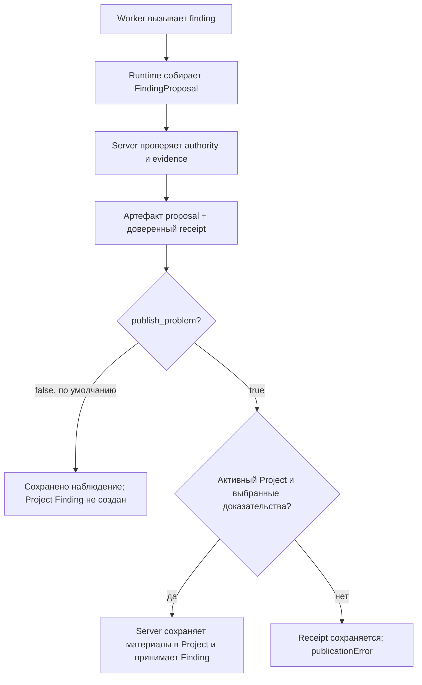
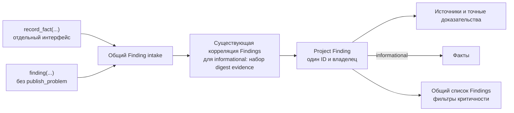
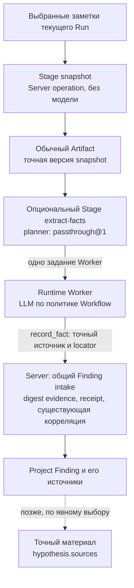
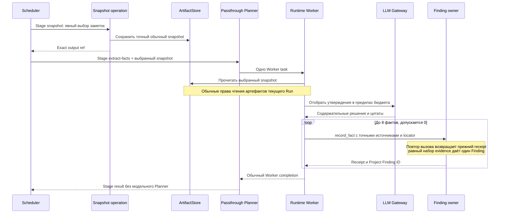
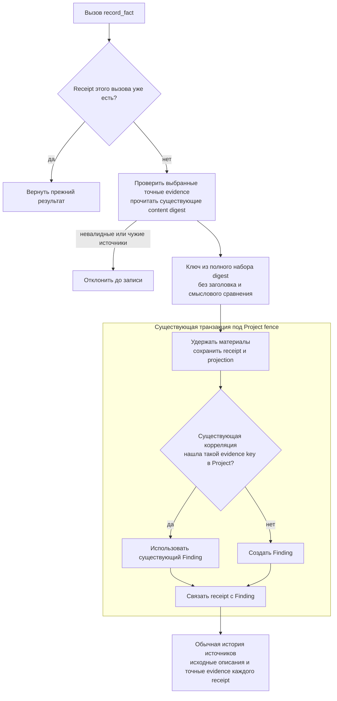
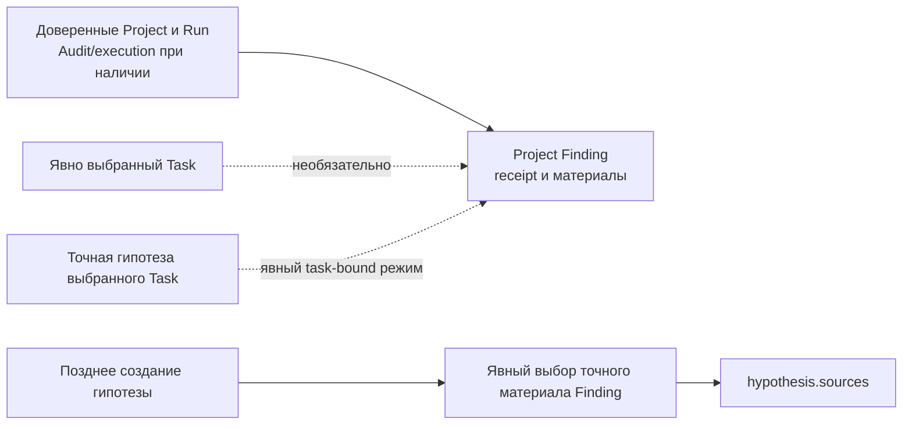

# Факты на общем пути Findings

Статус: предложение и план работ, обновлено 2026-11-21. Реализация не начата.
Текущий контракт остаётся в [Findings](../spec/findings/findings.md),
[Memory](../spec/tools/memory.md) и
[Server operations](../spec/execution/server-operations.md).

## Пользовательский результат

В Project есть представление «Факты» и общий список Findings с фильтрами критичности.
«На сервисе используется nginx» можно сохранить как факт, выбрать основанием
гипотезы и использовать в другом Audit. Каждая отправка сохраняет собственные
источники и происхождение; отправки с одинаковым evidence используют одну карточку. Рабочие мысли остаются в Memory.
Факт сохраняется самостоятельно с происхождением Run и, когда применимо, Audit.
Связи с Task и его гипотезой добавляются по явному выбору.

Под обоими интерфейсами остаётся один Project Finding: существующие intake,
receipt, Finding ID, источники, точные артефакты, reader, корреляция и lifecycle.
«Факты» показывает информационные записи общего механизма. Критичность определяет
представление записи и её участие в выборке `needs review`.

## Авторство решений

Пользовательские решения 2026-11-20:

- Добавить факты и продумать извлечение важных фактов из заметок.
- Извлечение должно явно включаться в Workflow, подобно operations; оно не
  является обязательным действием при завершении каждого Run.
- Для LLM-извлечения выбран отдельный модельный Stage с `passthrough@1`:
  один Runtime Worker, без модельного Planner и без LLM внутри Server operation.
- Используемая технология — пример факта, даже если исходный инструмент
  представляет её как информационную находку.
- Сделать отдельный интерфейс, сохранив под ним тот же Finding уровня Project.
- Упростить обычный `finding`: отдельный выбор `publish_problem` не нужен.
- Продумать дедупликацию и не превращать связи в хаотичный клубок.
- В уточнении к ревью использовать фильтры критичности и исключить `info` из
  `needs review`. Это заменяет предложенный агентом отдельный признак назначения.
- По пункту 2 ревью сохранить обычный доступ инструментов к артефактам текущего
  Run. Snapshot задаёт вход извлечения, ссылки на источники проверяются точно.
- Последнее уточнение 2026-11-21 возвращает V471-004 в активный план для
  базовой дедупликации по evidence. Откладывать всю задачу не нужно.
- При полном равенстве содержимого выбранных evidence использовать один Finding.
  Заголовок в сравнении не участвует. Переиспользовать существующую корреляцию
  и receipts, добавив только узкий вариант ключа. Сложные/смысловые правила,
  HTTP-профили, группировка материалов и `possible duplicate` исключены.
- Сделать привязку факта к Task и гипотезе необязательной, в том числе в batch Run.
- Сохранить явный выбор факта в основания новой гипотезы. Обратную навигацию
  от факта к использующим его гипотезам отложить.
- Показать схемы текущего и предлагаемого поведения.
- Обновить этот пакет задач и схем под выбранный Stage и влить его в `main`.

Ниже предложения агента о минимальном воплощении этих решений. Они не
являются уже принятыми изменениями спецификации. Этот документ и задачи
разрешают планирование и интеграцию пакета в `main`, а не выполнение продуктового
кода, live-вызовы или deploy.

## Как работает сейчас

Это один вызов intake с транзакционным приёмом, а не два независимых
пользовательских шага. Прямой модельный вызов запрашивает публикацию флагом;
Server выполняет запись. Успешное добавление не назначает analyst verdict.
Публикация может произойти до завершения Run и не откатывается из-за его
последующего сбоя.

Другой существующий путь — `publish-findings@1`: автор Workflow включает
детерминированный Stage, Scheduler вызывает его, Finding owner принимает
нормализованные scanner candidates. Текущий candidate contract рассчитан на
положительные scanner problems: это не готовый универсальный вход для
LLM-извлечения из заметок. Нельзя незаметно выдать LLM-кандидатам scan provenance.

## Предлагаемый единый путь

Представление «Факты» использует фильтр `informational` над общими Findings.
В него входят и нейтральные наблюдения, и информационные проблемы. Общий список
позволяет выбирать критичность. Отдельный признак назначения исключён из плана.

Предложение агента для реализации этого выбора использует существующие поля.
`record_fact` задаёт `severity_suggestion=informational`. Обычный `finding`
принимает необязательную предложенную критичность из существующего enum.
Для представления и фильтрации берётся `analystSeverity`, когда она задана,
иначе каноническое `severitySuggestion`. UI показывает происхождение оценки.
Поля решения аналитика сохраняют собственную семантику и nullable-значения.

`needs review` вычисляется из отсутствия оценки аналитика и критичности,
отличной от `informational`. Неизвестная критичность оставляет запись в этой
выборке. Информационная запись может оставаться без оценки и быть доступной
для ручного разбора. Списки и счётчики используют один серверный предикат.
Если API-поле `unreviewed` обозначает отсутствие оценки, его смысл нужно
сохранить либо согласованно переименовать при изменении на выборку `needs review`.

`record_fact` — фасад общего publisher, не новый сервис. Оба прямых инструмента
явно сохраняют Project Finding с источниками; не остаётся скрытого режима
«успех, но только proposal». Proposal и receipt сохраняются как внутренние
immutable источники. Промежуточные candidate artifacts Workflow остаются
обычными материалами до явно выбранного publishing Stage.

Из прямого пути удалить `publish_problem`/`publishProblem`, а не оставлять
deprecated alias. Все соответствующие Go/Python/API/UI/CLI/fixture/config callers
обновляются согласованно. Immutable catalog identities получают новые версии.
Не удалять существующий `publish-findings@1` только из-за похожего имени:
его реальный caller — отдельный Stage над scanner candidates.

Первоначальная информационная классификация задаётся производителем.
Аналитик может оценить запись через общий механизм. Его решение определяет
текущее представление, а Finding ID и точные источники сохраняются. Истинность
утверждения и качество доказательств описываются отдельно от критичности.

## Извлечение из Memory

Snapshot — обычный non-`memory.*` Artifact с выбранным содержимым. Только
Memory owner интерпретирует заметки; ArtifactStore остаётся domain-neutral.
Скрытые refs/revisions Memory не становятся аргументами модели или StageContext.
Операция читает явно названные заметки объявленного Namespace своего Run,
а не перебирает все Run/Project. Восстановление использует уже записанный
snapshot, а не заново читает изменившиеся заметки.

LLM отбирает полезные утверждения, сохраняет ограничения и точные цитаты.
Детерминированный код проверяет структуру, допустимые источники, размеры,
происхождение и общий приём Findings. Цитата из заметки доказывает, что
утверждение записано в заметке; она не превращается в независимую проверку
технологии или поведения сервиса. Такой источник виден пользователю.
Ноль фактов — допустимый результат, не повод снова вызывать модель.

Сохраняются проектная модель, обычные model/tool budgets, стоимость, отмена,
deadline, telemetry и snapshot каталога. Модель и Gateway задаёт существующий
`executionConfig` Workflow. `passthrough@1` сам не вызывает LLM: он передаёт
одно ограниченное задание единственному Worker. Worker получает выбранный
snapshot как вход и обычные инструменты чтения/`record_fact`. Инструменты могут
читать другие разрешённые артефакты текущего Run по общему контракту.
Доступ к reserved Memory bindings регулируется существующими правилами Memory.
Для сохранения факта проверяется точная версия указанного материала и цитата
либо locator внутри него. У ссылки на snapshot проверяется выбранная заметка.
Дополнительные источники проходят обычную проверку Artifact и Finding evidence.

Решение границы исполнения (пользователь, 2026-11-20): извлечение — отдельный
Stage с `passthrough@1` в существующем Runtime/Worker контуре. Server operation
снимает snapshot детерминированно; общий Finding owner принимает факты.
Публикация выполняется прямыми вызовами `record_fact` через существующий intake,
а не новым завершающим publishing Stage. Автор Workflow явно включает нужные
Stage; при их отсутствии нет фонового экспорта или дополнительного LLM-вызова.

Альтернатива с единым LLM `operation.ref` не выбрана. Уже существующие Worker
ModelPolicy, allocation, бюджеты, стоимость и восстановление покрывают нужный
путь; расширять Server-operation executor для первого среза не требуется.
Пересмотр возможен отдельным пользовательским решением после измерения
существенных накладных расходов Runtime или появления нескольких реальных
однотипных LLM-трансформаций. Не добавлять скрытый LLM client в operation.

## Базовая дедупликация по evidence

Последнее уточнение (пользователь, 2026-11-21): V471-004 возвращается в pending,
но её объём ограничивается базовым равенством evidence. Заголовок, смысл текста
и специальные правила для технологий не сравниваются.

| Событие | Receipt | Finding |
| --- | --- | --- |
| Повтор того же вызова после потери ответа | Прежний | Прежний результат |
| Новая информационная отправка с тем же полным набором содержимого evidence | Новый | Прежний, даже при другом заголовке |
| Fork или независимо записанные одинаковые байты evidence | Новый | Прежний при равном полном наборе |
| Другой или лишь частично совпадающий набор evidence | Новый | Отдельный |
| Такой же evidence в другом Project | Новый | Отдельный |

Server уже читает metadata выбранных точных evidence при приёме. Из готовых
content digest собирается отсортированный набор уникальных значений. Хеш его
версионированного canonical представления становится новым закрытым вариантом
существующего correlation key. Обычный Finding group key добавляет Project scope.
Модель не передаёт хеши или новые matching descriptors. Порядок ссылок и разные
bindings одинаковых байтов не влияют на сравнение. Непустой набор должен совпасть
полностью; пересечение наборов не означает равенство.

Базовый вариант применяется к producer `severity_suggestion=informational` из
`record_fact` и обычного `finding`. Для него выбирается evidence key. Остальные
находки сохраняют имеющиеся producer/structural алгоритмы. Нужен небольшой
новый вариант алгоритма/projection и его строгая поддержка в Go/Runtime/API/SQL
там, где он представлен. Используются существующие fence, уникальность,
транзакция и receipts; новый matcher, сервис, таблица или parser не нужны.

Повтор одного вызова возвращает прежний receipt до чтения источников. Новый
вызов сохраняет собственный receipt и происхождение; при равном наборе evidence
он связывается с прежним Finding. Идентичность первого источника и текущее решение
аналитика сохраняют обычные правила. Более поздняя оценка критичности не меняет ключ.

Это намеренно приблизительное правило: разные утверждения над одним широким
материалом могут оказаться в одной карточке. Исходные заголовки, описания, refs
и цитаты доступны через историю receipts. Рекомендуются точные, узкие evidence,
когда они доступны. Изменившиеся байты или набор материалов могут оставить
отдельные записи. Общий Finding owner применяет правило; пересмотр нужен только
при наблюдаемых ошибочных объединениях или мешающем объёме дублей.

UI показывает карточки Server и их обычные источники, без собственного matcher.
Группировка версий, уникальные счётчики материалов, обходы lineage и новые reader
API не требуются. Выбор точного источника в основания гипотезы проверяется
сквозной регрессией существующего механизма. Смысловая дедупликация и сравнение
заголовков остаются вне первого среза.

## Связи и представление

Server всегда выводит Project и Run из доверенного выполнения. Для Audit Run
сохраняются Audit и execution. Общая заметка может породить факт с таким
происхождением при любом числе участников batch.

Предложение реализации использует существующий incidental-режим общего intake.
`record_fact` выбирает его по умолчанию. При отсутствии `item_key` Task и гипотеза
остаются пустыми. Явно переданный ключ проверяется по реальному составу batch
и добавляет Task. Incidental-наблюдение с выбранным Task сохраняет эту связь
без автоматического назначения гипотезы. Явный task-bound режим может добавить
точную гипотезу выбранного задания. Произвольные системные ID моделью не задаются.

Текущий intake требует Task ещё до применения `incidental`. V471-001 меняет эту
общую границу вместе с wire/API, коллекциями и readers. Run-level receipts
остаются в Project/Audit истории. Результаты отдельных Task включают только
связанные с ними receipts. Общая заметка не назначается первому участнику batch.

Позже автор или Worker может явно выбрать факт в `hypothesis.sources` через
точный Finding snapshot или материал существующего reader. Выбор конкретного
элемента коллекции сохраняется проверяемо. Источники уже принятой ревизии
гипотезы сохраняют исходные версии при поступлении новых материалов.

В карточке факта доступны утверждение, объект, контекст, точные evidence
и существующая постраничная история отправок. Указанные в происхождении Task/гипотеза доступны,
когда такая связь действительно сохранена. На странице гипотезы доступны её
выбранные основания и результаты проверок. Обратный поиск гипотез, использующих
факт, и графовые представления отложены. Пересмотр нужен при конкретном запросе
на навигацию от материала к использовавшим его гипотезам.

Удаление Audit A, который произвёл факт, сохраняет Project Finding и его материалы.
Если Audit B выбрал факт в гипотезу, её основания живут с B. Удаление B удаляет
его реестр гипотез и удержания, а Project продолжает удерживать собственные материалы.

## Предложенные границы первого среза

Это ограничения предложения агента; owning spec и cross-language fixtures
фиксируют их при реализации, не дублируя константы в каждом компоненте.

| Работа | Ожидаемо | Максимум одной операции/ответа |
| --- | --- | --- |
| Snapshot заметок | 2–8 заметок | 16 явно выбранных; 512 KiB полного encoded snapshot |
| LLM-извлечение | 0–5 фактов | 8 фактов; 32 KiB полного authored payload на факт |
| Источники факта | 1–2 | 4 выбранных источника; общие evidence/material limits остаются теснее |
| Список Findings | Одна страница | 50 записей и общие byte limits |
| История источников | Одна страница | До 64 receipts на страницу и общие byte limits |

Суммарно выбранные материалы подчиняются общей границе 32 exact descriptors,
включая остальные входы. Превышение не приводит к молчаливой потере хвоста.
Для первого среза extraction quotas — локальные, не новый Project quota service;
на уровне Project действуют существующие Artifact/Run/Audit limits и paged reads.

## Порядок задач и проверка

| Задача | Результат | Зависимости |
| --- | --- | --- |
| [V471-001](../../tasks/v471-001-project-facts-shared-findings.yml) | Первый сквозной факт через общий Project Finding; обычный finding без флага | — |
| [V471-002](../../tasks/v471-002-memory-snapshot-operation.yml) | Явно подключаемый snapshot выбранных заметок | — |
| [V471-004](../../tasks/v471-004-fact-deduplication-and-selection.yml) | Базовое равенство evidence на существующей корреляции | 001 |
| [V471-003](../../tasks/v471-003-workflow-fact-extraction.yml) | Отдельный Stage с passthrough@1, общим publisher и проверкой повторных попыток | 001, 002, 004 |
| [V471-005](../../tasks/v471-005-project-facts-interface.yml) | Отдельный понятный интерфейс поверх тех же записей | 003 |
| [V471-006](../../tasks/v471-006-project-facts-release-gate.yml) | Проверка интегрированного пути, масштаба и удаления | 005 |

Первый deliverable — реальный Server/Runtime путь: `record_fact` → существующий
receipt и Project Finding → точный материал в основании гипотезы. Это не серия
бесхозных схем/таблиц перед первым caller. Детерминированный scripted Gateway
проверяет механизм, но не качество смыслового отбора. Для качества нужен отдельный
явно запускаемый повторный Eval; существующие Evals используются без нового harness.
Рецепт использует Audit Eval с обычным изолированным execution Project на участника.
Положительный scripted-Gateway сценарий проверяет публикацию и сбор реального факта.

Ещё одна открытая граница V471-001: projectless Runs. Предложение — прямые
`finding`/`record_fact` требуют активного Project и возвращают classified error
до записи; supporting Runs могут писать обычные artifacts. Это изменение
пользовательского поведения должно быть решено до реализации, а не заменено
скрытым fallback на Run-only proposal.

В отложенный объём входят автоматическое извлечение в конце Run, импорт старых
proposals по эвристике title, смысловой поиск дублей, автоматическое семантическое
слияние, обратная навигация к гипотезам, графовые представления и отдельный Fact
review lifecycle. Live-оценка качества и deploy требуют самостоятельного запуска.
