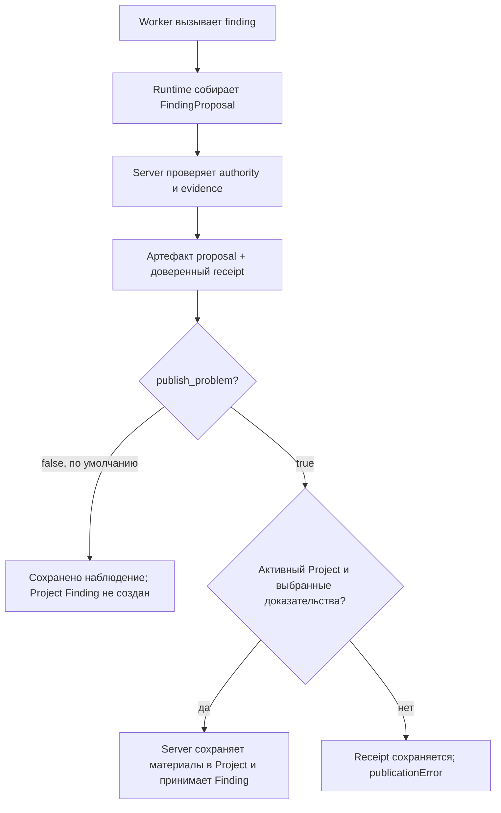
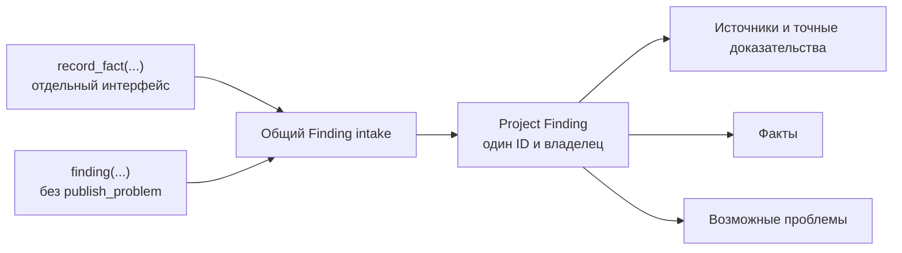
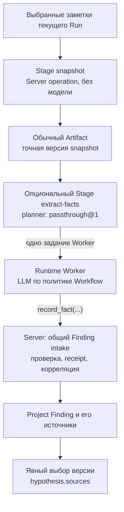
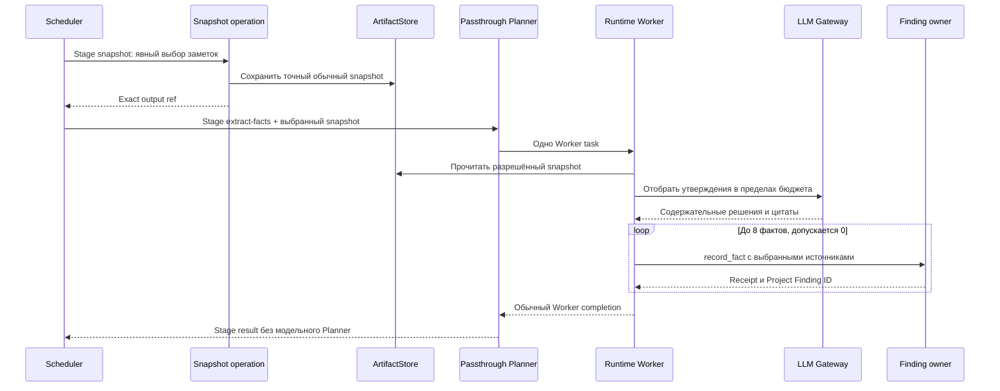

# Факты на общем пути Findings

Статус: предложение и план работ, 2026-11-20. Реализация не начата.
Текущий контракт остаётся в [Findings](../spec/findings/findings.md),
[Memory](../spec/tools/memory.md) и
[Server operations](../spec/execution/server-operations.md).

## Пользовательский результат

В Project есть два понятных интерфейса: «Факты» и «Возможные проблемы».
«На сервисе используется nginx» можно сохранить как факт, выбрать основанием
гипотезы и использовать в другом Audit. Несколько проверок могут дополнять
источники одной записи. Рабочие мысли остаются в Memory.

Под обоими интерфейсами остаётся один Project Finding: существующие intake,
receipt, Finding ID, источники, точные артефакты, reader, корреляция и lifecycle.
Ни отдельного Fact store, ни реестра Audit facts, ни второго графового движка
не появляется. Различается назначение записи и её представление.

## Авторство решений

Пользовательские решения 2026-11-20:

- Добавить факты и продумать извлечение важных фактов из заметок.
- Извлечение должно явно включаться в Workflow, подобно operations; оно не
  является обязательным действием при завершении каждого Run.
- Для LLM-извлечения выбран отдельный модельный Stage с `passthrough@1`:
  один Runtime Worker, без модельного Planner и без LLM внутри Server operation.
- Используемая технология — пример факта, даже если исходный инструмент
  представляет её как информационную находку.
- Сделать отдельный интерфейс, сохранив под ним тот же Finding уровня Project.
- Упростить обычный `finding`: отдельный выбор `publish_problem` не нужен.
- Продумать дедупликацию и не превращать связи в хаотичный клубок.
- Показать схемы текущего и предлагаемого поведения.
- Обновить этот пакет задач и схем под выбранный Stage и влить его в `main`.

Ниже предложения агента о минимальном воплощении этих решений. Они не
являются уже принятыми изменениями спецификации. Этот документ и задачи
разрешают планирование и интеграцию пакета в `main`, а не выполнение продуктового
кода, live-вызовы или deploy.

## Как работает сейчас

Это один вызов intake с транзакционным приёмом, а не два независимых
пользовательских шага. Прямой модельный вызов запрашивает публикацию флагом;
Server выполняет запись. Успешное добавление не назначает analyst verdict.
Публикация может произойти до завершения Run и не откатывается из-за его
последующего сбоя.

Другой существующий путь — `publish-findings@1`: автор Workflow включает
детерминированный Stage, Scheduler вызывает его, Finding owner принимает
нормализованные scanner candidates. Текущий candidate contract рассчитан на
положительные scanner problems: это не готовый универсальный вход для
LLM-извлечения из заметок. Нельзя незаметно выдать LLM-кандидатам scan provenance.

## Предлагаемый единый путь

Нужен минимальный явный признак назначения на существующей записи/claim,
чтобы Project reader мог фильтровать факты. Его точное wire-имя и размещение
фиксирует первая задача в owning spec и общей fixture. Не выводить назначение
из `informational`, title, имени Workflow или отсутствия analyst verdict.
Информационная проблема и нейтральное наблюдение могут иметь похожий текст.

`record_fact` — фасад общего publisher, не новый сервис. Оба прямых инструмента
явно сохраняют Project Finding с источниками; не остаётся скрытого режима
«успех, но только proposal». Proposal и receipt сохраняются как внутренние
immutable источники. Промежуточные candidate artifacts Workflow остаются
обычными материалами до явно выбранного publishing Stage.

Из прямого пути удалить `publish_problem`/`publishProblem`, а не оставлять
deprecated alias. Все соответствующие Go/Python/API/UI/CLI/fixture/config callers
обновляются согласованно. Immutable catalog identities получают новые версии.
Не удалять существующий `publish-findings@1` только из-за похожего имени:
его реальный caller — отдельный Stage над scanner candidates.

У факта нет автоматически подтверждённой истинности и нет требования пройти
vulnerability triage. Общие nullable поля оценки не заполняются выдуманной
серьёзностью или `true_positive`. Оценку проблемы аналитик выполняет отдельно;
сохранение записи не требует предварительного подтверждения. Возможные
ограничения существующих state/duplicate
команд для fact-представления проверяются до изменения схемы.

## Извлечение из Memory

Snapshot — обычный non-`memory.*` Artifact с выбранным содержимым. Только
Memory owner интерпретирует заметки; ArtifactStore остаётся domain-neutral.
Скрытые refs/revisions Memory не становятся аргументами модели или StageContext.
Операция читает явно названные заметки объявленного Namespace своего Run,
а не перебирает все Run/Project. Восстановление использует уже записанный
snapshot, а не заново читает изменившиеся заметки.

LLM отбирает полезные утверждения, сохраняет ограничения и точные цитаты.
Детерминированный код проверяет структуру, допустимые источники, размеры,
происхождение и общий приём Findings. Цитата из заметки доказывает, что
утверждение записано в заметке; она не превращается в независимую проверку
технологии или поведения сервиса. Такой источник виден пользователю.
Ноль фактов — допустимый результат, не повод снова вызывать модель.

Сохраняются проектная модель, обычные model/tool budgets, стоимость, отмена,
deadline, telemetry и snapshot каталога. Модель и Gateway задаёт существующий
`executionConfig` Workflow. `passthrough@1` сам не вызывает LLM: он передаёт
одно ограниченное задание единственному Worker. Worker получает только обычный
snapshot и выбранные инструменты чтения/`record_fact`; у него нет скрытого
доступа к исходному notebook или унаследованной беседы предыдущего Stage.

Решение границы исполнения (пользователь, 2026-11-20): извлечение — отдельный
Stage с `passthrough@1` в существующем Runtime/Worker контуре. Server operation
снимает snapshot детерминированно; общий Finding owner принимает факты.
Публикация выполняется прямыми вызовами `record_fact` через существующий intake,
а не новым завершающим publishing Stage. Автор Workflow явно включает нужные
Stage; при их отсутствии нет фонового экспорта или дополнительного LLM-вызова.

Альтернатива с единым LLM `operation.ref` не выбрана. Уже существующие Worker
ModelPolicy, allocation, бюджеты, стоимость и восстановление покрывают нужный
путь; расширять Server-operation executor для первого среза не требуется.
Пересмотр возможен отдельным пользовательским решением после измерения
существенных накладных расходов Runtime или появления нескольких реальных
однотипных LLM-трансформаций. Не добавлять скрытый LLM client в operation.

## Дедупликация без потери свидетельств

1. **Повтор запроса.** Существующие invocation/submission/receipt ключи возвращают
   прежний результат. Повтор не добавляет ещё один источник.
2. **Квалифицированное совпадение.** Повторная независимая проверка может добавить
   источник к тому же Project Finding. Ключ включает назначение записи, известный
   subject, утверждаемое свойство/значение и необходимый baseline/environment
   context. Используется общая корреляция Finding owner, без Fact registry.
3. **Смысловая близость.** Ограниченный отбор кандидатов и LLM предлагают
   возможное совпадение. Похожий текст или embedding сами по себе не объединяют
   записи. Неполный ключ остаётся unavailable; исходные receipts не теряются.

«nginx» и «nginx 1.25» могут быть частичным знанием и уточнением, а не дублями.
Разные окружения, baseline, роли или противоречащие значения нельзя схлопывать
только ради чистого списка. Не переносить совпадение проблемы на факт и обратно.
Сравнение не обходит весь Project и не выполняет все пары со всеми.

## Связи и представление

Факт используется в `hypothesis.sources` через точный выбранный Finding snapshot
или выделенный существующим reader proposal Artifact. Если материал содержит
несколько записей, интерфейс сохраняет проверяемый выбор конкретной записи;
ссылка на коллекцию не означает, что каждая запись обосновывает гипотезу.
Существующие finding reader/collection/selection механизмы расширяются только
под этот реальный caller.

Полученное при проверке наблюдение связано с Task/Run происхождением. Вывод
`supported/refuted/inconclusive` принадлежит результату проверки точной ревизии
гипотезы и действует в её условиях; создание факта не назначает verdict.
Новая ревизия источника не переписывает старые основания.

Основной UI — список фактов Project и детали выбранной записи: утверждение,
subject, контекст, источники, похожие записи и использующие её гипотезы.
В гипотезе отдельно видны основания и результаты проверок. Произвольный редактор
рёбер, автоматические fact-to-fact цепочки и глобальный граф по умолчанию не
входят в этот срез. При необходимости локальная схема показывает только выбранную
запись и непосредственно связанные объекты, с конечным лимитом и пагинацией.

## Предложенные границы первого среза

Это ограничения предложения агента; owning spec и cross-language fixtures
фиксируют их при реализации, не дублируя константы в каждом компоненте.

| Работа | Ожидаемо | Максимум одной операции/ответа |
| --- | --- | --- |
| Snapshot заметок | 2–8 заметок | 16 явно выбранных; 512 KiB полного encoded snapshot |
| LLM-извлечение | 0–5 фактов | 8 фактов; 32 KiB полного authored payload на факт |
| Источники факта | 1–2 | 4 выбранных источника; общие evidence/material limits остаются теснее |
| Подбор похожих | Несколько записей на факт | 32 кандидата; не более 64 сравниваемых пар за вызов |
| Список/источники | Одна страница | 50 записей; источники — существующий page limit 64 |
| Локальная схема, если нужна | Одна запись с соседями | 25 узлов, 40 рёбер, 128 KiB, без рекурсивного обхода |

Суммарно выбранные материалы подчиняются общей границе 32 exact descriptors,
включая остальные входы. Превышение не приводит к молчаливой потере хвоста.
Для первого среза extraction quotas — локальные, не новый Project quota service;
на уровне Project действуют существующие Artifact/Run/Audit limits и paged reads.

## Порядок задач и проверка

| Задача | Результат | Зависимости |
| --- | --- | --- |
| [V471-001](../../tasks/v471-001-project-facts-shared-findings.yml) | Первый сквозной факт через общий Project Finding; обычный finding без флага | — |
| [V471-002](../../tasks/v471-002-memory-snapshot-operation.yml) | Явно подключаемый snapshot выбранных заметок | — |
| [V471-003](../../tasks/v471-003-workflow-fact-extraction.yml) | Отдельный Stage с passthrough@1 и общим publisher | 001, 002 |
| [V471-004](../../tasks/v471-004-fact-deduplication-and-selection.yml) | Общая корреляция и точный выбор фактов для гипотез | 001 |
| [V471-005](../../tasks/v471-005-project-facts-interface.yml) | Отдельный понятный интерфейс поверх тех же записей | 003, 004 |
| [V471-006](../../tasks/v471-006-project-facts-release-gate.yml) | Проверка интегрированного пути, масштаба и удаления | 005 |

Первый deliverable — реальный Server/Runtime путь: `record_fact` → существующий
receipt и Project Finding → точный материал в основании гипотезы. Это не серия
бесхозных схем/таблиц перед первым caller. Детерминированный scripted Gateway
проверяет механизм, но не качество смыслового отбора. Для качества нужен отдельный
явно запускаемый повторный Eval; существующие Evals используются без нового harness.

Ещё одна открытая граница V471-001: projectless Runs. Предложение — прямые
`finding`/`record_fact` требуют активного Project и возвращают classified error
до записи; supporting Runs могут писать обычные artifacts. Это изменение
пользовательского поведения должно быть решено до реализации, а не заменено
скрытым fallback на Run-only proposal.

Отложены: автоматическое извлечение в конце Run, импорт старых proposals по
эвристике severity/title, универсальный knowledge graph, автоматическое семантическое
слияние, новая Fact review state machine и live/deploy действия из этого плана.
