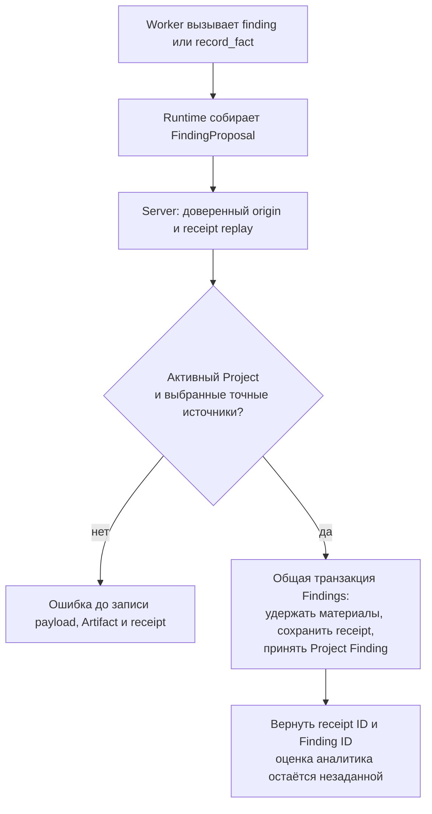
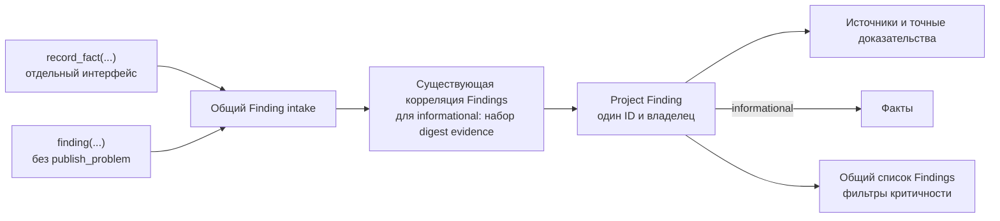
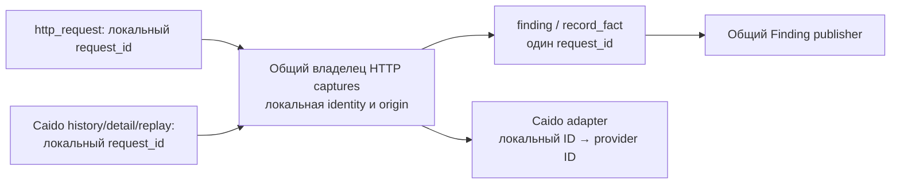
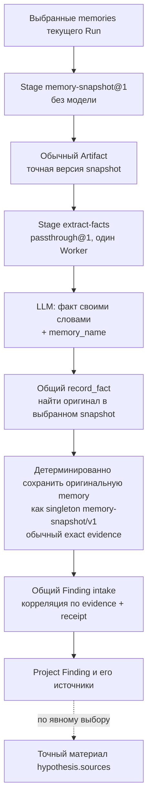
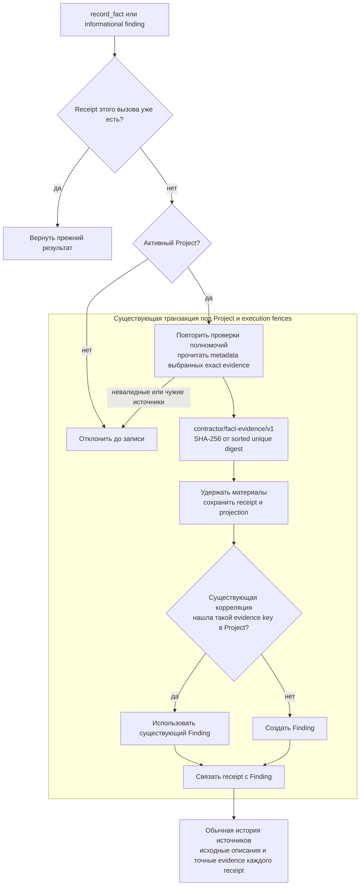
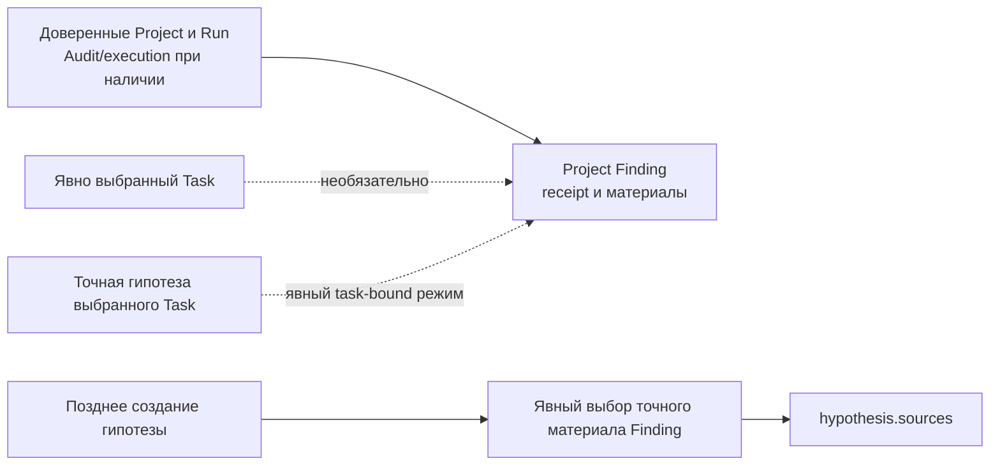

# Факты на общем пути Findings

Статус на 2026-11-21: группа 1 реализована и в main. Группа 2 возобновлена
после обсуждения интерфейсов; ниже выбранный проект решения.
Текущий контракт остаётся в [Findings](../spec/findings/findings.md),
[Memory](../spec/tools/memory.md) и
[Server operations](../spec/execution/server-operations.md).

## Пользовательский результат

В Project есть представление «Факты» и общий список Findings с фильтрами критичности.
«На сервисе используется nginx» можно сохранить как факт, выбрать основанием
гипотезы и использовать в другом Audit. Каждая отправка сохраняет собственные
источники и происхождение; отправки с одинаковым evidence используют одну карточку. Рабочие мысли остаются в Memory.
Факт сохраняется самостоятельно с происхождением Run и, когда применимо, Audit.
Связи с Task и его гипотезой добавляются по явному выбору.

Под обоими интерфейсами остаётся один Project Finding: существующие intake,
receipt, Finding ID, источники, точные артефакты, reader, корреляция и lifecycle.
«Факты» показывает информационные записи общего механизма. Критичность определяет
представление записи и её участие в выборке `needs review`.

## Авторство решений

Пользовательские решения 2026-11-20:

- Добавить факты и продумать извлечение важных фактов из заметок.
- Извлечение должно явно включаться в Workflow, подобно operations; оно не
  является обязательным действием при завершении каждого Run.
- Для LLM-извлечения выбран отдельный модельный Stage с `passthrough@1`:
  один Runtime Worker, без модельного Planner и без LLM внутри Server operation.
- Используемая технология — пример факта, даже если исходный инструмент
  представляет её как информационную находку.
- Сделать отдельный интерфейс, сохранив под ним тот же Finding уровня Project.
- Упростить обычный `finding`: отдельный выбор `publish_problem` не нужен.
- Продумать дедупликацию и не превращать связи в хаотичный клубок.
- В уточнении к ревью использовать фильтры критичности и исключить `info` из
  `needs review`. Это заменяет предложенный агентом отдельный признак назначения.
- По пункту 2 ревью сохранить обычный доступ инструментов к артефактам текущего
  Run. Snapshot задаёт вход извлечения, ссылки на источники проверяются точно.
- Последнее уточнение 2026-11-21 возвращает V471-004 в активный план для
  базовой дедупликации по evidence. Откладывать всю задачу не нужно.
- При полном равенстве содержимого выбранных evidence использовать один Finding.
  Заголовок в сравнении не участвует. Переиспользовать существующую корреляцию
  и receipts, добавив только узкий вариант ключа. Сложные/смысловые правила,
  HTTP-профили, группировка материалов и `possible duplicate` исключены.
- Сделать привязку факта к Task и гипотезе необязательной, в том числе в batch Run.
- Сохранить явный выбор факта в основания новой гипотезы. Обратную навигацию
  от факта к использующим его гипотезам отложить.
- Показать схемы текущего и предлагаемого поведения.
- Обновить этот пакет задач и схем под выбранный Stage и влить его в `main`.

Последующие решения пользователя 2026-11-21:

- Реализовать вторую группу и влить результат в main; затем притормозить
  реализацию для обсуждения перегруженных интерфейсов.
- Модель формулирует факт своими словами и выбирает memory по имени.
  Оригинал прикладывается детерминированно. Обязательные цитаты и проверку
  совпадения текста исключить. Незавершённый отдельный фасад извлечения удалён.
- Использовать общий `record_fact`. В новых параметрах использовать vocabulary
  Memory: `memory_name`, а не `note_name` или отдельный notes API.
- Использовать локальные request ID для HTTP/Caido, убрать `caido_request_id`
  из `record_fact` и обычного `finding`. Общий пересмотр остальных интерфейсов
  обсудить позднее. Изменение владельцев HTTP identity выделено в V471-007.

Ниже уточнённый дизайн; непоставленные параметры не объявляются существующим
контрактом. Реализация группы 2 возобновлена явной командой пользователя. Live-вызовы и deploy
не поручены. Удаление незавершённого варианта с цитатами не затрагивает группу 1.

Существующие `item_key` / `incidental` сохраняются с текущей семантикой.
Новый `link_hypothesis` не вводится; общий пересмотр интерфейсов отложен.

## Прямой приём Finding и фактов

V471-001 реализована и проверена. Она переводит оба прямых интерфейса на один обязательный приём в Project.



Server выполняет запись в одном вызове intake. Успешный прямой вызов всегда
создаёт или находит Project Finding; отдельного флага публикации нет. Повтор
принятого вызова возвращает сохранённый результат до чтения источников.
Приём может произойти до завершения Run и сохраняется после его сбоя.

Другой существующий путь — `publish-findings@1`: автор Workflow включает
детерминированный Stage, Scheduler вызывает его, Finding owner принимает
нормализованные scanner candidates. Текущий candidate contract рассчитан на
положительные scanner problems: это не готовый универсальный вход для
LLM-извлечения из заметок. Нельзя незаметно выдать LLM-кандидатам scan provenance.

## Предлагаемый единый путь



Представление «Факты» использует фильтр `informational` над общими Findings.
В него входят и нейтральные наблюдения, и информационные проблемы. Общий список
позволяет выбирать критичность. Отдельный признак назначения исключён из плана.

Предложение агента для реализации этого выбора использует существующие поля.
`record_fact` задаёт `severity_suggestion=informational`. Обычный `finding`
принимает необязательную предложенную критичность из существующего enum.
Для представления и фильтрации берётся `analystSeverity`, когда она задана,
иначе каноническое `severitySuggestion`. UI показывает происхождение оценки.
Поля решения аналитика сохраняют собственную семантику и nullable-значения.

`needs review` включает записи без оценки и явно переоткрытые (`proposed`), с критичностью,
отличной от `informational`. Неизвестная критичность оставляет запись в этой
выборке. Информационная запись может оставаться без оценки и быть доступной
для ручного разбора. Списки и счётчики используют один серверный предикат.
Параметр API называется `verdict=needs_review`, счётчик — `needsReviewFindings`;
это представление, без нового состояния или автоматически выставленной оценки.

`record_fact` — фасад общего publisher, не новый сервис. Оба прямых инструмента
явно сохраняют Project Finding с источниками; не остаётся скрытого режима
«успех, но только proposal». Proposal и receipt сохраняются как внутренние
immutable источники. Промежуточные candidate artifacts Workflow остаются
обычными материалами до явно выбранного publishing Stage.

Из прямого пути удалить `publish_problem`/`publishProblem`, а не оставлять
deprecated alias. Все соответствующие Go/Python/API/UI/CLI/fixture/config callers
обновляются согласованно. Immutable catalog identities получают новые версии.
Не удалять существующий `publish-findings@1` только из-за похожего имени:
его реальный caller — отдельный Stage над scanner candidates.

Первоначальная информационная классификация задаётся производителем.
Аналитик может оценить запись через общий механизм. Его решение определяет
текущее представление, а Finding ID и точные источники сохраняются. Истинность
утверждения и качество доказательств описываются отдельно от критичности.

## Общая организация инструментов

Существующие варианты `finding` уже используют один publisher. AgentTemplate
выбирает ровно один creation facade; модель видит его под именем `finding`.
Это существующий способ сделать схему подходящей конкретному Worker.

| Вариант | Что указывает модель | Что делает Runtime |
| --- | --- | --- |
| General finding | Наблюдение, нужные locations и источники | Общий приём с проверками источников |
| Code finding | Наблюдение, файл, при необходимости строка/диапазон и evidence | Нормализация координат; сам путь не заменяет evidence |
| Trace finding | Файл и координаты в текущем overlay | Уже захватывает исходник, переводит координаты и сохраняет proof |
| HTTP finding | Наблюдение, URL, method, при необходимости request_id | Прикладывает выбранный сохранённый exchange |
| record_fact | Наблюдение и источник | Тот же приём с informational severity |

Предложение: сохранить специализацию схем и общий publisher. Сейчас исправляется
identity запросов и добавляется короткий путь от Memory; объединение всех
аргументов в ещё один универсальный инструмент не требуется. Code/trace не
принимают HTTP ID сегодня; им не добавляются такие параметры ради симметрии.

### Локальные request ID

Пользователь выбирает локальные ID. Рекомендуемое представление — существующий
положительный integer `request_id`, с единым выделением внутри allocation.
Вывод про обязательную смену типа на string был преждевременным: если провайдерные
ID скрыты, их строковый тип не должен попадать в модельную схему.



Локальный ID однозначен в своём allocation и не переиспользуется для другого
запроса. Provider ID нужен адаптеру и provenance, но модель его не выбирает.
Один общий owner обеспечивает различие request ID при совместном выборе HTTP
и Caido toolsets; отдельная таблица не нужна. Ссылка из history ещё не означает,
что request/response прочитаны и доступны как evidence. Публикация требует
инспектированный capture текущего invocation и сама не обращается к провайдеру.
Ошибочный, вытесненный или чужой ID отклоняется явно.

Эта правка проходит через discovery, detail, replay/automate request arguments,
HTTP body/history, Audit results и Finding consumers. Поэтому V471-007 — отдельная
предпосылка, а не скрытое расширение задачи извлечения. Session/workflow/scope IDs
обозначают другие сущности Caido; их интерфейсы остаются предметом будущего обзора.

## Извлечение из Memory

Предлагаемый основной вызов общего инструмента:

```python
record_fact(
    title="В приложении используется nginx",
    description="Наблюдение из memories об инфраструктуре; версия не установлена.",
    memory_name="infrastructure",
)
```

`memory_name` копируется из поля `name` выбранной memory. Это логическое имя,
уже используемое `read_memory(name=...)` и `write_memory(name=...)`, а не новый
глобальный ID. Для Stage извлечения область имени — один явно выбранный exact
snapshot. Скрытые refs/revisions Memory не становятся аргументами модели.



Memory owner интерпретирует memories; ArtifactStore остаётся domain-neutral.
Уже реализованный snapshot сохраняет выбранное содержимое с логическими именами.
Его текущий wire format содержит `notes`, а аргумент операции называется `notes`.
Это существующие внутренние поля, а не отдельная сущность notes; массовое
переименование готового формата не является следствием выбора `memory_name`.

Runtime сохраняет исходные name, content, description и tags выбранной memory,
без переписывания моделью. К факту прикладывается оригинал выбранной memory,
а не весь общий snapshot: другие memories не становятся его evidence.
Происхождение exact snapshot остаётся доступно через обычные механизмы
Artifact/provenance; не помещать случайные call IDs или временные метки в
байты оригинала, влияющие на correlation. Это оригинальная memory из frozen
snapshot, а не позднейшая mutable версия.

Нет проверки дословной цитаты или смысловой истинности. Runtime проверяет,
что выбранный snapshot определён, memory существует и источники допустимы.
Если имя отсутствует или область неоднозначна, запись Finding не выполняется;
подстановка текущей mutable Memory запрещена. Дополнительные материалы
подчиняются обычным Artifact/Finding evidence правилам. Наблюдение из memories
показывается как reported: сам источник не означает независимого подтверждения.

Граница snapshot-binding конкретизирована: точный Artifact передаётся в
существующем Worker task slot `memories`. Runtime держит readonly-привязку
только в пределах invocation и очищает её при любом исходе. Не искать подходящий snapshot среди всех артефактов и не
угадывать Namespace по имени memory. Возможность сохранять факт прямо из текущей
mutable Memory вне extraction Stage в этот срез не включена.

Для модели основной сценарий содержит три действия: прочитать выбранный текст,
сохранить ноль или несколько фактов через общий `record_fact`, записать короткий
отчёт. Модель не собирает receipt IDs и не выполняет дополнительную публикацию.
Успешный tool call уже сохраняет Finding. Ноль фактов допустим при явном завершении;
пустой или оборванный ответ сам по себе завершением не является.

Сохраняются проектная модель, budgets, стоимость, отмена, deadline и telemetry.
`passthrough@1` выполняется детерминированно и передаёт одно задание Worker.
Обычные current-Run reads остаются доступными; snapshot-only sandbox не добавляется.
Stage включается автором Workflow явно, без фонового извлечения при завершении Run.
Общий publisher отвечает за Project, origin, intake и receipts. Новый Fact store,
модельный Planner, LLM Server operation или extraction-only facade не нужны.

```mermaid
sequenceDiagram
    participant S as Scheduler
    participant O as Memory snapshot
    participant A as ArtifactStore
    participant W as Runtime Worker
    participant L as LLM
    participant F as Finding owner
    S->>O: Явно выбранные memories
    O->>A: Frozen snapshot
    S->>W: Одно задание через passthrough@1 + exact snapshot
    W->>L: Выбранные memories и краткая инструкция
    loop До 8 фактов; 0 допустим
        L->>W: record_fact(title, description, memory_name)
        W->>A: Детерминированно сохранить оригинал выбранной memory
        W->>F: Общий intake с exact evidence
        F-->>W: Receipt и Project Finding ID
        W-->>L: Результат сохранения
    end
    W-->>S: Обычный Worker completion и отчёт
```

## Базовая дедупликация по evidence

V471-004 завершена в группе 1: её объём ограничен базовым равенством evidence. Заголовок, смысл текста
и специальные правила для технологий не сравниваются.

| Событие | Receipt | Finding |
| --- | --- | --- |
| Повтор того же вызова после потери ответа | Прежний | Прежний результат |
| Новая информационная отправка с тем же полным набором содержимого evidence | Новый | Прежний, даже при другом заголовке |
| Fork или независимо записанные одинаковые байты evidence | Новый | Прежний при равном полном наборе |
| Другой или лишь частично совпадающий набор evidence | Новый | Отдельный |
| Такой же evidence в другом Project | Новый | Отдельный |

Server уже читает metadata выбранных точных evidence при приёме. Из готовых
content digest собирается отсортированный набор уникальных значений. Хеш его
версионированного canonical представления становится новым закрытым вариантом
существующего correlation key. Обычный Finding group key добавляет Project scope.
Модель не передаёт хеши или новые matching descriptors. Порядок ссылок и разные
bindings одинаковых байтов не влияют на сравнение. Непустой набор должен совпасть
полностью; пересечение наборов не означает равенство.

Базовый вариант применяется к producer `severity_suggestion=informational` из
`record_fact` и обычного `finding`. Для него выбирается evidence key. Остальные
находки сохраняют имеющиеся producer/structural алгоритмы. Нужен небольшой
новый вариант алгоритма/projection и его строгая поддержка в Go/Runtime/API/SQL
там, где он представлен. Используются существующие fence, уникальность,
транзакция и receipts; новый matcher, сервис, таблица или parser не нужны.



Проекция использует существующую схему fingerprint: `schema`, `availability`,
`algorithm`, `value`, без полей провайдера. Для informational не разбираются
необязательные code anchors или SARIF. Сравниваются сохранённые байты evidence;
содержимое HTTP envelope не нормализуется.

Повтор одного вызова возвращает прежний receipt до чтения источников. Новый
вызов сохраняет собственный receipt и происхождение; при равном наборе evidence
он связывается с прежним Finding. Идентичность первого источника и текущее решение
аналитика сохраняют обычные правила. Более поздняя оценка критичности не меняет ключ.

Это намеренно приблизительное правило: разные утверждения над одним широким
материалом могут оказаться в одной карточке. Исходные заголовки, описания, refs
и оригинальные источники доступны через историю receipts. Рекомендуются точные, узкие evidence,
когда они доступны. Изменившиеся байты или набор материалов могут оставить
отдельные записи. Общий Finding owner применяет правило; пересмотр нужен только
при наблюдаемых ошибочных объединениях или мешающем объёме дублей.

UI показывает карточки Server и их обычные источники, без собственного matcher.
Группировка версий, уникальные счётчики материалов, обходы lineage и новые reader
API не требуются. Выбор точного источника в основания гипотезы проверяется
сквозной регрессией существующего механизма. Смысловая дедупликация и сравнение
заголовков остаются вне первого среза.

## Связи и представление

Server всегда выводит Project и Run из доверенного выполнения. Для Audit Run
сохраняются Audit и execution. Общая заметка может породить факт с таким
происхождением при любом числе участников batch.

Предложение реализации использует существующий incidental-режим общего intake.
`record_fact` выбирает его по умолчанию. При отсутствии `item_key` Task и гипотеза
остаются пустыми. Явно переданный ключ проверяется по реальному составу batch
и добавляет Task. Incidental-наблюдение с выбранным Task сохраняет эту связь
без автоматического назначения гипотезы. Явный task-bound режим может добавить
точную гипотезу выбранного задания. Произвольные системные ID моделью не задаются.

Текущий intake требует Task ещё до применения `incidental`. V471-001 меняет эту
общую границу вместе с wire/API, коллекциями и readers. Run-level receipts
остаются в Project/Audit истории. Результаты отдельных Task включают только
связанные с ними receipts. Общая заметка не назначается первому участнику batch.

Позже автор или Worker может явно выбрать факт в `hypothesis.sources` через
точный Finding snapshot или материал существующего reader. Выбор конкретного
элемента коллекции сохраняется проверяемо. Источники уже принятой ревизии
гипотезы сохраняют исходные версии при поступлении новых материалов.



В карточке факта доступны утверждение, объект, контекст, точные evidence
и существующая постраничная история отправок. Указанные в происхождении Task/гипотеза доступны,
когда такая связь действительно сохранена. На странице гипотезы доступны её
выбранные основания и результаты проверок. Обратный поиск гипотез, использующих
факт, и графовые представления отложены. Пересмотр нужен при конкретном запросе
на навигацию от материала к использовавшим его гипотезам.

Удаление Audit A, который произвёл факт, сохраняет Project Finding и его материалы.
Если Audit B выбрал факт в гипотезу, её основания живут с B. Удаление B удаляет
его реестр гипотез и удержания, а Project продолжает удерживать собственные материалы.

## Предложенные границы первого среза

Это ограничения предложения агента; owning spec и cross-language fixtures
фиксируют их при реализации, не дублируя константы в каждом компоненте.

| Работа | Ожидаемо | Максимум одной операции/ответа |
| --- | --- | --- |
| Snapshot заметок | 2–8 заметок | 16 явно выбранных; 512 KiB полного encoded snapshot |
| LLM-извлечение | 0–5 фактов | 8 фактов; 32 KiB полного authored payload на факт |
| Источники факта | 1–2 | 4 выбранных источника; общие evidence/material limits остаются теснее |
| Список Findings | Одна страница | 50 записей и общие byte limits |
| История источников | Одна страница | До 64 receipts на страницу и общие byte limits |

Суммарно выбранные материалы подчиняются общей границе 32 exact descriptors,
включая остальные входы. Превышение не приводит к молчаливой потере хвоста.
Для первого среза extraction quotas — локальные, не новый Project quota service;
на уровне Project действуют существующие Artifact/Run/Audit limits и paged reads.

## Две группы выполнения

Статус 2026-11-21: первая группа (001/002/004) реализована и проверена на
реальных Server/Runtime/PostgreSQL с актуальным main. Отдельный extraction Worker,
его Workflow приняты в 003; интерфейс 005 также принят; итоговый gate 006 ещё выполняется. После начала
003 пользователь приостановил реализацию для пересмотра интерфейсов. Удалён
непоставленный вариант с обязательными цитатами; новая правка request ID
выделена в V471-007. Исправления тестовых fixtures (V471-008) и чтения Findings
по точному ID служебного Eval Project (V471-009) — отдельные предпосылки.
В пакете десять задач; восемь приняты. Проверка 010 повторяется после обновления генерируемой схемы. Извлечение 003 и UI 005 завершены; После исправления устаревших тестовых селекторов (010) выполняется итоговая проверка 006.


Пользовательское решение 2026-11-21: выполнить шесть задач двумя группами по три,
каждую группу одним непрерывным проходом. Распределение следует существующим
зависимостям. Последующий запрос о локальных HTTP/Caido ID добавляет одну
отдельную предпосылку 007; исходные группы по три сохраняются.

| Группа | Порядок | Результат прохода |
| --- | --- | --- |
| 1 — базовый путь | V471-001 → V471-002 → V471-004 | Факт записывается через общий Finding, выбранные заметки становятся точным snapshot, равное evidence объединяется существующей корреляцией |
| Предпосылка группы 2 | V471-007 | Единый локальный request_id для HTTP/Caido и существующих publisher-инструментов |
| 2 — готовая функция | V471-003 → V471-005 → V471-006 | Опциональный passthrough@1 Stage извлекает факты, UI показывает их и источники, итоговая проверка подтверждает полный путь |

Внутри группы задачи выполняются последовательно, без остановки после каждого
законченного шага. Один проход не означает один commit: каждый commit относится
к одной задаче, у которой остаются собственные критерии завершения.
Следующий шаг начинается только после завершения его зависимостей. Не считать
группу завершённой по одной демонстрации или по инфраструктурным изменениям.

Решение пользователя 2026-11-21 закрывает условие входа группы 1: прямые
`finding` и `record_fact` требуют активного Project и отклоняются до записи,
если его нет. Пользователь поручил выполнить группу 1 одним проходом.
Позднее пользователь поручил группу 2, затем приостановил её для обсуждения
интерфейсов. V471-007 выделена по новому запросу. Live-модели и deployment
остаются вне поручения.

Выход группы 1 — выполнены все acceptance criteria и команды проверки задач
001/002/004 на согласованной ревизии, продемонстрированы реальные Server/Runtime/
PostgreSQL пути записи факта, независимого snapshot и базовой дедупликации.
Это готовность основания, а не приёмка извлечения или UI. Группа 2 начинается
после завершения всей группы 1. Её выход — завершены 003/005/006, включая общий
release gate V471-006, проверку lifecycle, масштаба и интерфейса. Точные команды
проверки остаются в owning tasks, без новых дублирующих групповых targets.

| Задача | Группа | Результат | Зависимости |
| --- | --- | --- | --- |
| [V471-001](../../tasks/done/v471-001-project-facts-shared-findings.yml) | 1 | Первый сквозной факт через общий Project Finding; обычный finding без флага | — |
| [V471-002](../../tasks/done/v471-002-memory-snapshot-operation.yml) | 1 | Явно подключаемый snapshot выбранных заметок | — |
| [V471-004](../../tasks/done/v471-004-fact-deduplication-and-selection.yml) | 1 | Базовое равенство evidence на существующей корреляции | 001 |
| [V471-007](../../tasks/done/v471-007-local-http-request-identifiers.yml) | предпосылка 2 | Локальный request_id для HTTP/Caido и общих publishers | 001 |
| [V471-008](../../tasks/done/v471-008-repair-process-catalog-fixtures.yml) | предпосылка 2 | Собственные инструкции process fixtures после обновления каталога | 001 |
| [V471-009](../../tasks/done/v471-009-eval-project-finding-navigation.yml) | предпосылка 2 | Чтение Findings выбранного Eval execution Project без открытия глобального discovery | 001 |
| [V471-010](../../tasks/v471-010-audit-eval-catalog-pins.yml) | предпосылка 2 | Точные версии текущих Audit-профилей в offline Eval проверках | 001 |
| [V471-003](../../tasks/done/v471-003-workflow-fact-extraction.yml) | 2 | Отдельный Stage с passthrough@1, общим publisher и проверкой повторных попыток | 001, 002, 004, 007, 009 |
| [V471-005](../../tasks/done/v471-005-project-facts-interface.yml) | 2 | Отдельный понятный интерфейс поверх тех же записей | 003 |
| [V471-006](../../tasks/v471-006-project-facts-release-gate.yml) | 2 | Проверка интегрированного пути, масштаба и удаления | 005 |

Первый deliverable — реальный Server/Runtime путь: `record_fact` → существующий
receipt и Project Finding → точный материал в основании гипотезы. Это не серия
бесхозных схем/таблиц перед первым caller. Детерминированный scripted Gateway
проверяет механизм, но не качество смыслового отбора. Для качества нужен отдельный
явно запускаемый повторный Eval; существующие Evals используются без нового harness.
Рецепт использует Audit Eval с обычным изолированным execution Project на участника.
Положительный scripted-Gateway сценарий проверяет публикацию и сбор реального факта.

Для Runs без Project поддерживающие результаты остаются обычными artifacts.
Оба прямых Finding инструмента требуют Project; скрытого Run-only fallback нет.

В отложенный объём входят автоматическое извлечение в конце Run, импорт старых
proposals по эвристике title, смысловой поиск дублей, автоматическое семантическое
слияние, обратная навигация к гипотезам, графовые представления и отдельный Fact
review lifecycle. Live-оценка качества и deploy требуют самостоятельного запуска.
