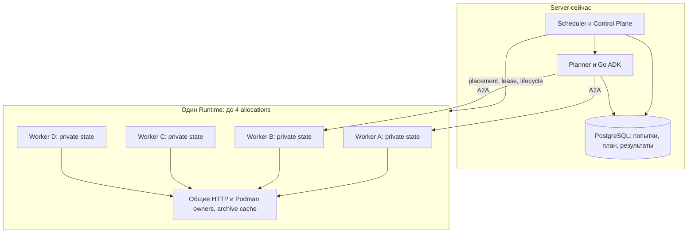
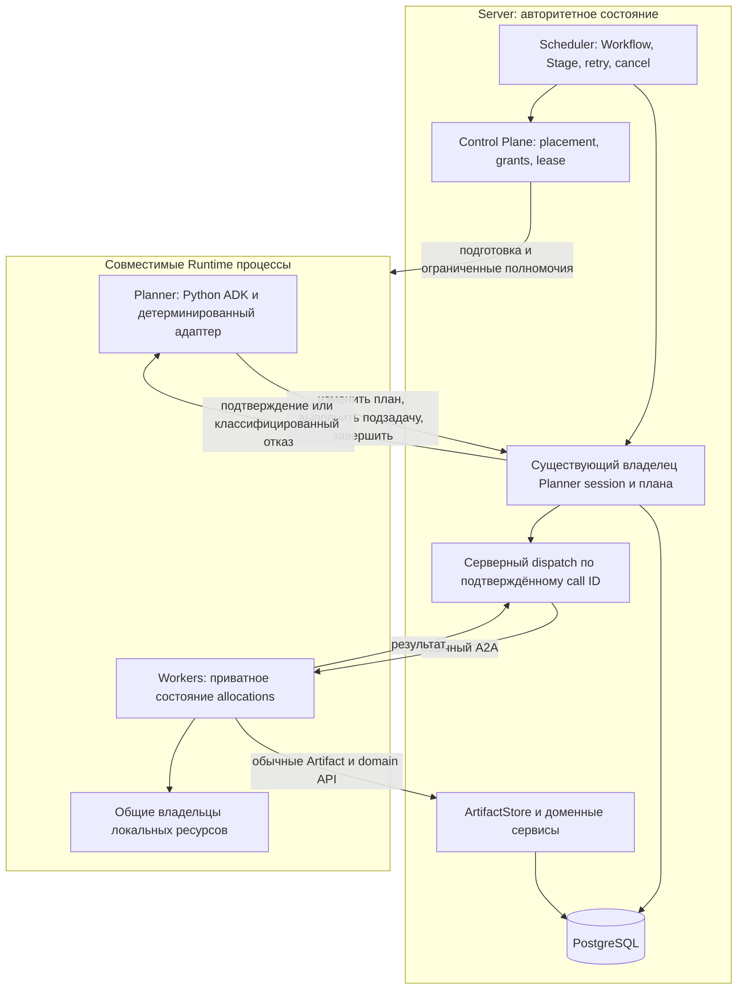
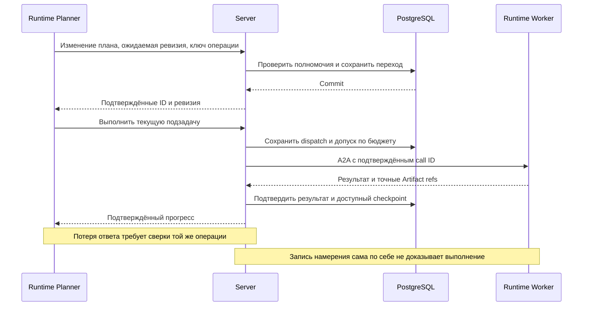
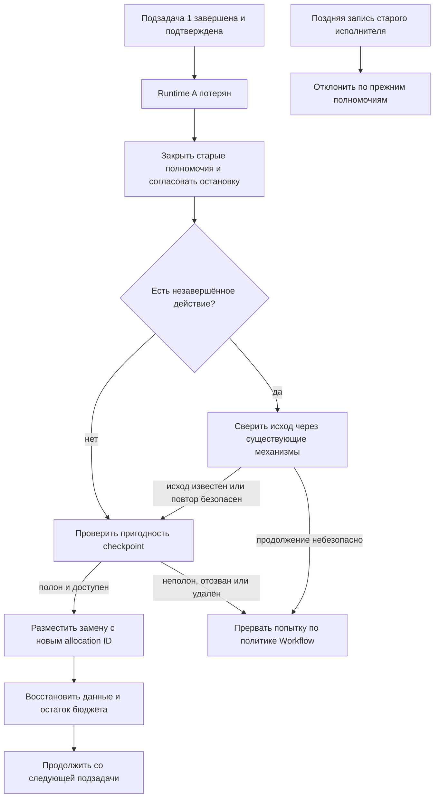
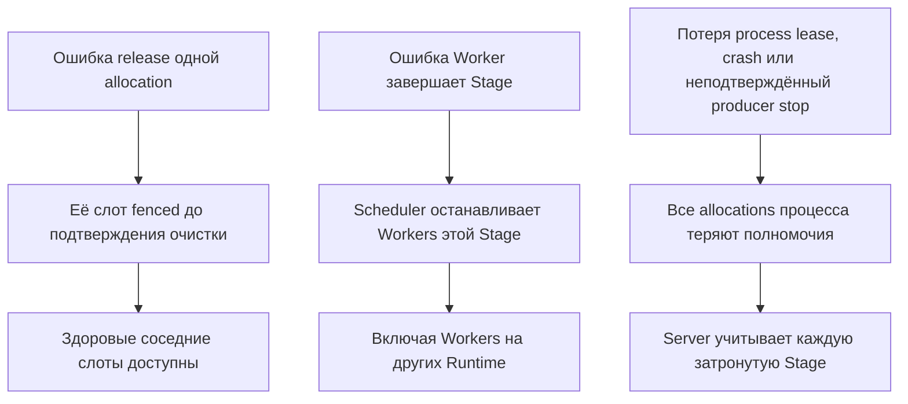
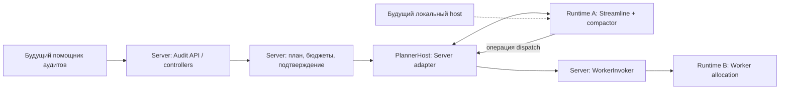

# Planner в Runtime и восстановление выполнения

Обновлено 27 ноября 2026 года. Пользователь поручил начать P1. Завершена
подготовительная задача V488-001; V488-002 завершена в отдельной ветке: весь Streamline, включая
`compact@1` и document recovery. Router остаётся на Go до следующего этапа. Planner получает отдельную учитываемую allocation по решению
пользователя от 2026-11-26. Возобновление остаётся следующим этапом. Основание — завершённый multi-allocation
в `main`, merge `57ba7a21675559fc4b86eebba0bb596252cac770`, и исправления
владения ресурсами и остановки V487-014–017.

Пользовательский результат: агентное исполнение можно заменить, сохранив
подтверждённую работу. Runtime выполняет модельный цикл Planner и Workers;
Server хранит канонический прогресс, проверяет полномочия и управляет
жизненным циклом. Рекомендуемый первый уровень восстановления — продолжение
на границе завершённой подзадачи. Перенос произвольной живой ADK Session
и повтор внешнего действия с неизвестным исходом сюда не входят.

## Основания и открытые решения

| Источник | Содержание и статус |
| --- | --- |
| Пользователь, 2026-11-25 | Запросил анализ переноса Planner в Runtime, серверной надёжности и возможности заменить Runtime, с плюсами, минусами и схемами. Это направление обсуждения, а не утверждение конкретного протокола. |
| Пользователь, 2026-11-26 | Запросил пересмотр анализа после исправлений, обновление плана и новые схемы. |
| Реализованный контракт | 1–4 allocations на процесс, отдельное владение их состоянием, общие владельцы сервисов, адресный release и общий process lease. |
| Предложение агента | Модельный Planner исполняется в Runtime; подтверждённый прогресс имеет одного владельца на Server; восстановление вводится отдельным этапом. |

Решение о начале P1 и отдельной allocation Planner принято пользователем
2026-11-26. D1 закрыт этим выбором. D2 сохраняет выбранный для P1 серверный
WorkerInvoker. D3/D4 относятся к следующему этапу восстановления; D5
ограничивает P1 стратегией streamline. Предложения по восстановлению ещё
не приняты. Принятые решения записаны с датой и `context.authority` в задачах
реализации. Действующие
нормативные контракты сохраняются до реализации выбранного варианта.

## Что уже завершено

Multi-allocation больше не является будущим этапом переноса Planner.
Текущие гарантии принадлежат
[Control Plane](../spec/execution/control-plane.md) и
[Runtime Agent](../spec/execution/runtime-agent.md), а история реализации —
[предложению 0057](0057-runtime-allocation-slots.md).

| Область | Текущий результат | Значение для переноса |
| --- | --- | --- |
| Capacity | `--allocation-slots` в диапазоне 1–4, default 4; подготовка и неподтверждённая очистка занимают слот | Использовать существующий механизм размещения; отдельно определить учёт Planner |
| Владение | Workers, HTTP sessions, TLS trust, credentials, cookies, workspaces и Podman resources приватны для allocation | Общие сервисы не означают общий изменяемый контекст |
| Общие ресурсы | Один ленивый HTTP engine, Podman lifecycle/owner и immutable archive cache | Повторный слой resource broker не требуется |
| Release | Обычная очистка освобождает только своих пользователей; здоровые соседние слоты сохраняют доступность | Изолированный lifecycle уже существует |
| Prepare rollback | Удалённый владелец помечается retired до продолжения ожидающего prepare | Старый запрос не использует reservation нового владельца |
| Shutdown | Все начатые allocation teardowns join до закрытия общих сервисов, в пределах действующей политики завершения процесса | Ошибка или отмена одного teardown не оставляет соседнюю очистку без владельца |
| Podman close | Close RPC остаётся учтённым до завершения; EOF cleanup не конкурирует с ним | Сохраняется владение незавершённой очисткой |

[Отчёт V487-014–017](../../tasks/evidence/v487-014-017-review-fixes.json)
фиксирует 6707 прошедших Runtime-тестов и 135 пропусков, успешные lint с
PostgreSQL, wire и реальный четырёхслотовый Server/Runtime/PostgreSQL сценарий;
дополнительные Linux lifecycle suites — 65 passed без пропусков. Это проверка
multi-allocation и исправлений, не свидетельство готовности переноса Planner.

До P1 модельный Planner исполняется на Server. В P1 модельный цикл Streamline
перенесён в Runtime; канонический план и правила остаются на Server. Один план допускает один active dispatch.
Потеря Runtime или Server не возобновляет живой Planner: обычная политика
прерывает попытку и при допустимом retry создаёт новую StageExecution
([SCH-R98–103](../spec/execution/scheduler.md)). Сохранённая проекция плана
не является полным состоянием продолжения.

## Варианты границы

| Вариант | Выигрыш | Цена |
| --- | --- | --- |
| Оставить Planner на Server, отдельно развить заменяемость Workers | Наименьшее изменение исполнения; нет нового удалённого Planner protocol | Агентный стек остаётся разделён между Go и Python; живой Planner связан с Server |
| Перенести модельный Planner, Server подтверждает прогресс | Единый агентный стек, отдельное развитие исполнения, ясный контракт замены | Сетевые исходы вместо локальных вызовов; следующий зависимый шаг ждёт Server |
| Исполнять Stage автономно с периодической выгрузкой | Меньше обращений к Server | Большое окно неподтверждённой работы, сложнее отмена, бюджеты и неоднозначные эффекты |

Рекомендация — второй вариант. Содержательные следующие шаги предлагает
Planner. Server проверяет переходы, идентичность, ограничения, бюджеты и lifecycle,
не принимает решения за модель о содержании проверки. Код Runtime собирает
и проверяет результаты; модель не получает обратно обязанность выпускать
финальный структурированный пакет.

Детерминированные [Server operations](../spec/execution/server-operations.md)
остаются у своих доменных владельцев. Наличие Stage не требует Runtime.
Местоположение `passthrough@1` и `scan-plan@1` рассматривается отдельно в D5,
без автоматического переноса доменных алгоритмов в Python.

## Схема текущего исполнения



Наличие четырёх Workers не означает четыре параллельные подзадачи одного
Planner. Allocations могут принадлежать разным Stage и Runs.

## Предлагаемая граница исполнения



Схема показывает рекомендацию D2 для первого среза: Worker dispatch остаётся
за существующим Server invoker. Это не новая очередь или сервис. Runtime
Planner выбирает логического Worker и запрашивает выполнение, Server
фиксирует допуск и вызывает Worker. Полномочия размещения остаются у Control
Plane. Прямой Runtime-to-Runtime вызов не нужен, пока его пользу не показывает
конкретный сценарий.

Planner и Workers могут размещаться в разных процессах. Совместное размещение
не становится семантикой Workflow. Planner занимает отдельную allocation
и один слот по решению D1. Streamline требует два совместимых слота: Planner и Worker. Оба могут находиться в разных
процессах. Четыре слота процесса ограничивают суммарное число allocations,
а не задают фиксированную пропорцию Planner/Workers.

Пример распределённого размещения: Runtime A с capacity 1 держит Planner,
Runtime B с capacity 1 держит его Worker. Planner запрашивает выполнение по
логическому имени Worker, Server разрешает имя в подготовленную allocation
и вызывает её через существующий A2A invoker. Runtime A не обязан иметь
сетевой доступ к Runtime B. При capacity 4 один процесс может вместить два
независимых streamline Runs: два Planner и два Worker. Один router с тремя
подготовленными Workers также занимает четыре слота, но его подзадачи пока
выполняются последовательно. Новая параллельность внутри плана не вводится.

## Подтверждение прогресса



Граница подтверждения использует существующие Planner session, CAS ревизии,
call IDs, fact receipts и ordinary Artifact revisions. При изменении
контракта сначала проверяется достаточность этих механизмов. Новая таблица
receipts, lease или универсальный журнал не предполагаются.

Следующий зависимый шаг начинается после подтверждения предыдущего. Токены
стрима и внутренние ADK события не становятся транзакциями. Неоднозначный
dispatch нельзя безусловно повторить по записи «начат»: требуется доступный
результат/receipt или заранее определённая безопасность повтора. Сбой после
записи намерения до отправки тоже входит в матрицу восстановления.

## Состав границы восстановления

Checkpoint обозначает подтверждённые данные для следующего шага, а не память
процесса. Прежде чем публиковать границу как пригодную для продолжения,
Server проверяет точные ссылки и полноту требуемого состояния.

| Данные | Владелец и предлагаемое правило |
| --- | --- |
| Workflow, входы и настройки | Существующие immutable snapshots и exact refs; восстановление не выбирает latest и не меняет модель |
| План и статус подзадач | Существующая Planner session с канонической ревизией и стабильными ID |
| Завершённая работа | Подтверждённый результат, provenance и ссылки на необходимые артефакты |
| Изменения workspace | Обычные Artifact state/diff refs там, где экспорт поддерживается; проверка доступности до объявления checkpoint |
| Бюджеты и deadline | Общий расход логического исполнения и прежний deadline; смена allocation не сбрасывает счётчики |
| Локальное состояние Worker | Явно определить переносимые зависимости; `isolated` само по себе не гарантирует отсутствие carried State |
| Полномочия и credentials | Новая allocation получает свежие ограниченные полномочия; старые grants не сериализуются в checkpoint |
| Активное внешнее действие | Сверить исход или применить разрешённую политику; при неизвестном небезопасном исходе прервать попытку |

Первый эксперимент использует две последовательные подзадачи, чья связь
полностью выражена сохранённым результатом и Artifact refs. Fixture не
зависит от carried State, cookies, живых процессов или shared conversation.
Её успех не объявляет восстановимыми все `isolated` Workers. Расширение на
shared sessions, HTTP sessions и иной локальный контекст требует отдельного
контракта и доказательства необходимости сохраняемых данных.

Текущее правило «одна StageExecution — одна Planner invocation» и запрет
adoption при reconnect требуют явного изменения для продолжения той же
логической работы на новом исполнителе. Это D3, а не готовая возможность
сохранённого плана. Ни одна схема ниже не означает миграцию живого стека ADK.

## Схема замены Runtime на подтверждённой границе



Запрет записи в Contractor не доказывает остановку ранее запущенного внешнего
действия. Назначение замены не обходит lease, shutdown grace и подтверждение
producer stop. Если здоровый Worker продолжает работу на другом Runtime,
сохранение именно этого Worker требует отдельного adoption-контракта;
первый эксперимент его не обещает.

## Три области отказа



Изоляция состояния и обычного lifecycle уже проверена. Изоляция аварийного
отказа адресного пространства не введена. Владелец общего failure domain —
Runtime lifecycle; enforcement — process fence и joined shutdown
([CTL-R142, CTL-R172](../spec/execution/control-plane.md),
[RTA-R127](../spec/execution/runtime-agent.md)). Пересмотреть размещение или
процессную изоляцию следует, если понадобится сохранять Planner при
фатальном отказе соседнего Worker. Дополнительный слот в том же процессе
такой гарантии не даёт.

## Решения перед реализацией

| ID | Рекомендация агента | Более простой или альтернативный вариант | Цена и условие пересмотра |
| --- | --- | --- | --- |
| D1: ресурс Planner, принято пользователем 2026-11-26 | Отдельная учитываемая allocation с ролью Planner в существующем lifecycle | Planner сопровождает одну Worker allocation | Отдельная allocation потребует обобщить нынешний контракт «одна allocation — один Worker» и занимает capacity. Сопровождение связывает stop/replacement и ресурсы двух исполнителей. Проверить минимум 2 слота для streamline и capacity deferral; при неприемлемой цене пересмотреть до production rollout. |
| D2: dispatch | Сохранить Server WorkerInvoker; Runtime обращается к каноническому плану и просит выполнить подзадачу | Прямой вызов Worker из Runtime после серверного допуска | Серверный маршрут переиспользует проверенную authority и транспорт, но оставляет Server на пути вызова. Прямой маршрут требует делегирования полномочий, достижимости Runtime peers и сверки результата. Пересмотреть только по измеренной стоимости или обязательному сценарию. |
| D3: идентичность продолжения | Сохранить логическую StageExecution, подтверждённый план и бюджеты; менять физическую allocation под контролем Server | Продолжать только через новую попытку Stage по текущему retry-контракту | Первый вариант меняет one-invocation/recovery контракт и требует защиты от старого исполнителя. Альтернатива проще, но не даёт продолжения внутри попытки без дополнительной семантики переноса прогресса. |
| D4: первая граница восстановления | Подтверждённая завершённая подзадача с явными зависимостями в результатах и артефактах | На первом этапе перенос без восстановления, прежний Stage retry | Граница подзадачи сокращает повторную работу, но подходит не каждому Worker. При скрытых зависимостях сначала сузить применимость; не сохранять весь SDK state автоматически. |
| D5: охват стратегий | Начать со streamline, затем router с общим Python execution core; детерминированные стратегии оценить по фактическим зависимостям | Оставить все Planners на Server и развивать только замену Workers | Перенос двух модельных стратегий позволяет удалить соответствующий Go ADK execution path. Нельзя удалить общие session/domain/result contracts или переносить Server operations только ради единообразия. |

Новые публичные recovery states и команды паузы не входят автоматически в
решение D3. Сначала определить достаточную проекцию существующих lifecycle
состояний; новая сущность или состояние требует production reader в том же
изменении. Возможность продолжить после перезапуска самого Server также
проверяется отдельно от замены Runtime.

## Пересмотренный порядок работы

P1 начат с завершённой [V488-001](../../tasks/done/v488-001-planner-tool-sdk-boundary.yml):
отделить серверные операции плана и dispatch от ADK-контекста, сохранив текущий
production caller. [V488-002](../../tasks/done/v488-002-runtime-streamline-p1.yml)
завершена: весь удалённый Streamline, отдельная
allocation, ordered host, compaction и существующая политика восстановления Gateway
для основной модели. Compactor сохраняет one-shot без повторов. D1 принят: отдельная allocation; D2 сохраняет Server WorkerInvoker.
Остальные этапы ниже — предложенный порядок.
После разрешения открытых решений задачи
создаются из шаблонов с точными нормативными изменениями и исполнимыми test
commands. Новые необходимые подсистемы получают отдельные задачи; объём не
расширяется внутри первого демонстрационного среза.

| Этап | Пользовательский результат и демонстрация | Вход и критерий перехода |
| --- | --- | --- |
| База, завершена | Четыре allocations используют общие owners; пятая ждёт, освобождение одной сохраняет соседей | V487 и последующие три исправления уже в main; их повторная реализация не нужна |
| P1: весь Streamline | Реальные Server, PostgreSQL и Runtime исполняют streamline с модельным циклом в Runtime; UI видит только подтверждённый план, отмена завершает работу | D1: отдельная allocation; D2: Server WorkerInvoker; D5: streamline. Контролируемый Gateway, те же результат, бюджеты и отказы; старый recovery-контракт пока сохраняется |
| P2: продолжение на границе | Две подзадачи: первая подтверждена, Runtime остановлен, другая среда продолжает со второй без повторения первой и сброса бюджета | P1; выбрать D3/D4, определить checkpoint и локальные зависимости; real-store/process проверка exact refs и запрета старых записей |
| P3: перенос Router и удаление Go-цикла | Поддерживаемые streamline/router сценарии, Memory, State projections, compaction и отчёты работают через общий Runtime-цикл | Результат P2 определяет границы; удалить заменённые Go модельные пути и тестовые обходы, без legacy fallback; перечислить неподдерживаемые recovery случаи |
| P4: интеграционная приёмка | Выбранные гарантии выдерживают потерю ответов, отмену, истечение deadline, разные capacity и отказ процесса | Проверки по изменённым границам, реалистичные объёмы, отрицательные контроли, отдельный результат каждого сценария и явные пропуски |

P1 проверяет новый execution path, не обещая resume. Допустимый временный
экспериментальный путь должен быть ограничен задачей и удалён либо заменить
прежний путь до завершения серии; постоянный переключатель старой и новой
реализации ради совместимости не предусматривается.

## Исходы и проверки

| Сценарий | Предлагаемый исход | Доказательство |
| --- | --- | --- |
| Успешное изменение/результат | Сначала durable commit, затем подтверждение и следующий зависимый шаг | Реальная PostgreSQL, событие и следующий dispatch не опережают commit |
| Неверная ревизия, чужой Worker, недопустимое содержимое | Постоянный классифицированный отказ, без Worker side effect | Strict Go/Python fixtures и проверка production handler |
| Временный отказ хранения | Ограниченный retry той же операции под прежним deadline | Инъекция отказа до и после границы commit |
| Commit произошёл, ответ потерян | Сверка прежнего ключа/ревизии возвращает тот же исход | Ни дополнительной подзадачи, ни повторной публикации |
| Dispatch сохранён, исход внешнего вызова неизвестен | Reconcile либо явное прерывание; не слепой повтор | Fault points до отправки, после отправки и до приёма результата |
| Cancellation или потеря полномочий во время записи | Единственный допустимый lifecycle исход; поздний результат не оживляет выполнение | Гонки на реальном store и управляемые barriers |
| Runtime потерян после checkpoint | Старые полномочия закрыты, новый allocation продолжает разрешённую работу | Два Runtime процесса и детерминированная остановка после commit |
| Deadline/бюджет исчерпан во время замены | Нельзя начать новый вызов с новым бюджетом | Инъецируемый clock, расходы до/после замены и неоднозначный модельный ответ |
| Server перезапущен | Пока сохраняется текущий interruption/retry; resume через reconnect не заявлен | Отдельный тест не принимает старого Worker за возобновлённого |
| Parent удаляется, exact artifact недоступен | Cleanup продвигается, checkpoint не позволяет восстановить удалённые/чужие данные | Populated Run/Project purge и проверка отозванного grant |

Существующие ограничения сохраняются: 1–4 allocations на процесс,
`maxSubtasks` 1–1000 (default 32), один active dispatch, вход Planner до
262144 encoded JSON bytes, session state до 2 MiB по authoritative PostgreSQL
accounting ([LIM-PLN-3, 4, 8, 9](../spec/platform/limits.md)). Типичный
демонстрационный план содержит две подзадачи; scale-проверки достигают
допустимого максимума по строкам и независимо проверяют байтовый предел.

Новые checkpoint payloads не считаются автоматически разрешёнными в пределах
старого session state: сначала определить схему и владельца. Большое
содержимое остаётся в обычных Artifacts, чтения истории/refs разбиваются на
ограниченные страницы; один dispatch не должен пересканировать весь Run.
Дополнительные суммарные ограничения, срок хранения и стоимость восстановления входят
в D4 до реализации. Блокирующее восстановление workspace и разбор данных
в Runtime выполняются вне event loop.

Для затронутых пакетов выполняются полные suites. План границ проверки:
`make test-runtime`, соответствующие Go/PostgreSQL suites,
`make test-wire-cross-language`, `make test-e2e`, `make lint`,
`make verify-architecture`; при публичных изменениях — `make verify-public-api`,
`make verify-public-api-postgres` и `make ui-verify`. Точные команды и непустые
селекции фиксируются в будущих задачах. Live-model quality — отдельная проверка
с настроенной моделью проекта. Optional heavy I/O не включается автоматически.

## Что удаляется и что сохраняет своего владельца

- После принятия модельных стратегий удаляются заменённые Go ADK execution,
  composition и модельные adapters, которые больше не имеют callers. Go ADK
  dependency удаляется только после проверки остальных production callers.
- Канонические Planner sessions, facts, plan/result validation, ArtifactStore,
  Scheduler и Control Plane остаются у своих владельцев. Их APIs расширяются
  только для конкретного удалённого Planner caller.
- Не вводятся второй Server Task DAG, отдельный checkpoint store, новый
  ресурсный broker, постоянная очередь Runtime или прямой доступ Runtime к БД.
- Shared fixtures покрывают переносимые грамматики, лимиты и outcomes;
  модели не присваивают IDs, статусы и полномочия.

На каждом этапе сравниваются удалённые и добавленные production paths,
отдельно от tests/generated/docs. Сохранение ненужной реализации ради
существующего теста не является основанием для её продолжения.

## Возможности после отдельных этапов

| Возможность | Необходимое условие |
| --- | --- |
| Единый Python агентный стек Planner и Worker | Перенос модельных стратегий и удаление прежнего исполнения |
| Замена Runtime без повторения подтверждённых подзадач | P2 и достаточный checkpoint конкретного Worker |
| Плановое обновление Runtime с передачей работы | Checkpoint плюс явная политика drain/placement; отдельный operation caller |
| Пауза внутри Stage с освобождением ресурсов | Согласованный suspend/resume контракт; нынешняя Queue Pause этого не обещает |
| Продолжение живого исполнения после Server restart | Отдельное изменение reconciliation/adoption и подтверждённых полномочий |
| Параллельные подзадачи и динамические Workers | Отдельные plan/admission/resource contracts; capacity 4 не меняет нынешний один active dispatch |

Remote Runtime уже разрешены текущей архитектурой. Перенос Planner может
помочь разместить агентную координацию рядом с инструментами, но не вводит
remote execution с нуля. Offline-продвижение, active-active Server и миграция
живой ADK Session не входят в этот план. Если они станут пользовательским
требованием, пересматривается граница подтверждения, а не ослабляется
существующий lease неявным образом.


## Уточнения пользователя от 26 ноября

P1 охватывает весь Streamline, включая `compact@1`; Router остаётся следующим
этапом. Общий Go-движок нужен Router и удаляется после его переноса. Runtime
Planner зависит от `PlannerHost` и внедряемых моделей, а Server transport и
allocation bootstrap находятся снаружи. Это позволяет подставить локальный
host для будущего headless режима; локальный backend сейчас не назначен.
В тесте локальный host исполняет настоящий ADK-цикл и compaction без Server.
Новые receipt/lease/queue stores не вводятся; переиспользуются существующие
сессии, планы, WorkerInvoker, Gateway recovery и allocation lifecycle.

Пользователь предложил серверного помощника для организации аудитов. Это
будущий продуктовый сценарий, не требование P1: помощник мог бы составлять
программу проверок, находить пробелы покрытия и объяснять результаты через
существующие Audit API/контроллеры. Server сохраняет полномочия и канонические
изменения, модельный цикл может использовать Runtime. Нужность отдельной
серверной модели и границу действий следует решить по конкретному сценарию.




## Границы автономности, replay и владения (уточнение пользователя, 2026-11-26)

В P1 Server участвует в каждом модельном шаге: подтверждает admission и usage,
изменения плана и dispatch. Интерфейс `PlannerHost` — полезный шов, но он не
доказывает простоту headless режима. Перед реализацией локального backend нужно
определить, как переиспользовать одно ядро операций и доменных правил; копия
Server на Python или второй Planner engine не являются целью. HTTP, allocation
авторизация и повторы доставки остаются в Server adapter.

Повтор того же sequence закрывает только потерю ответа при живом host. Для
восстановления важны подтверждённый план/результаты, уже начатая работа и
достаточный контекст следующего решения. Предложение для проверки P2: запускать
новый Planner из подтверждённых фактов, без восстановления всего диалога.

Конкретный сценарий проверки: первая подзадача подтверждена, вторая уже
запущена; связь со старым Runtime потеряна. Существующие claim/session/grant
механизмы отзывают старые полномочия. Новый Planner читает точные результаты и
статус второй работы, не запускает её повторно, затем продолжает допустимый
остаток. Оживший старый Planner не может записать план или начать dispatch.
Неизвестный исход уже начатой работы сначала reconciles через существующего
владельца либо явно прерывает восстановление. Sequence не служит fencing token;
новые таблицы и lease механизмы не предполагаются. Это проверяемое предложение
следующего этапа, а не гарантия P1.

```mermaid
sequenceDiagram
  participant Old as Старый Planner
  participant Owner as Владелец плана
  participant State as Подтверждённое состояние
  participant New as Новый Planner
  Note over Owner: Предложение P2: existing claim/session/grant fencing
  Owner->>Owner: Отозвать старые права до передачи владения
  New->>Owner: Прочитать план, результаты, dispatch и остаток бюджета
  Owner->>State: Сверить факты и исход начатой работы
  State-->>Owner: Первая работа завершена; вторая уже запущена
  Owner-->>New: Контекст следующего решения без повтора dispatch
  Old->>Owner: Позднее изменение плана или dispatch
  Owner-->>Old: Отказ старому владельцу
  New->>Owner: Продолжить разрешённый остаток
```


Приёмка P1 записана в [evidence V488-002](../../tasks/evidence/v488-002-runtime-streamline-p1.json):
Runtime, Go/PostgreSQL/race, wire, lint, архитектура и полный набор из 71
процессного сценария через штатные CI-шарды прошли. Ветка слита в main 27 ноября.
P1 не реализует производственный LocalHost или замену Runtime с продолжением
того же плана. Следующие этапы сохраняют указанные выше открытые решения.

Ревью 27 ноября выявило четыре регрессии на новом Runtime-пути: неполный
usage, неоднозначный JSON Gateway, продолжение после `content_filter` и пропуск
проверки неэффективного checkpoint при отклонённом выборе инструмента.
Все четыре исправлены и приняты в
[V488-003](../../tasks/done/v488-003-runtime-planner-review.yml). Общий Gateway использует
существующий строгий JSON-декодер; Planner и compactor проверяют usage через
общую проекцию счётчиков. Это сохраняет независимый `PlannerHost` и один движок
выполнения; новых серверных или локальных подсистем не требуется.

Повторная приёмка после ревью: 6772 Runtime-теста, Go/race/PostgreSQL, все 71
процессный сценарий, wire и lint прошли; declared skips указаны в
[evidence V488-003](../../tasks/evidence/v488-003-runtime-planner-review.json).
Новые Runtime-регрессии подтверждены negative control на исходной ревизии.
Исправления добавили 25 строк производственного кода; тестовая БД и кластер
удалены. P1 слит в main через merge `9d84161b076edd05d64a521c6be8187ba239ee22`;
[запись слияния V488-004](../../tasks/done/v488-004-runtime-planner-main-integration.yml)
подтверждает идентичность проверенного кода и сохранность локальной работы.
