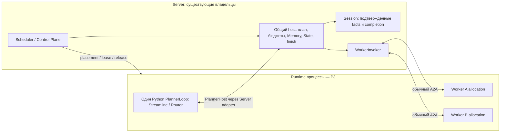
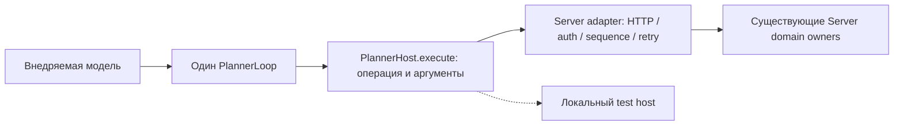
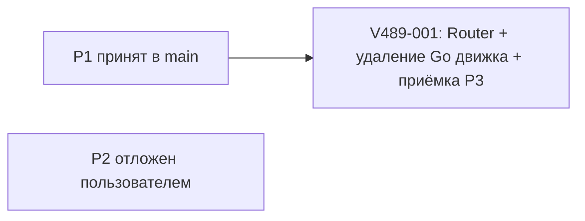
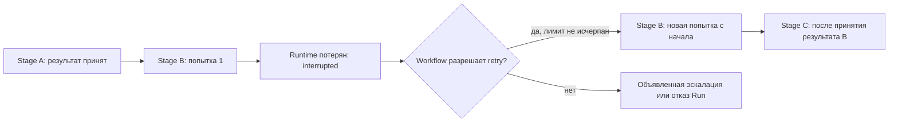

# Planner в Runtime: единый движок и приёмка P4

Обновлено 27 ноября 2026. P1 и P3 приняты в локальный `main`.
P3 слит через `d35ba0bd53bbc801b79996076497b6c45864552a`;
[интеграция V489-004](../../tasks/done/v489-004-runtime-planner-main-integration.yml)
подтверждает идентичность принятому коду и сохранность локальной работы.
Исходная приёмка: [V489-001](../../tasks/done/v489-001-runtime-router.yml) и
[evidence](../../tasks/evidence/v489-001-runtime-router.json).

Пять замечаний Astra закрыты в [V489-003](../../tasks/done/v489-003-runtime-planner-review-fixes.yml):
приоритет подтверждённого finish, завершение отклонённых сессий, исход и usage
компактора, каноническая цель для compaction и учёт множественного выбора.
Повторная приёмка и контрольные суммы: [evidence](../../tasks/evidence/v489-003-runtime-planner-review-fixes.json).

## Решения пользователя

| Дата | Решение |
| --- | --- |
| 2026-11-26 | Planner занимает отдельную allocation; Streamline требует Planner + Worker. Весь Streamline, включая compaction, входит в P1; Router переносится следующим этапом. |
| 2026-11-26 | Сохранить возможность headless через интерфейсы выполнения; не создавать второй движок и сокращать общее количество кода. |
| 2026-11-27 | При обсуждении P2 выбран узкий охват: та же StageExecution, замена Planner при живом Server и сохранении здоровых Workers. |
| 2026-11-27, последующее решение | **P2 отложить. Спланировать P3: перенос Router в Runtime и удаление заменённого Go-кода.** P3 не зависит от восстановления. Первоначально разрешено планирование. |
| 2026-11-27, начало реализации | Реализовать P3 по плану и довести до готовности к слиянию, сохранив headless-границу и сокращение кода. |
| 2026-11-27, после слияния P3 | **P2 отложить на неопределённый срок.** Принять повтор прерванного Stage с начала после потери Runtime; выполнить P4 как приёмку существующего interruption/retry, без восстановления подзадач. |

## Текущее состояние

Multi-allocation, P1 и P3 уже в main. Streamline и Router используют
один Python `PlannerLoop`, включая `compact@1`, Memory и State. Runtime имеет
1–4 allocation slots на процесс; Planner занимает отдельную allocation.
Server владеет планом, бюджетами, подтверждением результатов, Artifact refs,
WorkerInvoker, Scheduler и Control Plane. Один план допускает один active dispatch.
Go model runner, compactor, Gateway client и SDK tool/session bridge удалены.
Production-код Go/Python сокращён на 2 684 строки без учёта tests/generated/docs;
из Go module requirements удалены ADK, GenAI и ещё 21 неиспользуемая зависимость.
Первичная приёмка: 1 269 Go root tests. После исправлений повторены все
затронутые Go packages: 791 root test с race/PostgreSQL, 6 795 Runtime cases
и все 71 process roots;
136 platform/live/opt-in Runtime skips и один optional heavy-I/O skip не
считаются пройденным покрытием. Wire, public API/PostgreSQL, config, lint и
architecture gates первичной приёмки прошли; wire и lint повторены после
исправлений. Owned test DB/процессы убраны; live модели не запускались.

При потере Runtime неподтверждённая попытка прерывается; допустимый retry
по Workflow создаёт новую StageExecution. Completed Stages сохраняются, план
подзадач прерванной попытки
автоматически не наследуется. Sequence replay живого host не является resume
([SCH-R11–12, SCH-R98–103](../spec/execution/scheduler.md),
[PLN-R135–137](../spec/execution/planners.md)). P3 эти гарантии не меняет.

## P3: результат и минимальная демонстрация

Router выбирает логического Worker из неизменного набора Stage, но его
модельный цикл и compactor работают через **тот же Python PlannerLoop**, что
и Streamline. Server сохраняет свои доменные правила. Заменённый Go цикл,
Gateway adapter и SDK-обвязка удаляются, без fallback на прежнее исполнение.

Первый проверяемый результат: реальные Server, PostgreSQL, Runtime и
управляемый Gateway исполняют Router с двумя Workers. Модель направляет первую
подзадачу Worker A, вторую Worker B; проверяются ровно эти вызовы, подтверждённый
план, точные результаты/Artifact refs и финальный candidate. Planner находится
в отдельной allocation; хотя бы один Worker — на другом Runtime. Это один
вертикальный срез, не предварительное строительство новой инфраструктуры.

Runtime не получает прямой доступ к БД или новые права dispatch. Server
разрешает `worker_name` в текущий подготовленный WorkerHandle. Прямой вызов
Runtime-to-Runtime и параллельные подзадачи не нужны для этого переноса.

## Что действительно нужно изменить

| Текущий код | Изменение P3 |
| --- | --- |
| `internal/scheduler/runtime_planner.go`: только `StreamlinePlanner` | Использовать существующую synthetic Planner allocation и для Router; не включать её в immutable Stage snapshot, roster или логическое множество Workers. |
| `internal/app/composition_execution.go`, `internal/planner/router/factory.go` | Обе модельные стратегии создаются через общий Runtime host; удалить production model factory Go. Сохранить exact selectors `streamline@1` и `router@1`. |
| `internal/planner/registry.go`: callback направляется только Streamline | Адресовать единственный активный host по проверенной Stage/allocation; использовать существующую регистрацию host, без нового endpoint, polling или перебора handlers с проглатыванием ошибок. Runtime не выбирает стратегию/authority. |
| `streamline/runtime.go`: dispatch и history используют `workers[0]` | Router строго принимает `worker_name`; переиспользовать `routeWorker`, выбор binding и worker-scoped history. Streamline сохраняет свой single-Worker tool shape. |
| `tools_adk.go`, `memory_tools_adk.go`, `state_tools_adk.go`, `history.go` | Генерировать существующие tool schemas как обычные Contractor declarations; убрать SDK wrappers, сохранив ограничения допустимых bindings и model-visible domain errors. |
| `session/adk.go`, `runtime.go`, `runtime_context.go` | Писать те же ограниченные reduced facts непосредственно через session owner; убрать synthetic Go ADK event/session и in-memory conversation, ненужные удалённому циклу. |
| `planner.go`, `gateway*.go`, `compactor_agent.go`, часть `compaction.go` | Удалить Go runner, model/compactor execution и transcript projection. Оставить используемые Server validation, budgets, material index, exact history и подтверждение compaction marker. |

Один общий host сохраняет различия стратегий как небольшую декларацию
инструментов/roster, а не отдельные execution engines. Не переименовывать пакеты
и не вводить plugin framework только ради симметрии. Новые экспорты допустимы
только с production caller в том же изменении.

Поиск production imports на исходном main `b899210ff` обнаружил Go ADK/GenAI
только в Planner/session и composition. Это основание удалить зависимости
после переноса обвязки; `go mod tidy` и проверка callers определяют точный
остаток. Не удалять общий Gateway recovery/probe или другие используемые
сервисы вместе с Planner-specific HTTP adapter.

## Сохранённые контракты и цена переноса

- Router принимает фиксированное непустое множество Workers. `worker_name`
  ограничен точными logical binding keys; Memory и State дополнительно ограничены
  доступностью операции у выбранного Worker. History cursor связан с Worker.
  Неизвестный, отсутствующий или чужой binding не вызывает Worker side effect.
- Сохраняются deterministic roster из описаний AgentTemplates, исходные параметры,
  immutable context, exact models/Gateway/credentials, бюджеты и прежний deadline.
  Новый Python цикл не интерпретирует физические адреса Workers.
- Поддерживаются `none` и `compact@1`, Memory, State, document finish/recovery
  там, где они уже разрешены. Streamline-only summary continuation не становится
  Router-возможностью. Compactor остаётся one-shot без Gateway recovery.
- Native cost остаётся одним вкладом Planner в отчёт, без повторного вклада
  allocation. Отклонённый model reply/selection сохраняет действующие usage и
  compaction правила, включая четыре исправления P1.
- **Цена: Router с N Workers требует N + 1 allocation slots.** Три Workers и
  Planner помещаются в capacity 4 одного Runtime. Это не ограничение Router тремя
  Workers: fleet может дать больше slots. Нехватка capacity использует обычное
  ожидание; нет скрытого совместного размещения и изменения модели.
- Штатные отмена, fencing, cleanup, retry и завершение остаются общими. P3 не
  меняет allocation history, lease/receipt механизмы или DB schema ради P2.

Обязательные исходы для операций и тестов:

| Исход | Сохранить / проверить |
| --- | --- |
| Success | Commit плана/facts предшествует подтверждению и зависимому dispatch; candidate проходит обычную проверку. |
| Permanent error | Strict malformed requests и неверные полномочия отклоняются существующим private handler; domain binding errors возвращаются в принятом tool contract, без side effect. Не превращать их в transport retry. |
| Retryable failure | Штатные ограниченные transport/storage/Gateway recovery под исходным deadline, с прежней классификацией. |
| Reply lost | Ровно один identical replay через существующий sequence; нет повторного dispatch, charge, Memory mutation или marker. Неоднозначную обязательную session append не повторять как новую операцию. |
| Cancel / lease loss | Fence и join model/callback/Worker перед release; отсутствие Runtime resume. |
| Timeout | Различать Planner wall deadline, Gateway request, Worker invocation и cleanup budgets; Router не наследует случайно Worker timeout. |

Размеры остаются существующими: один active dispatch, `maxSubtasks` 1–1000,
2 MiB durable session, 64 tool declarations, 5001 operations, 4 MiB operation/reply,
512 KiB Planner envelope. Router roster и enums входят в проверяемый byte budget;
не добавлять произвольный числовой предел Workers. Проверки: 1/2/3 Workers,
64 небольших bindings для roster/schema и точная граница envelope с большими
описаниями. History сохраняет 8 fragments / 32 KiB на страницу, 16 KiB fragment,
8 cursors; compaction — действующие retained/peak bounds. Нельзя повторно
сканировать весь Run для callback или копировать весь history в каждый ответ.

## Headless без второго движка

Серверный транспорт, bootstrap, регистрация и allocation authority остаются
в адаптере. Loop не получает HTTP URL, grant или доступ к Server store.
Локальный тест запускает настоящий Router loop с двумя logical Workers и
compaction через внедрённые model/host, без Server, БД и A2A. Это доказывает
заменяемость интерфейса; fixture не копирует production plan/receipt engine.

Производственный LocalHost не входит в P3. Доменная логика, пока остающаяся
на Go Server, по-прежнему требует отдельного решения для полного headless.
Удаление Go ADK упрощает эту границу, но само по себе не создаёт автономный Runtime.

## Одна атомарная задача и приёмка этапа

[V489-001](../../tasks/done/v489-001-runtime-router.yml) объединяет перенос Router,
прямые tool declarations/session facts и удаление Go SDK. Первоначальная
[V489-002](../../tasks/done/v489-002-runtime-planner-go-removal.yml) архивирована:
production runner, SDK bridge и regression callers пришлось менять атомарно,
чтобы не сохранять второй движок ради тестов и пройти lint. Её объём и все
критерии приёмки перенесены в V489-001. После ревью exit task этапа —
[V489-003](../../tasks/done/v489-003-runtime-planner-review-fixes.yml).

Owning specs и architecture обновлены вместе с реализацией. Public event/fact
fields сохранены: старое имя `adk_event` не требует SDK и не меняется ради
косметической очистки. Никакого fallback на Go исполнение не осталось.

Приёмка переносит важные regression assertions на настоящий Runtime path:
Worker selection, Memory/State scope, cursor isolation, result revisions,
usage/malformed JSON/content_filter, compaction budgets и неэффективность,
required event-write failure, cancellation, stale allocation и lost reply.
Тесты старого Go runner не являются основанием сохранять его. Обновить gate
selectors и report validators при удалении/переносе тестов; пустая выборка — ошибка.

Открытые V420-003/004/005 сохраняют свой объём и зависимости, но их указания
уточнены под production Runtime path после P3. Их завершение не присваивается
приёмкой P3 автоматически. In-progress V420-006 не переназначается и не берётся
в работу; её shipped configuration остаётся входом штатной проверки.

Проверки включают полные затронутые Go/race/PostgreSQL packages, Runtime,
wire, config, public event contracts, architecture/lint и process suites через
штатные CI-шарды. Controlled Gateway сохраняет configured selection; live-model
quality отдельно и не является детерминированной приёмкой. Owned test DB и
процессы убираются; optional heavy I/O и прочие skips перечисляются отдельно.

До/после сравнить production LOC (Go + Python, без tests/generated/docs),
удалённые paths и module dependencies. Цель — отрицательный net delta и один
модельный движок. Не достигнутая экономия требует объяснения и пересмотра
объёма; нельзя выдавать перенос файлов или удаление тестов за сокращение
production кода. Новая очередь, checkpoint store или общий recovery framework
не нужны ни одной из задач.

## P2 отложен на неопределённый срок

Решение пользователя от 27 ноября после слияния P3: при потере Runtime
допустимо повторить прерванный Stage с начала. P2 не начат и отложен
**на неопределённый срок**. Его возобновляет только новое указание пользователя;
готовность P3 или P4 не создаёт зависимости от восстановления.

Это существующий контракт, без изменения defaults Workflow. Потеря Runtime
в `preparing`/`running` без durable candidate прерывает попытку как interrupted;
объявленная политика выбирает fresh retry,
эскалацию или отказ Run. Retry не безусловен: учитываются `retryable`,
`maxAttempts` и отмена. Он создаёт новую StageExecution и новый Planner;
подзадачи и внешние эффекты прерванного Stage могут выполниться повторно.
Подтверждённые более ранние Stages, принятые результаты и exact Artifact refs
сохраняются. Если candidate уже записан в `finalizing`, Server идемпотентно
дозавершает эту попытку без нового вызова Planner ([SCH-R99](../spec/execution/scheduler.md)).
Sequence replay действует внутри живого host, а не между попытками.

Порядок исполнения принадлежит Server/PostgreSQL. В одном Run активен максимум
один Stage; допустимый переход выбирается по pinned Workflow. Завершение
источника, outputs, неизменное решение перехода и создание следующего Stage
либо завершение Run — одна транзакция под действующим Run claim
([SCH-R75–80, SCH-R114–116](../spec/execution/scheduler.md)). Поэтому падение
процесса не разрешает перепрыгнуть Stage или создать две попытки для одного
подтверждённого исхода. Это гарантия последовательности и durable progression,
не exactly-once для действий внутри повторяемого Stage.

Ранее обсуждённая замена только Planner с сохранением здоровых Workers и той же
StageExecution остаётся возможным будущим охватом P2, без задач реализации.
Новые checkpoints, receipts, leases и восстановление диалога не нужны принятому
контракту. Повод вернуться к P2 — измеренная неприемлемая стоимость повторов
или новый пользовательский сценарий, а не завершение текущей серии.

## P4: интеграционная приёмка принятого контракта

Исходный P4 — проверка потери ответов, отмены, deadline, capacity и отказа
процесса. После отказа от P2 в нём нет требования продолжить живой Planner
или сохранить завершённые подзадачи прерванного Stage. Проверяем уже
реализованные гарантии через существующие suites, без нового движка.

| Граница | Ожидаемый исход и проверка |
| --- | --- |
| Переход Stage / неоднозначный terminal commit | Реальная PostgreSQL: атомарный переход, fresh attempt lineage, один ordinal, replay без второй публикации, claim fencing. |
| Потерянный ответ операции Planner | Для Streamline и Router живой host возвращает прежний исход; Worker dispatch и usage не повторяются. |
| Потеря Runtime / control lease / Server restart | Bounded interruption и cleanup; старые Workers не усыновляются. Workflow policy выбирает новую попытку либо terminal исход. |
| Отмена и deadline | Join model/Worker/callback, fence до release; late result не оживляет Stage, recovery не продлевает записанные cleanup budgets. |
| Capacity и изоляция | Отдельный слот Planner; capacity-one fleet, несколько Workers, четыре allocations одного процесса, ожидание пятой и освобождение без остановки соседей. |
| Headless-граница | Тот же Router/Streamline loop и compaction с внедрённым локальным host/model, без Server bootstrap. Production LocalHost не заявлен. |

Приёмка [V489-005](../../tasks/v489-005-runtime-planner-p4-acceptance.yml)
завершена в ветке `codex/runtime-planner-p4`, без слияния в main:
649 Go root tests с race/PostgreSQL, 6 795 Runtime passes / 136 declared skips,
71 process roots без отказов и пропусков, wire, architecture и lint прошли.
Отрицательный контроль через Go overlay нарушил создание следующей попытки;
реальный PostgreSQL-тест обнаружил разрыв перехода. Проверка отчёта также
отклонила отсутствующее подтверждение этого теста. Owned PostgreSQL и процессы
убраны, primary working files сохранены. Подробности и ограничения —
[отчёт P4](../../tasks/evidence/v489-005-runtime-planner-p4-acceptance.json).
Это новый запуск P4; результаты P3 не подменяют его. Публичные API, схема БД, логика исполнения
и модели проекта не меняются. Исправляются только устаревшие описания одного
слота на процесс, включая комментарий release: capacity принадлежит CTL-R112,
последовательность Stages — SCH-R114, один вызов allocation — WRK-R124. Live quality и недоступные на macOS Linux
sandbox проверки не входят в детерминированную приёмку.

После P4 возможны production headless, Worker restore, Server restart resume,
drain/обновления Runtime, pause/suspend, параллельные подзадачи. Это не часть
текущего плана. Серверный помощник аудитов остаётся предложением пользователя:
составлять проверки, находить пробелы и объяснять результаты через обычные
Audit API/контроллеры; отдельный движок или серверная модель не назначены.

## История принятого P1

Multi-allocation: [0057](0057-runtime-allocation-slots.md) и
[evidence V487-014–017](../../tasks/evidence/v487-014-017-review-fixes.json).
P1: [V488-001](../../tasks/done/v488-001-planner-tool-sdk-boundary.yml),
[V488-002](../../tasks/done/v488-002-runtime-streamline-p1.yml).

Ревью исправило неполный/несогласованный usage, неоднозначный JSON Gateway,
продолжение после `content_filter` и пропуск проверки compaction при отклонённом
выборе инструмента. [V488-003](../../tasks/done/v488-003-runtime-planner-review.yml)
и [evidence](../../tasks/evidence/v488-003-runtime-planner-review.json):
6772 Runtime passes, 135 declared skips, Go/race/PostgreSQL, 71 process roots,
wire и lint; negative controls подтвердили регрессии. Исправления добавили
25 production lines. Полный release-verify/live-model quality не заявлялись.

P1 слит через `9d84161b076edd05d64a521c6be8187ba239ee22`; metadata HEAD
`b899210ff0a39ff8e8d5ff1a0308083eac323bb4`.
[V488-004](../../tasks/done/v488-004-runtime-planner-main-integration.yml)
подтверждает идентичность принятого кода и сохранность локальной работы.
Эта приёмка относится к P1, не доказывает будущий перенос Router.
