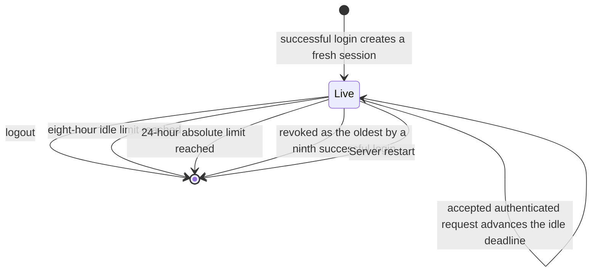
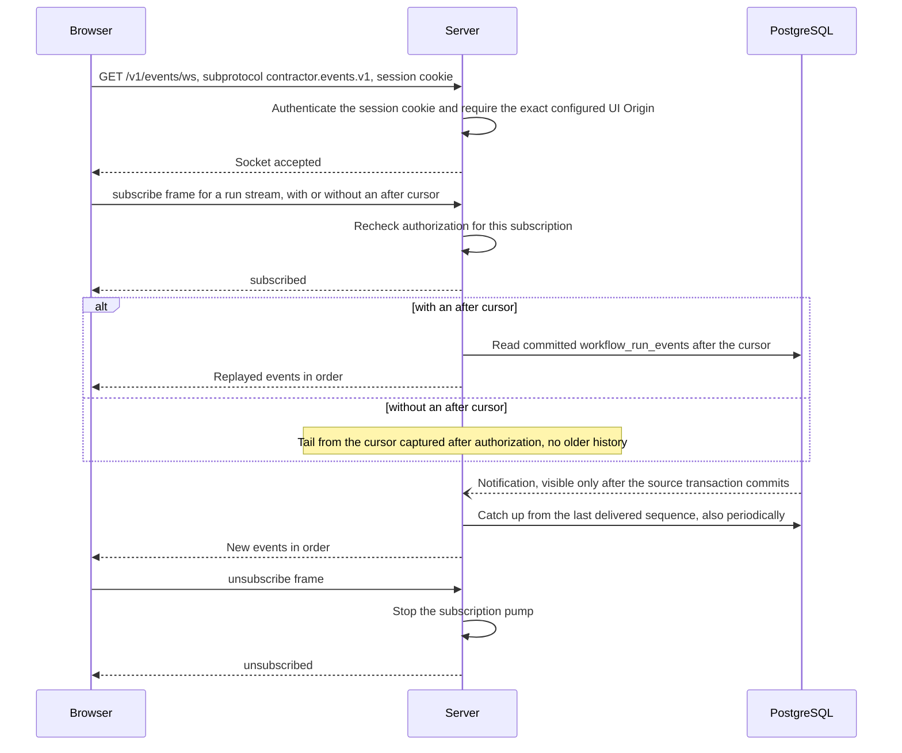
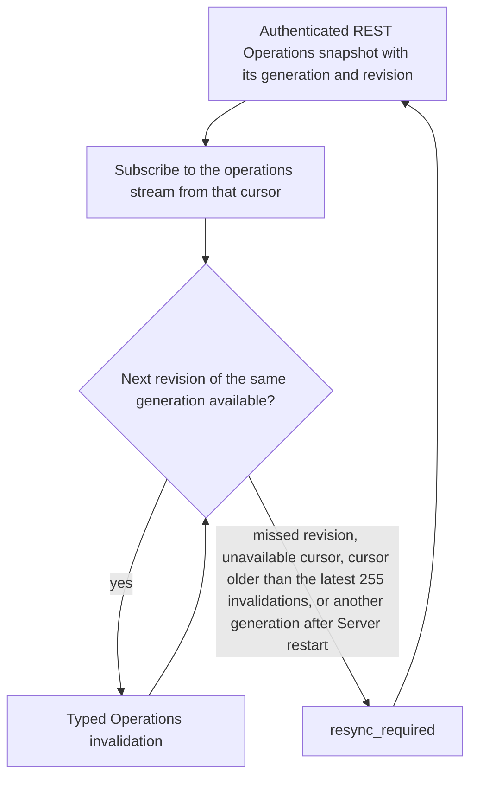

# Public API

Requirement prefix: `API` · [Specification index](../README.md)

## Purpose and scope

This document owns the conventions shared by every resource of the public
`/v1` Server API: the committed OpenAPI contract and API versioning, the public
JSON request-body bound, the boundary between browser clients and domain
services, the browser-origin allowlist and CORS, the browser authentication
routes, the session cookie, session lifetime and CSRF protection, the
non-disclosing `404`, the precondition policy for configuration and credential
mutations, and the live event WebSocket with its `run` and `operations`
streams.

It leaves to other documents:

- Create idempotency of `POST /v1/runs` (the canonical request digest, exact
  replay and key reuse), which published configurations a caller may select,
  and the public Runtime-label field `runtimeLabels`: Runs
  ([RUN-R5, RUN-R7, RUN-R8, RUN-R17 to RUN-R21](../execution/runs.md)).
- Request correlation through `X-Request-ID` and the `requestId` field of REST
  error objects: Observability
  ([OBS-R1 to OBS-R5](../platform/observability.md)).
- The local principal and its capabilities, the local-auth file, password
  hashing, the login body bound, the generic login failure, the login limiter,
  client IP and trusted proxies, the browser-session bootstrap settings, the
  insecure loopback cookie name, the `Authorization: Bearer` path and the
  meaning of `401` and `403`: Security
  ([SEC-R38 to SEC-R62](../platform/security.md)).
- The UI build's supported API versions and incompatible-version error,
  additive API changes within a supported version, the transport adapter and
  the SPA's reaction to `401` and `403`: UI
  ([UI-R5 to UI-R7, UI-R20 to UI-R22, UI-R31 to UI-R36](../ui/ui.md)).
- The headers and ETags of individual resources: Runtime configuration
  ([RCF-R125, RCF-R173 to RCF-R176](../configuration/runtime-config.md)), the
  Scheduler settings resource in Operations
  ([OPS-R53 to OPS-R60](../operations/operations.md)), the Git routes in Git
  import ([GIT-R82, GIT-R84](../artifacts/git-import.md)) and the Audit routes
  in Audits ([AUD-R198 to AUD-R205](../audits/audits.md)).
- Filtering and keyset pagination of each collection: Configuration catalog
  ([CAT-R67 to CAT-R69](../configuration/catalog.md)), Runs
  ([RUN-R81](../execution/runs.md)), Audits
  ([AUD-R203](../audits/audits.md)) and Managed Evals
  ([EVM-R210 to EVM-R214](../evals/managed-evals.md)).
- The generic Artifact payload limit: ArtifactStore
  ([ART-R65](../artifacts/artifact-store.md),
  [LIM-ART-4](../platform/limits.md)).
- The content of reduced durable Planner facts and of the typed Planner-plan
  projection: [Planners](../execution/planners.md).
- Run hard deletion: [Retention and deletion](../artifacts/retention-and-deletion.md).

## Concepts

- **Public API**: the versioned, authenticated `/v1` Server API described by
  the committed OpenAPI 3.1 contract and used by browser and non-UI clients.
- **Browser-origin allowlist**: the operator-configured list of exact browser
  origins that Server allows; credentialed CORS is enabled only for them.
- **Session cookie**: the `__Host-contractor_session` cookie that carries a
  browser session's random value.
- **CSRF token**: the session-bound 32-byte random token that a
  cookie-authenticated non-safe request presents in `X-CSRF-Token`.
- **Live event WebSocket**: the read-only `GET /v1/events/ws` endpoint that
  multiplexes `run` and `operations` subscriptions.
- **Event cursor**: an opaque generation combined with an unsigned decimal
  string sequence that identifies a position in one stream.
- **Run event**: a row of `workflow_run_events`, the sole Run replay
  authority.
- **Operations invalidation**: a typed, process-local notification on the
  `operations` stream that an Operations resource changed.

Terms are defined once in the [glossary](../glossary.md).

## Model

### Browser session

A browser session exists only in Server memory, from a successful login until
logout, expiry, revocation or Server restart (API-R15 to API-R21).



Leaving `Live` through expiry, logout or revocation closes the session's live
event sockets (API-R35).

### Live event streams

| Stream | Content | Cursor | Replay and retention |
| --- | --- | --- | --- |
| `run` | Every durable Run or StageExecution lifecycle change and every public Planner fact of one Run | Per-Run sequence assigned in the source record's transaction; generation stable for the Run; returned by Run detail | Committed events replayable from `workflow_run_events` while the Run is retained |
| `operations` | Runtime Agent, allocation, configuration, credential and scheduler-settings changes | Process-local; generation and revision returned by the Operations snapshot; Server restart creates another generation | Latest 255 typed Operations invalidations; otherwise `resync_required` |

A `run` subscription:



An `operations` subscription and its resynchronization:



## Requirements

### Contract and versioning

**API-R1.** The browser API has one committed OpenAPI 3.1 contract at
[`api/openapi/contractor-public-v1.yaml`](../../../api/openapi/contractor-public-v1.yaml).
It describes the public `/v1` auth, Workflow, Run, Artifact and Operations
resources, their error envelope and the mutation headers used by browser and
non-UI clients.

**API-R2.** Private Control Plane, Runtime Agent and A2A wire contracts remain
separate and are not made public by including them in this specification.

**API-R3.** Incompatible changes require a new public API version.
Regenerating a client from an incompatible document does not make the change
backward compatible.

The UI's supported-version check and the rule that additive changes within a
supported version need no coordinated release are in UI
([UI-R5 to UI-R7](../ui/ui.md)). The public Runtime-label field name and the
joint upgrade of Server, UI and bundled clients are in Runs
([RUN-R7, RUN-R8](../execution/runs.md)).

### Request bodies

**API-R4.** Every public JSON request body is bounded at 1 MiB (LIM-API-1)
unless a resource declares a smaller bound, such as the login body
([SEC-R49](../platform/security.md)). A larger body is rejected with
`413 request_too_large` and never reaches the handler's validation
(FAIL-API-1).

**API-R5.** An Artifact over its 64 MiB limit
([ART-R65](../artifacts/artifact-store.md),
[LIM-ART-4](../platform/limits.md)) is rejected in the same way, with
`413 artifact_too_large` (FAIL-API-1).

**API-R6.** Eval documents keep their own `422 eval_limit_exceeded` bound
([EVM-R63](../evals/managed-evals.md)).

### Browser clients and domain services

**API-R7.** Browser code uses the authenticated public Server APIs directly.

**API-R8.** UI-oriented query endpoints may aggregate existing durable or
read-model state, but mutations must call the same domain application services
as non-UI API clients.

### Browser origins and CORS

**API-R9.** Because UI and API may have different origins, Server has an
operator-configured exact browser-origin allowlist (the `--browser-origin`
setting, [SEC-R58](../platform/security.md)). Wildcard and reflected
origins and the opaque `null` origin are invalid.

**API-R10.** A matching preflight exposes only the public API methods that
Server supports and the required headers, including `Content-Type`,
`Idempotency-Key`, `If-Match` and `X-CSRF-Token`.

**API-R11.** Browser-readable response headers include `X-Request-ID`, `ETag`
and `Content-Disposition`.

**API-R12.** Credentialed CORS is enabled only for an exact allowed origin.

**API-R13.** CORS grants no authorization. Non-browser clients remain subject
to the public API's authentication contract: non-browser authentication gains
no authority from CORS and does not bypass the domain's owner and audit rules.

### Browser authentication routes

**API-R14.** The browser auth API is:

```text
POST /v1/auth/login       username + password; create session
GET  /v1/auth/session     return safe principal + session-bound CSRF token
POST /v1/auth/logout      require CSRF; destroy session
```

The single local principal and its bootstrap file, password rules, the 8 KiB
login body bound, the generic login failure response, the failed-login limiter
and `429`, and the non-browser `Authorization: Bearer` path are specified in
Security ([SEC-R38 to SEC-R62](../platform/security.md)).

### Session cookie

**API-R15.** Successful login always creates a fresh cryptographically random
32-byte value (LIM-API-2), puts its unpadded base64url representation only in
a `__Host-contractor_session` cookie and stores only its SHA-256 digest in
Server memory.

**API-R16.** The session cookie is `HttpOnly`, `Secure`, `SameSite=Lax`,
`Path=/` and has no `Domain`. Frontend requests send it with
`credentials: include`.

**API-R17.** Production UI and API must therefore be HTTPS and same-site even
when they have different origins.

**API-R18.** A separately named insecure cookie is permitted only behind an
explicit loopback-development mode and is never accepted on a non-loopback
listener. Its name and the mode's listener and origin rules are in Security
([SEC-R59 to SEC-R61](../platform/security.md)).

### Session lifetime

**API-R19.** Sessions have an eight-hour idle limit (LIM-API-3), a 24-hour
absolute limit (LIM-API-4) and a maximum of eight live sessions (LIM-API-5); a
ninth successful login revokes the oldest (LIFE-API-1).

**API-R20.** An accepted authenticated request advances only the idle
deadline.

**API-R21.** Restarting Server invalidates every session. No browser session,
password hash or CSRF token is written to PostgreSQL (LIFE-API-1).

**API-R22.** `GET /v1/auth/session` uses `Cache-Control: no-store` and lets a
reloaded SPA recover the session-bound 32-byte random CSRF token (LIM-API-6)
without exposing the session cookie.

### CSRF and Origin checks

**API-R23.** Every cookie-authenticated non-safe request requires both an
exact allowed `Origin` and `X-CSRF-Token`; missing or mismatched values have no
side effect (FAIL-API-2).

**API-R24.** Login itself requires JSON plus an exact allowed browser Origin
when an Origin header is present.

The non-browser `Authorization: Bearer` path, which requires neither Origin
nor CSRF, is in Security ([SEC-R62](../platform/security.md)). How the SPA
handles `401`, `403` and a CSRF token replaced by another tab is in UI
([UI-R31 to UI-R36](../ui/ui.md)).

### Principal and non-disclosure

The local principal's capabilities, the derivation of `userId` from the
authenticated request context, the meaning of `401` and `403` and the reuse of
the principal boundary by a future OIDC or session adapter and RBAC are in
Security ([SEC-R43 to SEC-R46](../platform/security.md)). The Audit routes
take their owner from authentication and Project membership
([AUD-R199](../audits/audits.md)).

**API-R25.** Ownership checks keep their non-disclosing `404` behaviour; the
Audit routes, for example, return the same safe `404` for unknown and
other-owner IDs ([AUD-R200](../audits/audits.md)).

### Mutation preconditions

**API-R26.** Run and Artifact mutations retain their existing idempotency,
ownership and CAS requirements ([Runs](../execution/runs.md),
[ArtifactStore](../artifacts/artifact-store.md)).

**API-R27.** Configuration publication, credential creation and deletion, and
RuntimeConfig, label and Agent-label administrative commands require their own
idempotency keys, revision preconditions where specified, and an audit actor.

**API-R28.** RuntimeCredential deletion is the one exception: its durable
tombstone makes it idempotent by credential ID, so it accepts but neither
requires nor binds an idempotency key. Its replay response and key-format
validation are in Runtime configuration
([RCF-R176](../configuration/runtime-config.md)).

**API-R29.** The API keeps configuration and credential mutations distinct
from ordinary Run and Artifact use, so later RBAC does not require changing
domain semantics.

The headers of individual resources are specified by their owners, which this
table only indexes:

| Resource | Owner |
| --- | --- |
| `POST /v1/runs` create idempotency | Runs, [RUN-R17 to RUN-R21](../execution/runs.md) |
| RuntimeConfig, bindings, runtime credentials and Agent labels | Runtime configuration, [RCF-R173 to RCF-R176](../configuration/runtime-config.md) |
| Revision ETags | Runtime configuration, [RCF-R125](../configuration/runtime-config.md) |
| Scheduler settings | Operations, [OPS-R53 to OPS-R60](../operations/operations.md) |
| Git import and the owner Git key | Git import, [GIT-R82, GIT-R84](../artifacts/git-import.md) |
| Audit routes | Audits, [AUD-R198 to AUD-R205](../audits/audits.md) |

### Collections and pagination

**API-R67.** Every paged collection that takes the shared `limit` query
parameter (OpenAPI `#/components/parameters/Limit`) accepts a page of 1 to
200 items and defaults to 50 (LIM-API-18); any other `limit` is
`400 invalid_request`. Server reads one row beyond the requested page to
decide `page.hasMore` and the continuation cursor, so every store behind such
a collection accepts a read of 201 rows. Server, its stores and the CLI take
both numbers from one definition. Collections with their own bound declare
it instead: Managed Eval lists (LIM-EVM-15) and allocation history
(LIM-OPS-28).

Filtering and keyset pagination are specified for each collection by its
owner, which this table only indexes:

| Collection | Owner |
| --- | --- |
| Configuration catalog | Configuration catalog, [CAT-R67 to CAT-R69](../configuration/catalog.md) |
| `/v1/runs` | Runs, [RUN-R81](../execution/runs.md) |
| Audits | Audits, [AUD-R203](../audits/audits.md) |
| Managed Eval lists | Managed Evals, [EVM-R210 to EVM-R214](../evals/managed-evals.md) ([LIM-EVM-14, LIM-EVM-15](../platform/limits.md)) |

### Live event WebSocket

#### Endpoint and authentication

**API-R30.** Live UI updates use one read-only WebSocket endpoint on Go
Server, `GET /v1/events/ws`, negotiated with the subprotocol
`contractor.events.v1`.

**API-R31.** The browser connects directly to the configured API origin; Node
does not proxy the upgrade.

**API-R32.** Production uses `wss`. `ws` is accepted only for the same
loopback development exception as the HTTP runtime config
([UI-R10](../ui/ui.md)).

**API-R33.** The upgrade authenticates the ordinary Server session cookie and
rejects every `Origin` other than the exact configured UI origin before
accepting the socket.

**API-R34.** No credential, CSRF token or cursor is placed in the URL.

**API-R35.** Session expiry, logout or revocation closes the session's sockets
(LIFE-API-1).

**API-R36.** Periodic socket checks validate the existing session handle
without extending its idle deadline. Revocation notifications are only a fast
process-local edge and do not replace those checks.

**API-R37.** The channel is strictly observational: subscription and
unsubscribe frames require no CSRF token and cannot cancel a Run, publish a
configuration, manage a credential or perform any other domain mutation. Those
operations remain authenticated HTTP requests with their existing CSRF,
idempotency and CAS contracts.

#### Subscriptions and frames

**API-R38.** One connection multiplexes explicit `run` and `operations`
subscriptions.

**API-R39.** Authorization is rechecked for each subscription, so a principal
may observe only its own Runs and its permitted Operations surface.

**API-R40.** All client and Server frames are bounded JSON (API-R61) and carry
the protocol version.

**API-R41.** A Server event envelope has this shape:

```json
{
  "type": "event",
  "stream": {"kind": "run", "id": "run_..."},
  "cursor": {"generation": "run-generation-...", "sequence": "42"},
  "kind": "planner.event",
  "occurredAt": "2026-08-30T12:00:00Z",
  "data": {}
}
```

**API-R42.** The cursor combines an opaque generation with an unsigned decimal
string sequence, so a Server restart or browser number precision cannot
silently alter its meaning.

**API-R43.** Unknown protocol versions, stream kinds, event kinds and fields
are rejected rather than guessed.

**API-R44.** The message contract is committed at
[`api/events/contractor-events-v1.schema.json`](../../../api/events/contractor-events-v1.schema.json);
the OpenAPI document describes the HTTP upgrade and links that schema.

**API-R45.** Normal generated HTTP methods and the browser WebSocket adapter
remain separate code paths.

**API-R46.** Server sends `subscribed` before replay, and sends
`unsubscribed` only after that subscription pump has stopped, so no later frame
can reuse the acknowledged subscription ID.

#### Run stream

**API-R47.** For a `run` stream, every durable Run or StageExecution lifecycle
change and every public Planner fact receives one monotonically increasing
per-Run sequence in the same transaction as its source record. Its generation
is stable for that Run.

**API-R48.** A Run detail response includes the corresponding event cursor.

**API-R49.** Subscribing with `after` replays committed events after that
cursor in order and then follows new commits. Reconnect uses the last fully
processed cursor.

**API-R50.** A subscription without `after` tails from the cursor captured
after authorization and does not replay older history.

**API-R51.** Run events remain replayable for as long as the Run itself is
retained (LIFE-API-2).

**API-R52.** `planner.event` carries exactly the reduced durable fact or typed
Planner-plan projection change defined in [Planners](../execution/planners.md),
never a live raw ADK or model stream. Prompts, model responses, reasoning, tool
payloads, provider bodies and credentials cannot appear in a Planner event
frame.

**API-R53.** Lifecycle events are invalidation hints: the UI refetches the
affected TanStack Query and does not treat their payload as a replacement
authoritative aggregate.

**API-R54.** `workflow_run_events` is the sole Run replay authority.

**API-R55.** The insert trigger of `workflow_run_events` emits a PostgreSQL
notification that becomes visible only if the source transaction commits. That
notification is only a coalescible wake-up hint: each subscription also
performs bounded periodic catch-up from its last delivered sequence, so a lost
or duplicated notification cannot create a gap (FAIL-API-3).

#### Operations stream

**API-R56.** The `operations` stream reports Runtime Agent, allocation,
configuration, credential and scheduler-settings changes, but its cursor is
process-local and its notifications are not a new audit log.

**API-R57.** The Operations snapshot response includes its current generation
and revision. A new subscription is established from that cursor.

**API-R58.** Server restart creates another generation, while a missed
revision or an unavailable cursor produces `resync_required`. The UI then
obtains another authenticated REST snapshot before continuing (FAIL-API-5).

**API-R59.** Server retains only the latest 255 typed Operations invalidations
(LIM-API-7); an older cursor also requires that snapshot resynchronization
(LIFE-API-3, FAIL-API-5).

#### Delivery, flow control and limits

**API-R60.** Delivery may be duplicated across disconnects. The client
deduplicates by stream and cursor, processes events in order and treats any
gap as a resync, not as permission to infer missing state (FAIL-API-4).

**API-R61.** A client frame is at most 16 KiB (LIM-API-8) and a Server frame
at most 64 KiB (LIM-API-9).

**API-R62.** An authenticated session has at most eight sockets (LIM-API-10)
and a socket at most 32 subscriptions (LIM-API-11).

**API-R63.** Exceeding an input or subscription limit closes or rejects only
that socket (FAIL-API-4).

**API-R64.** Each connection has a bounded output queue of at most 256 frames
(LIM-API-12) or 1 MiB (LIM-API-13), whichever is reached first. A slow
consumer that fills it is closed with retryable overload semantics, WebSocket
status `1013`, instead of blocking Scheduler or Planner persistence; the client
then resynchronizes (FAIL-API-4).

**API-R65.** Server ping and control frames detect dead connections: Server
sends a ping after 20 seconds without outbound traffic (LIM-API-14) and closes
a connection that has not answered within 60 seconds (LIM-API-15)
(FAIL-API-4).

**API-R66.** Client reconnect uses bounded exponential backoff with full
jitter: UI reconnect starts at 500 ms (LIM-API-16) and doubles up to 30 seconds
(LIM-API-17). The client always supports explicit manual refresh
(FAIL-API-4).

## Interfaces

| Interface | Use | Requirements |
| --- | --- | --- |
| [`contractor-public-v1.yaml`](../../../api/openapi/contractor-public-v1.yaml) | Public `/v1` resources, error envelope, mutation headers and the WebSocket upgrade | API-R1, API-R44 |
| [`contractor-events-v1.schema.json`](../../../api/events/contractor-events-v1.schema.json) | Live event message contract | API-R41, API-R44 |
| `POST /v1/auth/login`, `GET /v1/auth/session`, `POST /v1/auth/logout` | Browser authentication | API-R14 to API-R24 |
| `GET /v1/events/ws`, subprotocol `contractor.events.v1` | Live event WebSocket | API-R30 to API-R66 |
| Request headers `Content-Type`, `Idempotency-Key`, `If-Match`, `X-CSRF-Token`, `Origin` | Mutation headers and browser checks | API-R10, API-R23, API-R27 |
| Response headers `X-Request-ID`, `ETag`, `Content-Disposition` | Browser-readable response headers | API-R11 |

The error envelope is the `Error` schema of the OpenAPI document; its
`requestId` repeats `X-Request-ID`
([OBS-R5](../platform/observability.md)).

## Limits, failures and errors

Limits ([registry](../platform/limits.md)):

- LIM-API-1 — public JSON request body: 1 MiB unless a resource declares a
  smaller bound (API-R4).
- LIM-API-2 — session value: 32 random bytes (API-R15).
- LIM-API-3 — session idle limit: eight hours (API-R19).
- LIM-API-4 — session absolute limit: 24 hours (API-R19).
- LIM-API-5 — live sessions: at most eight (API-R19).
- LIM-API-6 — CSRF token: 32 random bytes (API-R22).
- LIM-API-7 — retained typed Operations invalidations: the latest 255
  (API-R59).
- LIM-API-8 — live event client frame: 16 KiB (API-R61).
- LIM-API-9 — live event Server frame: 64 KiB (API-R61).
- LIM-API-10 — live event sockets per authenticated session: eight (API-R62).
- LIM-API-11 — subscriptions per socket: 32 (API-R62).
- LIM-API-12 — output queue: 256 frames (API-R64).
- LIM-API-13 — output queue: 1 MiB (API-R64).
- LIM-API-14 — ping after 20 seconds without outbound traffic (API-R65).
- LIM-API-15 — unanswered connection closed after 60 seconds (API-R65).
- LIM-API-16 — UI reconnect initial delay: 500 ms (API-R66).
- LIM-API-17 — UI reconnect maximum delay: 30 seconds (API-R66).
- LIM-API-18 — page of a collection with the shared `limit` parameter: 200
  items, default 50 (API-R67).

The generic Artifact payload limit is [LIM-ART-4](../platform/limits.md)
([ART-R65](../artifacts/artifact-store.md)); the login body and login limiter
bounds are [LIM-SEC-8 to LIM-SEC-10](../platform/limits.md)
([SEC-R49, SEC-R51](../platform/security.md)); the `X-Request-ID` bound is
[LIM-OBS-1](../platform/limits.md) ([OBS-R1](../platform/observability.md)).

Failure outcomes ([failure model](../platform/failure-model.md)):

- FAIL-API-1 — an oversized public request body (API-R4, API-R5).
- FAIL-API-2 — a cookie-authenticated non-safe request without a valid
  `Origin` and `X-CSRF-Token` (API-R23).
- FAIL-API-3 — the `workflow_run_events` notification (API-R55).
- FAIL-API-4 — live event delivery to a client (API-R60, API-R63 to API-R66).
- FAIL-API-5 — an `operations` subscription cursor (API-R58, API-R59).

Entity lifecycle ([lifecycle](../platform/lifecycle.md)):

- LIFE-API-1 — browser session and its CSRF token (API-R19, API-R21,
  API-R35).
- LIFE-API-2 — Run events (API-R51).
- LIFE-API-3 — typed Operations invalidations (API-R59).

Errors ([registry](../platform/errors.md)): `request_too_large` (API-R4),
`artifact_too_large` (API-R5), the non-disclosing `404` (API-R25),
`resync_required` (API-R58, API-R59) and WebSocket close status `1013`
(API-R64). `eval_limit_exceeded` is owned by Managed Evals
([EVM-R63](../evals/managed-evals.md)); `401` and `403` by Security
([SEC-R45](../platform/security.md)) and the failed-login `429` by Security
([SEC-R51](../platform/security.md)); `412` and the stale-revision contracts by
the resource owners listed under
[Mutation preconditions](#mutation-preconditions); the catalog cursor `400` by
Configuration catalog ([CAT-R68](../configuration/catalog.md)).

## Security

Security-relevant requirements: the exact browser-origin allowlist and CORS
(API-R9 to API-R13); the session cookie (API-R15 to API-R18); in-memory
session lifetime and no persistence of session material (API-R19 to API-R22);
Origin and CSRF checks (API-R23, API-R24); the non-disclosing `404` (API-R25);
WebSocket authentication, per-subscription authorization, URL content and the
observational-only channel (API-R33 to API-R39). Trust boundaries, the local
principal and login protection are in [Security](../platform/security.md).

## Observability

`X-Request-ID` is browser-readable (API-R11); its generation and propagation
are in [Observability](../platform/observability.md). Operations
invalidations are process-local hints, not an audit log (API-R56).

## Invariants

These properties follow from the cited requirements, which are authoritative.
The owning tests are the live event contract tests in
[`internal/httpapi/public/events/events_test.go`](../../../internal/httpapi/public/events/events_test.go)
and
[`internal/httpapi/public/event_handlers_test.go`](../../../internal/httpapi/public/event_handlers_test.go).

1. An upgrade with an invalid Origin or session, and a Run subscription the
   principal is not authorized for, are rejected (API-R33, API-R39); tests
   `TestPublicEventWebSocketRequiresCookieAndExactOrigin` (session cookie and
   Origin) and
   `TestHandshakeAuthorizationUnknownFramesAndSubscriptionLimitFailClosed`
   (Origin, subprotocol, unauthorized Run subscription).
2. Replay after reconnect is ordered and tolerates duplicate delivery
   (API-R49, API-R55, API-R60); test
   `TestRunSubscriptionReplaysThenFollowsAndUnsubscribesInOrder`.
3. An `operations` subscription resynchronizes after a Server restart
   (API-R58); test `TestOperationsResyncAndLiveInvalidation`.
4. A slow consumer is closed without affecting other sockets (API-R64); test
   `TestProtocolAndQueueBoundsRejectUnknownOrUnsafeData`.
5. Prompts, model responses, reasoning, tool payloads, provider bodies and
   credentials never appear in a Planner event frame (API-R52); test
   `TestProtocolAndQueueBoundsRejectUnknownOrUnsafeData`.
