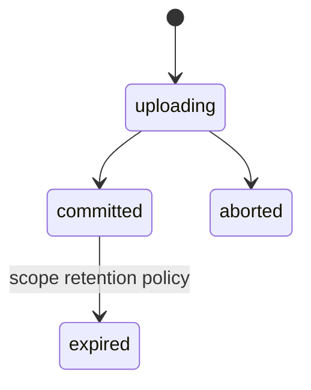
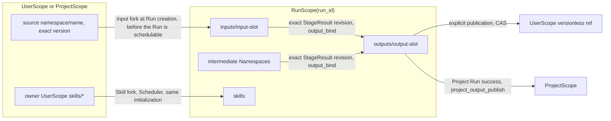
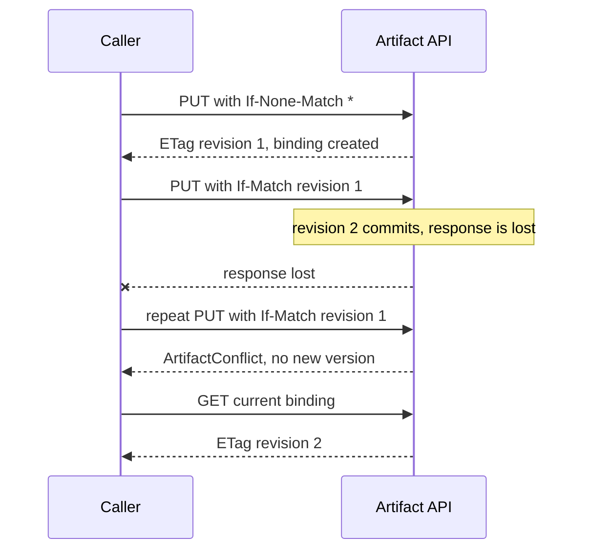

# Artifact store

Requirement prefix: `ART` · [Specification index](../README.md)

## Purpose and scope

This document owns the ArtifactStore: its structural scopes, artifact
addressing, Namespaces and reserved names, binding revisions and
compare-and-swap (CAS) writes, the Artifact authority of Workers and their
tools, the public and private Artifact API contract, Workflow input forks,
Workflow output binding and freezing, and explicit publication of Run outputs.
The artifact plane owns data access, authenticated scope and Namespace grants.

It leaves to other documents:

- Workflow input and output slot declarations, slot media-type matching, Stage
  binding fields and `workflowOutputs` validation:
  [Workflows](../configuration/workflows.md).
- StageExecution lifecycle, StageContext snapshots and retries, the preparation
  abort path and finalization records: [Scheduler](../execution/scheduler.md).
- WorkflowRun lifecycle, Run creation, repeat drafts and manual continuation
  eligibility: [Runs](../execution/runs.md).
- Projection of observed refs into Worker results and the Worker model
  boundary: [Worker](../execution/worker.md).
- Runtime Agent principals and mTLS identity:
  [Control Plane](../execution/control-plane.md) and
  [Security](../platform/security.md).
- The Project resource, Project Run creation and Project output publication:
  [Projects](projects.md).
- Scope purge and garbage collection:
  [Retention and deletion](retention-and-deletion.md).
- Payload backends: [Blob storage](blob-storage.md).
- Git repositories as artifact inputs: [Git import](git-import.md).
- The common Toolset selection contract: [Toolsets](../tools/toolsets.md);
  purpose-specific artifact-backed tools: [Memory](../tools/memory.md),
  [Skills](../tools/skills.md), [Workspace](../tools/workspace.md),
  [HTTP and Caido](../tools/http-caido.md), [Scanners](../tools/scanners.md).
- Audit-managed artifacts: [Audits](../audits/audits.md) and
  [Review and reports](../audits/review-and-reports.md).
- Transaction conventions: [Persistence](../platform/persistence.md).

## Concepts

Terms are defined once in the [glossary](../glossary.md).

| Term | Meaning here |
| --- | --- |
| ArtifactStore | The one physical artifact store of Contractor. |
| Scope | The structural context of a store operation: `UserScope`, `ProjectScope` or `RunScope`. |
| RunArtifactSpace | The RunScope of one WorkflowRun, seen as the shared data plane of its Stages. |
| ArtifactRef | The public artifact address `(namespace, name, revision?)`. |
| Binding | The logical, mutable `(scope, namespace, name)` entry that points at one current immutable version. |
| Revision | An opaque token that selects one exact retained binding revision. |
| Namespace | The first component of artifact addressing and the fixed scope of domain tools. |
| Stage Agent Namespace | The Namespace resolved for one Stage Agent from its Stage binding. |
| Fork | A new independent binding with a lineage edge to an exact source version. |
| Publication | A controlled fork of an exact Run output version into UserScope (explicit, on request) or ProjectScope (on Project Run success). |
| Write fence | The Server-side rejection of an allocation's Artifact writes once its StageExecution enters `finalizing` or `aborting`. |
| Allocation grant | The Server-side record that authorizes one Runtime Agent process to use the private Artifact API for one allocation. |
| Frozen binding | A binding that can no longer advance: for example a Run `outputs` binding once the Run is terminal (manual continuation of an eligible failed Run unfreezes it without changing its revision, ART-R97), or an Audit-managed `audit-*` Project binding, which is created frozen ([Review and reports](../audits/review-and-reports.md)). |

## Model

### Scopes

| Scope | What it holds |
| --- | --- |
| `UserScope(user_id)` | The user's durable artifact library. |
| `ProjectScope(project_id)` | The owner's long-lived reusable workspace for one [Project](projects.md). |
| `RunScope(run_id)` | The `RunArtifactSpace` of one Workflow Run: durable Stage outputs and the data plane for concurrent Worker collaboration. |

`RunArtifactSpace` is a scoped view of `ArtifactStore`, not another storage
component.

### References and bindings

The public `ArtifactRef` is `(namespace, name, revision?)`. The fully
qualified internal binding key is:

```text
(scope_kind, scope_id, namespace, name)
```

Adding `revision` to that key identifies one exact retained binding revision
and its immutable internal version. ArtifactStore keeps immutable content
versions and one current binding for each fully qualified internal key.

### Namespaces

A Namespace is:

- part of artifact addressing;
- the fixed scope of specialized domain tools;
- unique only within its UserScope, ProjectScope or RunScope;
- not a security boundary against explicitly granted current-Run tools.

Reserved Namespaces and name prefixes:

| Name | Kind | Scope | Holds | Rules |
| --- | --- | --- | --- | --- |
| `inputs` | Namespace | RunScope | Mutable working copies of declared Workflow inputs | ART-R14, ART-R37, ART-R76 |
| `outputs` | Namespace | RunScope | Declared Workflow results, managed by Workflow Scheduler | ART-R14, ART-R90 |
| `skills` | Namespace | RunScope | Exact read-only Agent Skill packages ([Skills](../tools/skills.md)) | ART-R14, ART-R39, ART-R108, ART-R109 |
| `contractor-system` | Namespace, hidden | RunScope | Bounded Control Plane records coupled to a Run | ART-R17, ART-R18 |
| `finding-proposals` | Namespace | RunScope | Finding proposals and their frozen selected HTTP exchanges that Server finding intake writes ([Findings](../findings/findings.md)) | ART-R114 |
| `memory.` | Name prefix | Non-reserved RunScope Namespaces | Memory notes ([Memory](../tools/memory.md)) | ART-R19 to ART-R22 |
| `tool-invocation.` | Name prefix | RunScope | Runtime-owned receipts of model-free tool Workers ([Scanners](../tools/scanners.md)) | ART-R23 |
| `http.body.` | Name prefix | The allocation's logical Namespace | HTTP response bodies ([HTTP and Caido](../tools/http-caido.md)) | ART-R24 |
| `audit-standards` | Namespace | UserScope | Curated Audit standard packages ([Audits](../audits/audits.md)) | ART-R25 |
| `audit-*` | Namespace prefix | ProjectScope | Audit-managed results, evidence and reports ([Review and reports](../audits/review-and-reports.md)) | ART-R26 |

### Version states

```text
uploading -> committed
uploading -> aborted
committed -> expired by its scope's retention policy
```



### Storage components

```text
ArtifactStore
  -> ArtifactRegistry
       scopes, immutable versions, logical bindings, CAS, grants, lineage
  -> ArtifactBlobStore
       immutable payload bytes
```

### Scope forks

An input fork moves an exact source version into a Run:

```text
UserScope(user_id) or ProjectScope(project_id): <source namespace>/<source name>
  -> RunScope(run_id): inputs/<workflow input name>
```



## Requirements

### Store and scopes

**ART-R1.** Contractor has one physical `ArtifactStore`, not separate
User, Project and Run artifact services; UserScope, ProjectScope and RunScope
are scoped views of it.

**ART-R2.** Every store operation is evaluated in one
authenticated or trusted internal scope.

**ART-R3.** The public API derives the UserScope `user_id` from
authentication rather than accepting an arbitrary scope from the request.
UserScope supports upload, read, list and revision-checked binding updates.

**ART-R4.** The ProjectScope public API derives the owner and
the Project scope from authentication and the Project resource. ProjectScope
allows arbitrary artifacts, and exact selected versions may be forked into
Runs ([Projects](projects.md)).

**ART-R5.** Planner and all allocated Runtime Agents acting as
Workers, across every Stage of one Workflow Run, share that Run's RunScope:
all Stage participants in one Run use the same RunArtifactSpace.

**ART-R6.** A Worker never reads another Worker's sandbox.

### References and names

**ART-R7.** An `ArtifactRef` is `(namespace, name, revision?)`.
Scope comes from the authenticated API, Run/Stage or allocation context; it is
structural context and must not be encoded into any ref field or duplicated in
the ref.

**ART-R8.** An `ArtifactRef` has two explicit modes. A versionless
ref (no `revision`) addresses the current logical binding. A ref with a
non-null `revision` addresses one exact historical binding revision and the
immutable version selected through it.

**ART-R9.** The Server resolves `(scope, namespace, name, revision)`
to one immutable internal version. Blob locations, digests and immutable
storage-version IDs remain internal.

**ART-R10.** A revision is an opaque selection token, not an
authorization credential.

Rationale: one ref model is kept while a Worker cannot select another Run or
UserScope in a tool call.

**ART-R11.** Both `namespace` and `name` are case-sensitive ASCII
identifiers of 1 through 128 characters (LIM-ART-1): the first character is a
letter or digit, followed only by letters, digits, `_`, `-` or `.`
(`[A-Za-z0-9][A-Za-z0-9_.-]{0,127}`). Spaces, non-ASCII characters and control
characters are rejected.

**ART-R12.** Workflow validation, wire DTOs, ArtifactStore and
the public and private APIs enforce the same grammar. Names are never trimmed
or normalized.

Rationale: Workflow inputs can depend on the exact spelling of a name.

**ART-R13.** For display and authoring, `namespace/name` denotes one
`ArtifactRef`; `/` does not create a filesystem or an additional hierarchy.
For example:

```text
inputs/source                 ArtifactRef(namespace="inputs", name="source")
oas/review-report             ArtifactRef(namespace="oas", name="review-report")
outputs/openapi               ArtifactRef(namespace="outputs", name="openapi")
```

### Namespaces and reserved names

**ART-R14.** RunScope reserves three model/data Namespaces:

- `inputs` contains mutable working copies of declared Workflow inputs;
- `outputs` contains declared Workflow results and is managed by Workflow
  Scheduler;
- `skills` contains exact read-only Agent Skill packages pinned and forked by
  Workflow Scheduler ([Skills](../tools/skills.md)).

**ART-R15.** All other RunScope Namespaces hold intermediate
artifacts. They normally use the Stage Agent Namespace selected by the Stage
binding.

**ART-R16.** `inputs`, `outputs` and `skills` cannot be
selected as Stage Agent Namespaces. The names in them are Workflow slot names
or trusted runtime-resource names, not arbitrary Worker-selected paths: only
trusted Server operations create a binding in them, and a Worker can at most
advance an existing `inputs` binding (ART-R37).

**ART-R17.** The physical store may additionally contain the exact
hidden `contractor-system` Namespace for bounded Control Plane records coupled
to a Run; its `repeat-request` binding retains the non-secret request fragment
defined by [Runs](../execution/runs.md). It is written only through a
purpose-specific trusted service operation, is hidden from every public
Artifact list, read, metadata, version and lineage route and from every private
allocation Artifact operation, and is removed with the containing RunScope
(LIFE-ART-1).

**ART-R18.** `contractor-system` is not an Agent Namespace, a
Workflow input or output, a collaboration channel or a general internal
key/value store. Owner access is only through the validated repeat-draft
projection owned by [Runs](../execution/runs.md), which rechecks authorization
and source scopes.

**ART-R114.** The purpose-reserved RunScope Namespaces are `inputs`,
`outputs`, `skills`, `finding-proposals` and `contractor-system`. A trusted
purpose-specific flow owns each one: none can be a Stage Agent Namespace or a
MemoryTools Namespace, and no Stage result slot or Worker result binds into
one. The Server and the Runtime apply one list and one reserved Memory binding
rule (ART-R19 to ART-R22), pinned by
[`memory-reservation-cases.json`](../../../api/testdata/v1alpha1/memory-reservation-cases.json),
so a binding one side reserves is reserved by the other.

The `finding-proposals` Namespace also holds selected HTTP exchange evidence.
Finding intake creates its frozen binding together with the proposal and receipt;
generic writes cannot supply or change the Server-issued finding association
([FND-R49](../findings/findings.md), [FND-R160](../findings/findings.md)).

**ART-R19.** The `memory.` artifact-name prefix is reserved at the
model-visible Toolset layer in every non-reserved RunScope Namespace.
`run-artifacts@1` and every other model-visible artifact-backed Toolset,
including bounded text, source-analysis, OpenAPI and LikeC4 tools, reject a
source or target that resolves to such a binding and filter such bindings from
lists and from any accumulated exact-ref projection, even when the same
AgentTemplate selects MemoryTools. Selecting a domain tool must not become an
alternate route around MemoryTools.

**ART-R20.** No StageContext declaration or StageResult can
expose a RunScope binding whose name begins `memory.` in a non-reserved
Namespace.

**ART-R21.** The lower-level allocation-bound private Artifact
API stays domain-neutral: the trusted MemoryTools implementation uses
`memory.` bindings through it without another endpoint, grant kind or Artifact
authorization mode, and their bytes and immutable revisions remain ordinary
ArtifactStore behaviour. Authenticated Run owners and operator diagnostics may
inspect the underlying Artifact metadata and revisions. The note mapping,
bounds, hidden CAS and response-loss reconciliation are owned by
[Memory](../tools/memory.md).

Rationale: this keeps revisions out of model context without adding another
network service or Artifact authorization mode.

**ART-R22.** An ordinary artifact named `memory.*` in a purpose-reserved
Namespace (ART-R114) is governed by that Namespace's own contract and is not a
Memory note.

**ART-R23.** The `tool-invocation.` name prefix in RunScope is
reserved for the Runtime-owned receipts of model-free tool Workers
([Scanners](../tools/scanners.md)); bindings with that prefix cannot be
declared as Stage result or Workflow output targets.

**ART-R24.** HTTP response-body bindings use the reserved
`http.body.` name prefix ([HTTP and Caido](../tools/http-caido.md)): generic
model-visible Artifact tools neither list nor read or write them. This is a
Toolset authority boundary, not a new Artifact API or storage class; the
private paged listing applies the same rule in storage (ART-R47).

**ART-R25.** The UserScope Namespace `audit-standards` is
reserved for curated Audit standard packages. Generic Artifact APIs cannot
write it or read or list raw package bytes; only the trusted catalog seed path
can create a binding. The reservation is this exact Namespace, not a prefix: a
Namespace that only begins with it, such as `audit-standards-notes`, is an
ordinary UserScope Namespace that the owner can write, read and list. The
public UserScope list hides the reserved Namespace in storage before keyset
pagination, together with any caller `excludeNamespace` (ART-R71). The catalog
rules are owned by [Audits](../audits/audits.md).

**ART-R26.** The Server derives and reserves the `audit-*` Project
Namespace prefix. Generic Project list, read, metadata, version, lineage and
mutation routes hide the entire reserved prefix, and ordinary public Project
Artifact mutation cannot write or delete Audit-managed bindings; the store
itself refuses every generic ProjectScope write under the prefix as reserved.
Owner uploads continue through non-reserved Namespaces. Frozen Audit bindings, recovery
staging, artifact links and crash replay are owned by
[Review and reports](../audits/review-and-reports.md).

**ART-R115.** The generic Project list reads its pages from an index of
exactly the listable Project bindings, those outside the reserved prefix, so
a page never reads an Audit-managed binding however many an Audit holds.

Rationale: a key range on the primary key cannot replace the prefix filter.
In a linguistic database collation such as `en_US` punctuation is ignored at
the first comparison level, so `audit-` names interleave with names such as
`audit0`; a `LIKE` predicate matches characters whatever the collation.

### Stage Agent Namespaces

**ART-R27.** Workflow Scheduler resolves each Stage Agent's
Namespace from its Stage binding ([Workflows](../configuration/workflows.md))
before allocation: an explicit `namespace` wins; otherwise the logical Agent
name is used. The result travels in AllocationSpec and is fixed when Worker
tools are constructed.

**ART-R28.** Namespace is not a model-selected argument of domain
tools.

**ART-R29.** Specialized namespace-bound toolsets must resolve to
unique Namespaces within one Stage. A later or different Stage may assign the
same Namespace to another Agent and continue that data scope.

**ART-R30.** There is no Namespace-wide writer lock: different artifact
names are independent, while conflicting writes by authorized participants to
the same logical binding use compare-and-swap. Whether multiple Stages of one
Run execute concurrently is a [Scheduler](../execution/scheduler.md) decision
and is not required by this contract.

### Tool authority

**ART-R31.** An AgentTemplate may explicitly select two kinds of
model-visible artifact tools:

1. the exact domain tools selected from AgentTemplate Toolsets and fixed to its
   resolved Namespace, for example selected members of
   `openapi_tools(namespace)` or the purpose-specific `memory-tools@1` wrapper
   ([Memory](../tools/memory.md));
2. selected members of the built-in current-Run Artifact Toolset
   `run-artifacts@1`, which exports exactly `list_artifacts`, `read_artifact`
   and `write_artifact` for explicit current-Run refs.

**ART-R32.** No generic Artifact tool is injected implicitly: an
AgentTemplate must select `run-artifacts@1` and list each operation it wants
the model to see ([Toolsets](../tools/toolsets.md)). Selecting only
`list_artifacts` and `read_artifact` exposes a model-visible read-only
interface; omitting `run-artifacts@1` exposes none of the generic operations.

**ART-R33.** A domain Toolset implementation may use the
allocation-bound private Artifact client internally, within its own registered
contract, without exposing the generic `run-artifacts@1` operations.

**ART-R34.** There are no separate `read_any_artifact` aliases. The
authority is evident in the explicitly selected generic tool, its explicit ref
and the allocation grant.

**ART-R35.** Tool selection and Artifact authorization are
independent checks. Selecting `write_artifact` only constructs and exposes that
model tool; it never broadens the Server-side allocation grant, bypasses the
`outputs` Namespace reservation or crosses the write fence (ART-R86).
Conversely, a grant never causes an unselected tool to be constructed or
exposed.

**ART-R36.** The generic tools deliberately have broader read
authority inside the current Run, except for the purpose-reserved `skills`
Namespace and the `memory.` and `http.body.` names.

**ART-R37.** The baseline allocation write grant permits `inputs`
and non-reserved Namespaces, so Workers can modify their working input copies
and intermediate artifacts. In `inputs` it permits only a CAS update
(`If-Match`, `expected_revision`) of an existing binding: a create
(`If-None-Match: *`, `expected_revision=None`) there is rejected with
`artifact_access_denied` (HTTP 403, `retryable` false), whether or not the name
exists, and creates nothing. Every `inputs` binding is therefore a declared
Workflow input forked by the trusted Run-creation operation (ART-R76). It
denies writes to `outputs` and `skills`, whose bindings are created only by
trusted Scheduler operations.

Rationale: a Worker-created `inputs/<name>` would appear among the Run's
inputs as if the Run had been started with it, including an optional input
that was absent at creation (ART-R78). Denying every Worker write to `inputs`
would remove the working copies ART-R77 promises, and checking a created name
against the Workflow's input slots would put the Workflow snapshot on the
allocation write path while still letting a Worker supply an absent optional
input. Reopen this only if a Workflow needs an input-like binding during the
Run that neither an ordinary Stage Namespace with a context mapping nor a new
trusted Server operation can provide.

**ART-R107.** Workers may read declared outputs produced by earlier accepted
Stages.

**ART-R38.** Generic Worker grants never cross a Run. Of a Project's or an
Audit's artifacts, Workers see only the exact versions forked into RunScope
`inputs`; they have no Audit or Project Artifact authority
([Review and reports](../audits/review-and-reports.md)).

**ART-R39.** RunScope `skills` bindings are exact forks from the
Run owner's UserScope created only by Scheduler. The trusted Runtime loader may
read exact package refs through its allocation-bound private client, and
allocations read `skills` only through this trusted Skill loading. Package
validation, the owner-UserScope fork and ADK access are owned by
[Skills](../tools/skills.md).

**ART-R108.** The private allocation Artifact API rejects every write to
`skills`.

**ART-R109.** `run-artifacts@1` filters the `skills` Namespace from
model-visible list, read and write operations.

**ART-R110.** Authenticated Run-owner inspection of the exact metadata, lineage
and bytes of `skills` bindings through public Artifact routes remains ordinary
public Artifact behaviour and is not model authority.

### Private Artifact API

**ART-R40.** The Server's private Artifact API authenticates
the Runtime Agent through mTLS, binds each request to its active allocation and
that allocation's RunScope, enforces the hard Run boundary, reserved-Namespace
policy, grants, byte limits and write preconditions, and streams bytes.

**ART-R41.** An allocated Runtime Agent uses the private
Artifact API with its existing mTLS identity and active allocation ID; it
receives no Artifact Registry, database, S3 or other blob-backend credential.

**ART-R42.** The allocation grant records the
certificate-derived Runtime Agent principal and its process `instance_id`
beside `allocation_id`, and each request must match all three. Another
otherwise valid CA-signed Runtime Agent certificate cannot borrow an allocation
ID. The principal has no broader scope or role: the check only proves that the
caller is the process to which Control Plane issued the grant
([Control Plane](../execution/control-plane.md)).

**ART-R43.** The allocation remains the path identity, while
the client repeats its process identity in the bounded
`X-Contractor-Runtime-Instance-ID` header. The Server validates that header
against the mTLS principal-bound grant before reading a request body.

**ART-R44.** The allocation ID is the only
authority-bearing path value of the private API: neither URL nor body accepts
a Run or User scope selector. Neither the public nor the private interface lets
its caller supply an arbitrary scope ID.

**ART-R45.** The private HTTP binding has one unambiguous
write protocol. Creating a binding requires `If-None-Match: *`; updating it
requires exactly one quoted, strong `If-Match` value containing the expected
opaque revision, read verbatim in the entity-tag grammar of
[API-R70](../api/public-api.md). A PUT without one of those preconditions,
with a weak validator, with a list of validators or with an escaped or
otherwise quoted value is `400 invalid_request` before the store is read.

**ART-R46.** Successful private reads return the resolved revision in
`ETag`; successful writes return the same exact revision in both `ETag` and the
versioned `ArtifactWriteResult`.

**ART-R47.** `GET /private/v1/allocations/{allocationID}/artifacts`
always requires an integer `limit` in `1..256` (LIM-ART-3) and has two forms;
there is no unbounded listing.

- The paged form takes an optional `namespace` and an optional opaque
  `cursor` (LIM-ART-5). It returns at most `limit` versionless refs of the
  model-visible bindings in namespace and name order, and a `nextCursor` when
  more follow. Storage excludes the model-hidden bindings before the limit:
  the `contractor-system` and `skills` Namespaces, and names starting with
  `memory.` or `http.body.` outside `inputs` and `outputs` (ART-R17, ART-R19,
  ART-R24, ART-R109). A page is therefore never shortened by filtering: every
  page but the last holds exactly `limit` refs. The response size is bounded by
  `limit`, independent of how many bindings the Run holds.
- Trusted adapters may instead supply all three of `namespace`, `namePrefix`
  and `limit`, without a `cursor`. This form requires non-empty portable ASCII
  namespace and prefix components, applies a literal case-sensitive name
  prefix in storage, and returns at most `limit` versionless refs ordered by
  name, without the model-visibility exclusion and without `nextCursor`.
  Underscores are literal, not SQL wildcards.

Missing or unpaired parameters, duplicates and invalid values are rejected
with `invalid_request`.

**ART-R48.** The cursor names the last binding of the previous page and is
bound to the `namespace` filter: a cursor positioned in another Namespace is
rejected for a filtered listing. It carries no authority, because the
allocation still selects the RunScope. Every binding that exists for the whole
traversal is returned exactly once; one created or deleted meanwhile may or
may not appear (FAIL-ART-7). The `namePrefix` form is a bounded query, not an
assertion that the result is complete: quota-aware callers request one extra
row to detect overflow. Run system Namespaces remain hidden in both forms, and
neither adds a scope selector.

Rationale: the Runtime rejects list responses over 1 MiB, and a Run with
thousands of HTTP response bodies would otherwise fail every model listing
even though the model may see none of them.

Accepted cost: a page is one primary-key range scan from the cursor, and the
hidden bindings it passes over are filtered rather than skipped by index, so
the rows one page reads are bounded by the Run's (or the filtered Namespace's)
bindings after the cursor, not by `limit`; the Run revision limit (LIM-ART-6,
ART-R118) bounds those bindings. A test pages 15,000 hidden and 7,000 visible
bindings through the Server and the Runtime. If listing latency is measured
to grow with Run size, skip hidden name ranges in the index.

**ART-R116.** `GET /private/v1/allocations/{allocationID}/artifacts/{namespace}/{name}/metadata`,
with the same optional `revision` and the same allocation, Namespace and
grant checks as the raw read, returns the `ArtifactReadResult` of the ref (its
exact revision, media type and size) without reading or sending the payload.
It is not a content observation: only a payload read records the exact
revision for invocation provenance.

**ART-R117.** The UTF-8 readers `read_artifact` and `read_text_artifact`
first resolve a ref through the metadata read (ART-R116), unless its exact
revision is already cached. A media type that names a binary format is
refused before any byte is downloaded: the top-level types `image` (except
`image/svg+xml`), `audio`, `video`, `font` and `model`, and the `application`
archive and document subtypes `zip`, `x-zip-compressed`, any `+zip` suffix,
`gzip`, `x-gzip`, `x-tar`, `x-7z-compressed`, `x-bzip2`, `x-xz`, `zstd`,
`java-archive`, `pdf` and `wasm`. Any other media type, including
`application/octet-stream`, is downloaded once per exact revision and refused
when it is not valid UTF-8. The allocation keeps one downloaded revision of
at most 64 MiB, so paging it, or reading a versionless ref whose current
revision it holds, downloads nothing again.

### Versions, reads and writes

**ART-R49.** Artifact content is immutable; only its logical current
binding changes.

**ART-R50.** Only a complete committed payload is readable.

**ART-R51.** A successful RunScope commit is immediately visible to
all authorized participants of the Run. StageResult acceptance is therefore not
a general artifact visibility event; only its optional binding into the
reserved `outputs` Namespace is Scheduler-controlled.

**ART-R52.** `list_artifacts` returns versionless refs one page at a time,
with the `nextCursor` of the paged private listing (ART-R47).

**ART-R53.** Reading a versionless ref resolves the current
committed binding and returns the exact versioned ref that was read. Reading a
versioned ref returns that exact historical revision and never falls forward to
the current or a newer binding.

**ART-R111.** In the ArtifactRegistry, `resolve(binding, None)` resolves the
current binding; supplying a revision resolves only that retained historical
binding revision and never substitutes another version.

**ART-R54.** `ArtifactReadResult` and `ArtifactWriteResult`
always contain a versioned ref plus the binding and revision timestamps.

**ART-R55.** ArtifactStore assigns both timestamps from its
authoritative database clock. `binding_created_at` is fixed when the logical
`(scope, namespace, name)` binding is first created. `revision_created_at`
identifies when the exact returned binding revision was committed and advances
on update. They are metadata, not part of ArtifactRef identity or of the
caller-supplied payload.

**ART-R56.** The raw private GET returns the timestamps as
strict RFC 3339 UTC values in `X-Contractor-Binding-Created-At` and
`X-Contractor-Revision-Created-At`, and the private PUT returns the same two
headers. Both use RFC 3339 with nanosecond-capable precision and canonical UTC
`Z`. The timestamps do not change the JSON bodies or ETags; the trusted client
assembles the conceptual result metadata from the headers and exposes it to
trusted wrappers without changing ArtifactRef or exposing the values as model
arguments.

Rationale: purpose-specific wrappers such as MemoryTools can project stable
creation and update order without trusting a Runtime Agent clock or adding
another endpoint ([Memory](../tools/memory.md)).

**ART-R57.** The target `ref` passed to `write_artifact` must be
versionless. A versioned write target is invalid, because `ref.revision` and
`expected_revision` would have conflicting meanings.

**ART-R58.** CAS is a separate, explicit write precondition:
`expected_revision=None` is create-only, while updating an existing binding
requires the opaque revision returned by a read or write.

**ART-R59.** A stale expected revision returns `ArtifactConflict`
(FAIL-ART-1). Same-binding conflicts are returned to the caller;
infrastructure never silently overwrites or semantically merges the winner.
A write to a frozen binding instead returns `artifact_frozen` (HTTP 409,
`retryable` false) on the public and private Artifact APIs, whatever its
precondition: a frozen binding never advances, so neither a re-read nor a
retry can make the write succeed.

**ART-R60.** CAS is also the response-loss contract. If a create
or update committed but its response was lost, repeating the already-consumed
`If-None-Match: *` or `If-Match: <old revision>` fails with `ArtifactConflict`
and creates no new version. The caller reconciles through a current or exact
read; the Server does not guess whether a different payload under the same
stale precondition was an intended replay (FAIL-ART-1).

**ART-R61.** Concurrent first writes to the same scope, and
concurrent writes of identical content to different bindings, must both observe
the committed scope or blob after a uniqueness wait rather than return a false
CAS conflict (FAIL-ART-5).

**ART-R118.** One RunScope holds at most 50,000 binding revisions outside the
Scheduler-managed `outputs` Namespace (LIM-ART-6). The Run's bindings,
retained revisions, candidate versions and owned lineage edges all hang off
these revisions, so the limit bounds them too. PostgreSQL counts every
inserted revision against its RunScope under the scope row lock, whichever
write path inserts it, so concurrent writers of one Run cannot exceed the
limit together. A write that would exceed it stores nothing and returns
`artifact_limit_exceeded` (HTTP 409, `retryable` false) on the private
Artifact API; revisions are never given back while the Run exists, so no
retry can succeed (FAIL-ART-1). The Scheduler's `outputs` revisions do not
count, so a Run that used up its limit still binds its declared outputs.
MemoryTools report the exhausted limit as `memory_namespace_full`
([Memory](../tools/memory.md)).

Rationale: Run deletion purges the whole RunScope in one transaction
(DEL-R22); without a bound on the Run, a large enough Run could never be
deleted within the purge budget.

How long an old revision remains resolvable to its immutable internal version
is owned by [Retention and deletion](retention-and-deletion.md).

### Payloads and media types

**ART-R62.** One resolved, versioned ref identifies one payload with
one media type. Contractor has no compound artifact or `parts[]` contract;
multi-file output is an archive or a manifest that names exact versioned refs.

**ART-R63.** `ArtifactPayload.media_type` is normalized and stored
with every immutable artifact version as a canonical lowercase `type/subtype`
without parameters, each part an RFC 6838 restricted name (a letter or digit
followed by letters, digits and `!#$&^_.+-`), at most 255 characters in total
(LIM-ART-2). The API rejects invalid or parameterized values. The artifact
store, Audit packages, schemas, Runtime and UI share
[these cases](../../../api/testdata/v1alpha1/media-type-cases.json).

**ART-R64.** Workflow input, Stage-result and Workflow-output slot
validation uses the stored media type and the strict slot matching rules owned
by [Workflows](../configuration/workflows.md).

**ART-R65.** The generic Artifact payload limit is 64 MiB
(67,108,864 bytes) (LIM-ART-4), enforced by the public and private APIs,
clients and persistence. Source archive uploads, including source ZIPs, may use
the full generic limit.

**ART-R66.** Specialized package and tool limits remain
independent of the generic payload limit: raising the transport limit does not
raise Skill or Audit package budgets, model disclosure (model-context) limits
or workspace expansion limits.

**ART-R67.** ArtifactStore and its APIs do not interpret
domain artifact semantics. The generic Artifact API enforces bytes, CAS, owner
isolation and immutable history but does not infer, for example, that an
artifact is a Skill ([Skills](../tools/skills.md)).

**ART-R68.** A source tree, repository archive, OpenAPI document
or other domain input is an ordinary artifact selected for a declared slot.
Generic digest, streaming, retention and size behaviour belongs to
ArtifactStore; safe unpacking or interpretation belongs to the selected Worker
tools and sandbox policy.

### Artifact API clients

**ART-R69.** The same contract backs the User and Project
Artifact APIs, Run clients and trusted Scheduler operations, but scope binding
and grants differ: a public user client is bound to its authenticated
UserScope, a Project client is owner-bound to one ProjectScope, and a Worker
client is bound to the RunScope in its allocation. The Project Artifact routes
and their scope binding are owned by [Projects](projects.md).

**ART-R70.** In the public Artifact API, create uses
`If-None-Match: *` and update uses the strong current revision ETag; the
response contains the new exact `ArtifactRef`. The `If-Match` value is one
plain double-quoted revision in the public `Revision` grammar (API-R70,
LIM-API-19), the same grammar as the `revision` query parameter. A malformed,
escaped or otherwise quoted value is `400 invalid_request` before the store is
read, never a CAS conflict. The Git import routes use the same headers
(GIT-R84).

**ART-R71.** The public UserScope Artifact list accepts an exact
`namespace` filter and an `excludeNamespace` exclusion. The Server evaluates
the exclusion before keyset pagination, so a page cannot become short or
incorrectly claim completion after browser-side filtering. The exact
`namespace` filter and the exclusion are part of the cursor identity. The UI
routes that use them are owned by [UI](../ui/ui.md).

**ART-R72.** Only purpose-specific trusted Server operations may
perform a controlled source-to-RunScope or successful-Run-to-ProjectScope fork,
including Workflow input and output forks ([Projects](projects.md)) and Agent
Skill forks ([Skills](../tools/skills.md)). There is no generic client
operation that accepts arbitrary source and target scopes.

**ART-R73.** Workflow Scheduler uses an internal
ArtifactStore capability to verify exact versions, fork UserScope inputs into
RunScope and bind accepted versions into `outputs`. The User Artifact API
exposes a separate, purpose-specific publication operation for an authorized
Run output.

### Workflow input forks

**ART-R74.** At Run creation, the caller supplies bindings only for declared
Workflow input slots ([Workflows](../configuration/workflows.md)), as
`ArtifactRef` values in the source scope selected by the endpoint: a
standalone Run selects from the caller's authenticated UserScope, and a Project
Run selects from its owner-authorized ProjectScope, with the explicit owner
rulepack exception in [PRJ-R29](projects.md) and [WFL-R88](../configuration/workflows.md).

**ART-R75.** A versionless input selects the binding current at
Run creation and is resolved to that exact revision; a versioned input
explicitly selects that retained historical revision directly.

**ART-R76.** Before the Run becomes schedulable, and so before the
first Stage is selected, the trusted Run-creation operation records the exact
source version and scope of every supplied input, validates its media type against the
Workflow input slot, then forks it to
`RunScope(run_id): inputs/<workflow input name>`. For a standalone Run that
operation is Workflow Scheduler; for a Project Run it is the Project endpoint,
after verifying ownership ([Projects](projects.md)). In the same
initialization boundary the optional Nuclei `sourceScope: user` rulepack uses the
authenticated owner UserScope even for a Project Run (SCN-R238), and Scheduler
pins and forks every selected Agent Skill
into `skills` ([Skills](../tools/skills.md)).

**ART-R77.** A fork creates an independent target binding and a
lineage edge to the exact source version. It may initially reuse the same
immutable blob; copying bytes is not required. The first or any later Run write
creates a new immutable version and advances only the Run binding through CAS;
Run mutations never mutate the source binding.

**ART-R78.** The initialization of all required inputs is atomic
from the execution model's point of view: no Stage is selected until every fork
succeeds and its exact source version is recorded. Optional missing inputs
remain absent. A failed initialization leaves no runnable partial
RunArtifactSpace (FAIL-ART-2).

**ART-R79.** Recovery retries the recorded exact source versions;
it never re-resolves a newer current source binding, in UserScope or
ProjectScope, for the same Run (FAIL-ART-2).

**ART-R80.** Run creation forks each declared input as one ordinary
artifact through this mechanism. It does not follow refs inside a payload,
such as the JSON refs of a findings collection ZIP, and has no
collection-specific recursive input handling
([Findings](../findings/findings.md)).

### Stage context artifacts

**ART-R81.** When creating each StageExecution, before
requesting any allocation, Scheduler resolves every present context binding to
its exact current revision, which must resolve to a retained version, and
records that version in the durable StageContext. It records explicit absence
for each missing optional binding, and the resolved artifact mapping passed to
Planner omits those absent entries. A missing required binding prevents Worker
allocation and Planner or Session creation; the abort path and its
`context_artifact_missing` StageTermination are owned by
[Scheduler](../execution/scheduler.md).

**ART-R82.** Writes during a StageExecution may advance
logical bindings but cannot change the exact refs already present in its
StageContext. Snapshot and retry semantics are owned by
[Scheduler](../execution/scheduler.md).

**ART-R83.** `context.artifacts` is data dependency and
provenance, not an authorization allowlist: Worker access remains governed by
the allocation-bound RunScope tools and grants of this document.

### Stage results and the write fence

**ART-R84.** Every ArtifactRef in a candidate StageResult must
already contain the revision selected by Planner.

**ART-R85.** When the StageExecution enters `finalizing`,
Workflow Scheduler verifies that each exact `(RunScope, namespace, name,
revision)` exists and resolves to a retained immutable version, validates its
stored media type against the declared result slot, and locks that internal
version for the same transition. It never re-resolves or substitutes the
current binding, even when that binding has advanced since Planner selected the
result; the selected revision need not still be current.

**ART-R86.** When a StageExecution durably enters `finalizing` or
`aborting`, Scheduler establishes a Server-side write fence for every
associated allocation. From that transition onward the private Artifact API
rejects its writes even if a Worker or A2A Task has not yet stopped
(FAIL-ART-3). Waiting until allocation release is not a conforming
write-revocation boundary; the fence is independent of Worker shutdown and
allocation release.

**ART-R87.** Fence establishment is serialized with the
complete Artifact mutation, not merely with grant lookup: when the fence
operation returns, no earlier authorized write may commit afterward
(FAIL-ART-3).

**ART-R88.** After the transition to `finalizing`, neither
Planner nor Worker may change the semantic result or its referenced artifact
versions. Worker finalization cannot mutate artifacts.

### Workflow outputs

**ART-R89.** Declared Run outputs are Scheduler-managed
bindings in `outputs` to accepted versions, created only through the Stage's
explicit `workflowOutputs` mapping ([Workflows](../configuration/workflows.md)).
There is no implicit output mapping based on artifact Namespace, name, list
position or matching slot names.

**ART-R90.** Scheduler applies the `workflowOutputs` mapping only
for an accepted terminal successful StageResult while the WorkflowRun is still
`running`. In the same database transaction it creates each
`outputs/<workflow output name>` binding, once per Run, at the exact version
already validated for the StageResult, without resolving the source's current
binding again, and validates the destination Workflow output slot. The binding
is a metadata fork inside the same RunScope with lineage edge kind
`output_bind` and does not copy bytes; Scheduler never advances or replaces
it. A mapping that finds the binding already forked by `output_bind` from the
same exact source revision, as a replay of a lost acceptance would, succeeds
without a second revision. A mapping that meets a binding of any other
revision is a permanent failure: it binds nothing, and the Run ends through
FAIL-SCH-13 with `scheduler_state_invalid`
([SCH-R102](../execution/scheduler.md)) instead of retrying the acceptance.

Rationale: no valid Workflow maps one output twice in one Run. Catalog load
rejects a graph in which a Stage maps an output that an earlier successful
Stage on the same path maps ([WFL-R85](../configuration/workflows.md)) and
every `next` cycle ([WFL-R44](../configuration/workflows.md)); `succeeded`
allows only `next` or `succeed` ([WFL-R40](../configuration/workflows.md)), so
a successful Stage never runs again in its Run; a mapping applies only to a
successful StageResult; and manual continuation re-runs only a failed or
interrupted StageExecution ([RUN-R46](../execution/runs.md)), which bound
nothing. Advancing an existing binding under a revision compare-and-set would
serve no reachable case, so the binding stays create-only. A Workflow shape
that can map one output twice in one Run, such as a loop or remapping after
continuation, needs a new decision before it is admitted.

**ART-R91.** If Run cancellation committed first, the StageResult
may still be accepted for audit, but its Workflow-output mapping is not applied
and it cannot create Run output bindings (FAIL-ART-4). Its effect on Workflow
advancement is owned by [Scheduler](../execution/scheduler.md).

**ART-R92.** Accepting the StageResult that causes success,
applying its Workflow-output mapping, freezing all required outputs and
changing the WorkflowRun `running -> succeeded` are one database transaction:
RunStore and ArtifactRegistry participate in the same PostgreSQL transaction
whenever Scheduler accepts a StageResult, applies Workflow output mappings and
possibly makes the WorkflowRun terminal. A storage split must preserve the same
atomic contract rather than exposing a partially mapped terminal Run
(FAIL-ART-6).

**ART-R93.** Once a Run succeeds, all required output bindings
are present and their exact versions are retained in Run provenance (LIFE-ART-2).

**ART-R94.** When a Run instead becomes `failed` or `cancelled`,
any output bindings accepted from earlier Stages are also frozen for audit;
they do not constitute successful Run completion and are not implicitly
published (LIFE-ART-2).

**ART-R95.** Frozen Run outputs are never implicitly
published or overwritten in UserScope; a successful standalone Run does not
implicitly overwrite the user's artifact library.

**ART-R96.** A Run with no Artifact bindings has an empty output
set. Freezing that set is a successful no-op; absence of an Artifact scope row
cannot prevent a terminal WorkflowRun transition.

**ART-R97.** Manual continuation of an eligible failed Run
([Runs](../execution/runs.md)) is the explicit exception to output-binding
freezing. The same transaction records the continuation receipt, creates the
new attempt and unfreezes that Run's `outputs` bindings without changing their
current revisions. Immutable artifact revisions, terminal Stage facts and other
frozen bindings remain protected, and Workers gain no output-write authority.
Cancelled, succeeded and already-published Runs cannot use this exception
(LIFE-ART-2).

### Publication

**ART-R98.** Publishing a Run result to UserScope is an explicit
controlled fork from the exact Run output version to a caller-selected
versionless `ArtifactRef` in UserScope. Creating a new user binding is
create-only; replacing an existing one requires its current opaque revision as
a separate CAS precondition. Publication records lineage and may reuse the
existing blob.

**ART-R99.** A successful Project Run additionally performs the
create-only `outputs/<slot>` publication contract of [Projects](projects.md);
it never silently replaces an existing Project binding or changes the semantic
Run outcome. The successful cross-scope lineage edge has kind
`project_output_publish`, distinct from the Run-internal `output_bind` edge.

### Deletion

Deletion of committed artifact versions, including the controlled scope purge,
its gates and who may invoke it, is owned by
[Retention and deletion](retention-and-deletion.md).

### A2A and ADK

**ART-R100.** Normal durable artifact bytes stay in ArtifactStore and
are never sent through A2A; A2A normally carries refs.

**ART-R112.** Agent Skill package bytes follow ART-R100: AllocationSpec
carries exact refs and digests, and Runtime reads the bytes through the private
Artifact API ([Skills](../tools/skills.md)).

**ART-R113.** Workspace source and state bytes follow ART-R100: their exact
refs are private construction data, while ordinary Stage task content remains
A2A ([Workspace](../tools/workspace.md)).

**ART-R101.** Private A2A task input carries exact input refs plus
Server-declared versionless result bindings. A private A2A input may still
carry a versionless ArtifactRef when it deliberately means "read current"; this
is unrelated to the catalog instruction-resource refs used by Workflow and
AgentTemplate configuration.

Runtime, not the Worker model, matches each declared result binding to the
exact versioned ref observed through completed allocation-bound tool calls in
the same invocation; that projection and the Worker model boundary are owned by
[Worker](../execution/worker.md).

**ART-R102.** ADK `BaseArtifactService` is an adapter, not the
authoritative contract:

```python
class AdkArtifactServiceAdapter(BaseArtifactService):
    store: ContractorArtifactClient
    run_id: RunId
    stage_execution_id: StageExecutionId
    principal: ArtifactPrincipal
```

**ART-R103.** Planner and Worker Runners receive an explicitly
configured adapter connected to the shared RunArtifactSpace; an exported ADK
A2A Worker must not fall back to an in-memory artifact service.

**ART-R104.** One ADK `types.Part` maps to one Contractor payload.

**ART-R105.** ADK `save_artifact` lacks CAS and grant semantics. The
adapter may use it for append-only creation; shared binding updates use the
richer Contractor client with explicit revision preconditions.

### Storage boundary

**ART-R106.** The ArtifactRegistry is PostgreSQL, because binding
CAS, scope forks and Stage-output recording need transactions.

The replaceable ArtifactBlobStore, its payload backends and their independence
from ArtifactRef are owned by [Blob storage](blob-storage.md).

## Interfaces

Public User and Project Artifact routes are defined in
[contractor-public-v1.yaml](../../../api/openapi/contractor-public-v1.yaml).
The conceptual data model shared by every client:

```python
class ArtifactRef(BaseModel):
    namespace: NamespaceId
    name: str
    revision: ArtifactRevision | None = None


class ArtifactPayload(BaseModel):
    media_type: str
    data: bytes  # transport/storage may stream this


class ArtifactReadResult(BaseModel):
    ref: ArtifactRef  # revision is always present
    payload: ArtifactPayload
    binding_created_at: datetime
    revision_created_at: datetime


class ArtifactWriteResult(BaseModel):
    ref: ArtifactRef  # revision is always present
    binding_created_at: datetime
    revision_created_at: datetime
```

The scope-bound operations are conceptually:

```python
async def read_artifact(ref: ArtifactRef) -> ArtifactReadResult: ...

async def read_artifact_metadata(
    ref: ArtifactRef,
) -> ArtifactMetadata: ...  # exact ref, media type and size, no payload

async def write_artifact(
    ref: ArtifactRef,
    payload: ArtifactPayload,
    expected_revision: ArtifactRevision | None,
) -> ArtifactWriteResult: ...

async def list_artifact_page(
    namespace: NamespaceId | None = None,
    *, limit: int, cursor: str | None = None,
) -> ArtifactListResult: ...  # model-visible refs and next_cursor

async def list_artifact_prefix(
    namespace: NamespaceId, name_prefix: str, *, limit: int,
) -> list[ArtifactRef]: ...  # trusted adapters such as Memory
```

Private allocation Artifact API (ART-R40 to ART-R48,
ART-R56, ART-R116):

| Element | Value |
| --- | --- |
| Authentication | mTLS Runtime Agent principal plus `X-Contractor-Runtime-Instance-ID` |
| Path identity | `allocationID` |
| List | `GET /private/v1/allocations/{allocationID}/artifacts` with `limit` and optional `namespace` and `cursor` (model-visible pages), or `limit` with `namespace` and `namePrefix` |
| Raw read | `GET /private/v1/allocations/{allocationID}/artifacts/{namespace}/{name}` with optional `revision` |
| Metadata read | `GET /private/v1/allocations/{allocationID}/artifacts/{namespace}/{name}/metadata` with optional `revision`; JSON `ArtifactReadResult` (ART-R116) |
| Create precondition | `If-None-Match: *` |
| Update precondition | exactly one quoted strong `If-Match: "<revision>"` |
| Revision on read and write | `ETag` |
| Timestamp headers | `X-Contractor-Binding-Created-At`, `X-Contractor-Revision-Created-At` |

The registry protocol behind ArtifactStore; `resolve` follows ART-R111 (the
matching ArtifactBlobStore protocol is in [Blob storage](blob-storage.md)):

```python
class ArtifactRegistry(Protocol):
    async def commit_version(...) -> StoredArtifactVersion: ...
    async def resolve(
        binding: ArtifactBinding,
        revision: ArtifactRevision | None = None,
    ) -> StoredArtifactVersion | None: ...
    async def fork_version(...) -> StoredArtifactVersion: ...
    async def record_stage_outputs(...) -> None: ...
```

CAS create, update and response-loss reconciliation (ART-R45,
ART-R60):



## Limits, failures and errors

Limits ([registry](../platform/limits.md)):

- LIM-ART-1 — `namespace` and `name`: 1 through 128 characters
  (ART-R11).
- LIM-ART-2 — media type: at most 255 characters (ART-R63).
- LIM-ART-3 — private list `limit`: 1 through 256 refs, both forms
  (ART-R47).
- LIM-ART-4 — generic Artifact payload: 64 MiB (67,108,864 bytes)
  (ART-R65).
- LIM-ART-5 — private list `cursor` and `nextCursor`: 1 through 512 base64url
  characters (ART-R48).
- LIM-ART-6 — binding revisions of one RunScope outside `outputs`: at most
  50,000 (ART-R118).

Errors ([registry](../platform/errors.md)):

- `ArtifactConflict` — a stale or already-consumed CAS precondition; no new
  version is created (ART-R59, ART-R60).
- `artifact_frozen` — a write to a frozen binding; permanent (ART-R59).
- `artifact_limit_exceeded` — a write beyond the Run revision limit; nothing
  is stored; permanent (ART-R118).
- `context_artifact_missing` is owned by [Scheduler](../execution/scheduler.md).

Failure outcomes ([failure model](../platform/failure-model.md)):

- FAIL-ART-1 — CAS write with a stale precondition or a lost response
  (ART-R59, ART-R60).
- FAIL-ART-2 — Workflow input initialization and its recovery
  (ART-R78, ART-R79).
- FAIL-ART-3 — allocation Artifact write after the write fence (ART-R86,
  ART-R87).
- FAIL-ART-4 — Workflow-output mapping onto an existing binding or after Run
  cancellation committed (ART-R90, ART-R91).
- FAIL-ART-5 — concurrent first writes and identical-content writes
  (ART-R61).
- FAIL-ART-6 — StageResult acceptance, output mapping and terminal transition
  (ART-R92).
- FAIL-ART-7 — paged private listing (ART-R47, ART-R48).

Lifecycle ([registry](../platform/lifecycle.md)):

- LIFE-ART-1 — `contractor-system` bindings (ART-R17).
- LIFE-ART-2 — RunScope `outputs` bindings (ART-R93,
  ART-R94, ART-R97).
- Artifact versions, RunScope and ProjectScope deletion and retention are
  owned by [Retention and deletion](retention-and-deletion.md).

## Security

The security-relevant rules of this document are:

- callers never select a scope: ART-R3, ART-R7,
  ART-R10, ART-R44, ART-R69,
  ART-R72;
- Runtime Agent authentication and allocation binding: ART-R40,
  ART-R41, ART-R42, ART-R43;
  certificate identity itself is owned by [Security](../platform/security.md);
- model tools versus grants: ART-R35, ART-R36,
  ART-R37, ART-R38, ART-R83, ART-R108, ART-R110;
- write revocation at finalization: ART-R86, ART-R87;
- reserved names hidden from model tools and generic routes:
  ART-R17, ART-R19, ART-R24, ART-R25, ART-R26, ART-R39, ART-R109;
- delete authority: [Retention and deletion](retention-and-deletion.md).

## Invariants

These properties follow from the cited requirements, which are authoritative.

1. One ArtifactStore serves every scope; scopes are views, not separate
   storage services (ART-R1).
2. ArtifactRef contains Namespace, name and an optional opaque revision;
   authenticated context supplies scope and callers cannot select another
   scope (ART-R7, ART-R44).
3. All Stage participants in one Run use the same RunArtifactSpace
   (ART-R5).
4. Every required input is forked at an exact revision before the Run is
   schedulable; Run mutations never modify the source binding
   (ART-R76, ART-R77).
5. Generic Worker grants never cross a Run, cannot write `outputs` and cannot
   create a binding in `inputs` (ART-R37, ART-R38).
6. Allocation writes are rejected from the durable transition to `finalizing`
   or `aborting`, independently of Worker shutdown and allocation release
   (ART-R86).
7. A domain tool Namespace is fixed before Worker allocation and cannot be a
   reserved Namespace (ART-R16, ART-R27).
8. Artifact content is immutable; only its logical current binding changes
   (ART-R49).
9. A versionless ref resolves current; a versioned ref resolves exactly and
   never falls forward (ART-R53, ART-R111).
10. Writes require a versionless target and a separate explicit CAS
    precondition; same-binding conflicts are returned to the caller
    (ART-R57, ART-R58, ART-R59).
11. Every candidate StageResult ref is versioned before `finalizing`, and
    Scheduler verifies that exact revision rather than resolving current
    (ART-R84, ART-R85).
12. Declared Run outputs are Scheduler-managed bindings to accepted versions,
    each created at most once per Run (ART-R89, ART-R90).
13. Final required-output binding and freezing and `running -> succeeded` are
    one transaction; a StageResult accepted after Run cancellation creates no
    Workflow output binding (ART-R91, ART-R92).
14. Run-to-user publication is explicit and revision-checked
    (ART-R98).
15. A2A normally carries refs, not artifact bytes (ART-R100).
16. A Runtime Agent receives no Artifact Registry or blob-backend credential
    (ART-R41).
17. Every present StageContext artifact resolves to an exact retained revision
    verified before allocation; missing optional bindings are recorded as
    absent, and a missing required binding prevents Planner creation
    (ART-R81).
18. `memory.` names in non-reserved RunScope Namespaces cannot be exposed by
    any artifact-backed model Toolset, StageContext declaration or StageResult;
    `tool-invocation.` names cannot be declared result or output bindings
    (ART-R19, ART-R20, ART-R23).
19. RunScope `skills` bindings are Scheduler-created exact forks; allocations
    read them only through trusted Skill loading, never write them, and generic
    Artifact tools cannot observe them (ART-R39, ART-R108, ART-R109).
20. Controlled lifecycle purge is scope-complete and collects only versions and
    blobs with no reference outside its deletion set
    ([Retention and deletion](retention-and-deletion.md)).

## Examples

### OpenAPI Workflow

Assume the authenticated user's library contains:

```text
UserScope(user-42)
  projects/payment-service-source
  openapi/payment-service-current
```

The Run request maps those refs to the Workflow's `source` and
`existing_openapi` input slots. Initialization produces independent bindings:

```text
RunScope(run-17)
  inputs/source
  inputs/existing_openapi
```

An `oas_builder` Worker in Namespace `oas` reads `inputs/source`, updates
`inputs/existing_openapi` with CAS and may write `oas/source-map`. A later
reviewer may update the same working OpenAPI binding and write
`oas/review-report`. A validator reads the resulting current version and writes
`validation/report`.

Suppose the final accepted StageResult contains these named result bindings:

```yaml
artifacts:
  openapi:
    namespace: inputs
    name: existing_openapi
    revision: 4
  validation_report:
    namespace: validation
    name: report
    revision: 2
```

Here `openapi` and `validation_report` are Stage-local result names, while the
values are exact, versioned `ArtifactRef`s. For example, the producing Stage can
declare this explicit output mapping:

```yaml
workflowOutputs:
  openapi: openapi
  validation_report: validation_report
```

The mapping keys are Workflow output slots and the values are Stage-local
result names. It causes Scheduler to bind those exact revisions as:

```text
outputs/openapi
outputs/validation_report
```

Neither user source changed during this Run. If requested after success,
`outputs/openapi` can be explicitly published to a new UserScope ref such as
`openapi/payment-service-v2`; it is not copied back to
`openapi/payment-service-current` automatically.

## Non-goals

- ArtifactStore exposes no Worker subscription or event-stream contract.
  Planner coordinates meaningful refs through A2A; Workers may discover current
  state through list and read. Internal registry history and audit events do
  not imply a public change feed.
- Contractor core has no `ProjectSnapshot` or `ProjectSnapshotManifest` domain
  type; Project inputs are ordinary artifacts ([Projects](projects.md)).
