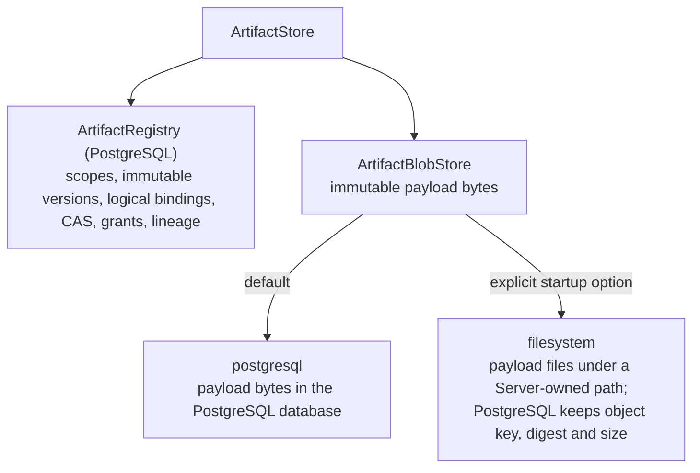
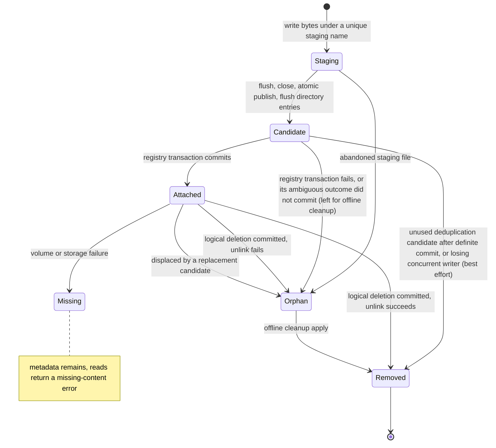
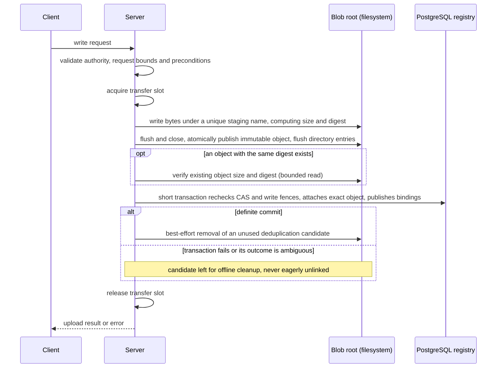

# Artifact blob storage

Requirement prefix: `BLB` · [Specification index](../README.md)

## Purpose and scope

This document owns where Artifact payload bytes live: the payload backends
(`postgresql` and `filesystem`), their selection at Server startup, the
internal blob boundary that every payload path uses, transfer slots and memory
handling, the `filesystem` write and failure contract, physical deletion of
payloads and offline cleanup of physical orphans.

It leaves to other documents:

- scopes, namespaces, ArtifactRef, revisions, CAS, grants, the
  ArtifactRegistry and the generic payload ceiling:
  [Artifact store](artifact-store.md);
- reference-safe registry deletion, retention and purge of scopes and
  versions: [Retention and deletion](retention-and-deletion.md);
- Git import admission, fetching, ZIP creation and the rest of Git
  publication: [Git import](git-import.md);
- deployment topology, including Kubernetes deployments without a PVC, and the
  operator command-line surface: [Operations](../operations/operations.md);
- the overlay export budget, which is independent of the generic payload
  ceiling: [Workspace](../tools/workspace.md).

## Concepts

Terms are collected in the [glossary](../glossary.md); this document owns the
following ones.

- **Payload backend.** The storage that holds the immutable Artifact payload
  bytes of an installation: `postgresql` or `filesystem`.
- **ArtifactBlobStore.** The internal blob interface through which every
  payload is stored, opened and deleted; it sits beside the ArtifactRegistry
  ([Artifact store](artifact-store.md)) under the ArtifactStore.
- **Physical object key.** The Server-generated name of one `filesystem`
  object; it includes a unique physical generation.
- **Physical generation.** One physical copy of a payload, identified by its
  object key; several generations can share a content digest.
- **Staging file.** A file under a unique staging name inside the blob root
  that receives bytes before atomic publication; readers never see it.
- **Upload candidate.** The complete, published immutable object written for
  one upload before the registry transaction attaches it.
- **Displaced generation.** A previously attached object whose blob now
  points at a replacement upload candidate.
- **Physical orphan.** A `filesystem` object or abandoned staging file that no
  registry record references.
- **Transfer slot.** One unit of the per-process budget that a full-payload
  transfer holds while it runs.
- **Missing-content error.** The explicit non-success Artifact error returned
  when referenced content is missing or corrupt.
- **Offline cleanup command.** The operator-only command that removes physical
  orphans while every writer is stopped.

## Model

### Storage layering

The ArtifactStore keeps scopes, immutable versions, logical bindings, CAS,
grants and lineage in the ArtifactRegistry, which is PostgreSQL, and immutable
payload bytes in the ArtifactBlobStore. The ArtifactBlobStore is backed by
exactly one payload backend per installation.



### Backends

| Backend | Payload location | Local storage requirement |
| --- | --- | --- |
| `postgresql` | Existing PostgreSQL database; default | No local blob filesystem, shared local volume, writable blob directory, temporary upload file or PVC |
| `filesystem` | Explicit Server-owned path | Writable directory; ephemeral storage is allowed |

### Filesystem physical objects

A `filesystem` payload is a physical object under the blob root. Its bytes are
first written to a staging file, then published atomically as an upload
candidate, and become referenced when the registry transaction attaches the
candidate. Objects that no registry record references are physical orphans
until the offline cleanup command removes them.



## Requirements

### Backend selection

**BLB-R1.** Artifact metadata, exact revisions, CAS, grants, pins, lineage
and lifecycle authority stay in PostgreSQL whichever payload backend is
selected.

**BLB-R2.** The Server selects one payload backend at startup for its
installation (LIM-BLB-2), and all payloads use that backend: there is no
size-based routing.

**BLB-R64.** Payload backend selection is independent of Worker workspace
storage, UI settings and managed configuration roots.

**BLB-R65.** Neither a filesystem probe nor whether a directory happens to
be writable decides the backend implicitly.

**BLB-R3.** Backend selection is a startup option only: it is not an
Operations setting, Workflow field, Runtime label or per-request option.

**BLB-R66.** The command-line flag overrides the environment variable (see
[Startup configuration](#startup-configuration)).

**BLB-R67.** Changing the payload backend requires a Server restart.

**BLB-R4.** The payload backend is `postgresql`, the default, or
`filesystem`; each keeps payloads where the [backend table](#backends) says and
needs only the local storage listed there.

**BLB-R5.** `filesystem` requires an absolute, dedicated path. The
directory may be ephemeral, for example a Kubernetes `emptyDir`, including
memory-backed storage; a persistent disk or PVC is optional for operators who
need it.

**BLB-R6.** Losing a `filesystem` volume may lose Artifact bytes while
their metadata remains in PostgreSQL. This is an accepted limitation of the
filesystem backend: payloads lost this way are reported through the
missing-content behaviour of BLB-R46 (FAIL-BLB-6).

**BLB-R7.** An unknown backend name fails validation, and `s3` is
rejected with an explicit unsupported-backend error. Backend selection never
falls back to `postgresql` or `filesystem`.

**BLB-R8.** Before serving, `filesystem` verifies actual bounded create,
write, publish, read and delete operations in its path; a read-only or
inaccessible path fails startup (FAIL-BLB-7).

**BLB-R9.** `postgresql` rejects a supplied blob path and performs no
filesystem initialization for artifacts.

**BLB-R10.** The Server persists the installation's backend kind in
PostgreSQL and checks it before serving or catalog seeding. A mismatch fails
explicitly; restarting with another backend does not copy or reinterpret
existing blobs (FAIL-BLB-7).

**BLB-R11.** Existing installations with payloads are `postgresql`
installations. A fresh installation may choose either `postgresql` or
`filesystem`.

**BLB-R12.** Relocating a `filesystem` path requires operator-managed
data movement if existing bytes should survive. An empty replacement path is
allowed; payloads absent from it follow the missing-content behaviour of
BLB-R46.

**BLB-R13.** The single active Server process uses one backend for its
registry, and any replica sharing that registry must use the same backend.

**BLB-R68.** A `filesystem` deployment is specified for one Server process.

**BLB-R69.** Any additional process sharing a `filesystem` registry must see
the same underlying directory with compatible atomic publication semantics,
because identical path strings on separate hosts or pods are separate stores,
not one.

### Blob boundary

**BLB-R14.** Every payload passes through one small internal blob
interface, the ArtifactBlobStore, which stores complete immutable bytes, opens
them and deletes an exact physical object. The ArtifactBlobStore is
replaceable: the backend behind it is chosen at startup.

**BLB-R15.** The PostgreSQL adapter participates in registry
transactions, and inline PostgreSQL payloads keep database-enforced size and
digest validation.

**BLB-R16.** The filesystem adapter stores only a physical object key,
digest and size in PostgreSQL.

**BLB-R70.** The Server validates `filesystem` payload size and digest.

**BLB-R71.** File payloads must not be duplicated in a `bytea` column.

**BLB-R17.** The backend choice does not change the public or private
Artifact APIs, ArtifactRef, namespaces, exact revisions or scope permissions.

**BLB-R18.** Metadata lists and forks need no payload read or copy; a scope
fork reuses the existing immutable blob.

**BLB-R19.** Ordinary writes, Audit imports, proposal and evidence
receipts, Skill forks, Project output publication and Git import publication
all use the blob boundary. No direct-SQL payload path may silently bypass the
filesystem selection.

### Transfers and memory

**BLB-R20.** Receiving a file and retaining it are separate operations.
In `postgresql` mode the download and upload path must not require a temporary
local file: bytes flow through bounded memory or streaming interfaces into the
selected backend, and payload persistence belongs to PostgreSQL. Git import
keeps the same boundary ([Git import](git-import.md)).

**BLB-R21.** The Server checks declared sizes early and enforces the actual
byte count while reading, including when Content-Length is unknown. A payload
of 64 MiB + 1 byte, one byte over the generic payload ceiling (LIM-ART-4,
[Artifact store](artifact-store.md)), is rejected before any metadata is
published.

**BLB-R22.** Transfers honour cancellation and avoid copies created
solely to adapt one internal interface to another.

**BLB-R23.** The Server may buffer one complete payload for hash
verification, but must not claim constant-memory streaming while public or
internal APIs materialize `[]byte` or decoded buffers.

**BLB-R24.** Each Server process bounds simultaneous full-payload transfers
to four active operations (LIM-BLB-1). A transfer slot is acquired before body
buffering or blob reads.

**BLB-R25.** When every slot is taken, the request fails promptly with
a retryable capacity error instead of joining an unbounded queue of bodies
(FAIL-BLB-1).

**BLB-R26.** Public and private transfers and trusted full-content reads
and writes draw on the same budget; metadata-only queries and forks do not
consume it. Nested trusted calls share the outer operation's slot instead of
acquiring another.

**BLB-R27.** A Git import holds one transfer slot from before fetch until
publication or response. Artifact operations nested in the import share that
slot, and other ordinary Artifact transfers use the remaining capacity.
Admission of Git imports is defined in [Git import](git-import.md).

**BLB-R28.** Every client socket read or write performed while an HTTP
handler holds a slot has its own deadline. A response that no longer needs the
payload (an upload result, archive preview or error) is written only after the
slot is released.

**BLB-R29.** Socket deadlines never cancel storage work; storage
work has its own budget.

**BLB-R30.** Container memory sizing must account for driver and
serialization buffers: four 64 MiB payloads (LIM-BLB-1, LIM-ART-4) are not a
256 MiB process-memory cap.

### Filesystem write contract



A `filesystem` write runs these steps in order:

- **BLB-R31.** First, the Server validates authority, request bounds and
  preconditions as early as possible.
- **BLB-R32.** Second, it writes the complete bytes under a unique staging
  name inside the blob root while computing size and digest, flushes and
  closes the file, atomically publishes a complete immutable object in the
  same filesystem and flushes the directory entries that publication created.
  A staging file is never exposed to readers.
- **BLB-R33.** Third, in the authoritative short PostgreSQL transaction, it
  rechecks CAS and write fences, attaches the exact object to the blob and
  version, and publishes bindings. No transaction or pool connection is held
  during bulk file transfer.
- **BLB-R34.** Fourth, if the registry transaction fails or its outcome is
  ambiguous, the candidate is left for offline cleanup; a candidate is never
  eagerly unlinked after a lost commit acknowledgement. Unused deduplication
  candidates are best-effort removed only after a definite commit. CAS
  response-loss behaviour is the one defined in
  [Artifact store](artifact-store.md) (FAIL-BLB-2).

**BLB-R35.** Git import publication follows the same contract: its
complete bounded ZIP is prepared in the selected backend before the short
registry transaction, and BLB-R34 applies to its candidate.

**BLB-R36.** Object keys are Server-generated and include a unique physical
generation; logical artifact names and URLs never become filesystem paths.

**BLB-R37.** Content digest is the deduplication identity, but a later
blob with the same bytes must not reuse a physical key that an earlier
deletion may still target.

**BLB-R38.** Of concurrent writers, only a complete verified winning object
is attached; losing files are best-effort removed.

### Deduplication against existing objects

**BLB-R39.** Before deduplicating, the Server verifies any existing
`filesystem` object, including its size and digest. Verification reads are
bounded by payload size and transfer capacity, and payload staging still
precedes publication.

**BLB-R40.** The candidate's size and digest are computed from the
bytes the Server wrote, so publication rechecks only that the candidate file is
still present with that size and never reads it back.

**BLB-R41.** The publication statement may reuse only the exact physical
key that was verified. If the existing content is missing, or a concurrent
writer has installed a different unverified key, the Server atomically attaches
the complete upload candidate instead; existing revisions that reference the
same SHA then read the replacement bytes, without any change to logical
revisions or content identity (FAIL-BLB-3).

**BLB-R42.** Corruption, permission and I/O errors and cancellation are
not treated as absence of content.

**BLB-R43.** BLB-R39 to BLB-R42 apply to ordinary writes
and to Controller-generated Audit artifacts, and preserve caller-owned
transaction and rollback boundaries.

**BLB-R44.** A displaced generation is not eagerly unlinked, because an
in-flight reader may already have resolved its key; such unreferenced files
remain for offline cleanup.

### Storage failures and missing content

A process, pod or storage failure can leave a physical orphan or lose bytes.

**BLB-R63.** The flushes in BLB-R32 must keep an operating-system crash on a
durable volume from leaving a committed reference to an empty or unpublished
object; they do not make an ephemeral volume durable (FAIL-BLB-6).

**BLB-R45.** Payload publication must be atomically visible during normal
operation.

**BLB-R46.** Missing or corrupt referenced content produces an explicit
non-success Artifact error, never an empty successful response, a silent
revision replacement or an automatic Git refetch (FAIL-BLB-5).

**BLB-R47.** A storage failure does not rewrite prior Run outcomes,
finding ratings or historical reports; new consumers see the storage failure.

**BLB-R48.** A re-upload creates a new revision under normal CAS. Apart
from the same-digest replacement in BLB-R41, it cannot silently repair an old
exact reference.

### Physical deletion

**BLB-R49.** With `postgresql`, blob deletion is transactional and
physical blob cleanup completes synchronously (LIFE-BLB-2). Reference-safe
registry deletion is defined in
[Retention and deletion](retention-and-deletion.md).

**BLB-R50.** With `filesystem`, the deletion transaction captures the
exact object keys it leaves unreferenced, commits the logical deletion and only
then attempts to unlink those files (LIFE-BLB-1).

**BLB-R72.** A failure to unlink a `filesystem` object after the logical
deletion is committed is logged with a bounded reason and does not block a
completed Run, Project or Audit deletion (FAIL-BLB-4). This deliberately
permits physical orphans: a completed lifecycle may leave them for offline
cleanup (LIFE-BLB-1).

**BLB-R51.** Only physical objects with no surviving version, pin or
lineage dependency may be selected for deletion, and deletion always targets
exact physical generations, never every file that shares a digest.

**BLB-R52.** Opening a retained object is coordinated with registry
deletion, so a live read either obtains its file handle or returns an explicit
missing-content error; a knowingly partial or mismatched successful payload is
never delivered (FAIL-BLB-5).

**BLB-R53.** Referenced metadata is never purged merely because a file
is missing (LIFE-BLB-3).

**BLB-R54.** Every future payload backend must define its own physical
cleanup contract.

### Offline orphan cleanup

**BLB-R55.** An operator-only offline cleanup command removes physical
orphans. It runs as a dry run by default and changes storage only with an
explicit apply option.

**BLB-R56.** Apply requires every writer and Server process that uses the
registry and blob root to be stopped; online cleanup is unsupported.

**BLB-R57.** The command removes only unreferenced objects and abandoned
staging files (LIFE-BLB-4).

**BLB-R73.** The command identifies unreferenced objects by comparing
generated object keys with the complete registry reference set.

**BLB-R74.** The command reports missing referenced objects without deleting
their metadata (LIFE-BLB-3).

**BLB-R58.** The command scans in bounded batches, avoids loading file
payloads and rejects symlinks and path escapes.

**BLB-R59.** An interrupted cleanup may require rerunning the command; no
durable cleanup queue is needed (FAIL-BLB-8).

## Interfaces

### Startup configuration

| Flag | Environment | Default |
| --- | --- | --- |
| `--artifact-blob-backend` | `CONTRACTOR_ARTIFACT_BLOB_BACKEND` | `postgresql` |
| `--artifact-blob-path` | `CONTRACTOR_ARTIFACT_BLOB_PATH` | unset |

The backend flag accepts `postgresql` and `filesystem` (BLB-R4,
BLB-R7). The path flag is required by `filesystem` (BLB-R5) and
rejected by `postgresql` (BLB-R9).

### Blob store protocol sketch

The artifact-plane protocol sketch of the blob store is illustrative; the
normative operation set is BLB-R14, which also includes deleting an exact
physical object. The matching ArtifactRegistry sketch is in
[Artifact store](artifact-store.md).

```python
class ArtifactBlobStore(Protocol):
    async def begin_upload(...) -> UploadSession: ...
    async def complete_upload(...) -> BlobRef: ...
    async def open(blob: BlobRef) -> AsyncIterator[bytes]: ...
```

## Limits, failures and errors

Limits ([registry](../platform/limits.md)):

- LIM-BLB-1 — four active full-payload transfers per Server process
  (BLB-R24).
- LIM-BLB-2 — one payload backend per installation (BLB-R2).
- The generic payload ceiling (LIM-ART-4) belongs to
  [Artifact store](artifact-store.md), the overlay export budget to [Workspace](../tools/workspace.md) and Git
  import admission to [Git import](git-import.md).

Failure outcomes ([failure model](../platform/failure-model.md)):

- FAIL-BLB-1 — transfer slot acquisition (BLB-R25).
- FAIL-BLB-2 — `filesystem` write and registry commit (BLB-R34).
- FAIL-BLB-3 — verification of an existing object before deduplication
  (BLB-R41).
- FAIL-BLB-4 — file unlink after logical deletion (BLB-R72).
- FAIL-BLB-5 — read of referenced content (BLB-R46, BLB-R52).
- FAIL-BLB-6 — process, pod, storage or volume failure (BLB-R6, BLB-R63).
- FAIL-BLB-7 — backend validation at startup (BLB-R8, BLB-R10).
- FAIL-BLB-8 — interrupted offline cleanup (BLB-R59).

Lifecycle ([registry](../platform/lifecycle.md)):

- LIFE-BLB-1 — `filesystem` physical object (BLB-R50).
- LIFE-BLB-2 — inline `postgresql` payload (BLB-R49).
- LIFE-BLB-3 — blob metadata whose file is missing (BLB-R53, BLB-R74).
- LIFE-BLB-4 — staging file (BLB-R57).

Errors ([registry](../platform/errors.md)); these errors have no assigned wire
code:

- unknown backend — validation failure (BLB-R7);
- unsupported backend `s3` (BLB-R7);
- backend kind mismatch (BLB-R10);
- unusable `filesystem` path — startup failure (BLB-R8);
- blob path supplied with `postgresql` (BLB-R9);
- transfer capacity exhausted — retryable (BLB-R25);
- missing or corrupt content (BLB-R46, BLB-R52).

## Security

**BLB-R60.** Physical keys and backend settings are not
client-controlled.

**BLB-R61.** Safe public errors never expose storage paths.

**BLB-R62.** Filesystem access uses rooted filesystem operations and
rejects symlink and special-file escapes.

Server-generated object keys (BLB-R36) and the operator-only cleanup command
that rejects symlinks and path escapes (BLB-R55, BLB-R58) complete the
storage-side controls. Trust boundaries and redaction are in
[Security](../platform/security.md).

## Observability

Unlink failures after logical deletion are logged with a bounded reason
(BLB-R72), and the offline cleanup command reports missing referenced
objects (BLB-R74). Telemetry content rules are in
[Observability](../platform/observability.md).

## Non-goals

- S3-compatible object storage, a deferred third backend: its credentials,
  buckets, multipart operations and consistency and recovery details are not
  designed, and `s3` is rejected (BLB-R7).
- Migration of populated stores, automatic store migration and online backend
  switching.
- Online orphan sweeping and online cleanup.
- Stronger crash durability: no distributed transaction, durable upload-intent
  queue, automatic reconstruction, background reconciliation service or
  power-loss durability guarantee is required.
- A targeted repair protocol for missing or corrupt content.
