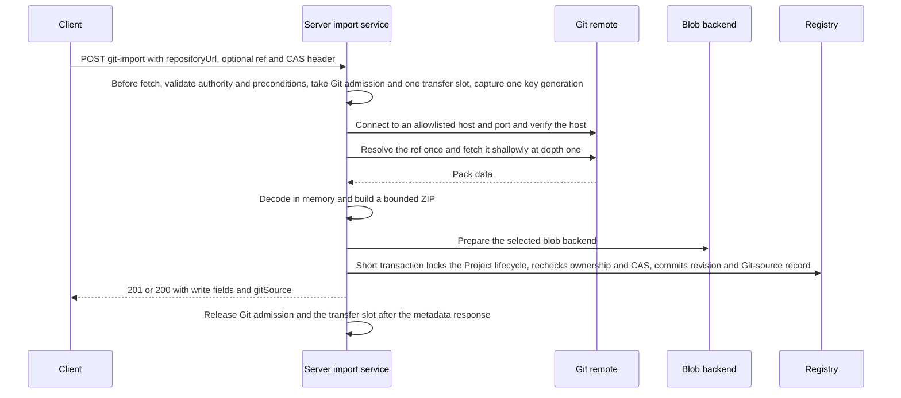
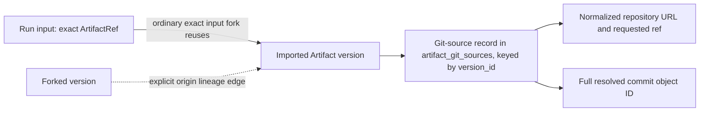
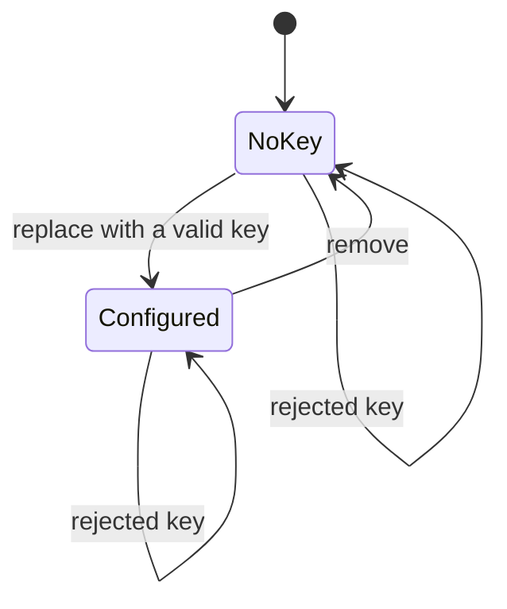

# Git import

Requirement prefix: `GIT` · [Specification index](../README.md)

## Purpose and scope

This document owns Git repositories as artifact inputs: where an import can
start and where it writes, repository URL and ref resolution, the content of
the source snapshot, Git-source provenance, the owner's Git SSH key, SSH host
trust, the outbound network policy for Git, the in-memory reader, admission and
import budgets, publication, and the Git routes of the public API.

It leaves to other documents:

- ArtifactStore scopes, namespaces, refs, revisions, CAS, Workflow input forks
  and output publication: [ArtifactStore](artifact-store.md).
- ProjectScope and the Project artifact library: [Projects](projects.md).
- Payload backends, the bounded-memory transfer path, the shared Artifact
  transfer slots and the filesystem orphan and ambiguous-commit rules:
  [Blob storage](blob-storage.md).
- Purge and garbage collection of Artifact versions:
  [Retention and deletion](retention-and-deletion.md).
- The Server credential master-key mechanism, trust boundaries and target
  policy: [Security](../platform/security.md).
- Authentication, browser CSRF protection and the error envelope:
  [Public API](../api/public-api.md).
- Placement of the Settings page and of the Git-import dialog in the Workflow
  user surface, navigation and dialog focus behaviour: [UI](../ui/ui.md).

## Concepts

- **Git import**: creating an ordinary exact source ZIP artifact from one
  resolved commit of a remote Git repository.
- **Git-source record**: the immutable provenance record attached to an
  imported Artifact version.
- **`gitSource`**: the optional field of Artifact metadata and version
  responses that exposes a version's Git-source record.
- **Owner Git key**: the single optional, owner-scoped Git SSH private key used
  for SSH imports.
- **Key generation**: the identity of one stored value of an owner Git key; an
  admitted import captures one.
- **Repository access**: the personal Settings editor for the owner Git key.
- **Git remote allowlist**: the operator list of exact `host:port` pairs that
  Git imports may connect to.
- **Git admission**: the per-process slot an active Git import holds.

Terms are defined once in the [glossary](../glossary.md).

## Model

### Import flow

An import is one cancellable public API request. It resolves one commit,
fetches a shallow snapshot into memory, builds a bounded source ZIP and
publishes it as an ordinary Artifact revision together with its Git-source
record.

### Git-source record

A Git-source record belongs to one Artifact version (GIT-R29) and holds:

| Field | Content |
| --- | --- |
| Repository URL | The normalized repository URL |
| Requested ref | The ref as requested; null for the default branch |
| Resolved commit | The full resolved commit object ID |
| Import time | The Server import timestamp |

A Run's exact input leads through forks to the version and its record:

### Owner Git key

An owner has no key or one configured key (GIT-R37). A rejected key
leaves the state unchanged (GIT-R40); removal returns the owner to no
key.

## Requirements

### Entry points and destinations

**GIT-R1.** Git import must create ordinary source ZIP artifacts
through the ArtifactStore service and storage boundary
([ArtifactStore](artifact-store.md)): an import materializes a source ZIP and
publishes an ordinary exact ArtifactRef with commit provenance.

**GIT-R2.** An authenticated user may import a Git repository when
selecting a Workflow input or when adding a Project artifact. The import takes
a repository URL, an optional branch or tag, and an ordinary Artifact namespace
and name.

**GIT-R3.** Standalone Workflow inputs, Project Workflow inputs and the
Project artifact library must use the same Git-import dialog for the repository
URL and ref.

**GIT-R4.** A Project import must write directly to the owned
ProjectScope. A standalone Workflow input import must write to the owner's
UserScope; a Project-bound input selection uses that ProjectScope.

**GIT-R5.** A Workflow must receive an imported ref through the
existing input selection and forking ([ArtifactStore](artifact-store.md)); it
must not clone the repository on execution.

**GIT-R6.** Importing must never start a Run or change a Workflow
definition, and must not require a PVC.

**GIT-R7.** The existing ASCII Artifact-name validation applies to the
import target, including its length and reserved-namespace rules; names with
spaces are rejected.

**GIT-R8.** A suggested Artifact name must be editable and must be
validated before import; the Server must never silently rewrite it.

**GIT-R9.** Replacing an existing binding requires explicit CAS
replacement.

**GIT-R88.** The dialog must have the user review and confirm the binding's
exact revision before replacement.

**GIT-R10.** Closing the dialog cancels its pending request without
closing the parent Run form.

**GIT-R89.** Closing a completed import dialog must not delete its artifact
(LIFE-GIT-1).

**GIT-R11.** After a successful import the UI must assign the exact
returned ref to the requested input slot only, preserve every other input and
show the recorded commit.

**GIT-R12.** Artifact metadata detail pages must display Git provenance.

The Repository access editor's location (`/operations/settings`, linked from
the account menu), its availability without the Operations capability, the
absence of a separate `/settings` route and the restoration of focus when the
dialog closes are specified in [UI](../ui/ui.md).

### Repository URLs and refs

**GIT-R13.** The importer accepts anonymous `https://host/path`,
`ssh://user@host[:port]/path` and conventional `git@host:path` repository URLs.

**GIT-R14.** A conventional `git@host:path` URL must be normalized to an SSH
URL. Its home-relative path is preserved as `/~/path`; an explicitly absolute
SCP path remains absolute.

**GIT-R15.** The importer must reject passwords, URL query or
fragment credentials, local paths, `file://`, `git://`, remote helpers and
unsupported schemes.

**GIT-R16.** Transport credentials must never enter the normalized
repository URL.

**GIT-R17.** An omitted ref resolves to the remote default branch. An
explicit ref selects a branch or tag; fully qualified `refs/heads/...` and
`refs/tags/...` names are supported.

**GIT-R18.** An ambiguous short ref name must fail with a safe error.

**GIT-R19.** The importer must resolve the ref once and archive
exactly that commit, including when the named branch advances during the
operation. Every successful import records the full resolved commit object ID.

**GIT-R20.** Unsupported repository or object formats must fail
explicitly; SHA-256 repositories are rejected explicitly. The importer must
never reinterpret an object ID.

### Snapshot content

**GIT-R21.** The archive must contain the complete tracked regular-file
tree at the selected commit, in stable sorted path order, with normalized file
modes and timestamps: every entry has mode 0644 and the same fixed 1980
timestamp.

**GIT-R22.** The archive must exclude the Git object database and
transport configuration.

**GIT-R23.** An import must not create a working tree and must not
execute hooks, filters, scripts or builds.

**GIT-R24.** The importer must not apply host Git configuration,
`.gitignore` rules to already tracked files, or host-specific source-directory
bundling rules.

**GIT-R25.** The importer must reject unsafe paths, symlink
entries, submodules and recognizable Git LFS pointer entries with explicit
unsupported-content errors; it must not silently omit them or claim that their
targets were fetched. For a symlink, submodule or LFS pointer, the
`git_content_unsupported` message names the entry kind and its tree path.

**GIT-R26.** The importer must refuse Git internals, special modes,
control characters and paths incompatible with Runtime source validation. A
path is at most 512 UTF-8 bytes (LIM-GIT-1).

**GIT-R27.** Repository filenames retain the existing safe UTF-8
archive-path rules, and the importer must validate the existing path and
archive rules before publication.

**GIT-R28.** An empty source tree must be rejected.

### Provenance

**GIT-R29.** Every import must persist an immutable Git-source record
([fields](#git-source-record)) attached to the Artifact version, not to the
mutable name or content digest alone. This per-version repository, ref and
commit metadata preserves origin across exact input forks without changing
ArtifactRef and without turning a Workflow input into a live repository
reference.

**GIT-R30.** Git-source records are stored in `artifact_git_sources`,
keyed by `artifact_versions.version_id`; metadata queries join it without
reading blobs.

**GIT-R31.** Content deduplication may share bytes between imports with
different origins; it must not merge their provenance.

**GIT-R32.** Existing forks reuse the exact version or preserve an
explicit origin lineage edge; the ordinary exact input fork reuses the imported
version. Subsequent imports must never rewrite earlier provenance.

**GIT-R33.** Purging the final retained version may remove its Git-source
record under the existing lifecycle rules
([Retention and deletion](retention-and-deletion.md)) (LIFE-GIT-2).

**GIT-R34.** Authorized Artifact metadata and version responses
expose an optional `gitSource`; its absence means an ordinary upload. Existing
byte and list contracts are preserved.

**GIT-R35.** Authorized scripts can trace a Run's exact input through
existing forks to the repository and commit, even after branch movement or key
deletion.

**GIT-R36.** Source metadata must follow Artifact ownership
checks and must not be emitted in global logs or metrics.

Rationale: repository URLs can disclose private project names.

### Owner Git SSH key

**GIT-R37.** Each owner has at most one optional Git SSH private key for
private repositories (LIM-GIT-2). The personal **Repository access**
editor in Settings offers replace and remove for it.

**GIT-R38.** Anonymous HTTPS repositories work without a key; SSH
imports use the importing owner's key. No automatic fallback to another owner,
the host SSH agent or a machine key is allowed.

**GIT-R39.** The Server accepts unencrypted OpenSSH or PEM private
keys supported by the chosen implementation, at least Ed25519 and RSA.
Encrypted or passphrase-protected keys must return an explicit
unsupported-format response; the Server must never prompt a background process
for a passphrase.

**GIT-R40.** Key input is bounded to 32 KiB (LIM-GIT-3) and
must be validated before it replaces the previous value (FAIL-GIT-1).

**GIT-R41.** The key must be protected with the Server credential
master-key mechanism ([Security](../platform/security.md)) and stored only as
authenticated ciphertext in PostgreSQL, with authenticated owner, purpose and
key-generation identity.

**GIT-R42.** Git-key rows must be included in the startup
master-key requirements and integrity checks.

**GIT-R43.** The key must not reuse LLM credential records and
must not be sent in allocation RuntimeSettings.

**GIT-R44.** No private-key readback API, browser storage, Artifact
payload, Workflow field, log or telemetry field may contain the key.

**GIT-R45.** Key responses expose only configured state, public-key
fingerprint and type, and update time.

**GIT-R46.** A successful replacement clears the UI secret input.

**GIT-R47.** An admitted import captures one key generation. A
concurrent replacement or removal affects subsequent imports; an already
admitted import may finish with its captured key.

**GIT-R48.** Deleting a key does not invalidate existing ZIP
artifacts or provenance (LIFE-GIT-3).

### SSH host trust

**GIT-R49.** SSH host verification uses an operator-managed,
read-only `known_hosts` file selected with `--git-known-hosts-file`, the
environment variable `CONTRACTOR_GIT_KNOWN_HOSTS_FILE` or the ServerConfig YAML
field `spec.gitKnownHostsFile`.

**GIT-R50.** Unknown or changed host keys must fail closed; there is
no automatic trust-on-first-use prompt.

**GIT-R51.** Missing `known_hosts` configuration makes SSH import
unavailable, while anonymous HTTPS import can still work. The optional
configuration mount is compatible with a read-only root and requires no PVC.

### Outbound network

**GIT-R52.** Outbound Git targets must match an explicit operator
allowlist of exact `host:port` pairs, configured by repeated
`--git-allowed-remote` flags, the comma-separated
`CONTRACTOR_GIT_ALLOWED_REMOTES` environment variable or the ServerConfig YAML
field `spec.gitAllowedRemotes`.

**GIT-R53.** Git configuration precedence is defaults, YAML,
environment, CLI, so the CLI overrides the environment; a CLI allowlist
replaces the lower-priority list.

**GIT-R90.** Relative file paths in the ServerConfig YAML Git fields, such as
`spec.gitKnownHostsFile`, resolve beside the YAML file.

**GIT-R54.** The default empty allowlist disables Git network
import without disabling the Server or existing artifacts.

**GIT-R55.** HTTPS uses normal CA verification and SSH uses the configured
host-key verifier. HTTP redirects are disabled.

**GIT-R56.** The importer must resolve and validate the destination
used for each actual connection and must disallow loopback, link-local,
unspecified and multicast addresses. Corporate private addresses are permitted
only through the explicitly allowlisted hostname and port.

**GIT-R57.** Tests may opt into isolated loopback fixtures
through a test-only injection; there is no production flag that disables
verification.

### Reader

**GIT-R58.** The importer uses an in-process Git reader with
in-memory object storage and bounded decode; no `git` subprocess, temporary
checkout, pack file, SSH key file, shell or credential helper is required. The
importer honours the bounded-memory boundary of [Blob storage](blob-storage.md)
with in-memory snapshots and no local checkout.

**GIT-R59.** The importer must never silently fall back to local disk.
Read-only operator trust and CA files are configuration, not scratch storage.

**GIT-R60.** The reader uses go-git protocol, pack-scanner and delta
primitives. It does not use `Clone`, an on-disk repository, the high-level pack
parser or host Git configuration.

**GIT-R61.** The client requires shallow negotiation and requests
depth one (LIM-GIT-4) for the chosen advertised ref. If the remote cannot
provide a bounded selected-ref snapshot, the import must fail explicitly
instead of fetching unlimited history.

**GIT-R62.** Large Git history can exhaust an import budget even
when the final tree is small; the import then returns the relevant limit
without publishing a partial artifact.

**GIT-R63.** The pack scanner exposes declared object sizes before
inflation, and the importer checks them before allocating fixed buffers. Delta
base and result sizes are checked before patching.

**GIT-R64.** SHA-1 pack checksums and decoded object identities must be
verified.

**GIT-R65.** Annotated tags are peeled from fetched objects to a commit.

### Import budgets

**GIT-R66.** Every import must stay within these budgets, which bound
ref advertisements, object counts, delta depth and parser allocations as well
as the final output:

| Budget | Value | Limit |
| --- | --- | --- |
| Import request JSON | 64 KiB | LIM-GIT-5 |
| Whole import, including resolution, fetch, ZIP creation and publication | 120 seconds | LIM-GIT-6 |
| Cumulative received Git protocol and pack bytes | 128 MiB | LIM-GIT-7 |
| Cumulative decoded Git object bytes, including delta results | 256 MiB | LIM-GIT-8 |
| One advertisement or ACK negotiation | 4 MiB | LIM-GIT-9 |
| Advertised references, including peeled entries | 10,000 | LIM-GIT-10 |
| Packed objects | 50,000 | LIM-GIT-11 |
| One decoded object or delta result | 64 MiB | LIM-GIT-12 |
| Delta depth | 50 | LIM-GIT-13 |
| Annotated-tag depth | 8 | LIM-GIT-14 |
| Published ZIP payload | 64 MiB | LIM-GIT-15 |
| Source ZIP entries | 10,000 | LIM-GIT-16 |
| Source ZIP expanded bytes | 64 MiB | LIM-GIT-17 |
| One source file | 4 MiB | LIM-GIT-18 |

Rationale: the source ZIP entry, expanded-byte and one-file budgets preserve
the current source-analysis budgets rather than assuming that a 64 MiB
transport artifact is always consumable as a workspace.

**GIT-R67.** Decoded accounting includes delta programs and
intermediate results, even after their buffers become reclaimable. Every
traversed tree entry, including directories, counts toward the source ZIP
entry budget (LIM-GIT-16).

**GIT-R68.** Actual process peak memory must be reported, including
object storage, ZIP buffers, driver copies and GC; the import budgets are not a
total RAM guarantee.

### Admission and cancellation

**GIT-R69.** A Server process admits at most one active Git import
(LIM-GIT-19).

**GIT-R91.** Git admission and the shared Artifact transfer slot the import
holds remain held from before fetch through the metadata response
([BLB-R27](blob-storage.md)).

How nested Artifact operations share the import's transfer slot and how other
Artifact transfers use the remaining capacity is specified by
[BLB-R27](blob-storage.md).

**GIT-R70.** When admission is saturated, the Server must reject
the import promptly, without a queued request or buffered clone.

**GIT-R71.** Fetching and ZIP creation must hold no database
connection or authoritative mutation lock; no long SQL lock is held during
network transfer.

**GIT-R72.** Server, client and proxy timeouts must be aligned with
the whole-import deadline (LIM-GIT-6).

**GIT-R73.** On request cancellation or deadline expiry, the importer
must cancel network transfer and decoding and release both admission slots
(FAIL-GIT-2).

**GIT-R74.** The socket write of the metadata response has its own short
deadline.

**GIT-R75.** While an import runs, the dialog shows a cancellable
pending request.

### Publication

**GIT-R76.** The import service must validate authority and
preconditions before fetch and recheck them at publication.

**GIT-R77.** Once a complete bounded ZIP exists and its selected blob
backend is prepared ([BLB-R35](blob-storage.md), which also applies the
filesystem orphan and ambiguous-commit rules), one short registry transaction
locks the owned Project lifecycle, rechecks ownership, Project lifecycle and
CAS, and commits the Artifact revision and its Git-source record atomically
(FAIL-GIT-3).

**GIT-R78.** A rejected or interrupted import must not publish
partial content.

**GIT-R79.** If cancellation races with a successful commit, the complete
artifact may remain (LIFE-GIT-1).

**GIT-R80.** A lost response is resolved through metadata
inspection, not an automatic mutation retry; interrupted responses instruct
clients to inspect metadata before retrying.

**GIT-R81.** Duplicate create or CAS retries must not advance the
binding twice.

## Interfaces

The routes and the `gitSource` schema are defined in
[contractor-public-v1.yaml](../../../api/openapi/contractor-public-v1.yaml).

**GIT-R82.** The Server exposes these authenticated public routes. They
use the existing browser CSRF protection on mutations and owner or Project
authorization ([Public API](../api/public-api.md)):

| Route | Contract |
| --- | --- |
| `GET /v1/settings/git-key` | Configured state and non-secret key metadata |
| `PUT /v1/settings/git-key` | Validate and replace the owner's key; body `privateKey` |
| `DELETE /v1/settings/git-key` | Remove the owner's configured key |
| `POST /v1/artifacts/{namespace}/{name}/git-import` | Import into UserScope |
| `POST /v1/projects/{projectId}/artifacts/{namespace}/{name}/git-import` | Import into owned ProjectScope |

**GIT-R83.** Import JSON contains `repositoryUrl` and optional `ref`. No
request can choose another owner, credential, backend or output filesystem
path.

**GIT-R84.** Import uses the existing Artifact create and CAS headers:
`If-None-Match: *` or an exact `If-Match`.

**GIT-R85.** A successful import returns 201 for create or 200 for
replacement, with the normal write fields plus `gitSource`.

## Limits, failures and errors

Limits LIM-GIT-1 to LIM-GIT-19 are registered in
[limits](../platform/limits.md). The failure outcomes of fetching
(FAIL-GIT-2), publication (FAIL-GIT-3) and key replacement
(FAIL-GIT-1) are registered in the
[failure model](../platform/failure-model.md). The deletion and retention of
imported artifacts (LIFE-GIT-1), Git-source records
(LIFE-GIT-2) and owner Git keys (LIFE-GIT-3) are
registered in [lifecycle](../platform/lifecycle.md).

**GIT-R86.** The Git routes use bounded public error codes that
distinguish invalid URL, ref or key; unavailable key or trust configuration;
refused remote or host identity; repository or ref access; unsupported tree
content; exceeded import budgets; timeout; and capacity. Existing
ownership-not-found, CAS and blob error semantics are preserved. Codes are
registered in [errors](../platform/errors.md).

**GIT-R87.** Failure responses must not return remote protocol
diagnostics, credential content, local paths or URLs containing
authentication material.

## Security

Git import crosses the Server's outbound trust boundary
([Security](../platform/security.md)). Its security rules are: owner key
secrecy and storage (GIT-R41 to GIT-R46), no fallback
credentials (GIT-R38), host verification (GIT-R49 to
GIT-R51), the remote allowlist and destination checks
(GIT-R52 to GIT-R57), URL credential rejection
(GIT-R15, GIT-R16), no code execution or host configuration
(GIT-R23, GIT-R24), unsupported content
(GIT-R25, GIT-R26), ownership checks on provenance
(GIT-R36) and error content (GIT-R87).

## Observability

Source metadata never reaches global logs or metrics (GIT-R36),
the owner Git key never reaches logs or telemetry (GIT-R44), and
actual process peak memory is reported (GIT-R68).

## Non-goals

- Private HTTPS tokens, multiple named keys per owner, repository browsing and
  Git writes.
- Fetching an arbitrary commit ID.
- Git LFS object download, recursive submodules, and sparse or subdirectory
  imports.
- Scheduled refresh of an imported artifact, and automatic refetch when
  filesystem blob content is lost.
- A new durable import job, broker, progress stream or resumable clone.
- A new finding or verification attribution model: Git-source records add
  source provenance only.
