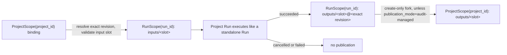
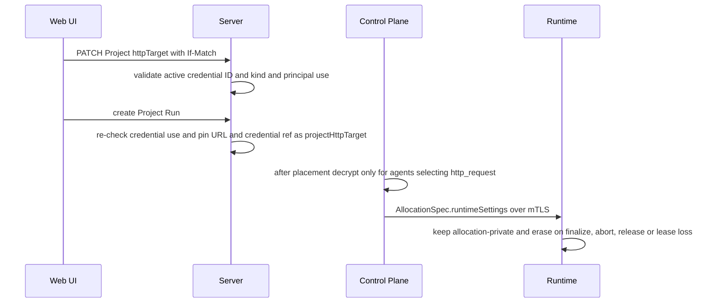

# Projects

Requirement prefix: `PRJ` · [Specification index](../README.md)

## Purpose and scope

This document owns the Project resource, ProjectScope, creating Runs from a
Project, Workflow recommendations, automatic publication of Project Run
outputs, the global Queue view and the Project HTTP target configuration.

Other documents own the adjacent concepts:

- ArtifactStore scopes, refs, revisions, CAS, the artifact representation and
  the generic fork and publication contract:
  [ArtifactStore](artifact-store.md).
- Project deletion, purge and garbage collection:
  [retention and deletion](retention-and-deletion.md).
- The WorkflowRun resource, the create-Run body, idempotency, metadata labels
  and standalone Runs: [Runs](../execution/runs.md).
- Workflow input and output slots, strict slot matching and the output-slot
  `primary` field: [Workflows](../configuration/workflows.md).
- The RuntimeCredential store and lifecycle:
  [RuntimeConfig](../configuration/runtime-config.md).
- How the HTTP tools use a resolved Project target at Runtime:
  [HTTP and Caido tools](../tools/http-caido.md).
- Agent Skills: [Skills](../tools/skills.md).
- Managed Eval experiments: [Managed Evals](../evals/managed-evals.md).
- Audits that run against a Project: [Audits](../audits/audits.md).
- Run claiming and the owner pause gate: [Scheduler](../execution/scheduler.md).
- UI layout and journeys: [UI](../ui/ui.md), [UI journeys](../ui/journeys.md).

## Concepts

Each term is defined once in the [glossary](../glossary.md).

- **Project** — an owner-scoped, long-lived workspace that groups reusable
  artifacts and the ordinary WorkflowRuns created from them. It is primarily an
  organization and reuse surface for the Web UI. It is not a Workflow,
  Scheduler, queue, execution state machine, authorization role or Runtime
  boundary.
- **ProjectScope** — the ArtifactStore structural scope that holds one
  Project's artifact bindings, `ProjectScope(project_id)`.
- **Project Run** — a WorkflowRun created through
  `POST /v1/projects/{project_id}/runs`; its artifact refs resolve in
  ProjectScope. A Run created without a Project is a standalone Run
  ([Runs](../execution/runs.md)).
- **Project output binding** — the binding
  `ProjectScope(project_id): outputs/<slot>` that automatic publication creates
  from a successful Project Run output.
- **Publication result** — the bounded record of one automatic publication
  attempt for one present declared output: `published`, `already_present` or
  `failed`.
- **Primary output** — a Workflow output slot marked `primary: true`; it
  identifies a canonical user-facing result.
- **Recommended group** — the default group of Project Workflow cards for
  compatible Workflows (every required artifact slot has at least one
  candidate), minus any Workflow that has at least one primary output and whose
  primary destinations all already exist at
  `ProjectScope(project_id): outputs/<slot>`. A Workflow with no primary
  output, or with a partially complete set, stays in the group.
- **Candidate compatibility** — the Run-draft layer meaning only that an
  artifact's stored media type satisfies a Workflow input slot.
- **Reviewed form readiness** — the Run-draft layer meaning the user
  explicitly chose, uploaded or confirmed one exact ArtifactRef for every
  populated slot.
- **All workflows** — the Project view that always permits an explicit Run of
  a Workflow, including one suppressed from the Recommended group.
- **Project HTTP target** — the optional application URL and RuntimeCredential
  reference a Project stores for HTTP tools; public field `httpTarget`.
- **audit-managed publication mode** — the trusted-only `publication_mode` of
  Audit child Runs that suppresses ordinary `outputs/<slot>` publication.
- **Queue** — the owner-scoped read view over nonterminal WorkflowRuns.

## Model

### Project

The durable owner-scoped resource is:

```text
Project
  project_id       opaque stable ID
  owner_id         derived from authentication
  kind             project | evaluation
  name             non-empty display name
  description      optional bounded text
  http_target      optional safe URL + RuntimeCredential ref
  lifecycle_state  active | deleting
  revision         opaque optimistic-concurrency token
  created_at
  updated_at
```

The public representation names `http_target` as `httpTarget`.

### Project lifecycle

`lifecycle_state` is `active` or `deleting`.
[Retention and deletion](retention-and-deletion.md) owns the transitions, the
durable deletion contract and its state diagram (DEL-R36, DEL-R37), and what
the deletion removes and retains (LIFE-DEL-2): with its Runs, Audits and
ProjectScope, a Project takes the finding proposal receipts of its Runs
(DEL-R61).

### ProjectScope

The one physical ArtifactStore has three structural scopes: `UserScope`,
`ProjectScope` and `RunScope` ([ArtifactStore](artifact-store.md)). A
Project's artifacts live in:

```text
ProjectScope(project_id)
```

### Artifact source scope of a Run

```text
standalone POST /v1/runs
  artifacts refs resolve in UserScope(owner_id)

project POST /v1/projects/{project_id}/runs
  artifacts refs resolve in ProjectScope(project_id)
```

### Input fork and output publication



Publication results:

| Result | Meaning |
| --- | --- |
| `published` | The Project output binding was created; the result records the exact source revision and the target revision. |
| `already_present` | The destination binding already existed. |
| `failed` | Publication was definitely rejected, for example because the exact source is unavailable or the Project is unavailable or deleting, or transient database failures exhausted its replays (`publication_attempts_exhausted`); the bounded error is recorded once. A transient database failure below that bound records no result (PRJ-R58). |

### Queue membership

The Queue lists WorkflowRuns in these nonterminal states:

```text
initializing | pending | running | waiting | cancelling
```

## Requirements

### Projects and standalone Runs

**PRJ-R1.** Server must not create a physical or privileged default
Project for standalone Runs; the UI may group standalone Runs.

### Project resource

**PRJ-R2.** A Project `name` must be a non-empty display name (LIM-PRJ-3).

**PRJ-R96.** A Project `description` is optional bounded text.

**PRJ-R3.** A Project's `kind` is immutable.

**PRJ-R4.** While a Project is `active`, its `name` and
`description` may be updated with `If-Match` against the current Project
revision. A stale `If-Match` fails with `409` or `412` and mutates no metadata
(FAIL-PRJ-1).

**PRJ-R5.** An unknown or foreign Project identifier yields an
owner-safe `404` (FAIL-PRJ-1, FAIL-PRJ-2).

**PRJ-R6.** The `evaluation` kind uses the same storage and
execution composition as `project`, with a distinct UI entry point; it must not
create an eval-only Scheduler path.

**PRJ-R95.** The legacy Evals view uses Project kind plus the generic
`purpose=eval` and `eval.*` Run-label convention ([Runs](../execution/runs.md)).

How legacy labelled Runs relate to experiments is specified in
[Managed Evals](../evals/managed-evals.md).

**PRJ-R7.** Managed Eval experiments are added explicitly inside
evaluation Projects, and the evaluation Project remains their owner and
storage container ([Managed Evals](../evals/managed-evals.md)).

**PRJ-R8.** The public Project collection is owner-isolated and
supports a `kind` filter. The Projects UI requests `project`; the Evals UI
requests `evaluation`.

**PRJ-R9.** The Project collection must exclude Managed
Eval Audit execution Projects by their registered experiment/member
association, before pagination. Their names and Project kind must not
determine this exclusion.

**PRJ-R10.** Excluded Managed Eval Audit execution Projects remain
accessible by ID for experiment evidence navigation and ordinary Audit
execution.

Audits accept only Projects of kind `project`, and Audit start and dispatch
serialize with the Project deletion fence; [Audits](../audits/audits.md) owns
both rules.

### ProjectScope and Project artifacts

**PRJ-R11.** Only the Project owner may list, read, create or
revision-check update the bindings in its ProjectScope.

**PRJ-R12.** An `ArtifactRef` used with a Project remains exactly
`(namespace, name, revision?)`. Its scope is derived from the authenticated
Project endpoint and must never be encoded inside the ref.

**PRJ-R13.** ProjectScope accepts arbitrary artifact names and
supported media types. Server has no closed enum of `sources`, `openapi`,
`likec4`, `docs` or `diff`; those names are UI affordances and interoperable
naming conventions, not an authorization or schema boundary.

**PRJ-R14.** A generic Other upload path must always be available.

**PRJ-R15.** Each UI shortcut in the table below opens the same Project
Artifact upload dialog with a suggested namespace, media type and icon; every
suggested field remains reviewable before upload. The upload journey is in
[UI journeys](../ui/journeys.md).

| Shortcut | Suggested namespace | Typical media types |
|---|---|---|
| Sources | `sources` | `application/zip`, source text |
| OpenAPI | `openapi` | `application/yaml`, `application/json` |
| LikeC4 | `likec4` | LikeC4/plain UTF-8 text |
| Docs | `docs` | Markdown, text, PDF |
| Diffs | `diffs` | unified text diff |
| Other | caller-selected | any ArtifactStore-supported type |

**PRJ-R16.** The shortcut classification is
presentation metadata inferred from namespace, media type and known Workflow
slots. It must not be copied to AllocationSpec, and a Worker never receives an
icon or category enum.

**PRJ-R17.** Project Artifact APIs reuse the User and Run
Artifact representation, streaming, ETag/CAS, revision history, bounds and
content-disposition behaviour defined in [ArtifactStore](artifact-store.md).

**PRJ-R18.** Project Artifact APIs are scope-bound below
`/v1/projects/{project_id}/artifacts`; no request accepts an arbitrary
`scope_kind` or `owner_id`.

**PRJ-R19.** A Project Artifact client is owner-bound to one
ProjectScope. Only purpose-specific trusted Server operations may perform the
Project input fork into RunScope and the successful-Run-to-ProjectScope output
fork; [ArtifactStore](artifact-store.md) owns the rule that no generic client
operation accepts arbitrary source and target scopes.

**PRJ-R20.** Skills are global to the authenticated owner rather
than owned by a Project; ProjectScope never contains Skill copies.

**PRJ-R21.** The Projects UI may display the exact Skills
required by a candidate Workflow.

### Creating a Run from a Project

**PRJ-R22.** `POST /v1/projects/{project_id}/runs` accepts the
ordinary create-Run body and idempotency header ([Runs](../execution/runs.md)).

**PRJ-R97.** In a Project Run the selected Workflow, string parameters, Runtime
labels, metadata labels and execution overrides keep their meanings; only the
source scope of `artifacts` changes, as shown in
[Artifact source scope of a Run](#artifact-source-scope-of-a-run).

**PRJ-R98.** A source tree, repository archive, OpenAPI document or other
domain input is an ordinary artifact that a Project Run selects for a declared
slot from its owner-authorized ProjectScope.

**PRJ-R23.** The Project endpoint verifies ownership, resolves every
supplied versionless ref to its then-current exact revision, validates the
Workflow input slot and forks that exact source to
`RunScope(run_id): inputs/<slot>`. A versioned ref selects that retained
revision directly.

**PRJ-R24.** Recovery uses the recorded exact source; it never
follows a later Project binding (FAIL-PRJ-2).

**PRJ-R25.** A missing or incompatible Project input makes Run
creation fail atomically (FAIL-PRJ-2).

**PRJ-R26.** A duplicate Project Run idempotency replay returns the
original Run and its Project membership (FAIL-PRJ-2).

**PRJ-R99.** The same idempotency key used in another Project or with changed
input is a conflict (FAIL-PRJ-2).

**PRJ-R27.** The resulting WorkflowRun stores a nullable `project_id`
that is immutable membership and query metadata, not a Scheduler input.
Scheduler, Planner, Control Plane and Runtime execute a Project Run exactly like
a standalone Run.

**PRJ-R28.** Runtime sees only RunScope and has no Project API
authority.

**PRJ-R29.** A Project Run must not source an input directly
from another Project or mix UserScope and ProjectScope refs in one request. The
user may explicitly fork or upload the desired artifact into the Project first.

**PRJ-R30.** Global Skills are the deliberate exception, handled
by trusted Run initialization: for a Project Run too, it resolves the
AgentTemplate-selected current UserScope binding of each Skill and forks its
exact revision into the reserved RunScope namespace
([Skills](../tools/skills.md)). Skills are not Project artifacts.

### Workflow recommendations

**PRJ-R31.** Workflow recommendations are a UI read projection over
the exact published Workflow contracts and the Project's current Artifact
bindings. They never replace Server validation.

**PRJ-R32.** For each required Workflow input slot, the UI finds the
Project artifacts whose stored media type satisfies the strict slot matching
rules of [Workflows](../configuration/workflows.md).

**PRJ-R33.** A Workflow is runnable when every required artifact slot
has at least one candidate. Missing optional inputs do not block the
suggestion. Required string parameters remain form fields and do not make
artifact compatibility unknowable.

**PRJ-R34.** Project Workflow matching loads every Artifact page
before considering a unique MIME match. Incomplete or cyclic pagination
displays an error with an explicit retry and supplies no partial match
(FAIL-PRJ-3).

**PRJ-R35.** A unique candidate may be prepopulated as a
format-compatible suggestion; it is not a reviewed input.

**PRJ-R36.** Multiple candidates require an explicit user
choice.

**PRJ-R37.** The Run draft distinguishes three layers:

1. candidate compatibility means only that the stored media type satisfies the
   Workflow slot;
2. reviewed form readiness means the user explicitly chose, uploaded or
   confirmed one exact ArtifactRef for every populated slot;
3. Server acceptance remains the authoritative Workflow and scope validation.

**PRJ-R38.** A media-type recommendation does not establish
semantic input suitability; matching media types is not proof of semantic
suitability or Runtime capacity.

**PRJ-R100.** The retained Run draft requires explicit per-slot review of each
populated exact suggestion, without changing Server media-type validation.

**PRJ-R39.** Confirmation is keyed by input slot and exact
ArtifactRef. The same revision may be deliberately confirmed for several
slots.

**PRJ-R40.** An unchanged inventory refetch preserves confirmation.

**PRJ-R41.** When the recommendation's exact suggestion
changes, an untouched automatic selection follows the new suggestion. A
previously confirmed old suggestion remains selected and inspectable as an
explicit older exact revision, but its confirmation is cleared for that slot.
A manually selected different ref is unaffected.

**PRJ-R42.** Empty optional slots need no confirmation.

**PRJ-R43.** Before confirmation, the UI exposes the slot
name and accepted types together with the exact Artifact identity, scope,
revision, basic provenance and a details/preview action.

**PRJ-R44.** The UI describes confirmation as user intent,
never as semantic validation of Artifact contents.

**PRJ-R45.** Project Workflow cards display only the selected
Workflow version's artifact matches, ambiguous choices, missing requirements
and primary outputs. The UI never silently selects an older compatible
version.

**PRJ-R46.** Each Workflow card has its own Run action. There is no
batch ProjectLaunch entity and no implicit chain of all compatible Workflows.

**PRJ-R47.** The ordinary Workflows view and a Project's
**All workflows** view always permit an explicit Run, including recomputation.

**PRJ-R48.** The output-slot `primary` flag
([Workflows](../configuration/workflows.md); omission means `false`) marks a
canonical user-facing result. In a Project it is presentation intent that
affects only Workflow recommendations.

**PRJ-R101.** The `primary` flag does not alter Stage acceptance or Run
success.

**PRJ-R102.** The `primary` flag does not select which declared outputs are
published; automatic publication covers every declared output (PRJ-R52).

**PRJ-R49.** A compatible Workflow is omitted from the default
Recommended group when all of its primary destinations already exist at
`ProjectScope(project_id): outputs/<slot>`. A Workflow with no primary output
is not suppressed by this rule, and a Workflow with a partially complete set
remains recommended.

**PRJ-R50.** A Workflow suppressed by existing outputs
remains available through **All workflows**.

Rationale: suppression is only a convenience heuristic. Stale content, changed
inputs or changed Workflow versions may still make **Run again** useful.

### Output publication

**PRJ-R51.** Every successful Project Run retains its exact
frozen outputs in RunScope (LIFE-PRJ-2).

**PRJ-R52.** Additionally, Server attempts a controlled metadata fork
of each declared Workflow output, technical outputs included, from the exact
Run output revision to the Project output binding:

```text
RunScope(run_id): outputs/<slot>@<exact revision>
  -> ProjectScope(project_id): outputs/<slot>
```

Rationale: publishing technical declared outputs keeps them available as
reusable exact revisions; a Workflow composition or join feature could select
exact `workspace_state`/`workspace_diff` revisions without changing Project or
Scheduler identity.

**PRJ-R53.** Automatic publication is create-only. It fills a missing
Project binding but never silently replaces an existing result (LIFE-PRJ-1).

**PRJ-R54.** Concurrent successful Runs may race for one destination;
exactly one creates it and the other records a publication conflict, while
both Runs remain `succeeded` (FAIL-PRJ-4).

**PRJ-R55.** A Run that was cancelled or failed does not
auto-publish.

**PRJ-R56.** The terminal Run transaction records one bounded
publication result per present declared output (LIM-PRJ-2) — `published`,
`already_present` or `failed` — together with the exact source revision and,
when published, the target revision.

**PRJ-R57.** A legitimately absent optional output has no
publication result, because it has no exact source revision.

**PRJ-R58.** An existing Project output or a publication
failure cannot rewrite semantic WorkflowRun success: when the destination
already exists the Run succeeds and publication records `already_present`;
when publication is definitely rejected the Run succeeds and publication
records one bounded `failed` result. A transient database failure during
publication (deadlock, serialization failure, lock, statement or pool timeout,
lost connection, cancellation) records no result: it aborts the terminal Run
transaction, the Stage keeps its durable `finalizing` candidate, and
finalization recovery ([SCH-R99](../execution/scheduler.md)) replays the same
terminal transaction against the same exact source. Each replay is one
terminal transaction within the Scheduler operation budget and at most one per
Run claim. Scheduler counts each such abort for the finalizing StageExecution
in a store operation of its own, because the aborted transaction keeps
nothing; an abort it cannot count, because the database is unavailable or the
claim was lost, does not consume the bound. Once LIM-PRJ-4 aborts are counted,
the next replay attempts no publication: it records one bounded `failed`
result with code `publication_attempts_exhausted` per present output and the
Run succeeds (FAIL-PRJ-4).

**PRJ-R59.** Retrying publication is idempotent against the
recorded exact source.

**PRJ-R60.** The UI exposes the publication result and may
offer an explicit CAS-protected replacement through the ordinary Project
Artifact publication operation.

**PRJ-R61.** A successful publication records the cross-scope lineage edge
`project_output_publish` defined by [ArtifactStore](artifact-store.md)
(ART-R99).

**PRJ-R62.** Trusted Audit child Runs use
`publication_mode=audit-managed`, which suppresses the ordinary
`outputs/<slot>` publication. Their frozen Run outputs remain ordinary accepted
outputs.

Rationale: publication targets the create-only `outputs/<workflow-output>`
destination, so the outputs of repeated Audit checks would collide.

**PRJ-R63.** The `audit-managed` publication mode is set
only by trusted Run creation and must not be accepted from the public
Run-create API.

### HTTP target

**PRJ-R64.** A Project may store one optional application URL and a
reference to an existing encrypted RuntimeCredential (LIM-PRJ-1). The public
field is `httpTarget`.

**PRJ-R65.** Setting or clearing `httpTarget` is part of the same
revision-checked Project PATCH as display metadata (FAIL-PRJ-1).

**PRJ-R66.** The URL is safe Project metadata. Secret material is
not an Artifact, parameter, metadata label or Project response.

**PRJ-R67.** After submission, public read APIs return only the URL
and the credential ID and kind, never plaintext.

**PRJ-R68.** The Web UI edits the URL and credential pair in a
dedicated dialog and may show the value while the user is entering it.

**PRJ-R69.** The URL must be a bounded absolute HTTP(S) URL without
userinfo, query or fragment.

**PRJ-R70.** The authorization scope of the target is its
normalized exact origin: scheme, lowercase host and effective port. The URL
path is safe application metadata but does not narrow the authentication
scope.

**PRJ-R71.** Target authentication reuses the existing
encrypted RuntimeCredential store and lifecycle
([RuntimeConfig](../configuration/runtime-config.md)). Target-origin Basic and
Bearer authentication use the credential kinds `http-origin-basic@1` and
`http-origin-bearer@1`.

**PRJ-R72.** Forward-proxy credentials must not be reinterpreted
as origin authorization.

**PRJ-R73.** Attaching a credential validates its exact active ID
and kind under the shared credential-reference fence.

**PRJ-R74.** Because RuntimeCredentials are global rows,
attaching one also requires that the requesting principal may use it: the
credential's `createdBy` is that principal's `userId`, or the principal holds
the Operations capability, which already administers every RuntimeCredential.

**PRJ-R75.** A credential the principal may not use is
reported exactly like a missing one (`404 not_found`), so its existence is not
disclosed (FAIL-PRJ-1).

**PRJ-R76.** Project Run creation and Audit start re-check the same rule
for the requesting owner before pinning the target.

Rationale: re-checking before pinning also covers a target that was attached
without this check.

**PRJ-R77.** Managed-eval Runs and Audits have no live
principal and accept only credentials the owner created.

**PRJ-R78.** Execution preparation does not repeat the check; it
decrypts only the reference the Run pinned after this authorization.

**PRJ-R79.** Deleting a RuntimeCredential requires first
detaching it from every Project, and deletion remains blocked while a
nonterminal Run or unreleased allocation pins it (LIFE-PRJ-3).

**PRJ-R80.** At Project Run creation, Server pins the safe URL and
credential reference into the immutable Run input/configuration provenance,
exposed safely as `projectHttpTarget`.

**PRJ-R81.** After placement, Control Plane decrypts the
pinned target only for a logical agent whose resolved AgentTemplate selects
`http_request`; other agents in the same Stage receive no target setting.

**PRJ-R82.** The typed resolved value is put inside
`AllocationSpec.runtimeSettings`. It travels over mTLS, remains
allocation-private in Runtime memory and is erased on finalize, abort, release
or lease loss (LIFE-PRJ-4).

**PRJ-R83.** The resolved target value is never rendered into
Planner or Worker prompts, ADK State, events, metrics, errors or durable
sessions.

**PRJ-R84.** HTTP finding evidence captures the marker
`[runtime-target-credential]` in place of the injected Authorization value.

How the HTTP tools apply the resolved target at Runtime — exact-origin
replacement of the `Authorization` header, removal before a cross-origin
redirect, the target-policy exception for the addresses the origin resolves to,
hiding the target from model-visible session inspection and clearing it during
allocation cleanup — is specified in
[HTTP and Caido tools](../tools/http-caido.md).

**PRJ-R85.** If the Project credential is missing at Run
initialization, the Run remains non-runnable and fails initialization safely
(FAIL-PRJ-5).

**PRJ-R86.** If the credential disappears after the
immutable Run pin, the Run gets the normal resolved-secret failure, with no
fallback to another credential (FAIL-PRJ-5).

**PRJ-R87.** The UI target dialog can select an existing origin
credential or create one from Basic or Bearer material. It clears entered
secrets on submission and never writes them to URL state, browser storage or
query-cache response data.

**PRJ-R88.** If credential creation succeeds but the Project CAS
update fails, the UI shows the safe active credential ID so the user can select
it and retry without resubmitting the secret (FAIL-PRJ-6).



### Global queue

**PRJ-R89.** Queue is a top-level UI and read API over the ordinary
nonterminal WorkflowRuns of `project` Projects, `evaluation` Projects and
standalone execution, in the states listed under
[Queue membership](#queue-membership).

**PRJ-R90.** Queue is not another durable queue table or
Scheduler. The Scheduler continues to claim WorkflowRuns with its authoritative
lifecycle query ([Scheduler](../execution/scheduler.md)).

**PRJ-R91.** Queue items expose Run identity, state and timestamps,
Workflow identity and optional safe Project identity and kind.

**PRJ-R92.** Queue items do not promise an exact numeric
position or start time.

Rationale: recovery, cancellation priority, claims, Runtime capability
placement and another Server process can change which Run advances next.

**PRJ-R93.** The owner-scoped `/v1/queue` endpoint uses stable
oldest-first keyset pagination and never exposes foreign Projects or Runs.
Each page reads the owner's nonterminal Runs through an index restricted to
those states, never the owner's whole Run history.

**PRJ-R94.** Live invalidation may reuse the existing Run event
channel; polling remains a correct fallback.

The consolidated Runs UI is specified in [UI](../ui/ui.md) and the durable
owner pause/resume gate in [Scheduler](../execution/scheduler.md).

## Interfaces

The public API schema is
[contractor-public-v1.yaml](../../../api/openapi/contractor-public-v1.yaml);
public API conventions are in [Public API](../api/public-api.md).

| Endpoint | Use | Requirements |
| --- | --- | --- |
| `/v1/projects` | Owner-isolated Project collection with a `kind` filter | PRJ-R8, PRJ-R9 |
| `/v1/projects/{project_id}` | One Project; revision-checked PATCH of `name`, `description` and `httpTarget`; deletion ([retention and deletion](retention-and-deletion.md)) | PRJ-R4, PRJ-R65 |
| `/v1/projects/{project_id}/artifacts` | Project Artifact API over ProjectScope | PRJ-R17, PRJ-R18 |
| `/v1/projects/{project_id}/runs` | Create a Project Run | PRJ-R22, PRJ-R97 |
| `/v1/queue` | Owner-scoped Queue | PRJ-R93 |

Wire names owned here: `httpTarget` on the Project, `projectHttpTarget` in Run
provenance and `publication_mode=audit-managed` on trusted Audit child Runs.

## Limits, failures and errors

Registry entries owned by this document:

- [LIM-PRJ-1](../platform/limits.md): at most one HTTP target per Project
  (PRJ-R64).
- [LIM-PRJ-2](../platform/limits.md): one publication result per present
  declared output of a successful Project Run (PRJ-R56).
- [LIM-PRJ-3](../platform/limits.md): a Project name has at least one
  character (PRJ-R2).
- [LIM-PRJ-4](../platform/limits.md): counted transient publication failures
  before a replay stops attempting publication (PRJ-R58).
- [FAIL-PRJ-1](../platform/failure-model.md): Project metadata and target
  update (PRJ-R4, PRJ-R5, PRJ-R65, PRJ-R75).
- [FAIL-PRJ-2](../platform/failure-model.md): Project Run creation and input
  fork (PRJ-R5, PRJ-R24, PRJ-R25, PRJ-R26, PRJ-R99).
- [FAIL-PRJ-3](../platform/failure-model.md): Project Workflow matching over
  the Artifact inventory (PRJ-R34).
- [FAIL-PRJ-4](../platform/failure-model.md): automatic output publication
  (PRJ-R54, PRJ-R58).
- [FAIL-PRJ-5](../platform/failure-model.md): Project credential resolution
  for a Run (PRJ-R85, PRJ-R86).
- [FAIL-PRJ-6](../platform/failure-model.md): credential creation followed by
  the Project CAS update in the UI (PRJ-R88).
- [LIFE-PRJ-1](../platform/lifecycle.md): Project output binding
  (PRJ-R53).
- [LIFE-PRJ-2](../platform/lifecycle.md): frozen outputs of a successful
  Project Run (PRJ-R51).
- [LIFE-PRJ-3](../platform/lifecycle.md): RuntimeCredential attached to a
  Project (PRJ-R79).
- [LIFE-PRJ-4](../platform/lifecycle.md): resolved Project target in Runtime
  allocation memory (PRJ-R82).

Shared error codes used here: [`not_found`](../platform/errors.md) reports a
credential the principal may not use exactly like a missing one (PRJ-R75).

## Security

Security-relevant requirements: owner isolation of Projects, ProjectScope and
the Queue (PRJ-R5, PRJ-R8, PRJ-R11, PRJ-R18, PRJ-R93); Runtime authority
limited to RunScope (PRJ-R28); credential use and non-disclosure (PRJ-R74,
PRJ-R75, PRJ-R76, PRJ-R77); secret handling for the HTTP target (PRJ-R66,
PRJ-R67, PRJ-R81, PRJ-R82, PRJ-R83, PRJ-R87); and the exact-origin
authorization scope (PRJ-R70). The shared model is in
[security](../platform/security.md).

## Observability

The resolved HTTP target never appears in events, metrics or errors
(PRJ-R83), and HTTP finding evidence carries the
`[runtime-target-credential]` marker instead of the injected value
(PRJ-R84). Queue live invalidation may reuse the Run event
channel (PRJ-R94). Shared rules are in
[observability](../platform/observability.md).

## Invariants

1. A Project organizes artifacts and Runs; it never executes work
   (PRJ-R27).
2. Standalone Runs remain first-class and no hidden default Project exists
   (PRJ-R1).
3. ProjectScope is structural authorization; Runtime receives only RunScope
   (PRJ-R11, PRJ-R28).
4. Project input forks and output publication always name exact revisions
   (PRJ-R23, PRJ-R52, PRJ-R56).
5. Automatic output publication is create-only and cannot change Run outcome
   (PRJ-R53, PRJ-R58).
6. Workflow recommendation is advisory, media-type based, explicitly reviewed
   per populated slot and bypassable (PRJ-R31, PRJ-R38, PRJ-R100,
   PRJ-R47).
7. `primary` affects recommendation only, not Workflow correctness
   (PRJ-R48).
8. Skills are global owner artifacts, never Project-owned copies
   (PRJ-R20).
9. Secret target auth uses RuntimeCredential and appears in plaintext only in
   allocation-private RuntimeSettings after placement (PRJ-R71,
   PRJ-R82).
10. Queue is a read model over WorkflowRun lifecycle, not a second Scheduler;
    its pause control is only a durable admission gate
    ([Scheduler](../execution/scheduler.md)) (PRJ-R90).

## Non-goals

- Projects do not introduce `ProjectSnapshot`, `ProjectSnapshotManifest` or a
  compound source domain object; Contractor core has no such domain type.
  Exact `ArtifactRef` revisions and the existing Run snapshot remain the
  execution provenance.
- Multiple named HTTP targets per Project, interactive OAuth and an
  in-memory-only Server credential backend are not supported. Adding them would
  not require a new Project artifact type.
