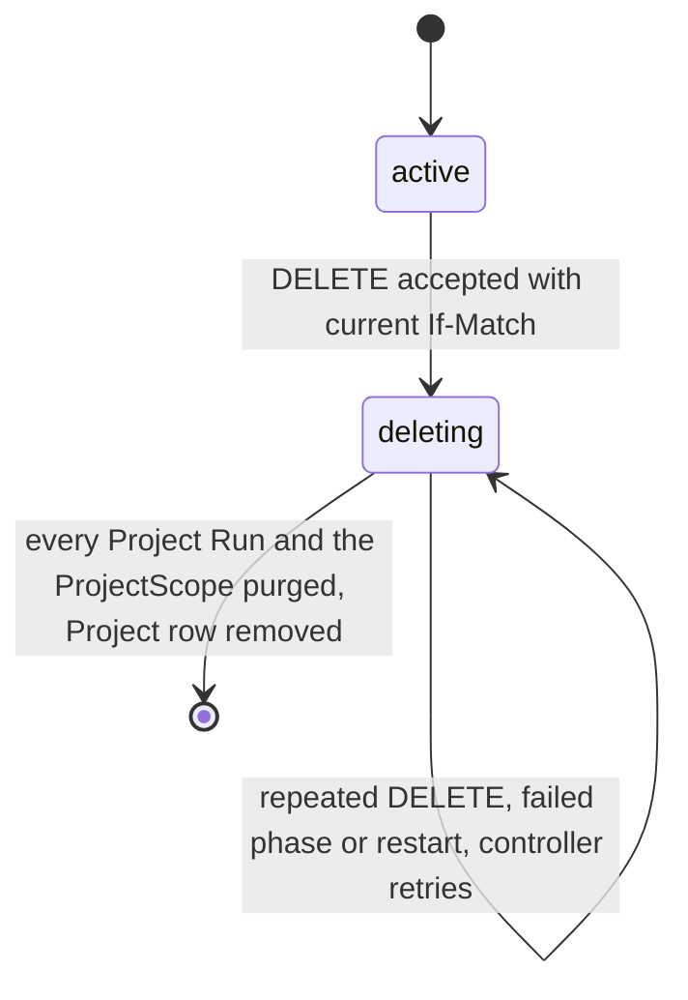
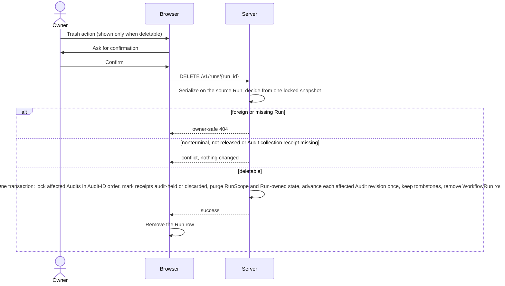
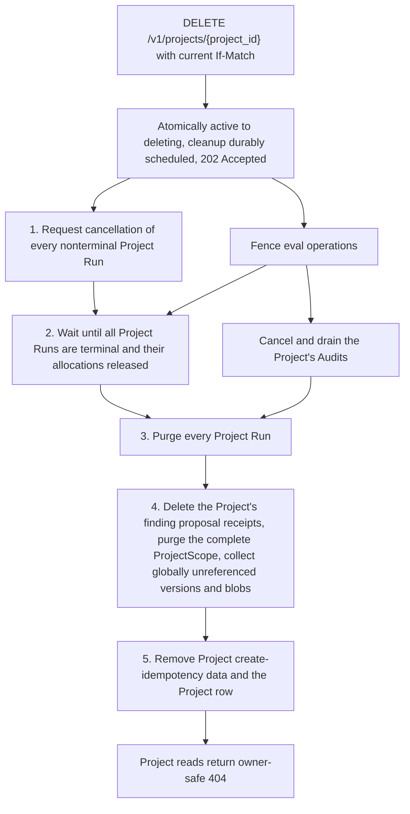

# Retention and deletion

Requirement prefix: `DEL` · [Specification index](../README.md)

## Purpose and scope

This document owns the destructive lifecycle controls for owner-scoped
WorkflowRun history and Project workspaces: how long artifact versions stay
resolvable, explicit terminal Run hard deletion, recoverable Project deletion,
the controlled scope purge and reference-safe garbage collection.

It leaves to other documents:

- ArtifactStore scopes, refs, revisions, read and write results and the
  create-only Artifact APIs: [artifact-store](artifact-store.md).
- The Project resource and its fields: [projects](projects.md).
- Physical cleanup inside each payload backend, live reads racing deletion and
  offline orphan cleanup: [blob-storage](blob-storage.md).
- WorkflowRun states and cancellation: [runs](../execution/runs.md); queue
  pause, the owner queue gate and the global execution limit:
  [scheduler](../execution/scheduler.md); allocation release:
  [control-plane](../execution/control-plane.md).
- The Runs surface (Queue and Completed views): [ui](../ui/ui.md).
- Audit revisions and `runDeleted` provenance: [audits](../audits/audits.md);
  Audit collection and its dispositions: [audits/execution](../audits/execution.md);
  Audit deletion, Audit retention, proposal import and reports:
  [review-and-reports](../audits/review-and-reports.md).
- Finding proposal lifecycle: [findings](../findings/findings.md).
- Managed eval submissions and external producers:
  [managed-evals](../evals/managed-evals.md).
- Shared registries: [limits](../platform/limits.md),
  [errors](../platform/errors.md),
  [failure model](../platform/failure-model.md) and
  [lifecycle](../platform/lifecycle.md).

## Concepts

Terms are defined once in [the glossary](../glossary.md); the ones this
document owns are:

- **Controlled scope purge.** The trusted lifecycle cleanup that removes a
  complete RunScope or ProjectScope and the lineage edges owned by it; the only
  exception to the create-only, immutable Artifact APIs.
- **Purge set.** The complete RunScope or ProjectScope that one controlled
  scope purge removes, together with the lineage edges it owns.
- **Reference-safe garbage collection.** Removal of an immutable version or
  blob only when nothing outside the purge set still references it.
- **Terminal Run hard deletion.** Permanent removal of a terminal, fully
  released Run and all Run-owned durable state in one transaction.
- **`deletable`.** The Server-derived Run boolean that marks the safe deletion
  boundary.
- **Recoverable Project deletion.** The durable, restart-safe
  cancel/drain/purge operation that removes a Project after it enters
  `deleting`.
- **`deleting`.** The Project lifecycle state entered atomically when deletion
  is accepted, in which Project metadata and target changes, artifact writes
  and new Project Runs are rejected while cleanup proceeds.
- **Tombstone provenance.** Bounded provenance that survives a deleted source
  Run when its content does not.

Physical orphans of the `filesystem` payload backend are defined in
[blob-storage](blob-storage.md).

## Model

A Project has an additive lifecycle state:

```text
active | deleting
```



## Requirements

### General

**DEL-R1.** None of the lifecycle controls, namely the consolidated Runs
surface ([ui](../ui/ui.md)), the durable queue admission gate
([scheduler](../execution/scheduler.md)), terminal Run hard deletion and
recoverable Project deletion, creates a second execution state machine:
WorkflowRun, StageExecution and allocation state remain owned by the Scheduler
and the Control Plane.

**DEL-R2.** Destructive cleanup may start only after those authorities have
reached their existing safe terminal or released boundaries.

### Retention of artifact versions

**DEL-R3.** An old revision must remain resolvable to its immutable internal
version for as long as Run input provenance, a StageContext snapshot, a
StageResult, a Run output or a retention policy keeps that version alive
(LIFE-DEL-5). The versioned refs and timestamps carried by read and write
results are specified in [artifact-store](artifact-store.md).

### Controlled scope purge

**DEL-R4.** Normal Artifact APIs, which are create-only and immutable, never
delete committed versions; the controlled scope purge performed by trusted
lifecycle cleanup is their only exception.

**DEL-R5.** The controlled scope purge may run only after its gate, the Run
release gate of terminal Run hard deletion (DEL-R16, DEL-R17) or the Project
deletion gate (DEL-R44), and then removes a complete RunScope or ProjectScope
together with the lineage edges owned by that purge set (LIFE-DEL-3,
LIFE-DEL-4).

**DEL-R6.** The purge must never grant delete authority to a
browser-selected scope, a Planner, a Runtime or a generic artifact client, and
is never available through a Runtime or a generic Artifact endpoint.

**DEL-R7.** Only authenticated public lifecycle endpoints and trusted Server
recovery code can enter the controlled deletion path.

**DEL-R8.** A deletion request that names a foreign or missing Run, or a
foreign Project, receives the ordinary owner-safe `404` with no existence
disclosure.

### Reference-safe garbage collection

**DEL-R9.** Artifact content may be deduplicated. Cleanup may remove an
immutable version or its content-addressed blob only when no binding, retained
revision, pin, lineage edge or other scope outside the purge set still
references it (LIFE-DEL-5).

**DEL-R10.** A physically shared blob retained for another artifact is not a
surviving Run artifact: when such a blob exists outside the purge set, the
logical Run or Project data is removed and the blob remains referenced.

**DEL-R11.** Removing a cross-scope provenance edge does not remove the
independently retained target artifact.

**DEL-R13.** Scope registry deletion and its relational reference checks are
one transaction; registry retention checks and scope and version removal are
transactional and reference-safe.

Physical deletion of payloads after the registry commit is owned by
[blob-storage](blob-storage.md): PostgreSQL blob deletion
([BLB-R49](blob-storage.md)), best-effort `filesystem` unlink and the physical
orphans it may leave ([BLB-R50](blob-storage.md), FAIL-BLB-4), selection of
physical objects and generations ([BLB-R51](blob-storage.md)), live reads
racing deletion ([BLB-R52](blob-storage.md)), referenced metadata whose file
is missing ([BLB-R53](blob-storage.md)), the cleanup contract of future
backends and offline orphan cleanup.

### Terminal Run hard deletion

**DEL-R16.** `DELETE /v1/runs/{run_id}` permanently removes an owned Run. It
is allowed only when the Run is terminal (`succeeded`, `failed` or
`cancelled`) and every allocation belonging to it has completed release.

**DEL-R17.** An Audit-bound Run additionally cannot be hard-deleted until a
durable `AuditCollectionReceipt` records the disposition of its exact terminal
observation. The receipt is required even when the Run failed or was
cancelled, produced no output, or produced an invalid package.

**DEL-R18.** A receipt with no accepted evidence records that fact rather than
waiting for an impossible successful import.

**DEL-R57.** A `collection-contract-invalid` disposition is a cleanup-safe
technical outcome, never accepted evidence. When the collector records each
disposition is specified in [audits/execution](../audits/execution.md).

**DEL-R58.** After collection, deletion of the Audit-bound Run is allowed
once the conditions of DEL-R16 also hold.

**DEL-R19.** Run list and detail responses expose a Server-derived
`deletable` boolean so that the UI shows a trash action only at that safe
boundary.

**DEL-R20.** A DELETE for a Run that is nonterminal or not yet released, or
for an Audit-bound Run that has no durable `AuditCollectionReceipt` (DEL-R17),
including a stale attempt, receives a conflict and changes nothing; no
partial cleanup happens (FAIL-DEL-1).

**DEL-R21.** When a Run becomes terminal while a DELETE races, one locked
snapshot decides; the client retries after refetching (FAIL-DEL-1).

**DEL-R22.** Deletion is one controlled transaction over all Run-owned
durable state (LIFE-DEL-1, LIFE-DEL-3), including:

- the complete RunScope: input forks, intermediate bindings, declared outputs,
  revisions and lineage;
- Stage executions, plans, attempts, candidate and accepted results,
  allocation records and release metadata;
- Run events, metrics, labels, cancellation state, resolved execution data,
  publication receipts and create-idempotency records;
- the WorkflowRun row itself.

**DEL-R59.** The purge removes a scope in purge batches of at most 1,000
binding revisions taken in key order (LIM-DEL-2). Each batch first removes
the lineage edges into or out of its revisions and the bindings whose current
revision it holds, then the revisions. Their versions and blobs are then
locked in one global order and the unreferenced ones deleted, at most one
batch of them per statement. A Run purge stays the one transaction of DEL-R22:
the Run revision limit (LIM-ART-6) bounds its batches. An Audit namespace
purge likewise runs inside its Audit deletion transaction
([review-and-reports](../audits/review-and-reports.md)).

Rationale: a statement per batch keeps every statement and lock set bounded,
and each batch's key range starts behind the rows earlier batches deleted, so
the work grows linearly with the scope instead of rereading it per batch.

**DEL-R23.** The same transaction advances the revision of every affected
owner Audit: the managed execution's Audit, native proposal-receipt Audits and
destination Audits retaining imported proposals. Each affected Audit,
including a terminal Audit, advances once per successful Run deletion
(LIM-DEL-1).

**DEL-R24.** A rollback or rejected deletion leaves both the Run and these
Audit revisions unchanged.

Rationale: the revision advance invalidates old Audit ETags, revision pins and
cursors when retained provenance starts reporting `runDeleted`
([audits](../audits/audits.md)).

**DEL-R25.** Run deletion never changes a finding assessment or a frozen
report-review subject; they keep their own revisions. The finalizing report
timestamp rule is defined in [review-and-reports](../audits/review-and-reports.md).

**DEL-R26.** Source UserScope and ProjectScope artifacts selected as Run
inputs are not Run-owned and remain after Run deletion.

**DEL-R27.** A ProjectScope output previously published from the Run is an
independent Project artifact and remains when only the Run is deleted; the
Run-owned publication receipt and cross-scope provenance edge are removed.
Deleting the Project later removes that ProjectScope output.

**DEL-R28.** Hard deletion of an ordinary (non-Audit) source Run atomically
marks its imported finding proposal receipts `audit-held` and every
unimported proposal receipt `discarded`, then purges the source RunScope with
its proposal and evidence revisions (LIFE-DEL-6).

**DEL-R29.** Receipt provenance and discarded tombstones survive the source
Run as bounded tombstone provenance; only imported Artifact revisions,
protected by the destination Audit's own exact holds, survive as readable
content. The tombstones of a Project's Runs go with the Project (DEL-R61).

Rationale: Run deletion therefore cannot leak abandoned proposals or silently
remove evidence already retained by an Audit. How a proposal stays readable
until import or discard is specified in [findings](../findings/findings.md),
and how an owner imports it into an Audit in
[review-and-reports](../audits/review-and-reports.md).

**DEL-R30.** Run deletion does not cascade to AuditExecution and
AuditExecutionItem: through a nullable, non-cascading Run relation they retain
the outcome, the exact retained refs when any, and tombstone provenance.
Accepted evidence stays retained by exact revision (LIFE-DEL-7).

**DEL-R31.** Run deletion and creation of a destination proposal hold
serialize on the source Run before taking Audit, receipt/retention and
Artifact locks.

**DEL-R32.** Deletion locks all affected Audits in Audit-ID order, then
commits their revision invalidation with the tombstones and the Run removal.

**DEL-R33.** An import that commits first is included in that invalidation;
an import after committed deletion finds no live source (FAIL-DEL-6).

**DEL-R34.** The browser asks for confirmation immediately before DELETE and
removes the Run row only after Server success.

**DEL-R35.** Hard deletion intentionally removes the original Run-create
idempotency record; a later create with the same key may therefore create a
new Run.



### Recoverable Project deletion

**DEL-R36.** Project deletion is a durable cancel/drain/purge operation, not a
synchronous foreign-key cascade (LIFE-DEL-2).

**DEL-R37.** `DELETE /v1/projects/{project_id}` requires the current Project
`If-Match` and returns `202 Accepted` after atomically changing the Project
from `active` to `deleting` and durably scheduling cleanup.

**DEL-R38.** Reconciliation of an already-deleting Project returns its current
deleting representation, so a retry after a lost DELETE response observes the
existing `deleting` operation (FAIL-DEL-2).

**DEL-R39.** The UI requires explicit confirmation by typing the Project name,
warns that Runs and artifacts are permanent, then polls the ordinary Project
representation until it becomes the owner-safe `404`.

**DEL-R40.** Once a Project is `deleting`, the Server rejects Project metadata
and target changes, artifact writes and new Project Runs, and no Audit work
starts in it. Reads may continue so that progress is visible.

**DEL-R41.** Project deletion must fence eval operations in the same durable
Project lifecycle before draining. The deletion barrier extends to native and
external managed submission intents and to referenced Audit execution
Projects (LIFE-DEL-9).

**DEL-R42.** Audit child projects are exact registered dependencies, not
inferred from labels; their ownership and deletion eligibility are rechecked.

**DEL-R43.** An external producer returning after the fence receives `409`
with the not retryable `eval_project_deleting` of
[managed-evals](../evals/managed-evals.md) (EVM-R227) and cannot recreate
deleted attempts (FAIL-DEL-5).

**DEL-R44.** A restart-safe controller repeatedly performs these phases:

1. durably request cancellation for every nonterminal Project Run using the
   ordinary Scheduler cancellation transition;
2. wait until all Project Runs are terminal and all their allocations have
   completed release;
3. invoke the terminal Run purge (DEL-R22) for every Project Run, including
   Runs that were already terminal when deletion began;
4. delete every finding proposal receipt of the Project (DEL-R61), then
   purge every binding, retained revision, pin and lineage edge in the
   complete ProjectScope, then garbage-collect only globally unreferenced
   versions and blobs (DEL-R9, LIFE-DEL-4), one purge batch per transaction
   (DEL-R60);
5. remove Project create-idempotency data and the Project row.

**DEL-R60.** A ProjectScope has no revision limit, so Project deletion
purges it in transactions of at most one purge batch each (LIM-DEL-2). Every
such transaction rechecks the deletion claim and that no Project Run or Audit
remains, purges the Project's native private eval storage, which is a no-op
after the first time, deletes the next batch of the Project's finding
proposal receipts (DEL-R61), and only when no receipt is left removes one
purge batch and collects the versions and blobs that batch left
unreferenced. The transaction that finds the scope empty removes the scope
and the Project row. A committed batch stays purged: a deleting Project
without Runs and Audits admits no Artifact write (DEL-R40), and a failed
transaction leaves the earlier batches purged and the Project `deleting`
(DEL-R47).

**DEL-R61.** Project deletion deletes every finding proposal receipt of the
Project, which by then is the `audit-held` or `discarded` tombstone of a
deleted Project Run (DEL-R28, DEL-R29), before it purges the ProjectScope
(LIFE-DEL-10). It deletes them in receipt order, in batches bounded by
LIM-DEL-3, one batch per Project purge transaction (DEL-R60), and only after
every Project Run and Audit is gone: an Audit hold, contribution, finding or
assessment that refers to a receipt belongs to an Audit of the receipt's own
Project and is purged with that Audit. Nothing else deletes a receipt: the
database refuses its deletion outside the Project purge or while its Project
is not `deleting`. A receipt of a standalone Run names no Project and keeps
its tombstone.

Rationale: a receipt holds the owner, Project, client key, report projection
and evidence references of a finding, so none may outlive the Project it
names. The tombstones of standalone Runs are an accepted retention without a
deleter: their number grows with the owner's deleted standalone Runs that
submitted findings, and the database rule above is what enforces that
nothing removes them by accident. The decision is to be reopened when
deleting an owner's data, or a retention period for standalone Run
provenance, is specified.

**DEL-R45.** Before its Run purge and ProjectScope purge, Project deletion
runs an Audit cancellation and drain phase. Audit deletion itself, including
how its deletion intent is recorded, is specified in
[review-and-reports](../audits/review-and-reports.md).

**DEL-R55.** Project deletion supplies the durable deletion intent, so the
cancellation of each of its Audits deterministically continues to `deleting`
instead of finishing as `cancelled`.

**DEL-R56.** No Audit hold survives a completed Project purge.

**DEL-R46.** Project deletion neither changes nor bypasses the Scheduler's
global execution limit ([scheduler](../execution/scheduler.md)), and all its
cancellation and release phases must converge at every valid setting of that
limit.

**DEL-R47.** The operation is monotonic, idempotent and retryable after a
crash at every phase. After a Server restart the durable phase is resumed and
no Run is recreated (FAIL-DEL-3).

**DEL-R48.** Claim bookkeeping and the cancellation and drain phases use the
controller operation budget; each Run purge and each ProjectScope purge
transaction use a separate, longer purge budget, and a purge claim's lease
grows by the same amount.

**DEL-R49.** A failed attempt defers or releases its claim with a fresh
bounded budget. When cancellation or release fails, the Project stays
`deleting` and the controller retries (FAIL-DEL-3).

**DEL-R50.** Owner or Audit queue pause never blocks the cancellation, drain,
release or cleanup work of Project deletion.

**DEL-R51.** UserScope artifacts, global Skills and referenced
RuntimeCredential records are outside Project ownership and are retained;
deleting the Project only removes their Project and Run references
(LIFE-DEL-8).

**DEL-R52.** Native private eval storage is not left behind after the Project
purge (LIFE-DEL-9).

**DEL-R53.** Lifecycle uncertainty blocks the purge rather than claiming that
external work was undone (FAIL-DEL-3).

**DEL-R54.** No response claims completion while an allocation, a finding
proposal receipt of the Project or a ProjectScope artifact is still retained:
Project deletion cannot finish before every owned Run, every receipt of the
Project (DEL-R61) and the entire ProjectScope have been purged.



## Interfaces

- `DELETE /v1/runs/{run_id}` is operation `deleteRun` and
  `DELETE /v1/projects/{project_id}` is operation `deleteProject` in the
  [public API schema](../../../api/openapi/contractor-public-v1.yaml). The
  schema reports a refused Run deletion (DEL-R20) as a conflict whose details
  kind is `run_not_deletable`, with reason `run_not_terminal`,
  `allocation_release_pending` or `audit_collection_pending`.
- Run list and detail representations carry `deletable` (DEL-R19); the
  Project representation carries the `active` or `deleting` lifecycle state
  and stays readable while deleting (DEL-R40).

## Limits, failures and errors

- [LIM-DEL-1](../platform/limits.md): one revision advance per affected Audit
  per successful Run deletion (DEL-R23).
- [LIM-DEL-2](../platform/limits.md): 1,000 binding revisions per purge batch,
  one batch per ProjectScope purge transaction (DEL-R59, DEL-R60).
- [LIM-DEL-3](../platform/limits.md): 1,000 finding proposal receipts and
  64 MiB of their stored report projections and evidence per Project purge
  transaction (DEL-R61).
- [LIM-ART-6](../platform/limits.md): the Run revision limit that bounds one
  Run purge transaction (DEL-R59).
- [FAIL-DEL-1](../platform/failure-model.md): terminal Run hard deletion
  (DEL-R20, DEL-R21, DEL-R24).
- [FAIL-DEL-2](../platform/failure-model.md): the Project DELETE request
  (DEL-R38).
- [FAIL-DEL-3](../platform/failure-model.md): Project deletion controller
  phases (DEL-R47, DEL-R49, DEL-R53).
- [FAIL-DEL-5](../platform/failure-model.md): an external eval producer
  returning after the Project deletion fence (DEL-R43).
- [FAIL-DEL-6](../platform/failure-model.md): a destination proposal import
  racing source Run deletion (DEL-R33).
- [LIFE-DEL-1](../platform/lifecycle.md) WorkflowRun,
  [LIFE-DEL-2](../platform/lifecycle.md) Project,
  [LIFE-DEL-3](../platform/lifecycle.md) RunScope,
  [LIFE-DEL-4](../platform/lifecycle.md) ProjectScope,
  [LIFE-DEL-5](../platform/lifecycle.md) artifact versions and blobs,
  [LIFE-DEL-6](../platform/lifecycle.md) finding proposal receipts of a
  deleted source Run,
  [LIFE-DEL-7](../platform/lifecycle.md) AuditExecution and
  AuditExecutionItem,
  [LIFE-DEL-8](../platform/lifecycle.md) records outside Project ownership,
  [LIFE-DEL-9](../platform/lifecycle.md) managed eval data of a Project,
  [LIFE-DEL-10](../platform/lifecycle.md) finding proposal receipt
  tombstones of a Project.
- [Errors](../platform/errors.md): `run_not_deletable` (DEL-R20).

Deletion failure and concurrency outcomes are stated in DEL-R8, DEL-R10,
DEL-R20, DEL-R21, DEL-R38, DEL-R47 and DEL-R49. How
queue pause races with normal Stage admission is specified in
[scheduler](../execution/scheduler.md).

## Security

Delete authority is limited to the controlled deletion path (DEL-R6, DEL-R7);
deletion endpoints never disclose foreign resources (DEL-R8); destructive
cleanup starts only at the Scheduler and Control Plane safe boundaries
(DEL-R2).

## Observability

A deleting Project stays readable so that cleanup progress is visible
(DEL-R40). Logging of a failed `filesystem` unlink is specified in
[blob-storage](blob-storage.md) ([BLB-R50](blob-storage.md)).

## Invariants

1. A Run cannot be deleted before terminal allocation release completes
   (DEL-R16).
2. Run deletion removes all RunScope and execution state but never deletes an
   independently retained source or ProjectScope artifact (DEL-R22, DEL-R26,
   DEL-R27).
3. Project deletion is durable and cannot finish before every owned Run and
   the entire ProjectScope have been purged (DEL-R36, DEL-R54).
4. Artifact garbage collection is reference-safe across all scopes (DEL-R9).
5. Only authenticated public lifecycle endpoints and trusted Server recovery
   code can enter the controlled deletion path (DEL-R7).
