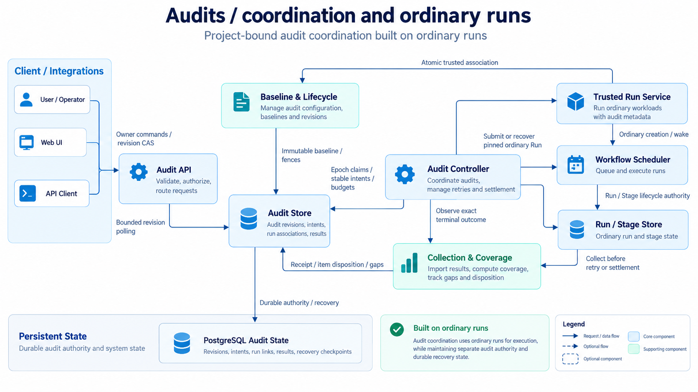
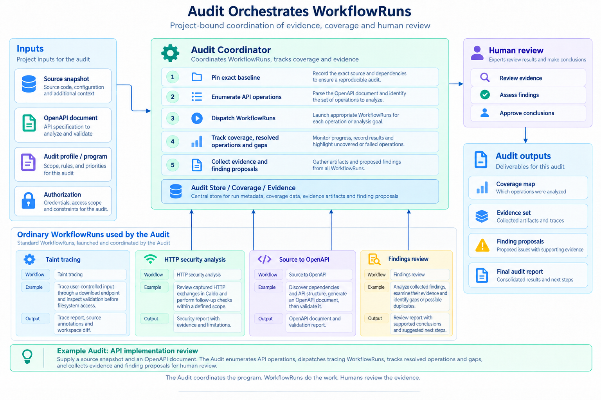
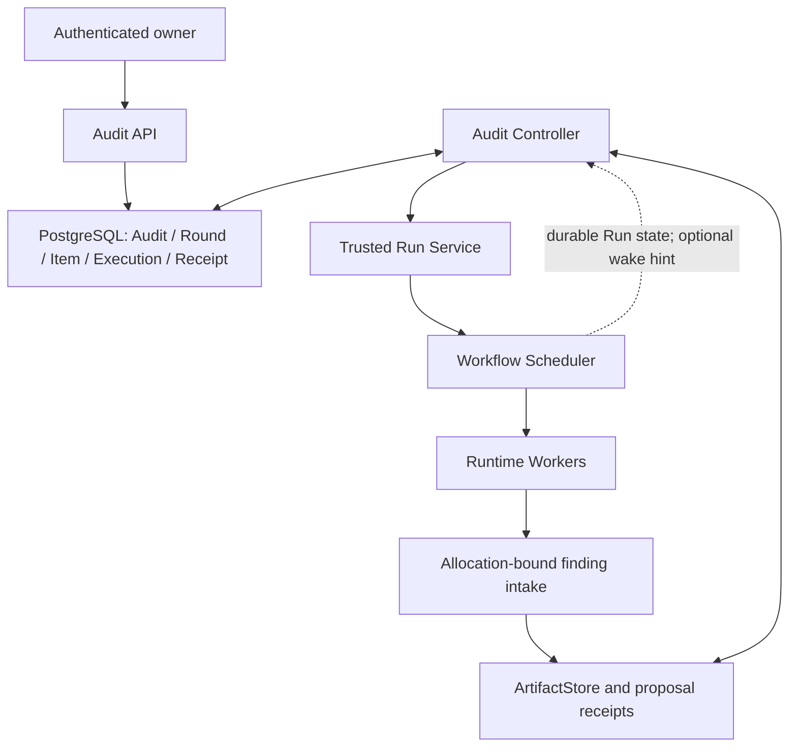
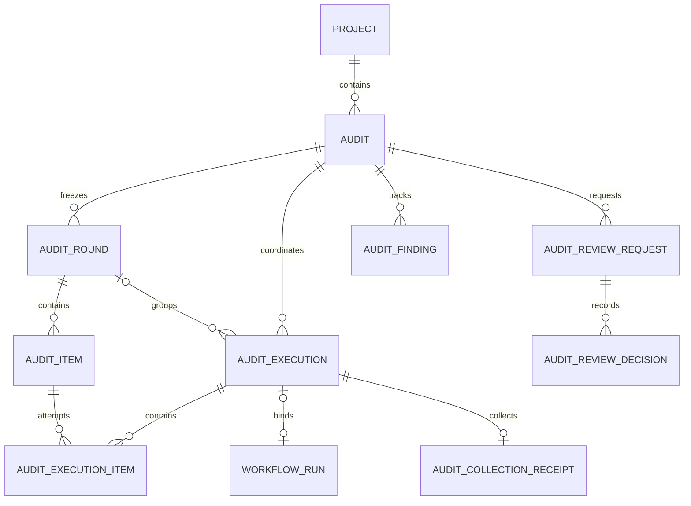
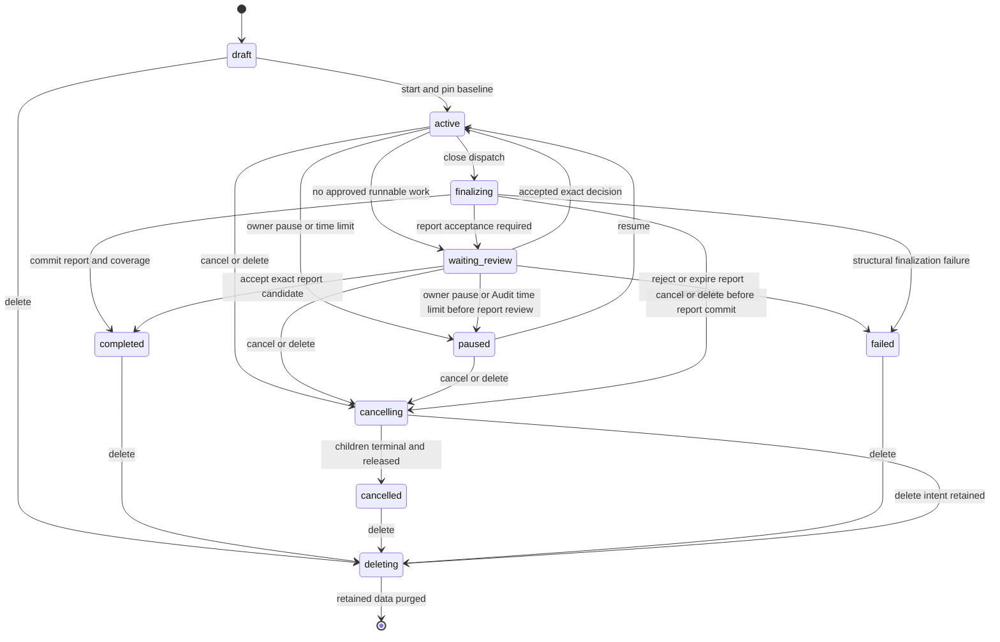
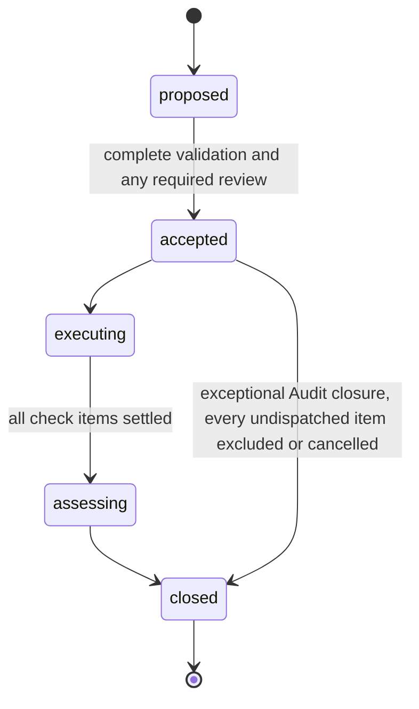
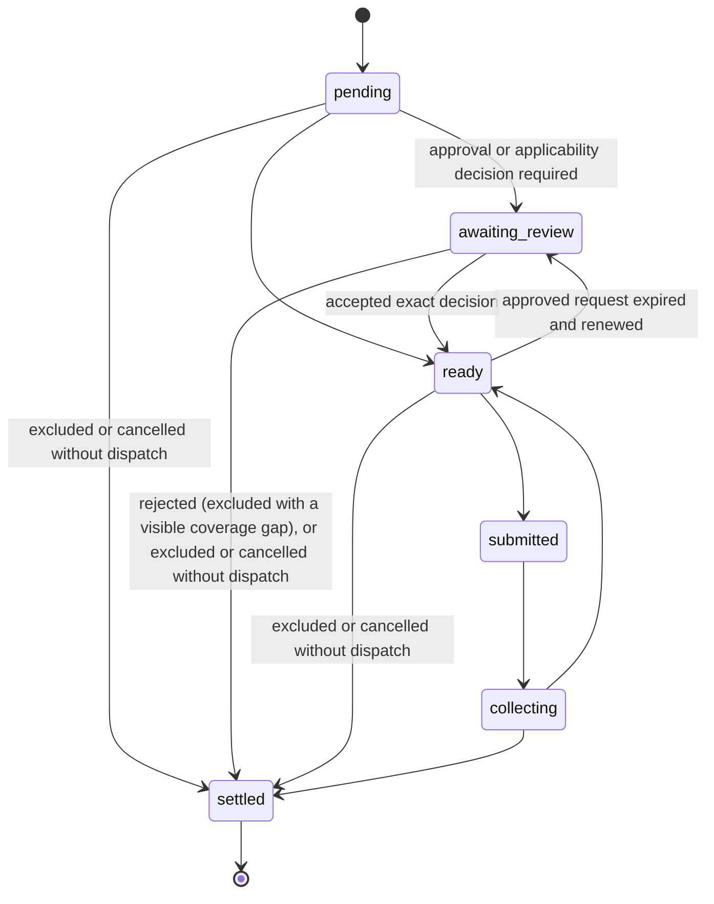

# Audits

Requirement prefix: `AUD` · [Specification index](../README.md)

## Purpose and scope

An `Audit` is the assessment abstraction above Workflows in Contractor's
Application Security orchestration model. It defines a long-lived,
Project-bound assessment against an immutable baseline, a selected scope and a
versioned program. An AuditProfile selects Workflows for check, discovery or
assessment roles. Audit coordinates their ordinary WorkflowRuns, deterministic
inventory items, evidence, finding proposals, rounds and authenticated human
decisions.

[](../../assets/contractor-audits.png)

The Audit contract covers deterministic inventories, immutable rounds, bounded
compatible item batches in ordinary check Runs, PostgreSQL recovery, exact
result collection, finding intake and triage, exact human decisions, pinned
discovery and assessment roles, bounded multiple rounds, and automatic or
owner-accepted coverage reports.

This document owns the AuditProfile and the curated standard packages it
pins, the Audit baseline and scope, the durable Audit domain model, Audit
packages and their schemas, deterministic inventories, the Audit, Round and
item lifecycle, and the public Audit API surface.

It leaves to other documents:

- Audit Controller submission, dispatch, collection, import, recovery and
  budgets: [execution](execution.md).
- Human review, evidence, coverage, reports, Audit retention and deletion, and
  proposal import from ordinary Runs: [review and reports](review-and-reports.md).
- Check result collection and completion inside the Worker:
  [worker completion](worker-completion.md).
- Preparation roles, the mapping-source contract for inventories and prepare
  roles, pre-Round controls and OpenAPI scan checks: [scans](scans.md).
- Finding proposals, the bundled CWE catalog and finding collections:
  [findings](../findings/findings.md).
- Projects and output publication: [projects](../artifacts/projects.md);
  ArtifactStore scopes, refs and reserved namespaces:
  [artifact store](../artifacts/artifact-store.md); Run hard deletion and
  Project deletion: [retention and deletion](../artifacts/retention-and-deletion.md).
- Configuration subtrees and loading: [catalog](../configuration/catalog.md);
  RuntimeConfig, Runtime labels and credentials:
  [runtime config](../configuration/runtime-config.md); Skill packages:
  [skills](../tools/skills.md).
- WorkflowRuns and Run metadata labels: [runs](../execution/runs.md); queue
  pause and the global execution limit: [scheduler](../execution/scheduler.md).
- The Audit pages of the web UI: [ui](../ui/ui.md); public API conventions:
  [public API](../api/public-api.md).
- Shared registries: [limits](../platform/limits.md),
  [errors](../platform/errors.md),
  [failure model](../platform/failure-model.md) and
  [lifecycle](../platform/lifecycle.md).

## Concepts

Terms are defined once in [the glossary](../glossary.md); the ones this
document owns are:

- **Audit.** A long-lived, Project-bound assessment against an immutable
  baseline, a selected scope and a versioned program.
- **AuditProfile.** The versioned, operator-authored configuration document
  that selects an Audit's mode, standards, inputs, inventory, Workflow roles,
  execution limits and interaction policy.
- **Audit Controller.** The Server component that owns coordination across
  Runs: rounds, items, child Run intents, collection, coverage and Audit
  budgets.
- **Profile mode.** The program kind of a profile, which fixes the initial
  item source and the principal result.
- **Workflow role.** A named binding in a profile from an operator-chosen role
  name to a pinned `ResolvedWorkflow` closure with an explicit role kind
  (`prepare`, `check`, `discovery` or `assessment`).
- **Baseline.** Everything the start transaction freezes: exact inputs, scope,
  credential identities, the resolved profile and Workflow closures, the Run
  RuntimeConfig snapshot, Skill packages, the standard selection, limits and
  interaction policy.
- **Round.** An immutable, validated set of AuditItems that is executed,
  assessed and closed as one unit.
- **AuditItem.** The logical unit of a check, attempt, result, evidence,
  proposal attribution, coverage and settlement.
- **AuditExecution.** One submission of a Workflow role for an Audit, with at
  most one Run and one immutable execution-input manifest.
- **Audit package.** A versioned `application/zip` package with a strict
  `manifest.json` that carries a related variable-sized set through the
  ArtifactStore.
- **Execution manifest.** The Controller-generated, immutable, ordered list of
  item keys and exact task and input refs of one execution.
- **Audit standard package.** A canonical ZIP, built from one
  `contractor.audit-standard.v1` document, holding curated requirements or
  risks, evidence contracts and mappings.
- **Evidence contract.** An independently versioned part of a standard package
  that defines allowed assessments, evidence kinds and counts, rationale and
  human-review policy.
- **Deterministic inventory.** An inventory generator that produces a finite
  subject and item list without network side effects.
- **Phase.** An Audit's progress through `not-started`, `preparing`,
  `inventory` and `rounds`, separate from its lifecycle state.
- **Item origin.** The immutable record on an AuditItem of the exact source it
  was generated from.
- **Required Audit capabilities.** The closed, versioned set of Server
  mechanisms a profile needs, computed for presentation and enforced at start.
- **Incidental classification.** A known `CWE@4.20` reference retained on a
  proposal without pinning CWE as an Audit standard.
- **Dispatch hold.** A credential usage hold that Audit start adds for future
  child Runs.
- **Audit revision.** The counter that advances on every projection-visible
  Audit mutation and backs the Audit ETag.

External standards referenced by the curated programs:
[OWASP Top 10:2025](https://owasp.org/Top10/2025/), and
[OWASP ASVS](https://owasp.org/www-project-application-security-verification-standard/)
with its [official repository](https://github.com/OWASP/ASVS), including
stable version 5.0.0 and version-qualified requirement identifiers.

## Model

The figure follows one Audit end to end: the Project inputs and authorization
it starts from, the ordinary WorkflowRuns it coordinates, the evidence and
coverage it collects, and the human review that turns finding proposals into
conclusions. It illustrates the requirements; where the two differ, the
requirements apply.

[](../../assets/audit-workflows.png)

### Ownership boundaries



| Participant | Owns | Does not own |
| --- | --- | --- |
| Audit API | Owner authorization, commands, review decisions | Stage execution |
| Audit Controller | Rounds, items, child Run intents, collection, coverage, Audit budgets | A2A dispatch or Runtime placement |
| Trusted Run Service | Atomic creation of a pinned ordinary Run and its Audit association | Audit policy or Stage progression |
| Workflow Scheduler | Run/Stage lifecycle, retry, escalation, output acceptance | ASVS, checklist, or finding semantics |
| Planner | Decomposition inside one Stage and candidate task/result production | Child Run creation or human approval |
| Worker and tools | Analysis, observations, result artifacts, finding proposals | ProjectScope or final Audit assessment |
| ArtifactStore | Exact revisions, scopes, CAS, lineage, and durable retention | AuditItem state |

### AuditProfile

An AuditProfile manifest uses the configuration envelope with
`kind: AuditProfile`; its `spec` has the sections `mode`, `standards`,
`inputs`, `inventory`, `workflows`, `execution` and `interaction` (see the
[authoring example](#auditprofile-authoring-shape)). The `inventory` section
names the inventory `implementation` (for example `openapi-operations@1` or
`standard-mappings@1`) and the `itemWorkflowRole`. Each entry of `workflows`
is a Workflow role binding with `kind`, `ref` and `inputs`, `parameters` and
`outputs` maps.

Profile modes:

| Mode | Initial item source | Principal result |
| --- | --- | --- |
| `risk-assessment` | Risk categories, assets, and bounded discovery proposals | Assessed scenarios, findings, and gaps |
| `requirements-verification` | Exact versioned requirements and selected level/scope | Per-requirement evaluation and coverage |
| `custom-checklist` | Exact versioned user checklist | Per-item evaluation under its evidence contract |
| `operation-tracing` | Operations from an exact OpenAPI input | Trace reports, coverage, and proposals |
| `finding-verification` | Explicit exact finding candidates | Supporting, refuting, or inconclusive evidence |

### Standard package document

A `contractor.audit-standard.v1` document contains:

- exact standard metadata and source/license attribution;
- bounded `risk | requirement` entries with applicability and allowed methods;
- independently versioned evidence contracts defining allowed assessments,
  evidence kinds/counts, rationale, and human-review policy;
- deterministic mappings from one check key to exact entry IDs, one named
  Workflow role, an allowed method, and one exact evidence contract.

### Durable records



| Record | Minimum durable fields |
| --- | --- |
| `Audit` | id, owner_id, project_id, profile snapshot/digest, exact input/Skill sets, scope snapshot, runtime snapshots, state, revision, current_round_id, dispatch/hold state, optional deadline_at and paused_at, limits/counters, stop reason, optional deletion_requested_at, timestamps |
| `AuditRound` | id, audit_id, ordinal, exact accepted manifest ref/digest, state, expected_count, revision |
| `AuditItem` | id, round_id, item_key, ordinal, kind, subject_key, exact task package ref, workflow_role, immutable source origin (exact source ref/content digest, canonical inventory digest, checklist key/version), exact source proposal refs, state, approval kind and optional exact approval-subject digest, final disposition, optional accepted result ref, optional last_execution_item_id |
| `AuditExecution` | id, audit_id, optional round_id, role kind, exact named workflow_role from the pinned profile, optional role_attempt, exact ordered execution manifest ref/digest, submission_key, optional run_id, safe Workflow closure provenance, optional run_deleted_at, state, optional terminal Run outcome/version |
| `AuditExecutionItem` | execution_id, item_id, batch_ordinal, item_attempt, exact task/input refs, collection disposition, optional exact result ref |
| `AuditCollectionReceipt` | id, execution_id, optional run_id, exact terminal observation, output disposition, optional source output ref/digest, retained refs/digests, bounded error code, timestamp |
| `AuditFinding` | id, audit_id, exact first and contributing proposal refs, current assessment ref with exact supporting check-result/attempt or direct Workflow result refs, triage state, current analyst decision ref, optional duplicate target, revision |
| `AuditProposalReceipt` | id, run_id, allocation_id, invocation_id, submission_id, payload digest, exact proposal ref, immutable trusted origin including Workflow identity/digest, optional admitted audit_id, source status |
| `AuditArtifactLink` | audit_id, logical key, exact retained version, source provenance, display ref, timestamp |
| `AuditReviewRequest` | id, audit_id, subject kind/id, review kind, exact subject revision/digest, requested actions, state, optional expiry |
| `AuditReviewDecision` | id, request_id, actor_id, typed finding verdict or action decision, exact subject revision/digest, bounded rationale, timestamp |
| `AuditReportCandidate` | audit_id, request_id, round_id, exact pre-publication Audit revision/digest, frozen machine/summary artifact descriptors, timestamp |
| `AuditEvent` | audit_id, dense sequence (AUD-R223), kind, entity id/revision, bounded safe summary |

### Result layers

| Layer | Meaning |
| --- | --- |
| Run outcome | Whether the technical Workflow contract completed |
| Check observation | What was observed, under which exact inputs and limits |
| Hypothesis assessment | `supported | refuted | inconclusive | blocked` |
| Requirement evaluation | `satisfied | violated | inconclusive | not-tested | not-applicable` |
| Finding triage | `proposed | confirmed | rejected | duplicate | needs-evidence` |
| Audit completion | Whether the bounded program closed, with what coverage and gaps |

The rules that keep these layers apart, including when a finding is confirmed
and what a Run outcome may not imply, are specified in
[review and reports](review-and-reports.md).

### Audit packages

Audit package kinds are `worklist`, `item-task`, `item-task-set`,
`execution-manifest`, `check-results`, `finding-proposal`, `evidence`,
`coverage` and `openapi-source`. Package manifests use the
`contractor.audit.package.v1` schema; the documents inside include
`contractor.audit.worklist.v1` worklists and `contractor.audit.check-results.v1`
check result sets (see [Examples](#examples)).

### Audit states



### Round and item states





The diagram draws the item lifecycle of AUD-R187. Exceptional Audit closure
settles every undispatched item as excluded or cancelled (AUD-R186), and the
renewal of an expired approved request returns a ready item to
`awaiting_review` ([REV-R39](review-and-reports.md)).

## Requirements

### Audits and Projects

**AUD-R1.** An Audit belongs to exactly one `project_id` and one owner
(LIM-AUD-1).

**AUD-R2.** An Audit is not a new Project kind. It belongs to an existing
Project whose `kind` is exactly `project`. Of the Project kinds `project` and
`evaluation` ([projects](../artifacts/projects.md)), Audit accepts only
`project`: `evaluation` Projects and standalone Audits are rejected.

**AUD-R3.** One ordinary Project may contain multiple independent Audits: an
OWASP Top 10 risk assessment, an ASVS verification, a custom checklist, OpenAPI
operation tracing, or verification of findings proposed by earlier Runs.

**AUD-R4.** Audit start and dispatch serialize with the existing Project
deletion fence of the Project lifecycle `active | deleting` ([retention and
deletion](../artifacts/retention-and-deletion.md)).

### Ownership and authority

**AUD-R5.** The Audit Controller owns coordination across Runs. The Workflow
Scheduler continues to own WorkflowRun and StageExecution progression, and a
Planner remains local to one StageExecution.

**AUD-R6.** Workers may produce observations and propose findings, but cannot
create Runs, select an Audit, approve work or mutate Audit control state.

**AUD-R7.** Each Audit participant owns the responsibilities listed for it in
[Ownership boundaries](#ownership-boundaries) and none of those listed for it
under "Does not own".

**AUD-R8.** Audit is an external state machine for coordinating multiple
ordinary Runs. It does not add a second task graph inside a WorkflowRun and
does not alter the StageExecution lifecycle.

**AUD-R9.** Generic immutable Run metadata labels
([runs](../execution/runs.md)) such as `audit.id`, `audit.round`, `audit.item`
and `audit.role` may be attached to child Runs for search, telemetry and UI
backlinks.

**AUD-R10.** These labels are caller-visible and therefore never authoritative.
Database foreign keys and trusted creation provenance are the only Audit-to-Run
authority; labels grant no access and cannot attach an arbitrary Run to an
Audit.

### Platform contracts reused by Audits

**AUD-R11.** Audits use the ArtifactStore scopes `UserScope`, `ProjectScope`
and `RunScope` ([artifact store](../artifacts/artifact-store.md)). No
`AuditScope` is introduced, and `ArtifactRef` does not carry a scope.

**AUD-R12.** Audit baseline inputs always require exact refs: an `ArtifactRef`
with `namespace`, `name` and a required `revision`.

**AUD-R13.** Audit child Runs must use the complete resolved Workflow snapshot
and the pinned Run RuntimeConfig snapshot that WorkflowRuns persist, rather
than re-resolving mutable names or Run-label bindings at dispatch. Physical
Agent-label settings remain an allocation-time layer, exactly as defined in
[runtime config](../configuration/runtime-config.md).

**AUD-R14.** Ordinary Run creation resolves each selected Skill name to an
exact package revision and digest ([skills](../tools/skills.md)). Because Audit
child Runs may be created long after start, Audit start must retain that exact
Skill package set, and the trusted Run Service must consume it without
resolving the current `skills/<name>` binding again.

**AUD-R15.** Queue pause is an owner-wide Stage-admission gate
([scheduler](../execution/scheduler.md)). Audit coordination must continue to
reconcile terminal Runs and perform cancellation and cleanup while that gate is
paused.

Trusted Audit child Runs publish with the internal `audit-managed`
publication mode, which is not accepted from the public Run-create API,
because repeated Audit check outputs would collide in the create-only
`outputs/<workflow-output>` destination. The mode is specified in
[projects](../artifacts/projects.md) (PRJ-R62, PRJ-R63).

**AUD-R16.** Managed LLM and Runtime credential deletion is reference-aware for
Runs ([runtime config](../configuration/runtime-config.md)). Audit start must
add equivalent dispatch holds for credentials needed by future child Runs
(LIFE-AUD-1).

**AUD-R17.** Credential dispatch holds end after dispatch is durably closed and
all submission intents are resolved (LIFE-AUD-1). Exact evidence and artifact
holds have a separate lifetime and remain until Audit deletion; their release
is specified in [review and reports](review-and-reports.md).

### AuditProfile documents

**AUD-R18.** `AuditProfile` is a versioned, operator-authored configuration
document with identity `(name, version)`.

**AUD-R19.** The configuration loader validates an AuditProfile only after all
referenced Workflows are dependency-resolved.

**AUD-R20.** An Audit persists the full resolved profile snapshot and its
canonical digest; later catalog reloads do not affect that Audit.

**AUD-R21.** A persisted profile snapshot requires an explicit valid `kind` for
every Workflow role. Its canonical digest includes each role kind, the complete
embedded Workflow, any explicit `workerCompletion` contract ([worker
completion](worker-completion.md)) and a prepare role's `maxRunAttempts`.

**AUD-R22.** The snapshot reader validates that digest without inferring roles,
consulting the current catalog or rewriting the snapshot. Historical snapshots
that omit role kinds or use the former digest without role kinds are
unsupported; start and recovery fail validation (FAIL-AUD-1).

**AUD-R23.** `audit-profiles` is a fixed configuration subtree alongside
`workflows`, `agent-templates`, `model-policies`, `llm-gateways`,
`execution-configs` and `instructions`. The subtree list, the roots from which
AuditProfile manifests are loaded and the loading contract are specified in
[catalog](../configuration/catalog.md).

**AUD-R24.** The configuration layer exposes an internal read-only AuditProfile
catalog; the Audit API adds a dedicated owner-safe read projection for exact
versions and Server compatibility (AUD-R93).

**AUD-R25.** Generic managed configuration publication and the existing
`/v1/configurations/{kind}` surface do not accept AuditProfile.

**AUD-R26.** AuditProfile has no execution-concurrency field; `maxActiveRuns`
is not part of its authoring or resolved contracts. Audit child executions are
ordinary WorkflowRuns, so their actual execution is governed by the global
Scheduler setting ([scheduler](../execution/scheduler.md)).

The meaning of `maxSubmittedRuns` as a pinned cumulative budget over all child
Run attempts, and its independence from concurrent execution, are specified in
[execution](execution.md).

**AUD-R27.** Profile modes compose one mechanism rather than creating Scheduler
branches. The modes are listed in [AuditProfile](#auditprofile).

**AUD-R28.** A profile may combine item sources, but it does not create a full
Cartesian product of requirements and operations unless the profile explicitly
defines that bounded expansion.

**AUD-R29.** A repository profile may only reference Workflows that actually
resolve in the same configuration snapshot.

**AUD-R30.** Each production profile must pin versioned evidence contracts,
finite schema bounds and source licenses before publication.

#### Workflow role bindings

**AUD-R31.** Every Workflow binding has an explicit `kind: prepare | check |
discovery | assessment` and pins a complete `ResolvedWorkflow` closure.

**AUD-R32.** The binding map key is only the operator-chosen role name; the
Server never infers behaviour from substrings such as `discover` or `assess`.

**AUD-R33.** `inventory.itemWorkflowRole` must name a `check` binding.

**AUD-R34.** A profile may contain several role names of the same kind when
their input and result contracts are distinct.

Each binding's `inputs`, `parameters` and `outputs` maps are validated against
the selected Workflow:

- **AUD-R35.** All required child inputs and parameters have exactly
  one mapping (LIM-AUD-2).
- **AUD-R36.** Unknown child slots and unknown logical output names
  are rejected.
- **AUD-R37.** `audit-input` names exist and have at least one
  compatible media type.
- **AUD-R38.** `standard-mappings@1` has no `source`, uses exactly one
  retained package, and still maps ordinary declared Audit inputs such as
  `source` into its child Workflow.
- **AUD-R39.** `item-package` is accepted only by an artifact slot
  compatible with the versioned Audit package media type.
- **AUD-R40.** `execution-manifest` maps the Controller-generated
  exact one-execution manifest into an `application/json` Workflow input
  without making it part of its own digest-bearing member list.
- **AUD-R41.** `retained-output` identifies a declared logical
  output of another bound role. Cycles, dependencies on per-item `check`
  outputs, and dependencies on a later execution phase are rejected. Discovery
  outputs may feed later discovery, check or assessment roles, while
  assessment outputs may only feed a later assessment role in the same phase.
- **AUD-R42.** Literal parameter values are bounded strings;
  item and scope fields come from a closed trusted enum rather than
  model-selected object paths.
- **AUD-R43.** Every output consumed by the Audit importer is
  required by the child Workflow and has a profile-supported package media
  type.

Which mapping sources (`audit-input`, `prepare-output`, `item-package`,
`execution-manifest`, `retained-output`) each consumer may use, the
`inventory.source` and `inventory.settings` contract, prepare-role
`maxRunAttempts`, and the per-profile bounds on roles, baseline inputs,
mappings per binding, accepted output descriptors and retained output sizes
are specified in [scans](scans.md).

#### Profile limits

**AUD-R44.** All numeric profile limits, including `batchSize`, are finite
positive values and are jointly validated. Profiles cannot weaken Server-wide
maxima.

**AUD-R45.** `batchSize` is a maximum, not a required fill level: the
Controller may submit a smaller final or compatibility-constrained batch.

**AUD-R46.** The Server caps `batchSize` at 64 items (LIM-AUD-3).

**AUD-R47.** Model policies, execution budgets, Runtime labels and credentials
are selected by the pinned child execution configuration, not by finding
content.

### Standard packages and catalog

**AUD-R48.** Curated requirements and risks live in versioned Audit standard
packages, not in prompts or model memory.

**AUD-R49.** Operator sources are the immediate directories below
`configs/audit-standards`, a non-YAML source subtree of the operator
configuration root ([catalog](../configuration/catalog.md)); each contains
exactly one `standard.json` (LIM-AUD-4).

**AUD-R50.** At startup the Server normalizes that strict document, builds a
canonical ZIP with media type `application/vnd.contractor.audit-standard+zip`,
and creates the absent owner-scoped catalog binding.

**AUD-R51.** The complete source tree is validated before any binding is
written. Duplicate `(scheme, version)`, unknown fields, duplicate JSON keys,
symlinks, extra or archive-traversal members, excessive data, dangling mappings
and unsupported license/disclosure pairs reject the load (FAIL-AUD-2).

**AUD-R52.** Every entry and mapping reference is checked against the package
itself.

**AUD-R53.** A Worker can cite the package's identifiers, but neither Worker
nor Planner output can create, redefine or change their authoritative
membership.

**AUD-R218.** Catalog packages use the reserved UserScope namespace
`audit-standards`. Generic Artifact APIs cannot write it or read/list raw
package bytes; only the trusted catalog seed path can create a binding. The
namespace reservation itself is listed with the other reserved namespaces in
[artifact store](../artifacts/artifact-store.md) (ART-R25).

**AUD-R54.** Existing catalog identity bytes are never updated. A different
current media type or digest is fatal catalog drift rather than an implicit new
revision (FAIL-AUD-2, LIFE-AUD-2).

**AUD-R55.** A changed standard requires a new exact version (LIFE-AUD-2).

**AUD-R56.** At Audit start the Server resolves every profile `(scheme,
version)` to the current exact catalog revision, validates the package again,
and copies its canonical bytes into a frozen create-only binding in the
matching protected `audit-<audit-id>` Project namespace (LIFE-AUD-3).

**AUD-R57.** The baseline records both the catalog and the retained exact refs,
the digest, size, title, source, license and disclosure policy of every pinned
standard.

**AUD-R58.** Matching `standard/<scheme>/<version>` artifact links and their
source provenance commit atomically with the first Round. Retained package
bytes count against `maxEvidenceBytes` (LIFE-AUD-3).

**AUD-R59.** Reports include these baseline pins, so later catalog additions,
source Run deletion or restart cannot rewrite historical identity (LIFE-AUD-3).

**AUD-R60.** Audit deletion removes the retained standard packages with the
other Audit-managed artifacts (LIFE-AUD-3); the deletion procedure is specified
in [review and reports](review-and-reports.md).

**AUD-R61.** The persisted baseline requires a `standards` array, which may be
empty. Snapshots without the field or with `null` are invalid and cannot resume
(FAIL-AUD-1).

**AUD-R62.** `GET /v1/audit-standards` returns bounded metadata, counts, digest
and the exact catalog ref. `GET
/v1/audit-standards/{scheme}/versions/{version}` returns the exact package
projection.

**AUD-R63.** Raw standard package ZIP bytes are never public.

**AUD-R64.** Detail disclosure is license-policy-aware: `metadata` returns no
entry bodies, `identifiers` returns only entry identities and kinds, and `full`
may include entries, evidence contracts and mappings.

**AUD-R65.** The license allowlist is explicit; an unknown license, or a
disclosure level not allowed for that license, is invalid.

#### Standard-backed inventories

**AUD-R66.** `standard-mappings@1` is the deterministic inventory
implementation for one exact standard package. Such a profile declares exactly
one `standards` entry (LIM-AUD-5) and omits `inventory.source`: the trusted
inventory source is the Audit-retained package revision, not a user-uploaded
copy.

**AUD-R67.** Each mapping becomes one item and task package carrying the exact
scheme, version, mapping key, entry IDs and complete evidence-contract
snapshot.

**AUD-R68.** Every mapping must select `itemWorkflowRole`; unevaluated
`profile-rule` applicability and `on-inconclusive` review semantics are
rejected.

**AUD-R69.** Building a `standard-mappings@1` inventory calls neither a model
nor the network.

**AUD-R70.** A requirements-verification profile may add
`inventory.standardSelection` with an operator-authored `scope`, a sorted set
of `levels` and a sorted set of version-qualified `entryIds`. The entry IDs are
the authoritative denominator; scope and levels are retained explanatory
constraints.

**AUD-R71.** Every selected entry must exist at one selected level and must
have exactly one one-entry mapping whose key equals that entry ID (LIM-AUD-6).
Missing, duplicate, dangling or wrong-version selection fails Server startup
before an Audit can start (FAIL-AUD-3).

**AUD-R72.** The exact selection is included in the profile digest, canonical
inventory, Audit baseline, API and reports.

**AUD-R73.** Profiles without `inventory.standardSelection` retain the
all-mappings behaviour used by the curated Top 10 risk program.

**AUD-R74.** OWASP Top 10 is a risk-awareness document, not an exhaustive
compliance checklist. A risk-assessment report must not claim "OWASP certified"
or infer complete security from a lack of findings.

**AUD-R75.** ASVS assessments pin an exact standard version, selected level and
included requirement set. References use the version-qualified form recommended
by ASVS, for example `v5.0.0-1.2.5`.

**AUD-R76.** A new standard release requires a new profile version.

### Server capabilities and start compatibility

**AUD-R77.** Catalog validity and executable Server support are deliberately
different: the read-only catalog may retain a profile before every mechanism it
requests is installed.

**AUD-R78.** Profile reads and draft creation compute a closed, versioned set
of required Audit capabilities for presentation; start enforces that set
against the same profile snapshot it pins. A stale UI projection cannot bypass
the start check.

**AUD-R79.** The Server supports deterministic inventory, bounded compatible
check batches, bounded multiple rounds, pinned discovery and assessment
Workflow roles, exact active-check and manual-item approval, human finding
confirmation, human applicability decisions and exact report acceptance.

**AUD-R80.** Automatic active checks are not enabled: a profile must prohibit
them or require an exact human decision.

**AUD-R81.** `findingConfirmation: disabled` means finding proposals are not an
accepted result surface for that profile; it never turns proposals into
findings implicitly.

**AUD-R82.** Start rejects a disabled-finding profile whose resolved Workflow
outputs or AgentTemplates can emit finding proposals, and rejects active-check
capabilities under `activeChecks: prohibited` (FAIL-AUD-4).

**AUD-R83.** For `activeChecks: approval-required`, each item assigned to a
Workflow role that exposes a classified active-check tool starts in
`awaiting_review`. The trusted profile gate wins over a weaker
inventory-authored policy.

**AUD-R84.** Manual checklist items also start in `awaiting_review`. No
model-authored marker can make an active-check or manual item runnable.

**AUD-R85.** Report acceptance and item decisions use the shared exact-subject
review ledger specified in [review and reports](review-and-reports.md).

**AUD-R86.** For standard-backed items, package-authored `human-review`
applicability or a `required` evidence-contract review starts the item in
`awaiting_review` and uses the same exact-subject applicability decision as
manual checklist items.

**AUD-R87.** The executable mapping subset rejects standard-package policies it
cannot enforce rather than silently weakening them.

**AUD-R88.** The stable start error is `audit_profile_unsupported`. Its bounded
reason codes describe missing Server capabilities rather than transient Worker
availability (FAIL-AUD-4).

**AUD-R89.** The Server emits the reason codes
`automatic_active_checks_unsupported` and `assessment_unsupported` for the
unsupported finding-candidate inventory entry point.

**AUD-R90.** The Server emits the reason code
`finding_confirmation_unsupported` when `findingConfirmation: disabled` but a
resolved Workflow has a `proposals` output or an AgentTemplate selects a
finding-proposal tool.

**AUD-R91.** `batching_unsupported` and other older closed reason values,
including `preparation_unsupported`, remain reserved wire values for compatible
clients. The Server does not produce them for preparation, bounded profile
batch sizes, discovery, human review, report acceptance or multiple-round
execution.

**AUD-R92.** A successfully started Audit may still wait in the ordinary queue
for a compatible Runtime Agent.

**AUD-R93.** Profile endpoints are a dedicated read-only projection, not
generic managed configuration publication. Every item identifies the exact
name, version and digest and returns the declared input contract, mode,
standards, execution and interaction limits, `serverCompatible`, stable
missing-capability reason codes, and whether exact input-dependent validation
is still required.

**AUD-R94.** Compatibility describes the current Server only. Project artifact
and checklist-item compatibility are evaluated separately, by the draft UI
where possible and authoritatively by the start transaction. Start always
revalidates both.

### Baseline and scope

**AUD-R95.** At `start`, one transaction freezes (FAIL-AUD-4):

- exact ProjectScope ArtifactRefs for source, OpenAPI, checklist, finding, and
  other declared inputs;
- a bounded target/scope snapshot, selected assets, exclusions, and permitted
  methods;
- non-secret credential identities plus durable usage holds;
- the resolved AuditProfile, every child ResolvedWorkflow closure, and one
  exact Run RuntimeConfig snapshot (default plus Audit-selected Runtime labels)
  reused by every child Run; physical Agent labels still resolve only after
  placement;
- the exact source revision, digest, validated metadata, and limits for every
  Skill package selected by any pinned child Workflow; later child creation
  forks these exact packages rather than resolving a current catalog binding;
- standard version, selected level, and requirement/asset selection rules;
- limits and human-interaction policy.

**AUD-R96.** Draft input bindings may be edited with Audit revision CAS.

**AUD-R97.** After start, the baseline is immutable. Changing target,
credentials, selected input revisions or profile creates a new Audit.

**AUD-R98.** Additional human evidence may be accepted as an exact retained
input to a later round without rewriting the baseline.

**AUD-R99.** Scope is not encoded in ArtifactRef and never becomes a
model-selectable argument.

**AUD-R100.** The existing `ProjectScope -> RunScope` trust boundary remains:
the trusted Run Service resolves and forks exact inputs, and Runtime receives
only allocation-scoped Run authority.

**AUD-R101.** For a standard-backed item, `ItemOrigin.sourceRef` points at the
exact retained package and `entryKey`/`entryVersion` identify the selected
mapping and standard version. The exact task package is the authoritative join
to its entry IDs and evidence contract.

**AUD-R102.** A proposal associated with the result of a standard-backed item
must name every assigned entry using the same pinned scheme and version.

**AUD-R219.** The importer reopens the retained package, rejects unknown,
duplicate, unpinned or wrong-version references, and never accepts
model-authored standard membership.

**AUD-R103.** The bundled `CWE@4.20` weakness catalog
([findings](../findings/findings.md)) is the sole non-pinned exception: Audit
import accepts known `CWE@4.20` IDs without pinning CWE as an Audit standard
and retains them as incidental classifications, while unknown CWE IDs and other
versions are rejected.

**AUD-R104.** A CWE classification never satisfies an assigned standard or
checklist entry.

### Durable model rules

**AUD-R105.** `AuditItem` remains the logical unit of a check, attempt, result,
evidence, proposal attribution, coverage and settlement, even when several
items share one `AuditExecution` and WorkflowRun.

**AUD-R106.** Execution role kinds are `prepare | discovery | check |
assessment`; `workflow_role` stores the operator-chosen binding name, whose
pinned kind must match.

**AUD-R107.** A check execution has an ordered set of `AuditExecutionItem`
rows; discovery and assessment executions belong to the Audit or Round and do
not create fake items.

**AUD-R108.** Each execution has at most one Run and one immutable
execution-input manifest, and one Run can belong to at most one AuditExecution
(LIM-AUD-7).

**AUD-R109.** A check execution contains one to `batchSize` compatible items
(LIM-AUD-8), subject to both the Server item-count maximum and the encoded
Audit package byte bounds. `batchSize` is a ceiling, not a promise that every
compatible count-sized group fits one Run.

**AUD-R110.** Each item retains its own batch ordinal, attempt, result,
evidence, proposal membership, coverage and settlement.

**AUD-R111.** Members verifying distinct proposed checks of one finding may
share an execution: each records its own assessment, and the member with the
highest batch ordinal supplies the finding's current assessment, as if the
members were collected in batch order.

**AUD-R112.** A bounded retry creates a new `AuditExecution` and
`AuditExecutionItem` for every retried item and preserves every earlier
receipt. The Controller may regroup ready retries without changing item
identity or attempt history (FAIL-AUD-5).

**AUD-R113.** Items with different pinned Workflow role or configuration,
resolved Run inputs or parameters, baseline or workspace, credentials,
active-check authority, or exact approval kind or subject digest cannot share
an execution.

**AUD-R114.** Workspace reuse does not imply a conversation shared with another
Run.

**AUD-R115.** Required uniqueness includes `(audit_id, round.ordinal)`,
`(round_id, item_key)`, `(round_id, ordinal)`, `submission_key`, non-null
`run_id`, `(execution_id, batch_ordinal)`, `(execution_id, item_id)`,
`(item_id, item_attempt)`, `(allocation_id, invocation_id, submission_id)` and
`(audit_id, event.sequence)`.

**AUD-R116.** Discovery and assessment attempts use explicit PostgreSQL
null-safe uniqueness over Audit, optional Round, role kind, named workflow role
and `role_attempt`.

**AUD-R117.** Each newly generated item task pins the Audit profile mode in
`profile_mode`. The Worker's local result collector ([worker
completion](worker-completion.md)) uses that trusted mode to reject `supported`
on non-finding checklist tasks outside `risk-assessment`; the importer still
applies the pinned profile mode when accepting results.

**AUD-R118.** Older retained task packages without `profile_mode` remain
decodable and are treated as non-risk for local `supported` validation.

### Audit packages and schemas

**AUD-R119.** ArtifactStore remains the sole artifact plane. Related
variable-sized sets are transported as one versioned `application/zip` package
containing `manifest.json` and relative files.

**AUD-R120.** The manifest uses package-local IDs, media types, sizes and
content digests. It contains no unqualified external refs whose scope could
change during a fork. External data is materialized before acceptance or
rejected (FAIL-AUD-6).

**AUD-R121.** Packages reuse the existing secure workspace and archive rules
([workspace](../tools/workspace.md)): bounded compressed and expanded bytes,
bounded file count, path length and depth, strict relative paths, no traversal,
no special files, no symlink escape, and no execution of package content. A
dedicated Audit package schema adds tighter per-document limits.

**AUD-R122.** The `contractor.audit.package.v1` manifest schema is strict
canonical JSON (see the [package manifest example](#audit-package-manifest)).

**AUD-R123.** `members` is ordered by path, and every member `id` and `path` is
unique.

**AUD-R124.** The optional `entrypoint` is permitted only for an
`openapi-source` package and names one declared member.

**AUD-R125.** An `item-task-set` contains the ordered exact `item-task` package
bytes as the members `000.zip`, `001.zip`, and so on of its `tasks/` directory;
its membership and nested package digests must match the execution manifest.

**AUD-R126.** Unknown manifest fields, schema versions or package kinds are
rejected (FAIL-AUD-6).

**AUD-R127.** Canonical export uses stored members, fixed ZIP metadata and the
JCS manifest. Import may accept stored or deflated members but always checks
their declared size and SHA-256 digest before exposing bytes (FAIL-AUD-6).

**AUD-R128.** A package under the `contractor.audit.package.v1` schema version
must stay within these hard limits. Server deployments may lower these values
but cannot accept a package above them under this schema version (FAIL-AUD-6).

| Bound | Hard limit | Registry |
| --- | --- | --- |
| Compressed package size | 16 MiB | LIM-AUD-9 |
| Expanded package size | 32 MiB | LIM-AUD-10 |
| Members per package | 1,024 members | LIM-AUD-11 |
| Opaque member size | 16 MiB per opaque member | LIM-AUD-12 |
| `manifest.json` size | 512 KiB | LIM-AUD-13 |
| Parsed JSON or YAML document | 8 MiB per document | LIM-AUD-14 |
| Package path length | 512 bytes per package path | LIM-AUD-15 |
| Package path components | 16 components per package path | LIM-AUD-16 |
| JSON/YAML depth | 64 | LIM-AUD-17 |
| Local-ref depth | 32 | LIM-AUD-18 |
| Inventory items | 4,096 inventory items | LIM-AUD-19 |
| All generated item packages | 64 MiB across all generated item packages | LIM-AUD-20 |

**AUD-R129.** Child Workflows declare fixed slots such as `task`, `result` and
`proposals`. Variable lists live inside a package; Runtime cannot publish an
unbounded dynamic `outputs/vuln-*` namespace around Scheduler acceptance.

**AUD-R130.** The execution input of a check execution contains an immutable
manifest with an ordered list of item keys and exact task and input refs. How
the importer verifies a result set against it is specified in
[execution](execution.md).

**AUD-R131.** The frozen `result` output is a `check-results` Audit package
with no entrypoint. It contains the required `check-results` member at
`check-results.json`, an optional `evidence` member at `evidence.json`, and
optional opaque content members, each referenced by exactly one evidence record
(LIM-AUD-21). Both JSON members use `application/json`. Validation of the
package, its evidence budget and its proposal associations are specified in
[execution](execution.md).

#### Worklist manifests

**AUD-R132.** The Controller validates the entire worklist manifest before
creating the first child Run. Duplicate keys, missing or duplicate ordinals,
unknown roles, absent package members, dependency gaps and limit violations
reject it atomically (FAIL-AUD-7).

**AUD-R133.** The normalized manifest and its Round and Items commit together
(FAIL-AUD-7).

**AUD-R134.** A model may request more approval, but cannot weaken the trusted
profile requirement.

**AUD-R135.** For proposal-driven work, acceptance also persists exact source
proposal refs (receipt ID, artifact revision and digest) on each AuditItem.

**AUD-R136.** Checklist-driven items pin the checklist package revision and
digest and the entry key and version, plus standard identifiers when
applicable.

**AUD-R137.** These source relations are validated durable relations, not
references reconstructed from hypothesis text or task filenames.

**AUD-R138.** One proposal may require several items, and an item may verify
several explicitly linked proposals. Initial inventory items may have no source
proposal.

**AUD-R139.** The Server resolves model-proposed references only within the
exact authorized inbox and input set; a proposal cannot choose another Audit or
execution.

### Deterministic inventories

**AUD-R140.** Inventory generators produce finite subject and item lists and
perform no network side effects.

#### Requirements and custom checklists

**AUD-R141.** Each checklist entry has a stable key, version, statement,
applicability rule, allowed methods, required evidence and review policy.

**AUD-R142.** ASVS references carry an exact version-qualified identifier. A
selected level is expanded from the pinned standards package, never from model
memory.

Initial `not-tested` coverage rows for every selected requirement, review work
for manual and documentary requirements, and the conditions for
`not-applicable` are specified in [review and reports](review-and-reports.md).

#### OpenAPI operations

**AUD-R143.** `openapi-operations@1` accepts an exact OpenAPI 3.x JSON or YAML
document, or a bounded package containing it.

**AUD-R144.** Local `$ref` values resolve only inside the pinned document or
package under cycle, depth and byte bounds. The generator never performs a
network request.

**AUD-R145.** A remote ref needed to resolve an enumerated Path Item,
operation, parameter, security declaration or schema dependency rejects the
entire inventory before dispatch (FAIL-AUD-8). Remote refs that occur only in
unsupported callbacks, webhooks or other non-selected surfaces are not followed
and become explicit named coverage gaps.

**AUD-R146.** Numbers in either form must be finite and within the exact
integer range (±9007199254740991, without a fraction that rounds past it)
(LIM-AUD-22); a larger number rejects the document in JSON and YAML alike, as
in scan preparation ([scanners](../tools/scanners.md), SCN-R124) (FAIL-AUD-8).

**AUD-R147.** `openapi-operations@1` enumerates explicit HTTP operations in
`paths`. Callbacks and webhooks become named coverage gaps rather than counted
checks.

**AUD-R148.** Path Item refs resolve before enumeration.

**AUD-R149.** `operationId` is only a display label: missing or duplicate
operation IDs do not merge operations.

**AUD-R150.** Ordering is UTF-8 lexicographic path followed by a fixed
HTTP-method order.

**AUD-R151.** Identity and provenance use separate digests:

- `source_content_digest` is SHA-256 over the exact accepted source artifact
  bytes. It identifies provenance and changes after reformatting or conversion
  between JSON and YAML;
- `canonical_inventory_digest` is SHA-256 over a versioned JCS representation
  of the normalized inventory basis: enumerated paths/operations, their
  resolved local dependency closures, and normalized gap descriptors. It
  excludes source byte identity, mapping presentation order, comments, and
  `operationId` uniqueness;
- `operation_key` is SHA-256 over a domain-separated canonical tuple of
  `canonical_inventory_digest`, the exact path template, and the lowercase
  HTTP method.

**AUD-R152.** The canonical inventory and operation keys are therefore stable
for semantically equivalent JSON/YAML inputs and mapping-key reorderings, while
task packages may differ because they retain exact source provenance.

**AUD-R153.** There is no circular digest: the inventory basis contains no
operation keys, and the worklist is derived only after its digest is known.

**AUD-R154.** Task packages include both digests, the operation, the relevant
resolved schemas, parameters and security declarations, an exact source
descriptor (`ArtifactRef`, media type and content digest) and scope. The
immutable execution manifest repeats that exact source input.

**AUD-R155.** Source bytes remain in the single pinned input artifact and are
forked through the ordinary Run input path; they are not copied into every item
package.

Rationale: this keeps inventory memory and storage bounded while a reformatted
or replaced source still changes task package provenance.

**AUD-R156.** The baseline ref in a task package is inert provenance, not scope
authority: the trusted Run Service consumes the server-side execution manifest,
forks it to `inputs/<workflow-slot>`, and Runtime receives only that
allocation-bound RunScope access.

**AUD-R157.** Operation-to-handler mapping requires evidence; an unsupported
mapping remains an assumption.

**AUD-R158.** An unmapped endpoint or truncated graph yields an explicit gap or
inconclusive result, never "no vulnerabilities found".

**AUD-R159.** Taint annotations ([code analysis](../tools/code-analysis.md))
remain research artifacts, not proof of reachability or exploitation.

#### Worker proposals

**AUD-R160.** Worker proposals never alter an accepted Round. They enter a
durable inbox and may be triaged into a later Round.

**AUD-R161.** A proposal from a non-Audit Run remains attached to that Run
until an owner imports the exact revision into a compatible Audit ([review and
reports](review-and-reports.md)). The Server checks owner, Project, scope and
provenance, and never finds an Audit by trusting Run labels.

### Audit lifecycle

The states and transitions are shown in [Audit states](#audit-states).
Cancellation and the drain of owned Runs are specified in
[execution](execution.md); Audit deletion and its purge in
[review and reports](review-and-reports.md).

**AUD-R162.** An active Audit may enter `failed` only after dispatch is closed
and owned Runs are terminal and released (FAIL-AUD-9).

**AUD-R163.** Non-time budget exhaustion closes dispatch and tries bounded
finalization with explicit gaps; inability to form a structurally valid report
yields `failed` (FAIL-AUD-9).

**AUD-R164.** The optional Audit time limit instead pauses admission with stop
reason `deadline_exhausted`, preserves the dispatch hold and leaves existing
Runs to drain and collect (FAIL-AUD-9).

**AUD-R165.** The owner can override `deadlineSeconds` at start or resume. Zero
disables the deadline, and a positive value is bounded to 365 days
(LIM-AUD-23).

**AUD-R166.** Entering `paused` records `paused_at`, so resume can restore the
remaining allowance independently of collection updates while paused.

**AUD-R167.** The admission clock includes owner Queue waiting; an Audit pause
freezes it.

**AUD-R168.** Waiting for a frozen report decision uses that decision's own
expiry rather than the Audit admission clock (FAIL-AUD-11).

**AUD-R169.** Only a `paused` Audit can resume, and Resume is its only way back
to `active`: no plain owner transition bypasses Resume's checks and renewals.

**AUD-R170.** Terminal `completed`, `failed` and `cancelled` Audits remain
final, including historical records whose stop reason is `deadline_exhausted`.

**AUD-R171.** Resume requires an active Project, a pinned baseline and either a
current Round or a persisted preparation or inventory phase, with no frozen
report candidate (FAIL-AUD-10).

**AUD-R172.** Accepted items, receipts, evidence and baseline bytes never
change; report links are not archived or rewritten by Resume.

**AUD-R173.** Expired task approvals require fresh exact-subject requests;
resuming never silently extends human authority. How requests are renewed is
specified in [review and reports](review-and-reports.md).

**AUD-R174.** Successful resume clears `paused_at` and the stop reason and
applies the selected deadline allowance.

**AUD-R175.** `completed` means the bounded Audit process closed, not that the
application is secure.

**AUD-R176.** Completion requires a durable collection receipt for every
execution, every item settled, no mandatory open review, and retention of every
accepted evidence revision.

**AUD-R177.** A profile that allows partial completion may close review work as
deferred or excluded with a visible gap.

**AUD-R178.** `waiting_review` has two deliberately distinct uses. While
immutable items are awaiting approval, accepting the final outstanding item
returns the Audit to `active`; rejecting one settles it as excluded with a
visible coverage gap.

**AUD-R179.** When a human report policy is selected, finalization instead
freezes an exact machine/summary candidate and its acceptance request.

**AUD-R180.** During that report decision, new finding reviews, finding imports
and pause/resume are fenced so the reviewed bytes cannot drift (FAIL-AUD-11).

**AUD-R220.** Accept publishes exactly those descriptors (FAIL-AUD-11).

**AUD-R221.** Reject or expiry fails the Audit (FAIL-AUD-11).

**AUD-R222.** Cancel and delete remain available during the report decision
(FAIL-AUD-11).

**AUD-R181.** Once the report decision is complete, finding triage may continue
without rewriting the historical accepted report.

### Rounds and items

**AUD-R182.** Round lifecycle is `proposed -> accepted -> executing ->
assessing -> closed`.

**AUD-R183.** Items are immutable after acceptance.

**AUD-R184.** Checks settle before one assessment execution.

**AUD-R185.** A proposed next worklist becomes a new Round only after complete
validation and any required review.

**AUD-R186.** Exceptional Audit closure may move an accepted Round directly to
`closed` after every undispatched item receives an explicit excluded or
cancelled disposition; it never fabricates an execution merely to traverse the
normal Round path.

When discovery and assessment roles run relative to these Round states is
specified in [execution](execution.md).

**AUD-R187.** Item lifecycle is `pending -> awaiting_review | ready ->
submitted -> collecting -> ready | settled`.

**AUD-R188.** Only settled items participate in the round barrier.

**AUD-R189.** Zero items yields an explicit empty-inventory reason; it never
proves compliance.

How terminal observation, collection and settlement move items between these
states is specified in [execution](execution.md).

### Phase

**AUD-R190.** `phase` is separate from the Audit lifecycle `state`. It is
required in public projections, with the values `not-started`, `preparing`,
`inventory` or `rounds`.

**AUD-R191.** `not-started` has no preparation or current Round.

**AUD-R192.** A direct-input profile pins its baseline and builds inventory at
start, then enters `rounds`.

**AUD-R193.** A prepare profile pins original inputs, profile, Workflow and
Skill closures, Runtime configuration, credentials and scope before the first
Run and enters `preparing`.

**AUD-R194.** `preparing` and `inventory` have no `currentRoundId`.

The `inventory` phase, the atomic acceptance of the first Round after
preparation, the `empty_inventory`, `invalid_inventory` and
`preparation_failed` outcomes, and owner controls before the first Round are
specified in [scans](scans.md).

### Item origin and execution provenance

**AUD-R195.** The checklist origin is a first-class immutable `AuditItem`
projection rather than an inference from the current catalog. It contains the
exact source ArtifactRef and source-content digest, canonical inventory digest,
entry key, and optional checklist entry version.

**AUD-R196.** Both materialization and stored reads require complete origin.
Historical or mixed `provenanceIncomplete` records are rejected without
rewriting their retained bytes.

**AUD-R197.** Bound execution history requires the exact Workflow identity and
closure digest, including after the child Run is deleted; unbound executions
have no Run provenance yet.

### Public API

**AUD-R198.** The Audit endpoints are defined in the single public OpenAPI and
generated client.

**AUD-R199.** The owner comes from authentication and Project membership, never
from a request body.

**AUD-R200.** Unknown and other-owner IDs return the same safe 404.

**AUD-R201.** Invalid transitions return conflict with bounded stable codes.

**AUD-R202.** Nested route IDs must belong to the same Audit.

**AUD-R203.** Filters apply before keyset pagination.

**AUD-R204.** Safe errors and events contain no credential, raw provider
response, package content or model transcript.

**AUD-R205.** Start and resume require `If-Match` and `Idempotency-Key` and
accept an optional JSON object with only `deadlineSeconds`.

**AUD-R206.** `deadlineSeconds` must be an integer from zero through 31,536,000
(LIM-AUD-23); explicit `null` is invalid. An absent body and `{}` both omit the
override.

**AUD-R207.** The effective allowance follows this table:

| Request | Start | Resume |
| --- | --- | --- |
| Positive `deadlineSeconds` | Set deadline to now plus the supplied seconds | Replace the allowance with the supplied seconds from now |
| `deadlineSeconds: 0` | Start without a deadline | Clear the deadline |
| Override omitted | Use the pinned profile's default | Preserve no-limit mode or the positive remainder frozen at `paused_at`; otherwise renew the pinned profile's default |

**AUD-R208.** The optional override participates in the mutation's request
digest. Reusing an idempotency key with a changed override conflicts; omission
and zero are distinct requests (FAIL-AUD-4, FAIL-AUD-10).

**AUD-R209.** Audit reads omit `deadlineAt` when no time limit is set and
include `pausedAt` while paused.

**AUD-R210.** `GET /v1/audits/{auditId}/events` serves the durable owner-scoped
history, newest sequence first, in pages of at most 200 events (LIM-AUD-24).

**AUD-R211.** The first read fixes `throughSequence`; signed cursors bind
owner, Audit, that immutable prefix and the next exclusive sequence boundary.
`total` counts the frozen prefix, before pagination.

**AUD-R212.** New events do not invalidate continuations: refresh begins a new
prefix.

**AUD-R213.** Event summaries project only bounded structured identifiers,
counters and known states and actions; free-form messages, rationale, nested
data and request digests are omitted.

**AUD-R214.** Events remain until Audit purge (LIFE-AUD-4).

**AUD-R215.** The Audit revision advances for every projection-visible
lifecycle, Round, item, execution, receipt, finding, review, provenance,
coverage, retained-artifact or budget-counter mutation.

**AUD-R216.** Controller claim acquire, renew and release is internal lease
traffic and does not advance the public revision.

**AUD-R223.** An Audit numbers its events 1, 2, 3 and so on without gaps: the
n-th event has sequence n, and `eventSequence` is the sequence of the last
event. A mutation that records k events advances the Audit revision and
`eventSequence` by k in the same database statement and appends its events in
order directly after the last one. One database allocator writes every Audit
event; a recording that would skip or reuse a sequence fails the whole
mutation as an internal error, so no committed Audit has a gap.

**AUD-R217.** Consequently an unchanged strong ETag means the complete bounded
Audit projection is unchanged, not merely that the top-level lifecycle state is
unchanged.

Run deletion advances the revision of every affected Audit, including a
terminal one, as specified in
[retention and deletion](../artifacts/retention-and-deletion.md) (DEL-R23);
retained provenance then reports `runDeleted`. How Run deletion interacts with
`updatedAt` while an Audit is `finalizing`, and with a pending report review,
is specified in [review and reports](review-and-reports.md).

## Interfaces

The endpoints are part of the
[public API schema](../../../api/openapi/contractor-public-v1.yaml); shared
conventions are in [public API](../api/public-api.md).

| Method and path | Purpose |
| --- | --- |
| `GET /v1/audit-profiles` | Paginated exact profile versions with mode, input contract, limits, and Server compatibility |
| `GET /v1/audit-profiles/{name}/versions/{version}` | One exact read-only profile projection and compatibility reason codes |
| `GET /v1/audit-standards` | Bounded standards metadata and exact catalog references (see [Standard packages and catalog](#standard-packages-and-catalog)) |
| `GET /v1/audit-standards/{scheme}/versions/{version}` | One exact standards package projection (see [Standard packages and catalog](#standard-packages-and-catalog)) |
| `POST /v1/projects/{projectId}/audits` | Create idempotent draft from profile and exact input selections |
| `GET /v1/projects/{projectId}/audits` | Keyset list with state/profile filters |
| `GET /v1/audits/{auditId}` | Authoritative projection and revision |
| `POST /v1/audits/{auditId}/start` | CAS-pin baseline and enter active with an optional time-limit override |
| `POST /v1/audits/{auditId}/pause` | Stop new Audit submissions; optionally gate admission |
| `POST /v1/audits/{auditId}/resume` | Resume a paused Audit with an optional time-limit override |
| `POST /v1/audits/{auditId}/cancel` | Close dispatch and bounded-cancel children |
| `GET /v1/audits/{auditId}/items` | Paginated items filtered by round/state/subject |
| `GET /v1/audits/{auditId}/coverage` | Requirement or operation matrix |
| `GET /v1/audits/{auditId}/workspace` | Owner-scoped snapshot of current-round progress, gaps, findings and reviews |
| `GET /v1/audits/{auditId}/finding-proposals` | Paginated, oldest-first inbox of unconfirmed proposal receipts |
| `POST /v1/audits/{auditId}/finding-proposal-imports` | Retain one exact ordinary-Run proposal and its evidence revisions in a compatible owned Audit; idempotent replay returns 200 |
| `POST /v1/finding-collections` | Publish selected exact proposals as an ordinary finding collection (see [findings](../findings/findings.md)) |
| `GET /v1/audits/{auditId}/findings` | Keyset list with triage, analyst verdict/severity and duplicate target; filters apply before pagination |
| `GET /v1/audits/{auditId}/findings/{findingId}` | Exact finding revision, current assessment, analyst decision/rating and evidence links |
| `GET /v1/audits/{auditId}/findings/{findingId}/provenance` | Paginated structured source proposals and verification attempts with Workflow/checklist provenance |
| `POST /v1/audits/{auditId}/findings/{findingId}/reviews` | CAS/idempotent create or reuse of a pending finding-triage request for the exact current finding revision |
| `GET /v1/audits/{auditId}/reviews` | Pending/completed finding, item-action, and report review requests |
| `GET /v1/audits/{auditId}/reviews/{requestId}` | Exact owned review subject and revision with an ETag |
| `POST /v1/audits/{auditId}/reviews/{requestId}/decisions` | Idempotent exact-subject owner finding verdict or approve/reject action |
| `GET /v1/audits/{auditId}/report` | Pending, frozen proposed, exact accepted, or unavailable report projection |
| `DELETE /v1/audits/{auditId}` | Begin/replay durable delete and return current deletion state |

The behaviour behind the finding, review, report, proposal-import and delete
endpoints is specified in [review and reports](review-and-reports.md); the
`workspace` snapshot semantics and the Audit pages that use it in
[ui](../ui/ui.md); the events endpoint in AUD-R210 to
AUD-R214.

Wire names owned here include `phase` (AUD-R190) and `currentRoundId`
(AUD-R194), `deadlineSeconds`, `deadlineAt` and `pausedAt`
(AUD-R206, AUD-R209), `serverCompatible`
(AUD-R93) and `throughSequence` (AUD-R211).

## Limits, failures and errors

Registry entries owned by this document:

- [LIM-AUD-1](../platform/limits.md): one Project and one owner per
  Audit (AUD-R1).
- [LIM-AUD-2](../platform/limits.md): exactly one mapping per
  required child input and parameter (AUD-R35).
- [LIM-AUD-3](../platform/limits.md): `batchSize` at most 64 items
  (AUD-R46).
- [LIM-AUD-4](../platform/limits.md): one `standard.json` per
  catalog source directory (AUD-R49).
- [LIM-AUD-5](../platform/limits.md): one `standards` entry in a
  `standard-mappings@1` profile (AUD-R66).
- [LIM-AUD-6](../platform/limits.md): one one-entry mapping per
  selected entry (AUD-R71).
- [LIM-AUD-7](../platform/limits.md): at most one Run per
  AuditExecution and one AuditExecution per Run (AUD-R108).
- [LIM-AUD-8](../platform/limits.md): one to `batchSize` items
  per check execution (AUD-R109).
- [LIM-AUD-9](../platform/limits.md) to
  [LIM-AUD-20](../platform/limits.md): Audit package hard limits
  (AUD-R128).
- [LIM-AUD-21](../platform/limits.md): one evidence record per
  opaque content member of a result package (AUD-R131).
- [LIM-AUD-22](../platform/limits.md): OpenAPI numbers within
  ±9007199254740991 (AUD-R146).
- [LIM-AUD-23](../platform/limits.md): `deadlineSeconds` from 0 through
  31,536,000 seconds (365 days) (AUD-R165,
  AUD-R206).
- [LIM-AUD-24](../platform/limits.md): at most 200 events per page
  (AUD-R210).
- [FAIL-AUD-1](../platform/failure-model.md): reading persisted
  profile and baseline snapshots at start, recovery and resume
  (AUD-R22, AUD-R61).
- [FAIL-AUD-2](../platform/failure-model.md): standard catalog load at
  Server startup (AUD-R51, AUD-R54).
- [FAIL-AUD-3](../platform/failure-model.md): AuditProfile
  standard-selection validation at Server startup (AUD-R71).
- [FAIL-AUD-4](../platform/failure-model.md): Audit start
  (AUD-R82, AUD-R88, AUD-R95,
  AUD-R208).
- [FAIL-AUD-5](../platform/failure-model.md): retry of a check item
  (AUD-R112).
- [FAIL-AUD-6](../platform/failure-model.md): Audit package import
  (AUD-R120, AUD-R126, AUD-R127, AUD-R128).
- [FAIL-AUD-7](../platform/failure-model.md): worklist manifest
  acceptance (AUD-R132, AUD-R133).
- [FAIL-AUD-8](../platform/failure-model.md): `openapi-operations@1`
  inventory generation (AUD-R145, AUD-R146).
- [FAIL-AUD-9](../platform/failure-model.md): Audit budget exhaustion
  and time limit (AUD-R162, AUD-R163, AUD-R164).
- [FAIL-AUD-10](../platform/failure-model.md): Audit resume
  (AUD-R171, AUD-R208).
- [FAIL-AUD-11](../platform/failure-model.md): human report acceptance
  decision (AUD-R168, AUD-R180, AUD-R220, AUD-R221, AUD-R222).
- [LIFE-AUD-1](../platform/lifecycle.md): Audit credential
  dispatch hold (AUD-R16, AUD-R17).
- [LIFE-AUD-2](../platform/lifecycle.md): catalog standard package
  binding (AUD-R54, AUD-R55).
- [LIFE-AUD-3](../platform/lifecycle.md): Audit-retained standard
  package (AUD-R56, AUD-R58, AUD-R59, AUD-R60).
- [LIFE-AUD-4](../platform/lifecycle.md): Audit events
  (AUD-R214).
- [Errors](../platform/errors.md): `audit_profile_unsupported`
  (AUD-R88) with the reason codes
  `automatic_active_checks_unsupported`, `assessment_unsupported`
  (AUD-R89) and `finding_confirmation_unsupported` (AUD-R90),
  the reserved reason codes `batching_unsupported` and
  `preparation_unsupported` (AUD-R91), and the stop reason
  `deadline_exhausted` (AUD-R164).

Limits owned elsewhere and used by Audits: the per-profile bounds on roles,
baseline inputs, mappings, output descriptors and prepare-role
`maxRunAttempts` ([scans](scans.md)); `maxSubmittedRuns`,
`maxEvidenceBytes` accounting and the dispatch look-ahead
([execution](execution.md)); and the one revision advance per affected Audit
on Run deletion ([retention and deletion](../artifacts/retention-and-deletion.md)).

## Security

Security-relevant requirements: Worker and model authority is limited to
observations and proposals (AUD-R6, AUD-R53,
AUD-R102, AUD-R219, AUD-R134, AUD-R139,
AUD-R84); Run labels never establish Audit authority
(AUD-R10, AUD-R161); scope stays out of model arguments
and Runtime receives only allocation-scoped RunScope authority
(AUD-R99, AUD-R100, AUD-R156); active checks
require a profile prohibition or an exact human decision (AUD-R80,
AUD-R82, AUD-R83); standard packages are validated,
immutable and never disclosed as raw bytes (AUD-R51,
AUD-R54, AUD-R63, AUD-R64, AUD-R65,
AUD-R218); packages are processed under the
secure archive rules (AUD-R121); only non-secret credential
identities enter the baseline (AUD-R95); and the API isolates
owners and never leaks secrets (AUD-R199, AUD-R200,
AUD-R202, AUD-R204). The shared model is in
[security](../platform/security.md).

## Observability

Child Runs may carry `audit.*` metadata labels for search, telemetry and UI
backlinks (AUD-R9). Every Audit keeps a durable, owner-scoped event
history with bounded summaries (AUD-R210 to AUD-R214), and its
revision and strong ETag change with every projection-visible mutation
(AUD-R215, AUD-R217). Errors and events never carry credentials,
raw provider responses, package content or model transcripts
(AUD-R204). Shared rules are in
[observability](../platform/observability.md).

## Invariants

1. Workers and models cannot create Runs, select an Audit, approve work,
   mutate Audit control state or author standard membership
   (AUD-R6, AUD-R53, AUD-R219).
2. Only database foreign keys and trusted creation provenance relate a Run to
   an Audit; labels never do (AUD-R10).
3. The baseline is immutable after start; changing it creates a new Audit
   (AUD-R97).
4. Items are immutable after Round acceptance, and Worker proposals never
   alter an accepted Round (AUD-R183, AUD-R160).
5. Inventory generation performs no network side effects and never expands
   standards from model memory (AUD-R140, AUD-R69,
   AUD-R142).
6. An empty inventory, an unmapped endpoint or a truncated graph never
   becomes a compliance or "no vulnerabilities found" result, and `completed`
   never means the application is secure (AUD-R189, AUD-R158,
   AUD-R175, AUD-R74).
7. Every item keeps its own attempt, result, evidence and settlement even when
   it shares an execution (AUD-R105, AUD-R110).
8. An unchanged strong ETag means the complete bounded Audit projection is
   unchanged (AUD-R217).
9. The events of every Audit are numbered 1..N with N = `eventSequence`, and
   only the database allocator `contractor_append_audit_events` inserts them
   (AUD-R223); tests `TestPostgresAuditEventSequencesStayDense` and
   `TestPostgresAuditEventAllocatorRejectsBrokenReservations` in
   [`internal/auditstore/event_allocation_postgres_test.go`](../../../internal/auditstore/event_allocation_postgres_test.go)
   and `TestAuditEventsHaveOneWriter` in
   [`internal/auditstore/event_allocation_test.go`](../../../internal/auditstore/event_allocation_test.go).

## Examples

The YAML and package examples define domain envelopes, not complete JSON
Schema or currently installed Workflow definitions.

### AuditProfile authoring shape

Workflow names in this example are proposed definitions, not claims that they
exist in the current catalog.

```yaml
apiVersion: contractor/v1alpha1
kind: AuditProfile
metadata:
  name: api-security-review
  version: "1"
spec:
  mode: operation-tracing
  standards:
    - scheme: owasp-web-top10
      version: "2025"
  inputs:
    openapi:
      required: true
      mediaTypes: [application/json, application/yaml]
    source:
      required: true
      mediaTypes: [application/zip]
  inventory:
    implementation: openapi-operations@1
    source: {source: audit-input, name: openapi}
    itemWorkflowRole: trace
  workflows:
    trace:
      kind: check
      ref: security-trace-operation@1
      inputs:
        source: {source: audit-input, name: source}
        task: {source: item-package}
        execution_manifest: {source: execution-manifest}
      parameters:
        target: {source: scope-field, name: target}
      outputs:
        result: trace_report
  execution:
    roundMode: fixed-barrier
    maxRounds: 1
    batchSize: 4
    maxItemsPerRound: 100
    maxItemsTotal: 250
    maxSubmittedRuns: 500
    maxItemRunAttempts: 2
    deadlineSeconds: 86400
    maxEvidenceBytes: 67108864
    incompleteRound: assess-with-gaps
  interaction:
    activeChecks: prohibited
    findingConfirmation: disabled
    notApplicable: profile-rule
    reportAcceptance: automatic
```

### Audit package manifest

```json
{
  "schema": "contractor.audit.package.v1",
  "package_id": "task-0123",
  "kind": "item-task",
  "members": [
    {
      "id": "task-document",
      "path": "task.json",
      "media_type": "application/json",
      "size": 123,
      "digest": "sha256:..."
    }
  ]
}
```

### Check result set

```yaml
schema: contractor.audit.check-results.v1
execution_manifest_digest: sha256:...
results:
  - item_key: item-017
    subject_key: op-stable-key
    assessment: inconclusive
    summary: Route-to-handler mapping was found, but a required helper could not be resolved.
    evidence_ids: [ev-21]
    coverage:
      requested: [route-mapping, source-to-sink, validation-path]
      completed: [route-mapping]
      gaps: [unresolved-helper]
    proposals: [candidate-local-7]
```

### Worklist manifest

```yaml
schema: contractor.audit.worklist.v1
round: 1
items:
  - item_key: item-017
    ordinal: 0
    kind: operation-trace
    subject_key: op-stable-key
    workflow_role: trace
    task_package_id: task-017
    approval_requirement: none
```

### Top 10 risk assessment

1. Owner selects `owasp-top10-2025-source-risk@1`, an exact source artifact,
   and scope. The Server pins the exact `owasp-web-top10@2025` package.
2. `standard-mappings@1` creates the immutable ten-category denominator from
   package mappings; no duplicate checklist input or model expansion is used.
3. Context-sensitive A03 and A06 items wait for exact human applicability
   decisions. The remaining bounded source scenarios are immediately ready.
4. Checks run as independent ordinary Runs. A supported traced issue may emit
   an evidence-bound proposal with its assigned exact category reference.
5. Proposals require human finding confirmation; item assessments and gaps do
   not imply confirmation.
6. The report retains all ten category scenarios and exact package/profile/task
   identities. It is limited to those scenarios and is never presented as
   Top 10 compliance, certification, exhaustive vulnerability discovery, or a
   claim that the application is secure.

### ASVS or custom checklist

1. The curated `owasp-asvs-5-0-l1-source-review@1` profile pins
   `owasp-asvs@5.0.0` and an explicit five-requirement Level 1 denominator. It
   does not claim to represent all ASVS requirements or certification.
2. Each selected version-qualified requirement creates exactly one item. Four
   source checks are immediately eligible; the documentary requirement waits
   for an exact applicability decision.
3. Trace and documentary evidence link to exact requirement IDs and immutable
   mapping/evidence-contract snapshots.
4. A human `not_applicable` decision requires rationale. Worker output cannot
   author that authority.
5. Item origin retains the causal standard scheme/version, mapping key, entry
   IDs, and evidence-contract version separately from incidental standard refs
   on a finding proposal. Attempt provenance retains the actual verification
   Workflow after its ordinary Run or the current catalog entry is removed.
6. Report includes every selected item, including satisfied, violated,
   not-applicable, not-tested, and inconclusive outcomes, and states the exact
   limited selection.

### OpenAPI operation tracing

1. Deterministic inventory pins operations and stable keys.
2. One task package and AuditItem is created per operation. Compatible
   operations may share a bounded execution, while results, attempts, evidence,
   permissions, and coverage remain independent for every operation.
3. Trace Run works against exact source and code-analysis capabilities.
4. `finding(...)` may register candidates independently of the terminal report.
5. Barrier closes the current Round before any candidate enters a later one.
6. Missing handler mapping or truncated graph becomes a gap, not a clean verdict.

## Non-goals

- Publishing AuditProfile through generic managed configuration publication
  or the `/v1/configurations/{kind}` surface; that requires a separate API and
  versioning decision.
- A generic event-driven workflow language, arbitrary nested Audit graphs,
  mutable accepted worklists, semantic auto-merge, cross-Project analysis,
  multi-owner RBAC, universal compliance certification, unapproved
  exploitation, dynamic Worker-pool expansion, per-model-call recovery, and an
  external broker without demonstrated need are deferred.
- Partial durable completion of items inside a still-running batch is deferred
  until its own receipt/pin protocol exists.
- Planned engagement, proposed-check routing, retained-dependency and optional
  finding-review extensions are capability-gated designs in
  [proposal 0033: autonomous pentest Audits](../../proposals/0033-autonomous-pentest-audits.md);
  the profile support and lifecycle semantics specified here remain unchanged
  by them.
