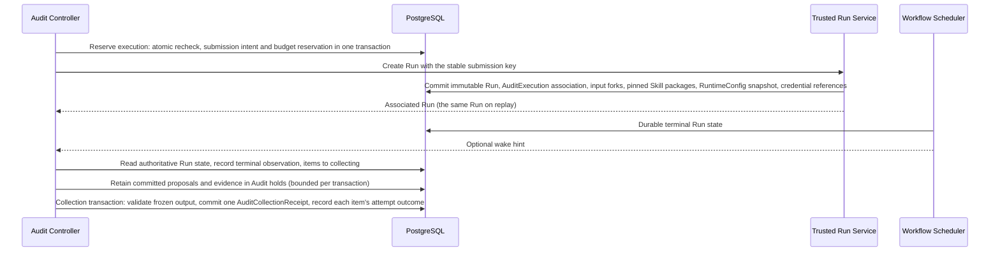
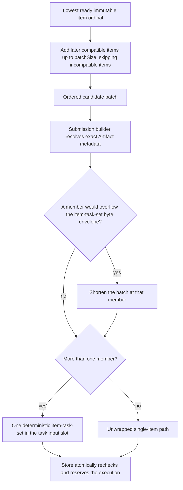
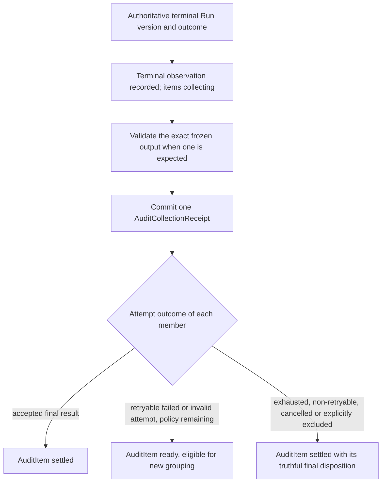

# Audit execution

Requirement prefix: `AUX` · [Specification index](../README.md)

## Purpose and scope

This document owns how the Audit Controller executes an Audit: submission of
ordinary child WorkflowRuns and the dispatch look-ahead that paces it, item
selection and batch formation, submission identity and idempotency, the
`audit-managed` publication mode of child Runs, terminal observation and
collection of child Runs, the execution manifest and the `check-results`
result package, import of their result sets, the evidence budget,
finding-proposal intake and Audit-side proposal retention during collection,
the Controller's progression of a Round through discovery, checks, assessment
and the next Round, recovery after crashes and races, and Audit budgets and
bounds.

It leaves to other documents:

- The AuditProfile, the durable records and their uniqueness, execution
  membership and compatibility, the other Audit packages and the hard limits
  of every Audit package, worklist validation, Worker proposals entering the
  inbox, the Audit, Round and item lifecycle, the Audit time limit and the
  Audit API: [audits](audits.md).
- Human review, coverage, reports, Audit retention, Audit-managed links and
  holds, Audit deletion and the `collection-contract-invalid` disposition:
  [review and reports](review-and-reports.md).
- Check result collection and completion inside the Worker:
  [worker completion](worker-completion.md).
- Preparation attempts and controls before the first Round: [scans](scans.md).
- Finding proposals, the `finding` tool and the Audit inbox:
  [findings](../findings/findings.md).
- Project output publication and the rule that only trusted Run creation
  sets `audit-managed`: [projects](../artifacts/projects.md);
  hard deletion of an Audit-bound Run: [retention and
  deletion](../artifacts/retention-and-deletion.md).
- The global `maxConcurrentRuns` limit and the owner Queue Pause gate:
  [scheduler](../execution/scheduler.md); WorkflowRuns:
  [runs](../execution/runs.md).
- The Audit pause wording: [ui](../ui/ui.md); the Start and Continue
  time-limit dialog: [journeys](../ui/journeys.md).
- Shared registries: [limits](../platform/limits.md),
  [errors](../platform/errors.md),
  [failure model](../platform/failure-model.md) and
  [lifecycle](../platform/lifecycle.md).

## Concepts

Terms are defined once in [the glossary](../glossary.md); the ones this
document owns are:

- **Submission intent.** The durable record of one planned child Run
  submission; it reserves Audit budget in its own transaction and carries one
  stable idempotency key until the original Run is recovered.
- **Submission identity.** The submission key derived from `audit_id`,
  round/role, the immutable ordered execution-item/attempt set and the
  execution manifest digest.
- **Dispatch look-ahead.** The Server-owned per-Audit window, equal to the
  current global `maxConcurrentRuns`, that bounds an Audit's outstanding count.
- **Outstanding count.** An Audit's reserved submission intents plus its
  associated nonterminal child Runs.
- **Candidate batch.** The ordered set of compatible ready items that
  selection forms before the submission builder applies the `item-task-set`
  byte envelope.
- **Unwrapped single-item path.** Dispatch of one valid task package on its
  own, without an `item-task-set`.
- **Terminal observation.** The authoritative terminal Run version and outcome
  that the Controller records on an AuditExecution.
- **Collection.** The transition that validates an execution's exact frozen
  output, retains accepted revisions, commits one `AuditCollectionReceipt` and
  records each member's attempt outcome.
- **Attempt disposition.** The outcome that an AuditExecutionItem records for
  one attempt during collection.
- **Settlement.** The final disposition of an AuditItem, reached by an
  accepted final result or by exhaustion, a non-retryable outcome,
  cancellation or explicit exclusion.
- **Evidence budget.** `maxEvidenceBytes`, the Audit's bound on retained
  evidence bytes, which charges each distinct retained revision once.
- **`maxSubmittedRuns`.** The pinned cumulative Audit budget over every child
  Run attempt.
- **Reconcile step.** One claimed pass of the Controller over one Audit.
- **Wake hint.** A process-local notification that may trigger
  reconciliation early but carries no authority.
- **Next-Round builder.** The Controller logic that admits unscheduled
  proposal checks from held finding receipts into a next Round.
- **Scan-budget stop.** A next-Round builder pass that reaches its receipt
  scan limit while another receipt remains.

## Model

### Submission and collection of one execution

### Batch formation

### Collection receipt dispositions

| Disposition | Recorded for |
| --- | --- |
| `accepted-result` | An exact frozen output that passes validation |
| `missing-output` | An expected frozen output that is missing |
| `invalid-result` | An invalid or incomplete result set or package, including one that exceeds `maxEvidenceBytes` (`evidence-budget-exhausted`) |
| `execution-failed` | A technically failed Run |
| `execution-cancelled` | A cancelled Run |
| `collection-contract-invalid` | The bounded trusted-data failure specified in [REV-R154](review-and-reports.md) |

### Item outcome after collection

## Requirements

### Execution capacity

**AUX-R1.** Audit uses ordinary WorkflowRuns and the existing owner queue. The
global `maxConcurrentRuns` setting ([SCH-R127](../execution/scheduler.md),
[SCH-R128](../execution/scheduler.md)) is the only execution limit and the sole
execution-concurrency authority for Audit and non-Audit Runs alike;
AuditProfile has no WorkflowRun concurrency limit and no simultaneous-Run
maximum ([AUD-R26](audits.md)).

**AUX-R2.** The Controller never reserves Runtime slots, owns execution
capacity or bypasses queue ordering.

### Dispatch look-ahead

**AUX-R3.** The Controller must nevertheless avoid eagerly filling the queue by
materializing every item as a queued Run. It uses a Server-owned per-Audit
dispatch look-ahead equal to the current global `maxConcurrentRuns`
(LIM-AUX-1).

**AUX-R4.** The window counts both reserved submission intents and associated
nonterminal child Runs and is enforced transactionally across Controller
instances, so two Controller instances cannot overfill it through a crash or
race.

**AUX-R5.** The window is internal producer backpressure: it is not a second
execution limit, not AuditProfile policy and not reproducible Audit policy. It
is not pinned at Audit start and changes dynamically with the global setting.

**AUX-R6.** The settings row and an Audit dispatch reservation have a defined
PostgreSQL ordering (FAIL-AUX-6).

**AUX-R7.** Lowering the global value never cancels already submitted child
Runs. If it falls below an Audit's current outstanding count, that Audit
submits no additional Run until the count drains below the new window
(FAIL-AUX-6).

**AUX-R8.** An increase may wake Audit reconciliation, while periodic
reconciliation remains authoritative.

### Pause

**AUX-R9.** Audit pause always blocks new child Run submissions.

**AUX-R10.** The generic owner Queue Pause gate
([SCH-R145](../execution/scheduler.md), [SCH-R148](../execution/scheduler.md))
may also block
normal Stage admission of already-created Audit Runs; it contains no Audit
domain semantics.

**AUX-R11.** Through every pause state, active Stages drain normally, and
terminal reconciliation, cancellation and cleanup proceed.

The Audit-specific pause wording is fixed by [UI-R170](../ui/ui.md).

### Selection and batch formation

**AUX-R12.** The Controller dispatches items by immutable ordinal through a
bounded window and uses fair age/round-robin selection across Audits. It does
not promise optimal multi-host placement.

**AUX-R13.** For check work, selection starts at the lowest ready immutable
item ordinal and fills up to the profile's `batchSize`
([audits](audits.md), LIM-AUD-3, LIM-AUD-8) with later compatible items. It
may skip an incompatible item and form an ordered candidate batch.

**AUX-R14.** Compatibility requires the same pinned named Workflow role and
closure, resolved Run inputs and scalar parameters, baseline/workspace,
credential/tool authority, and exact approval kind/subject digest. Grouping
never unions permissions. The membership rules of a check execution, including
how members verifying one finding share an execution, are specified in
[AUD-R109](audits.md) to [AUD-R114](audits.md).

**AUX-R15.** Before reserving an execution, the trusted submission builder
resolves exact Artifact metadata and shortens the candidate batch at the first
member that would overflow the deterministic `item-task-set` byte envelope
(the package bounds of [AUD-R128](audits.md)).

**AUX-R16.** A valid task package that cannot join another member is
dispatched through the unwrapped single-item path. Package capacity is not
`dispatch_contract_invalid` and does not consume an attempt for omitted items.

**AUX-R17.** When it reserves the execution, the Store rechecks item state,
next attempt, approval decision and expiry, common approval envelope, budget,
deadline, current Round, dispatch fence and the derived outstanding-Run window
atomically.

### Child Run contract

**AUX-R18.** The Run receives one immutable ordered execution manifest and,
when it has more than one member, one deterministic `item-task-set` in the
ordinary `task` input slot. It returns one complete result set, a
`CheckResultSet`.

**AUX-R19.** Existing Planners need no Audit awareness. Discovery and
assessment Workflows produce normal fixed outputs.

**AUX-R20.** Small compatible batches use `AuditExecutionItem`, an ordered
task-set input and one complete `CheckResultSet`; batching cannot create Runs
from a Worker, merge permission envelopes or replace Audit recovery.

**AUX-R21.** A normal intermediate artifact write is not durable item
completion, and none of a batch's intermediate artifact writes is a
checkpoint. If the Run terminates before accepted collection, retry policy may
rerun all still-eligible members, possibly regrouped.

**AUX-R22.** Audit child Runs use trusted `publication_mode=audit-managed`,
suppressing the ordinary `outputs/<slot>` publication that would collide
across checks. Frozen Run outputs remain ordinary accepted outputs. Import
failure does not rewrite Run success. That only trusted Run creation sets
this mode, never the public Run-create API, is specified in
[PRJ-R63](../artifacts/projects.md).

### Submission

**AUX-R23.** Submission identity is derived from `audit_id`, round/role, the
immutable ordered execution-item/attempt set and the execution manifest
digest.

**AUX-R24.** The trusted Run Service creates the immutable Run, the
authoritative AuditExecution association, exact input forks, the start-pinned
exact Skill packages ([AUD-R14](audits.md)), the RuntimeConfig snapshot
([AUD-R13](audits.md)) and credential references under the normal Project and
credential lifecycle barriers.

**AUX-R25.** Direct Scheduler-table inserts are forbidden.

**AUX-R26.** An external call uses a durable submission intent and one stable
idempotency key until the original Run is recovered (LIM-AUX-2, LIFE-AUX-3,
FAIL-AUX-1).

**AUX-R27.** The AuditExecution association is committed with Run creation,
so there is no orphan window based only on labels.

**AUX-R28.** Scheduler retry and escalation remain inside one Run. An
Audit-level retry creates another Run only after the previous execution has a
terminal observation and a collection receipt; the new AuditExecution and
AuditExecutionItem rows of a retry and the regrouping of ready retries are
specified in [AUD-R112](audits.md).

### Terminal observation and collection

**AUX-R29.** Terminal observation and item settlement are separate durable
transitions.

**AUX-R30.** First, the Controller observes an authoritative terminal Run
version and outcome, records it on the AuditExecution and moves its items to
`collecting`.

**AUX-R31.** Then collection validates the exact frozen output when one is
expected and always commits one `AuditCollectionReceipt` (LIM-AUX-3).
Receipt dispositions include `accepted-result`, `missing-output`,
`invalid-result`, `execution-failed`, `execution-cancelled` and the bounded
trusted-data failure `collection-contract-invalid`, whose conditions are
specified in [REV-R154](review-and-reports.md). A receipt
may retain zero evidence revisions.

**AUX-R32.** In that transaction, each AuditExecutionItem records its attempt
outcome. An accepted final result settles its AuditItem. A retryable failed or
invalid attempt with remaining policy returns the item to `ready`; it is not
settled. Exhausted, non-retryable, cancelled or explicitly excluded items
settle with their truthful final disposition.

**AUX-R33.** Collection is atomic at execution granularity. A technically
failed Run, missing output or invalid or incomplete result set gives every
member an explicit attempt disposition (FAIL-AUX-2).

**AUX-R34.** Members that are retryable and still within policy return to
`ready` and are then eligible for new grouping, so exhaustion is evaluated per
logical item even though one failed Run may consume one attempt for several
items.

**AUX-R35.** Collection is unique by execution and exact terminal Run version
(LIM-AUX-3); accepted output identity additionally includes its exact
revision and digest.

The hard-deletion gate that an Audit-bound Run passes only after its
collection receipt exists is specified in
[DEL-R17](../artifacts/retention-and-deletion.md),
[DEL-R18](../artifacts/retention-and-deletion.md) and
[DEL-R58](../artifacts/retention-and-deletion.md), and the retention of
AuditExecution and AuditExecutionItem after Run deletion in
[DEL-R30](../artifacts/retention-and-deletion.md).

### Result set import

**AUX-R93.** The execution input of a check execution contains an immutable
manifest with an ordered list of item keys and exact task and input refs.

**AUX-R36.** The importer verifies a result set against the immutable
execution manifest of its execution (AUX-R93): it verifies the
manifest digest, membership, `item_key` and `subject_key`, rejects duplicate,
foreign, missing or extra results, and requires exactly one result per input
item after a technically succeeded Run (LIM-AUX-4).

**AUX-R37.** The model does not choose the AuditItem that receives a result.

**AUX-R38.** Run success does not imply success for any individual item.

**AUX-R39.** Schema validity is not semantic evidence acceptance: the
importer also checks evidence references, requested coverage and the profile
evidence contract.

**AUX-R40.** An invalid or incomplete result set creates one durable invalid
collection receipt independently of the technically succeeded Run and accepts
no member partially. Every member records that attempt disposition and is
independently requeued or settled under its remaining attempt policy. A later
retry may contain a different compatible member set (FAIL-AUX-2).

**AUX-R94.** The frozen `result` output is a `check-results` Audit package
with no entrypoint. It contains the required `check-results` member at
`check-results.json`, an optional `evidence` member at `evidence.json`, and
optional opaque content members, each referenced by exactly one evidence
record (LIM-AUD-21). Both JSON members use `application/json`.

**AUX-R41.** Every result evidence ID of that package must resolve.
Unreferenced evidence, missing or aliased content members, duplicate content
ownership and any other unreferenced package member make the complete package
an `invalid-result`.

**AUX-R42.** One evidence record belongs to exactly one result item
(LIM-AUX-5); an evidence ID cannot be used to attribute one observation to
several batch members.

**AUX-R43.** Evidence may instead reference an exact revision in the same
RunScope. The importer never follows a path or accepts an unversioned or
foreign-scope reference.

How the importer validates standard-entry references against the retained
standard package, and the `CWE@4.20` exception, are specified in
[AUD-R101](audits.md) to [AUD-R104](audits.md).

### Evidence budget

**AUX-R44.** Each distinct referenced revision is retained once: evidence
records citing the same revision share one Audit copy, and a record citing
the frozen result output shares the retained result (LIFE-AUX-2).

**AUX-R45.** The evidence budget `maxEvidenceBytes` (LIM-AUX-6) therefore
charges every distinct retained revision exactly once, both when the importer
checks it and when the collection transaction enforces it.

**AUX-R46.** A result whose retained revisions exceed `maxEvidenceBytes`,
including after a concurrent writer consumed the remaining budget, commits a
non-retryable `invalid-result` receipt with `evidence-budget-exhausted` that
links and charges no retained revision, rather than leaving the execution
collecting (FAIL-AUX-2).

### Finding proposals during collection

**AUX-R47.** Finding intake retains every trusted child-Run proposal in the
Audit inbox before committing the collection receipt, including proposals from
technically failed Runs.

**AUX-R48.** Before an Audit child Run receives its collection receipt, every
committed proposal and its evidence is copied to collision-free protected
ProjectScope bindings and recorded in an exact Audit hold (LIFE-AUX-1). This
transfer is idempotent and does not confirm the proposal or associate it with
an item.

**AUX-R49.** Each transaction retains a bounded number of proposal and
evidence revisions (LIM-AUX-7), so a collection attempt that reaches its
deadline keeps the holds it committed and the next attempt retains only the
rest (FAIL-AUX-3).

**AUX-R50.** For an Audit child Run, collection accounts for every committed
proposal receipt before making the Run deletable: an allowed proposal receives
an exact Audit-owned inbox link and hold.

**AUX-R51.** A proposal whose own proposal or evidence revision is missing or
no longer matches its receipt can never be retained. Collection records it as
rejected, like a proposal with invalid standard references, and keeps
collecting the others (FAIL-AUX-3).

**AUX-R52.** A profile with `findingConfirmation: disabled` cannot select the
`security-findings@1` Toolset.

**AUX-R92.** Under such a profile, an unexpected proposal receipt makes
collection contract-invalid rather than admitting it (FAIL-AUX-3).

**AUX-R53.** The source Run may be purged only after the durable disposition
of every committed proposal receipt (LIFE-AUX-1).

**AUX-R54.** A non-empty `proposals` association in a result contains exact
`(invocation_id, client_key)` selections injected by Runtime. It is accepted
only when finding triage resolves every selection to one receipt retained by
the same Audit execution and validates item membership.

**AUX-R55.** Proposals are never silently ignored or associated merely
because they share a Run.

That Worker proposals never alter an accepted Round, and how a proposal from a
non-Audit Run reaches an Audit, are specified in [AUD-R160](audits.md) and
[AUD-R161](audits.md).

### Round progression

**AUX-R56.** Start always creates the deterministic accepted first inventory.

**AUX-R57.** If the pinned profile has discovery roles, the Controller
executes each role exactly once, or by bounded retry, while that Round is
`accepted` (LIM-AUX-8). Only accepted frozen role output allows the Round to
enter `executing`.

**AUX-R58.** Partial discovery output never mutates the accepted worklist.

**AUX-R59.** Assessment roles run after all check items settle and before the
Round closes; accepted proposal receipts may then form a separately validated
next Round.

Validation of a worklist manifest before the first child Run is created, and
the atomic commit of the normalized manifest with its Round and Items, are
specified in [AUD-R132](audits.md) to [AUD-R134](audits.md). Preparation
attempts, their identity, bounded retry and reuse of accepted outputs are
specified in [ASC-R29](scans.md) to [ASC-R34](scans.md).

### Next-Round building

**AUX-R60.** The next-Round builder scans at most 10,000 held finding
receipts per pass (LIM-AUX-9).

**AUX-R61.** Reaching that count is a scan-budget stop only when another
receipt exists; a fully scanned inbox with no unscheduled checks completes the
Round.

**AUX-R62.** Start, input preview and the next-Round builder share one
per-Round item budget: the profile's per-Round limit and the Audit's remaining
total, never more than the 4,096 inventory items of
[AUD-R128](audits.md) (LIM-AUX-10, LIM-AUD-19).

**AUX-R63.** The builder admits unscheduled proposal checks in inbox order
only while the Round also stays within every byte, JSON-node and nesting limit
of the documents it derives: the proposal inventory, its canonical inventory,
the coverage, worklist and execution documents and their Round package, and
the generated item-task packages.

**AUX-R64.** Checks that do not fit wait for a later Round, so one proposal's
checks may span Rounds.

**AUX-R65.** A proposal whose first unscheduled check cannot fit even an
empty Round is skipped rather than failing the Round. When only such
proposals remain, the Audit finalizes with
`proposal_inventory_limit_exceeded`, whose message names each skipped receipt
and the limit it exceeds (FAIL-AUX-5).

**AUX-R66.** If a retained proposal or materialized item fails deterministic
next-Round validation, including exact artifact bytes that fail their digest,
the Controller closes dispatch and moves the Audit to `finalizing` with
`next_round_invalid` (FAIL-AUX-5).

**AUX-R67.** A preparation state that retained Audit data cannot reach, such
as an undecodable pinned snapshot, a drifted proposal descriptor or a
content-named artifact holding different bytes, finalizes the Audit with
`next_round_contract_invalid`; the stop reason names the violated invariant
and the Controller logs the full error (FAIL-AUX-5).

**AUX-R68.** Transient failures, including failed blob storage I/O, remain
retryable (FAIL-AUX-5).

### Recovery

**AUX-R69.** PostgreSQL is authoritative. The Controller periodically claims
and reconciles a bounded number of nonterminal Audits (LIM-AUX-11).

**AUX-R70.** Process-local notifications are wake hints only; their loss,
duplication or reordering cannot prevent progress. Public WebSocket is not an
internal completion bus.

**AUX-R71.** A paused Audit only observes and collects Runs it already
submitted, so it is claimed only while it has a submitted or collecting
execution.

**AUX-R72.** Cancel and delete move an Audit out of `paused`, so their
cleanup is always claimable.

During cancellation the rules of this document drain owned Runs: a Run
committed while cancel races submission joins the cancellation set (AUX-R76),
every cancelled Run still receives one collection receipt with
`execution-cancelled` (AUX-R31), and its items settle with their truthful
final disposition (AUX-R32). The `cancelling` state, which ends in `cancelled`
once children are terminal and released, is specified in
[audits](audits.md#audit-states), and the cancel sequence before the first
Round in [ASC-R57](scans.md).

**AUX-R73.** One reconcile step, in order:

1. obtains a short claim with expiry/epoch and reads the Audit and Project
   fences;
2. resumes durable submission and collection intents;
3. reads authoritative state for associated Runs and records each new exact
   terminal observation without settling an item;
4. collects every observed execution exactly once: validates a frozen result
   set when present, retains accepted revisions, commits a receipt for
   accepted, missing, invalid, failed or cancelled output, and then either
   requeues or settles each item according to its remaining attempt policy;
5. observes item state already changed by the authenticated review API, while
   execution-intent creation independently rechecks the accepted, unexpired
   exact decision in its own transaction;
6. creates only the next bounded set of allowed submissions;
7. creates at most one assessment execution after the barrier (LIM-AUX-12);
8. accepts a next Round or commits the exact final report and coverage.

**AUX-R74.** A claim alone does not authorize stale commits. Every mutation
checks epoch or revision plus uniqueness constraints (FAIL-AUX-4).

**AUX-R95.** A reconcile step reads its snapshot of the claimed Audit (the
Audit, its current Round, the bounded windows of unsettled items, ready items
and unsettled executions, role executions and collection receipts) in one
read-only REPEATABLE READ transaction, so a concurrent owner mutation or child
Run transition appears in every part of the snapshot or in none. The snapshot
carries the lifecycle state of each child Run bound to an execution in its
window: terminal observation and cancellation read no Run per execution, and
a dispatch reads the next attempts of its whole candidate batch in one
statement. The statements a reconcile step issues therefore do not grow with
the Audit's items, executions or child Runs.

**AUX-R75.** No network or model call occurs under a database row lock.

**AUX-R76.** Recovery must produce these results for these faults:

| Fault | Required result |
| --- | --- |
| Crash before child Run creation | Durable intent retries (FAIL-AUX-1) |
| Run created but response lost | Same submission key returns same associated Run (FAIL-AUX-1) |
| Crash after terminal Run before collection | Reconcile records the terminal version and one collection receipt (FAIL-AUX-2) |
| Partial package materialization | Staging is invisible; retry completes or records one invalid receipt (FAIL-AUX-2) |
| Terminal event lost/duplicated/reordered | Controller reads durable Run state and collects once (FAIL-AUX-2) |
| Worker dies after `finding` | Committed receipt remains; uncommitted proposal does not (FAIL-AUX-7) |
| Two Controllers start assessment | Unique execution identity admits one (FAIL-AUX-4) |
| Cancel races submission | Audit fence chooses; any committed Run joins cancellation set (FAIL-AUX-1) |
| Project delete races start/dispatch | Project deleting fence rejects new work (FAIL-AUX-1, [AUD-R4](audits.md)) |

### Budgets and bounds

**AUX-R77.** Every Audit has finite maxima for rounds, items per round, total
items, proposals, cumulative submitted Run attempts, package bytes and
retained evidence bytes.

**AUX-R78.** `maxSubmittedRuns` is a pinned cumulative Audit budget over every
child Run attempt, including retries and later rounds (LIM-AUX-13). It bounds
accidental or adversarial total work; it neither bounds simultaneous execution
nor controls concurrent execution.

**AUX-R79.** `batchSize` counts the logical items carried by one ordinary
child Run.

**AUX-R80.** The Audit admission time limit is optional: the pinned profile
provides a positive default, while start or resume may override it or disable
it with zero ([AUD-R165](audits.md), [AUD-R207](audits.md)). Disabling this limit
does not remove child Run deadlines or any other budget.

**AUX-R81.** Exhausting the time limit pauses new submissions and allows
existing Runs to finish and be collected; it does not finalize the Audit. Its
stop reason and the preserved dispatch hold are specified in
[AUD-R164](audits.md).

**AUX-R82.** A submission reserves budget in the same transaction as its
intent; replay never consumes twice (FAIL-AUX-1).

**AUX-R83.** Reserved and committed consumption are recorded separately,
together with the current outstanding intent/Run count used by the
Server-owned dispatch look-ahead.

**AUX-R84.** Model, token, Tool, HTTP and context limits remain enforced by
each pinned child execution policy.

**AUX-R85.** Collected monetary and token metrics can be incomplete after
failure and therefore do not constitute a strict aggregate spending cap.

**AUX-R86.** UI totals of collected monetary and token metrics are
explicitly advisory.

**AUX-R87.** When a limit prevents more hypotheses or executions, counts,
omission reasons and coverage gaps are retained. No work is silently dropped.

### Batch efficiency

**AUX-R88.** Batch efficiency is observational, not an acceptance claim.

**AUX-R89.** The existing child Run telemetry is aggregated with the durable
execution member count and item attempt history to compare preparation and
model cost per settled item and to show whole-batch retry amplification.

**AUX-R90.** Missing provider usage remains unknown rather than zero.

**AUX-R91.** No separate Audit token authority is introduced, and a profile
does not promise that increasing `batchSize` reduces cost or latency.

## Interfaces

This document defines no public endpoint; the start, pause, resume and cancel
commands that the Controller acts on are listed in
[audits](audits.md#interfaces). The contract between the Controller and a
check child Run uses ordinary Workflow slots:

| Slot or field | Direction | Content |
| --- | --- | --- |
| Execution manifest | Into the Run | One immutable manifest with an ordered list of item keys and exact task and input refs (AUX-R18, AUX-R93) |
| `task` input slot | Into the Run | One deterministic `item-task-set` when the execution has more than one member; a task package that cannot join another member is dispatched through the unwrapped single-item path (AUX-R16) |
| `result` output | Out of the Run | One complete `check-results` package (AUX-R94) with exactly one result per input item (AUX-R36) |
| `proposals` in a result | Out of the Run | Exact `(invocation_id, client_key)` selections injected by Runtime |

## Limits, failures and errors

Registry entries owned by this document:

- [LIM-AUX-1](../platform/limits.md): per-Audit dispatch look-ahead equal to
  the current `maxConcurrentRuns` (AUX-R3).
- [LIM-AUX-2](../platform/limits.md): one stable idempotency key per
  submission intent until the original Run is recovered (AUX-R26).
- [LIM-AUX-3](../platform/limits.md): exactly one `AuditCollectionReceipt`
  per execution and exact terminal Run version (AUX-R31, AUX-R35).
- [LIM-AUX-4](../platform/limits.md): exactly one result per input item after
  a technically succeeded Run (AUX-R36).
- [LIM-AUX-5](../platform/limits.md): one result item per evidence record
  (AUX-R42).
- [LIM-AUX-6](../platform/limits.md): `maxEvidenceBytes` retained evidence
  bytes per Audit (AUX-R45).
- [LIM-AUX-7](../platform/limits.md): a bounded number of proposal and
  evidence revisions retained per collection transaction (AUX-R49).
- [LIM-AUX-8](../platform/limits.md): each discovery role executed exactly
  once, or by bounded retry, per accepted Round (AUX-R57).
- [LIM-AUX-9](../platform/limits.md): at most 10,000 held finding receipts
  scanned per next-Round builder pass (AUX-R60).
- [LIM-AUX-10](../platform/limits.md): the shared per-Round item budget
  (AUX-R62).
- [LIM-AUX-11](../platform/limits.md): a bounded number of nonterminal Audits
  claimed per reconciliation (AUX-R69).
- [LIM-AUX-12](../platform/limits.md): at most one assessment execution after
  the barrier (AUX-R73).
- [LIM-AUX-13](../platform/limits.md): `maxSubmittedRuns` child Run attempts
  per Audit (AUX-R78).
- [FAIL-AUX-1](../platform/failure-model.md): child Run submission
  (AUX-R26, AUX-R76, AUX-R82).
- [FAIL-AUX-2](../platform/failure-model.md): collection and result import of
  a terminal child Run (AUX-R33, AUX-R40, AUX-R46, AUX-R76).
- [FAIL-AUX-3](../platform/failure-model.md): Audit-side retention of
  child-Run proposals and evidence (AUX-R49, AUX-R51, AUX-R92).
- [FAIL-AUX-4](../platform/failure-model.md): Controller claims and
  reconcile mutations (AUX-R74, AUX-R76).
- [FAIL-AUX-5](../platform/failure-model.md): next-Round building
  (AUX-R65 to AUX-R68).
- [FAIL-AUX-6](../platform/failure-model.md): a change of the global
  `maxConcurrentRuns` against Audit dispatch reservations (AUX-R6, AUX-R7).
- [FAIL-AUX-7](../platform/failure-model.md): Worker death after a `finding`
  call (AUX-R76).
- [LIFE-AUX-1](../platform/lifecycle.md): committed finding proposal receipts
  of an Audit child Run (AUX-R48, AUX-R53).
- [LIFE-AUX-2](../platform/lifecycle.md): retained evidence revisions of a
  collected result (AUX-R44).
- [LIFE-AUX-3](../platform/lifecycle.md): submission intent and its
  idempotency key (AUX-R26).
- [Errors](../platform/errors.md): the receipt dispositions `missing-output`,
  `invalid-result`, `execution-failed` and `execution-cancelled` (AUX-R31);
  `evidence-budget-exhausted` (AUX-R46); `dispatch_contract_invalid`
  (AUX-R16); and the stop reasons `proposal_inventory_limit_exceeded`
  (AUX-R65), `next_round_invalid` (AUX-R66) and `next_round_contract_invalid`
  (AUX-R67).

Entries owned elsewhere and used here: `batchSize` (LIM-AUD-3, LIM-AUD-8), the
Audit package hard limits including 4,096 inventory items (LIM-AUD-9 to
LIM-AUD-20), one evidence record per content member (LIM-AUD-21),
`deadlineSeconds` (LIM-AUD-23), retry of a check item (FAIL-AUD-5), worklist
acceptance (FAIL-AUD-7), budget exhaustion and the time limit (FAIL-AUD-9) and
the credential dispatch hold (LIFE-AUD-1) in [audits](audits.md); the
`collection-contract-invalid` disposition
([REV-R154](review-and-reports.md), FAIL-REV-9) and Audit evidence and
proposal holds (LIFE-REV-3) in
[review and reports](review-and-reports.md); Audit-bound Run deletion before
collection (FAIL-DEL-1) and AuditExecution retention (LIFE-DEL-7) in
[retention and deletion](../artifacts/retention-and-deletion.md); and the
`maxConcurrentRuns` bounds in [scheduler](../execution/scheduler.md).

## Security

Workers and models never decide Audit membership: the model does not choose
the AuditItem receiving a result (AUX-R37), proposals are associated only
through exact Runtime-injected selections resolved by finding triage
(AUX-R54, AUX-R55), and batching cannot create Runs from a Worker (AUX-R20).
Grouping never unions permissions or merges permission envelopes (AUX-R14,
AUX-R20). The importer never follows a path or accepts an unversioned or
foreign-scope evidence reference (AUX-R43). Child Runs are created only by the
trusted Run Service under the normal Project and credential lifecycle
barriers, never by direct Scheduler-table inserts, and their Audit association
never depends on labels (AUX-R24, AUX-R25, AUX-R27). The shared model is in
[security](../platform/security.md).

## Observability

Batch efficiency is reported from existing child Run telemetry aggregated with
durable member counts and attempt history, with missing provider usage kept
unknown (AUX-R88 to AUX-R91). Wake hints never carry authority (AUX-R70). A
`next_round_contract_invalid` stop reason names the violated invariant and the
Controller logs the full error (AUX-R67). Shared rules are in
[observability](../platform/observability.md).

## Invariants

1. Every observed execution receives exactly one collection receipt, whatever
   its Run outcome (AUX-R31, AUX-R35).
2. A result set is accepted for all members or for none (AUX-R33, AUX-R40).
3. Run success never implies item success, and import failure never rewrites
   Run success (AUX-R38, AUX-R22).
4. An Audit-level retry never starts before the previous execution has a
   terminal observation and a collection receipt (AUX-R28).
5. Replay never consumes budget twice, and each distinct retained evidence
   revision is charged once (AUX-R82, AUX-R45).
6. The dispatch look-ahead never bounds execution: `maxConcurrentRuns` is the
   only execution limit (AUX-R1, AUX-R5).
7. No work is silently dropped and no proposal is silently ignored (AUX-R87,
   AUX-R55).
8. No network or model call runs under a database row lock (AUX-R75).

## Non-goals

- Durable per-item checkpoints inside a still-running Run. Accepting partial
  in-flight progress requires a separate idempotent receipt contract and is
  not implied by artifact writes.
- A strict aggregate token or spend cap across child Runs. Such a hard
  aggregate token/spend limit would require conservative per-Run reservations
  and must reserve unknown consumption rather than treating it as zero.
- The other deferred Audit capabilities are listed in
  [audits](audits.md#non-goals).
