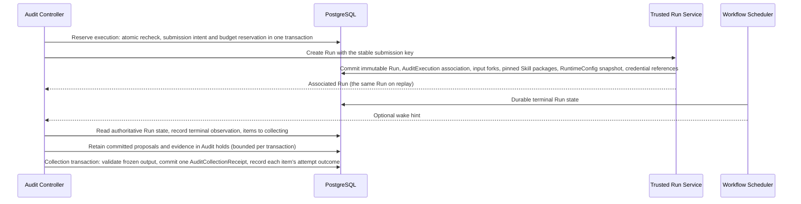
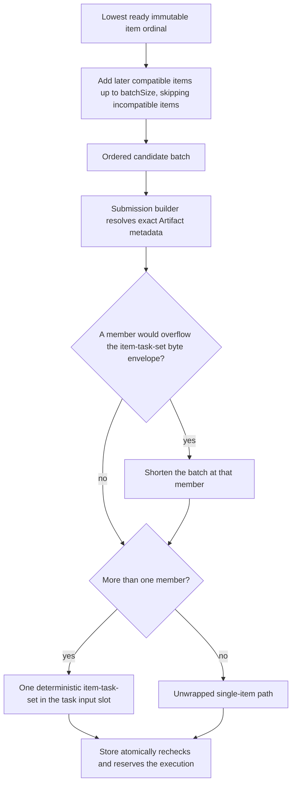
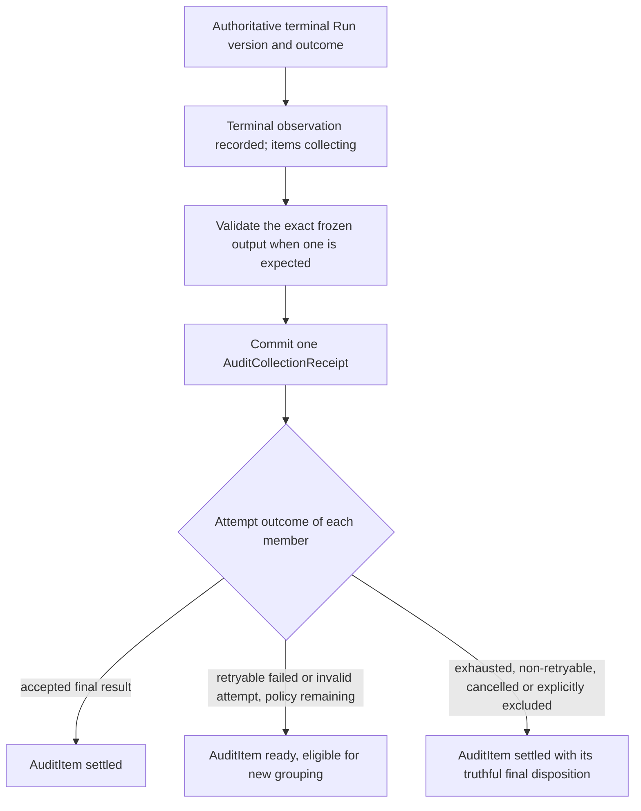

# Audit execution

Requirement prefix: `AUX` · [Specification index](../README.md)

## Purpose and scope

This document owns Audit coordination through ordinary child WorkflowRuns,
existing controller claims, submission identities, terminal observation,
collection and budgets. Executable profiles use the common
[Program/Task contract](common-contract.md#ACT-R14).

The former Round/inventory/role progression below is a retired representation:
it does not register an alternative profile reader or executor. Its independent
stored projections and receipt/retention facts confer no new dispatch authority.
Common coordination follows AUX-R108 through AUX-R110; ordinary Scheduler,
Artifact and Finding guarantees continue to belong to their named owners.

It leaves to other documents:

- The AuditProfile, the durable records and their uniqueness, execution
  membership and compatibility, the other Audit packages and the hard limits
  of every Audit package, worklist validation, Worker proposals entering the
  inbox, the Audit, Round and item lifecycle, the Audit time limit and the
  Audit API: [audits](audits.md).
- Human review, coverage, reports, Audit retention, Audit-managed links and
  holds, Audit deletion and the `collection-contract-invalid` disposition:
  [review and reports](review-and-reports.md).
- Check result collection and completion inside the Worker:
  [worker completion](worker-completion.md).
- Preparation attempts and controls before the first Round: [scans](scans.md).
- Finding proposals, the `finding` tool and the Audit inbox:
  [findings](../findings/findings.md).
- Project output publication and the rule that only trusted Run creation
  sets `audit-managed`: [projects](../artifacts/projects.md);
  hard deletion of an Audit-bound Run: [retention and
  deletion](../artifacts/retention-and-deletion.md).
- The global `maxConcurrentRuns` and `maxConcurrentToolRuns` limits and the
  owner Queue Pause gate:
  [scheduler](../execution/scheduler.md); WorkflowRuns:
  [runs](../execution/runs.md).
- The Audit pause wording: [ui](../ui/ui.md); the Start and Continue
  time-limit dialog: [journeys](../ui/journeys.md).
- Shared registries: [limits](../platform/limits.md),
  [errors](../platform/errors.md),
  [failure model](../platform/failure-model.md) and
  [lifecycle](../platform/lifecycle.md).

## Concepts

Terms are defined once in [the glossary](../glossary.md); the ones this
document owns are:

- **Submission intent.** The durable record of one planned child Run
  submission; it reserves Audit budget in its own transaction and carries one
  stable idempotency key until the original Run is recovered.
- **Submission identity.** The submission key derived from `audit_id`,
  round/role, the immutable ordered execution-item/attempt set and the
  execution manifest digest.
- **Dispatch look-ahead.** The Server-owned per-Audit windows, one per lane
  class: the current global `maxConcurrentToolRuns` bounds the outstanding
  count of `tool` roles and the current global `maxConcurrentRuns` that of
  every other role.
- **Outstanding count.** An Audit's reserved submission intents plus its
  associated nonterminal child Runs, kept in total and for the `tool` class.
- **Role lane class.** `tool` when every Stage of the role's pinned Workflow is
  `tool` ([SCH-R175](../execution/scheduler.md)), otherwise `model`; an
  execution keeps the class it was reserved with.
- **Candidate batch.** The ordered set of compatible ready items that
  selection forms before the submission builder applies the `item-task-set`
  byte envelope.
- **Unwrapped single-item path.** Dispatch of one valid task package on its
  own, without an `item-task-set`.
- **Terminal observation.** The authoritative terminal Run version and outcome
  that the Controller records on an AuditExecution.
- **Collection.** The transition that validates an execution's exact frozen
  output, retains accepted revisions, commits one `AuditCollectionReceipt` and
  records each member's attempt outcome.
- **Attempt disposition.** The outcome that an AuditExecutionItem records for
  one attempt during collection.
- **Settlement.** The final disposition of an AuditItem, reached by an
  accepted final result or by exhaustion, a non-retryable outcome,
  cancellation or explicit exclusion.
- **Evidence budget.** `maxEvidenceBytes`, the Audit's bound on retained
  evidence bytes, which charges each distinct retained revision once.
- **`maxSubmittedRuns`.** The pinned cumulative Audit budget over every child
  Run attempt.
- **Reconcile step.** One claimed pass of the Controller over one Audit.
- **Wake hint.** A process-local notification that may trigger
  reconciliation early but carries no authority.
- **Next-Round builder.** The Controller logic that admits unscheduled
  proposal checks from held finding receipts into a next Round.
- **Scan-budget stop.** A next-Round builder pass that reaches its receipt
  scan limit while another receipt remains.

## Model

### Submission and collection of one execution

### Batch formation

### Collection receipt dispositions

| Disposition | Recorded for |
| --- | --- |
| `accepted-result` | An exact frozen output that passes validation |
| `missing-output` | An expected frozen output that is missing |
| `invalid-result` | An invalid or incomplete result set or package of the child Run, including one that exceeds `maxEvidenceBytes` (`evidence-budget-exhausted`) |
| `execution-failed` | A technically failed Run |
| `execution-cancelled` | A cancelled Run |
| `collection-contract-invalid` | Pinned or retained trusted data that was read but cannot be validated, or a request the Store rejects by its content alone: the bounded trusted-data failure specified in [REV-R154](review-and-reports.md) |

A failed or cancelled read and a receipt that cannot be committed record no
disposition: the execution stays `collecting` (AUX-R96).

### Item outcome after collection

## Requirements

### Execution capacity

**AUX-R1.** Audit uses ordinary WorkflowRuns and the existing owner queue. The
global `maxConcurrentRuns` and `maxConcurrentToolRuns` settings
([SCH-R127](../execution/scheduler.md), [SCH-R128](../execution/scheduler.md))
are the only execution limits and the sole execution-concurrency authority for
Audit and non-Audit Runs alike;
AuditProfile has no WorkflowRun concurrency limit and no simultaneous-Run
maximum ([AUD-R26](audits.md)).

**AUX-R2.** The Controller never reserves Runtime slots, owns execution
capacity or bypasses queue ordering.

### Dispatch look-ahead

**AUX-R3.** The Controller must nevertheless avoid eagerly filling the queue by
materializing every item as a queued Run. It uses a Server-owned per-Audit
dispatch look-ahead per role lane class: a role whose pinned Workflow has only
`tool` Stages is paced by the current global `maxConcurrentToolRuns`, every
other role by the current global `maxConcurrentRuns` (LIM-AUX-1). A Workflow
that scans and then calls a model is `model`. The windows fill independently:
a full window of one class never holds back the ready items of the other, and
the reconcile snapshot reads the first ready items of each Workflow role
separately, so the items of one role cannot hide another role's.

**AUX-R4.** Each window counts both reserved submission intents and
associated nonterminal child Runs of its class and is enforced transactionally
across Controller instances, so two Controller instances cannot overfill
either through a crash or race. An execution records the class it was
reserved with, and its terminal observation releases that class, so it leaves
the count it entered. A role whose pinned Workflow cannot be classified is a
storage invariant failure of the Audit, never a default class.

**AUX-R5.** The windows are internal producer backpressure: they are not a
second execution limit, not AuditProfile policy and not reproducible Audit
policy. They are not pinned at Audit start and change dynamically with the
global settings.

**AUX-R6.** The settings row and an Audit dispatch reservation have a defined
PostgreSQL ordering (FAIL-AUX-6).

**AUX-R7.** Lowering either global value never cancels already submitted child
Runs. If it falls below an Audit's current outstanding count of that class,
that Audit submits no additional Run of the class until its count drains below
the new window, while the other class keeps dispatching (FAIL-AUX-6).

**AUX-R8.** An increase may wake Audit reconciliation, while periodic
reconciliation remains authoritative.

### Pause

**AUX-R9.** Audit pause always blocks new child Run submissions.

**AUX-R10.** The generic owner Queue Pause gate
([SCH-R145](../execution/scheduler.md), [SCH-R148](../execution/scheduler.md))
may also block
normal Stage admission of already-created Audit Runs; it contains no Audit
domain semantics.

**AUX-R11.** Through every pause state, active Stages drain normally, and
terminal reconciliation, cancellation and cleanup proceed.

The Audit-specific pause wording is fixed by [UI-R170](../ui/ui.md).

### Selection and batch formation

**AUX-R12.** The Controller dispatches items by immutable ordinal through a
bounded window and uses fair age/round-robin selection across Audits. It does
not promise optimal multi-host placement.

**AUX-R13.** For check work, selection starts at the lowest ready immutable
item ordinal and fills up to the profile's `batchSize`
([audits](audits.md), LIM-AUD-3, LIM-AUD-8) with later compatible items. It
may skip an incompatible item and form an ordered candidate batch.

**AUX-R14.** Compatibility requires the same pinned named Workflow role and
closure, resolved Run inputs and scalar parameters, baseline/workspace,
credential/tool authority and pinned operation policy. Grouping
never unions permissions. The membership rules of a check execution, including
how members verifying one finding share an execution, are specified in
[AUD-R109](audits.md) to [AUD-R114](audits.md).

**AUX-R15.** Before reserving an execution, the trusted submission builder
resolves exact Artifact metadata and shortens the candidate batch at the first
member that would overflow the deterministic `item-task-set` byte envelope
(the package bounds of [AUD-R128](audits.md)).

**AUX-R16.** A valid task package that cannot join another member is
dispatched through the unwrapped single-item path. Package capacity is not
`dispatch_contract_invalid` and does not consume an attempt for omitted items.

**AUX-R17.** When it reserves the execution, the Store rechecks item state,
next attempt, pinned operation policy, budget,
deadline, current Round, dispatch fence and the derived outstanding-Run window
atomically.

### Child Run contract

**AUX-R18.** The Run receives one immutable ordered execution manifest and,
when it has more than one member, one deterministic `item-task-set` in the
ordinary `task` input slot. Execution entries contain item identity and ordinal,
subject key, exact task package identity/digest/ref and named exact inputs.
`accepted_plan` and `dependencies` are rejected execution-entry fields: their
complete content belongs only to the exact task document. The Run returns one
complete result set, a `CheckResultSet`.

**AUX-R19.** Existing Planners need no Audit awareness. Discovery and
assessment Workflows produce normal fixed outputs.

**AUX-R20.** Small compatible batches use `AuditExecutionItem`, an ordered
task-set input and one complete `CheckResultSet`; batching cannot create Runs
from a Worker, merge permission envelopes or replace Audit recovery.

**AUX-R21.** A normal intermediate artifact write is not durable item
completion, and none of a batch's intermediate artifact writes is a
checkpoint. If the Run terminates before accepted collection, retry policy may
rerun all still-eligible members, possibly regrouped.

**AUX-R22.** Audit child Runs use trusted `publication_mode=audit-managed`,
suppressing the ordinary `outputs/<slot>` publication that would collide
across checks. Frozen Run outputs remain ordinary accepted outputs. Import
failure does not rewrite Run success. That only trusted Run creation sets
this mode, never the public Run-create API, is specified in
[PRJ-R63](../artifacts/projects.md).

### Submission

**AUX-R23.** Submission identity is derived from `audit_id`, round/role, the
immutable ordered execution-item/attempt set and the execution manifest
digest.

**AUX-R24.** The trusted Run Service creates the immutable Run, the
authoritative AuditExecution association, exact input forks, the start-pinned
exact Skill packages ([AUD-R14](audits.md)), the RuntimeConfig snapshot
([AUD-R13](audits.md)) and credential references under the normal Project and
credential lifecycle barriers.

**AUX-R25.** Direct Scheduler-table inserts are forbidden.

**AUX-R26.** An external call uses a durable submission intent and one stable
idempotency key until the original Run is recovered (LIM-AUX-2, LIFE-AUX-3,
FAIL-AUX-1).

**AUX-R27.** The AuditExecution association is committed with Run creation,
so there is no orphan window based only on labels.

**AUX-R28.** Scheduler retry and escalation remain inside one Run. An
Audit-level retry creates another Run only after the previous execution has a
terminal observation and a collection receipt; the new AuditExecution and
AuditExecutionItem rows of a retry and the regrouping of ready retries are
specified in [AUD-R112](audits.md).

### Terminal observation and collection

**AUX-R29.** Terminal observation and item settlement are separate durable
transitions.

**AUX-R30.** First, the Controller observes an authoritative terminal Run
version and outcome, records it on the AuditExecution and moves its items to
`collecting`.

**AUX-R31.** Then collection validates the exact frozen output when one is
expected and always commits one `AuditCollectionReceipt` (LIM-AUX-3).
Receipt dispositions include `accepted-result`, `missing-output`,
`invalid-result`, `execution-failed`, `execution-cancelled` and the bounded
trusted-data failure `collection-contract-invalid`, whose conditions are
specified in [REV-R154](review-and-reports.md). A receipt
may retain zero evidence revisions.

**AUX-R32.** In that transaction, each AuditExecutionItem records its attempt
outcome. An accepted final result settles its AuditItem. A retryable failed or
invalid attempt with remaining policy returns the item to `ready`; it is not
settled. Exhausted, non-retryable, cancelled or explicitly excluded items
settle with their truthful final disposition.

**AUX-R33.** Collection is atomic at execution granularity. A technically
failed Run, missing output or invalid or incomplete result set gives every
member an explicit attempt disposition (FAIL-AUX-2).

**AUX-R34.** Members that are retryable and still within policy return to
`ready` and are then eligible for new grouping, so exhaustion is evaluated per
logical item even though one failed Run may consume one attempt for several
items.

**AUX-R35.** Collection is unique by execution and exact terminal Run version
(LIM-AUX-3); accepted output identity additionally includes its exact
revision and digest.

**AUX-R96.** Collection classifies a failure by its cause, whichever step
reads the failing input first. A failed or cancelled read of storage, an
artifact or the scan history, and a transient failure to commit the receipt,
leave the execution `collecting` without a receipt or a consumed item
attempt; a later reconcile collects the same terminal observation. Pinned or
retained trusted data that was read but cannot be validated settles through
`collection-contract-invalid` (REV-R154): the execution manifest, an item
task package, the AuditProfile, the standard baseline, a retained standard
package or its match with a standard-mapped task, the scan assignment, a
retained scan plan or scanner report, and the scan result assembled only from
them. Two kinds of trusted data are exceptions and stay retryable like a
failed read:

- scan history that cannot be decoded or validated: the Run's Workflow
  snapshot, the scan Stage's snapshot and its Planner session journal, and a
  scan attempt that is not terminal;
- a scan plan or scanner report reference without an exact revision, which
  the exact read rejects before it reads anything.

Only a violation by the child Run's own output, including the standard
references of a finding proposal it selects, is an `invalid-result`. A
retained scan plan or scanner report that does not exist is a coverage gap of
the recovered scan result, not a failure ([scans](scans.md), ASC-R145).

Rationale: a storage failure never proves the Worker's output invalid, and an
`invalid-result` would consume an item attempt for it; immutable data that
cannot be validated never passes on a retry, so retrying it would leave the
execution collecting forever. An earlier attempt that retained every finding
proposal skips the retention-time read of the pinned standards, and a
proposal the owner held before the Run finished needs no retention-time read
at all, so the class cannot depend on which step reads them. The manifest and
task branches are defensive: the exact read verifies the digests pinned when
the Round was materialized after validating them.

The two exceptions are an accepted risk, enforced by their writers rather
than by collection. The Run's Workflow snapshot is validated when the Run is
created and on every read (CAT-R78); the Scheduler copies the Stage snapshot
from it and checks the copy whenever it reads it. The Planner session service
validates the scan journal, including that every plan and report reference is
exact, on every write and again when it decodes it, so a stored reference
without a revision fails as scan history before collection could read it. The
scan history read is shared with Audit scan dispatch recovery and returns
untyped errors; classifying them as contract-invalid needs a typed error that
both callers handle, so collection keeps them retryable. Detection: the
execution stays `collecting` without a receipt, and the Audit Controller logs
`Audit Controller iteration failed` with the error on every poll. Reopen the
decision when the scan history gets a writer other than Run creation, the
Scheduler and the Planner session service, when their validation on write is
removed, or when an execution is found `collecting` on such an error.

The hard-deletion gate that an Audit-bound Run passes only after its
collection receipt exists is specified in
[DEL-R17](../artifacts/retention-and-deletion.md),
[DEL-R18](../artifacts/retention-and-deletion.md) and
[DEL-R58](../artifacts/retention-and-deletion.md), and the retention of
AuditExecution and AuditExecutionItem after Run deletion in
[DEL-R30](../artifacts/retention-and-deletion.md).

### Result set import

**AUX-R93.** The execution input of a check execution contains an immutable
manifest with an ordered list of item keys and exact task and input refs.
Dispatch fixes its fitting descriptor prefix before reading task payloads.
Typed singletons and final multi-item batches read each selected exact task
once, strictly decode it before typed route authorization, and reuse those
same verified bytes for task-set assembly. The cache is local to that one
preparation and bound to each complete exact descriptor and digest; excluded
items have no task payload read. Ordinary singletons keep their accepted SQL
dependency and exact task descriptor path without a task payload read. Runtime
always verifies the actual task package and plan/dependency body before model
context. The private prepared projection remains bounded, immutable and
separate from this compact Run-visible manifest. The incompatible format
preflight is [PER-R40](../platform/persistence.md).

**AUX-R36.** The importer verifies a result set against the immutable
execution manifest of its execution (AUX-R93): it verifies the
manifest digest, membership, `item_key` and `subject_key`, rejects duplicate,
foreign, missing or extra results, and requires exactly one result per input
item after a technically succeeded Run (LIM-AUX-4).

**AUX-R37.** The model does not choose the AuditItem that receives a result.

**AUX-R38.** Run success does not imply success for any individual item.

**AUX-R39.** Schema validity is not semantic evidence acceptance: the
importer also checks evidence references, requested coverage and the profile
evidence contract.

**AUX-R40.** An invalid or incomplete result set creates one durable invalid
collection receipt independently of the technically succeeded Run and accepts
no member partially. Every member records that attempt disposition and is
independently requeued or settled under its remaining attempt policy. A later
retry may contain a different compatible member set (FAIL-AUX-2).

**AUX-R94.** The frozen `result` output is a `check-results` Audit package
with no entrypoint. It contains the required `check-results` member at
`check-results.json`, an optional `evidence` member at `evidence.json`, and
optional opaque content members, each referenced by exactly one evidence
record (LIM-AUD-21). Both JSON members use `application/json`.

**AUX-R41.** Every result evidence ID of that package must resolve.
Unreferenced evidence, missing or aliased content members, duplicate content
ownership and any other unreferenced package member make the complete package
an `invalid-result`.

**AUX-R42.** One evidence record belongs to exactly one result item
(LIM-AUX-5); an evidence ID cannot be used to attribute one observation to
several batch members.

**AUX-R43.** Evidence may instead reference an exact revision in the same
RunScope. The importer never follows a path or accepts an unversioned or
foreign-scope reference.

How the importer validates standard-entry references against the retained
standard package, and the `CWE@4.20` exception, are specified in
[AUD-R101](audits.md) to [AUD-R104](audits.md).

### Evidence budget

**AUX-R44.** Each distinct referenced revision is retained once: evidence
records citing the same revision share one Audit copy, and a record citing
the frozen result output shares the retained result (LIFE-AUX-2).

**AUX-R45.** The evidence budget `maxEvidenceBytes` (LIM-AUX-6) therefore
charges every distinct retained revision exactly once, both when the importer
checks it and when the collection transaction enforces it.

**AUX-R46.** A result whose retained revisions exceed `maxEvidenceBytes`,
including after a concurrent writer consumed the remaining budget, commits a
non-retryable `invalid-result` receipt with `evidence-budget-exhausted` that
links and charges no retained revision, rather than leaving the execution
collecting (FAIL-AUX-2).

### Collection store work

**AUX-R98.** Collection store work stays within fixed row and byte bounds per
statement and per transaction at the accepted collection sizes: at most 64
items (LIM-AUD-3) and 1,024 retained links per receipt (LIM-AUX-15).

- Evidence descriptors are read without payloads, one statement per 32
  distinct exact references (LIM-ART-8, ART-R121). Digest, media type and
  size are all that the evidence budget (AUX-R45), retention and the receipt
  need, and the retained copy shares the stored version, whose bytes every
  reader verifies. A reference that is not an exact revision the source Run
  holds is `evidence-reference-invalid`; any other read failure leaves the
  execution collecting (AUX-R96).
- The result, its distinct evidence revisions (AUX-R44) and role outputs are
  retained in artifact-write transactions of at most 512 revisions each
  (LIM-AUX-7). Each such transaction holds the live Controller claim and the
  Audit row, as every claimed artifact write does, so takeover and purge
  serialize with every retention. It issues five statements (begin, claim
  lock, Audit lock, claim check and commit), plus two for each new retention
  and five for each retention an earlier attempt committed, whose content and
  lineage it verifies; it writes three rows for each new retained revision and
  copies no payload bytes.
- Retained copies stay out of public projections until the one collection
  transaction links them. A failed or interrupted retention transaction
  therefore leaves earlier ones committed but unlinked, writes no receipt and
  leaves the execution collecting; the next attempt finds each committed copy
  retained from the same source and retains only the rest.
- One item's at most 128 proposal selections (LIM-AWC-4) are resolved by one
  statement that reads, for each selection, at most two receipts retained by
  the execution together with the Audit's hold, plus the exact proposal
  documents in batches (LIM-ART-8, LIM-ART-4). An invalid or repeated
  selection fails before any read. The first selection in input order that
  matches no retained receipt, or more than one, rejects the association
  before any document is read (AUX-R54).

### Finding proposals during collection

**AUX-R47.** Finding intake retains every trusted child-Run proposal in the
Audit inbox before committing the collection receipt, including proposals from
technically failed Runs.

**AUX-R48.** Before an Audit child Run receives its collection receipt, every
committed proposal and its evidence is copied to collision-free protected
ProjectScope bindings and recorded in an exact Audit hold (LIFE-AUX-1). This
transfer is idempotent and does not confirm the proposal or associate it with
an item.

**AUX-R49.** Each transaction retains a bounded number of proposal and
evidence revisions (LIM-AUX-7), so a collection attempt that reaches its
deadline keeps the holds it committed and the next attempt retains only the
rest. A definite transaction conflict, such as Project correlation fence
contention (FND-R177), replays only the transaction it aborted, from the same
proposal and with the same bound (FAIL-AUX-3).

**AUX-R50.** Collection accounts for every committed child-Run receipt before allowing Run purge:
accepted materials receive exact Project retention and Audit membership;
rejected/unavailable inputs receive the existing durable disposition. Incidental
discoveries receive the same Project retention as task-selected Finding sources.

**AUX-R51.** A proposal whose own proposal or evidence revision is missing or
no longer matches its receipt can never be retained. Collection records it as
rejected, like a proposal with invalid standard references, and keeps
collecting the others (FAIL-AUX-3).

**AUX-R52.** Finding publication has no AuditProfile confirmation gate. The selected Workflow
Toolsets define proposal emission; explicit intent and exact evidence define problem
publication (FND-R210).

**AUX-R92.** An ordinary proposal or unsupported publication remains ordinary intake material.
Invalid publication intent/evidence records its permanent publication error without
failing the Run solely for that reason. Collection still classifies malformed result
contracts under its existing failure policy.

**AUX-R53.** The source Run may be purged only after the durable disposition
of every committed proposal receipt (LIFE-AUX-1).

**AUX-R54.** A non-empty `proposals` association in a result contains exact
`(invocation_id, client_key)` selections injected by Runtime. It is accepted
only when finding triage resolves every selection to one receipt retained by
the same Audit execution and validates item membership.

**AUX-R55.** Proposals are never silently ignored or associated merely
because they share a Run.

That Worker proposals never alter an accepted Round, and how a proposal from a
non-Audit Run reaches an Audit, are specified in [AUD-R160](audits.md) and
[AUD-R161](audits.md).

### Round progression

**AUX-R56.** Start always creates the deterministic accepted first inventory.

**AUX-R57.** If the pinned profile has discovery roles, the Controller
executes each role exactly once, or by bounded retry, while that Round is
`accepted` (LIM-AUX-8). Only accepted frozen role output allows the Round to
enter `executing`.

**AUX-R58.** Partial discovery output never mutates the accepted worklist.

**AUX-R59.** Assessment roles run after all check items settle and before the
Round closes; accepted proposal receipts may then form a separately validated
next Round.

Validation of a worklist manifest before the first child Run is created, and
the atomic commit of the normalized manifest with its Round and Items, are
specified in [AUD-R132](audits.md) to [AUD-R134](audits.md). Preparation
attempts, their identity, bounded retry and reuse of accepted outputs are
specified in [ASC-R29](scans.md) to [ASC-R34](scans.md).

### Next-Round building

**AUX-R60.** Without typed method mappings, the next-Round builder scans at most 10,000 held finding
receipts per pass (LIM-AUX-9). It pages the held inbox of FND-R186
([findings](../findings/findings.md)) in pages of at most 200 receipts and
then reads one look-ahead receipt. Each page reads only that page's holds
and receipts, so a pass reads in proportion to the receipts it scans, not to
the Audit's holds once per page. Typed method mappings use the indexed
continuation and per-slice bounds of ASC-R179 to ASC-R183 instead.

**AUX-R61.** Reaching that count is a scan-budget stop only when another
receipt exists; a fully scanned inbox with no unscheduled checks completes the
Round.

**AUX-R62.** Start, input preview and the next-Round builder share one
per-Round item budget: the profile's per-Round limit and the Audit's remaining
total, never more than the 4,096 inventory items of
[AUD-R128](audits.md) (LIM-AUX-10, LIM-AUD-19).

**AUX-R63.** The default builder admits unscheduled proposal checks in inbox order
only while the Round also stays within every byte, JSON-node and nesting limit
of the documents it derives: the proposal inventory, its canonical inventory,
the coverage, worklist and execution documents and their Round package, and
the generated item-task packages. Typed admission uses its exact fragment,
task and paged root accounting under ASC-R181 to ASC-R183.

**AUX-R64.** Checks that do not fit wait for a later Round, so one proposal's
checks may span Rounds.

**AUX-R65.** In the default builder, a proposal whose first unscheduled check cannot fit even an
empty Round is skipped rather than failing the Round. When only such
proposals remain, the Audit finalizes with
`proposal_inventory_limit_exceeded`, whose message names each skipped receipt
and the limit it exceeds (FAIL-AUX-5).

**AUX-R66.** If a retained proposal or materialized item fails deterministic
next-Round validation, including exact artifact bytes that fail their digest,
the Controller closes dispatch and moves the Audit to `finalizing` with
`next_round_invalid` (FAIL-AUX-5). In typed admission, an individual invalid
candidate has a retained rejection under ASC-R179 and FAIL-ASC-11; an invalid
enclosing Round contract still closes dispatch.

**AUX-R67.** A preparation state that retained Audit data cannot reach, such
as an undecodable pinned snapshot, a drifted proposal descriptor or a
content-named artifact holding different bytes, finalizes the Audit with
`next_round_contract_invalid`; the stop reason names the violated invariant
and the Controller logs the full error (FAIL-AUX-5).

**AUX-R68.** Transient failures, including failed blob storage I/O, remain
retryable (FAIL-AUX-5).

### Recovery

**AUX-R69.** PostgreSQL is authoritative. The Controller periodically claims
and reconciles a bounded number of nonterminal Audits (LIM-AUX-11) through
the shared controller claim lifecycle
([PER-R26](../platform/persistence.md)). A claim pass leases free or expired
claims of reconcilable Audits, lowest epoch first, then least recently
updated Audit, and skips claims another transaction holds locked. It reads
the Audits in the reconcilable states through their partial index and each
candidate's claim by its key, so the drafts and terminal Audits that keep
their claim rows until purge add nothing to its work.

**AUX-R70.** Process-local notifications are wake hints only; their loss,
duplication or reordering cannot prevent progress. Public WebSocket is not an
internal completion bus.

**AUX-R71.** A paused Audit only observes and collects Runs it already
submitted, so it is claimed only while it has a submitted or collecting
execution.

**AUX-R72.** Cancel and delete move an Audit out of `paused`, so their
cleanup is always claimable.

During cancellation the rules of this document drain owned Runs: a Run
committed while cancel races submission joins the cancellation set (AUX-R76),
every cancelled Run still receives one collection receipt with
`execution-cancelled` (AUX-R31), and its items settle with their truthful
final disposition (AUX-R32). The `cancelling` state, which ends in `cancelled`
once children are terminal and released, is specified in
[audits](audits.md#audit-states), and the cancel sequence before the first
Round in [ASC-R57](scans.md).

**AUX-R73.** One reconcile step runs these phases in this order and ends
after the first one that changes anything; the next step continues from a
fresh snapshot (AUX-R97), so a step does part of this work and never more
than one batched phase of it:

1. obtains a short claim with expiry/epoch and reads its snapshot of the
   Audit and the Project fences (AUX-R95);
2. applies the Audit time limit or exhausted execution budget, pausing or
   closing dispatch under the existing lifecycle fences;
3. records new exact terminal observations of associated Runs from the
   authoritative Run states in the snapshot, at most LIM-AUX-14 of them,
   without settling an item;
4. collects one observed execution, so every observed execution is collected
   exactly once over the steps: validates a frozen result set when present,
   retains accepted revisions, commits a receipt for accepted, missing,
   invalid, failed or cancelled output, and then either requeues or settles
   each item according to its remaining attempt policy;
5. resumes one durable submission intent of an active Audit; collection
   needs no intent of its own, because an observed execution stays
   `collecting` until its receipt commits;
6. progresses the current Round through its discovery roles, its check
   barrier and at most one assessment execution after the barrier
   (LIM-AUX-12), and accepts a next Round or begins finalization;
7. once dispatch is closed, settles the Audit: fails unbound intents and
   requests child Run cancellation in batches, settles undispatched items,
   releases the dispatch hold, and commits the exact final report and
   coverage or the transition to `cancelled`, `failed` or `deleting`; a
   `deleting` Audit then deletes its released child Runs in batches and is
   purged;
8. otherwise completes preparation and creates only the next bounded set of
   allowed submissions.

Draining finished work before starting new work is deliberate: observation
and collection come before intent resumption and dispatch, so a step never
spends its budget on new children while finished ones wait for their
receipts.

**AUX-R74.** A claim alone does not authorize stale commits. Every mutation
checks epoch or revision plus uniqueness constraints (FAIL-AUX-4).

**AUX-R99.** A reconcile write that the Audit Store refuses as invalid,
whether its own validation or a stored constraint refuses it, would be
refused again on every pass, so the Controller never retries it. A refused
write that carries work the Audit cannot do without closes dispatch with the
stop reason of that work, after one attempt and in the same step:

- a refused initial Round fails the Audit with `invalid_inventory`
  (ASC-R51);
- a refused preparation role intent fails it with `preparation_failed`
  (ASC-R59);
- a refused discovery or assessment role intent finalizes it with
  `role_dispatch_contract_invalid`;
- a refused check execution intent finalizes it with
  `dispatch_contract_invalid`;
- a refused next Round finalizes it with `next_round_invalid` (AUX-R66).

The stop reason carries a fixed message, and the Controller logs the Store's
cause with the Audit and the refused operation. A child Run creation that
the Run Service, the Run Store or the Audit Store refuses as invalid fails
its submission intent once and is never resumed (FAIL-AUX-1); collection
settles check members non-retryably as `collection-contract-invalid` while
dispatch remains open; retrying a definite rejection cannot repair the immutable
submission. A declared round-results role whose first submission fails is
likewise non-retryable with `audit_input_initialization_failed`. Closed dispatch
also records `submission-failed` for unbound intents as part of safe draining;
that observation follows ordinary failed-execution collection and closing
settlement, including cancellation, rather than establishing an input rejection.
A contract-invalid receipt committed before closure replays unchanged. A bound
child whose exact owned Run reports `audit_input_initialization_failed` remains
non-retryable even after dispatch closes. Ordinary retryable execution failures
keep their attempt policy (AUX-R31).
Collection's own refusals are AUX-R96's. A failure that is not classified invalid, such as a serialization
failure or a lost connection, stays retryable: the step fails, its claim is
released and a later pass attempts the same write again (FAIL-AUX-4).

**AUX-R100.** The writes that close or drain an Audit cannot themselves be
closed by AUX-R99, so they write only values the Store accepts:

- the closing transition bounds its stop reason message to 4 KiB of valid
  UTF-8 without NUL (LIM-PER-15), replacing invalid bytes and NUL and cutting a longer
  message a builder composed;
- settlement of undispatched items, the barrier every closure waits for
  (AUD-R186), appends its closure gap only while the item's gap array stays
  within its stored bound of 1 MiB of JSON text (LIM-PER-17), and otherwise records the
  closure through the item's final disposition and rationale alone;
- the other drain writes (terminal observation, intent
  failure, child Run cancellation and deletion, hold release and purge)
  carry only the claim, values read from the snapshot and fixed values.

A refusal of one of these writes is a Store defect, not an Audit outcome: the
step fails and a later pass retries it.

**AUX-R95.** A reconcile step reads its snapshot of the claimed Audit (the
Audit, its current Round, the bounded windows of unsettled items, ready items
and unsettled executions, role executions and collection receipts) in one
read-only REPEATABLE READ transaction, so a concurrent owner mutation or child
Run transition appears in every part of the snapshot or in none. The snapshot
carries the lifecycle state of each child Run bound to an execution in its
window: terminal observation and cancellation read no Run per execution, and
a dispatch reads the next attempts of its whole candidate batch in one
statement. A batched drain phase adds at most LIM-AUX-14 mutations, each with
a statement count bounded independently of the Audit (AUX-R97). The
statements a reconcile step issues therefore do not grow with the Audit's
items, executions or child Runs.

**AUX-R97.** Four drain phases of a reconcile step are batched: terminal
observation of submitted executions whose child Run the snapshot shows
terminal, failure of execution intents that never got a child Run once
dispatch is closed, cancellation requests for the nonterminal child Runs of a
`cancelling` or `deleting` Audit, and deletion of the released terminal child
Runs of a `deleting` Audit. Each commits at most 32 mutations per claimed step
(LIM-AUX-14), a fixed number that does not depend on the Audit's size and
stays below the 200-row snapshot window its candidates come from.

- Bounds. Each mutation is its own transaction over one execution with its
  members (at most `batchSize`) and one Audit event, or over one child Run
  and its event; a Run deletion is atomic and bounded by the Run's revision
  quota (LIM-ART-6). Observation, intent failure and cancellation write only
  identifiers, states and fixed-shape event payloads, never caller-sized
  bytes, and each has a fixed statement count. A Run deletion issues a fixed
  number of statements plus one purge batch per 1,000 of the Run's binding
  revisions (LIM-DEL-2), at most 50 batches under LIM-ART-6. A step's
  statements are therefore bounded by LIM-AUX-14 times that per-mutation
  bound and do not grow with the Audit. An ordinary step's batch shares one `OperationTimeout` with its snapshot read,
  and the claim lease is at least twice that timeout; a deleting step's batch
  uses the two-minute cleanup budget under the renewed four-minute lease
  ([REV-R160](review-and-reports.md)). The step's budget therefore ends
  before its claim.
- Stop conditions. A batch stops at the bound, when the step's budget ends
  (no further mutation starts), at the first error, including a lost claim
  or a precondition that became stale, and, for deletion, at a child Run that
  is not deletable yet. Committed mutations remain and none is repeated:
  observation and intent failure are claim-fenced and idempotent on replay, a
  cancellation request is idempotent and never stands for the Run's terminal
  transition, and every deletion candidate comes from a fresh claim-proven
  read. A mutation interrupted by the end of the budget committed or rolled
  back whole; the next step's snapshot shows which, so the end of the budget
  stops the batch without failing the step.
- Revisions. Candidates stay valid under a concurrent owner mutation: a
  terminal Run state is final, a closed dispatch never reopens, an Audit that
  is `cancelling` or `deleting` never stops needing its child Runs
  cancelled, and a `deleting` Audit only proceeds to its purge. A batched
  phase that changed anything ends the step, because its mutations advance
  the Audit revision or change the child Run states that later,
  revision-fenced phases read: settlement, the dispatch hold release, Audit
  and Round transitions and the purge wait for the next step's fresh
  snapshot. Collection stays one execution per step (AUX-R73),
  and the purge runs in a step that found no child Run left.
- Deletion probes. Each Run deletion of a `deleting` Audit starts from the
  earliest execution whose child Run still exists, and the purge waits until
  none is left. A Run deletion marks its execution in the transaction that
  deletes the Run, so both reads pass over the executions marked this way and
  read only the first unmarked execution, in creation order, and its Run. The
  Audit's executions whose Runs are already deleted and other Audits' Runs add
  nothing to a probe, so deleting the child Runs costs work linear in their
  number, not quadratic.
- Fairness. One Controller pass reconciles each claimed Audit in its own step
  (LIM-AUX-11) and ends when every one of them has finished, so a draining
  Audit spends at most one batch per pass. An ordinary step's batch ends
  within `OperationTimeout`, so it does not lengthen the pass. A deleting
  step's batch can use the cleanup budget for up to LIM-AUX-14 Run
  deletions. The longest possible pass is the same as before batching,
  because one large Run deletion could already use that budget. But while
  an Audit with many large child Runs is deleted, every pass can last up to
  that budget, so each Audit claimed with it gets fewer steps per unit of
  time.

That reduced step rate is an accepted risk. The cleanup budget enforces the
pass's upper bound, and the deleting phase ends with the Audit's purge. The
Controller logs `Audit deletion step outlasted the ordinary operation budget`
with the Audit and the step's duration whenever a deleting step outlasts
`OperationTimeout`. Reopen the decision, for example by also stopping a
deletion batch at `OperationTimeout`, when that warning recurs while other
Audits are claimed, or when an operator reports active Audits progressing
slowly while one is being deleted.

**AUX-R75.** No network or model call occurs under a database row lock.

**AUX-R76.** Recovery must produce these results for these faults:

| Fault | Required result |
| --- | --- |
| Crash before child Run creation | Durable intent retries (FAIL-AUX-1) |
| Run created but response lost | Same submission key returns same associated Run (FAIL-AUX-1) |
| Run Service definitely rejects the pinned submission: invalid or conflicting request, a Run Store or Audit Store refusal as invalid, missing or corrupt exact input, start-pinned Skill source no longer exists | The execution ends once with the submission-failed outcome and no Run; the intent is not retried (FAIL-AUX-1, AUX-R99) |
| Crash after terminal Run before collection | Reconcile records the terminal version and one collection receipt (FAIL-AUX-2) |
| Partial package materialization | Staging is invisible; retry completes or records one invalid receipt (FAIL-AUX-2) |
| Terminal event lost/duplicated/reordered | Controller reads durable Run state and collects once (FAIL-AUX-2) |
| Worker dies after `finding` | Committed receipt remains; uncommitted proposal does not (FAIL-AUX-7) |
| Two Controllers start assessment | Unique execution identity admits one (FAIL-AUX-4) |
| Cancel races submission | Audit fence chooses; any committed Run joins cancellation set (FAIL-AUX-1) |
| Project delete races start/dispatch | Project deleting fence rejects new work (FAIL-AUX-1, [AUD-R4](audits.md)) |

### Budgets and bounds

**AUX-R77.** Every Audit has finite maxima for rounds, items per round, total
items, proposals, cumulative submitted Run attempts, package bytes and
retained evidence bytes.

**AUX-R78.** `maxSubmittedRuns` is a pinned cumulative Audit budget over every
child Run attempt, including retries and later rounds (LIM-AUX-13). It bounds
accidental or adversarial total work; it neither bounds simultaneous execution
nor controls concurrent execution.

**AUX-R79.** `batchSize` counts the logical items carried by one ordinary
child Run.

**AUX-R80.** The Audit admission time limit is optional: the pinned profile
provides a positive default, while start or resume may override it or disable
it with zero ([AUD-R165](audits.md), [AUD-R207](audits.md)). Disabling this limit
does not remove child Run deadlines or any other budget.

**AUX-R81.** Exhausting the time limit pauses new submissions and allows
existing Runs to finish and be collected; it does not finalize the Audit. Its
stop reason and the preserved dispatch hold are specified in
[AUD-R164](audits.md).

**AUX-R82.** A submission reserves budget in the same transaction as its
intent; replay never consumes twice (FAIL-AUX-1).

**AUX-R83.** Reserved and committed consumption are recorded separately,
together with the current outstanding intent/Run count used by the
Server-owned dispatch look-ahead. HTTP request quotas belong to each Runtime
allocation under AUX-R104–106.

**AUX-R84.** Model, token, Tool, HTTP and context limits remain enforced by
each pinned child execution policy.

**AUX-R85.** Collected monetary and token metrics can be incomplete after
failure and therefore do not constitute a strict aggregate spending cap.

**AUX-R86.** UI totals of collected monetary and token metrics are
explicitly advisory.

**AUX-R87.** When a limit prevents more hypotheses or executions, counts,
omission reasons and coverage gaps are retained. No work is silently dropped.

### Batch efficiency

**AUX-R88.** Batch efficiency is observational, not an acceptance claim.

**AUX-R89.** The existing child Run telemetry is aggregated with the durable
execution member count and item attempt history to compare preparation and
model cost per settled item and to show whole-batch retry amplification.

**AUX-R90.** Missing provider usage remains unknown rather than zero.

**AUX-R91.** No separate Audit token authority is introduced, and a profile
does not promise that increasing `batchSize` reduces cost or latency.

**AUX-R101.** Typed later-Round admission has a durable intent before its
first source read and a ten-minute validation deadline independent of Audit,
child execution and input materialization deadlines. A pending changing slice
is progress; an unchanged exact-source readiness wait is not. Timeout closes
admission with `next_round_validation_deadline`, accepts no partial Round,
and starts no target retry to repair bookkeeping. Pause preserves the
checkpoint and deadline. Cancel/deletion fence admission and use the existing
safe drain and bounded private proposed-work cleanup.

**AUX-R102.** Admission decisions retain exact receipt/ordinal, source check
digest, optional registered plan digest, selected route where known, and an
admitted, rejected, deferred or blocked disposition. Rejections use a natural
source/policy/code identity independent of generation; restart and later
Rounds cannot append the same rejection on each tick. Acceptance and an
ambiguous lost reply reconcile the same immutable Round and source-to-item
associations under ControllerClaims. Neither replay nor collection creates
a new item, target action or budget reservation.

**AUX-R103.** Typed admission and dispatch validate the exact pinned profile,
baseline scope, effective active-check policy, binding/capability closure and
pinned operation policy. An eligible candidate is deferred with
`submission_budget_exhausted` before selection when all cumulative child Run
reservations are spent; it cannot create a new accepted Round just to close
at dispatch. The effective Project policy remains the
start-time policy under PRJ-R104; editing Project policy applies to new
Audits and does not reinterpret the accepted authorization of an existing
Audit. Live owner/Project lifecycle fences and operation policy still
apply. Missing configured capability is a permanent configuration/admission
failure; temporary Runtime capacity remains an ordinary scheduling wait.

**AUX-R111.** Compatible ready Tasks are selected by explicit human attention
first and original source ordinal second, through the ready index. Attention is
owner-authored scheduling intent and grants no truth, scope or operation authority.
Prerequisites are the binding's required exact available materials and accepted
prior results at ordinary admission; no future dependency graph is inferred.
Current lane, Project, control, deadline, Task/iteration/attempt/Run and evidence
budgets still bound selection. Settled history is not rescanned to rank work.
Fixed seeds are admitted independently of remaining Task capacity, so a limited
check budget does not silently remove selected source requirements.

## Interfaces

This document defines no public endpoint; the start, pause, resume and cancel
commands that the Controller acts on are listed in
[audits](audits.md#interfaces). The contract between the Controller and a
check child Run uses ordinary Workflow slots:

| Slot or field | Direction | Content |
| --- | --- | --- |
| Execution manifest | Into the Run | One immutable manifest with an ordered list of item keys and exact task and input refs (AUX-R18, AUX-R93) |
| `task` input slot | Into the Run | One deterministic `item-task-set` when the execution has more than one member; a task package that cannot join another member is dispatched through the unwrapped single-item path (AUX-R16) |
| `result` output | Out of the Run | One complete `check-results` package (AUX-R94) with exactly one result per input item (AUX-R36) |
| `proposals` in a result | Out of the Run | Exact `(invocation_id, client_key)` selections injected by Runtime |

## Limits, failures and errors

Registry entries owned by this document:

- [LIM-AUX-1](../platform/limits.md): per-Audit dispatch look-ahead equal to
  the current `maxConcurrentToolRuns` for `tool` roles and the current
  `maxConcurrentRuns` for every other role (AUX-R3).
- [LIM-AUX-2](../platform/limits.md): one stable idempotency key per
  submission intent until the original Run is recovered (AUX-R26).
- [LIM-AUX-3](../platform/limits.md): exactly one `AuditCollectionReceipt`
  per execution and exact terminal Run version (AUX-R31, AUX-R35).
- [LIM-AUX-4](../platform/limits.md): exactly one result per input item after
  a technically succeeded Run (AUX-R36).
- [LIM-AUX-5](../platform/limits.md): one result item per evidence record
  (AUX-R42).
- [LIM-AUX-6](../platform/limits.md): `maxEvidenceBytes` retained evidence
  bytes per Audit (AUX-R45).
- [LIM-AUX-7](../platform/limits.md): 512 work units of proposal, evidence,
  result and role output retention per collection transaction (AUX-R49,
  AUX-R98).
- [LIM-AUX-8](../platform/limits.md): each discovery role executed exactly
  once, or by bounded retry, per accepted Round (AUX-R57).
- [LIM-AUX-9](../platform/limits.md): at most 10,000 held finding receipts
  scanned per default next-Round builder pass (AUX-R60).
- [LIM-AUX-10](../platform/limits.md): the shared per-Round item budget
  (AUX-R62).
- [LIM-AUX-11](../platform/limits.md): a bounded number of nonterminal Audits
  claimed per reconciliation (AUX-R69).
- [LIM-AUX-12](../platform/limits.md): at most one assessment execution after
  the barrier (AUX-R73).
- [LIM-AUX-13](../platform/limits.md): `maxSubmittedRuns` child Run attempts
  per Audit (AUX-R78).
- [LIM-AUX-14](../platform/limits.md): at most 32 drain mutations per claimed
  reconcile step and batched phase (AUX-R97).
- [LIM-AUX-15](../platform/limits.md): at most 1,024 retained artifact links
  per collection receipt (AUX-R98).
- [FAIL-AUX-1](../platform/failure-model.md): child Run submission
  (AUX-R26, AUX-R76, AUX-R82).
- [FAIL-AUX-2](../platform/failure-model.md): collection and result import of
  a terminal child Run (AUX-R33, AUX-R40, AUX-R46, AUX-R76, AUX-R96).
- [FAIL-AUX-3](../platform/failure-model.md): Audit-side retention of
  child-Run proposals and evidence (AUX-R49, AUX-R51, AUX-R92).
- [FAIL-AUX-4](../platform/failure-model.md): Controller claims and
  reconcile mutations (AUX-R74, AUX-R76, AUX-R97, AUX-R99, AUX-R100).
- [FAIL-AUX-5](../platform/failure-model.md): next-Round building
  (AUX-R65 to AUX-R68).
- [FAIL-ASC-11](../platform/failure-model.md): typed next-Round admission
  (AUX-R101, AUX-R102).
- [FAIL-AUX-6](../platform/failure-model.md): a change of the global
  `maxConcurrentRuns` or `maxConcurrentToolRuns` against Audit dispatch
  reservations (AUX-R6, AUX-R7).
- [FAIL-AUX-7](../platform/failure-model.md): Worker death after a `finding`
  call (AUX-R76).
- [LIFE-AUX-1](../platform/lifecycle.md): committed finding proposal receipts
  of an Audit child Run (AUX-R48, AUX-R53).
- [LIFE-AUX-2](../platform/lifecycle.md): retained evidence revisions of a
  collected result (AUX-R44).
- [LIFE-AUX-3](../platform/lifecycle.md): submission intent and its
  idempotency key (AUX-R26).
- [Errors](../platform/errors.md): the receipt dispositions `missing-output`,
  `invalid-result`, `execution-failed` and `execution-cancelled` (AUX-R31);
  `evidence-budget-exhausted` (AUX-R46); `dispatch_contract_invalid`
  (AUX-R16, AUX-R99); and the stop reasons
  `proposal_inventory_limit_exceeded` (AUX-R65), `next_round_invalid`
  (AUX-R66), `next_round_contract_invalid` (AUX-R67) and
  `role_dispatch_contract_invalid` (AUX-R99), plus typed admission's
  `next_round_validation_deadline` (AUX-R101). Invalid stored check indexes
  fail permanently (ASC-R180).

Entries owned elsewhere and used here: `batchSize` (LIM-AUD-3, LIM-AUD-8), the
Audit package hard limits including 4,096 inventory items (LIM-AUD-9 to
LIM-AUD-20), one evidence record per content member (LIM-AUD-21),
`deadlineSeconds` (LIM-AUD-23), retry of a check item (FAIL-AUD-5), worklist
acceptance (FAIL-AUD-7), budget exhaustion and the time limit (FAIL-AUD-9) and
the credential dispatch hold (LIFE-AUD-1) in [audits](audits.md); the
`collection-contract-invalid` disposition
([REV-R154](review-and-reports.md), FAIL-REV-9) and Audit evidence and
proposal holds (LIFE-REV-3) in
[review and reports](review-and-reports.md); Audit-bound Run deletion before
collection (FAIL-DEL-1), AuditExecution retention (LIFE-DEL-7) and the purge
batch (LIM-DEL-2) in
[retention and deletion](../artifacts/retention-and-deletion.md); the Run
revision quota (LIM-ART-6) in [artifact store](../artifacts/artifact-store.md);
and the
`maxConcurrentRuns` and `maxConcurrentToolRuns` bounds in
[scheduler](../execution/scheduler.md).

## Security

Workers and models never decide Audit membership: the model does not choose
the AuditItem receiving a result (AUX-R37), proposals are associated only
through exact Runtime-injected selections resolved by finding triage
(AUX-R54, AUX-R55), and batching cannot create Runs from a Worker (AUX-R20).
Grouping never unions permissions or merges permission envelopes (AUX-R14,
AUX-R20). The importer never follows a path or accepts an unversioned or
foreign-scope evidence reference (AUX-R43). Child Runs are created only by the
trusted Run Service under the normal Project and credential lifecycle
barriers, never by direct Scheduler-table inserts, and their Audit association
never depends on labels (AUX-R24, AUX-R25, AUX-R27). The shared model is in
[security](../platform/security.md).

## Observability

Batch efficiency is reported from existing child Run telemetry aggregated with
durable member counts and attempt history, with missing provider usage kept
unknown (AUX-R88 to AUX-R91). Wake hints never carry authority (AUX-R70). A
`next_round_contract_invalid` stop reason names the violated invariant and the
Controller logs the full error (AUX-R67). A deleting step that outlasts
`OperationTimeout` logs a warning with its Audit and duration (AUX-R97). A
write the Audit Store refuses as invalid is logged with its Audit, its
operation and the Store's cause, while the stop reason keeps a fixed message
(AUX-R99).
Shared rules are in
[observability](../platform/observability.md).

## Invariants

1. Every observed execution receives exactly one collection receipt, whatever
   its Run outcome (AUX-R31, AUX-R35).
2. A result set is accepted for all members or for none (AUX-R33, AUX-R40).
3. Run success never implies item success, and import failure never rewrites
   Run success (AUX-R38, AUX-R22).
4. An Audit-level retry never starts before the previous execution has a
   terminal observation and a collection receipt (AUX-R28).
5. Replay never consumes budget twice, and each distinct retained evidence
   revision is charged once (AUX-R82, AUX-R45).
6. The dispatch look-ahead never bounds execution: `maxConcurrentRuns` and
   `maxConcurrentToolRuns` are the only execution limits (AUX-R1, AUX-R5).
7. No work is silently dropped and no proposal is silently ignored (AUX-R87,
   AUX-R55).
8. No network or model call runs under a database row lock (AUX-R75).
9. A reconcile snapshot reflects one commit: a change committed while it is
   read appears in none of it (AUX-R95); test
   `TestSharedPostgresReconcileSnapshotReadsOneCommitOnAPoolAndInACallerTransaction`
   in [`internal/auditstore/internal/pgstore/reconcile_snapshot_postgres_test.go`](../../../internal/auditstore/internal/pgstore/reconcile_snapshot_postgres_test.go).
10. A failed ordinary-output read during collection creates no receipt; permanent
    input or submission rejection settles once (AUX-R109). The owning regression
    cases are in [`internal/auditimport/tasks_test.go`](../../../internal/auditimport/tasks_test.go).
11. A claimed drain step commits at most LIM-AUX-14 mutations. Lost claims,
    stale preconditions and exhausted step budgets end the batch (AUX-R97);
    regression cases are in
    [`internal/auditcontroller/drain_batch_test.go`](../../../internal/auditcontroller/drain_batch_test.go)
    and the real PostgreSQL pause/deadline/cancellation cases in
    [`internal/auditcontroller/tasks_postgres_test.go`](../../../internal/auditcontroller/tasks_postgres_test.go).
12. A claim pass reads, in its custom and generic plans, the Audits in the
    reconcilable states and one claim per candidate plus one per leased
    claim, whatever the number of retained drafts and terminal Audits, and
    leases the candidates in claim order past locked claims (AUX-R69); tests
    `TestPostgresAuditClaimReadsOnlyTheReconcilableAudits` in
    [`internal/auditstore/internal/pgstore/claim_scale_postgres_test.go`](../../../internal/auditstore/internal/pgstore/claim_scale_postgres_test.go)
    and `TestPostgresAuditClaimLeasesTheOriginalCandidatesInOrder` in
    [`internal/auditstore/internal/pgstore/claim_candidates_postgres_test.go`](../../../internal/auditstore/internal/pgstore/claim_candidates_postgres_test.go).
13. A deletion step's next child Run probe and the purge gate read, in
    their custom and generic plans, at most the first execution whose child
    Run is not marked deleted and that Run, whatever the number of the
    Audit's executions and of other Runs, and the probe returns the child
    Runs in execution creation order until the purge gate passes (AUX-R97);
    tests `TestPostgresAuditDeletionProbesReadOnlyTheLiveRuns` and
    `TestPostgresAuditDeletionProbeTraversesRunsInOriginalOrder` in
    [`internal/auditstore/internal/pgstore/deletion_probe_postgres_test.go`](../../../internal/auditstore/internal/pgstore/deletion_probe_postgres_test.go).
14. Definite submission rejection consumes no retry loop; transient reads do
    not manufacture collection receipts (AUX-R109). The common importer cases
    in [`internal/auditimport/tasks_test.go`](../../../internal/auditimport/tasks_test.go)
    and real controller cases in
    [`internal/auditcontroller/tasks_postgres_test.go`](../../../internal/auditcontroller/tasks_postgres_test.go)
    exercise the current task path.

## Non-goals

- Durable per-item checkpoints inside a still-running Run. Accepting partial
  in-flight progress requires a separate idempotent receipt contract and is
  not implied by artifact writes.
- A strict aggregate token or spend cap across child Runs. Such a hard
  aggregate token/spend limit would require conservative per-Run reservations
  and must reserve unknown consumption rather than treating it as zero.
- The other deferred Audit capabilities are listed in
  [audits](audits.md#non-goals).

### Model-driven controlled Audit HTTP

**AUX-R104.** Server validates and pins the typed engagement and existing Audit
budgets at admission. Its allocation projection carries exact engagement
attribution, routes/exclusions, assigned credentials and any configured local
HTTP limits. Runtime interprets and executes HTTP locally; no per-request
Server call, permit, receipt or PostgreSQL request journal exists.

**AUX-R105.** Ordinary Audit/Run receipts, allocation leases and lifecycle
fences retain their ownership. Cancellation and release join target work and
clear credentials through the ordinary allocation path (CTL-R169). Controller
settlement and purge wait for ordinary child release, without a separate stop
proof, action recovery loop or retained possibly-sent marker.

**AUX-R106.** Preparation is passive; only explicit HTTP tool calls start target
requests. An engagement Audit never automatically repeats an item after a failed
Run (`maxItemRunAttempts: 1`). Runtime's sole automatic transport retry follows
HTP-R139. Each allocation owns fresh optional HTTP counters and private sessions.
The Audit author accepts aggregate request overrun across parallel or replacement
allocations; the Server deliberately keeps no global target request counter.
The owning Audit/Runtime boundary is reopened if a production requirement needs
a quota independent of allocation count or lifetime. Tests prove independent
allocation budgets; this accepted risk does not weaken scope or credentials.

**AUX-R107.** Declared ordinary preparation/discovery/assessment outputs use
AuditScope retention under their existing live claim and collection receipt.
Collection names each producer Run/output once and reconciles the same fork
on replay. Accepted preparation and role-output lookup supply exact Audit
inputs to ordinary Run initialization. Existing sequencing remains the caller;
material handoff introduces no coordinator, execution mode or dependency walker.

## Common Task coordination

**AUX-R108.** One reconcile pass applies current control intent, observes a
bounded window of admitted ordinary Runs, collects terminal outputs, and selects
bounded compatible accepted Tasks. RunService derives the exact closure,
configuration and frozen inputs from the locked Program/baseline. A reservation
keeps its original execution, submission key and membership across ambiguous
creation and restart; no target operation is repeated to repair an acknowledgement.
Scheduler lane windows, controller claim epoch, Project deletion and Audit
control/deadline fences remain authoritative.

**AUX-R109.** Pause closes new dispatch and drains admitted Runs. Their ordinary
outputs and declared prepared-work lists may be collected/accepted while paused.
Owner API acceptance may add work from already available exact materials before
Resume. Pause cannot complete an empty Audit automatically. Cancellation and
deletion preserve and collect admitted outcomes while settling undispatched
Tasks with explicit gaps; they accept no further prepared work. No extra waiting
state, automatic generator or continuation mechanism is inferred from a material.

Audit projections expose `collectionPending`, derived from an indexed existence
lookup of collecting executions in the same read snapshot. Terminal observation
can reduce `outstandingRunCount` to zero before this flag clears. Paused readers
continue polling through collection and any remaining prepared-work intake;
neither zero active Runs nor ready undispatched Tasks alone determine whether
collection has settled. The projection introduces no stored counter or state.

**AUX-R110.** Attempt ceilings are the minimum of the effective Audit ceiling
and the binding's optional tighter limit. The effective Audit may tighten the
Program's task, iteration, batch, Run, attempt and evidence ceilings and never
widen them. A permanent submission/input/contract rejection settles once;
retryable failures retain their original receipt and permit only bounded new
attempts after terminal observation. Logical outputs remain ordinary immutable
Artifacts, with trusted common results normalized only for a declared `result`.
A material without Findings remains a useful completed outcome.
