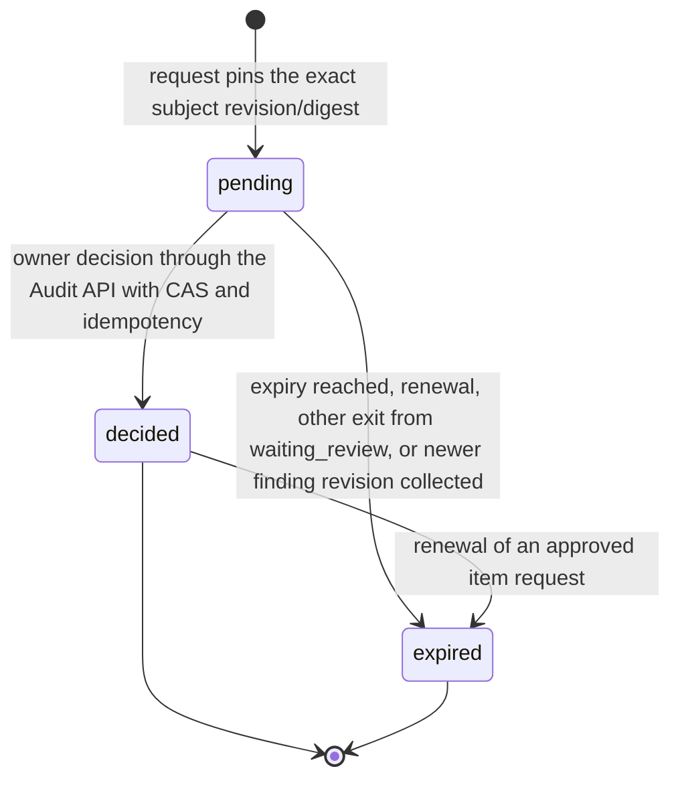
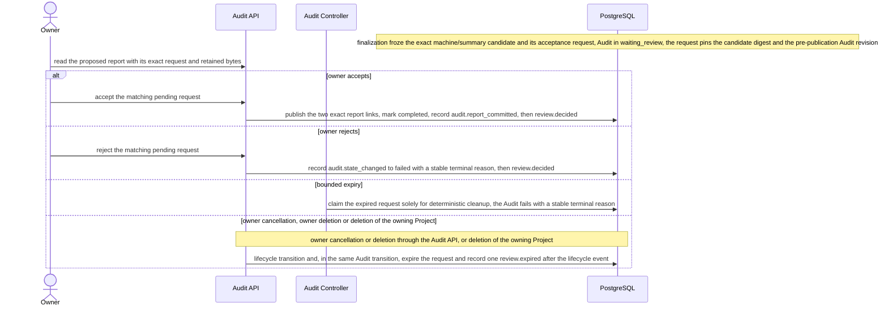
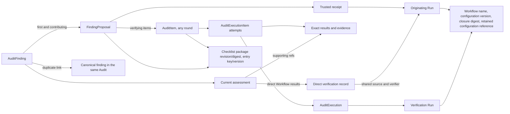

# Review and reports

Requirement prefix: `REV` · [Specification index](../README.md)

## Purpose and scope

This document owns what Audit results may and may not claim and how people
act on them: the separation of Run outcome, evidence, assessment and triage;
evidence content; finding identity and duplicates; coverage; human review
through the exact-subject review ledger, including request expiry and renewal,
report acceptance and analyst verdicts and severity; the human-readable and
machine-readable reports; finding backtrace and offline attribution; direct
findings verified inside the source Workflow; owner import of ordinary-Run
proposals; Audit retention, Audit-managed artifact links and holds; the
effects of Run deletion on Audit reports and collection; Audit deletion; and
the finding, review, provenance and report reads of the public API and the
Reviews view.

It leaves to other documents:

- AuditProfile, standard packages, baseline and scope, the durable records,
  the result-layer table, the Audit, Round and item lifecycle (including the
  uses of `waiting_review`, what `completed` requires and which items start in
  `awaiting_review`), item origin and the Audit endpoint table:
  [audits](audits.md).
- Collection of Audit child Runs, Audit-side proposal retention during
  collection, budgets and omission accounting: [execution](execution.md).
- Terminal Run hard deletion, its Audit collection gate and Project deletion:
  [retention and deletion](../artifacts/retention-and-deletion.md).
- The reserved `audit-*` Project namespace as seen by generic Artifact routes:
  [artifact store](../artifacts/artifact-store.md) (ART-R26).
- Finding proposals, intake and finding collections:
  [findings](../findings/findings.md).
- Audit Overview: [ui](../ui/ui.md); review navigation journeys:
  [journeys](../ui/journeys.md).
- Public API conventions: [public API](../api/public-api.md).
- Shared registries: [limits](../platform/limits.md),
  [errors](../platform/errors.md),
  [failure model](../platform/failure-model.md) and
  [lifecycle](../platform/lifecycle.md).

## Concepts

Terms are defined once in [the glossary](../glossary.md); the ones this
document owns are:

- **Exact-subject review ledger.** The shared mechanism for human decisions on
  Audit items, findings and reports: a review request pins an immutable subject
  revision/digest, and a decision is accepted only through the
  owner-authenticated Audit API with CAS and idempotency.
- **Review kind.** The purpose of a review request: `active-check-approval`,
  `requirement-applicability`, `finding-triage` or `report-acceptance`.
- **Item-action subject.** The subject of an item review: a hash over the
  Audit and item identities, the pinned profile digest, the Workflow role and
  the exact task artifact.
- **Review renewal.** The single procedure that Resume and the Controller use
  to replace an expired item request with a fresh exact-subject request.
- **Frozen report candidate.** The exact machine/summary report candidate that
  finalization freezes, together with its acceptance request, when a human
  report policy is selected.
- **Analyst verdict.** An owner's `true_positive` or `false_positive` decision
  on a finding, recorded through the `finding-triage` review flow.
- **Analyst severity.** The owner-assigned severity of a `true_positive`
  finding, distinct from the Worker's `severity_suggestion`.
- **Applicability coverage.** `(satisfied + violated) / selected applicable`.
- **Finding fingerprint.** A grouping hint combining scope snapshot, subject
  and normalized issue family; it never merges finding identities.
- **Duplicate link.** An acyclic, human-decided link inside one Audit from a
  finding to its canonical target.
- **Backtrace.** The retained relations that lead from an Audit finding to its
  source proposals, receipts and originating Runs, its verifying items,
  attempts and Runs, their Workflow closures and its checklist origins.
- **Direct verification.** Discovery and verification of a finding inside the
  same Run, without consuming an earlier hypothesis.
- **Direct verification reference.** The retained record of a direct
  verification: source Run and exact Workflow closure, result artifact
  revision/digest, evidence refs, contract revision/digest, semantic
  assessment and acceptance record.
- **Frozen contract artifact.** The Audit artifact created on acceptance of a
  direct verification that freezes the `ResolvedWorkflow` snapshot, its closure
  digest, the selected output declaration, the result schema and the
  identity/evidence binding rule.
- **AuditArtifactLink.** The Audit record that retains exact immutable content
  independently of source Run lifetime and makes an Audit-managed binding
  visible to owner-facing Audit projections.
- **Recovery staging.** An Audit-managed binding that exists before its
  receipt or report-link transaction commits; it is not an acceptance signal.
- **Audit hold.** An exact Audit evidence hold or accepted proposal hold that
  keeps retained revisions alive under Audit ownership.
- **Deletion intent.** The dedicated `deletion_requested_at` marker that
  records that owner or Project deletion requested an Audit's deletion.

## Model

The result layers (Run outcome, check observation, hypothesis assessment,
requirement evaluation, finding triage and Audit completion) and the durable
records `AuditFinding`, `AuditReviewRequest`, `AuditReviewDecision`,
`AuditReportCandidate`, `AuditArtifactLink` and `AuditCollectionReceipt` are
defined in [audits](audits.md). This document states the rules that keep the
layers apart and that govern those records.

### Review kinds

| Review kind | Subject | Owner actions |
| --- | --- | --- |
| `active-check-approval` | Item-action subject | `approve`, `reject` |
| `requirement-applicability` | Item-action subject | `approve`, `reject`, `not_applicable` |
| `finding-triage` | Exact finding revision/digest | Analyst verdict (`true_positive` with severity, `false_positive`) with rationale; also duplicate (exact same-Audit target), reopen and `needs-evidence` decisions (REV-R60, REV-R62, REV-R182) |
| `report-acceptance` | Frozen candidate digest and pre-publication Audit revision | `approve`, `reject` |

`plan-approval` and `provide-evidence` are reserved extensions (REV-R25).

### Review request states

Reviews are filtered by the states `pending`, `decided` and `expired`
(REV-R167).



### Analyst verdict

| Verdict | Triage effect | Severity |
| --- | --- | --- |
| `true_positive` | `confirmed`, subject to the profile evidence contract | Required: `informational`, `low`, `medium`, `high` or `critical` |
| `false_positive` | `rejected` with the false-positive reason | No effective severity |
| none (unreviewed) | — | Null; `severity_suggestion` is never a fallback |

### Coverage states

| Coverage row | States |
| --- | --- |
| Requirement | `satisfied`, `violated`, `inconclusive`, `not-tested`, `not-applicable` |
| Operation | `traced-complete`, `traced-partial`, `unmapped`, `not-tested` |

### Report artifacts

| Artifact | Media type | Content |
| --- | --- | --- |
| `report.md` | `text/markdown` | Human-readable report with headings and coverage, finding and attempt tables |
| `report.json` | not specified | Machine-readable report |

### Report acceptance



### Backtrace relations



## Requirements

### Result layers and claims

**REV-R1.** A succeeded Run never automatically confirms a finding or
satisfies a requirement.

**REV-R2.** A failed or cancelled Run does not refute a hypothesis.

**REV-R3.** `supported` describes evidence; `confirmed` is a
policy-authorized triage decision.

**REV-R4.** Severity and confidence are distinct fields.

**REV-R5.** A profile may disable finding production; otherwise
human confirmation is required.

**REV-R6.** A future profile may allow deterministic
auto-confirmation only under an explicit evidence contract.

What `completed` means and requires is specified in [audits](audits.md)
(AUD-R175 to AUD-R177); the OWASP Top 10 non-certification rule for
risk-assessment reports and ASVS version pinning in AUD-R74 and AUD-R75; and
the rule that an unmapped endpoint or truncated graph yields an explicit gap
or inconclusive result, never "no vulnerabilities found", in AUD-R157 and
AUD-R158.

### Evidence

**REV-R7.** Every accepted observation records its exact inputs,
instrument and version, actor role, observation time, output refs, scope,
limitations and truncation.

**REV-R8.** For live HTTP observations, evidence also records the
observation time and an available deployment marker.

Rationale: pinned source does not prove that a live target remained unchanged.

**REV-R9.** Code, documents and HTTP responses are untrusted data;
instructions embedded in them grant no tools or approvals.

### Finding identity

**REV-R10.** Finding fingerprints combine the scope snapshot, the
subject and the normalized issue family only as a grouping hint; they do not
merge identities automatically.

**REV-R11.** A human duplicate decision creates an acyclic link inside one
Audit.

**REV-R12.** One finding may map to multiple requirements, and a
requirement may be violated without a technical vulnerability, for example
because required documentary evidence is absent.

### Coverage

**REV-R13.** Coverage starts with one row per selected requirement or
operation (LIM-REV-1).

**REV-R14.** Every selected requirement gets an initial
`not-tested` coverage row, even when no automated Workflow applies.

**REV-R15.** Manual and documentary requirements create review work
rather than disappearing from the denominator.

**REV-R16.** `not-applicable` requires a rationale and a
policy-authorized decision.

**REV-R17.** Requirement and operation states share one typed
coverage field but are not interchangeable.

**REV-R18.** `traced-complete` means every requested trace
dimension completed with no gap; some completed dimensions plus any gap is
`traced-partial`; no completed dimension with a known resolution gap is
`unmapped`.

**REV-R19.** The semantic assessment of a result is retained
independently of its coverage state; for example, a complete trace may still
have an inconclusive security assessment.

**REV-R20.** Technical Run failure, collection failure and semantic
assessment remain three distinct report dimensions.

**REV-R21.** Exclusions and N/A rationales are reported separately.

**REV-R22.** Applicability coverage is
`(satisfied + violated) / selected applicable`; `inconclusive` remains a
separate count.

**REV-R23.** A zero denominator is `N/A`, never 100%.

**REV-R193.** Every coverage state is in exactly one progress bucket:
completed (`satisfied`, `violated`, `traced-complete`, `not-applicable`), gap
(`inconclusive`, `blocked`, `traced-partial`, `unmapped`, `excluded`) or
unchecked (`not-tested`). An item the owner rejected is `excluded`, so it is a
gap and never completed work (AUD-R178). A selected item outside the completed
bucket makes the report conclude `completed-with-gaps`, and the Audit
workspace counts the current round by the same buckets (UI-R144).

When a limit prevents more hypotheses or executions, the retention of counts,
omission reasons and coverage gaps is specified in [execution](execution.md)
(AUX-R87); the report includes those limits (REV-R79).

### Human review

#### Review kinds

**REV-R24.** The review kinds are `active-check-approval`,
`requirement-applicability`, `finding-triage` and `report-acceptance`.

**REV-R25.** `plan-approval` and `provide-evidence` are reserved
extensions and do not become effective merely because a model emits those
strings.

Which items start in `awaiting_review` (items of a Workflow role that exposes
a classified active-check tool under `activeChecks: approval-required`,
manual checklist items, and standard-backed items with package-authored
`human-review` applicability or a `required` evidence-contract review) is
specified in [audits](audits.md) (AUD-R83 to AUD-R87). Those item decisions
and report acceptance use the exact-subject review ledger below (AUD-R85).

#### Exact-subject review ledger

**REV-R26.** A review request pins an immutable subject revision/digest.

**REV-R27.** A decision is accepted only through the owner-authenticated
Audit API with CAS and idempotency (FAIL-REV-1).

**REV-R200.** Every review decision, a finding verdict as much as an item or
report action, accepts exactly the public `Idempotency-Key` grammar
(`[A-Za-z0-9][A-Za-z0-9._:-]*`, at most 128 characters). A decision that the
review ledger's stored constraints refuse is invalid, `400 invalid_request`
for the API and the service's invalid-argument error for trusted callers,
never an internal error, and nothing is written.

**REV-R28.** Model text or an artifact claiming "approved" has no
authority.

**REV-R29.** A new subject revision requires a new decision.

**REV-R30.** An item-action subject hashes the Audit and item
identities, the pinned profile digest, the Workflow role and the exact task
artifact; the immutable Audit baseline supplies the associated scope,
execution closure and credential selections.

**REV-R31.** Active-check approval is attached only to roles whose
pinned AgentTemplates select a classified active tool.

**REV-R32.** Runtime adapters still enforce their own scope and
egress controls.

**REV-R33.** A decision never rewrites original observations.

#### Waiting, expiry and renewal

**REV-R34.** Waiting for a person holds no allocation, Controller claim or
database transaction.

**REV-R35.** A new item request uses the current Audit deadline as
its expiry when one is set; with no Audit deadline, its expiry may be absent.

**REV-R36.** Pausing, extending or disabling the Audit clock does not
extend an existing review's authority.

**REV-R37.** Resume replaces expired requests with fresh exact-subject
requests for eligible unfinished work, requiring a new decision.

**REV-R38.** The Controller also renews item requests that expire
after Resume, including while the Audit waits for review.

**REV-R39.** Resume and the Controller use one renewal: it expires a
still-pending or approved request, creates the fresh request, returns a
formerly ready item to awaiting review, and records `review.expired` and
`review.requested` events, each advancing the Audit revision by one
(LIM-REV-2).

**REV-R40.** Resume records these events before `audit.resumed`,
and its fresh requests expire with the deadline Resume applies.

**REV-R41.** Historical expired requests do not keep the Audit
claimable after a live replacement exists.

**REV-R42.** Before creating an authorized execution intent,
PostgreSQL rechecks that the item is still ready, the exact request was
accepted, its digest still matches and its expiry is absent or in the future
(FAIL-REV-2).

**REV-R43.** Every review expiry, whether the Controller, an owner
decision, finding-review creation or Resume judges it, compares against the
PostgreSQL clock under the request's lock, so process clock skew cannot end or
extend human authority.

**REV-R189.** The default finding-triage window starts at the PostgreSQL
clock.

**REV-R44.** An expired request cannot authorize later execution.

Rejecting an item settles it as excluded with a visible coverage gap, and
resuming never silently extends human authority; both are specified in
[audits](audits.md) (AUD-R178, AUD-R173).

#### Report acceptance

**REV-R45.** Human report acceptance uses a frozen candidate rather than
regenerating bytes after review.

**REV-R46.** The report-acceptance request pins the candidate digest and
the pre-publication Audit revision.

**REV-R47.** Acceptance atomically publishes the two exact report
links (LIM-REV-3) and marks the Audit `completed`.

**REV-R188.** Rejection or bounded expiry of a report request records a
stable terminal reason.

**REV-R48.** Each outcome is an ordinary revisioned Audit transition:
acceptance records the same `audit.report_committed` event as an automatic
report commit, rejection records `audit.state_changed` to `failed`, and the
owner's decision then records `review.decided`.

**REV-R49.** Every other exit from `waiting_review` (owner
cancellation, owner deletion or deletion of the owning Project) expires the
pending report request in the same Audit transition and records one
`review.expired` event after the lifecycle event (LIM-REV-4).

**REV-R50.** A non-expired report request is excluded from Controller
claims, while an expired request becomes claimable solely for deterministic
cleanup.

**REV-R51.** A pending report review continues to authorize only
its frozen subject revision/digest, independent of the current Audit revision
after an availability change.

**REV-R52.** Historical or unavailable report requests cannot
silently decide a replacement report.

The two uses of `waiting_review`, the fence on new finding reviews, finding
imports and pause/resume during the report decision, the effect of accept,
reject and expiry on the Audit state, and continued finding triage after the
decision are specified in [audits](audits.md) (AUD-R178 to AUD-R181).

#### Analyst verdict and severity

**REV-R53.** The Findings UI lets an authenticated owner acting as
analyst record `true_positive` or `false_positive`, a severity and a bounded
rationale through the existing `finding-triage` review flow.

**REV-R54.** There is no separate analyst role or second approval
system.

**REV-R55.** The immutable decision contains actor and time, the exact
finding revision/digest, verdict, severity and rationale.

**REV-R56.** A verdict requires a rationale; `true_positive` also
requires a severity from `informational | low | medium | high | critical`.

**REV-R57.** `false_positive` has no effective severity.

**REV-R58.** An unreviewed finding has a null analyst verdict and
severity; the Worker's `severity_suggestion` remains separate and is never a
fallback analyst rating.

**REV-R59.** `true_positive` sets triage to `confirmed`, subject to the
profile evidence contract; `false_positive` sets it to `rejected` with the
false-positive reason.

**REV-R60.** Other rejection reasons, `duplicate` and `needs-evidence` do
not imply a false positive.

**REV-R61.** Current analyst fields are projected from the applicable
decision, not independently mutable copies of triage state.

**REV-R62.** Reopening a finding or marking it duplicate clears the
effective verdict and severity while preserving all previous decisions.

**REV-R63.** Severity changes and corrected verdicts append a new
exact-subject decision using CAS and idempotency.

**REV-R64.** The owner may create or reuse a pending finding-triage
request for the current finding revision through the finding review endpoint;
a completed request is never reopened or overwritten (FAIL-REV-3).

**REV-R65.** Corrections never rewrite the proposal, check result,
earlier assessment or decision.

**REV-R66.** A new assessment cannot silently carry forward an
earlier confirmation: it requires renewed triage.

**REV-R67.** Collecting a check result that assesses a finding
advances the finding's revision and, in the same transaction, expires every
pending finding-triage request for the earlier revision, recording one
`review.expired` event per request (LIM-REV-5).

Rationale: such a request could otherwise never be decided.

**REV-R68.** Review remains possible after Audit execution completes
until deletion begins; it does not restart execution.

**REV-R69.** Finding and Audit revisions advance on visible review,
assessment and duplicate changes.

**REV-R70.** An already accepted report retains the finding and
decision revisions it used; the API and UI distinguish its historical ratings
from current analyst ratings rather than rewriting that report.

### Reports

**REV-R71.** The human-readable report is `report.md` with media type
`text/markdown`, headings, and coverage, finding and attempt tables.

**REV-R72.** The machine-readable report remains `report.json`.

**REV-R73.** The Audit Report view renders `report.md` with the
existing safe Markdown preview and downloads the exact Markdown bytes.

**REV-R74.** Report commit, candidate reads, approval and
accepted-report reads require the current media type `text/markdown`.

**REV-R75.** Historical `text/plain` summaries are unsupported;
readers never relabel or rewrite their artifacts.

**REV-R76.** Report reads require the retained descriptor to match the
artifact's actual media type, digest and byte length.

**REV-R77.** Rejected reads and approval attempts leave report links,
review decisions and Audit history unchanged (FAIL-REV-4).

**REV-R78.** The report covers the items of every Round, ordered by
Round ordinal and then item ordinal, and each report item names its
`roundId`.

**REV-R79.** The report includes baseline, profile and standard
versions, scope, the coverage matrix, confirmed and proposed findings
separately, unresolved questions, exclusions, incomplete evidence, human
decisions, limits and reproducible provenance.

**REV-R80.** Any ASVS statement is limited to the selected version, level,
scope and evidence policy; partial automation is not described as complete
compliance.

**REV-R194.** A report carries at most 100,000 findings (LIM-REV-7). Its
machine-readable `report.json` is at most 64 MiB and its `report.md` at most
64 KiB (LIM-REV-8). An Audit whose report would pass either bound cannot form
a structurally valid report and fails (FAIL-AUD-9).

**REV-R195.** Each report finding shows the report projection that finding
intake stored with its first receipt (FND-R158); finalization reads no
proposal artifact.

**REV-R196.** Finalization records the report's item and finding entries in
pages, in report order: the items of each Round, then the findings of each
state. A page holds at most 200 entries, a findings page ends with the
finding whose report projection brings its projections to 8 MiB, and one
finalization attempt records at most 32 pages (LIM-REV-9). An attempt that reaches its budget
returns with its pages recorded; an attempt that times out or fails keeps the
pages it recorded. The next attempt resumes after the last recorded page and
never reads a recorded page again (FAIL-REV-13). Once every page is recorded,
one attempt assembles both artifacts from the recorded entries and commits or
freezes them.

**REV-R197.** Recorded pages belong to the Audit revision they were read at.
A revision change while `finalizing` makes them stale: the next page or the
report commit fails its revision check, and the report is built again from
the new revision. Every exit from `finalizing` discards the pages in the same
transaction (LIFE-REV-6).

### Finding backtrace and offline attribution

**REV-R81.** An external script must be able to start with an Audit
finding ID and obtain its analyst rating and provenance through the
owner-authenticated public API, without database access, parsing narrative
reports or inferring Run labels.

**REV-R82.** Hypothesis content, when present, remains in an exact
FindingProposal.

The retained relations distinguish discovery from verification
(see [Backtrace relations](#backtrace-relations)):

**REV-R83.** A finding links to its exact first proposal and every
explicitly contributing proposal; each proposal links to its trusted receipt
and originating Run.

**REV-R84.** A proposal links to its verifying AuditItems, including
items in later rounds; each item links to all its AuditExecutionItem attempts,
exact results and evidence, execution and verification Run.

**REV-R85.** Failed, inconclusive and superseded attempts remain
visible.

**REV-R86.** The current assessment explicitly identifies which
result/attempt refs support it, or the exact direct Workflow results
(REV-R130).

**REV-R87.** Missing verification is represented by an empty set
and a reason, never an invented successful check.

**REV-R88.** Each originating or verification Run links to its
immutable Workflow name, its configuration version when available and its
complete ResolvedWorkflow closure digest; the exact retained configuration
reference used to compute that digest is preserved independently of the
mutable catalog.

**REV-R89.** The origin also records Run ID, stage execution ID,
allocation ID and invocation ID from trusted state; for Audit Runs it includes
the Audit, round and execution identity and the role.

**REV-R90.** Items and proposals link to the exact checklist
package revision/digest and entry key/version, with `scheme`, `version` and
`requirement_id` for standards.

**REV-R91.** A validated standards mapping and a causal source
checklist are distinct: attaching an ASVS reference does not prove that ASVS
generated the hypothesis.

**REV-R92.** Missing mappings are preserved as unmapped, and
direct discoveries as having no checklist source.

**REV-R93.** Receipt origins are captured at intake; checklist origins and
proposal-to-item relations are bound at trusted inventory, import or worklist
acceptance.

**REV-R94.** Result import resolves invocation-local proposal keys to
exact receipts and validates item membership.

**REV-R95.** A finding discovered while checking an item inherits that
item's checklist origin only through this validated association; sharing a
Run, batch, subject or fingerprint never links a proposal to every item.

**REV-R96.** References outside the authorized Audit or imported
inputs are rejected (FAIL-REV-5).

**REV-R97.** The lineage write and its corresponding acceptance commit
atomically; replay cannot create another contribution (FAIL-REV-5).

**REV-R98.** Backtrace preserves both the first source and
additional contributors without claiming each was an independent discovery.

**REV-R99.** A duplicate link keeps each original finding and proposal
and identifies the canonical target inside the Audit; ratings are not silently
copied to duplicate records.

**REV-R100.** A script can count distinct confirmed canonical findings per
source Workflow or checklist, and separately count participation in
verification.

**REV-R101.** Retries, multiple evidence refs, multiple checklist
mappings and duplicate proposals must not inflate unique-finding counts.

**REV-R102.** Comparisons should state baseline, scope, profile and
Workflow digest, separate unreviewed and inconclusive work, and use attempted
items or Runs as denominators when measuring yield.

**REV-R103.** The Server supplies provenance and ratings; aggregation and
the choice of attribution policy belong to the external script.

**REV-R104.** For backtrace, the Audit retains under its own
ownership the original Run IDs even when their live relation disappears, the
Workflow identity, closure digest and exact configuration reference, item and
attempt links, checklist origins, proposal links and analyst decision history
(LIFE-REV-1).

**REV-R105.** Public projections expose `runDeleted` instead of
requiring a live Run join.

**REV-R106.** Configuration provenance contains no credential values or
active grants.

**REV-R107.** This retention applies to child checks, imported
ordinary-Run proposals and finding relations; source-owned holds are released
only after that retention is durable.

**REV-R108.** This retention lasts for the Audit lifetime and does
not prevent explicit Audit or Project purge (LIFE-REV-1).

The immutable checklist origin of an `AuditItem`, its completeness checks and
the Workflow identity required by bound execution history are specified in
[audits](audits.md) (AUD-R195 to AUD-R197).

### Direct findings verified inside the source Workflow

**REV-R109.** A Workflow may discover and verify a finding in the same
Run without consuming an earlier hypothesis; this is a supported path for both
ordinary and Audit Runs.

**REV-R110.** The finding candidate of a direct verification still
uses trusted intake and a receipt, but no synthetic hypothesis, AuditItem or
additional verification Run is created just to complete a lineage chain.

**REV-R111.** The same Run may be recorded as both the source and
the verifier; an actual check execution retains its existing item/attempt
link.

**REV-R112.** Treating the source Workflow as verifier requires its
exact pinned output/evidence contract to define verification and the accepted
result to satisfy that contract.

**REV-R113.** A direct verification retains a direct verification
reference containing the source Run and exact Workflow closure, the result
artifact revision/digest, the evidence refs, the contract revision/digest, the
semantic assessment and the acceptance record.

**REV-R114.** For an ordinary Run, validation and retention occur on
import into a compatible Audit; for an Audit Run they occur during trusted
collection and assessment.

**REV-R115.** Direct verification uses the existing acceptance and
receipt mechanism and grants no new model authority.

**REV-R116.** Intake alone records a candidate; a successful Run or a
model assertion of verification does not create an accepted verification
reference.

**REV-R117.** Without a valid result contract the finding remains a
candidate with no accepted verification, eligible for further checks or human
evidence review.

**REV-R118.** A Workflow opts in through exactly one required primary
Workflow output whose declared media types include
`application/vnd.contractor.audit.direct-verifications+json` (LIM-REV-6).

**REV-R119.** Multiple matching primary outputs are ambiguous and
therefore do not verify anything.

**REV-R120.** The frozen output uses this bounded, strictly decoded
envelope:

```yaml
schema: contractor.audit.direct-verifications.v1
verifications:
  - invocation_id: worker-invocation-7
    client_key: candidate-local-7
    assessment: supported
    summary: The exact retained trace establishes the reported path.
    evidence_ids: [ev-12]
```

**REV-R121.** Entries are ordered by `(invocation_id, client_key)`,
identities are unique, and assessments are limited to `supported`, `refuted`,
`inconclusive` or `blocked`.

**REV-R122.** Every selected evidence ID must belong to the exact
proposal receipt.

**REV-R123.** The Server matches only the receipt currently being
imported; it does not search by title, subject, Run-wide client key or mutable
binding.

**REV-R124.** On acceptance the Server forks the exact frozen result
into the Audit namespace and creates a frozen contract artifact containing the
immutable `ResolvedWorkflow` snapshot, its closure digest, the selected output
declaration, the result schema and the identity/evidence binding rule.

**REV-R125.** Both exact refs and digests are stored on the assessment
and as Audit artifact links.

**REV-R126.** The bytes of the forked result and the contract artifact
count against the Audit evidence budget and survive permitted source Run and
catalog deletion (LIFE-REV-2).

**REV-R127.** Replay matches the current deterministic assessment
identity derived from the destination Audit and the proposal receipt,
validates its stored content and does not add links or retained bytes again
(FAIL-REV-6).

**REV-R128.** Direct-assessment replay supports only the current
Audit-and-receipt identity: receipt-only assessment IDs are not recognized as
repeats of a current assessment and are not replay aliases.

**REV-R129.** An absent, unfrozen, malformed, ambiguous, mismatched or
budget-exceeding opt-in output leaves the proposal unassessed; it never turns
Run success into evidence (FAIL-REV-6).

**REV-R130.** Finding assessment accepts both item-attempt result refs
and direct Workflow result refs.

**REV-R131.** Further checks may supplement either path without
changing the original source.

**REV-R132.** The API exposes a direct verification record with
nullable item/attempt IDs and an explicit shared source/verifier Run ID; it
must not look like a missing relation.

**REV-R133.** The exact result, contract and provenance of a direct
verification are preserved after permitted source Run deletion
(LIFE-REV-2).

**REV-R134.** Analyst TP/FP and severity remain separate decisions
(REV-R53); verified evidence does not bypass the human-confirmation
policy.

**REV-R135.** Offline attribution can credit discovery and
verification to the same Workflow while counting one unique finding.

The evidence budget (`maxEvidenceBytes`, LIM-AUX-6) and its accounting are
specified in [execution](execution.md) (AUX-R45).

### Proposal import from ordinary Runs

**REV-R136.** An owner may import an exact proposal from an ordinary Run
into a non-terminal Audit in the same Project whose pinned profile requires
finding confirmation; the import retains the proposal and its evidence
revisions in the same way as collection does for an Audit child Run
([execution](execution.md), AUX-R48).

**REV-R137.** The same exact receipt may be imported into multiple
compatible Audits owned by the same owner.

**REV-R138.** Each destination independently owns its finding, analyst
review, assessment and exact evidence holds; replay within one Audit reuses
that Audit's records (FAIL-REV-7).

**REV-R139.** Finding and direct-assessment IDs are opaque and scoped to
the destination Audit.

**REV-R140.** Deleting one destination does not release another
destination's retained evidence or change its finding decisions
(LIFE-REV-3).

**REV-R141.** A receipt read through one Audit lists only that
Audit's own hold and, after source Run deletion, reads the proposal from that
Audit's retained copy, never from another destination's.

**REV-R142.** After source Run deletion, the Audit inbox omits a native
child receipt the Audit never retained, such as a proposal whose collection
was rejected, because no readable copy remains for it (LIFE-REV-4).

A proposal from a non-Audit Run stays attached to that Run until import
([audits](audits.md), AUD-R161); finding imports are fenced during a report
decision (AUD-R180). The effect of hard deletion of the source Run on its
proposal receipts is specified in
[retention and deletion](../artifacts/retention-and-deletion.md) (DEL-R28,
DEL-R29), and how an import racing that deletion serializes in DEL-R31 to
DEL-R33. An end-to-end example is in
[Proposal from an ordinary Run](#proposal-from-an-ordinary-run).

### Audit retention and publication

**REV-R143.** `AuditArtifactLink` retains exact immutable content
independently of source Run lifetime (LIFE-REV-2).

**REV-R144.** Trusted import forks accepted packages into protected,
create-only ProjectScope bindings under an Audit-specific logical namespace
and records a receipt.

**REV-R145.** Binding keys include the Audit identity and version; a
collision never overwrites another result.

**REV-R146.** Every Audit-managed binding is created frozen in the
Server-derived, reserved `audit-*` Project namespace: imported results and
external evidence through the trusted import, and Server-generated material
(task packages, worklists, execution manifests and task sets, inventories,
retained standards, direct-verification contracts and reports) through the
one trusted Audit writer. A generic Project artifact write never creates or
advances a binding under the reserved prefix.

**REV-R147.** Such a binding may exist briefly as recovery staging
before its receipt or report-link transaction commits; this is why generic
Project routes hide the entire reserved prefix (ART-R26).

**REV-R148.** Owner-facing Audit report and evidence projections
expose only exact bindings that have a committed `AuditArtifactLink`;
database-internal staging is not an acceptance signal.

**REV-R149.** Crash replay accepts an existing binding only when it is
frozen and its bytes, media type and size match and, for an imported binding,
its exact source Run revision and import lineage match as well. Any other
existing binding is a permanent integrity failure, never overwritten
(FAIL-REV-8).

**REV-R150.** Workers see only exact RunScope inputs and have no Audit
or Project Artifact authority.

Generic Project route hiding, the ban on ordinary public Project Artifact
mutation writing or deleting Audit-managed bindings, and owner uploads through
non-reserved namespaces form the explicit reserved-prefix policy of
[artifact store](../artifacts/artifact-store.md) (ART-R26).

**REV-R151.** Audit-level credential dispatch holds and evidence holds
are not released by the same transition.

**REV-R187.** Dispatch holds may be released once dispatch is durably closed
and no unresolved child submission intent can create another Run
(LIFE-AUD-1).

**REV-R152.** Per-Run credential holds follow the ordinary Run lifecycle.

**REV-R153.** Exact Audit evidence holds and accepted proposal holds
remain until Audit deletion or until an explicit later retention policy
transfers and releases them (LIFE-REV-3).

The Audit-level credential dispatch holds themselves are described in
[audits](audits.md) (AUD-R17). How collection copies every committed proposal
of an Audit child Run into an Audit hold, or records it as rejected, before the
Run becomes deletable is specified in [execution](execution.md) (AUX-R48 to
AUX-R53).

### Effects of Run deletion on Audits

The Audit collection gate on hard deletion of an Audit-bound Run, the
receipt required even for a failed, cancelled, output-less or invalid Run, the
retention of AuditExecution and AuditExecutionItem through a nullable
non-cascading Run relation, the revision advance of every affected Audit even
when that Audit is terminal (LIM-DEL-1), the
serialization with proposal imports and the rule that Run deletion never
changes a finding assessment or a frozen report-review subject are specified
in [retention and deletion](../artifacts/retention-and-deletion.md) (DEL-R17,
DEL-R18, DEL-R23, DEL-R25, DEL-R30 to DEL-R33, DEL-R57, DEL-R58).

**REV-R154.** If the trusted collector cannot validate pinned internal data,
or the Store rejects a collection request by its content alone so that no
retry can commit it, the collector records the bounded
`collection-contract-invalid` disposition, settles the affected items as
invalid with blocked coverage, and preserves their prior requested and
completed coverage arrays (FAIL-REV-9). This is a cleanup-safe technical
outcome, never accepted evidence, after which Run deletion is allowed
(DEL-R57, DEL-R58).

**REV-R155.** While an Audit is `finalizing`, the external-retention
invalidation caused by Run deletion preserves its `updatedAt`: report
`generatedFrom` uses that frozen timestamp, and Run availability is not part
of the report payload.

**REV-R156.** A conflict after an immutable report write can
therefore retry with identical bytes and exact refs before the mandatory
revision CAS (FAIL-REV-10).

**REV-R157.** In other Audit states, Run deletion advances
`updatedAt` normally.

**REV-R158.** The revision and ETag, rather than the timestamp alone,
remain the authoritative change token.

### Audit deletion

**REV-R159.** Deleting an Audit is a durable operation that runs these
phases in order (FAIL-REV-11, LIFE-REV-5):

1. close dispatch and release future-dispatch credential holds;
2. cancel, drain and collect owned Runs;
3. release evidence and accepted-proposal holds;
4. only then purge Audit-managed Project bindings and domain rows.

**REV-R160.** The purge removes every row the Audit owns, including
immutable review decisions and finding assessments that outlive the deleted
child Runs; their restricting keys protect them only outside a purge.

**REV-R161.** Audit deletion cleanup runs regardless of owner or Audit
queue pause.

**REV-R162.** Deletion intent is represented by a dedicated
`deletion_requested_at` marker, not inferred from the stop reason.

**REV-R163.** Cancellation finishes as `cancelled` when no deletion
was requested and deterministically continues to `deleting` when owner or
Project deletion supplied the durable intent.

The Audit cancellation and drain phase that Project deletion runs before its
Run and ProjectScope purge, the exclusion of Audit work from a deleting
Project, the deletion intent Project deletion supplies and the release of
every Audit hold by a completed Project purge are specified in
[retention and deletion](../artifacts/retention-and-deletion.md) (DEL-R40,
DEL-R45, DEL-R50, DEL-R55, DEL-R56). Cancellation and drain of owned Runs are
specified in [execution](execution.md).

### Finding, review, provenance and report reads

The endpoints are listed in [audits](audits.md); this section specifies the
behaviour of the finding, review, provenance and report reads.

**REV-R164.** Findings and Reviews use bounded server pages.

**REV-R165.** Their `total` covers the entire normalized filter, before
the cursor; it is never inferred from visible rows.

**REV-R166.** Finding lists support filters for triage
disposition, analyst verdict (including unreviewed) and analyst severity, and
distinguish analyst severity from a model suggestion.

**REV-R167.** Reviews can be filtered by `pending`,
`decided` or `expired` state, and by finding ID to retrieve paginated decision
history.

**REV-R198.** The owner-wide review list `GET /v1/reviews` filtered by
`pending` lists only requests that can still be decided: a stored pending
request whose expiry has passed at the PostgreSQL statement time is left out
before anything has expired it (REV-R43), by the same rule as the workspace's
pending count. Its `decided` and `expired` filters, its unfiltered list and
the revision-pinned per-Audit Reviews projection (REV-R167, REV-R168) match
the stored state.

**REV-R199.** The owner-wide finding list `GET /v1/findings` reads each
finding's first proposal receipt, the receipt's hold, the analyst decision and
the current assessment through the finding's own Audit, exactly as the
per-Audit list does: a receipt held by two Audits on one page exposes only
each finding's own Audit hold. A page reads its receipts, holds, decisions and
assessments once each, for every Audit on it together, plus one exact
proposal read per bounded group of proposals, so its cost does not grow with
the number of Audits on the page.

**REV-R168.** Both the Findings and the Reviews projection include
`auditRevision` and `asOf`; an optional `auditRevision` pins the first page to
a summary.

**REV-R169.** Signed continuation cursors bind owner, Audit, normalized
filters and revision.

**REV-R170.** A revision fence includes count, page and finding
hydration, returning 409 on concurrent changes (FAIL-REV-12).

**REV-R171.** Filter changes clear incompatible cursors and
revision pins.

**REV-R190.** Refresh explicitly starts a new context.

**REV-R172.** Coverage links also pin the summary revision. Every coverage
page is read at one Audit revision and reports it as `auditRevision`; an
optional `auditRevision` pins a page, and the current Round it defaults to, to
that revision, and signed continuation cursors bind the Round and revision, so
a page whose Audit changes returns 409 (FAIL-REV-12). The UI pins every page
of a batch to the revision it read before the batch and rejects mixed
revisions.

**REV-R173.** Finding detail identifies the exact first and contributing
proposals, the current assessment and decision, and the duplicate target.

**REV-R174.** Provenance pages return typed source-proposal,
check-attempt and direct-verification records with the complete respective
chain of the backtrace and direct verification rules (REV-R83 to
REV-R92, REV-R113, REV-R132), stable IDs, exact
refs/digests, role, technical outcome, semantic assessment, whether a result
supports the current assessment, and `runDeleted`.

**REV-R175.** Checklist sources and standards mappings are separate
fields.

**REV-R176.** These reads use the same ownership checks and
generated OpenAPI client as the UI.

**REV-R177.** The provenance response carries finding and Audit
revisions.

**REV-R191.** Bounded keyset provenance cursors bind to those revisions.

**REV-R192.** A change during provenance traversal returns a conflict and
requires restarting rather than silently mixing histories (FAIL-REV-12).

**REV-R178.** A script may pass the revisions obtained from finding
detail to the first provenance page to detect an intervening edit.

**REV-R179.** The public contract includes
[`docs/examples/audit-finding-backtrace.sh`](../../examples/audit-finding-backtrace.sh),
which reads ratings and follows revision-bound pagination to emit one
finding's complete backtrace; no analytics service, dashboard or direct SQL
access is required.

**REV-R180.** An exact review read exposes its ETag.

**REV-R181.** A proposed report read includes its exact review request
and the retained bytes under an Audit revision fence.

**REV-R182.** A duplicate finding decision accepts an exact same-Audit
target ID, including one taken from another page; the Server's ownership and
duplicate validation still apply.

Review navigation (direct links from each review to its exact finding or
proposed report, return links that preserve the queue URL, filters and cursor,
the unavailable or stale state for missing subjects and mismatched revisions,
where approval and rejection are offered, and refreshing evidence on conflicts
without replaying a mutation) is specified in [journeys](../ui/journeys.md).
Audit Overview, including its current-round progress, pending decisions and
counts linking to Coverage result groups or the pending review filter, is
specified in [ui](../ui/ui.md).

#### Reviews view

**REV-R183.** The Reviews view renders pending item-action requests
with an explicit rationale and exact-subject controls.

**REV-R184.** Applicability reviews offer `approve`, `reject` and
`not_applicable`; `not_applicable` settles the item with a durable owner
rationale and removes only that item from the applicable denominator.

**REV-R185.** Other item reviews and report reviews remain
approve/reject.

**REV-R186.** A proposed report is readable before acceptance and
links back to its request; it is never presented as an accepted result.

## Interfaces

- Finding, review, report, coverage, proposal-inbox, proposal-import and
  delete endpoints are part of the
  [public API schema](../../../api/openapi/contractor-public-v1.yaml):
  `listAuditFindings`, `getAuditFinding`, `listAuditFindingProvenance`,
  `createAuditFindingReview`, `listAuditReviews`, `getAuditReview`,
  `decideAuditReview`, `getAuditReport`, `listAuditCoverage`,
  `listAuditFindingProposals`, `importAuditFindingProposal` and
  `deleteAudit`. Their paths and purposes are listed in
  [audits](audits.md); shared conventions are in
  [public API](../api/public-api.md).
- Direct verification output: one required primary Workflow output declaring
  the media type `application/vnd.contractor.audit.direct-verifications+json`,
  whose content is the `contractor.audit.direct-verifications.v1` envelope with
  `verifications` entries of `invocation_id`, `client_key`, `assessment`,
  `summary` and `evidence_ids` (REV-R118 to REV-R123).
- Reports: `report.md` (`text/markdown`) and `report.json`
  (REV-R71, REV-R72).
- Backtrace example:
  [`docs/examples/audit-finding-backtrace.sh`](../../examples/audit-finding-backtrace.sh)
  (REV-R179).

## Limits, failures and errors

Registry entries owned by this document:

- [LIM-REV-1](../platform/limits.md): one initial coverage row per selected
  requirement or operation (REV-R13).
- [LIM-REV-2](../platform/limits.md): one Audit revision advance per
  `review.expired` and per `review.requested` event of a review renewal
  (REV-R39).
- [LIM-REV-3](../platform/limits.md): two exact report links published on
  report acceptance (REV-R47).
- [LIM-REV-4](../platform/limits.md): one `review.expired` event per exit
  from `waiting_review` by owner cancellation, owner deletion or deletion of
  the owning Project (REV-R49).
- [LIM-REV-5](../platform/limits.md): one `review.expired` event per pending
  finding-triage request expired by result collection (REV-R67).
- [LIM-REV-6](../platform/limits.md): exactly one required primary Workflow
  output opts in to direct verification (REV-R118).
- [LIM-REV-7](../platform/limits.md): at most 100,000 findings per report
  (REV-R194).
- [LIM-REV-8](../platform/limits.md): 64 MiB machine report and 64 KiB
  Markdown summary (REV-R194).
- [LIM-REV-9](../platform/limits.md): report finalization pages and the
  pages one attempt records (REV-R196).
- [FAIL-REV-1](../platform/failure-model.md): owner review decision
  (REV-R27).
- [FAIL-REV-2](../platform/failure-model.md): creation of an authorized
  execution intent for an approved item (REV-R42).
- [FAIL-REV-3](../platform/failure-model.md): creation or reuse of a
  finding-triage request (REV-R64).
- [FAIL-REV-4](../platform/failure-model.md): report reads and approval
  attempts (REV-R77).
- [FAIL-REV-5](../platform/failure-model.md): lineage write at result import
  (REV-R96, REV-R97).
- [FAIL-REV-6](../platform/failure-model.md): direct verification acceptance
  (REV-R127, REV-R129).
- [FAIL-REV-7](../platform/failure-model.md): proposal import into a
  destination Audit (REV-R138).
- [FAIL-REV-8](../platform/failure-model.md): creation of Audit-managed
  frozen bindings (REV-R149).
- [FAIL-REV-9](../platform/failure-model.md): Audit collection that no retry
  can commit (REV-R154).
- [FAIL-REV-10](../platform/failure-model.md): report write while
  `finalizing` (REV-R156).
- [FAIL-REV-11](../platform/failure-model.md): Audit deletion
  (REV-R159).
- [FAIL-REV-12](../platform/failure-model.md): revision-fenced pagination of
  findings, reviews and provenance (REV-R170, REV-R192).
- [FAIL-REV-13](../platform/failure-model.md): bounded, resumable report
  finalization (REV-R196, REV-R197).
- [LIFE-REV-1](../platform/lifecycle.md): backtrace provenance under Audit
  ownership (REV-R104, REV-R108).
- [LIFE-REV-2](../platform/lifecycle.md): Audit-managed artifacts and their
  `AuditArtifactLink` records (REV-R143, REV-R126,
  REV-R133).
- [LIFE-REV-3](../platform/lifecycle.md): Audit evidence and accepted
  proposal holds (REV-R153, REV-R140).
- [LIFE-REV-4](../platform/lifecycle.md): native child proposal receipts the
  Audit never retained (REV-R142).
- [LIFE-REV-5](../platform/lifecycle.md): Audit and the rows it owns
  (REV-R159, REV-R160).
- [LIFE-REV-6](../platform/lifecycle.md): recorded report finalization pages
  (REV-R197).
- [Errors](../platform/errors.md): the collection disposition
  `collection-contract-invalid` (REV-R154). The revision-fence conflict uses
  the generic `409` conflict response of the
  [public API](../api/public-api.md) (REV-R170, FAIL-REV-12).

Limits owned elsewhere and used here: `maxEvidenceBytes` (LIM-AUX-6,
[execution](execution.md)); the Audit revision advance on Run deletion
(LIM-DEL-1, [retention and deletion](../artifacts/retention-and-deletion.md)).
Failure entries owned elsewhere: the human report acceptance fence
(FAIL-AUD-11, [audits](audits.md)); a proposal import racing source Run
deletion (FAIL-DEL-6); Audit-bound Run deletion before collection
(FAIL-DEL-1).

## Security

Human authority is exact-subject and owner-authenticated: only the Audit API
with CAS and idempotency records decisions (REV-R27), model text and
artifacts have no approval authority (REV-R28, REV-R25),
and expiry is judged against the PostgreSQL clock so that clock changes and
skew cannot extend authority (REV-R36, REV-R43). Approval never
replaces Runtime scope and egress controls (REV-R32). Code, documents
and HTTP responses are untrusted data (REV-R9). Workers have no
Audit or Project Artifact authority (REV-R150); generic Project routes
hide Audit-managed bindings (ART-R26). Lineage rejects references outside the
authorized inputs (REV-R96) and never links proposals to items by
shared Run, batch, subject or fingerprint (REV-R95); direct
verification grants no new model authority (REV-R115). Retained
configuration provenance contains no credential values or active grants
(REV-R106). The shared model is in [security](../platform/security.md).

## Observability

Review and report transitions record the Audit events `review.requested`,
`review.expired`, `review.decided`, `audit.report_committed`,
`audit.state_changed` and `audit.resumed` (REV-R39,
REV-R40, REV-R48, REV-R49,
REV-R67). Finding and Audit revisions advance on visible review,
assessment and duplicate changes (REV-R69). Findings and Reviews
projections carry `auditRevision` and `asOf` (REV-R168), and retained
provenance reports `runDeleted` (REV-R105). The Audit event history
itself is specified in [audits](audits.md); shared rules are in
[observability](../platform/observability.md).

## Invariants

1. No Run outcome, model text or artifact confirms a finding, satisfies a
   requirement, refutes a hypothesis or approves work (REV-R1,
   REV-R2, REV-R28, REV-R116).
2. A human decision authorizes only its exact subject revision/digest and
   never outlives its expiry (REV-R26, REV-R29, REV-R44,
   REV-R51).
3. Decisions and corrections never rewrite observations, proposals, check
   results, earlier assessments, earlier decisions or an accepted report
   (REV-R33, REV-R65, REV-R70).
4. Every selected requirement has a coverage row, and a zero denominator is
   never reported as 100% (REV-R14, REV-R23).
5. Unique-finding counts are not inflated by retries, evidence refs, checklist
   mappings or duplicate proposals (REV-R101).
6. Content an Audit retained survives source Run and catalog deletion until
   Audit or Project purge, and deleting one destination Audit never affects
   another (REV-R143, REV-R126, REV-R140,
   REV-R108).
7. Paginated finding, review and provenance reads never mix revisions
   (REV-R170, REV-R191, REV-R192).

## Examples

### Proposal from an ordinary Run

1. A non-Audit Worker with `security-findings@1` submits a proposal.
2. Proposal/receipt remains attached to its exact Run.
3. Owner imports that exact revision into a compatible Audit or creates a
   finding-verification Audit.
4. Import retains provenance; Worker never chooses the Project/Audit or starts work.
5. If the owner instead hard-deletes the source Run, unimported proposals are
   durably discarded and purged with the source Run; imported revisions remain
   held by their destination Audits.

The direct verification envelope example is shown with REV-R120.

## Non-goals

- A separate global Hypothesis entity or generic graph engine for backtrace
  (REV-R82).
- Cross-Audit deduplication: it is not implied.
- Cross-Audit snapshot export.
- An analytics service, dashboard or direct SQL access for attribution
  (REV-R179, REV-R103).
- A separate analyst role or second approval system (REV-R54).
- The reserved review kinds `plan-approval` and `provide-evidence`
  (REV-R25) and historical `text/plain` report summaries
  (REV-R75).
