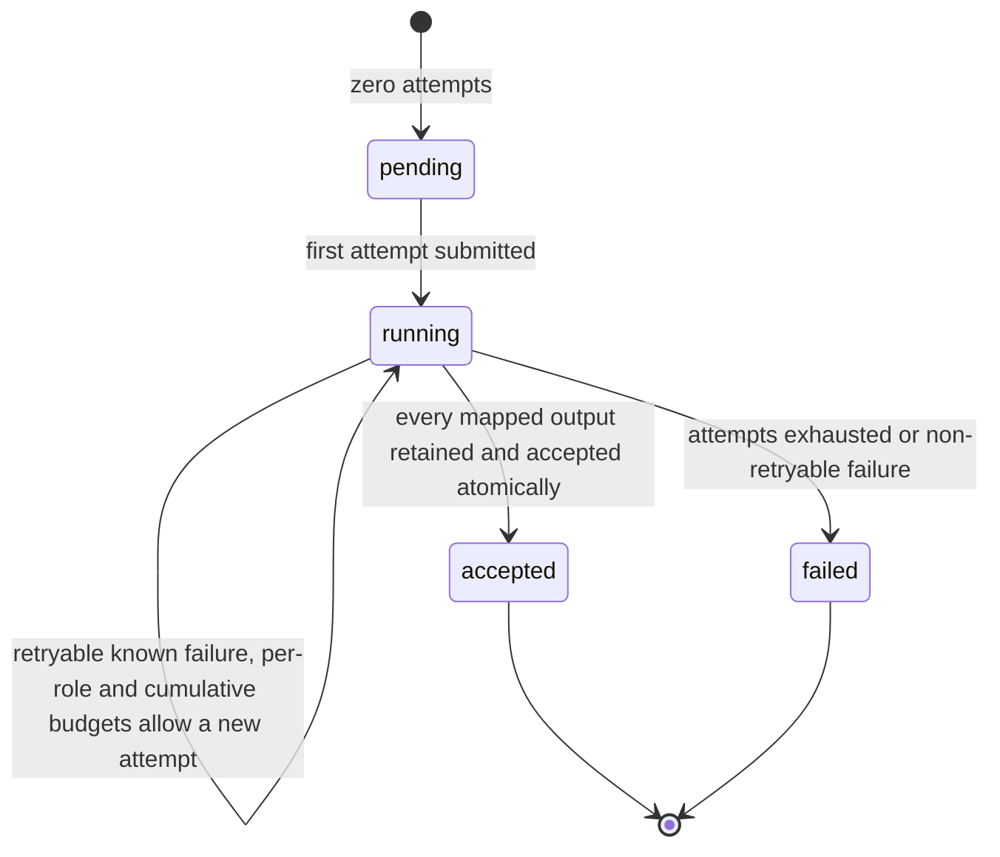
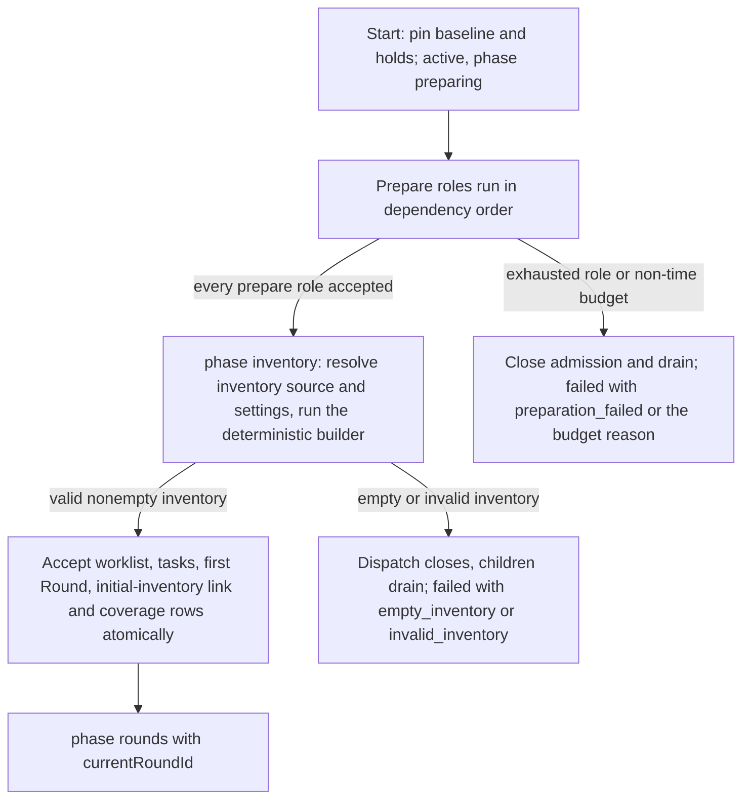
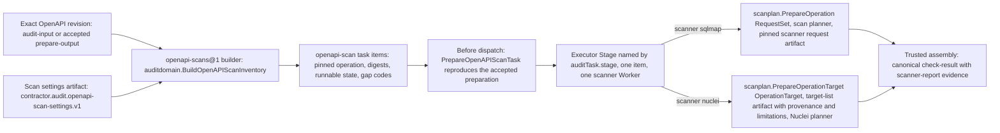

# Audit preparation and OpenAPI scans

Requirement prefix: `ASC` · [Specification index](../README.md)

## Purpose and scope

This document owns:

- the preparation contract of an AuditProfile: `prepare` Workflow roles, the
  mapping sources that inventories, prepare roles and Round consumers may use,
  the `inventory.source` and `inventory.settings` references, the prepare-role
  attempt bound and the per-profile bounds on roles, baseline inputs, mappings,
  accepted output descriptors and retained output sizes;
- preparation attempts, accepted preparation outputs and the public
  `preparation.roles` projection;
- the `inventory` phase of a prepared Audit, the atomic acceptance of its first
  Round, and owner controls and Controller outcomes before the first Round;
- the OpenAPI Audit scan adapter: the `openapi-scans@1` inventory builder, the
  `openapi-scan@1` task contract and its `auditTask` executor declaration, the
  scan settings artifact, pinned scan tasks, the Audit use of SQLMap requests,
  fixed Nuclei URL targets, scan coverage and semantic results, and scan retry
  and completion.

It leaves to other documents:

- AuditProfile, Workflow role bindings and role kinds, the baseline, the
  `phase` values, active-check approval and the Audit, Round and item
  lifecycle: [audits](audits.md).
- Audit Controller submission, dispatch, collection, import, recovery, the
  cumulative Run budget `maxSubmittedRuns` and the evidence budget
  `maxEvidenceBytes`: [execution](execution.md).
- Coverage, reports, human review, Audit retention and Audit deletion:
  [review and reports](review-and-reports.md).
- Check result collection and completion inside the Worker, including
  `audit-check-results@1`: [worker completion](worker-completion.md).
- Tool Workers, scan request preparation (RequestSet v1, preparation policy 2,
  `scanplan.PrepareOperation` and the preparation bounds), scan planning and
  the scan session journal: [scanners](../tools/scanners.md).
- Workflow definitions, Stages, input slots and graph validation:
  [workflows](../configuration/workflows.md).
- The opt-in catalog configurations `openapi-operation-trace@3` and
  `findings-review@1`: [findings](../findings/findings.md) (FND-R147,
  FND-R148).
- Exact ArtifactRefs and input forks:
  [artifact store](../artifacts/artifact-store.md); Run hard deletion:
  [retention and deletion](../artifacts/retention-and-deletion.md).
- Shared registries: [limits](../platform/limits.md),
  [errors](../platform/errors.md),
  [failure model](../platform/failure-model.md) and
  [lifecycle](../platform/lifecycle.md).

## Concepts

Terms are defined once in [the glossary](../glossary.md); the ones this
document owns are:

- **Prepare role.** A Workflow role binding with `kind: prepare` whose ordinary
  Workflow produces Audit inputs before any item exists.
- **Preparation attempt.** One submission of a prepare role, identified by
  `(audit_id, workflow_role, role_attempt)`, with no Round, no execution items
  and at most one Run.
- **Accepted preparation output.** A profile-mapped output of a successful
  prepare role, retained with its exact revision and accepted atomically with
  the role's other mapped outputs.
- **Mapping source.** The kind of a mapping reference: `audit-input`,
  `prepare-output`, `item-package`, `execution-manifest` or `retained-output`.
- **Generated inventory.** An inventory built in the `inventory` phase from
  accepted preparation outputs instead of from the original baseline.
- **`initial-inventory` link.** The protected Artifact link that pins the
  derived inventory snapshot of a prepared Audit and commits with its first
  Round.
- **OpenAPI scan inventory builder.** The built-in, versioned
  OpenAPI-to-scan-task builder registered as `openapi-scans@1`.
- **`openapi-scan@1` task contract.** The execution contract that the builder
  declares and that a consuming Workflow's executor Stage implements.
- **Scan executor Stage.** The Workflow Stage named by `auditTask.stage`, which
  executes one assigned `openapi-scan` task with one scanner Worker.
- **Scan settings artifact.** The JSON document with schema
  `contractor.audit.openapi-scan-settings.v1` that selects the scanner, target
  server, operations and their bindings.
- **`OperationTarget`.** The in-process fixed URL target that
  `scanplan.PrepareOperationTarget` produces for Nuclei.
- **URL-only limitation.** A limitation code that records which declared
  request data a fixed URL scan does not replay or apply.

## Model

### Prepare role status

Each prepare role reports one status in `preparation.roles`
(ASC-R42).



### From start to the first Round

A prepare profile reaches its first Round through the `preparing` and
`inventory` phases. Pause, deadline, cancel and delete are described in
[Controls before the first Round](#controls-before-the-first-round).



### OpenAPI scan path



## Requirements

### Preparation contract

**ASC-R1.** The preparation contract is the AuditProfile authoring
contract. The fields `sourceInput` and `settingsInput` are rejected, including
in persisted profile snapshots; there is no alternate reader or implicit
conversion.

**ASC-R2.** Repository profiles use the same explicit mapping as
Workflow inputs.

**ASC-R3.** A schema change changes the profile digest. Immutable
snapshots are never silently rewritten to match a newer catalog.

**ASC-R4.** The Workflows and execution contracts a profile selects,
such as `openapi-from-workspace@7` for a `prepare` role or a scan Workflow's
`openapi-scan@1` contract, are configuration choices; the role kind and the
declared input sources determine scheduling and authority.

**ASC-R5.** Preparation happens before any item exists. Workflow
Stages around an item executor cannot replace it.

**ASC-R6.** Prepare parameters may use literals and scope fields,
never item fields.

**ASC-R7.** Prepare roles cannot declare `auditTask` or
`workerCompletion`. The ordinary Workflow of a prepare role may have any valid
topology.

**ASC-R8.** The Server executes valid prepare profiles. Input
preview validates the presence and media contracts of the original inputs;
parsing of generated documents waits until accepted preparation outputs exist.

**ASC-R9.** Preparation may use classified active tools only when the effective
Project policy pinned at Audit start is automatic. Preparation has no item for
individual approval: approval-required mode rejects active preparation before
dispatch, and prohibited mode rejects classified active capabilities.

**ASC-R10.** Preparation leaves the scan approval and
outcome-aware retry rules unchanged.

### Inventory references and mapping sources

**ASC-R11.** `inventory.source` is required for document
inventories and absent for `standard-mappings@1`.

**ASC-R12.** `inventory.settings` is required only for
`openapi-scans@1`; it must accept JSON and must differ from `source`.

**ASC-R13.** Both inventory references use
`{source: audit-input, name}` or `{source: prepare-output, role, name}`.
`name` denotes the Audit input or the producer's logical output. An Audit input
reference forbids `role`.

**ASC-R14.** A `prepare-output` reference requires a declared
prepare producer and a required Workflow output with compatible media types.

**ASC-R15.** Required consumers cannot use optional inputs
or outputs.

**ASC-R16.** Scanner source and settings mappings must exactly
equal the inventory references, including the producer role.

**ASC-R17.** Each mapping source may be used only by the
consumers, and with the scope, that this table allows:

| Source | Prepare consumer | Inventory | Round consumer | Scope |
| --- | --- | --- | --- | --- |
| `audit-input` | yes | yes | yes | Immutable baseline |
| `prepare-output` | yes, dependency order | yes | yes, every Round | Accepted output of this Audit |
| `item-package` | forbidden | forbidden | check item context ([AUD-R39](audits.md)) | Assigned execution |
| `execution-manifest` | forbidden | forbidden | the item execution manifest ([AUD-R40](audits.md)) | Assigned execution |
| `retained-output` | forbidden | forbidden | the discovery and assessment dependency rules ([AUD-R41](audits.md)) | Same Round |

**ASC-R18.** A prepare output cannot be consumed as
`retained-output`; a check, discovery or assessment output cannot be consumed
as `prepare-output`.

**ASC-R19.** Self-dependencies, cycles, later-phase
dependencies, unknown roles or outputs and incompatible media types fail
configuration validation.

### Profile bounds

**ASC-R20.** Each prepare role must explicitly set
`maxRunAttempts` in 1..10 (LIM-ASC-1), no larger than
`execution.maxSubmittedRuns`; other role kinds cannot set it. The shared Server
ceiling is `MaxAuditRunAttempts`.

**ASC-R21.** `maxRunAttempts` bounds ordinary Run submissions
for that role, independently of Stage retries inside a Run.

An AuditProfile is bounded as follows:

- **ASC-R22.** at most 16 roles in total (LIM-ASC-2);
- **ASC-R23.** at most 32 baseline inputs (LIM-ASC-3);
- **ASC-R24.** at most 128 input, parameter and output mappings
  per Workflow binding (LIM-ASC-4);
- **ASC-R25.** at most 128 accepted output descriptors per role
  (LIM-ASC-5).

**ASC-R26.** Public retained output descriptors include the
exact ref and digest, media type and size, which is 0..64 MiB (LIM-ASC-6).

**ASC-R27.** The cumulative bytes of retained outputs consume
the evidence budget ([execution](execution.md)), including failed attempt
evidence, and are also bounded by the artifact layer and the chosen parser.

**ASC-R28.** Preparation attempts reserve the cumulative Run budget
atomically and do not introduce an Audit concurrency setting. Per-Run execution
policies and the Scheduler ([scheduler](../execution/scheduler.md)) retain
their authority.

### Phase before the first Round

The `phase` field and its values, the direct-input path that builds inventory
at start, and what a prepare profile pins before its first Run when it enters
`preparing` are specified in [audits](audits.md) (AUD-R190 to AUD-R194).

### Preparation attempts

**ASC-R29.** Every preparation attempt has a unique
`(audit_id, workflow_role, role_attempt)` identity, `kind: prepare`, no Round
and no execution items.

**ASC-R30.** A preparation attempt records one submission key,
at most one Run (LIM-ASC-7), the exact resolved inputs and parameters in the
execution snapshot, and the ordinary execution and receipt lifecycle
([execution](execution.md)).

**ASC-R31.** A retry is a new attempt. A process restart reuses the
existing submission key (FAIL-ASC-1).

**ASC-R32.** A failed authoritative Run or an invalid or missing
required output may consume another bounded attempt: a retryable known failure
starts a new role attempt if both the per-role and the cumulative budgets
allow (FAIL-ASC-1, FAIL-ASC-2).

**ASC-R33.** A lost submit acknowledgement or an uncertain
collection never justifies another Run. An unknown submit or collection
outcome recovers the same intent, Run and receipt, with no speculative retry;
collection I/O uncertainty stays in recovery until resolved (FAIL-ASC-1,
FAIL-ASC-2).

**ASC-R34.** Accepted outputs are reused on resume, restart and all
later Rounds.

### Accepted preparation outputs

**ASC-R35.** All profile-mapped outputs of a successful prepare
role are retained and accepted atomically, including outputs used only as
diagnostics.

**ASC-R36.** Acceptance records the exact source Run output
revision, the retained Project revision, digest, media type and size,
execution and Run identity, the logical name and the actual Workflow output
name.

**ASC-R37.** At most one attempt is accepted per role
(LIM-ASC-8).

**ASC-R38.** Dependent roles fork these exact retained revisions.
They do not read a mutable current binding.

**ASC-R39.** Accepted preparation artifacts are protected by Audit
retention ([review and reports](review-and-reports.md)) and remain readable
after permitted source Run deletion (LIFE-REV-2).

**ASC-R40.** Generated outputs do not replace baseline input or
scope provenance.

### Preparation status

**ASC-R41.** The public `preparation.roles` map uses the authored
role names as keys. Each entry has `status`, `attempts`, `maxAttempts`,
optional current `executionId` and `runId`, and `outputs`.

**ASC-R42.** `status` takes these values:

- `pending`: zero attempts and no execution or outputs;
- `running`: includes submission, recovery, collection and bounded retries;
- `accepted`: has the accepted execution and Run and every mapped exact
  output;
- `failed`: has exhausted attempts or a non-retryable failure, and no accepted
  outputs.

**ASC-R43.** Accepted output descriptors retain the
producing execution and Run identity and the Workflow output name.

**ASC-R44.** A failed attempt's diagnostic evidence remains in
its receipt, not in accepted outputs (LIFE-ASC-2).

**ASC-R45.** `attempts` cannot exceed `maxAttempts`.

### Inventory phase and the first Round

**ASC-R46.** After all prepare roles are accepted, `phase: inventory`
resolves the explicit inventory source and settings and reuses the
deterministic inventory builders ([audits](audits.md)).

**ASC-R47.** The original baseline has no inventory field for
this path: generated inventory and worklist provenance is retained separately
through its accepted Round and preparation descriptors.

**ASC-R48.** The validated worklist, tasks and first Round are
accepted atomically, and only then does the Audit switch to `phase: rounds`,
which requires `currentRoundId`. There is no partially accepted first Round,
and no Round or successful coverage exists until the worklist is accepted
(FAIL-ASC-3).

**ASC-R49.** The protected `initial-inventory` Artifact link
pins a versioned derived inventory snapshot, the exact source and settings
identities, gaps, worklist and execution manifest. It commits with the initial
Round and coverage rows, and its retained bytes consume the shared evidence
budget (LIFE-REV-2).

**ASC-R50.** Report construction uses this accepted derived
snapshot while keeping the original baseline digest.

**ASC-R51.** Empty generated inventory fails the Audit with
`empty_inventory`, and invalid generated inventory with `invalid_inventory`,
after dispatch closes and children drain (FAIL-ASC-3). The failure creates no
placeholder Round, items, coverage success or fabricated report, and does not
imply compliance.

**ASC-R52.** Empty or invalid inventory of a direct-input profile
rejects start before its baseline transaction commits.

### Controls before the first Round

Before the first Round, owner controls and Controller outcomes have these
results:

- **ASC-R53.** For a prepare profile, Start pins the baseline and holds and
  leaves the Audit `active` in phase `preparing`; the response returns
  `audit` and empty `items` and omits `round`. A direct-input profile builds
  its inventory at start and enters `rounds` ([AUD-R192](audits.md)).
- **ASC-R54.** Pause closes admission and enters `paused`,
  preserving the phase, the exact outputs and the holds; existing Runs drain
  and collect.
- **ASC-R55.** Reaching the Audit deadline has the same paused
  behaviour with `deadline_exhausted` ([AUD-R164](audits.md)); child deadlines
  remain independent.
- **ASC-R56.** Resume requires an active Project, the pinned
  baseline and the persisted phase ([AUD-R171](audits.md)), and reopens
  admission without rerunning accepted roles.
- **ASC-R57.** Cancel enters `cancelling`, closes admission,
  cancels and drains owned Runs, collects receipts, releases holds, then
  enters `cancelled`.
- **ASC-R58.** Delete persists the deleting intent, fences
  admission, drains children, then purges retained artifacts through the
  ownership rules of Audit deletion ([review and
  reports](review-and-reports.md)) (LIFE-REV-5).
- **ASC-R59.** An exhausted role or an exhausted non-time budget
  closes admission and drains; the Audit fails with the explicit stop reason
  `preparation_failed` or the budget's own reason (FAIL-ASC-1).

**ASC-R60.** Pause and deadline may allow completed outputs to
be collected, but first-Round acceptance waits for resumed admission.

**ASC-R61.** Cancellation and deletion never start inventory or
dependent preparation.

Terminal Audits do not resume ([AUD-R170](audits.md)).

**ASC-R62.** Before a Round exists, item and coverage pages are
empty and no aggregate report is ready; phase, role status and stop reason
explain progress.

**ASC-R63.** After Round creation, the ordinary controls, review,
budgets and Round barriers apply ([audits](audits.md),
[execution](execution.md)).

**ASC-R64.** Richer provenance views may be added without
changing these minimal contracts.

### OpenAPI scan profiles

**ASC-R65.** The supplied-input scan profile takes an exact
supplied OpenAPI document and explicit scan settings, and runs SQLMap request
checks and Nuclei URL checks through the scanner Workers
([scanners](../tools/scanners.md)) and the Scheduler.

**ASC-R66.** Source preparation, which generates the
OpenAPI document through a `prepare` role such as `openapi-from-workspace@7`,
is a separate capability governed by the preparation contract of this
document and is not a prerequisite for the supplied-input scan profile.

**ASC-R67.** The runnable
[`source-openapi-sqlmap-scan@1`](../../../configs/audit-profiles/source_openapi_sqlmap_scan.yaml)
preset accepts an exact source archive and the same explicit scan settings.
One `openapi-from-workspace@7` prepare role produces the OpenAPI document and
validation diagnostics; the Server retains both, constructs the inventory from
the accepted OpenAPI revision with the scan adapter, and forks that revision
into each check Run.

**ASC-R68.** The `source-openapi-sqlmap-scan@1` preset keeps the
same explicit operation denominator, active-check approvals, scanner arguments
and retry rules as the supplied-input SQLMap profile.

### Inventory builder and executor

**ASC-R69.** `inventory.implementation: openapi-scans@1` selects the
built-in, versioned OpenAPI-to-scan-task builder. It is not a Workflow or
AuditProfile name.

**ASC-R70.** The profile chooses its Workflow by an ordinary exact `ref`.
Profile, Workflow, Worker, role and Stage names are operator-authored.

**ASC-R71.** Audit input names can differ from Workflow input aliases
through the declared input mappings.

**ASC-R72.** The builder declares the `openapi-scan@1` task
contract. A consuming Workflow explicitly selects an executor Stage with
`auditTask`; consumers declare `auditTask.contract: openapi-scan@1`
independently of the builder registration:

```yaml
spec:
  auditTask:
    contract: openapi-scan@1
    stage: check-request
  entryStage: prepare-context
  # Ordinary Stages may run before and after check-request.
```

**ASC-R73.** The catalog validates producer and consumer
contract compatibility, then the selected executor's capabilities and input
mappings.

**ASC-R74.** `auditTask.stage` need not be the entry Stage. Other
Workflow Stages and other Audit roles are allowed.

**ASC-R75.** The scan executor accepts one assigned item and one
scanner Worker (LIM-ASC-9); its batch-size, exact-input and approval
constraints belong to that executor.

**ASC-R76.** The scan executor uniquely owns the canonical
check-result output. Ordinary graph validation rejects successful paths
without that required output, and no other Stage can replace it.

**ASC-R77.** A second scan executor requires a different
execution and result contract.

**ASC-R78.** Inventory construction does not inspect the executor's
scanner or entry Stage.

**ASC-R79.** After construction, both input preview and Audit
start check the actual task requirements against the declared executor;
SQLMap settings cannot be dispatched to a Nuclei Worker.

**ASC-R80.** During dispatch the manifest uses Workflow input
aliases; the task retains the original producer input identities.

**ASC-R81.** Additional exact inputs for surrounding Stages do
not change the scanner's assigned source or settings.

**ASC-R82.** The complete `auditTask` declaration is cloned
and retained in immutable Workflow and profile snapshots.

**ASC-R83.** Recovery reads the retained `auditTask`
declaration to select the scanner's journal; surrounding Stage outcomes cannot
be mistaken for scan attempts (FAIL-ASC-6).

**ASC-R84.** Absent `auditTask` fields remain omitted on
ordinary Workflows, preserving their serialized shape and completion
behaviour.

### Pinned items and authority

**ASC-R85.** An accepted item pins one source operation (LIM-ASC-10)
by its canonical JSON Pointer, the original OpenAPI ref and byte digest,
explicit target and operation values, scanner policy and the exact Workflow,
template and configuration versions.

**ASC-R86.** A model or scanner report cannot select a different
operation or substitute a newer source.

**ASC-R87.** Dispatch validates the original-to-Run fork mapping
under the Audit artifact contract ([audits](audits.md), AUD-R155, AUD-R156).

**ASC-R88.** Preparation helpers receive already-authorized bytes;
they do not perform ownership checks or grant network authority.

**ASC-R89.** The Audit adapter requires an explicit absolute
target server selected before start. It passes this override into preparation
instead of trusting generated OpenAPI servers as authorization.

**ASC-R90.** Scope and active-check approval ([audits](audits.md))
remain authoritative.

**ASC-R91.** Scanner arguments and template selections are pinned
by the resolved profile and Worker configuration, not by arbitrary strings
returned by a model.

### Scan settings

**ASC-R92.** Concrete values are supplied with operation bindings
using the `scanplan.Options` contract ([scanners](../tools/scanners.md)):
`path:name`, `query:name`, and for SQLMap also header, cookie, body and
authentication bindings.

**ASC-R93.** Examples and defaults follow
[preparation policy 2](../tools/scanners.md#input-and-selection-policy); types
alone never invent values. Unsupported or missing data produce gaps.

**ASC-R94.** The settings artifact is strictly validated and
pinned before inventory creation. Missing values require a corrected new
Audit; resume cannot rewrite the accepted input snapshot.

**ASC-R95.** `scanplan.DecodeAuditScanSettings` accepts JSON with
schema `contractor.audit.openapi-scan-settings.v1`, up to 256 KiB
(LIM-ASC-11).

**ASC-R96.** The required fields are `schema`, `scanner`
(`sqlmap` or `nuclei`), `server` and a nonempty `operations`.

**ASC-R97.** `server` is a concrete absolute HTTP(S) URL without
credentials, template variables, query or fragment.

**ASC-R98.** `operations` maps canonical operation pointers to
objects with optional `parameters` and `body`, using the binding types of
`scanplan.Options`. Only listed operations enter the inventory; there is no
implicit whole-document scan.

**ASC-R99.** At most 1,000 operations are accepted (LIM-ASC-12).

**ASC-R100.** A body contains both `mediaType` and `value`; an explicit
JSON-null value is data, not an absent body.

**ASC-R101.** SQLMap requires a nonempty `testParameters` list
of up to 64 distinct names (LIM-ASC-13) and allows `authentication` keyed by
declared security scheme.

**ASC-R102.** Nuclei forbids nonempty test parameters or
authentication and any body, header or cookie binding. Explicit
authentication, body, header or cookie bindings are rejected for the fixed URL
interface so that supplied request data cannot be silently discarded.

**ASC-R103.** Unknown fields, case aliases, duplicate keys, null
structural fields and unsafe numbers are rejected with fixed diagnostics
(FAIL-ASC-4).

**ASC-R104.** Scanner arguments, templates and execution budgets
are not accepted through the settings artifact.

### Scan inventory and tasks

**ASC-R105.** `auditdomain.BuildOpenAPIScanInventory` creates an
`openapi-scans` inventory with `openapi-scan` task items. It requires
the effective approval policy pinned in the Audit baseline.

**ASC-R106.** Each task pins the exact source and settings refs and
byte digests, the selected operation, the preparation digest, the SQLMap
request digest or the Nuclei URL, explicit test parameters, the runnable state
and the preparation gap codes.

**ASC-R107.** Settings are an additional exact
execution-manifest input.

**ASC-R108.** Credentials and request bodies are not copied into
task documents. URL query values are retained as part of a Nuclei target.

**ASC-R109.** Correctly formed settings with unavailable path,
body or authentication data or unavailable SQLMap parameters retain a
non-runnable item with gaps. Missing operations or malformed settings reject
the inventory atomically (FAIL-ASC-4).

**ASC-R110.** Before dispatch, `PrepareOpenAPIScanTask` checks the
source and settings bytes and reproduces the accepted preparation. A different
operation, request, target, parameters, preparation identity or gap set fails
this check (FAIL-ASC-5).

**ASC-R111.** The caller of `PrepareOpenAPIScanTask` still
verifies artifact ownership, trusted manifest membership and the
Project-to-Run fork mapping.

### SQLMap requests

Selecting the assigned operation with `scanplan.PrepareOperation`, including
its selector form, the retention of the original full source ref and digest,
the `unassigned_operation_binding` error and skipped-operation diagnostics,
the `request`-mode preparation identity, and the document-wide source parsing
bounds are specified in [scanners](../tools/scanners.md) (SCN-R118,
SCN-R162 to SCN-R166).

**ASC-R112.** SQLMap consumes the resulting RequestSet through
the [scan planner](../tools/scanners.md#plan-v1-and-selection). Its nonempty
`testParameters` must be explicitly selected and available in the prepared
request.

**ASC-R113.** The planner preserves method, URL, headers and
body, and pins the exact scanner request artifact.

**ASC-R114.** Excluded parameters and unsupported request
representations remain gaps; no automatic broadening is allowed.

### Nuclei fixed URLs

**ASC-R115.** `scanplan.PrepareOperationTarget` produces an
in-process `OperationTarget`: the original exact source, the operation
pointer, the preparation digest, a concrete URL and limitations. `url-target`
is a separate preparation identity.

**ASC-R116.** The URL uses the selected server, path substitutions
and query values. No missing path value is invented.

**ASC-R117.** An empty URL with gaps is an unavailable target and
must not be passed to the scanner.

**ASC-R118.** An `OperationTarget` is deliberately not
serialized as a synthetic GET request.

**ASC-R119.** The URL can come from a POST operation: Nuclei receives
that fixed URL and runs its pinned templates. It does not replay the OpenAPI
method, body, headers, cookies or authenticated session.

**ASC-R120.** Declared requirements are retained as the
limitations `http_method_not_replayed`, `request_body_not_replayed`,
`non_url_parameter_not_applied` and `authentication_not_applied`. All targets
carry `url_template_scan_only`.

**ASC-R121.** An explicitly anonymous URL scan may still target an
operation declaring authentication; it does not count as testing that
authenticated operation.

**ASC-R122.** The adapter must retain the target provenance and
limitations beside the exact target-list artifact passed to the ordinary
Nuclei planner. A bare target-list artifact is insufficient Audit provenance.

**ASC-R123.** Deduplicating equal URLs must preserve every operation
contribution.

**ASC-R124.** Template configuration is pinned. Template scans may
make several requests and must not be presented as one exact HTTP replay.

### Scan coverage and semantic results

**ASC-R125.** The separate `openapi-operations@1` inventory
produces `operation-trace` / `operation-resolution`; its canonical
bytes and `traced-complete` semantics must not change.

**ASC-R126.** The `openapi-scans` inventory has separate coverage
requirements: `sqlmap-request-scan` and `nuclei-url-template-scan`.

**ASC-R127.** Scan coverage accounts independently for:

- the assigned operation and the prepared URL or request, including
  preparation gaps;
- the SQLMap selected test parameters, or the Nuclei URL and the selected
  template policy;
- scanner execution: completed, failed, unavailable, incomplete or unknown;
- semantic evidence: reported observation, inconclusive or not tested.

**ASC-R128.** A successful process exit is execution
completion, not a clean security verdict.

**ASC-R129.** SQLMap request mode reports `reported` or
`unknown`; absence of a technique cannot establish `refuted` or `satisfied`.

**ASC-R130.** Nuclei findings are scanner observations. An
empty result does not establish that the operation is secure.

**ASC-R131.** URL-only limitations must reach the Audit report
even if scanner execution succeeds.

**ASC-R132.** The importer accepts `not-tested`, `blocked` or
`inconclusive` for scan tasks.

**ASC-R133.** Completed execution requires a retained
`scanner-report` evidence item and a runnable accepted task; it still yields
inconclusive security coverage.

**ASC-R134.** Scanner observations can be retained without
declaring a verified violation. Conclusive assessments belong to a separate
verification.

**ASC-R135.** Preparation gaps are always merged into coverage, and
scan provenance into the retained task origin.

**ASC-R136.** Trusted assembly must bind the accepted item and
manifest identity and the exact evidence; raw scanner JSON is not itself an
Audit result package.

### Retry and completion

**ASC-R137.** The scan adapter must address two retry layers: the
scan session fence ([scanners](../tools/scanners.md), SCN-R204) is keyed by
Stage execution identity and protects recovery of that execution, not a new
Stage or Audit item attempt, while the Audit importer treats a failed Run as
retryable ([execution](execution.md), AUX-R32).

**ASC-R138.** The adapter must not impose a blanket one-attempt
limit or disable ordinary Workflow retries.

**ASC-R139.** Failures known to precede scanner invocation and
known failed executions may use the bounded retry policy, with each execution
attempt recorded and charged to its budgets (FAIL-ASC-6).

**ASC-R140.** A committed successful scan result is reused during
recovery; collection, read and publication retries do not rerun its scanner
(FAIL-ASC-6, FAIL-ASC-7).

**ASC-R141.** A known failure must be distinguished from a lost
result after possible scanner execution. That unknown outcome must not
silently become a fresh scan solely because collection sees a failed Run: the
attempted execution and its gap are retained (FAIL-ASC-6). This is an outcome
and recovery rule, not a prohibition on running the same scan again or a
requirement for a new human approval flow.

**ASC-R142.** Automatic handling of unknown outcomes must be
explicit in the pinned execution policy before activation.

**ASC-R143.** Scanner execution uses the ordinary scan planner journal
([scanners](../tools/scanners.md)).

**ASC-R144.** `audit-check-results@1`
([worker completion](worker-completion.md)) is not applied to a multi-stage
or tool-only Worker.

**ASC-R145.** Trusted result assembly must retain reports for
failures as well as for successful execution, and must be tested at the
interruption between scanner completion and package publication (FAIL-ASC-7).

## Interfaces

- AuditProfile fields owned here: `inventory.source` and `inventory.settings`
  (ASC-R11 to ASC-R16),
  `inventory.implementation: openapi-scans@1` (ASC-R69) and a prepare
  role's `maxRunAttempts` (ASC-R20). The remaining AuditProfile
  fields are specified in [audits](audits.md).
- Workflow field owned here: `auditTask` with `contract` and `stage`
  (ASC-R72 to ASC-R84); the rest of the Workflow
  definition is specified in [workflows](../configuration/workflows.md).
- Public Audit projection: `preparation.roles` (ASC-R41 to
  ASC-R45), with the schemas `AuditPreparation`,
  `AuditPreparationRole` and `AuditPreparationOutput` in
  [contractor-public-v1.yaml](../../../api/openapi/contractor-public-v1.yaml).
- The start response before the first Round (ASC-R53).
- The scan settings artifact `contractor.audit.openapi-scan-settings.v1`
  (ASC-R95 to ASC-R104).

## Limits, failures and errors

Registry entries owned by this document:

- [LIM-ASC-1](../platform/limits.md): prepare-role `maxRunAttempts` in 1..10,
  no larger than `execution.maxSubmittedRuns` (ASC-R20).
- [LIM-ASC-2](../platform/limits.md): 16 roles per profile
  (ASC-R22).
- [LIM-ASC-3](../platform/limits.md): 32 baseline inputs
  (ASC-R23).
- [LIM-ASC-4](../platform/limits.md): 128 input, parameter and output mappings
  per Workflow binding (ASC-R24).
- [LIM-ASC-5](../platform/limits.md): 128 accepted output descriptors per role
  (ASC-R25).
- [LIM-ASC-6](../platform/limits.md): retained output descriptor size
  0..64 MiB (ASC-R26).
- [LIM-ASC-7](../platform/limits.md): one submission key and at most one Run
  per preparation attempt (ASC-R30).
- [LIM-ASC-8](../platform/limits.md): at most one accepted attempt per prepare
  role (ASC-R37).
- [LIM-ASC-9](../platform/limits.md): one assigned item and one scanner Worker
  per scan executor (ASC-R75).
- [LIM-ASC-10](../platform/limits.md): one source operation per accepted scan
  item (ASC-R85).
- [LIM-ASC-11](../platform/limits.md): scan settings artifact up to 256 KiB
  (ASC-R95).
- [LIM-ASC-12](../platform/limits.md): at most 1,000 operations in scan
  settings (ASC-R99).
- [LIM-ASC-13](../platform/limits.md): SQLMap `testParameters` nonempty, up to
  64 distinct names (ASC-R101).
- [FAIL-ASC-1](../platform/failure-model.md): preparation attempt Run
  submission (ASC-R31, ASC-R32,
  ASC-R33, ASC-R59).
- [FAIL-ASC-2](../platform/failure-model.md): collection and acceptance of
  preparation outputs (ASC-R32, ASC-R33).
- [FAIL-ASC-3](../platform/failure-model.md): inventory phase and first-Round
  acceptance (ASC-R48, ASC-R51).
- [FAIL-ASC-4](../platform/failure-model.md): OpenAPI scan settings decoding
  and scan inventory construction (ASC-R103,
  ASC-R109).
- [FAIL-ASC-5](../platform/failure-model.md): pre-dispatch reproduction of the
  accepted scan preparation (ASC-R110).
- [FAIL-ASC-6](../platform/failure-model.md): scanner execution in an Audit
  scan check (ASC-R83, ASC-R139,
  ASC-R140, ASC-R141).
- [FAIL-ASC-7](../platform/failure-model.md): trusted result assembly and
  package publication after scanner completion (ASC-R140,
  ASC-R145).
- [LIFE-ASC-2](../platform/lifecycle.md): failed preparation attempt
  diagnostic evidence (ASC-R44).
- [Errors](../platform/errors.md): the stop reasons `preparation_failed`
  (ASC-R59), `empty_inventory` and `invalid_inventory`
  (ASC-R51).

Owned elsewhere and used here: `unassigned_operation_binding`, the preparation
bounds and the scan session job records ([scanners](../tools/scanners.md));
`deadline_exhausted` ([audits](audits.md)); `maxSubmittedRuns` and
`maxEvidenceBytes` ([execution](execution.md));
[LIFE-REV-2](../platform/lifecycle.md) for accepted preparation artifacts and
the `initial-inventory` Artifact link (ASC-R39, ASC-R49) and
[LIFE-REV-5](../platform/lifecycle.md) for an Audit deleted before its first
Round (ASC-R58) ([review and reports](review-and-reports.md)).

## Security

Security-relevant requirements: preparation never authorizes classified
active-check tools unless the pinned Project policy is automatic (ASC-R9); an accepted
item pins its exact operation, source and versions, and neither a model nor a
scanner report can retarget it (ASC-R85, ASC-R86);
dispatch validates fork mappings and preparation helpers grant no authority
(ASC-R87, ASC-R88, ASC-R111); the target
server is an explicit pre-start override rather than a generated OpenAPI server
(ASC-R89, ASC-R97); scope and active-check approval stay
authoritative and the scan inventory uses the effective pinned active-check policy
(ASC-R90, ASC-R105); scanner arguments and templates are
pinned by configuration, never by model output or the settings artifact
(ASC-R91, ASC-R104); credentials and request bodies
stay out of task documents (ASC-R108); and fixed URL scans never
silently discard supplied request data or count as authenticated testing
(ASC-R102, ASC-R121).

## Examples

The executable example
[`prepared-openapi-scan.yaml`](../../../api/testdata/audit-composition/prepared-openapi-scan.yaml)
selects the `openapi-from-workspace@7` Workflow as a `prepare` role and the
scan Workflow's `auditTask: openapi-scan@1` execution contract. Its inventory
and prepare role:

```yaml
inventory:
  implementation: openapi-scans@1
  source: {source: prepare-output, role: generate-api, name: api}
  settings: {source: audit-input, name: settings}
  itemWorkflowRole: scan
workflows:
  generate-api:
    kind: prepare
    ref: openapi-from-workspace@7
    maxRunAttempts: 2
    inputs:
      source: {source: audit-input, name: source}
    parameters: {}
    outputs:
      api: openapi
      validation: openapi_validation_report
```

The `auditTask` executor declaration is shown with ASC-R72.

## Non-goals

- The preparation contract introduces no `finalize`, no `round-results`, no
  proposed-check routing and no additional retained source kind.
- Profiles whose preparation requires classified active-check tools before
  item approval (ASC-R9).
- The OpenAPI scan adapter does not provide Round result snapshots, retained
  dependencies, proposed-check routing or standalone project-analysis
  preparation.
- Implicit whole-document scans (ASC-R98), synthetic GET
  serialization of fixed URL targets (ASC-R118) and
  conclusive security verdicts from scan tasks (ASC-R134).
