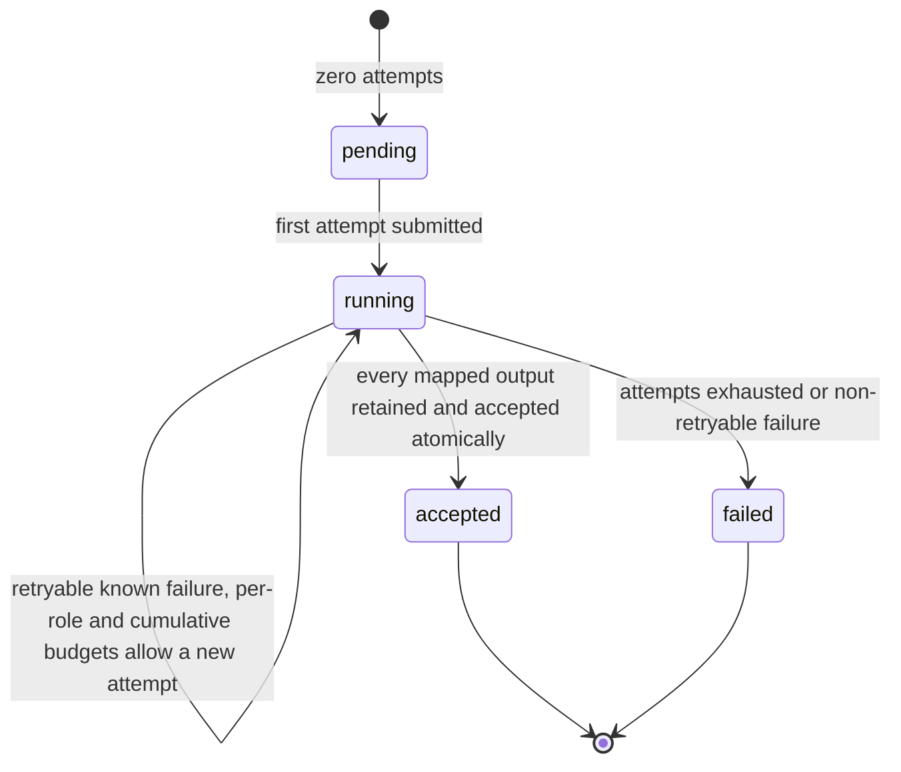
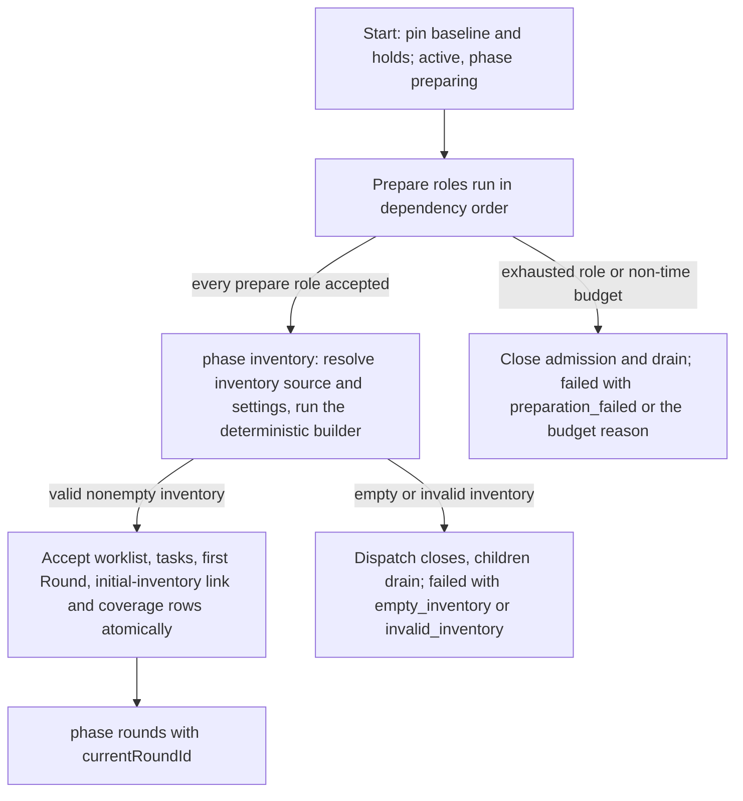
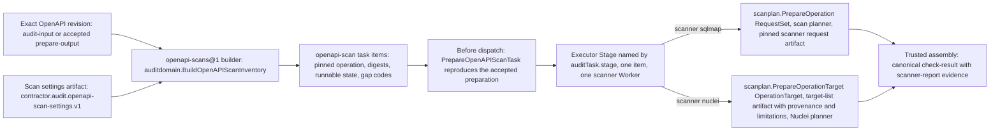

# Audit preparation and OpenAPI scans

Requirement prefix: `ASC` · [Specification index](../README.md)

## Purpose and scope

The executable preparation path is an ordinary Workflow with the existing
Server-operation Stage described by [SOP-R10](../execution/server-operations.md).
Its declared common work output enters [ACT-R13](common-contract.md#ACT-R13)
acceptance and produces separate operation Tasks. Web scanning accepts one
selected target Task. It creates no inventory phase, prepare role or Round.
The original OpenAPI domain selection, conditions and gaps remain with their
domain parser; provider adaptation remains with the owning Runtime adapter.

The former role/inventory/dependency-manifest authoring described below is
retired as an execution contract. Its independent source/settings/domain
constraints remain applicable through their owning parser and ordinary Workflow
inputs; none permits a second profile reader or executor.

This document owns:

- the preparation contract of an AuditProfile: `prepare` Workflow roles, the
  mapping sources that inventories, prepare roles and Round consumers may use,
  the `inventory.source` and `inventory.settings` references, the prepare-role
  attempt bound and the per-profile bounds on roles, baseline inputs, mappings,
  accepted output descriptors and retained output sizes;
- preparation attempts, accepted preparation outputs and the public
  `preparation.roles` projection;
- exact retained item dependency manifests and the declared
  `retained-dependency` check input source;
- the `inventory` phase of a prepared Audit, the atomic acceptance of its first
  Round, and owner controls and Controller outcomes before the first Round;
- the OpenAPI Audit scan adapter: the `openapi-scans@1` inventory builder, the
  `openapi-scan@1` task contract and its `auditTask` executor declaration, the
  scan settings artifact, pinned scan tasks, the Audit use of SQLMap requests,
  fixed Nuclei URL targets, scan coverage and semantic results, and scan retry
  and completion.

It leaves to other documents:

- AuditProfile, Workflow role bindings and role kinds, the baseline, the
  `phase` values, active-check approval and the Audit, Round and item
  lifecycle: [audits](audits.md).
- Audit Controller submission, dispatch, collection, import, recovery, the
  cumulative Run budget `maxSubmittedRuns` and the evidence budget
  `maxEvidenceBytes`: [execution](execution.md).
- Coverage, reports, human review, Audit retention and Audit deletion:
  [review and reports](review-and-reports.md).
- Check result collection and completion inside the Worker, including
  `audit-check-results@1`: [worker completion](worker-completion.md).
- Tool Workers, scan request preparation (RequestSet v1, preparation policy 2,
  `scanplan.PrepareOperation` and the preparation bounds), scan planning and
  the scan session journal: [scanners](../tools/scanners.md).
- Workflow definitions, Stages, input slots and graph validation:
  [workflows](../configuration/workflows.md).
- The opt-in catalog configurations `openapi-operation-trace@3` and
  `findings-review@1`: [findings](../findings/findings.md) (FND-R147,
  FND-R148).
- Exact ArtifactRefs and input forks:
  [artifact store](../artifacts/artifact-store.md); Run hard deletion:
  [retention and deletion](../artifacts/retention-and-deletion.md).
- Shared registries: [limits](../platform/limits.md),
  [errors](../platform/errors.md),
  [failure model](../platform/failure-model.md) and
  [lifecycle](../platform/lifecycle.md).

## Concepts

Terms are defined once in [the glossary](../glossary.md); the ones this
document owns are:

- **Prepare role.** A Workflow role binding with `kind: prepare` whose ordinary
  Workflow produces Audit inputs before any item exists.
- **Preparation attempt.** One submission of a prepare role, identified by
  `(audit_id, workflow_role, role_attempt)`, with no Round, no execution items
  and at most one Run.
- **Accepted preparation output.** A profile-mapped output of a successful
  prepare role, retained with its exact revision and accepted atomically with
  the role's other mapped outputs.
- **Mapping source.** The kind of a mapping reference: `audit-input`,
  `prepare-output`, `item-package`, `execution-manifest`, `retained-output`,
  `round-results` or `retained-dependency`.
- **Generated inventory.** An inventory built in the `inventory` phase from
  accepted preparation outputs instead of from the original baseline.
- **`initial-inventory` link.** The protected Artifact link that pins the
  derived inventory snapshot of a prepared Audit and commits with its first
  Round.
- **OpenAPI scan inventory builder.** The built-in, versioned
  OpenAPI-to-scan-task builder registered as `openapi-scans@1`.
- **`openapi-scan@1` task contract.** The execution contract that the builder
  declares and that a consuming Workflow's executor Stage implements.
- **Scan executor Stage.** The Workflow Stage named by `auditTask.stage`, which
  executes one assigned `openapi-scan` task with one scanner Worker.
- **Scan settings artifact.** The JSON document with schema
  `contractor.audit.openapi-scan-settings.v1` that selects the scanner, target
  server, operations and their bindings.
- **`OperationTarget`.** The in-process fixed URL target that
  `scanplan.PrepareOperationTarget` produces for Nuclei.
- **URL-only limitation.** A limitation code that records which declared
  request data a fixed URL scan does not replay or apply.

## Model

### Prepare role status

Each prepare role reports one status in `preparation.roles`
(ASC-R42).



### From start to the first Round

A prepare profile reaches its first Round through the `preparing` and
`inventory` phases. Pause, deadline, cancel and delete are described in
[Controls before the first Round](#controls-before-the-first-round).



### OpenAPI scan path



## Requirements

### Preparation contract

**ASC-R1.** The preparation contract is the AuditProfile authoring
contract. The fields `sourceInput` and `settingsInput` are rejected, including
in persisted profile snapshots; there is no alternate reader or implicit
conversion.

**ASC-R2.** Repository profiles use the same explicit mapping as
Workflow inputs.

**ASC-R3.** A schema change changes the profile digest. Immutable
snapshots are never silently rewritten to match a newer catalog.

**ASC-R4.** The Workflows and execution contracts a profile selects,
such as `openapi-from-workspace@7` for a `prepare` role or a scan Workflow's
`openapi-scan@1` contract, are configuration choices; the role kind and the
declared input sources determine scheduling and authority.

**ASC-R5.** Preparation happens before any item exists. Workflow
Stages around an item executor cannot replace it.

**ASC-R6.** Prepare parameters may use literals and scope fields,
never item fields.

**ASC-R7.** Prepare roles cannot declare `auditTask` or
`workerCompletion`. The ordinary Workflow of a prepare role may have any valid
topology.

**ASC-R8.** The Server executes valid prepare profiles. Input
preview validates the presence and media contracts of the original inputs;
parsing of generated documents waits until accepted preparation outputs exist.

**ASC-R9.** Preparation may use classified active tools only when the effective
Project policy pinned at Audit start is automatic. Preparation has no item for
individual approval: approval-required mode rejects active preparation before
dispatch, and prohibited mode rejects classified active capabilities.

**ASC-R10.** Preparation leaves the scan approval and
outcome-aware retry rules unchanged.

### Inventory references and mapping sources

**ASC-R11.** `inventory.source` is required for document
inventories and absent for `standard-mappings@1`.

**ASC-R12.** `inventory.settings` is required only for
`openapi-scans@1` and `web-scans@1`; it must accept JSON and must differ from `source`.

**ASC-R13.** Both inventory references use
`{source: audit-input, name}` or `{source: prepare-output, role, name}`.
`name` denotes the Audit input or the producer's logical output. An Audit input
reference forbids `role`.

**ASC-R14.** A `prepare-output` reference requires a declared
prepare producer and a required Workflow output with compatible media types.

**ASC-R15.** Required consumers cannot use optional inputs
or outputs.

**ASC-R16.** Scanner source and settings mappings must exactly
equal the inventory references, including the producer role.

**ASC-R17.** Each mapping source may be used only by the
consumers, and with the scope, that this table allows:

| Source | Prepare consumer | Inventory | Round consumer | Scope |
| --- | --- | --- | --- | --- |
| `audit-input` | yes | yes | yes | Immutable baseline |
| `prepare-output` | yes, dependency order | yes | yes, every Round | Accepted output of this Audit |
| `item-package` | forbidden | forbidden | check item context ([AUD-R39](audits.md)) | Assigned execution |
| `execution-manifest` | forbidden | forbidden | the item execution manifest ([AUD-R40](audits.md)) | Assigned execution |
| `retained-output` | forbidden | forbidden | the discovery and assessment dependency rules ([AUD-R41](audits.md)) | Same Round |
| `round-results` | forbidden | forbidden | required assessment input (ASC-R154) | Complete immutable settled current Round |
| `retained-dependency` | forbidden | forbidden | named check input ([ASC-R170](#exact-retained-item-dependencies)) | Accepted item manifest of this Audit |

**ASC-R18.** A prepare output cannot be consumed as
`retained-output`; a check, discovery or assessment output cannot be consumed
as `prepare-output`.

**ASC-R19.** Self-dependencies, cycles, later-phase
dependencies, unknown roles or outputs and incompatible media types fail
configuration validation.

### Profile bounds

**ASC-R20.** Each prepare role must explicitly set
`maxRunAttempts` in 1..10 (LIM-ASC-1), no larger than
`execution.maxSubmittedRuns`; other role kinds cannot set it. The shared Server
ceiling is `MaxAuditRunAttempts`.

**ASC-R21.** `maxRunAttempts` bounds ordinary Run submissions
for that role, independently of Stage retries inside a Run.

An AuditProfile is bounded as follows:

- **ASC-R22.** at most 16 roles in total (LIM-ASC-2);
- **ASC-R23.** at most 32 baseline inputs (LIM-ASC-3);
- **ASC-R24.** at most 128 input, parameter and output mappings
  per Workflow binding (LIM-ASC-4);
- **ASC-R25.** at most 128 accepted output descriptors per role
  (LIM-ASC-5).

**ASC-R26.** Public retained output descriptors include the
exact ref and digest, media type and size, which is 0..64 MiB (LIM-ASC-6).

**ASC-R27.** The cumulative bytes of retained outputs consume
the evidence budget ([execution](execution.md)), including failed attempt
evidence, and are also bounded by the artifact layer and the chosen parser.

**ASC-R28.** Preparation attempts reserve the cumulative Run budget
atomically and do not introduce an Audit concurrency setting. Per-Run execution
policies and the Scheduler ([scheduler](../execution/scheduler.md)) retain
their authority.

### Phase before the first Round

The `phase` field and its values, the direct-input path that builds inventory
at start, and what a prepare profile pins before its first Run when it enters
`preparing` are specified in [audits](audits.md) (AUD-R190 to AUD-R194).

### Preparation attempts

**ASC-R29.** Every preparation attempt has a unique
`(audit_id, workflow_role, role_attempt)` identity, `kind: prepare`, no Round
and no execution items.

**ASC-R30.** A preparation attempt records one submission key,
at most one Run (LIM-ASC-7), the exact resolved inputs and parameters in the
execution snapshot, and the ordinary execution and receipt lifecycle
([execution](execution.md)).

**ASC-R31.** A retry is a new attempt. A process restart reuses the
existing submission key (FAIL-ASC-1).

**ASC-R32.** A failed authoritative Run or an invalid or missing
required output may consume another bounded attempt: a retryable known failure
starts a new role attempt if both the per-role and the cumulative budgets
allow (FAIL-ASC-1, FAIL-ASC-2).

**ASC-R33.** A lost submit acknowledgement or an uncertain
collection never justifies another Run. An unknown submit or collection
outcome recovers the same intent, Run and receipt, with no speculative retry;
collection I/O uncertainty stays in recovery until resolved (FAIL-ASC-1,
FAIL-ASC-2).

**ASC-R34.** Accepted outputs are reused on resume, restart and all
later Rounds.

### Accepted preparation outputs

**ASC-R35.** All profile-mapped outputs of a successful prepare
role are retained and accepted atomically, including outputs used only as
diagnostics.

**ASC-R36.** Acceptance records the exact source Run output
revision, the retained AuditScope revision, digest, media type and size,
execution and Run identity, the logical name and the actual Workflow output
name.

**ASC-R37.** At most one attempt is accepted per role
(LIM-ASC-8).

**ASC-R38.** Dependent roles fork these exact retained revisions.
They do not read a mutable current binding.

**ASC-R39.** Accepted preparation artifacts are protected by Audit
retention ([review and reports](review-and-reports.md)) and remain readable
after permitted source Run deletion (LIFE-REV-2).

**ASC-R40.** Generated outputs do not replace baseline input or
scope provenance.

### Preparation status

**ASC-R41.** The public `preparation.roles` map uses the authored
role names as keys. Each entry has `status`, `attempts`, `maxAttempts`,
optional current `executionId` and `runId`, and `outputs`.

**ASC-R42.** `status` takes these values:

- `pending`: zero attempts and no execution or outputs;
- `running`: includes submission, recovery, collection and bounded retries;
- `accepted`: has the accepted execution and Run and every mapped exact
  output;
- `failed`: has exhausted attempts or a non-retryable failure, and no accepted
  outputs.

**ASC-R43.** Accepted output descriptors retain the
producing execution and Run identity and the Workflow output name.

**ASC-R44.** A failed attempt's diagnostic evidence remains in
its receipt, not in accepted outputs (LIFE-ASC-2).

**ASC-R45.** `attempts` cannot exceed `maxAttempts`.

**ASC-R146.** After generated inventory is accepted, public Audit reads include
`generatedInventory`: the exact retained snapshot and worklist, source/settings
Artifact descriptors, source-content and canonical inventory digests, accepted
initial item count and gaps. It is absent before acceptance. Original baseline
inputs remain unchanged. One committed `initial-inventory` link and one bounded
exact snapshot read supply this projection; item pages are not scanned. The
link is read with the rest of the Audit's detail in one snapshot and the
exact snapshot after that read (ASC-R149).

**ASC-R147.** Coverage details for an OpenAPI scan include typed `scan`
provenance: scanner, operation pointer, exact source and settings, preparation
digest, runnable state, test parameters and gaps, and the accepted request digest
or fixed target URL when available. These are read from the retained validated
task. Raw request credentials are not included. Evidence may identify a validated
`contentMemberId` in its retained result package.

**ASC-R148.** `GET /v1/audits/{auditId}/artifacts` reads one committed Audit
receipt link selected by `key` and mandatory exact `revision`. Optional `member`
selects a validated package member by ID. It uses existing owner authentication,
transfer admission and byte/time limits. Foreign, absent, uncommitted or
revision-mismatched content returns the same safe 404. Invalid selectors return
400, a changed Audit during the read returns 409, and storage conflicts return
retryable 503. Cancellation ends the read without a mutation. It grants no
Project-prefix browsing or current-binding resolution. Accepted outputs and
results remain readable after source Run deletion and until Audit deletion.

**ASC-R149.** `GET /v1/audits/{auditId}` and the Audit that create, start,
pause, resume, cancel and delete return are the Audit's detail, and a detail
never mixes an earlier phase, revision or ETag with newer preparation or
inventory. The detail of a draft, or of an Audit whose pinned profile has no
prepare role, is the one Audit row the read or the mutation returned. For a
started Audit that pins a prepare role, the Server reads the Audit again with
its pinned roles, each with its attempt count and latest attempt, and, in the
`rounds` phase while it is not deleting, its `initial-inventory` link and its
first Round, in one read-only REPEATABLE READ transaction whose preparation
statement is the one the lists use (ASC-R150); a start response reads the
Audit's current Round and only that Round's items in the same transaction
([AUD-R226](audits.md)). After the transaction commits it reads the exact
inventory snapshot the link names, by ref and digest; that snapshot is
immutable, so no later write enters the detail. The detail, its `revision` and its `ETag`
therefore come from one commit, and a write that commits during the read never
fails it: a mutation response is the Audit as of the mutation's commit or a
later one, as an `Idempotency-Key` replay of it also answers, and an Audit
purged in between answers the `404` a later read would. A transaction conflict
follows the store's transaction retry and then returns the retryable `503`
`storage_transaction_conflict`, a snapshot that fails exact verification is
an integrity failure, and cancellation ends the read without a mutation.
Retained-artifact reads (ASC-R148) check the Audit revision after reading
and return `409` for a changed Audit, and public coverage, finding, review and
provenance pagination keeps its revision pin.

Rationale: an earlier detail checked the Audit revision after hydrating it and
answered `409 conflict` for any write that committed during the read. The
`getAudit` contract declares no `409`, so a polled detail answered an
undeclared status, and a committed mutation answered as if it had lost the
race it won. Declaring `409` on `getAudit` instead would keep both: every
poller would retry needlessly and every mutation response could still report
a conflict. Revisit the single snapshot if the detail must read a part that
is unbounded or mutable outside the transaction, which would have to come
back to a revision check and a declared, retried `409`.

**ASC-R150.** The owner-wide and Project Audit lists give every item in the
`preparing` or `inventory` phase whose pinned profile has a prepare role the
`preparation` that `GET /v1/audits/{auditId}` returns for it; items in other
phases keep their list projection. A list reads its page of Audits and that
preparation in one read-only REPEATABLE READ transaction, so the page shows
every item and its preparation as of one commit: an owner mutation, a new
attempt or a purge that commits during the read is in neither part of the
page, and never fails it with a conflict or a missing Audit. The lists stay
live lists, not revision-pinned snapshots, and a later request sees the
change. The transaction issues the list statement and, only when the page
holds such an item, one preparation statement, whatever the number of items
(at most the page plus the row that decides whether a next page exists,
LIM-API-18). Between the two statements the transaction only checks each
listed Audit's phase, which suffices because an Audit in either phase must
pin a prepare role; pinned profiles are decoded and preparation projected
after it commits, so no profile decoding holds it open. The preparation
statement reads each item's pinned prepare roles (at most LIM-ASC-2), each
role's attempt count and latest attempt, and the output descriptors of an
accepted attempt (at most LIM-ASC-5); it never reads preparation snapshots or
earlier attempts. A transaction conflict follows
the store's transaction retry and then returns the retryable `503`
`storage_transaction_conflict`; other storage failures keep their own class.
Neither phase has `generatedInventory` (ASC-R146), so the lists read no
inventory link or payload.

### Inventory phase and the first Round

**ASC-R46.** After all prepare roles are accepted, `phase: inventory`
resolves the explicit inventory source and settings and reuses the
deterministic inventory builders ([audits](audits.md)).

**ASC-R47.** The original baseline has no inventory field for
this path: generated inventory and worklist provenance is retained separately
through its accepted Round and preparation descriptors.

**ASC-R48.** The validated worklist, tasks and first Round are
accepted atomically, and only then does the Audit switch to `phase: rounds`,
which requires `currentRoundId`. There is no partially accepted first Round,
and no Round or successful coverage exists until the worklist is accepted
(FAIL-ASC-3).

**ASC-R49.** The protected `initial-inventory` Artifact link
pins a versioned derived inventory snapshot, the exact source and settings
identities, gaps, worklist and execution manifest. It commits with the initial
Round and coverage rows, and its retained bytes consume the shared evidence
budget (LIFE-REV-2).

**ASC-R50.** Report construction uses this accepted derived
snapshot while keeping the original baseline digest.

**ASC-R51.** Empty generated inventory fails the Audit with
`empty_inventory`, and invalid generated inventory with `invalid_inventory`,
after dispatch closes and children drain (FAIL-ASC-3). Generated inventory
whose first Round the Audit Store refuses as invalid is invalid inventory,
after one attempt (AUX-R99). The failure creates no placeholder Round, items,
coverage success or fabricated report, and does not imply compliance.

**ASC-R52.** Empty or invalid inventory of a direct-input profile
rejects start before its baseline transaction commits.

### Controls before the first Round

Before the first Round, owner controls and Controller outcomes have these
results:

- **ASC-R53.** For a prepare profile, Start pins the baseline and holds and
  leaves the Audit `active` in phase `preparing`; the response returns
  `audit` and empty `items` and omits `round`. A direct-input profile builds
  its inventory at start and enters `rounds` ([AUD-R192](audits.md)).
- **ASC-R54.** Pause closes admission and enters `paused`,
  preserving the phase, the exact outputs and the holds; existing Runs drain
  and collect.
- **ASC-R55.** Reaching the Audit deadline has the same paused
  behaviour with `deadline_exhausted` ([AUD-R164](audits.md)); child deadlines
  remain independent.
- **ASC-R56.** Resume requires an active Project, the pinned
  baseline and the persisted phase ([AUD-R171](audits.md)), and reopens
  admission without rerunning accepted roles.
- **ASC-R57.** Cancel enters `cancelling`, closes admission,
  cancels and drains owned Runs, collects receipts, releases holds, then
  enters `cancelled`.
- **ASC-R58.** Delete persists the deleting intent, fences
  admission, drains children, then purges retained artifacts through the
  ownership rules of Audit deletion ([review and
  reports](review-and-reports.md)) (LIFE-REV-5).
- **ASC-R59.** An exhausted role or an exhausted non-time budget
  closes admission and drains; the Audit fails with the explicit stop reason
  `preparation_failed` or the budget's own reason (FAIL-ASC-1). A prepare
  role whose dispatch data fails validation, or whose execution intent the
  Audit Store refuses as invalid (AUX-R99), fails it with
  `preparation_failed` too.

**ASC-R60.** Pause and deadline may allow completed outputs to
be collected, but first-Round acceptance waits for resumed admission.

**ASC-R61.** Cancellation and deletion never start inventory or
dependent preparation.

Terminal Audits do not resume ([AUD-R170](audits.md)).

**ASC-R62.** Before a Round exists, item and coverage pages are
empty and no aggregate report is ready; phase, role status and stop reason
explain progress.

**ASC-R63.** After Round creation, the ordinary controls, review,
budgets and Round barriers apply ([audits](audits.md),
[execution](execution.md)).

**ASC-R64.** Richer provenance views may be added without
changing these minimal contracts.

### OpenAPI scan profiles

**ASC-R65.** The supplied-input scan profile takes an exact
supplied OpenAPI document and explicit scan settings, and runs SQLMap request
checks and Nuclei URL checks through the scanner Workers
([scanners](../tools/scanners.md)) and the Scheduler.

**ASC-R66.** Source preparation, which generates the
OpenAPI document through a `prepare` role such as `openapi-from-workspace@7`,
is a separate capability governed by the preparation contract of this
document and is not a prerequisite for the supplied-input scan profile.

**ASC-R67.** The runnable
[`source-openapi-sqlmap-scan@1`](../../../configs/audit-profiles/source_openapi_sqlmap_scan.yaml)
preset accepts an exact source archive and the same explicit scan settings.
One `openapi-from-workspace@7` prepare role produces the OpenAPI document and
validation diagnostics; the Server retains both, constructs the inventory from
the accepted OpenAPI revision with the scan adapter, and forks that revision
into each check Run.

**ASC-R68.** The `source-openapi-sqlmap-scan@1` preset keeps the
same explicit operation denominator, active-check approvals, scanner arguments
and retry rules as the supplied-input SQLMap profile.

### Inventory builder and executor

**ASC-R69.** `inventory.implementation: openapi-scans@1` selects the
built-in, versioned OpenAPI-to-scan-task builder. It is not a Workflow or
AuditProfile name.

**ASC-R70.** The profile chooses its Workflow by an ordinary exact `ref`.
Profile, Workflow, Worker, role and Stage names are operator-authored.

**ASC-R71.** Audit input names can differ from Workflow input aliases
through the declared input mappings.

**ASC-R72.** The builder declares the `openapi-scan@1` task
contract. A consuming Workflow explicitly selects an executor Stage with
`auditTask`; consumers declare `auditTask.contract: openapi-scan@1`
independently of the builder registration:

```yaml
spec:
  auditTask:
    contract: openapi-scan@1
    stage: check-request
  entryStage: prepare-context
  # Ordinary Stages may run before and after check-request.
```

**ASC-R73.** The catalog validates producer and consumer
contract compatibility, then the selected executor's capabilities and input
mappings.

**ASC-R74.** `auditTask.stage` need not be the entry Stage. Other
Workflow Stages and other Audit roles are allowed.

**ASC-R75.** The scan executor accepts one assigned item and one
scanner Worker (LIM-ASC-9); its batch-size, exact-input and approval
constraints belong to that executor.

**ASC-R76.** The scan executor uniquely owns the canonical
check-result output. Ordinary graph validation rejects successful paths
without that required output, and no other Stage can replace it.

**ASC-R77.** A second scan executor requires a different
execution and result contract.

**ASC-R78.** Inventory construction does not inspect the executor's
scanner or entry Stage.

**ASC-R79.** After construction, both input preview and Audit
start check the actual task requirements against the declared executor;
SQLMap settings cannot be dispatched to a Nuclei Worker.

**ASC-R80.** During dispatch the manifest uses Workflow input
aliases; the task retains the original producer input identities.

**ASC-R81.** Additional exact inputs for surrounding Stages do
not change the scanner's assigned source or settings.

**ASC-R82.** The complete `auditTask` declaration is cloned
and retained in immutable Workflow and profile snapshots.

**ASC-R83.** Recovery reads the retained `auditTask`
declaration to select the scanner's journal; surrounding Stage outcomes cannot
be mistaken for scan attempts (FAIL-ASC-6).

**ASC-R84.** Absent `auditTask` fields remain omitted on
ordinary Workflows, preserving their serialized shape and completion
behaviour.

### Pinned items and authority

**ASC-R85.** An accepted item pins one source operation (LIM-ASC-10)
by its canonical JSON Pointer, the original OpenAPI ref and byte digest,
explicit target and operation values, scanner policy and the exact Workflow,
template and configuration versions.

**ASC-R86.** A model or scanner report cannot select a different
operation or substitute a newer source.

**ASC-R87.** Dispatch validates the original-to-Run fork mapping
under the Audit artifact contract ([audits](audits.md), AUD-R155, AUD-R156).

**ASC-R88.** Preparation helpers receive already-authorized bytes;
they do not perform ownership checks or grant network authority.

**ASC-R89.** The Audit adapter requires an explicit absolute
target server selected before start. It passes this override into preparation
instead of trusting generated OpenAPI servers as authorization.

**ASC-R90.** Scope and active-check approval ([audits](audits.md))
remain authoritative.

**ASC-R91.** Scanner arguments and template selections are pinned
by the resolved profile and Worker configuration, not by arbitrary strings
returned by a model.

### Scan settings

**ASC-R92.** Concrete values are supplied with operation bindings
using the `scanplan.Options` contract ([scanners](../tools/scanners.md)):
`path:name`, `query:name`, and for SQLMap also header, cookie, body and
authentication bindings.

**ASC-R93.** Examples and defaults follow
[preparation policy 2](../tools/scanners.md#input-and-selection-policy); types
alone never invent values. Unsupported or missing data produce gaps.

**ASC-R94.** The settings artifact is strictly validated and
pinned before inventory creation. Missing values require a corrected new
Audit; resume cannot rewrite the accepted input snapshot.

**ASC-R95.** `scanplan.DecodeAuditScanSettings` accepts JSON with
schema `contractor.audit.openapi-scan-settings.v1`, up to 256 KiB
(LIM-ASC-11).

**ASC-R96.** The required fields are `schema`, `scanner`
(`sqlmap` or `nuclei`), `server` and a nonempty `operations`.

**ASC-R97.** `server` is a concrete absolute HTTP(S) URL without
credentials, template variables, query or fragment.

**ASC-R98.** `operations` maps canonical operation pointers to
objects with optional `parameters` and `body`, using the binding types of
`scanplan.Options`. Only listed operations enter the inventory; there is no
implicit whole-document scan.

**ASC-R99.** At most 1,000 operations are accepted (LIM-ASC-12).

**ASC-R100.** A body contains both `mediaType` and `value`; an explicit
JSON-null value is data, not an absent body.

**ASC-R101.** SQLMap requires a nonempty `testParameters` list
of up to 64 distinct names (LIM-ASC-13) and allows `authentication` keyed by
declared security scheme.

**ASC-R102.** Nuclei forbids nonempty test parameters or
authentication and any body, header or cookie binding. Explicit
authentication, body, header or cookie bindings are rejected for the fixed URL
interface so that supplied request data cannot be silently discarded.

**ASC-R103.** Unknown fields, case aliases, duplicate keys, null
structural fields and unsafe numbers are rejected with fixed diagnostics
(FAIL-ASC-4).

**ASC-R104.** Scanner arguments, templates and execution budgets
are not accepted through the settings artifact.

### Scan inventory and tasks

**ASC-R105.** `auditdomain.BuildOpenAPIScanInventory` creates an
`openapi-scans` inventory with `openapi-scan` task items. It requires
the effective approval policy pinned in the Audit baseline. It prepares the
selected operations from one parse of the source
([SCN-R256](../tools/scanners.md)).

**ASC-R106.** Each task pins the exact source and settings refs and
byte digests, the selected operation, the preparation digest, the SQLMap
request digest or the Nuclei URL, explicit test parameters, the runnable state
and the preparation gap codes.

**ASC-R107.** Settings are an additional exact
execution-manifest input.

**ASC-R108.** Credentials and request bodies are not copied into
task documents. URL query values are retained as part of a Nuclei target.

**ASC-R109.** Correctly formed settings with unavailable path,
body or authentication data or unavailable SQLMap parameters retain a
non-runnable item with gaps. Missing operations or malformed settings reject
the inventory atomically (FAIL-ASC-4).

**ASC-R110.** Before dispatch, `PrepareOpenAPIScanTask` checks the
source and settings bytes and reproduces the accepted preparation. A different
operation, request, target, parameters, preparation identity or gap set fails
this check (FAIL-ASC-5).

**ASC-R111.** The caller of `PrepareOpenAPIScanTask` still
verifies artifact ownership, trusted manifest membership and the
Project-to-Run fork mapping.

### SQLMap requests

Selecting the assigned operation with `scanplan.PrepareOperation`, including
its selector form, the retention of the original full source ref and digest,
the `unassigned_operation_binding` error and skipped-operation diagnostics,
the `request`-mode preparation identity, and the document-wide source parsing
bounds are specified in [scanners](../tools/scanners.md) (SCN-R118,
SCN-R162 to SCN-R166).

**ASC-R112.** SQLMap consumes the resulting RequestSet through
the [scan planner](../tools/scanners.md#plan-v1-and-selection). Its nonempty
`testParameters` must be explicitly selected and available in the prepared
request.

**ASC-R113.** The planner preserves method, URL, headers and
body, and pins the exact scanner request artifact.

**ASC-R114.** Excluded parameters and unsupported request
representations remain gaps; no automatic broadening is allowed.

### Nuclei fixed URLs

**ASC-R115.** `scanplan.PrepareOperationTarget` produces an
in-process `OperationTarget`: the original exact source, the operation
pointer, the preparation digest, a concrete URL and limitations. `url-target`
is a separate preparation identity.

**ASC-R116.** The URL uses the selected server, path substitutions
and query values. No missing path value is invented.

**ASC-R117.** An empty URL with gaps is an unavailable target and
must not be passed to the scanner.

**ASC-R118.** An `OperationTarget` is deliberately not
serialized as a synthetic GET request.

**ASC-R119.** The URL can come from a POST operation: Nuclei receives
that fixed URL and runs its pinned templates. It does not replay the OpenAPI
method, body, headers, cookies or authenticated session.

**ASC-R120.** Declared requirements are retained as the
limitations `http_method_not_replayed`, `request_body_not_replayed`,
`non_url_parameter_not_applied` and `authentication_not_applied`. All targets
carry `url_template_scan_only`.

**ASC-R121.** An explicitly anonymous URL scan may still target an
operation declaring authentication; it does not count as testing that
authenticated operation.

**ASC-R122.** The adapter must retain the target provenance and
limitations beside the exact target-list artifact passed to the ordinary
Nuclei planner. A bare target-list artifact is insufficient Audit provenance.

**ASC-R123.** Deduplicating equal URLs must preserve every operation
contribution.

**ASC-R124.** Template configuration is pinned. Template scans may
make several requests and must not be presented as one exact HTTP replay.

### Scan coverage and semantic results

**ASC-R125.** The separate `openapi-operations@1` inventory
produces `operation-trace` / `operation-resolution`; its canonical
bytes and `traced-complete` semantics must not change.

**ASC-R126.** The `openapi-scans` inventory has separate coverage
requirements: `sqlmap-request-scan` and `nuclei-url-template-scan`.

**ASC-R127.** Scan coverage accounts independently for:

- the assigned operation and the prepared URL or request, including
  preparation gaps;
- the SQLMap selected test parameters, or the Nuclei URL and the selected
  template policy;
- scanner execution: completed, failed, unavailable, incomplete or unknown;
- semantic evidence: reported observation, inconclusive or not tested.

**ASC-R128.** A successful process exit is execution
completion, not a clean security verdict.

**ASC-R129.** SQLMap request mode reports `reported` or
`unknown`; absence of a technique cannot establish `refuted` or `satisfied`.

**ASC-R130.** Nuclei findings are scanner observations. An
empty result does not establish that the operation is secure.

**ASC-R131.** URL-only limitations must reach the Audit report
even if scanner execution succeeds.

**ASC-R132.** The importer accepts `not-tested`, `blocked` or
`inconclusive` for scan tasks.

**ASC-R133.** Completed execution requires a retained
`scanner-report` evidence item and a runnable accepted task; it still yields
inconclusive security coverage.

**ASC-R134.** Scanner observations can be retained without
declaring a verified violation. Conclusive assessments belong to a separate
verification.

**ASC-R135.** Preparation gaps are always merged into coverage, and
scan provenance into the retained task origin.

**ASC-R136.** Trusted assembly must bind the accepted item and
manifest identity and the exact evidence; raw scanner JSON is not itself an
Audit result package.

### Retry and completion

**ASC-R137.** The scan adapter must address two retry layers: the
scan session fence ([scanners](../tools/scanners.md), SCN-R204) is keyed by
Stage execution identity and protects recovery of that execution, not a new
Stage or Audit item attempt, while the Audit importer treats a failed Run as
retryable ([execution](execution.md), AUX-R32).

**ASC-R138.** The adapter must not impose a blanket one-attempt
limit or disable ordinary Workflow retries.

**ASC-R139.** Failures known to precede scanner invocation and
known failed executions may use the bounded retry policy, with each execution
attempt recorded and charged to its budgets (FAIL-ASC-6).

**ASC-R140.** A committed successful scan result is reused during
recovery; collection, read and publication retries do not rerun its scanner
(FAIL-ASC-6, FAIL-ASC-7).

**ASC-R141.** A known failure must be distinguished from a lost
result after possible scanner execution. That unknown outcome must not
silently become a fresh scan solely because collection sees a failed Run: the
attempted execution and its gap are retained (FAIL-ASC-6). This is an outcome
and recovery rule, not a prohibition on running the same scan again or a
requirement for a new human approval flow.

**ASC-R142.** Automatic handling of unknown outcomes must be
explicit in the pinned execution policy before activation.

**ASC-R143.** Scanner execution uses the ordinary scan planner journal
([scanners](../tools/scanners.md)).

**ASC-R144.** `audit-check-results@1`
([worker completion](worker-completion.md)) is not applied to a multi-stage
or tool-only Worker.

**ASC-R145.** Trusted result assembly must retain reports for
failures as well as for successful execution, and must be tested at the
interruption between scanner completion and package publication (FAIL-ASC-7).

### Direct-target Web scan Audits

**ASC-R151.** `web-scans@1` produces one `web-scan@1` task for an explicit
HTTP(S) URL. Its source is strict JSON `contractor.audit.web-target.v1` with
required `schema` and `url`. Its distinct settings input is strict JSON
`contractor.audit.web-scan-settings.v1`, with required `schema`, `templateIds`,
`tags`, `severity` strings and integer `rateLimit`. Unknown, duplicate, aliased,
null, omitted or invalid fields fail inventory admission before traffic. Both
inputs use the scan options byte ceiling; the shared Nuclei argument validator
owns URL, filter, severity and rate validation. The public component schemas
and shared fixtures describe these artifact documents.

**ASC-R152.** The bundled `web-scan@1` AuditProfile runs one target through
`audit-web-nuclei-scan@1` without a model, source archive or OpenAPI document.
It accepts an optional exact Project rulepack input. Absence selects the pinned
installed Nuclei package; presence selects only the supplied YAML/ZIP through
the existing custom-rulepack adapter, with no installed-rule fallback. Rule
selection is pinned in the exact settings; the installed package digest stays
in the resolved template. The task uses kind `web-scan`, operation `target`
and the existing scan coverage/result shape. Source, settings and baseline
retain their exact identities. Dispatch re-prepares and compares the entire
assignment before any scanner invocation.

Audit admission discovers custom rulepack inputs through each resolved role's
Workflow, the tool Worker's `rulepack_ref` argument and its Stage context input
binding; profile, role and input names do not grant scanner semantics. Draft
selection rejects incompatible Project metadata. Start verifies every selected
exact descriptor and applies SCN-R239's encoded media/size predicate before
reading input payloads or accepting the baseline. A rejected start leaves the
draft editable and creates no child Run. Preview applies the same predicate to
its already verified bytes. Successful keyed start replay returns the original
receipt before looking up mutable catalog or artifact state. Original Audit
inputs remain ProjectScope; ordinary owner-rulepack Run inputs retain their
SCN-R238 scope contract.

A role may instead consume an accepted preparation or retained role output,
whose bytes do not exist at original start. Once that exact output is resolved,
the submission builder verifies its AuditScope metadata and applies the same
predicate before creating a role/check execution intent or submitting a Run.
For a `retained-dependency` input, metadata admission uses the same accepted
source scope as Run input initialization: dependency kind `prepare-output`
selects AuditScope; Project-owned dependency kinds select ProjectScope.
Permanent refusal follows the existing dispatch-contract failure path; read
failures preserve their classification. Independently retained materials are
not deleted by either refusal. Runtime still owns YAML/ZIP content validation.

**ASC-R153.** The trusted scan executor supports a closed set of Nuclei
parameter bindings (`template_ids`, `tags`, `severity`, integer-parsed
`rate_limit`) and the optional `rulepack_ref` artifact binding. Only exact
Audit settings and forked inputs supply them. Plans retain those parameters
and exact input refs and validate their resolved Nuclei arguments before
execution. Run/Stage journals, ambiguous-outcome recovery, deadlines,
active-check approvals, cancellation, evidence collection, inconclusive
scanner coverage and Audit deletion reuse the ordinary scanner Audit path.
No new controller, persistence table, receipt or lease is introduced. The
Web scan profile bounds its inventory to one item, one job per attempt and
three item attempts, within the existing scanner and Audit limits.

### Complete settled-Round inputs

**ASC-R154.** An assessment binding may declare one required JSON Workflow
input mapping `{source: round-results}`. It forbids `name` and `role`; other
role kinds and inventories cannot consume it. Profiles without this mapping,
including direct Runs and deterministic Audits, keep their existing path.

**ASC-R155.** Before dispatching that assessment, the Audit owner captures
exactly one settled current Round, in immutable item ordinal order. Every item
appears once with its final disposition, coverage and gaps, exact selected
attempt and collection receipt or explicit absence. An accepted result pins
its retained exact descriptor. Accepted typed attachment descriptors retain
attribution and conservative classification; they confer no authority and
unknown schemas are not interpreted as research or finding confirmation.
Finding state, current machine assessment and human decision are pinned to
the captured revision.

**ASC-R156.** Capture reads only indexed rows of the selected Round, under
the existing Audit claim and Audit/review mutation lock. Unaccepted pages
belong to one Audit revision. A changed revision discards their bounded
staging and restarts; no staged ArtifactRef or partial root is consumable.
The final capture verifies expected membership and seals that coherent source
generation before immutable Artifact publication. A sealed generation is never
refreshed by later reviews. Interrupted capture and publication reuse the
Round, generation and exact page digests (FAIL-ASC-8).

**ASC-R157.** The strict versioned documents are
`contractor.audit.round-results.v2`, `contractor.audit.round-results-page.v2`
and `contractor.audit.round-results-consumer.v1`. The source root names all
pages, exact refs/digests/media/sizes, item counts and its source generation.
Each page carries that identity and ordered complete items. Source root and
consumer descriptor are each at most 256 KiB; pages are at most 256 KiB,
128 items and 512 total descriptors. There are at most 256 pages and 64 MiB
of source and derived snapshot metadata including root and consumer descriptor
(LIM-ASC-14 to LIM-ASC-18). Tighter artifact/input/evidence limits apply.
Oversize, missing or corrupt complete results fail explicitly without truncation.

**ASC-R158.** One changing construction slice reads at most 128 primary
records, 512 primary/attempt/result/related descriptors and 1 MiB metadata.
Stored conservative JSON sizes select rows before loading their coverage or
attachment metadata. The indexed per-attempt related reads share the remaining
slice budget; a cut closure leaves its whole item for the next slice. Stale
staging cleanup deletes at most 128 rows per slice. Publication progress lives
on its owning Round with one indexed next-page read; it does not rescan the
containing Audit or every staged page each tick (LIM-ASC-19).

**ASC-R159.** The source snapshot remains immutable under protected Audit
retention, with the existing distinct-revision evidence debit and natural
ArtifactLink publication identity. Selected results and attachments must
already be exact authorized retained Audit content before acceptance. No raw
foreign ref, source descriptor, provenance-only ref or JSON mention grants
access. The consumer projection removes prohibited source-derived metadata
and content before exposure, according to the pinned Audit authority; it
never broadens a source mode or substitutes current content.

The source pages and root debit the Audit's `maxEvidenceBytes` as retained
Audit content. Derived Run-local pages and their consumer descriptor belong
to the child input lifecycle and do not debit that Audit retention counter
again. The independent 64 MiB materialization metadata budget includes both
source and derived documents; rewriting an accepted closure cannot evade
that work bound or charge an already retained source revision twice.

**ASC-R160.** The Audit-owned materializer validates the accepted root and
its complete exact page closure, then derives ordinary exact Run-local page
artifacts and required dependencies behind the existing `initializing`
input fence. One declared descriptor consumes one Workflow mapping; pages
consume none. The derived pages and consumer descriptor rewrite required
refs to exact Run-local refs and preserve explicit original-to-retained-to-
consumer mappings and digests. Provenance-only refs stay inert. Generic Run
creation keeps ART-R80 and never recursively follows JSON.

**ASC-R161.** Materialization records bounded durable progress on its
existing child Run, using the immutable Audit execution/accepted root and
Run identities. Its explicit exact Run-local page, descriptor and declared-input closure refs register strict
history holds in the same transaction as progress; ordinary dependency forks
already hold both ends through existing lineage. Publication verifies frozen exact bytes before transferring the staged page
payload to its protected Artifact; staging keeps immutable byte counts and
descriptors without retaining a duplicate payload. A replay of a bound
`initializing` child resumes missing work and cannot create another child,
refresh a source revision or allocate a Stage before complete closure and
the descriptor are committed. Skill initialization respects the same fence.
The complete serialized wire JSON progress is at most 256 KiB, includes at most 1,024 unique exact local hold refs,
and has an immutable deadline ten minutes after the original durable execution
intent was created (LIM-ASC-20 to
LIM-ASC-22). A rolled-back first slice does not reset that deadline.
Materialization and assessment execution have independent clocks
(FAIL-ASC-9).

**ASC-R162.** Pause, deadline and cancel fence new capture/materialization
work under existing Audit ownership; in-flight transactions join before
cleanup. Required foreign, denied, missing, corrupt or incompatible content
fails input initialization permanently, and protected-history conflict is
permanent. Shared storage/history backpressure stays within its existing
three-attempt original deadline. Recovery never reruns a target check merely
to rebuild context. Pending and accepted snapshot rows/links and incomplete
Run-local copies purge through existing Audit/Run lifecycle, with no new TTL,
receipt table or independent holder service (LIFE-ASC-3, LIFE-ASC-4).
## Exact retained item dependencies

**ASC-R170.** A check may declare `retained-dependency` with one portable
Artifact name and no producer `role`. The name resolves only through that
accepted item's manifest, never by searching Project bindings, previous role
names, batches or attempts. A profile without these mappings follows its
existing baseline, prepare-output and same-Round retained-output paths.

**ASC-R171.** The strict `contractor.audit.retained-dependencies.v1` manifest
pins owner, Project, Audit, item key, baseline and profile digests, and the
selected consumer Workflow and Skill closure digests. The Server proves these
pins against the immutable accepted item record. The task package is the sole
transported dependency document; the execution item pins that exact package,
without copying its dependency body. Selected typed or batched task reads must
agree with the accepted SQL dependency manifest. An ordinary singleton retains
its accepted-descriptor dispatch path, and Runtime verifies actual task bytes
before supplying model context. Changing a dependency changes the deterministic task
package identity, without rewriting the source inventory's semantic identity.

**ASC-R172.** Registered exact source kinds are `baseline`, `prepare-output`,
`accepted-item-result` and `finding-receipt`. Each variant has only its own
required fields. A baseline names its input; a prepare source names its role,
logical output, accepted execution/attempt and Run; an item result names its
Round, item, execution/attempt and Run; a finding source alone names an exact
held receipt and proposed-check ordinal. A manifest's own claim of an origin
is insufficient: trusted admission verifies same-owner/Project/Audit/baseline
membership, exact source content, accepted attempt and consumer authorization.
Unknown, foreign or ambiguous origins and unsupported projections fail before
model-visible context is supplied. These source classes describe provenance;
they do not grant source-mode or target-action authority.

**ASC-R173.** Every dependency has a unique sorted name, `projection: exact`,
complete original and retained exact descriptors, a trusted origin and a
sorted `requires` list. Original and retained digest, media type and byte size
must agree. The explicitly enumerated graph is closed and acyclic; all its
required descriptors must be present before acceptance. Preparation dependencies
expand only the pinned declared input graph, and accepted result dependencies
use the selected collection's explicitly retained evidence. References embedded
in arbitrary JSON are inert provenance and are never recursively loaded.

**ASC-R174.** Admission retains each required source in the protected Audit
Project namespace before accepting the immutable next-Round membership. It
reuses the exact Audit copy and existing lineage/holder machinery on replay.
The accepted item's authoritative retained refs acquire strict holds in the
same database transaction as that item, against automatic history eviction
([DEL-R65](../artifacts/retention-and-deletion.md)). Staged retention is not an
accepted item. Distinct retained revisions consume `maxEvidenceBytes` once,
without a second debit on retry or reuse by another item; bytes and originals
remain attributable after the producer Run is deleted.

**ASC-R175.** Before intent creation, dispatch validates every named mapping's
exact retained descriptor and its Workflow media contract against the accepted
manifest. Different required input closures cannot be unioned into one batch.
The Audit-owned materializer verifies and forks the complete authorized closure
into the child Run, retaining original-to-retained-to-consumer refs and digests
in its frozen context. It supplies ordinary Run-local exact refs and finishes
behind the existing input-initialization fence: no Stage or allocation starts
with a partial closure. Generic Run creation keeps [ART-R80](../artifacts/artifact-store.md).
A missing, denied, corrupt or incompatible exact source fails input preparation;
there is no latest fallback or preparation/target rerun to repair context.

**ASC-R176.** One manifest contains at most 32 exact descriptors and 256 KiB of
canonical metadata (LIM-ASC-23), with payloads separate. Dependency retention,
validation and materialization advance in slices bounded by 128 primary records, 512 related
descriptors and 1 MiB metadata (LIM-ASC-24); exact descriptions use at most
32 refs per statement (LIM-ART-8), and retained-link calls keep LIM-AUX-15.
Only indexed selected source/accepted-item rows and holder counts determine
availability. Containing Audit or unrelated Project bindings add no per-item
scan. Tighter item-package, evidence, Artifact history and Run insertion
limits remain authoritative; exceeded bounds reject explicitly, without
truncating a declared closure or publishing partial membership.

**ASC-R177.** Existing ControllerClaims, accepted item identities, keyed
mutations, source lineage and child submission intents own recovery. A lost
retention, acceptance or fork reply resumes the same exact source and child,
retains only missing work and cannot charge evidence or launch a target check
twice. Transaction conflicts and history-maintenance backpressure keep their
existing bounded retry/deadline rules; deterministic validation, missing exact
content and protected-history conflicts are permanent. Admission/storage work
and Run input preparation have separate finite allowances from target execution
(FAIL-ASC-10).

**ASC-R178.** Pause, deadline, cancel and deletion use the existing Audit
admission and drain fences. In-flight materialization joins before owner
release; an incomplete child stays non-schedulable and follows its ordinary
Run lifecycle. Accepted manifests and Audit copies remain immutable through
normal cancellation. Audit purge removes manifest references and releases only
its own obligations within the shared bounded purge; child Run purge removes
its local copies independently. No new TTL, lease, hold table or quota refund
is introduced (LIFE-ASC-5).

## Typed finding-check admission

**ASC-R179.** A profile with declared method mappings uses the registered
finding receipt/ordinal adapter for later-Round checks. Admission reads the
private exact-byte check projection by an indexed receipt/ordinal cursor,
then validates only the selected check fragment and its exact subject and
limitations. An unknown method or absent mapping has a retained rejection
disposition and creates no item or child. A receipt with no checks advances
the cursor without fabricating a check. Profiles without method mappings
retain their existing inventory role and whole-package next-Round path.

**ASC-R180.** Finding check admission strictly rejects an absent or invalid
private check index as invalid stored data. It creates no waiting generation,
rebuild operation or guessed empty check. New receipt publication supplies the
validated index atomically (FND-R188, FND-R190).

**ASC-R181.** Each candidate is prepared inside the current claimed
transaction's savepoint. Its exact retained dependency closure, selected
ordinary Workflow binding, accepted plan, source fragment and task package
exist before budget admission. Refusal rolls back speculative artifacts and
holds together while the outer transaction may retain its deterministic
decision. Source and task copies are frozen Audit artifacts and consume the
existing distinct retained-evidence accounting. Storage replay cannot debit
the same exact revision twice.

**ASC-R182.** Selection publishes one strict canonical prepared-page chain
and one compact root that freezes its ordered membership. Selected source
fragments keep their actual exact source descriptors. Preparation stages
those same trusted stored pages by ordinal; it publishes no second page or
root and cannot replace the frozen bytes. Published and staged counts remain
independent. The last bounded staging phase installs the database membership
seal atomically with its rows and checkpoint. Root publication alone grants
no membership: proposed items stay hidden until one atomic accepted-Round
switch. Acceptance validates the staged counters, generation, page chain,
exact source membership and route pins without rereading all prepared pages.

**ASC-R183.** Admission slices read or change at most 128 primary records,
512 related descriptors, 1 MiB metadata and 64 MiB payload. A selected page
contains at most 128 items under the same descriptor/metadata bounds; a root
is at most 256 KiB. The containing accepted Round retains the existing
4,096-item and tighter pinned limits. The producer includes each actual page
and root once, plus source and task bytes, in the 64 MiB Round construction
budget; its fixed budget checkpoint is at most 4 KiB. The staging slice still
counts its page read, source-index metadata, row envelope and checkpoint
against the combined metadata limit even though it publishes no page copy.
The durable admission checkpoint is at most 64 KiB. No containing receipt
or unrelated artifact population may turn a slice into a whole-history scan.

**ASC-R184.** Typed dispatch reads the compact accepted root and an indexed
fitting prefix of only the selected immutable execution entries. It checks
the exact accepted plan and dependency tuple against each task before
creating an ordinary child intent, rebasing only batch-local ordinals.
Different routes or incompatible exact inputs cannot be unioned into one
child's authority. Existing retained input materialization and Scheduler
initialization fences apply before execution.

## Interfaces

- AuditProfile fields owned here: `inventory.source` and `inventory.settings`
  (ASC-R11 to ASC-R16),
  `inventory.implementation: openapi-scans@1` (ASC-R69) and a prepare
  role's `maxRunAttempts` (ASC-R20). The remaining AuditProfile
  fields are specified in [audits](audits.md).
- Workflow field owned here: `auditTask` with `contract` and `stage`
  (ASC-R72 to ASC-R84); the rest of the Workflow
  definition is specified in [workflows](../configuration/workflows.md).
- Public Audit projection: `preparation.roles` (ASC-R41 to
  ASC-R45) on the Audit and on preparing and inventory list items
  (ASC-R150), with the schemas `AuditPreparation`,
  `AuditPreparationRole` and `AuditPreparationOutput` in
  [contractor-public-v1.yaml](../../../api/openapi/contractor-public-v1.yaml).
- The start response before the first Round (ASC-R53).
- The scan settings artifact `contractor.audit.openapi-scan-settings.v1`
  (ASC-R95 to ASC-R104).

## Limits, failures and errors

- [LIM-ASC-23](../platform/limits.md) and [LIM-ASC-24](../platform/limits.md):
  exact item dependency manifest and admission/materialization slice bounds.
- [FAIL-ASC-10](../platform/failure-model.md): exact dependency admission and
  materialization recovery.
- [LIFE-ASC-5](../platform/lifecycle.md): accepted item dependency lifetime.

Registry entries owned by this document:

- [LIM-ASC-1](../platform/limits.md): prepare-role `maxRunAttempts` in 1..10,
  no larger than `execution.maxSubmittedRuns` (ASC-R20).
- [LIM-ASC-2](../platform/limits.md): 16 roles per profile
  (ASC-R22).
- [LIM-ASC-3](../platform/limits.md): 32 baseline inputs
  (ASC-R23).
- [LIM-ASC-4](../platform/limits.md): 128 input, parameter and output mappings
  per Workflow binding (ASC-R24).
- [LIM-ASC-5](../platform/limits.md): 128 accepted output descriptors per role
  (ASC-R25).
- [LIM-ASC-6](../platform/limits.md): retained output descriptor size
  0..64 MiB (ASC-R26).
- [LIM-ASC-7](../platform/limits.md): one submission key and at most one Run
  per preparation attempt (ASC-R30).
- [LIM-ASC-8](../platform/limits.md): at most one accepted attempt per prepare
  role (ASC-R37).
- [LIM-ASC-9](../platform/limits.md): one assigned item and one scanner Worker
  per scan executor (ASC-R75).
- [LIM-ASC-10](../platform/limits.md): one source operation per accepted scan
  item (ASC-R85).
- [LIM-ASC-11](../platform/limits.md): scan settings artifact up to 256 KiB
  (ASC-R95).
- [LIM-ASC-12](../platform/limits.md): at most 1,000 operations in scan
  settings (ASC-R99).
- [LIM-ASC-13](../platform/limits.md): SQLMap `testParameters` nonempty, up to
  64 distinct names (ASC-R101).
- [FAIL-ASC-1](../platform/failure-model.md): preparation attempt Run
  submission (ASC-R31, ASC-R32,
  ASC-R33, ASC-R59).
- [FAIL-ASC-2](../platform/failure-model.md): collection and acceptance of
  preparation outputs (ASC-R32, ASC-R33).
- [FAIL-ASC-3](../platform/failure-model.md): inventory phase and first-Round
  acceptance (ASC-R48, ASC-R51).
- [FAIL-ASC-4](../platform/failure-model.md): OpenAPI scan settings decoding
  and scan inventory construction (ASC-R103,
  ASC-R109).
- [FAIL-ASC-5](../platform/failure-model.md): pre-dispatch reproduction of the
  accepted scan preparation (ASC-R110).
- [FAIL-ASC-6](../platform/failure-model.md): scanner execution in an Audit
  scan check (ASC-R83, ASC-R139,
  ASC-R140, ASC-R141).
- [FAIL-ASC-7](../platform/failure-model.md): trusted result assembly and
  package publication after scanner completion (ASC-R140,
  ASC-R145).
- [LIFE-ASC-2](../platform/lifecycle.md): failed preparation attempt
  diagnostic evidence (ASC-R44).
- [Errors](../platform/errors.md): the stop reasons `preparation_failed`
  (ASC-R59), `empty_inventory` and `invalid_inventory`
  (ASC-R51).

Owned elsewhere and used here: `unassigned_operation_binding`, the preparation
bounds and the scan session job records ([scanners](../tools/scanners.md));
`deadline_exhausted` ([audits](audits.md)); `maxSubmittedRuns` and
`maxEvidenceBytes` ([execution](execution.md));
[LIFE-REV-2](../platform/lifecycle.md) for accepted preparation artifacts and
the `initial-inventory` Artifact link (ASC-R39, ASC-R49) and
[LIFE-REV-5](../platform/lifecycle.md) for an Audit deleted before its first
Round (ASC-R58) ([review and reports](review-and-reports.md)).

## Security

Security-relevant requirements: preparation never authorizes classified
active-check tools unless the pinned Project policy is automatic (ASC-R9); an accepted
item pins its exact operation, source and versions, and neither a model nor a
scanner report can retarget it (ASC-R85, ASC-R86);
dispatch validates fork mappings and preparation helpers grant no authority
(ASC-R87, ASC-R88, ASC-R111); the target
server is an explicit pre-start override rather than a generated OpenAPI server
(ASC-R89, ASC-R97); scope and active-check approval stay
authoritative and the scan inventory uses the effective pinned active-check policy
(ASC-R90, ASC-R105); scanner arguments and templates are
pinned by configuration, never by model output or the settings artifact
(ASC-R91, ASC-R104); credentials and request bodies
stay out of task documents (ASC-R108); and fixed URL scans never
silently discard supplied request data or count as authenticated testing
(ASC-R102, ASC-R121).

## Examples

The executable example
[`prepared-openapi-scan.yaml`](../../../api/testdata/audit-composition/prepared-openapi-scan.yaml)
selects the `openapi-from-workspace@7` Workflow as a `prepare` role and the
scan Workflow's `auditTask: openapi-scan@1` execution contract. Its inventory
and prepare role:

```yaml
inventory:
  implementation: openapi-scans@1
  source: {source: prepare-output, role: generate-api, name: api}
  settings: {source: audit-input, name: settings}
  itemWorkflowRole: scan
workflows:
  generate-api:
    kind: prepare
    ref: openapi-from-workspace@7
    maxRunAttempts: 2
    inputs:
      source: {source: audit-input, name: source}
    parameters: {}
    outputs:
      api: openapi
      validation: openapi_validation_report
```

The `auditTask` executor declaration is shown with ASC-R72.

## Non-goals

- Preparation introduces no `finalize` or proposed-check routing. Settled-Round
  inputs, exact retained item dependencies and typed check routing use the
  separate contracts above.
- Profiles whose preparation requires classified active-check tools before
  item approval (ASC-R9).
- The OpenAPI scan adapter does not interpret snapshot attachments, retained
  dependencies or proposed-check routing, or add standalone project-analysis preparation.
- Implicit whole-document scans (ASC-R98), synthetic GET
  serialization of fixed URL targets (ASC-R118) and
  conclusive security verdicts from scan tasks (ASC-R134).
