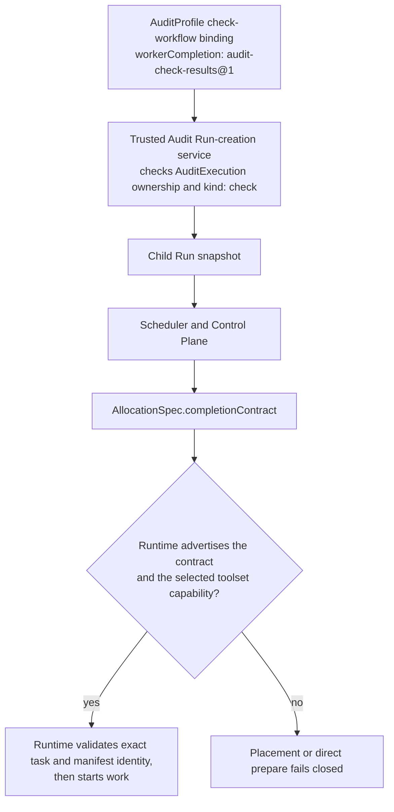
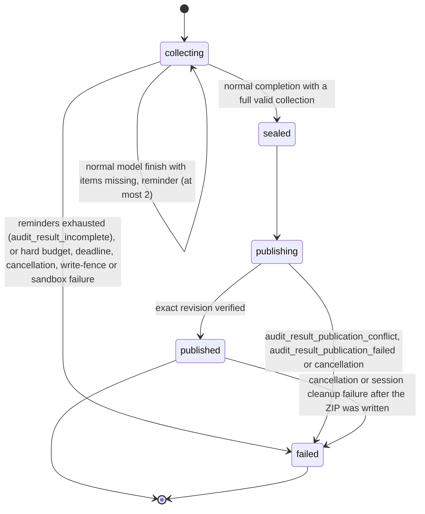
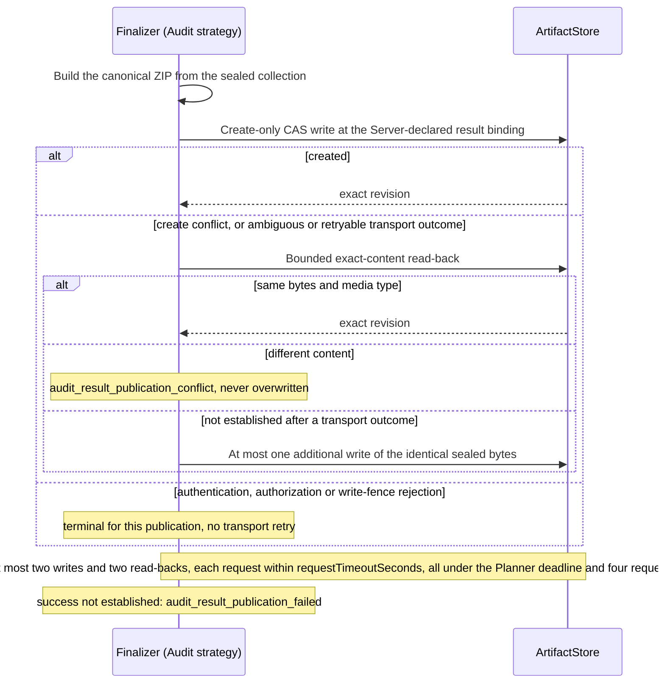

# Audit Worker completion

Requirement prefix: `AWC` · [Specification index](../README.md)

## Purpose and scope

This document owns the opt-in `audit-check-results@1` Worker completion
contract: its trusted activation by an Audit check binding, its pinning on the
child Run and the allocation, invocation-local check result collection by the
`audit-results@2` tools, the completeness gate and bounded continuation at the
Worker's completion boundary, deterministic publication of the
`check-results` package, the Runtime-authored `WorkerResult` and the
completion diagnostics.

It extends the ordinary Worker result path ([worker](../execution/worker.md))
and Audits ([audits](audits.md)). Where those documents describe mandatory LLM
serialization or one-shot Audit submission, this document defines the
explicit opt-in exception. It does not replace ordinary Workflow
finalization.

It leaves to other documents:

- The common Runtime-owned semantic completion boundary and its `continue`,
  `complete` and `fail` outcomes ([WRK-R62](../execution/worker.md)); the
  binding of a prepared completion implementation, including the Audit
  implementation in `toolsets/audit_results`, to its trusted contract and
  required tools under one owner ([WRK-R63](../execution/worker.md)); the
  ordinary completion strategy, its result finalizer and the optional terminal
  summarizer ([WRK-R43](../execution/worker.md),
  [WRK-R64](../execution/worker.md)); `StageContentRequest`, `WorkerResult`,
  `WorkerFailure`, `WorkerCompletion` and the trusted artifact projection:
  [worker](../execution/worker.md).
- `AllocationSpec`, Runtime capability discovery and placement:
  [control-plane](../execution/control-plane.md).
- Planner deadlines: [planners](../execution/planners.md).
- AgentTemplates, ModelPolicies, toolset selection and Worker budgets:
  [agent-templates](../configuration/agent-templates.md).
- The AuditProfile and its Workflow bindings, item task packages and their
  `profile_mode`, the assessment vocabulary and the `check-results` package
  with its hard limits: [audits](audits.md).
- Child Run submission, collection, the trusted importer and Audit retry
  policy: [execution](execution.md).
- Evidence retention and acceptance: [review and
  reports](review-and-reports.md).
- The `finding` tool and the `client_key` it returns:
  [findings](../findings/findings.md).
- Create-only CAS writes and the write fence:
  [artifact-store](../artifacts/artifact-store.md).
- `ExecutionReport` and the model-content telemetry policy:
  [observability](../platform/observability.md).
- Shared registries: [limits](../platform/limits.md),
  [errors](../platform/errors.md), [failure
  model](../platform/failure-model.md) and
  [lifecycle](../platform/lifecycle.md).

## Concepts

Terms are defined once in [the glossary](../glossary.md); the ones this
document owns are:

- **Audit-check completion contract.** `audit-check-results@1`, the opt-in
  completion strategy that a trusted Audit check binding pins to one logical
  Worker; it replaces the ordinary LLM serializer with Runtime-side result
  collection, a completeness gate, deterministic publication and a
  Runtime-authored `WorkerResult`.
- **`workerCompletion`.** The field of an AuditProfile check-workflow binding
  that selects the contract kind and, through `stage` and `agent`, the one
  logical Worker it applies to.
- **Completion contract.** The optional, Server-pinned
  `AllocationSpec.completionContract` that carries the contract kind, the exact
  task and execution-manifest refs and the versionless result binding to
  Runtime.
- **Result collector.** The bounded, invocation-local collection of accepted
  check results that `submit_check_result` builds.
- **Item revision.** The invocation-local positive revision of one accepted
  item, starting at 1.
- **Receipt.** The `recorded` response to an accepted submission; it is not an
  ArtifactRef and claims neither publication nor Audit acceptance.
- **Replay.** A repeated submission of identical canonical content, which
  returns the existing receipt without incrementing the item revision.
- **Seal.** The atomic freeze of a full valid collection at a normal
  completion, after which submissions and updates are rejected.
- **Reminder.** The deterministic, Runtime-authored continuation that names the
  missing trusted item keys.
- **Deterministic publication.** The phase in which the common finalizer's
  Audit strategy builds the `check-results` package from the sealed collection
  and writes it to the Server-declared result binding without the model.
- **Completion facts.** The bounded `completion` diagnostics object: contract
  kind, phase, accepted and total counts, reminder count and failure code.

## Model

### Completion strategies

The Worker completion boundary selects one of two strategies:

| Selected contract | Completion behavior |
| --- | --- |
| Omitted / ordinary | Existing terminal text → one-shot tool-free LLM serializer → trusted projection. Existing optional summarizer remains unchanged. No mandatory Audit tool check. |
| `audit-check-results@1` | Check Runtime's validated per-item collection → seal → deterministic ZIP publication → Runtime-authored WorkerResult. No LLM serializer. |

Under the Audit-check strategy the boundary outcomes of
[WRK-R62](../execution/worker.md) are: `continue` with a reminder while items
are missing (AWC-R72); `complete` with the Runtime-constructed
`WorkerResult` after verified publication (AWC-R100); and `fail` with a
stable failure code ([errors](#limits-failures-and-errors)).

### Activation path



### Collection

Collection state is keyed by `(allocation, invocation, pinned task-set
digest)`. For each accepted item it holds the current canonical data, the item
revision and a bounded replay identity. A receipt reports the item's key and
revision(s) and the progress of the whole collection.

### Completion phases

The completion facts report one of five phases:



### Publication



## Requirements

### Strategy scope

**AWC-R1.** The `audit-check-results@1` contract is an opt-in strategy at the
common Worker completion boundary ([WRK-R62](../execution/worker.md)), enabled
only by the trusted Audit check binding (AWC-R15). It replaces the ordinary LLM
serializer ([WRK-R43](../execution/worker.md)) for the selected Worker without
changing ordinary Workflow behavior.

**AWC-R2.** The strategy uses the same semantic completion boundary as ordinary
completion, before terminal `WorkerCompletion` and not during allocation drain,
and does not invoke the ordinary LLM serializer.

**AWC-R3.** The strategy performs its completeness gate before terminal State
or session teardown, may continue the same invocation within its remaining
budget, and supplies only Runtime-verified publication receipts. Its phase,
failure and accounting rules supplement the ordinary serializer rules of
[worker](../execution/worker.md).

**AWC-R4.** Ordinary Workflows do not acquire this completion rule, and
ordinary Workers without an Audit toolset retain ordinary completion behavior.

**AWC-R5.** Existing deployed Runs and immutable snapshots keep their current
behavior until an explicitly versioned configuration selects this contract; a
retained snapshot that selects `audit-results@1` is the exception (AWC-R19).

**AWC-R124.** Existing resolved snapshots are not rewritten by a catalog
reload.

**AWC-R6.** The strategy does not change durable import, atomic batch
acceptance or retry ownership, which remain as specified in
[execution](execution.md).

### Trusted activation

**AWC-R7.** The activation source is the `workerCompletion` field of an
immutable AuditProfile check-workflow binding, which names the contract kind
`audit-check-results@1`, a `stage` and an `agent` ([example](#examples)). The
binding's existing inputs, parameters and outputs mappings remain required.

**AWC-R8.** `stage` and `agent` select exactly one logical Worker in the
resolved Workflow (LIM-AWC-1), not a physical Runtime. Other stages and Workers
are not implicitly enrolled.

**AWC-R9.** Version 1 of the contract requires the selected stage to use
`passthrough@1`, with one Worker responsible for the entire assigned task set.
Subdividing the batch among Streamline or Router subtask invocations is outside
this version.

**AWC-R10.** The selected stage's declared result binding must feed the check
binding's canonical logical `result` output.

**AWC-R11.** The selected AgentTemplate must explicitly select
`audit-results@2` with both `read_audit_task` and `submit_check_result`, and
must not select legacy `audit-results@1` at the same time.

**AWC-R12.** Version 1 rejects an optional terminal summarizer on the selected
Worker and does not combine the strategy with terminal summarization. This
restriction does not affect ordinary Worker summarization, whose trigger rules
apply to the ordinary completion strategy ([worker](../execution/worker.md)).

Rationale: a tool-free summary cannot replace missing check submissions.

**AWC-R13.** These constraints are validated against every reachable escalation
variant of the selected stage, including replacement AgentTemplates and result
mappings. Changing an execution configuration must not remove the gate, select
`audit-results@1`, add a summarizer or change the pinned task or result
ownership.

**AWC-R14.** Server authoring descriptors must register `audit-results@2`
separately from Runtime capability advertisement.

**AWC-R15.** Only the trusted Audit Run-creation service may activate the
binding, after checking actual AuditExecution ownership and `kind: check`.
Discovery, assessment and other role kinds cannot select it.

**AWC-R16.** Ordinary public Run creation cannot set the contract, including
when it uses the same Workflow or spoofed Audit labels. Run labels, task text,
tool names and model function calls are never activation signals.

**AWC-R17.** Every bundled Audit profile selects this strategy, pinned at
version 1. Bundled Audit Workflows require their profile-supplied contract and
cannot run as ordinary Runs without it.

### Toolset availability

**AWC-R18.** Runtime exposes `audit-results@2` only with a trusted Worker
completion contract. Selecting `audit-results@2` without a trusted contract is
a preparation error, also during direct prepare, and not an implicit change of
ordinary completion behavior.

**AWC-R19.** `audit-results@1` is not registered in Server descriptors or
Runtime factories and is unavailable in both Server configuration and Runtime
discovery. Catalogs selecting it are rejected; retained snapshots selecting it
cannot be placed and must be recreated with the current catalog (FAIL-AWC-1).

### Pinning and propagation

**AWC-R20.** The Server snapshots the choice with the child Run and propagates
it through the Scheduler and the Control Plane into the optional
`AllocationSpec.completionContract`
([control-plane](../execution/control-plane.md)); its shape is given under
[Interfaces](#interfaces).

**AWC-R21.** The contract's refs and its versionless output binding are derived
from the resolved input, Stage and output mappings; they are not additional
operator or model authorities. They must agree with the AllocationSpec grants
and the `StageContentRequest` result binding.

**AWC-R22.** Runtime validates the exact task and manifest identity before
starting work.

**AWC-R23.** The contract grants no new Project or Audit mutation and no
foreign-scope artifact authority.

### Runtime capability and placement

**AWC-R24.** Runtime advertises `capabilities.completionContracts` containing
the supported contract IDs. Omission means no new contracts are supported.

**AWC-R25.** Placement requires both the contract and the selected toolset
capability. Unlike resource diagnostics, completion-contract support constrains
placement and direct preparation and fails closed when unsupported; direct
prepare also rejects unknown or unsupported contracts (FAIL-AWC-1).

**AWC-R26.** Retry and placement preserve the pinned choice and must never
downgrade silently to ordinary completion on an older Runtime (FAIL-AWC-1).

### Invocation deadline

**AWC-R27.** The Planner sends its effective Worker-call deadline in the
private `StageContentRequest.deadline` ([WRK-R6](../execution/worker.md)).
Runtime converts it to a monotonic deadline once, at invocation start;
continuations do not reset it.

**AWC-R28.** The Stage/Planner deadline, not `requestTimeoutSeconds`, bounds
the whole Audit invocation and any coordinated model-recovery wait.

### Result tools

**AWC-R30.** `audit-results@2` keeps the read tool `read_audit_task` and
changes the submit tool `submit_check_result` into a bounded collector.

**AWC-R31.** `read_audit_task` returns the validated, ordered tasks and
requested coverage without exposing opaque base64 ZIPs. For a one-item
assignment it also returns singular `task` and `taskPackageId` fields.

**AWC-R32.** `submit_check_result` records one item or one complete ordered
batch locally. For incremental submissions its model-facing shape is:

```text
submit_check_result(
  item_key, assessment, summary, completed, gaps,
  evidence=[], proposal_keys=[], expected_revision=None
)
```

**AWC-R33.** The model supplies assessments, summaries, completed coverage,
explicit gaps, bounded evidence summaries and proposal receipt keys. Runtime
derives item identities and the execution-manifest digest from the pinned
inputs.

**AWC-R34.** `item_key` must come from the trusted task set; it may be omitted
only for a single-item assignment. Subject, requested coverage and execution
digest are derived from that task, never from model arguments.

**AWC-R35.** Runtime injects the invocation identity used for proposal
selection. The `proposal_keys` argument carries the `client_key` values that
`finding` calls return ([FND-R25](../findings/findings.md) to
[FND-R27](../findings/findings.md)).

**AWC-R36.** `assessment` uses the existing closed vocabulary
([audits](audits.md)), not synonyms such as `pass`.

**AWC-R37.** Neither tool identifies an Audit, changes its assignment, accepts
evidence or bypasses the trusted importer.

**AWC-R38.** Both tools use the invocation's validated snapshot of the exact
contract input refs. Reading the current `inputs/task` or
`inputs/execution_manifest`, as `audit-results@1` did, is insufficient: later
alias changes must not change the assignment or what `read_audit_task` presents
as authoritative.

### Batch and incremental submissions

**AWC-R39.** The compatible `results=[...]` convenience form accepts one
complete ordered batch only, without scalar fields, `item_key` or
`expected_revision`. It validates all members atomically before accepting any.

**AWC-R40.** Incremental scalar calls may arrive in any order, including
parallel calls; a lock serializes acceptance.

**AWC-R41.** When the batch form follows incremental submissions, already
recorded identical members are replays and absent members are creates. Any
changed existing member conflicts and leaves the entire collection unchanged
(FAIL-AWC-2).

**AWC-R42.** Corrections use scalar calls with `expected_revision`; the batch
form does not silently replace items.

**AWC-R43.** Each accepted item has an invocation-local positive revision,
starting at 1.

**AWC-R44.** In a scalar submission, an absent `expected_revision` creates an
unrecorded item.

**AWC-R45.** Identical canonical content repeated without a revision returns
the existing receipt without incrementing the revision (FAIL-AWC-2).

**AWC-R46.** Different content without the current `expected_revision`
conflicts (FAIL-AWC-2).

**AWC-R47.** An explicit update with the current revision atomically replaces
the item and increments its revision; a stale revision fails without mutation
(FAIL-AWC-2).

**AWC-R48.** A retry of an already applied explicit update returns its receipt
only when the expected revision and the content match that immediately
preceding update (FAIL-AWC-2).

**AWC-R49.** A receipt reports `status: recorded`, the item key and
revision(s), the accepted count, the total count, the missing item keys and
completeness. It is not an ArtifactRef and does not claim publication or Audit
acceptance.

**AWC-R50.** Update histories are not retained as unbounded content; the
collector retains only current data and bounded replay identity (LIFE-AWC-1).

**AWC-R51.** Repeating or correcting a call still consumes normal tool budget.

### Local validation

**AWC-R52.** The collector validates before changing the collection:
identifiers and membership, the closed assessment vocabulary, bounded text and
arrays, requested and completed coverage, proposal-key shape and the task-local
evidence rules available to Runtime.

**AWC-R53.** A conclusive checklist result must include each required evidence
kind; `completed` alone is not evidence.

**AWC-R54.** Task-local validation includes the pinned standard evidence
contract's allowed assessments, evidence kinds and minimum and maximum counts,
the minimum applying to conclusive results, and the operation-task rule that
`not-tested` cannot carry completed coverage.

**AWC-R55.** Local validation of `supported` applies the item task's pinned
`profile_mode` as specified in [AUD-R117](audits.md) and [AUD-R118](audits.md).

**AWC-R56.** Local validation preserves the importer's distinction between
invalid input and a valid result whose gaps yield inconclusive coverage; it
does not require every accepted result to be conclusive.

**AWC-R57.** Shared Go/Python fixtures must cover the task-local
evidence-contract rules as well as checklist evidence.

**AWC-R58.** Validation errors identify the field or item and the missing kinds
without copying raw source, summaries or credentials.

**AWC-R59.** Evidence retention and cross-Run, proposal and profile acceptance
remain the trusted importer's responsibility ([execution](execution.md),
[review and reports](review-and-reports.md)); local acceptance is not a
substitute for that validation.

**AWC-R60.** The collector applies the existing limits:

| Bound | Limit | Registry |
| --- | --- | --- |
| Assigned items | at most 64 | [LIM-AUD-3](../platform/limits.md) |
| Summary | at most 16 KiB per summary | LIM-AWC-2 |
| Coverage values | at most 512 per bounded list | LIM-AWC-3 |
| Proposal keys | at most 128 per item (the existing importer limit) | LIM-AWC-4 |
| Evidence records | at most 256 across the whole batch | LIM-AWC-5 |
| Canonical collected data | at most 8 MiB | LIM-AWC-6 |
| Final package | at most 16 MiB | [LIM-AUD-9](../platform/limits.md) |

**AWC-R61.** Replacements are charged by prospective total size, not just the
new item's size.

**AWC-R62.** The collector validates prospective encoded member and package
bounds before accepting a submission, so that a locally accepted complete set
is serializable.

**AWC-R63.** An invalid call consumes no stored item revision and never erases
an earlier valid result (FAIL-AWC-2).

**AWC-R64.** The publisher owns the pure canonical encoder and size calculation
that the collector uses for prospective validation, including per-member limits
and ZIP overhead. The collector must not maintain a second, approximate
encoder.

### Collection state

**AWC-R65.** Collection state belongs to `(allocation, invocation, pinned
task-set digest)`. Even shared ADK sessions do not carry accepted results into
another invocation.

**AWC-R66.** Collection state is outside model-editable ADK State and public or
live-state raw content, and cannot be restored from conversation, metrics or
prior tool-call names.

**AWC-R67.** Cancellation, failure, release and process loss discard unsealed
partial data (LIFE-AWC-1). There is no partial durable AuditItem completion and
no durable recovery or cross-invocation resume of a partially collected
invocation.

### Completion gate and bounded continuation

**AWC-R68.** Success requires a valid accepted submission for every assigned
item. A proposed tool call, an unsuccessful call, a textual claim of
completion, or one successful submission in a larger batch cannot satisfy it.

Rationale: the earlier `MandatoryToolCallback` inspires the bounded reminders
only; its proposal-based call tracking over the agent instance's lifetime is
not sufficient.

**AWC-R69.** This is a condition for successful completion, not an exactly-once
tool-call or eventual-success guarantee. A model may never submit valid data,
and bounded continuation then fails the invocation. Duplicate calls can occur.

**AWC-R70.** Accepted collection, published artifact and importer-accepted
Audit coverage remain three different facts.

**AWC-R71.** At each normal model finish, including empty or meaningless
terminal text, the common completion boundary dispatches to the pinned
strategy. The Audit-check strategy consults accepted collector state, not
terminal prose.

**AWC-R72.** If items are missing, Runtime supplies a deterministic reminder
naming the missing trusted item keys and instructing the model to use
`submit_check_result` or `read_audit_task`. No untrusted tool error text is
promoted into control instructions.

**AWC-R73.** At most two reminders are allowed per invocation, independently of
item count (LIM-AWC-7). A reminder is bounded by the existing 64-item
identifier limits ([LIM-AUD-3](../platform/limits.md)).

**AWC-R74.** Reminders continue the same invocation and session with the same
ModelPolicy and counters; no reset, hidden model call, second A2A invocation or
increased deadline is allowed.

**AWC-R75.** The model may truthfully submit `blocked`, `inconclusive` or
`not-tested` where the existing task contract permits; Runtime never invents
those entries itself.

**AWC-R76.** One logical Worker invocation is separate from repeated ADK runner
turns. A continuation must not repeat `begin_invocation`/`prepare_invocation`,
reset the instrumentation reducer or tool ordinals, clear observed refs, or
erase the collector.

**AWC-R77.** Final State and cleanup occur once per logical invocation.

**AWC-R78.** The `before_run_callback` consumes a one-use preparation token;
simply wrapping `runner.run_async` in a loop is not sufficient.

**AWC-R79.** After the reminder allowance is exhausted, the strategy returns
retryable `audit_result_incomplete` with safe counts and missing identifiers
(FAIL-AWC-3).

**AWC-R80.** Existing hard budget, deadline, cancellation, write-fence and
sandbox failures take precedence and neither grant another reminder nor trigger
publication. A failed or cancelled main invocation cannot be converted into
success merely because its collection is full (FAIL-AWC-3).

**AWC-R81.** Stage and Audit policies, not the retryable flag, decide whether a
new attempt is submitted.

**AWC-R82.** Consuming the last permitted model or tool call is not itself a
budget failure: a normally completed full collection may publish without
another call. Actual budget exceptions or overshoot still fail.

**AWC-R83.** If another model or tool call would exceed its limit, continuation
cannot obtain extra capacity.

**AWC-R84.** Once a normal completion has a full valid collection, Runtime
atomically seals it; further submissions and updates are rejected
(FAIL-AWC-2).

**AWC-R85.** The deterministic publication phase must not return control to the
model or modify the sealed contents.

### Deterministic publication

**AWC-R86.** The common finalizer's Audit strategy, not the model-visible tool,
builds the existing `check-results` package ([AUD-R131](audits.md)). The
importer and wire package formats are kept: `manifest.json`,
`check-results.json`, optional `evidence.json` and evidence members.

**AWC-R87.** The package uses trusted task order regardless of submission
order, stable member and evidence IDs, canonical JSON, fixed ZIP timestamps and
permissions, and stored compression.

**AWC-R88.** For identical sealed values and pinned manifest bytes the
resulting ZIP is byte-identical; wall clock, random IDs and submission or
update order cannot affect it. Proposal invocation identities remain meaningful
inputs, so identical bytes are not promised across different invocations that
select proposals.

**AWC-R89.** The finalizer writes only the Server-declared output binding,
using create-only CAS ([artifact-store](../artifacts/artifact-store.md))
(FAIL-AWC-4).

**AWC-R90.** On a create conflict or an ambiguous transport outcome, a bounded
exact-content read-back may recognize the same bytes and media type at that
binding and return its exact revision. A create conflict permits comparison,
not overwrite; retryable transport errors permit reconciliation (FAIL-AWC-4).

**AWC-R91.** Different content at the binding is
`audit_result_publication_conflict`; the finalizer never overwrites it.

**AWC-R92.** The finalizer retries only the identical sealed bytes, within the
existing deadline and a finite policy that permits at most one additional
write, that is at most two writes (LIM-AWC-8) and two read-backs (LIM-AWC-9) in
total. There is no model repair or re-execution.

**AWC-R93.** Each artifact request has its own `requestTimeoutSeconds` budget,
and all attempts remain under the Planner deadline and a finite publication cap
of four request budgets plus one second for local work (LIM-AWC-10). The
package-size response bound still applies.

**AWC-R94.** If success cannot be established, the strategy returns
`audit_result_publication_failed`.

**AWC-R95.** Size and input-contract errors are non-retryable, transport errors
are retryable, and a conflicting existing output is non-retryable for this
contract. Authentication, authorization and write-fence rejections are terminal
for this publication and do not become transport retries (FAIL-AWC-4).

**AWC-R96.** These failures are translated at the Audit boundary, so that
generic exception handling does not record a programmatic publisher failure as
an LLM error.

**AWC-R97.** The result binding is Run-scoped, not Stage-attempt-scoped. If a
failed attempt already wrote it, a later attempt in the same Run must collect
and seal its own complete set before comparing bytes. Equal bytes may be
recognized; different bytes, including changed proposal invocation identities,
fail with `audit_result_publication_conflict` (FAIL-AWC-5).

**AWC-R98.** Existing bytes never seed the new collector.

**AWC-R99.** A fresh Audit-level retry creates a new child Run and therefore a
fresh result binding. Version 1 does not promise transparent recovery by Stage
retry after publication, and no automatic revision overwrite is introduced.

### Trusted result

**AWC-R100.** After verified publication, Runtime constructs the `WorkerResult`
directly from the request's authoritative subtask ID, a bounded deterministic
completion summary, the finalizer's verified exact artifact receipt, normal
trusted observations and `summarized=false`.

**AWC-R101.** There is no LLM serializer, invented tool call or model token
charge for this work.

**AWC-R102.** Exact receipts from this trusted finalizer are an explicit
extension of tool-observed artifact projection
([WRK-R56](../execution/worker.md)), not an invitation to accept model-authored
artifact refs.

**AWC-R103.** Trusted completion fields enter the common Runtime result
assembly directly, without a synthetic model-JSON wrapper. Runtime validates
the fresh text and identity fields, projects artifacts against the request's
bindings, and retains the actual text, result and `WorkerCompletion` bounds.

**AWC-R104.** The size of an intermediate ASCII-escaped JSON representation is
not an additional Audit completion limit. Ordinary finalizer and terminal
summarizer outputs still pass through the bounded model-JSON decoder before the
same result assembly.

**AWC-R105.** The common lifecycle path still applies cancellation and write
fencing, terminal State, cleanup and `WorkerCompletion` publication.

**AWC-R106.** If cancellation wins after the artifact write, the artifact may
remain for diagnostics but cannot imply Run success or accepted Audit coverage
(LIFE-AWC-2, FAIL-AWC-4).

**AWC-R107.** The Scheduler and the Planner validate Stage outputs; the Audit
importer independently validates and atomically accepts the full set
([execution](execution.md)).

### Completion diagnostics

**AWC-R108.** Bounded completion facts are exposed through the existing typed
report and diagnostic mechanisms: contract kind, phase (`collecting`, `sealed`,
`publishing`, `published` or `failed`), accepted and total counts, reminder
count and a stable failure code.

**AWC-R109.** Terminal facts are persisted so that failed Runs can distinguish
incomplete collection, publication failure and ordinary LLM serialization
failure (LIFE-AWC-3).

**AWC-R110.** Missing item IDs belong in bounded diagnostics, not in metric
labels, and no evidence, source or summary bodies are added to reports. The
existing opt-in model-content telemetry policy
([observability](../platform/observability.md)) remains unchanged.

**AWC-R111.** `ExecutionReport.completion` and the optional `completion` of the
live allocation metrics carry the latest invocation's facts, not a history of
item data (LIFE-AWC-3).

**AWC-R112.** The `completion` object has these fields (LIM-AWC-11):

| Field | Values |
| --- | --- |
| `kind` | Contract kind |
| `phase` | One of the phases listed in AWC-R108 |
| `acceptedCount` | 0..64 |
| `totalCount` | 1..64 |
| `reminderCount` | 0..2 |
| `failureCode` | Bounded; present for failed completion |

**AWC-R113.** The `sealed`, `publishing` and `published` phases require all
assigned results.

**AWC-R114.** Ordinary Workers and historical reports omit the field.

**AWC-R115.** A `completion` object whose `kind` is not the contract kind
`audit-check-results@1` or whose `phase` is not one of the phases of AWC-R108
is malformed, like a known object that breaks AWC-R112 or AWC-R113. No consumer
drops or ignores it: the private JSON Schema, the Server and the Runtime reject
the message that carries it as a whole, and they give every case of the shared
fixture
[`diagnostics.json`](../../../api/testdata/audit-completion/diagnostics.json)
the same verdict (FAIL-AWC-7):

- The Server decodes the object with a validation error, so the containing
  `ExecutionReport` or live allocation metrics fail to decode. A final or abort
  response from the Runtime is an invalid lifecycle response: the allocation
  gets the incomplete placeholder report with `allocation_report_unavailable`
  ([OBS-R37](../platform/observability.md)), and the Stage result and
  termination are unchanged ([OBS-R38](../platform/observability.md)).
- A live Worker State read fails with the non-retryable
  `worker_state_response_invalid`; the Planner's State projection answers the
  non-retryable `worker_state_unavailable`, and the Stage continues.
- The Runtime models the object with the closed kind and phase sets, so its
  producer cannot record an unknown value. Its State endpoint validates every
  snapshot at the wire boundary and answers non-retryable
  `503 agent_state_unavailable`
  rather than serving the snapshot without the object.
- Reports are validated before they are stored and are read back with the same
  strict decoder.

Rationale: a misspelt phase must surface as a rejected report or State read,
not as a report that silently lacks its completion facts.

**AWC-R116.** The optional object is bounded to 4 KiB at the wire boundary
(LIM-AWC-12), measured as compact UTF-8 JSON by the shared private-wire byte
rule of WRK-R37. Formatting whitespace and unnecessary escape spellings do not
consume the bound; Go and Python apply the same verdict to the whitespace-padded
case in `diagnostics.json`.

**AWC-R117.** Public attempt diagnostics retain these facts through the
existing report projection and explicitly distinguish publication from Audit
evidence acceptance.

**AWC-R118.** Phase publication only synchronizes facts; it charges no model
call, tool call or token usage.

**AWC-R119.** Invalid submit calls remain real failed tool calls. Reminders use
the existing invocation budget.

**AWC-R120.** Cancellation and session cleanup failure after the ZIP was
written change the completion diagnostics to `failed`, preserving the recorded
count and leaving the existing output intact. Publishing these late facts does
not complete the invocation a second time (FAIL-AWC-6).

### Bundled checklist profile

**AWC-R121.** The bundled checklist profile is `source-checklist@1` →
`audit-source-check@1` → `audit_source_checker@1`, with a separate bounded
`audit_completion_worker@1` ModelPolicy. It selects `audit-results@2`, one
`passthrough@1` Worker and no target summarizer.

**AWC-R122.** Its completion-specific instruction explains scalar `item_key`
submissions, `expected_revision`, local `recorded` receipts, truthful gaps and
Runtime-owned ZIP publication.

**AWC-R123.** Both failed and interrupted transitions end the child Run; the
Audit's existing attempt policy ([execution](execution.md)) decides whether to
create a fresh child Run. A same-Run retry cannot overwrite different bytes or
different invocation-owned proposal IDs.

## Interfaces

- **Activation binding.** `workerCompletion` with `kind`, `stage` and `agent`
  on an AuditProfile check-workflow binding (AWC-R7; see
  [Examples](#examples)).
- **Allocation contract.** The optional `AllocationSpec.completionContract`
  ([control-plane](../execution/control-plane.md)) carries the contract kind,
  the exact `task` and `executionManifest` input refs and the versionless
  `resultArtifact` binding (AWC-R20, AWC-R21):

```yaml
completionContract:
  kind: audit-check-results@1
  task: {namespace: inputs, name: task, revision: exact-task-revision}
  executionManifest: {namespace: inputs, name: execution_manifest, revision: exact-manifest-revision}
  resultArtifact: {namespace: audit-check, name: result}
```

- **Runtime capability.** `capabilities.completionContracts` lists the
  supported contract IDs (AWC-R24).
- **Worker-call deadline.** The private `StageContentRequest.deadline`
  ([WRK-R6](../execution/worker.md); AWC-R27).
- **Tools.** `read_audit_task` (AWC-R31) and `submit_check_result` (AWC-R32,
  AWC-R39) of `audit-results@2`; the receipt fields are listed in AWC-R49.
- **Result package.** The `check-results` Audit package ([AUD-R131](audits.md);
  AWC-R86).
- **Completion facts.** `ExecutionReport.completion`
  ([observability](../platform/observability.md)) and the optional `completion`
  of the live allocation metrics ([worker](../execution/worker.md)), with the
  fields of AWC-R112.

## Limits, failures and errors

Registry entries owned by this document:

- [LIM-AWC-1](../platform/limits.md): exactly one logical Worker selected per
  `workerCompletion` contract (AWC-R8).
- [LIM-AWC-2](../platform/limits.md): at most 16 KiB per check-result summary
  (AWC-R60).
- [LIM-AWC-3](../platform/limits.md): at most 512 coverage values per bounded
  list (AWC-R60).
- [LIM-AWC-4](../platform/limits.md): at most 128 proposal keys per item
  (AWC-R60).
- [LIM-AWC-5](../platform/limits.md): at most 256 evidence records across the
  whole batch (AWC-R60).
- [LIM-AWC-6](../platform/limits.md): 8 MiB canonical collected-data budget
  (AWC-R60).
- [LIM-AWC-7](../platform/limits.md): at most two reminders per invocation
  (AWC-R73).
- [LIM-AWC-8](../platform/limits.md): at most two publication writes in total
  (AWC-R92).
- [LIM-AWC-9](../platform/limits.md): at most two publication read-backs in
  total (AWC-R92).
- [LIM-AWC-10](../platform/limits.md): publication cap of four
  `requestTimeoutSeconds` budgets plus one second (AWC-R93).
- [LIM-AWC-11](../platform/limits.md): `acceptedCount` 0..64, `totalCount`
  1..64, `reminderCount` 0..2 (AWC-R112).
- [LIM-AWC-12](../platform/limits.md): `completion` object at most 4 KiB at the
  wire boundary (AWC-R116).

Limits owned elsewhere and applied here: the 64-item assignment bound
([LIM-AUD-3](../platform/limits.md)) and the 16 MiB package bound
([LIM-AUD-9](../platform/limits.md)).

Errors ([registry](../platform/errors.md)):

- `audit_result_incomplete` — retryable; the reminder allowance is exhausted
  while assigned items are missing (AWC-R79).
- `audit_result_publication_conflict` — non-retryable for this contract;
  different content already exists at the Run-scoped result binding (AWC-R91,
  AWC-R97).
- `audit_result_publication_failed` — publication success cannot be
  established; retryability depends on the cause: size and input-contract
  causes are non-retryable, transport causes are retryable, and
  authentication, authorization and write-fence rejections are terminal for
  the publication (AWC-R94, AWC-R95).

Failure outcomes ([failure model](../platform/failure-model.md)):

- FAIL-AWC-1 — placement and direct preparation of an allocation with a pinned
  completion contract (AWC-R25, AWC-R26, AWC-R19).
- FAIL-AWC-2 — `submit_check_result` changes to the collection (AWC-R41,
  AWC-R44 to AWC-R48, AWC-R63, AWC-R84).
- FAIL-AWC-3 — the completion gate with an incomplete collection (AWC-R79,
  AWC-R80).
- FAIL-AWC-4 — deterministic publication of the `check-results` package
  (AWC-R89, AWC-R90, AWC-R95, AWC-R106).
- FAIL-AWC-5 — a later attempt in the same Run publishing to an already written
  result binding (AWC-R97).
- FAIL-AWC-6 — cancellation or session cleanup failure after the ZIP was
  written (AWC-R120).
- FAIL-AWC-7 — a `completion` object with an unknown kind or phase, or any
  other malformed one, in a Runtime report or live Worker State (AWC-R115).

Lifecycle ([registry](../platform/lifecycle.md)):

- LIFE-AWC-1 — the invocation-local result collection (AWC-R50, AWC-R67).
- LIFE-AWC-2 — the published `check-results` package at the result binding
  (AWC-R106, AWC-R99).
- LIFE-AWC-3 — completion facts (AWC-R109, AWC-R111).

## Security

The trust boundaries are those of [security](../platform/security.md). The
requirements of this document that protect them are:

- activation only through the trusted Audit Run-creation service, never from
  public Run creation, labels, task text, tool names or model function calls
  (AWC-R15, AWC-R16, AWC-R18);
- contract refs derived from mappings, with no new authority (AWC-R21,
  AWC-R23);
- item identities, subject, coverage, execution digest and invocation identity
  derived by Runtime, not by the model (AWC-R33, AWC-R34, AWC-R35, AWC-R37);
- collection state outside model-editable State (AWC-R66);
- no untrusted tool error text in reminders (AWC-R72) and no raw source,
  summaries or credentials in validation errors (AWC-R58);
- no model-authored artifact refs in the trusted result (AWC-R102).

## Observability

Completion facts (AWC-R108 to AWC-R120) extend the
`ExecutionReport` owned by [observability](../platform/observability.md) and
the live allocation metrics owned by [worker](../execution/worker.md). Missing
item IDs stay in bounded diagnostics and never become metric labels
(AWC-R110).

## Invariants

- A successful Audit-check completion implies a valid accepted submission for
  every assigned item (AWC-R68).
- Sealed contents never change, and publication never returns control to the
  model (AWC-R85).
- The published ZIP depends only on the sealed values, the pinned manifest
  bytes and proposal invocation identities (AWC-R88).
- An existing result binding is never overwritten (AWC-R91, AWC-R99).
- A continuation never resets the deadline, counters, instrumentation reducer,
  tool ordinals, observed refs or collector (AWC-R27, AWC-R74, AWC-R76).
- Accepted collection, published artifact and importer-accepted Audit coverage
  are distinct facts (AWC-R70).

## Examples

An AuditProfile check-workflow binding that activates the contract:

```yaml
workflows:
  check:
    kind: check
    ref: audit-source-check@2
    # Existing inputs, parameters and outputs mappings remain required.
    workerCompletion:
      kind: audit-check-results@1
      stage: check
      agent: checker
```

## Non-goals

- A mandatory tool policy for ordinary Workflows, a general callback framework,
  a public completion override, a durable partial-check store, batch
  decomposition across Workers, automatic acceptance of Audit evidence, global
  replacement of the ordinary LLM finalizer, and automatic demo rollout.
- In version 1 of the contract: durable recovery of a partially collected
  invocation, a target summarizer, and a multi-Worker completion strategy.
