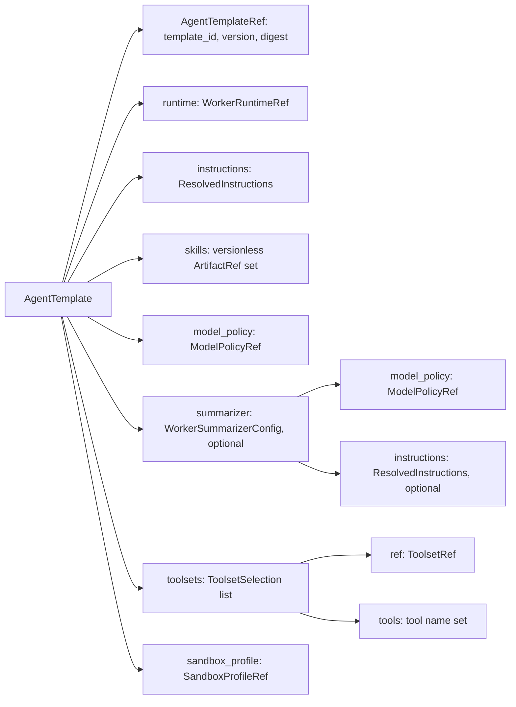
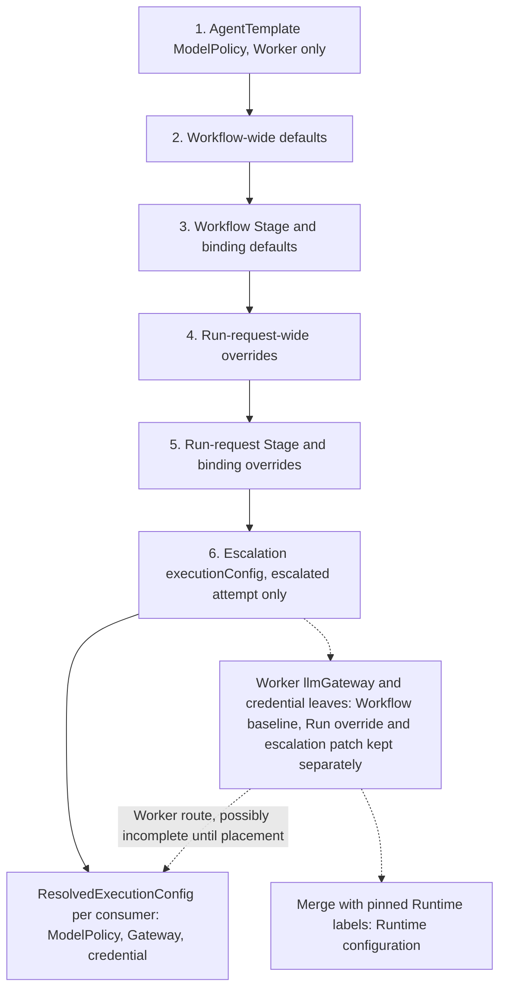

# Agent templates

Requirement prefix: `TPL` · [Specification index](../README.md)

## Purpose and scope

This document owns the AgentTemplate, the reusable definition of a Worker's
intended behavior: its document shape, Worker runtime selection, base
instructions, Agent Skill declaration, Toolset and tool selection,
SandboxProfile selection, optional terminal summarizer configuration,
immutability and canonical digest, its resolution and pinning for a Run, and
its read endpoints. It also owns ModelPolicy, the shared model-loop policy of
Planners and Workers, and executionConfig: the reference-only selections of
ModelPolicy, LLM Gateway and credential that Workflow defaults, Run requests
and escalation profiles make, their precedence layers and their resolution into
ResolvedExecutionConfigs.

It leaves to other documents:

- the shared configuration-file and envelope contract, configuration kinds, the
  `<id>@<version>` selector grammar, all-or-nothing loading and the
  AgentTemplateCatalog as an in-process configuration boundary:
  [Configuration catalog](catalog.md);
- Workflow Stages, Stage Agent bindings, Stage `objective` and `instructions`,
  escalation transition actions and the closed `ref`-or-inline union of an
  escalation `executionConfig`: [Workflows](workflows.md);
- LLMGatewayConfig, LLM credentials, RuntimeConfig, runtime labels and the
  infrastructure layers that complete or override a Worker's physical Gateway
  route: [Runtime configuration](runtime-config.md);
- WorkflowRun creation, the Run snapshot as a resource and Run detail:
  [Runs](../execution/runs.md);
- retry and escalation scheduling: [Scheduler](../execution/scheduler.md);
- placement, AllocationSpec, WorkerHandle and Agent Card checks:
  [Control Plane](../execution/control-plane.md);
- Runtime-side allocation preparation and the built-in `local-workdir@1`
  SandboxProfile: [Runtime Agent](../execution/runtime-agent.md);
- Planner implementations: [Planners](../execution/planners.md);
- Worker budget enforcement, the result finalizer and the Runtime behavior of
  terminal summarization: [Worker](../execution/worker.md);
- the common Toolset contract and Runtime-side tool construction:
  [Toolsets](../tools/toolsets.md); individual Toolsets:
  [Memory](../tools/memory.md), [Workspace](../tools/workspace.md),
  [Code analysis](../tools/code-analysis.md),
  [HTTP and Caido](../tools/http-caido.md),
  [Code execution](../tools/code-execution.md); Agent Skill packages, pinning
  and the ADK SkillToolset: [Skills](../tools/skills.md); model-free `tool@1`
  Workers: [Scanners](../tools/scanners.md);
- the Catalog UI: [UI](../ui/ui.md);
- usage attribution: [Observability](../platform/observability.md); trust
  boundaries and secrets: [Security](../platform/security.md).

## Concepts

Terms are defined once in the [glossary](../glossary.md).

| Term | Meaning here |
| --- | --- |
| AgentTemplate | The reusable, immutable definition of a Worker's intended behavior; a Contractor contract, not an ADK object and not a running Agent. |
| AgentTemplateRef | `template_id`, `version` and `digest`, identifying one exact AgentTemplate body. |
| AgentTemplateCatalog | The Server configuration boundary that loads, validates, resolves and digests AgentTemplates ([Configuration catalog](catalog.md)). |
| Worker runtime | The generic code, selected by the template's `runtime` field, that executes an AgentTemplate. |
| Worker | An ephemeral in-process instance created from one AgentTemplate for one allocation. |
| ResolvedInstructions | The normalized instruction ref, content digest and resolved UTF-8 text of an instruction resource. |
| ModelPolicy | The shared, immutable model-loop policy of a Planner or Worker: a Gateway model alias plus portable generation and execution-safety fields. |
| Model consumer | A modeled user of a ModelPolicy: an `adk@1` Worker, a Worker summarizer, or a `streamline@1` or `router@1` Planner. |
| Toolset | A versioned group of model-visible tools implemented by the selected Worker runtime ([Toolsets](../tools/toolsets.md)). |
| Toolset selection | One exact Toolset ref plus an explicit allowlist of its tools. |
| SandboxProfile | Registered Runtime Agent behavior selected by an exact ref. |
| Worker summarizer | The optional one-shot terminal summarization policy of an `adk@1` AgentTemplate. |
| executionConfig | Reference-only selections of ModelPolicy, LLMGatewayConfig and credential for Planner and Worker consumers, given as Workflow defaults, a Run override or an escalation override. |
| Execution-selection leaf | One object with the optional fields `modelPolicy`, `llmGateway` and `credential`, at least one of them present. |
| ExecutionConfig | The configuration kind of an immutable, Stage-local escalation override profile. |
| ExecutionConfigRef | The exact `(name, version)` of an ExecutionConfig plus the digest of its normalized manifest. |
| ResolvedExecutionConfig | The effective per-consumer selection that Run initialization stores in the immutable WorkflowRun snapshot. |
| Escalation variant | The ResolvedExecutionConfig of an escalated attempt, resolved at Run initialization. |

## Model

### AgentTemplate

An AgentTemplate separates three things:

- the Stage-local logical name used by Planner;
- the semantic Worker configuration reused across Workflows;
- the allocation-scoped Worker runtime instance created from that configuration
  inside one Runtime Agent process.

The template is a Contractor contract, not an ADK object and not a running
Agent.

The logical model of a resolved AgentTemplate and of the references it carries
is:

```python
class AgentTemplateRef(BaseModel):
    template_id: str
    version: str
    digest: str


class WorkerRuntimeRef(BaseModel):
    runtime_id: str
    version: str


class ModelPolicyRef(BaseModel):
    policy_id: str
    version: str
    digest: str


class ModelPolicy(BaseModel):
    ref: ModelPolicyRef
    model: str
    context_window_tokens: int | None = None
    max_output_tokens: int | None = None
    max_model_calls: int | None = None
    max_tool_calls: int | None = None
    max_worker_calls: int | None = None
    max_total_tokens: int | None = None
    temperature: float | None = None


class LLMGatewayConfigRef(BaseModel):
    gateway_id: str
    version: str
    digest: str


class LLMCredentialRef(BaseModel):
    credential_id: str


class ToolsetRef(BaseModel):
    toolset_id: str
    version: str


class ToolsetSelection(BaseModel):
    ref: ToolsetRef
    tools: frozenset[str]


class SandboxProfileRef(BaseModel):
    sandbox_profile_id: str
    version: str


class WorkerSummarizerConfig(BaseModel):
    model_policy: ModelPolicyRef
    instructions: ResolvedInstructions | None = None
    context_window_ratio: float = 0.9
    cumulative_budget: int | None = None


class AgentTemplate(BaseModel):
    ref: AgentTemplateRef
    description: str
    runtime: WorkerRuntimeRef
    instructions: ResolvedInstructions
    skills: list[ArtifactRef] = Field(default_factory=list)
    model_policy: ModelPolicyRef
    summarizer: WorkerSummarizerConfig | None = None
    toolsets: list[ToolsetSelection]
    sandbox_profile: SandboxProfileRef
```

The semantics of `LLMGatewayConfigRef` and `LLMCredentialRef` are owned by
[Runtime configuration](runtime-config.md).



### ExecutionConfig layers

executionConfig appears on three surfaces: the Workflow's
`spec.executionConfig` defaults, the optional top-level `executionConfig` of a
`POST /v1/runs` request, and the executionConfig of an escalation transition,
which is either an exact ExecutionConfig profile or an inline override
([Workflows](workflows.md)). Each surface carries execution-selection leaves.
Run initialization resolves them, in the precedence below, into a base
ResolvedExecutionConfig and one escalation variant per declared escalation for
every modeled consumer.



Later layers win. Solid edges show the authoritative order for ModelPolicy,
budgets and Planner model access. Dashed edges show the Worker's physical
route leaves: each ResolvedExecutionConfig holds the Worker route, which may
remain incomplete until placement, when the infrastructure layers of
[Runtime configuration](runtime-config.md) complete or override it.

## Requirements

### AgentTemplate document

**TPL-R1.** An AgentTemplate document follows the shared configuration-file and
envelope contract ([Configuration catalog](catalog.md)). `metadata` contains
exactly `name` and `version`; that pair is the AgentTemplateCatalog lookup key
regardless of the file name.

**TPL-R2.** `spec` contains the mandatory `description`, `runtime`, `toolsets`
and `sandboxProfile` fields. Unknown fields and duplicate YAML mapping keys are
invalid. For `runtime: adk@1`, `spec` also contains the mandatory
`instructions` and `modelPolicy` fields, for six mandatory fields in all, and
the optional `skills` and `summarizer` fields; these model fields are absent in
the `tool@1` variant (TPL-R5). The fields are:

- `description` (mandatory): a non-empty purpose string for human-facing
  configuration and for the deterministic `router@1` agent roster;
- `runtime` (mandatory): an exact Worker runtime selector (TPL-R3);
- `toolsets` (mandatory, possibly empty): the Toolset selection list (TPL-R38);
- `sandboxProfile` (mandatory): an exact SandboxProfile selector (TPL-R44);
- `instructions` (mandatory for `adk@1`): exactly the mandatory `ref`
  (TPL-R7);
- `modelPolicy` (mandatory for `adk@1`): an exact ModelPolicy selector
  (TPL-R15);
- `skills` (optional for `adk@1`): the versionless Agent Skill ArtifactRef set;
  omission is equivalent to an empty set (TPL-R11);
- `summarizer` (optional for `adk@1`): the one-shot terminal summarization
  policy (TPL-R47).

`runtime`, `modelPolicy` and `sandboxProfile` use the shared `<id>@<version>`
selector grammar ([Configuration catalog](catalog.md)).

### Worker runtime

**TPL-R3.** An AgentTemplate is the complete declarative definition selected by
Workflow. Its `runtime` field chooses the generic code that can execute that
definition; `adk@1` is the model-backed runtime value, and the model-free
`tool@1` variant is described in TPL-R5. Many different AgentTemplates may use
the same runtime.

**TPL-R4.** A running Worker is an ephemeral in-process instance created from
one template for one allocation; it is not another service or operating-system
process. An AgentTemplate never becomes a physical deployment or a long-lived
Agent identity.

**TPL-R5.** The model-free `tool@1` variant and its explicit `execution`
bindings are specified in [Scanners](../tools/scanners.md). The model fields in
this document describe `adk@1` and are absent in the tool variant. The `adk@1`
requirements are unchanged by the tool variant, and `execution` is forbidden
for every runtime other than `tool@1`.

**TPL-R6.** ResolvedAgentTemplate embeds a `tool@1` template's `execution`
unchanged. Its canonical digest uses the sorted toolsets, runtime, sandbox and
description projection, omits instructions and modelPolicy, and adds
`execution`. An `adk@1` template's digest is computed as defined in TPL-R58
and is not affected by the `tool@1` projection. The same absence of a model is
preserved in the resolved consumer execution config and in AllocationSpec; null
or placeholder model objects are not a model-free route.

### Instructions

**TPL-R7.** `spec.instructions` contains exactly the mandatory `ref`. It uses
the same configuration-root-relative text-resource ref contract
([Configuration catalog](catalog.md)) as Stage Planner instructions
([Workflows](workflows.md)):

```yaml
spec:
  instructions:
    ref: instructions/openapi-builder-worker-memory.md
```

**TPL-R8.** AgentTemplateCatalog resolves the UTF-8 text at load time. The
normalized ref, content digest and resolved text form `ResolvedInstructions`.
The resolved content contributes to the enclosing AgentTemplate digest and is
sent inside the complete template in AllocationSpec, so Runtime Agent requires
no catalog or filesystem access.

**TPL-R9.** ModelPolicy, Toolset selections and SandboxProfile are
framework-neutral Contractor data. An ADK Worker adapter translates them into
runtime configuration only when an allocation is prepared.

**TPL-R10.** `AgentTemplate.instructions` defines reusable Worker behavior. It
is distinct from a Workflow Stage's `objective` and `instructions`, which tell
Planner what that particular Stage must accomplish and how to orchestrate its
prepared Workers. Resolving a Stage never concatenates those fields into the
stored AgentTemplate and never mutates it.

How always-on `instructions` differ from progressively disclosed `skills`, and
which requirements belong in instructions rather than in a skill, is owned by
[Skills](../tools/skills.md).

### Agent Skills

**TPL-R11.** `spec.skills` is optional; omission and `skills: []` normalize to
the same empty set. Each entry uses the existing `ArtifactRef` shape with exact
Namespace `skills`. `revision` is forbidden in AgentTemplate source, and the
owner UserScope is supplied by the Run rather than encoded in the ref.

**TPL-R12.** Entries are unique by `(namespace, name)` and are normalized in
name order. The normalized logical `(namespace, name)` refs contribute to the
AgentTemplate digest, and the canonical manifest omits an empty set (TPL-R58).
Adding or removing refs, or otherwise changing the normalized set to a distinct
value, is a behavioral change that requires a new AgentTemplate version.

**TPL-R13.** A skill `name` follows the Agent Skills grammar: 1 through 64
(LIM-TPL-1) lowercase ASCII letters, digits or hyphen-separated components. It
cannot start or end with a hyphen or contain consecutive hyphens, and it must
equal `name` in the package's `SKILL.md` frontmatter.

**TPL-R14.** AgentTemplateCatalog validates the `skills` syntax at
configuration load but does not require the current packages. WorkflowRun, not
Runtime, resolves the declared refs in the owner UserScope and pins exact
immutable revisions while it initializes. That pinning, ordinary Artifact
update, Run fork, AllocationSpec delivery, native ADK behavior and the limits
on the number of skill refs per AgentTemplate and per Run are owned by
[Skills](../tools/skills.md).

Why skills belong to the AgentTemplate, and which Workflow, Stage, Run and
Planner surfaces cannot change them, is owned by [Skills](../tools/skills.md).

```yaml
spec:
  skills:
    - namespace: skills
      name: likec4
```

### ModelPolicy

**TPL-R15.** For `runtime: adk@1`, ModelPolicyCatalog resolves the mandatory
`spec.modelPolicy` selector before the AgentTemplate is accepted. The resolved
`ModelPolicyRef(policy_id, version, digest)` and complete validated policy body
are embedded in the resolved AgentTemplate and in AllocationSpec; Runtime Agent
performs no policy-catalog lookup. The exact ref contributes to the enclosing
AgentTemplate digest.

```yaml
spec:
  modelPolicy: worker@2
```

**TPL-R16.** ModelPolicy is one shared, immutable kind usable by Planner and
Worker consumers. It owns the logical LLM Gateway model alias and the portable
generation or cumulative execution-safety fields that its consumer uses. It
does not own the Gateway endpoint, provider credentials or provider routing.

**TPL-R17.** ModelPolicy bounds stop one Planner or Worker model loop
deterministically; they are not a Gateway-wide spend, rate or account quota.
ModelPolicy call and token ceilings remain authoritative only for bounded
execution of their selected Planner or Worker and are enforced independently of
Gateway-reported spend or rate state.

Gateway authority over Gateway-wide model access, spend and rate limits is
owned by [UI](../ui/ui.md) (invariant 8); the display of Gateway-reported spend
and rate state and the handling of Gateway quota rejections are owned by
[Observability](../platform/observability.md) (OBS-R17).

**TPL-R18.** A Planner never inherits a Worker's policy implicitly:
executionConfig selects the Planner's own exact ModelPolicy when the chosen
Planner implementation uses an LLM.

**TPL-R19.** A ModelPolicy `spec` contains only `model` and the seven optional
portable fields `contextWindowTokens`, `maxOutputTokens`, `maxModelCalls`,
`maxToolCalls`, `maxWorkerCalls`, `maxTotalTokens` and `temperature`. Arbitrary
provider-specific parameters are invalid. ModelPolicy contains no URL, token,
retry policy, request timeout, Stage deadline, organization quota or pricing
configuration; those concerns remain in the selected LLMGatewayConfig
([Runtime configuration](runtime-config.md)), in RuntimeSettings or in the
enclosing execution contract.

**TPL-R20.** `model` is a mandatory non-empty opaque Gateway alias; Contractor
does not parse it as a provider/model pair.

**TPL-R21.** Every other field is structurally optional: a policy omits a limit
or parameter that its intended consumer does not use. Every present numeric
limit is a positive integer.

**TPL-R22.** `contextWindowTokens` pins the model route's advertised
input-plus-output context capacity. Contractor treats it as pinned operator
metadata and does not ask the provider to discover it at Runtime.

**TPL-R23.** `maxOutputTokens` caps one model response and must be smaller than
`contextWindowTokens` when both are present (LIM-TPL-2).

**TPL-R24.** `maxModelCalls`, `maxToolCalls`, `maxWorkerCalls` and
`maxTotalTokens` are cumulative across one complete Planner or Worker
invocation.

**TPL-R25.** `maxModelCalls` is at most 1,000 (LIM-TPL-3); `maxToolCalls` and
`maxWorkerCalls` are each at most 10,000 (LIM-TPL-4, LIM-TPL-5);
`maxTotalTokens` and `contextWindowTokens` are each at most 100,000,000
(LIM-TPL-6, LIM-TPL-7). These maxima reject configuration mistakes and are not
recommended operating values.

**TPL-R26.** `temperature` is optional. When it is absent, the Worker and the
modeled Planners (`streamline@1` and `router@1`) omit the parameter instead of
inventing a default; an explicit zero is preserved. When present, it is a
finite JSON number greater than or equal to zero (LIM-TPL-8). The Gateway
remains responsible for whether that value and the per-response output limit
are supported by the selected route.

#### Consumer compatibility

**TPL-R27.** Optional in the shared schema does not mean unbounded by default.
Each model consumer declares the fields it requires, and each consumer rejects
a policy missing one of its required finite limits: configuration resolution
fails before Run execution if the selected policy is incompatible (FAIL-TPL-1).

Rationale: consumer validation lets one kind represent both roles without
inventing zero values or silently treating an omitted safety limit as infinity.

**TPL-R28.** An `adk@1` Worker requires `maxOutputTokens`, `maxModelCalls` and
`maxTotalTokens`. It additionally requires `maxToolCalls` when the resolved
AgentTemplate exposes any model-visible Contractor tool or Agent Skill. It does
not use `maxWorkerCalls`.

**TPL-R29.** An `adk@1` Worker's `maxModelCalls` and `maxTotalTokens` include
the mandatory result-finalizer call owned by [Worker](../execution/worker.md).
The explicitly pinned Audit-check strategy
([Audit worker completion](../audits/worker-completion.md)) instead makes no
finalizer model call.

**TPL-R30.** A Worker whose AgentTemplate enables terminal summarization
additionally requires `contextWindowTokens`, so that Runtime can derive its
soft context boundary ([Worker](../execution/worker.md)).

**TPL-R31.** A Worker summarizer policy is tool-free. It requires
`contextWindowTokens`, `maxOutputTokens` and `maxModelCalls: 1` (LIM-TPL-9),
permits neither `maxToolCalls` nor `maxWorkerCalls`, and is invoked at most
once; a larger or missing `maxModelCalls` is a configuration error. Its
`maxTotalTokens` is optional because the call count is already one; when
present, Runtime checks it against the provider usage reported for that single
call. Runtime also enforces the one-call bound
([Worker](../execution/worker.md), LIM-WRK-21).

**TPL-R32.** A `streamline@1` or `router@1` Planner requires `maxOutputTokens`,
`maxModelCalls`, `maxWorkerCalls` and `maxTotalTokens`; it does not use
`maxToolCalls`.

**TPL-R33.** `passthrough@1` does not use an LLM and therefore has no Planner
ModelPolicy selection.

Runtime enforcement of these ceilings, including the capacity checks before
each operation, token accounting and the retryable `worker_budget_exhausted`
failure, is owned by [Worker](../execution/worker.md).

#### ModelPolicy identity

**TPL-R34.** ModelPolicyCatalog validates and normalizes the document, then
computes `ModelPolicyRef.digest` as SHA-256 over its RFC 8785 JCS manifest,
using the same `sha256:<64 lowercase hex>` representation as AgentTemplate.
Runtime Agent verifies the resolved policy body against that digest before
configuring the Worker model client (TPL-R63).

**TPL-R35.** Future schema versions may add explicit portable ModelPolicy
fields without changing the meaning of `contractor/v1alpha1`.

**TPL-R36.** A ModelPolicy or LLMGatewayConfig version published at runtime,
and its digest, is never edited in place ([CAT-R44](catalog.md)). Until the
first release a shipped operator-root version may change in place, which
changes its digest ([CAT-R74](catalog.md)).

### Toolset selection

**TPL-R37.** An AgentTemplate chooses both the exact Toolset
([Toolsets](../tools/toolsets.md)) and an explicit allowlist of tools within
it.

**TPL-R38.** `toolsets` is a mandatory list but may be empty. Every entry
contains exactly a versioned `ref` and a non-empty `tools` list.

**TPL-R39.** Tool names are case-sensitive, must be unique within their entry
and must be exported by the selected Toolset version. A Toolset ref may appear
only once in an AgentTemplate.

**TPL-R40.** List order has no meaning: normalization sorts selections by exact
ref and sorts tool names before computing the AgentTemplate digest.

**TPL-R41.** `v1alpha1` has no wildcard, no omitted-list-means-all behavior and
no exclusion mode. To expose every tool, the author lists every name
explicitly. Omitting a Toolset exposes none of its tools.

Rationale: a newly added Toolset function cannot become model-visible to an
existing AgentTemplate without a template change and a new digest.

**TPL-R42.** AgentTemplateCatalog rejects unknown Toolset refs, unknown
selected tool names and cross-Toolset collisions in final model-visible tool
names, independently of the currently connected Runtime fleet. Runtime-side
validation against a Runtime Agent's capability snapshot, and construction of
only the selected tools, are owned by [Toolsets](../tools/toolsets.md).

**TPL-R43.** The native ADK Agent Skill functions enabled by a non-empty
`skills` field are the one bounded first-class exception to the Toolset
selection rule; the exception is explicit in the AgentTemplate body rather than
inferred from Runtime installation or a label. Their construction, script
filtering and tool-call accounting are owned by [Skills](../tools/skills.md).
When `skills` is non-empty, AgentTemplateCatalog rejects any selected
Contractor Toolset operation named `list_skills`, `load_skill` or
`load_skill_resource`, so the model-visible function namespace remains
unambiguous, and it validates the Worker ModelPolicy as tool-using (TPL-R28)
even when the ordinary `toolsets` list is empty.

No Toolset is implicit: memory tools, workspace filesystem and edit tools, and
every other Toolset reach a Worker only through this allowlist. Their
operations, and the checked-in templates that select them (such as
`caido_analyst@1`, `http_explorer@1`, the discovery template and the trace
template), are specified with each Toolset: [Memory](../tools/memory.md),
[Workspace](../tools/workspace.md), [Code analysis](../tools/code-analysis.md),
[HTTP and Caido](../tools/http-caido.md) and
[Code execution](../tools/code-execution.md).

### SandboxProfile

**TPL-R44.** `spec.sandboxProfile` identifies registered Runtime Agent
behavior, not an arbitrary mapping of host settings. Its exact ID and version
form `SandboxProfileRef`, which contributes to the AgentTemplate digest and
travels in the resolved AgentTemplate inside AllocationSpec.

```yaml
spec:
  sandboxProfile: local-workdir@1
```

**TPL-R45.** Server validates the ref against its SandboxProfile descriptor
registry. Runtime Agent must have the matching implementation and rejects
allocation preparation if it does not (FAIL-TPL-2).

**TPL-R46.** A template cannot provide a host path, container image, command,
mount or implementation module through `sandboxProfile`.

The built-in `local-workdir@1` profile is specified in
[Runtime Agent](../execution/runtime-agent.md); `podman@1` and its
`code-execution@1` Toolset are specified in
[Code execution](../tools/code-execution.md).

### Terminal summarizer

**TPL-R47.** An `adk@1` AgentTemplate may contain one optional `summarizer`
block; omission disables terminal summarization. The object is closed and
contains:

- a mandatory exact `modelPolicy` selector;
- optional `instructions: {ref: ...}`, resolved by the instruction-file loader
  into a block that carries the exact ref, SHA-256 digest and text;
- optional `contextWindowRatio`, defaulted to `0.9` during resolution, required
  in the normalized AllocationSpec, and strictly between zero and one
  (LIM-TPL-10);
- optional positive `cumulativeBudget`, lower than the normal Worker's hard
  `maxTotalTokens` (LIM-TPL-11).

**TPL-R48.** The block has fixed `terminal@1` semantics in this API version. It
is not a generic bag of compaction options and is never silently reinterpreted
as a continuing strategy. A second strategy requires an explicit
strategy/version discriminator in authoring and a strategy-specific closed
schema.

**TPL-R49.** The summarizer uses the same pinned Worker LLMGatewayConfig and
credential as the normal Worker, but its own exact ModelPolicy and model alias,
which must be a Worker summarizer policy (TPL-R31). Multiple AgentTemplates may
reuse one exact common summarizer ModelPolicy.

**TPL-R50.** Configured summarizer instructions must contain non-blank text of
at most 8,000 Unicode characters, including whitespace and newlines
(LIM-TPL-12). This is a character bound, not a 2,000-token allowance.

**TPL-R51.** ADK receives the summarizer instructions literally, including
braces, without expanding session variables. Omitting them retains the built-in
instructions.

The checked-in catalog selects `instructions/terminal-summarizer.md`
explicitly.

**TPL-R52.** The resolved summarizer block and its exact ModelPolicy are
included in the AgentTemplate digest (TPL-R58), in the immutable Run snapshot
and in AllocationSpec; the exact summarizer instruction text is pinned in the
Run and in AllocationSpec. Runtime verifies the digests before Worker
construction (TPL-R63).

**TPL-R53.** Labels may select the same physical Worker Gateway route
([Runtime configuration](runtime-config.md)) but cannot enable summarization or
change its policy or soft limits.

The trigger, context boundary, input, output and failure behavior of terminal
summarization are owned by [Worker](../execution/worker.md).

### Identity and canonical digest

**TPL-R54.** `template_id + version + digest` identifies one exact
AgentTemplate body, including its logical skill ArtifactRef set and optional
summarizer policy; the body behind a digest never changes. Until the first
release a shipped `template_id + version` may change in place, and its digest
changes with it ([CAT-R74](catalog.md)).

**TPL-R55.** Workflow authoring selects an AgentTemplate with the exact
`<id>@<version>` selector ([Configuration catalog](catalog.md)); `latest`,
ranges and unversioned aliases are invalid.

**TPL-R56.** Any change to the template's instructions, policy, summarizer,
tools or normalized logical skill-ref set creates a new digest and, outside the
pre-production shipped catalog ([CAT-R74](catalog.md)), a new version.
Omitted `skills` and explicit `skills: []` are the same empty body. Writing a
new current UserScope artifact revision for an already selected logical skill
ref is separate Run-pinned behavior ([Skills](../tools/skills.md)) and does not
mutate the body.

**TPL-R57.** `AgentTemplateRef.digest` is encoded as
`sha256:<64 lowercase hex>` and is computed from a resolved manifest, not from
the source YAML bytes:

```text
sha256(JCS(normalized resolved AgentTemplate manifest))
```

**TPL-R58.** The manifest is an I-JSON object containing the normalized
`apiVersion`, `kind`, template name and version, plus the canonical `spec`
representation:

- resolved Worker instructions appear as their normalized
  configuration-root-relative `ref` and exact instruction `digest`; their full
  text is carried beside the manifest and need not be duplicated inside it;
- a non-empty `skills` set appears as sorted logical `{namespace,name}` refs
  with no revision; the property is omitted for the empty set;
- an optional summarizer appears with its exact ModelPolicy ref, normalized
  context-window ratio and optional cumulative budget; when its own
  instructions are configured, their resolved `{ref, digest}` is also included,
  and omitting them adds no member to the manifest;
- every model, toolset and sandbox reference appears in its normalized exact
  form;
- the computed AgentTemplate digest itself is the only AgentTemplate field
  excluded from the input.

**TPL-R59.** The manifest is serialized with the JSON Canonicalization Scheme
of [RFC 8785](https://www.rfc-editor.org/rfc/rfc8785.html), and its canonical
UTF-8 bytes are hashed with SHA-256. Object property order is canonical. Array
order is preserved unless a field, such as `toolsets` or `skills`, is
explicitly defined as an unordered set and sorted during normalization. Unicode
strings are not normalized.

**TPL-R60.** YAML comments, mapping order, anchors, aliases and scalar
presentation do not independently affect identity after parsing and validation.
Changing any normalized value or the bytes of the resolved instruction resource
changes the digest.

**TPL-R61.** AgentTemplateCatalog computes the digest and stores it with the
resolved template.

**TPL-R62.** The complete template is resolved before capacity preparation and
passed in AllocationSpec rather than fetched by the Worker at task time.
AllocationSpec carries the normalized manifest, the resolved instruction text,
the resolved default ModelPolicy dependency, the optional summarizer
ModelPolicy and the separately selected effective Worker ModelPolicy body, each
with its exact ref. ExecutionConfig may thereby select another compatible
published ModelPolicy without mutating the AgentTemplate.

**TPL-R63.** Before creating the Worker, Runtime Agent verifies the instruction
digest, every policy dependency digest and the enclosing AgentTemplate digest.
A mismatch fails preparation with the non-retryable `template_digest_mismatch`
(FAIL-TPL-2); Runtime Agent never silently recomputes a new identity or fetches
replacement configuration content.

**TPL-R64.** The digest is an integrity and identity fingerprint, not an
authorization signature. Trust comes from the configured catalog boundary and
the mTLS control channel.

### Content boundaries

**TPL-R65.** An AgentTemplate contains no:

- Workflow, Stage objective or instructions, Stage inputs or product success
  criteria;
- Planner strategy or Planner agent tree;
- physical Runtime Agent, allocation, endpoint or Agent Card;
- process ID, host path, Python class or module, or executable;
- project filesystem backend, mount source or host-write switch;
- credential or provider secret;
- retry, deadline or Stage budget state;
- Run-specific Namespace or artifact grant.

**TPL-R66.** Workflow owns product semantics. A Stage binding owns its logical
name and Namespace. Control Plane owns placement and sends the resolved
template to one free Runtime Agent. Allocation identity and scoped access
context are generated for that assignment.

**TPL-R67.** The template selects an in-process Worker runtime by stable ref
but contains no host-specific process details. Runtime Agents may run the same
Contractor code in different immutable process environments and therefore
advertise different runtime, Toolset and tool, SandboxProfile and
RuntimeAdapter capability snapshots. An AgentTemplate expresses semantic
requirements only and never names an environment or physical process.

**TPL-R68.** Infrastructure-channel metadata belongs to the exact registered
Toolset descriptor and adds no field to the AgentTemplate manifest.

**TPL-R69.** Runtime labels configure allocation infrastructure around the
resolved template and never change its model-visible instructions or selected
tools. What a RuntimeConfig may and may not select is owned by
[Runtime configuration](runtime-config.md).

### ExecutionConfig

#### Selection surfaces

**TPL-R70.** A Workflow supplies reference-only execution defaults, and a Run
request may override them with other already published configurations. Neither
surface, and no Run creation request, accepts an inline or free-form URL,
token, model name, budget or provider-specific parameter: Workflow defaults and
Run overrides contain exact published refs only. Operations manages, and Run
forms select, already validated published configurations.

**TPL-R71.** In Workflow `spec.executionConfig`, `planner` and `workers` are
optional Workflow-wide defaults. `stages` is an optional mapping keyed by an
existing Stage name; a Stage entry may carry a Stage `planner` leaf and an
`agents` mapping, and each `agents` entry is keyed by an existing logical
binding in that Stage. Unknown fields, Stages, bindings or configurations are
invalid.

**TPL-R72.** Every execution-selection leaf, whether in Workflow defaults, a
Run override or an ExecutionConfig profile, contains only the optional exact
`<id>@<version>` selectors `modelPolicy` and `llmGateway` plus the optional
exact credential ID `credential`, and must select at least one of them.
Explicit `credential: null` is accepted only in a Run or escalation override
(TPL-R78).

**TPL-R73.** A credential is valid only with the exact Gateway to which it is
bound. `LLMGatewayConfig` versions carry protocol, inference URL and an
optional credential-manager declaration
([Runtime configuration](runtime-config.md)); executionConfig selects an
optional credential independently for that exact Gateway.

**TPL-R74.** Secret values live behind `LLMCredentialRef` and never appear in
Workflow, AgentTemplate, ModelPolicy, LLMGatewayConfig or Run JSON.

**TPL-R75.** Credential existence is checked again during Run initialization,
because an immutable YAML default may outlive a deleted operational credential.
A missing credential makes that selection unrunnable but does not rewrite or
hide the Workflow (FAIL-TPL-3, LIFE-TPL-1).

**TPL-R76.** `POST /v1/runs` accepts an optional top-level `executionConfig`
object with the same `planner`/`workers`/`stages` shape. It is an override
document, not a way to author configuration.

**TPL-R77.** The Run form may submit only exact published refs in the
reference-only `executionConfig` override; it may choose Planner and Worker
policies independently and may target a particular Stage or Agent binding.

**TPL-R78.** Workflow defaults either omit `credential` or name an ID. In a Run
or escalation override, an omitted field inherits the lower-precedence
selection, a string replaces it, and explicit `credential: null` clears it for
an unauthenticated Gateway. No other selector accepts null. This tri-state
exists only in override patches; a ResolvedExecutionConfig always contains
either one credential ref or none.

#### Precedence

**TPL-R79.** Server resolves one effective configuration for every modeled
consumer in this order, with later values winning:

1. the AgentTemplate's ModelPolicy, for a Worker;
2. Workflow-wide execution defaults;
3. Workflow Stage and binding defaults;
4. Run-request-wide overrides;
5. Run-request Stage and binding overrides.

**TPL-R80.** For an escalated attempt only, the selected Stage transition's
escalation executionConfig is applied as a sixth and final layer.

**TPL-R81.** This order is authoritative for ModelPolicy, budgets and Planner
model access. ExecutionConfig is not another label and alone selects them:
stronger models and larger call or token budgets are an explicit
executionConfig selection (for example `high-budget@1`), Planner LLM Gateway
and model selection remains entirely in executionConfig, and runtime labels
never select a Planner model or budget.

**TPL-R82.** For a Worker's physical `llmGateway` and `credential` leaves,
Server also retains the normalized Workflow baseline, Run override and
escalation patch separately, so that [Runtime configuration](runtime-config.md)
can insert pinned Run-selected Runtime labels between Workflow defaults and Run
overrides and then apply the selected Runtime Agent label layer last. The final
effective refs remain fully provenance-attributed; no browser state is used to
reconstruct layers.

#### ExecutionConfig profiles

**TPL-R83.** A Workflow escalation may select one immutable Stage-local
ExecutionConfig profile by exact `name@version`. The selector resolves an
immutable manifest under `configs/execution-configs/`. The alternative inline
override, and the closed union of the two forms, are owned by
[Workflows](workflows.md).

**TPL-R84.** An ExecutionConfig `spec` is a non-empty Stage-local
reference-only override. It contains the optional fields `planner` and
`agents`, at least one of which must be present. `planner` is one non-empty
execution-selection leaf (TPL-R72). `agents`, when present, is a non-empty
mapping from logical Stage binding name to a non-empty leaf. Unknown fields and
duplicate YAML keys are invalid.

**TPL-R85.** ModelPolicy and Gateway refs in a profile resolve while the
configuration set loads; binding names and consumer compatibility are validated
against every Stage that references the profile.

**TPL-R86.** The manifest's exact `(name, version)` selector resolves to an
`ExecutionConfigRef` carrying the SHA-256 digest of its normalized RFC 8785 JCS
manifest. WorkflowCatalog embeds that exact ref and the resolved body in the
Run snapshot. A missing or incompatible profile rejects the consuming Workflow
(FAIL-TPL-1); later edits cannot reinterpret an existing Run.

**TPL-R87.** An escalation override may select other already published
ModelPolicy, LLMGatewayConfig and credential refs, but cannot change the
Planner factory, Agent bindings, AgentTemplates, Stage context, result contract
or Workflow graph. The separately typed summary policy may change only the
factory from Passthrough to Streamline under
[WFL-R86](workflows.md); that is not a general executionConfig factory override.

**TPL-R88.** Contractor does not infer whether a selected model is stronger;
the Workflow author declares the escalation tier intentionally.

**TPL-R89.** Operations exposes an ExecutionConfig profile's digest and its
safe ModelPolicy, LLMGatewayConfig and credential IDs read-only. The Run form
cannot edit the profile body or mix browser-supplied inline fields into the
referenced profile.

#### Consumers

**TPL-R90.** Every `adk@1` Worker must resolve one compatible ModelPolicy. Its
Worker LLM route starts as either one explicit LLMGatewayConfig plus zero or
one matching credential from executionConfig, or deliberate absence. The
label-driven allocation resolver may complete or explicitly override those
physical route leaves ([Runtime configuration](runtime-config.md)).

**TPL-R91.** Every `streamline@1` or `router@1` Planner must independently
resolve one compatible ModelPolicy, one LLMGatewayConfig and zero or one
matching credential at Run initialization.

**TPL-R92.** `passthrough@1` has no model client, so a Planner model, Gateway
or credential selection for that Stage is invalid, and the Run form exposes no
Planner model selection for it. An independent Planner selection in the
declared summary continuation variant is validated against its Streamline
target, never borrowed from the base Worker ([WFL-R86](workflows.md)).

**TPL-R93.** The Planner and every logical Worker resolve their model policy,
Gateway and optional matching credential independently.

#### Resolution at Run creation

**TPL-R94.** Run initialization resolves every selected ModelPolicy and
LLMGatewayConfig body, its exact digest-bearing ref and the non-secret
credential ref. An intentionally omitted Worker route remains explicit absence
rather than an environment default.

**TPL-R95.** Run initialization resolves both the base configuration and every
declared escalation variant. A later Scheduler decision selects one already
pinned variant rather than performing configuration lookup; an ExecutionConfig
ref is never resolved during an attempt.

**TPL-R96.** Before returning a successful Run-create response, Server expands
defaults and overrides into immutable base and escalation-variant per-consumer
ResolvedExecutionConfigs and stores the normalized per-Stage and per-binding
values with the immutable WorkflowRun snapshot (LIFE-TPL-2). Planner
selections, including model-backed Planner routes, are complete and pinned at
Run creation. A Worker's physical Gateway route may remain incomplete until the
default, Run and Agent configuration layers of
[Runtime configuration](runtime-config.md) are resolved for placement.

**TPL-R97.** That snapshot, not later configuration edits or UI state, is
authoritative for every selected executionConfig value. Pinned Run-selected
Runtime labels and allocation-time Agent Runtime labels may complete or
override only the physical Worker route and adapters, under the explicit
precedence and separately pinned provenance of
[Runtime configuration](runtime-config.md); they cannot reinterpret
ModelPolicy, budgets or Planner access.

**TPL-R98.** Secret bytes are never stored in the Run snapshot. Control Plane
resolves the pinned credential only when constructing RuntimeSettings or the
Planner model client.

**TPL-R99.** The Run detail page shows the selected refs and their origin
(`workflow`, `run override`, inline escalation or exact ExecutionConfig ref),
but never reconstructs authority from browser state.

### Resolution and pinning

**TPL-R100.** A Workflow Stage binding selects the AgentTemplate, and Planner
cannot change it. Before a Run starts, Workflow Scheduler resolves every
authoring selector through AgentTemplateCatalog to the exact digest-bearing ref
and validated template body stored with the Run snapshot. Accepted execution
state never retains an unresolved selector.

**TPL-R101.** When a StageExecution is created, its template comes from the Run
snapshot rather than from a fresh catalog lookup.

**TPL-R102.** Resolution follows this path:

```text
StageAgentBinding
  -> AgentTemplateCatalog: resolve exact id/version/digest
  -> Run owner UserScope: resolve/fork each logical Skill ArtifactRef exactly
  -> WorkflowRun snapshot retains the resolved template and skill dependencies
  -> Workflow Scheduler records it for the StageExecution
  -> Control Plane builds AllocationSpec
  -> Runtime Agent creates one in-process Worker instance from that template
```

**TPL-R103.** After Stage preparation begins, Planner, Control Plane recovery,
Runtime Agent and Worker do not consult a mutable template alias. Changing or
removing the catalog entry cannot retarget an already prepared or recorded
StageExecution (LIFE-TPL-3). They never re-resolve a current owner skill
binding either: exact skill artifacts come from the immutable WorkflowRun
snapshot ([Skills](../tools/skills.md)).

### Read endpoints

**TPL-R104.** Authenticated users read base instructions through
`GET /v1/configurations/agent-templates/{name}/versions/{version}/instructions`.
It returns `{template, instructions}` from one loaded configuration snapshot:
the exact AgentTemplate ref and the instruction ref, digest and text.

**TPL-R105.** The instruction response's ETag identifies the template digest,
and caching is private.

**TPL-R106.** The instruction endpoint accepts no filesystem path and performs
no file read.

**TPL-R107.** Invalid selectors and unknown versions return bounded `400` and
`404` errors.

**TPL-R108.** General configuration and Workflow projections remain
reference-only.

**TPL-R109.** The read-only endpoint
`GET /v1/configurations/agent-templates/{name}/versions/{version}/workflow-bindings`
lists every resolved Workflow binding that pins that exact AgentTemplate body.
Each row contains only the exact Workflow ref, the Stage name and the logical
Worker name, and never Stage objective, instructions, prompt text or invocation
content.

**TPL-R110.** Workflow-binding results have deterministic pagination. A missing
exact template is `404`; an existing template with no consumers returns an
empty successful page.

The read-only Catalog UI view of exact template versions and their loaded base
instruction text is owned by [UI](../ui/ui.md).

## Interfaces

- AgentTemplate, ModelPolicy and ExecutionConfig documents use
  `apiVersion: contractor/v1alpha1` with `kind: AgentTemplate`,
  `kind: ModelPolicy` and `kind: ExecutionConfig` ([Examples](#examples)). The
  ExecutionConfig manifest schema is
  [`execution-config-manifest.schema.json`](../../../api/v1alpha1/execution-config-manifest.schema.json).
- AgentTemplates travel to the Runtime inside AllocationSpec
  ([`allocation.schema.json`](../../../api/v1alpha1/allocation.schema.json),
  [Control Plane](../execution/control-plane.md)).
- The Run-request `executionConfig` object and the read endpoints
  `getAgentInstructions` and `listAgentTemplateWorkflowBindings` are defined in
  the public OpenAPI document
  [`contractor-public-v1.yaml`](../../../api/openapi/contractor-public-v1.yaml);
  error envelope and pagination conventions are owned by
  [Public API](../api/public-api.md).

## Limits, failures and errors

Registry entries owned by this document:

- [LIM-TPL-1](../platform/limits.md): a skill name has 1 to 64 characters
  (TPL-R13).
- [LIM-TPL-2](../platform/limits.md): `maxOutputTokens` smaller than
  `contextWindowTokens` when both are present (TPL-R23).
- [LIM-TPL-3](../platform/limits.md): `maxModelCalls` at most 1,000 (TPL-R25).
- [LIM-TPL-4](../platform/limits.md): `maxToolCalls` at most 10,000 (TPL-R25).
- [LIM-TPL-5](../platform/limits.md): `maxWorkerCalls` at most 10,000
  (TPL-R25).
- [LIM-TPL-6](../platform/limits.md): `maxTotalTokens` at most 100,000,000
  (TPL-R25).
- [LIM-TPL-7](../platform/limits.md): `contextWindowTokens` at most 100,000,000
  (TPL-R25).
- [LIM-TPL-8](../platform/limits.md): `temperature` a finite number greater
  than or equal to zero (TPL-R26).
- [LIM-TPL-9](../platform/limits.md): a Worker summarizer policy has
  `maxModelCalls: 1` (TPL-R31).
- [LIM-TPL-10](../platform/limits.md): summarizer `contextWindowRatio` strictly
  between 0 and 1, default 0.9 (TPL-R47).
- [LIM-TPL-11](../platform/limits.md): summarizer `cumulativeBudget` positive
  and lower than the normal Worker's `maxTotalTokens` (TPL-R47).
- [LIM-TPL-12](../platform/limits.md): summarizer instructions at most 8,000
  Unicode characters (TPL-R50).
- [FAIL-TPL-1](../platform/failure-model.md): resolution of a selected
  ModelPolicy or ExecutionConfig profile against its consumers (TPL-R27,
  TPL-R86).
- [FAIL-TPL-2](../platform/failure-model.md): Runtime Agent allocation
  preparation from a resolved AgentTemplate (TPL-R45, TPL-R63).
- [FAIL-TPL-3](../platform/failure-model.md): credential existence check at Run
  initialization (TPL-R75).
- [LIFE-TPL-1](../platform/lifecycle.md): an LLM credential named by an
  immutable Workflow default (TPL-R75).
- [LIFE-TPL-2](../platform/lifecycle.md): ResolvedExecutionConfigs in the
  WorkflowRun snapshot (TPL-R96, TPL-R98).
- [LIFE-TPL-3](../platform/lifecycle.md): an AgentTemplate catalog entry pinned
  by a Run (TPL-R103).

Error codes owned by this document:
[`template_digest_mismatch`](../platform/errors.md), non-retryable (TPL-R63).
The read endpoints return `400` and `404` through the shared error envelope
(TPL-R107, TPL-R110). The limits on the number of skill refs are owned by
[Skills](../tools/skills.md); the Runtime-side one-call summarizer bound and
`worker_budget_exhausted` are owned by [Worker](../execution/worker.md); the
one-Worker-per-Runtime-Agent and one-allocation-per-binding cardinalities are
owned by [Control Plane](../execution/control-plane.md).

## Security

Security-relevant requirements: configuration carries exact references and
never inline URLs, tokens, model names, budgets or provider parameters
(TPL-R70, TPL-R19); secrets live only behind `LLMCredentialRef` and never enter
the Run snapshot (TPL-R74, TPL-R98); an AgentTemplate carries no credential,
host path, executable or Run-specific grant (TPL-R65) and `sandboxProfile`
cannot carry host settings (TPL-R46); the digest is an integrity fingerprint,
not an authorization signature (TPL-R64); tools reach a Worker only by explicit
allowlist (TPL-R41); and the instruction endpoint reads no file and accepts no
path (TPL-R106). Workflow and API input cannot select an executable, module,
image or raw process arguments
([Control Plane](../execution/control-plane.md)). Trust boundaries, mTLS
identity and redaction are in [Security](../platform/security.md).

## Observability

Attribution of model usage to ModelPolicy, LLMGatewayConfig and credential
refs, together with WorkflowRun, StageExecution and Planner or Worker role, and
the status of provider-reported token and call counts are owned by
[Observability](../platform/observability.md). ModelPolicy ceilings are
enforced independently of Gateway-reported spend and rate state (TPL-R17).

## Invariants

1. A Workflow Stage binding selects the AgentTemplate, Workflow Scheduler
   resolves its exact body and Planner cannot change it (TPL-R100).
2. One Stage binding produces one allocation and one in-process Worker instance
   in one Runtime Agent ([Control Plane](../execution/control-plane.md)).
3. The complete template is resolved before capacity preparation and is passed
   in AllocationSpec rather than fetched by the Worker at task time (TPL-R62).
4. ExecutionConfig may select another compatible published ModelPolicy without
   mutating the AgentTemplate; AllocationSpec carries that effective exact
   policy separately and Runtime verifies its digest (TPL-R62, TPL-R63).
5. WorkerHandle reports the exact template ref, runtime ref and allocation
   identity returned by the prepared Runtime Agent
   ([Control Plane](../execution/control-plane.md)).
6. An Agent Card incompatible with the required A2A protocol fails preparation
   before Planner starts ([Control Plane](../execution/control-plane.md)).
7. An AgentTemplate never becomes a physical deployment or long-lived Agent
   identity (TPL-R4).
8. Runtime Agent and Worker functions execute in one process; one Runtime Agent
   has at most one active Worker instance
   ([Control Plane](../execution/control-plane.md)).
9. Workflow or API input cannot select an executable, module, image or raw
   process arguments ([Control Plane](../execution/control-plane.md)).
10. Runtime labels configure allocation infrastructure around the resolved
    template and never change its model-visible instructions or selected tools
    (TPL-R69).
11. An AgentTemplate declares versionless Agent Skill ArtifactRefs;
    WorkflowRun, not Runtime, resolves them in the owner UserScope and pins
    exact immutable revisions (TPL-R14).
12. Immutable base and escalation-variant ResolvedExecutionConfigs are
    authoritative after Run creation, and an ExecutionConfig ref is never
    resolved during an attempt (TPL-R95, TPL-R97).

## Examples

A complete AgentTemplate from the checked-in catalog is
[`openapi_builder@3`](../../../configs/agent-templates/openapi_builder_v3_memory.yaml):

```yaml
apiVersion: contractor/v1alpha1
kind: AgentTemplate

metadata:
  name: openapi_builder
  version: "3"

spec:
  description: Incrementally builds one evidence-linked OpenAPI document from project source
  runtime: adk@1
  instructions:
    ref: instructions/openapi-builder-worker-memory.md
  modelPolicy: worker@2
  summarizer:
    instructions:
      ref: instructions/terminal-summarizer.md
    modelPolicy: summarizer@1
    contextWindowRatio: 0.8
  toolsets:
    - ref: memory-tools@1
      tools:
        - list_memories
        - read_memory
        - write_memory
        - append_memory
        - search_memory
        - list_memory_tags
    - ref: source-analysis@1
      tools:
        - open_source_archive
        - list_source_files
        - search_source
        - read_source
    - ref: text-artifacts@1
      tools:
        - read_text_artifact
    - ref: openapi@1
      tools:
        - load_openapi
        - initialize_openapi
        - get_openapi_info
        - set_openapi_info
        - list_openapi_servers
        - set_openapi_servers
        - list_openapi_tags
        - set_openapi_tags
        - list_openapi_paths
        - get_openapi_path
        - upsert_openapi_path
        - list_openapi_components
        - get_openapi_component
        - upsert_openapi_component
        - validate_openapi
  sandboxProfile: local-workdir@1
```

A Toolset selection with explicit allowlists:

```yaml
spec:
  toolsets:
    - ref: run-artifacts@1
      tools:
        - list_artifacts
        - read_artifact
    - ref: source-analysis@1
      tools:
        - read_source
        - search_source
    - ref: openapi@1
      tools:
        - load_openapi
        - upsert_openapi_path
        - validate_openapi
```

A terminal summarizer block:

```yaml
spec:
  summarizer:
    modelPolicy: worker-summarizer@1
    instructions:
      ref: instructions/terminal-summarizer.md
    contextWindowRatio: 0.9
    cumulativeBudget: 220000
```

A complete Worker ModelPolicy:

```yaml
apiVersion: contractor/v1alpha1
kind: ModelPolicy

metadata:
  name: code-analysis
  version: "1"

spec:
  model: code-analysis
  maxOutputTokens: 16000
  maxModelCalls: 24
  maxToolCalls: 96
  maxTotalTokens: 250000
  temperature: 0.1
```

The same kind describes a Streamline or Router Planner without inventing a
Worker tool limit:

```yaml
apiVersion: contractor/v1alpha1
kind: ModelPolicy

metadata:
  name: planner-strong
  version: "1"

spec:
  model: planning-strong
  maxOutputTokens: 16000
  maxModelCalls: 32
  maxWorkerCalls: 64
  maxTotalTokens: 500000
  temperature: 0.1
```

Workflow execution defaults with Stage and binding overrides:

```yaml
spec:
  executionConfig:
    planner:
      modelPolicy: planner-balanced@1
      llmGateway: local-lm-studio@1
      credential: planner-local
    workers:
      llmGateway: local-lm-studio@1
      credential: worker-local
    stages:
      build:
        planner:
          modelPolicy: planner-strong@1
          llmGateway: paid-gateway@1
          credential: paid-planner
        agents:
          builder:
            modelPolicy: domain-worker-strong@1
            llmGateway: paid-gateway@1
            credential: paid-openapi-builder
```

An ExecutionConfig escalation profile:

```yaml
apiVersion: contractor/v1alpha1
kind: ExecutionConfig

metadata:
  name: strong-oas-review
  version: "1"

spec:
  planner:
    modelPolicy: planner-strong@1
  agents:
    reviewer:
      modelPolicy: oas-reviewer-strong@1
```

A Run form may leave discovery on a local Worker policy while choosing a
stronger published policy and a separately metered credential for the OpenAPI
builder. A `streamline@1` or `router@1` Stage may independently use a stronger
Planner policy, while `passthrough@1` exposes no Planner model selection
because it makes no Planner LLM call.

## Non-goals

- Prompt editing and raw invocation inspection through the instruction endpoint
  or the Catalog UI.
- An ExecutionConfig override of only the summarizer model, or a summarizer
  Gateway or credential different from the normal Worker's.
- Wildcard, omitted-list-means-all and exclusion modes in Toolset selection
  (TPL-R41).
- Inferring model strength for escalation (TPL-R88).
