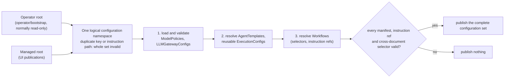
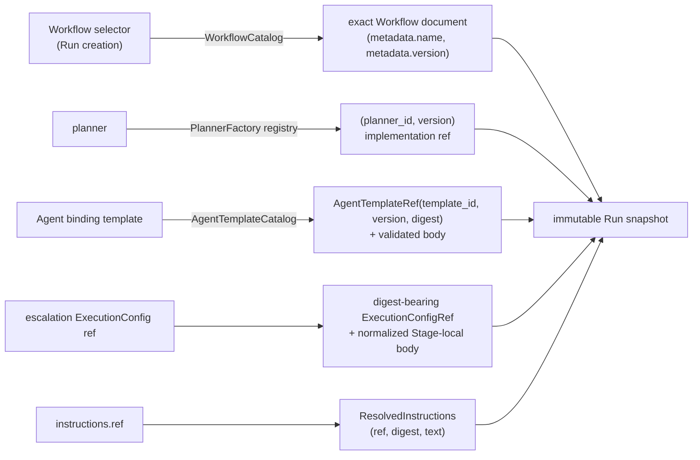

# Configuration catalog

Requirement prefix: `CAT` · [Specification index](../README.md)

## Purpose and scope

This document owns the configuration catalog: the configuration kinds and
instruction resources, the operator and managed configuration roots and their
fixed subtrees, the manifest envelope and the `(kind, name, version)` lookup
key, the `<id>@<version>` selector grammar, all-or-nothing loading and
validation, the resolution of selectors and instruction refs into the Run
snapshot, immutability of published versions and the pre-production exception
for the shipped catalog, managed publication of new versions, and catalog
discovery on the listing endpoints. It also owns
WorkflowCatalog and the in-process AgentTemplateCatalog configuration
boundary.

It leaves to other documents:

- Workflow content: Stages, transitions, Agent bindings, input and output
  slots, Stage `objective` and the placement of `instructions`, and the
  `presentation` metadata: [Workflows](workflows.md).
- AgentTemplate, ModelPolicy and ExecutionConfig content, their canonical
  digests, consumer compatibility and executionConfig layering:
  [AgentTemplates](agent-templates.md).
- LLMGatewayConfig, LLM credentials, RuntimeConfig and runtime labels:
  [Runtime configuration](runtime-config.md).
- The WorkflowRun resource, the Run creation transaction and the Run snapshot
  as a resource: [Runs](../execution/runs.md).
- Agent Skill sources and SkillCatalog: [Skills](../tools/skills.md).
- AuditProfile content, its Audit API read projection and the Audit standard
  catalog: [Audits](../audits/audits.md).
- Deployment of the managed root, including memory-backed volumes:
  [Operations](../operations/operations.md).
- Pagination, idempotency and the error envelope shared by every resource:
  [Public API](../api/public-api.md).
- Planner budgets: [Planners](../execution/planners.md).

## Concepts

Terms are defined once in the [glossary](../glossary.md).

| Term | Meaning here |
| --- | --- |
| Operator root | The operator/bootstrap configuration root, normally read-only. |
| Managed root | The Server-managed configuration root that receives UI publications. |
| Configuration namespace | The single logical namespace formed by the operator root and the managed root together. |
| Configuration set | The complete validated and resolved in-memory configuration that the Server serves. |
| Manifest | One YAML configuration document with the envelope `apiVersion`, `kind`, `metadata` and `spec`. |
| Lookup key | `(kind, metadata.name, metadata.version)`, the identity of a manifest. |
| Selector | The compact `<id>@<version>` authoring and API lookup value. |
| Instruction resource | A UTF-8 text resource below `instructions/`, identified by its normalized logical path rather than by a lookup key. |
| Instruction ref | The normalized configuration-root-relative path of an instruction resource, such as `instructions/openapi/planner.md`. |
| WorkflowCatalog | The Server component that loads and validates Workflows and resolves their selectors and instruction refs. |
| AgentTemplateCatalog | The in-process Server configuration boundary that resolves AgentTemplate selectors to exact refs and bodies. |
| Managed publication | The atomic, create-only addition of a new immutable ModelPolicy or LLMGatewayConfig version to the managed root and the configuration set. |
| Draft | A clone of a published configuration whose typed fields are edited in the Operations authoring flow; it is not executable configuration. |
| Catalog source fingerprint | The SHA-256 fingerprint of the immutable catalog source a listing result was built from. |
| Shipped catalog | The operator-root manifests and instruction resources that the repository ships under `configs/`; pre-production until the first release (CAT-R74). |

## Model

### Configuration roots and subtrees

Default root paths (CAT-R1, CAT-R2):

```text
/etc/contractor/configs/       operator/bootstrap root, normally read-only
/var/lib/contractor/configs/   Server-managed root for UI publications
```

Subtree layout of each root (CAT-R4):

```text
configs/
  workflows/          # Workflow YAML manifests
  agent-templates/    # AgentTemplate YAML manifests
  model-policies/     # ModelPolicy YAML manifests
  llm-gateways/       # LLMGatewayConfig YAML manifests; never secret values
  execution-configs/  # reusable Stage-local ExecutionConfig YAML manifests
  audit-profiles/      # operator-authored resolved multi-Run Audit programs
  instructions/       # UTF-8 instruction resources
```



### Configuration kinds

Each YAML subtree holds exactly one kind. Content, digest and consumer rules
belong to the owning document; this catalog owns only loading, identity and
publication.

| Kind | Subtree | Authored by | Identity carried into a Run | Content owner |
| --- | --- | --- | --- | --- |
| Workflow | `workflows/` | operator | exact `(name, version)`; no Workflow digest, the Run snapshot is the execution authority (CAT-R34) | [Workflows](workflows.md) |
| AgentTemplate | `agent-templates/` | operator | `AgentTemplateRef(template_id, version, digest)` ([TPL-R57](agent-templates.md); summarizer included in the digest: [TPL-R52](agent-templates.md)) | [AgentTemplates](agent-templates.md) |
| ModelPolicy | `model-policies/` | operator or managed publication | `ModelPolicyRef` with digest ([TPL-R34](agent-templates.md)) | [AgentTemplates](agent-templates.md) |
| LLMGatewayConfig | `llm-gateways/` | operator or managed publication | digest-bearing ref ([RCF-R26](runtime-config.md)) | [Runtime configuration](runtime-config.md) |
| ExecutionConfig | `execution-configs/` | operator | `ExecutionConfigRef` with digest ([TPL-R86](agent-templates.md)) | [AgentTemplates](agent-templates.md) |
| AuditProfile | `audit-profiles/` | operator; accepted only from the operator root (CAT-R8) | see [Audits](../audits/audits.md) | [Audits](../audits/audits.md) |
| instruction resource | `instructions/` | operator | `ResolvedInstructions` ref and digest (CAT-R41) | this document |

RuntimeConfig versions and label bindings are stored in PostgreSQL and add no
configuration subtree; RuntimeConfig uses the selector grammar of this
document ([RCF-R78](runtime-config.md), [RCF-R79](runtime-config.md)).

### Instruction refs

Authoring and resolved forms of an instruction reference are distinct:

```python
class InstructionsRef(BaseModel):
    ref: str


class ResolvedInstructions(BaseModel):
    ref: str       # normalized configuration-root-relative ref
    digest: str    # "sha256:" + 64 lowercase hexadecimal characters
    text: str
```

### Selector resolution



### Managed publication

The Operations authoring flow is conceptually:

```text
published configuration
  -> clone as draft
  -> edit typed fields
  -> validate references and consumer compatibility
  -> publish new immutable name@version + digest
```

```mermaid
sequenceDiagram
  participant C as Client
  participant S as Server
  participant F as Managed root
  participant M as In-memory configuration set
  C->>S: publish manifest (Idempotency-Key)
  S->>S: acquire the single configuration-publication lock
  S->>S: normalize; validate the union of operator, managed and candidate manifests
  S->>F: write canonical YAML to a same-directory temporary file, flush
  S->>F: hard-link the stable name (never replaces an entry), remove the temporary name, flush the parent directory
  S->>M: atomically swap the configuration snapshot
  S-->>C: success, only after file and snapshot are both published
```

## Requirements

### Configuration roots

**CAT-R1.** Published YAML is the source of truth for the
configuration kinds loaded from the configuration roots. The Server has two
configured roots, an operator/bootstrap root
and a separate Server-managed publication root, which form one logical
configuration namespace.

**CAT-R2.** The root paths are deployment defaults, not
hard-coded identities. Local development may point both roots at
workspace-specific directories.

**CAT-R3.** The executable settings are
`--operator-config-root` / `CONTRACTOR_OPERATOR_CONFIG_ROOT` and
`--managed-config-root` / `CONTRACTOR_MANAGED_CONFIG_ROOT`. When the managed
root is omitted, local configuration derives a sibling `managed-configs/`
directory from the final operator-root path.

### Subtrees

**CAT-R4.** Both roots use the same seven fixed manifest/resource
subtrees: `workflows`, `agent-templates`, `model-policies`, `llm-gateways`,
`execution-configs`, `audit-profiles` and `instructions`.

**CAT-R5.** The operator root may also hold the non-YAML source
subtrees `configs/skills` and `configs/audit-standards`. `configs/skills` holds
the reviewable built-in Agent Skill sources; their role in SkillCatalog
population and their lifecycle are owned by [Skills](../tools/skills.md)
([SKL-R48](../tools/skills.md), [SKL-R55](../tools/skills.md)).
`configs/audit-standards` holds the curated Audit standard packages, one
`standard.json` per package directory; that catalog is owned by
[Audits](../audits/audits.md) ([AUD-R49](../audits/audits.md)).

**CAT-R6.** Toolsets, SandboxProfiles, WorkerRuntime
factories and Planner factories are registered code plus Server-visible
descriptors, not configuration subtrees.

### Manifest files

**CAT-R7.** The local loader recursively discovers regular files
ending in `.yaml` below the six YAML subtrees `workflows`, `agent-templates`,
`model-policies`, `llm-gateways`, `execution-configs` and `audit-profiles`, in
either root.

**CAT-R8.** AuditProfile manifests are accepted only from the
operator root. The managed `audit-profiles` subtree remains empty, and no
generic configuration publication kind is added for AuditProfile
([AUD-R25](../audits/audits.md)).

**CAT-R9.** Each file contains exactly one non-empty YAML document; a
multi-document stream is invalid.

**CAT-R10.** A manifest's `kind` must match its subtree.

**CAT-R11.** The loader rejects duplicate YAML mapping keys and
validates the exact schema selected by `apiVersion` and `kind` rather than
retaining unknown fields.

**CAT-R12.** Every YAML manifest has the envelope `apiVersion`,
`kind`, `metadata` and `spec`. `metadata` contains the mandatory `name` and
`version`, which use the selector `id` and `version` grammars respectively
(CAT-R18).

### Identity

**CAT-R13.** The configuration lookup key is
`(kind, metadata.name, metadata.version)`; for a Workflow this is its exact
configuration key `(name, version)`. A YAML document's identity comes from its
lookup key, not from its file name: file name and nesting below the kind
subtree are organizational only.

**CAT-R14.** No YAML manifest may depend on a local absolute
path, inode or file name for its identity.

**CAT-R15.** Two files with the same lookup key, in one root or
across both roots, make the complete configuration set invalid. There is no
root precedence, no implicit override and no last-writer-wins overlay.

**CAT-R16.** Instruction resources follow a different identity
rule: the identity of an instruction resource is its normalized logical path
below `instructions/`, such as `instructions/openapi/planner.md`, and that path
is the ref embedded into the resolved parent document. Instruction resources
need not be YAML and are not indexed by `kind/name/version`.

**CAT-R17.** The two roots also form one instruction namespace:
the same normalized path in both roots is invalid rather than an override.

### Selectors

**CAT-R18.** The Workflow selector accepted when creating a
Run, the `planner` field, every Agent binding's `template` field and an
escalation ExecutionConfig `ref` use the same compact authoring syntax and
grammar:

```text
<id>@<version>
```

```text
id      = [a-z][a-z0-9_-]*
version = [A-Za-z0-9][A-Za-z0-9._+-]*
```

**CAT-R19.** A selector contains exactly one `@`, and both parts
are non-empty; whitespace and `/` are consequently invalid.

**CAT-R20.** A configuration id has at most 128 characters
([LIM-CAT-1](../platform/limits.md)) and a version at most 64 characters
([LIM-CAT-2](../platform/limits.md)), as in the public
`ConfigurationName`, `ConfigVersion` and `Selector` schemas. The Server, the
schemas, the Runtime and the UI share the cases in
[`config-identity-cases.json`](../../../api/testdata/v1alpha1/config-identity-cases.json).

Rationale: the version grammar keeps `+` because Audit standard versions,
which AuditProfiles reference through it, allow it.

**CAT-R21.** Version comparison is opaque, case-sensitive
exact equality; Contractor does not interpret semantic-version ordering.

**CAT-R22.** `latest`, version ranges and an omitted version are
invalid.

**CAT-R23.** A selector is an authoring and API lookup
value only, never the complete durable execution identity.

### Loading and validation

**CAT-R24.** Configuration loading and UI publication are
all-or-nothing: the Server publishes no partially resolved in-memory
configuration set if any manifest, instruction ref or cross-document selector
is invalid ([FAIL-CAT-1](../platform/failure-model.md)).

**CAT-R25.** The Server first loads and validates ModelPolicies and
LLMGatewayConfigs, then resolves AgentTemplates and reusable ExecutionConfigs,
and finally resolves Workflows. LLMGatewayConfig schema and digest validation
before `executionConfig` resolution is specified in
[RCF-R26](runtime-config.md).

**CAT-R26.** At startup the Server loads the complete union of both roots.

**CAT-R71.** At startup WorkflowCatalog loads, parses and validates the
Workflow definitions into internal DTOs.

**CAT-R72.** There is no hot reload of configuration files.

**CAT-R27.** AgentTemplateCatalog is an in-process Server configuration
boundary in the single-VM baseline. It loads through the shared all-or-nothing
configuration root; it is not a new network service, Kubernetes CRD or runtime
service locator.

**CAT-R70.** Cross-document validation rules owned elsewhere are part of the
same all-or-nothing load, for example: a missing or incompatible
ExecutionConfig profile rejects the consuming Workflow
([TPL-R86](agent-templates.md)); each model consumer rejects a ModelPolicy
missing one of its required finite limits ([TPL-R27](agent-templates.md)); and
configuration validation rejects a code-analysis Worker binding without a Stage
`context.workspace` ([CAN-R17](../tools/code-analysis.md)).

### Selector resolution and the Run snapshot

**CAT-R28.** At Run creation WorkflowCatalog resolves the
supplied Workflow selector to the exact Workflow document whose
`metadata.name` and `metadata.version` match it.

**CAT-R29.** WorkflowCatalog resolves `planner` through the
configured PlannerFactory registry to an exact `(planner_id, version)`
implementation ref.

**CAT-R30.** WorkflowCatalog resolves each `template` through
AgentTemplateCatalog to an exact `AgentTemplateRef(template_id, version,
digest)` and a validated template body.

**CAT-R31.** WorkflowCatalog resolves every escalation
ExecutionConfig selector to its exact digest-bearing ref and normalized
Stage-local body; the `ExecutionConfigRef` digest is specified in
[TPL-R86](agent-templates.md).

**CAT-R32.** An unknown or ambiguous selector makes the
Workflow invalid.

**CAT-R33.** Creating a Run stores the complete validated,
dependency-resolved and normalized Workflow snapshot used by that Run: its
resolved Planner
factory refs, the exact digest-bearing AgentTemplate, ModelPolicy,
LLMGatewayConfig and referenced ExecutionConfig dependencies, every resolved
execution configuration, the resolved instruction dependencies
(CAT-R43) and the exact Agent Skill artifact refs and digests
selected under [Skills](../tools/skills.md). Later file or
current-Skill-binding edits cannot change the Run's graph or active execution
contract.

**CAT-R34.** The durable Run snapshot, rather than a separately
computed Workflow digest, is the execution authority for its Run. No Workflow
digest exists; Workflow `presentation` metadata does not add one
([WFL-R13](workflows.md)).

**CAT-R35.** Scheduler never consults configuration files to
reinterpret a Run and never re-resolves the authoring selector strings while
executing it.

**CAT-R76.** A Run's Workflow snapshot is at most 2 MiB
([LIM-CAT-4](../platform/limits.md)), counted in bytes of the Server's JSON
encoding of the resolved Workflow (CAT-R33), never in the text PostgreSQL
returns for the stored `jsonb`, which spaces separators and expands numbers.
WorkflowCatalog rejects a Workflow whose snapshot without Run overrides exceeds
the bound, so the configuration set does not load (CAT-R24). Run Workflow
resolution measures the snapshot after the Run's `executionConfig` overrides
and before any credential lookup, so Run creation, eval preflight and the
repeat draft reject an oversized snapshot before a Run exists; `POST /v1/runs`
answers the permanent `400 invalid_request` and stores nothing. Audit-managed
Run creation measures its pinned Workflow again, and the Run store refuses to
insert a larger snapshot. The Scheduler measures a stored snapshot the same way
after decoding it, so every snapshot accepted at creation stays executable; a
stored snapshot over the bound fails its Run as `unsupported_workflow_shape`
([SCH-R102](../execution/scheduler.md)).

Rationale: the bound was once checked only on the Scheduler's read, after
`202`, and against the longer `jsonb` text; one measure at every point keeps
acceptance and execution consistent.

### Instruction resources

**CAT-R36.** The authoring `instructions` object contains exactly one
`ref`. It is not an ArtifactRef and is never resolved through UserScope or
RunScope; it names a UTF-8 text resource under the configured `configs/` root.

**CAT-R37.** The normalized ref is a non-empty `/`-separated
relative path. Absolute paths, URI schemes, backslashes, empty segments, `.`
segments and `..` segments are invalid.

**CAT-R38.** A local configuration loader rejects a symlink whose
resolved target escapes the configured root.

**CAT-R39.** WorkflowCatalog resolves the ref while loading the
Workflow, requires non-empty text, and records the normalized ref, the content
digest and the resolved text.

**CAT-R40.** The loader first verifies that the source bytes decode
as strict UTF-8 and that the decoded text is not whitespace-only.

**CAT-R41.** The instruction digest is SHA-256 over the exact
source bytes, encoded as `sha256:<64 lowercase hex>`. The loader performs no
Unicode, line-ending, BOM or trailing-newline normalization before hashing, so
the stored text and digest identify exactly the bytes loaded from the
configuration resource.

**CAT-R42.** No separate maximum size applies to an instruction
resource: it is an operator-authored file under the configuration root, loaded
once at startup, and its only content rule is non-empty strict UTF-8. Every
Workflow that embeds it must still fit its snapshot bound (CAT-R76), and the
Planner budget must carry the rendered text
([Planners](../execution/planners.md)); together they bound a used instruction
in practice.

**CAT-R43.** WorkflowCatalog does not read the instruction file
again while creating or executing a Run. The complete resolved instruction
dependency is embedded in the immutable Run snapshot, so editing or deleting
the configuration resource cannot change an existing Run
([LIFE-CAT-2](../platform/lifecycle.md)).

### Immutability

**CAT-R44.** A configuration version published at runtime is
immutable and is never edited in place. Managed publication is create-only: a
publication that reuses an existing identity with different content conflicts
(CAT-R59), and it never replaces an identity that the operator root defines,
even with identical content (CAT-R46). Content that the Server seeds from the
operator root at runtime keeps its own drift checks: bundled Skill sources
([SKL-R54](../tools/skills.md)) and Audit standard packages, whose changed
content needs a new version ([AUD-R54](../audits/audits.md),
[AUD-R55](../audits/audits.md)). The shipped catalog follows CAT-R74 until the
first release. For ModelPolicy and LLMGatewayConfig see also
[TPL-R36](agent-templates.md); for Workflow `presentation` metadata see
[WFL-R12](workflows.md).

**CAT-R74.** Until the first release, the shipped catalog is
pre-production: the Workflow, AgentTemplate, ModelPolicy, LLMGatewayConfig,
ExecutionConfig and AuditProfile manifests and the instruction resources of the
operator root, which the repository ships under `configs/`, may change in place
without a new `metadata.version`. The Server loads the changed content under
the existing lookup key at its next start (CAT-R26, CAT-R72); nothing records
the earlier content of a shipped identity. Bundled Skill sources and Audit
standard packages are not part of this exception (CAT-R44).

What a Run used stays exact, because the identity of executed content never
rests on `name@version` alone:

- every Run snapshot stores the complete resolved Workflow with the
  digest-bearing AgentTemplate, ModelPolicy, LLMGatewayConfig and
  ExecutionConfig refs and the instruction digests (CAT-R33, CAT-R34,
  CAT-R41), and an edit never changes an existing Run (CAT-R35, CAT-R43);
- a started Audit runs its child Runs from the Workflow closures it pinned at
  start ([AUD-R31](../audits/audits.md));
- a managed Eval rechecks the selection digests frozen in its plan when it
  creates a member Run or Audit, and a changed selection rejects that member
  with `eval_pin_mismatch` instead of running other content
  ([managed Evals](../evals/managed-evals.md)).

Accepted risk: two Runs, or a Run and the current catalog, can carry the same
`name@version` with different content, so `name@version` alone does not
identify behaviour; compare digests or Run snapshots instead. The edit itself
is not rejected; it is detected by those digests, by the snapshots and by the
Eval pin check. Reopen at the first release or the first external deployment,
whichever comes first: then a committed digest lock (`kind name@version ->
digest`) for the shipped catalog, checked by `contractor server config
validate` and the release gate, replaces this requirement.

**CAT-R45.** Workflow, AgentTemplate, ExecutionConfig and
instruction resources are operator-authored and read-only; UI publication
accepts only ModelPolicy and LLMGatewayConfig manifests.

**CAT-R46.** At runtime Operations may create a new immutable ModelPolicy or
LLMGatewayConfig version only in the managed root, through managed
publication; it cannot replace an existing identity.

**CAT-R47.** Operations lists the version-indexed configuration
kinds. Instruction refs and digests are visible through their consuming
resources, and the Catalog adds the exact-template instruction read
([TPL-R104](agent-templates.md)).

**CAT-R48.** UI publication is create-only: it cannot edit,
replace, disable or delete an existing published identity
([LIFE-CAT-1](../platform/lifecycle.md)).

**CAT-R49.** An implementation must not approximate retirement by
silently hiding a file that is still referenced by a Workflow or Run.

**CAT-R50.** Drafts are not executable configuration and may be stored
separately without becoming a source of truth.

### Managed publication

**CAT-R51.** Publication atomically adds a complete validated
version to the Server's current configuration set. Readers observe either the
set before publication or the set including the new version, never partial
dependency resolution.

**CAT-R52.** Publication does not mutate an existing version and
does not require re-resolving existing Runs.

**CAT-R53.** The startup file loader is a valid bootstrap
and import path but is not by itself sufficient for writable Operations UI
behavior.

**CAT-R54.** For one publication the Server, in order:

1. acquires the single configuration-publication lock;
2. normalizes the document and validates the complete union of operator,
   managed and candidate manifests, including refs, consumer compatibility and
   digests;
3. writes the canonical YAML durably into the managed kind subtree
   (CAT-R55);
4. atomically swaps the in-memory configuration snapshot.

**CAT-R55.** The Server writes the canonical YAML to a new
same-directory temporary file in the managed kind subtree and flushes it,
atomically creates the stable name with a hard link that never replaces an
existing entry, removes the temporary name and flushes the parent directory.

**CAT-R56.** The link and unlink steps use descriptor-relative
`linkat`/`unlinkat`, which support Linux and macOS.

**CAT-R73.** The managed filesystem must support hard links
([OPS-R10](../operations/operations.md)).

**CAT-R57.** No successful response is returned before the
file and the in-memory snapshot are both published.

**CAT-R58.** A crash after file publication but before the
snapshot swap is recovered by the ordinary startup load. A temporary `.tmp`
name left by a crash between link and unlink is ignored by that loader
([FAIL-CAT-2](../platform/failure-model.md),
[LIFE-CAT-3](../platform/lifecycle.md)).

**CAT-R59.** Publication requires an `Idempotency-Key`. Retrying an
identical identity and body returns that published version; the same identity
with different normalized content conflicts
([FAIL-CAT-2](../platform/failure-model.md)).

**CAT-R75.** Before each publication the Server reloads both roots and
compares the union with its current snapshot. The union may differ only by
managed versions whose durable link this Server made without swapping its
snapshot, because a later publication step failed, and by the identical version
the request retries; the Server adopts those exactly as the startup load would
(CAT-R58) and binds each recovered publication's `Idempotency-Key`. Any other
difference is configuration drift: an edited, added or removed operator-root
file, or a managed file the Server did not write. Drift fails the publication
with `409 configuration_drift`, `retryable` false, and publishes nothing
([FAIL-CAT-2](../platform/failure-model.md)). Publication resumes without a
restart once the roots match the loaded snapshot again; restoring the changed
files is the recovery for an in-place edit, which CAT-R44 forbids. A restart
instead loads and validates the roots as they are (CAT-R24).

**CAT-R60.** Loss of the PostgreSQL audit record cannot remove or
reinterpret the YAML version.

**CAT-R61.** The client never supplies a filesystem path. The
Server derives a stable relative path from the validated kind, name and
version and creates parent directories inside the dedicated managed root.

**CAT-R62.** The Server rejects symlinks and any resolved escape from
the managed root. Temporary and final creation use exclusive, no-follow
semantics; an existing destination is handled only by the idempotency
comparison (CAT-R59).

### Catalog discovery

**CAT-R63.** Catalog discovery is performed by the Server
before pagination. `GET /v1/workflows` and `GET /v1/configurations/{kind}`
accept an optional `q` of at most 200 Unicode code points
([LIM-CAT-3](../platform/limits.md)) and an optional exact `name`.

**CAT-R64.** The Server trims Unicode whitespace around `q`,
normalizes it to NFC, applies Unicode case folding and then performs literal
substring matching; no wildcard or regular-expression syntax is interpreted.
An empty normalized query is equivalent to omission.

**CAT-R65.** Workflow matching covers the exact name, the opaque
version and the available authored `presentation.displayName` and
`presentation.description`. Configuration matching covers the exact name, the
opaque version and an available safe authored description, notably
`AgentTemplate.description`.

**CAT-R66.** `name` uses the ordinary exact configuration-name
grammar (CAT-R18) and never implies latest-version selection.

**CAT-R67.** Filtering precedes the bounded keyset pagination
([Public API](../api/public-api.md)). A continuation cursor is bound to the
normalized query, the exact-name filter and a SHA-256 fingerprint of the
immutable catalog source used to build that result. The Server computes each
fingerprint once, when it builds a configuration snapshot at load or
publication, and takes a page's resources from that same snapshot; a page read
neither copies nor encodes the whole catalog.

**CAT-R68.** Reusing a cursor with another query, kind or catalog
snapshot is a bounded `400`; the client restarts from the first page.

**CAT-R69.** Versions remain opaque strings ordered by the
existing exact selector order.

## Interfaces

- `GET /v1/workflows` and `GET /v1/configurations/{kind}`: catalog discovery
  parameters `q` and `name` and cursor binding (CAT-R63 to
  CAT-R69).
- Managed publication of ModelPolicy and LLMGatewayConfig versions, with a
  required `Idempotency-Key` (CAT-R45,
  CAT-R59).
- The public `ConfigurationName`, `ConfigVersion` and `Selector` schemas in
  [`contractor-public-v1.yaml`](../../../api/openapi/contractor-public-v1.yaml)
  and the shared cases in
  [`config-identity-cases.json`](../../../api/testdata/v1alpha1/config-identity-cases.json)
  (CAT-R20).
- The AgentTemplate instruction read: [TPL-R104](agent-templates.md).

## Limits, failures and errors

Registry entries owned by this document:

- [LIM-CAT-1](../platform/limits.md): a configuration id has at most 128
  characters (CAT-R20).
- [LIM-CAT-2](../platform/limits.md): a configuration version has at most 64
  characters (CAT-R20).
- [LIM-CAT-3](../platform/limits.md): the catalog discovery `q` has at most 200
  Unicode code points (CAT-R63).
- [FAIL-CAT-1](../platform/failure-model.md): loading and resolving the
  configuration set (CAT-R24, CAT-R15,
  CAT-R32).
- [FAIL-CAT-2](../platform/failure-model.md): managed publication of a
  configuration version (CAT-R58, CAT-R59, CAT-R75).
- [LIFE-CAT-1](../platform/lifecycle.md): published configuration version
  (CAT-R48).
- [LIFE-CAT-2](../platform/lifecycle.md): instruction resource and other
  configuration files referenced by an existing Run (CAT-R43).
- [LIFE-CAT-3](../platform/lifecycle.md): managed publication temporary file
  (CAT-R58).

Errors owned by this document ([errors](../platform/errors.md)): reusing a
catalog cursor with another query, kind or catalog snapshot is a bounded `400`
(CAT-R68); publishing an existing identity with different
normalized content is an immutable-definition conflict (CAT-R44,
CAT-R59); a publication against configuration roots that changed outside the
Server is the permanent `409 configuration_drift` (CAT-R75).

## Security

- The `llm-gateways/` subtree never holds secret values; where secret values
  live and the `LLMCredentialRef` contract are specified in
  [TPL-R74](agent-templates.md) and [Security](../platform/security.md).
- Instruction refs are confined to the configuration root
  (CAT-R36, CAT-R37, CAT-R38).
- Managed publication never accepts a client filesystem path and never
  follows a symlink out of the managed root (CAT-R61,
  CAT-R62).

## Non-goals

- An S3-backed configuration loader. A future one maps the same seven logical
  manifest/resource subtrees to prefixes and preserves the same document keys
  and relative instruction refs, so the instruction resource rule can be
  backed by an S3 prefix without changing Workflow YAML.
- Editors for Workflow, AgentTemplate, ExecutionConfig and instruction
  resources; they require a separate contract.
- A standalone path-indexed instruction API. Instruction resources are not
  given an invented `name@version` identity; their refs and digests are visible
  through their consuming resources (CAT-R47).
- Managed publication of AuditProfile and its acceptance by
  `/v1/configurations/{kind}` ([AUD-R25](../audits/audits.md)); that requires a
  separate API and versioning decision.
- Retiring configurations and safe garbage collection of published versions
  (CAT-R49).
- A digest lock for the shipped catalog before the first release (CAT-R74).
