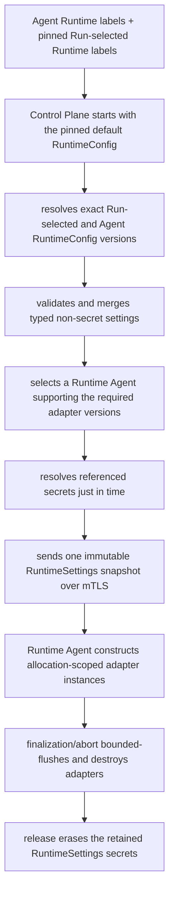
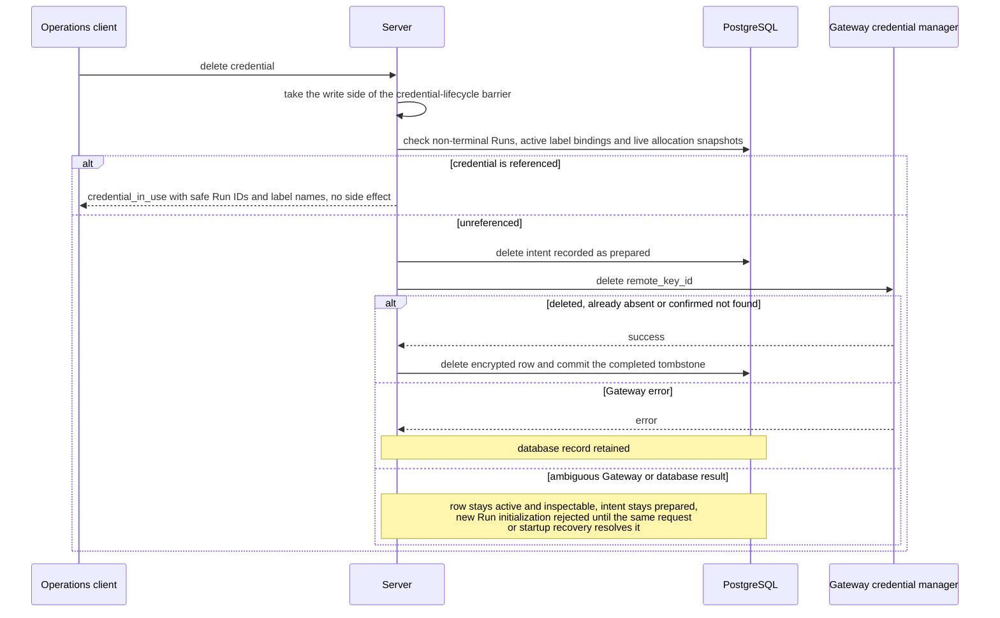
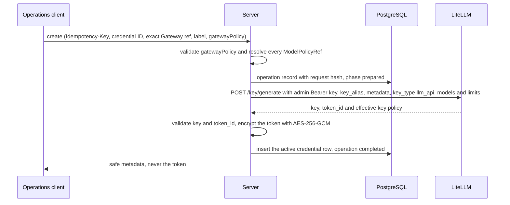

# Runtime configuration, labels, credentials and Gateways

Requirement prefix: `RCF` · [Specification index](../README.md)

## Purpose and scope

This document owns the infrastructure side of model access and of Worker
allocations:

- LLMGatewayConfig manifests, the LLM Gateway role and Gateway failure
  signatures;
- LLM credentials: their record, encryption, creation, deletion and the LiteLLM
  virtual-key manager that provisions them;
- RuntimeConfig documents, Runtime labels, label bindings and the reserved
  `default` binding;
- Run-selected Runtime labels, Runtime Agent label sets and the layered
  resolution and merge that turns them into one allocation configuration;
- runtime (adapter) credentials;
- the configuration of the Runtime adapters `otlp-http@1`, `http-proxy@1` and
  `caido-graphql@1`;
- the private `RuntimeSettings` wire snapshot and its non-secret provenance;
- the Operations API for RuntimeConfig versions, label bindings, runtime
  credentials and Runtime Agent label sets.

<!-- from: 07#3, 07#5, 01#33, 06#108 -->

It leaves to other documents:

- configuration kinds, the configuration-ID and `<id>@<version>` selector
  grammar, digests, loading and managed configuration roots: [Configuration
  catalog](catalog.md);
- AgentTemplate, ModelPolicy and the executionConfig leaves and layering that
  select ModelPolicy, budgets and Planner model access: [Agent
  templates](agent-templates.md);
- WorkflowRun creation, the `runtimeLabels` request field, Run idempotency,
  metadata `labels` and public Run and StageAttempt detail:
  [Runs](../execution/runs.md);
- Runtime Agent principals and their certificate-derived `runtime_agent_id`,
  registration and `initialLabels`, adapter capability discovery, placement,
  allocation pinning and lock order: [Control
  plane](../execution/control-plane.md);
- allocation adapter construction, proxy injection, traffic bypass and adapter
  teardown inside the Runtime: [Runtime Agent](../execution/runtime-agent.md);
- Planner model access and Planner telemetry construction:
  [Planners](../execution/planners.md);
- the Worker build context: [Worker](../execution/worker.md);
- the protocol status rules of model recovery classification and the failure
  mapping of label resolution and adapter preparation: [Failure
  model](../platform/failure-model.md);
- secret transport, in-memory retention, redaction, the credential-encryption
  master key and backup protection: [Security](../platform/security.md);
- telemetry export behaviour, span content and the attribution of calls and
  tokens: [Observability](../platform/observability.md);
- Caido tools and the `worker.caido` endpoint and timeout bounds: [HTTP and
  Caido tools](../tools/http-caido.md);
- tool Workers (`tool@1`): [Scanners](../tools/scanners.md);
- Project HTTP target credentials: [Projects](../artifacts/projects.md);
- the Operations surface and UI dialogs:
  [Operations](../operations/operations.md) and [UI](../ui/ui.md);
- public API conventions: [Public API](../api/public-api.md).

<!-- from: 00#29, 00#155, 02#16, 06#55, 06#147, 07#56, 07#89, 07#122, 16#4 -->

## Concepts

Terms are collected in the [glossary](../glossary.md); this document owns the
following ones.

| Concept | Meaning |
|---|---|
| LLM Gateway | The backend-neutral Contractor role of the endpoint that serves model calls. LiteLLM is the initial backend, not a required Contractor component |
| LLMGatewayConfig | An immutable, published description of one OpenAI-compatible Gateway endpoint |
| LLM credential | An immutable encrypted Gateway token bound to one exact LLMGatewayConfig and selected through `LLMCredentialRef` |
| Credential manager | The optional Gateway declaration (`credentialManager`) through which Server Operations creates and deletes LLM credentials |
| Failure signatures | The optional provider-specific part of model recovery classification declared by a Gateway (`failureSignatures`) |
| Gateway policy | The immutable key policy (`gatewayPolicy`) sent when an LLM credential is created |
| Credential-lifecycle barrier | The lock shared by Run initialization, binding and Agent-label mutation, allocation config pinning and credential deletion |
| Runtime label | A bounded name such as `debug` or `caido` selected through `runtimeLabels` on a Run or assigned to a Runtime Agent |
| Default binding | The reserved `default` binding used as the base for every Run, including a Run with no labels |
| RuntimeConfig | One immutable versioned typed non-secret infrastructure configuration stored by Server |
| Label binding | The mutable, revisioned Control Plane pointer from one label to one exact RuntimeConfig version |
| Run Runtime-label snapshot | Exact label-binding/config versions pinned when the WorkflowRun is created |
| Agent label set | The authoritative durable labels assigned to one stable Runtime Agent principal |
| ResolvedRuntimeConfig | The merged, non-secret, exact configuration and provenance for one consumer/allocation |
| RuntimeSettings | The secret-bearing wire snapshot created for one allocation after placement |
| Runtime adapter | Versioned Runtime-owned code that consumes one typed settings block, for example `otlp-http@1` |
| Runtime credential | An encrypted secret of a versioned adapter-owned credential kind, such as `otlp-headers@1`, referenced by ID from a RuntimeConfig |
| Merge unit | A leaf or atomic block that a higher precedence layer replaces as a whole |

<!-- from: 07#9, 01#33, 02#67, 01#36, 01#37, 06#92, 06#98, 07#47, 07#84 -->

`runtimeLabels` on a Run is a sorted unique array of names that selects and
pins RuntimeConfig bindings such as `debug` or `caido`. It is independent of
the Run's metadata `labels` map, a key/value string map of immutable metadata
owned by [Runs](../execution/runs.md).

<!-- from: 16#4, 07#11 -->

## Model

### Gateway and credential references

Model access is resolved to exact references. The other AgentTemplate
references (ModelPolicy, Toolsets, SandboxProfile) are owned by [Agent
templates](agent-templates.md).

```python
class LLMGatewayConfigRef(BaseModel):
    gateway_id: str
    version: str
    digest: str


class LLMCredentialRef(BaseModel):
    credential_id: str
```

<!-- from: 01#8 -->

### LLM credential record

The logical schema of LLM credentials and of their internal recovery journal
is:

```text
llm_credentials
  credential_id
  llm_gateway_id
  llm_gateway_version
  llm_gateway_digest
  remote_key_id
  label
  gateway_policy                   selected refs + canonical effective key policy
  key_id
  nonce
  ciphertext
  created_at

credential_operations              internal recovery journal, not a credential
  operation_id
  idempotency_key
  request_hash
  credential_id
  operation_kind                   create | delete
  phase                            prepared | completed
  created_at
  updated_at
```

<!-- from: 06#81 -->

`key_id` identifies the credential-encryption master key that produced the
ciphertext; its format is defined in [Security](../platform/security.md).

<!-- from: 06#84 -->

### Label bindings

A label binding contains:

```text
RuntimeLabelBinding
  label
  exact RuntimeConfigRef(name, version, digest)
  monotonically increasing uint64 revision (starts at 1)
  created/updated timestamp and audit actor
```

<!-- from: 07#19 -->

The durable Runtime Agent principal record that holds an Agent label set is
owned by [Control plane](../execution/control-plane.md).

<!-- from: 07#56 -->

### Resolution provenance

The exact resolution result stored for StageExecution and allocation provenance
contains:

```text
ResolvedRuntimeConfigProvenance
  sorted Run-selected Runtime labels and pinned binding revisions
  pinned default binding revision
  sorted Agent labels and allocation-time binding revisions
  exact RuntimeConfig refs and digests
  exact Runtime adapter refs
  non-secret LLMGatewayConfig and credential refs
```

<!-- from: 07#91, 07#92 -->

### Resolution flow

Labels are resolved and merged on the Server; the Runtime Agent receives only
typed settings.



<!-- from: 07#7 -->

## Requirements

### Boundary

**RCF-R1.** Contractor must be able to redirect allocation-scoped
infrastructure without editing a Workflow or AgentTemplate and without
rebuilding or restarting every Runtime Agent. Typical cases are listed under
[Examples](#label-use-cases).
<!-- from: 07#3 -->

**RCF-R2.** A label is a short Control Plane alias for an immutable, typed
RuntimeConfig; it is not configuration itself.
<!-- from: 07#5 -->

**RCF-R3.** Runtime Agent never resolves or interprets label strings such as
`debug` or `caido`, and receives typed settings only. Control Plane resolves
labels, merges their typed settings, resolves credential references and sends
one complete allocation-scoped `RuntimeSettings` snapshot, following the
[resolution flow](#resolution-flow).
<!-- from: 07#5, 07#7, 01#112 -->

**RCF-R4.** Runtime Agent code contains adapter implementations such as
`otlp-http@1` and `http-proxy@1`. It does not contain deployment endpoints,
tokens, concrete Langfuse or Caido instance names, or a mapping from label
names to behaviour.
<!-- from: 07#8 -->

Rationale: this boundary deliberately keeps infrastructure knowledge on the
Server.
<!-- from: 07#6 -->

**RCF-R5.** Runtime labels are configuration selection, not authorization
roles, scheduling scores, arbitrary user tags or Workflow graph conditions.
<!-- from: 07#11 -->

**RCF-R6.** Labels grant no Runtime authorization: all valid Runtime Agent
certificates have the same Runtime role eligibility ([Control
plane](../execution/control-plane.md)), and access to one allocation's
settings, A2A route and Artifact scope remains bound to that allocation's
authenticated principal and instance grant.
<!-- from: 07#11, 02#16 -->

**RCF-R7.** A Runtime label may configure a proxy, a telemetry exporter or an
already selected Toolset adapter, but cannot add a tool, Toolset, Agent Skill,
instruction, AgentTemplate, Worker binding or Worker behaviour.
<!-- from: 01#112, 07#131 -->

**RCF-R8.** RuntimeConfig cannot select a ModelPolicy, Planner implementation,
AgentTemplate, Toolset, SandboxProfile, Stage deadline, retry or escalation
rule or Workflow transition. Stronger models and larger call or token budgets
remain an explicit `executionConfig`, for example `high-budget@1`; they are not
labels. Planner LLM Gateway and model selection also remains entirely in
executionConfig.
<!-- from: 07#32 -->

**RCF-R9.** ExecutionConfig is not another label. It alone selects ModelPolicy,
budgets and Planner model access. Its Worker Gateway and credential fields
participate only in the infrastructure layers of RCF-R146, so an Agent label
may override those physical connection settings but cannot change the selected
model policy.
<!-- from: 07#83, 07#131 -->

### LLM Gateways

**RCF-R10.** `LLM Gateway` is a backend-neutral Contractor role. LiteLLM is the
initial backend; another backend may replace it when it satisfies the
configured model-client protocol, without changing Workflow, AgentTemplate or
allocation semantics.
<!-- from: 01#111, 02#67 -->

**RCF-R11.** LLMGatewayConfig is separate from ModelPolicy, so the same
execution bounds and model alias can use different endpoints or tokens and the
same endpoint can serve several policies. Neither AgentTemplate nor ModelPolicy
carries the LLM Gateway URL, token, provider routing or credential;
AgentTemplate selects only its default exact ModelPolicy.
<!-- from: 01#33, 01#111 -->

**RCF-R12.** In an LLMGatewayConfig, `protocol` and `url` are mandatory, and
the only accepted protocol is `openai-compatible@1`.
<!-- from: 01#35 -->

**RCF-R13.** URL userinfo, query and fragment components are invalid in the
Gateway `url`. Credentials never travel inside the URL or the Gateway manifest.
<!-- from: 01#35 -->

**RCF-R14.** A modeled consumer selects an optional credential independently
beside `llmGateway` in executionConfig, for that exact Gateway. Omitting it
means an unauthenticated local Gateway request.
<!-- from: 01#35, 06#60 -->

**RCF-R15.** `credentialManager` is optional. When present, it contains exactly
`implementation` and `managementUrl`, and the only accepted implementation is
`litellm-virtual-keys@1`.
<!-- from: 01#36 -->

**RCF-R16.** `managementUrl` is an absolute HTTPS origin with no userinfo,
query, fragment or non-root path. HTTP is accepted only for a loopback IP
origin in the single-VM deployment.
<!-- from: 01#36 -->

**RCF-R17.** The credential manager is used only by Server Operations, never by
a Planner or Runtime Agent. Without it, the Gateway can still be selected for
unauthenticated execution, but Contractor cannot create a credential for it.
<!-- from: 01#36 -->

**RCF-R18.** The Gateway declaration contains no LiteLLM master key. Server
deployment binds the exact digest-bearing Gateway ref to an operator-owned
admin-key file separately (RCF-R57).
<!-- from: 01#36 -->

**RCF-R19.** `failureSignatures` is optional and declares the provider-specific
part of model recovery classification. The protocol's fixed status rules, the
outcome classes and the shared classification fixture are owned by [Failure
model](../platform/failure-model.md).
<!-- from: 01#37, 04#7 -->

**RCF-R20.** Each `modelUnavailable` entry names one `status` from 400, 404,
409 or 422 and exactly one of `messageEquals` or `litellmWrapped`. The text is
trimmed UTF-8 of at most 512 bytes (LIM-RCF-1) without Unicode Cc (control), Cf
(format), Co (private-use) or Cs (surrogate) characters; unassigned Cn is
allowed.
<!-- from: 01#39, 04#7 -->

**RCF-R21.** `messageEquals` text matches the provider's error message or bare
error string; `litellmWrapped` matches the same text inside LiteLLM's observed
BadRequest wrapper. How a matching entry is classified, and that matching is
exact, is owned by [Failure model](../platform/failure-model.md).
<!-- from: 01#39, 04#7 -->

**RCF-R22.** `permanentCodes` are snake_case provider error codes; their effect
on an invocation is owned by [Failure model](../platform/failure-model.md).
<!-- from: 01#39, 04#7 -->

**RCF-R23.** Each `failureSignatures` list holds at most 32 distinct entries
(LIM-RCF-2).
<!-- from: 01#39 -->

**RCF-R24.** When `failureSignatures` is omitted, the `openai-compatible@1`
default (the LM Studio unload messages observed through LiteLLM) applies and
the manifest digest is unchanged. A declared block joins the digest, so it is
added on a new Gateway version.
<!-- from: 01#39 -->

**RCF-R25.** Server forwards the declared block to allocations as
`runtimeSettings.llmGatewayFailureSignatures`.
<!-- from: 01#39 -->

**RCF-R26.** LLMGatewayConfig manifests live under `configs/llm-gateways/` in
either configured root. Configuration loading validates their exact schema and
digest before resolving `executionConfig`. Operations publishes new immutable
versions only into the managed YAML root ([Configuration catalog](catalog.md),
[Operations](../operations/operations.md)).
<!-- from: 01#41 -->

**RCF-R27.** A published LLMGatewayConfig version is never edited in place;
changing its URL or protocol creates a new LLMGatewayConfig version.
<!-- from: 01#40, 06#60 -->

**RCF-R28.** Encrypted PostgreSQL credentials and the external bootstrap
master-key file are separate from the LLMGatewayConfig manifest contract.
LLMGatewayConfig contains no credential selector.
<!-- from: 01#41, 06#80 -->

### Model access resolution

**RCF-R29.** Resolving model access for a Run produces an exact
`LLMGatewayConfigRef` and, when selected, an `LLMCredentialRef(credential_id)`
bound to that Gateway. A credential is valid only with the exact Gateway to
which it is bound.
<!-- from: 01#40, 00#24 -->

**RCF-R30.** Run initialization resolves the Workflow defaults plus the
request's reference-only `executionConfig` overrides, under the layering owned
by [Agent templates](agent-templates.md). It pins the non-secret credential ID
selected beside the exact LLMGatewayConfig. The immutable Run snapshot stores
those non-secret refs but never the token.
<!-- from: 01#40, 01#111, 06#79, 00#29 -->

**RCF-R31.** Control Plane obtains the selected URL from the exact
LLMGatewayConfig and the pinned credential from the trusted Server secret
store, then delivers their values over the private mTLS control channel.
<!-- from: 01#111 -->

Run creation never accepts free-form Gateway URLs or tokens; Run forms select
already validated published configurations under [Agent
templates](agent-templates.md).
<!-- from: 06#59 -->

Planner model access (alias, Gateway and credential) is resolved independently
of any Worker under [Planners](../execution/planners.md); its credential is
decrypted through the Server secret boundary under RCF-R46.
<!-- from: 00#155 -->

### LLM credentials

**RCF-R32.** Secret values live behind `LLMCredentialRef`, never in Workflow,
AgentTemplate, ModelPolicy, LLMGatewayConfig or Run JSON.
<!-- from: 06#60 -->

**RCF-R33.** Credential metadata and encrypted tokens live in PostgreSQL, using
the [record schema](#llm-credential-record). PostgreSQL is authoritative only
for the immutable credential record, never for ModelPolicy or LLMGatewayConfig
bodies.
<!-- from: 06#80, 06#81 -->

**RCF-R34.** If a credential row exists, its key is active. The model has no
`disabled`, `revoked`, `superseded` or mutable-current state. `active` means
that the Contractor row exists and its managed Gateway key is expected to
exist. Removing access deletes the key from the Gateway and the database
through the fenced deletion of RCF-R48 and RCF-R49 (LIFE-RCF-1).
<!-- from: 06#76 -->

**RCF-R35.** A credential is immutable: its token is never replaced in place.
Replacing a key means creating another credential ID and selecting that ID in a
new Workflow default or Run executionConfig. The UI may create and delete
credentials but cannot update or rotate one in place.
<!-- from: 01#40, 06#76 -->

**RCF-R36.** LiteLLM may still reject a call because its spend or rate limit is
exhausted. That is Gateway policy state, not a Contractor credential lifecycle
state; the rejection follows the ordinary bounded LLM error path
([Observability](../platform/observability.md)).
<!-- from: 06#76, 06#102 -->

**RCF-R37.** `credential_id` uses the shared configuration-ID grammar
([Configuration catalog](catalog.md)). Credential IDs are never reused: the
create operation reserves its ID permanently.
<!-- from: 06#82, 06#83 -->

**RCF-R38.** The public create request accepts no token, and Server never
reveals the token generated by the Gateway. Credential creation accepts a new
credential ID, one exact digest-bearing LLMGatewayConfig ref, an optional safe
label and the typed Gateway policy of RCF-R63.
<!-- from: 06#77 -->

**RCF-R39.** The Gateway manager must return a secret token of 1 through 16,384
UTF-8 bytes (LIM-RCF-3) and a bounded stable non-secret remote key identifier.
Server performs no trimming and rejects a missing, malformed or oversized
response (FAIL-RCF-1).
<!-- from: 06#82 -->

**RCF-R40.** Server encrypts the exact token bytes with AES-256-GCM using a
fresh 96-bit cryptographically random nonce. The canonical schema version,
credential ID and exact Gateway ref are authenticated additional data, so
ciphertext cannot be moved to another identity or route.
<!-- from: 06#82 -->

**RCF-R41.** Credential creation inserts the active row only after the Gateway
credential-management boundary has returned the bounded non-secret
`remote_key_id` and token.
<!-- from: 06#82 -->

**RCF-R42.** Plaintext is retained only for the bounded encryption or
decryption operation and the model-client settings that actively need it.
<!-- from: 06#82 -->

**RCF-R43.** An LLM credential read response contains exactly the fields listed
under [LLM credential read model](#llm-credential-read-model).
<!-- from: 06#77, 06#78 -->

**RCF-R44.** When any credential row exists, Server startup requires the
credential-encryption master key ([Security](../platform/security.md)).
<!-- from: 06#86, 06#84 -->

**RCF-R45.** A decryption or authentication failure is a bounded internal
configuration error and never falls back to plaintext, another credential or an
unauthenticated request (FAIL-RCF-3).
<!-- from: 06#86 -->

**RCF-R46.** Planner construction and Control Plane allocation preparation
decrypt exactly the credential ID pinned by the Run or by the durable
allocation-config snapshot, just in time. The token is never copied into
WorkflowRun, StageExecution, Planner Session, audit rows or metrics.
<!-- from: 06#86, 00#155 -->

**RCF-R47.** Credential existence is checked again during Run initialization,
because an immutable YAML default may outlive a deleted operational credential.
A YAML default naming a deleted or missing credential is not rewritten or
hidden and remains inspectable, but it is not runnable unless a valid
higher-precedence Run or Agent infrastructure layer replaces that physical
Worker credential before prepare (FAIL-RCF-4).
<!-- from: 00#24, 06#86 -->

**RCF-R48.** There is no disable operation. Credential deletion is idempotent
and allowed only when no non-terminal WorkflowRun, active RuntimeConfig label
binding or live allocation snapshot pins or references that credential.
Otherwise it returns `credential_in_use` with the safe referencing Run IDs and
label names and performs no side effect.
<!-- from: 06#87, 06#95 -->

**RCF-R49.** Under a credential lock, Server first asks the bound Gateway
credential manager to delete `remote_key_id` (`already absent` counts as
success), then deletes the encrypted PostgreSQL row. A Gateway error retains
the database record (FAIL-RCF-2).
<!-- from: 06#87 -->

**RCF-R50.** Contractor never automatically aborts a Run or silently
substitutes a different key to make deletion succeed.
<!-- from: 06#87 -->

**RCF-R51.** Successful deletion removes the remote key and the encrypted
credential row. The completed delete operation is the non-secret audit
tombstone, containing only the ID, actor and deletion time; it is not a
credential and cannot be selected for execution (LIFE-RCF-1, LIFE-RCF-2).
<!-- from: 06#83 -->

**RCF-R52.** Run initialization, RuntimeConfig binding and Agent-label
mutation, allocation config pinning and credential deletion share one
credential-lifecycle barrier. Readers hold it from current credential
revalidation through their immutable Run or allocation commit; deletion holds
the write side from all durable and live reference checks through remote
deletion and local tombstone commit.
<!-- from: 06#98 -->

**RCF-R53.** If a delete call has an ambiguous Gateway or database result, the
encrypted row remains active and inspectable, the write intent remains
prepared, and new Run initialization is rejected until the same request or
startup recovery resolves it (FAIL-RCF-2).
<!-- from: 06#98 -->

Rationale: this prevents a newly committed Run from pinning a remote key that
may already have been deleted.
<!-- from: 06#98 -->

**RCF-R54.** The deletion fence of RCF-R48, RCF-R52 and RCF-R128 applies to
both LLM credentials and runtime credentials.
<!-- from: 07#51 -->



<!-- from: 06#87, 06#96, 06#97, 06#98, 06#81 -->

### LiteLLM virtual-key manager

**RCF-R55.** `litellm-virtual-keys@1` is the only managed credential
implementation. It follows LiteLLM's documented virtual-key API: creation calls
`POST /key/generate` and deletion calls `POST /key/delete`.
<!-- from: 06#88 -->

**RCF-R56.** Server sends the LiteLLM master key as the management request's
Bearer credential. It never sends that key to a Planner or Runtime Agent;
executions receive only the generated virtual key selected by their immutable
ResolvedExecutionConfig.
<!-- from: 06#88 -->

**RCF-R57.** The LLMGatewayConfig provides the non-secret management origin and
declares the adapter implementation. A separate operator-owned bootstrap
document passed as `--llm-gateway-admin-bindings-file` binds an exact
digest-bearing LLMGatewayConfig ref to one absolute `adminKeyFile` path
([format](#admin-key-bindings-file)).
<!-- from: 06#89 -->

**RCF-R58.** The bootstrap document and key files are read once at startup and
cannot be read or changed through Operations. Duplicate Gateway refs are
invalid (LIM-RCF-4).
<!-- from: 06#91 -->

**RCF-R59.** Each admin key file must be absolute, regular, non-symlinked and
not readable by group or world. After removing at most one trailing LF, its
exact content must be 1 through 16,384 UTF-8 bytes (LIM-RCF-5) and start with
`sk-`.
<!-- from: 06#91 -->

**RCF-R60.** The management client uses only the binding whose complete ref
equals the selected immutable Gateway ref. A missing binding makes credential
creation and deletion unavailable and never falls back to another key or sends
an admin key to an unbound URL (FAIL-RCF-1, FAIL-RCF-2).
<!-- from: 06#91 -->

**RCF-R61.** For creation, Server derives a bounded LiteLLM `key_alias` as
`contractor-` plus the lowercase hex value of `SHA-256(UTF-8(gateway_digest) ||
0x00 || UTF-8(credential_id))`. It sends the alias with bounded metadata
containing the credential ID and the exact Gateway ref.
<!-- from: 06#92 -->

**RCF-R62.** The create request sets `key_type: llm_api`, so the generated key
cannot call LiteLLM management routes.
<!-- from: 06#92 -->

**RCF-R63.** The create request contains one immutable `gatewayPolicy` with the
fields under [Gateway policy](#gateway-policy).
<!-- from: 06#92, 06#93 -->

**RCF-R64.** Server resolves every exact ModelPolicyRef and sends the sorted
distinct values of their `model` fields as LiteLLM `models`. It maps the
remaining fields to `max_budget`, `budget_duration`, `tpm_limit`, `rpm_limit`
and `max_parallel_requests`.
<!-- from: 06#94 -->

**RCF-R65.** Unknown fields, duplicate refs, an empty model set, non-finite,
zero or negative values and an invalid duration are rejected before any Gateway
call (FAIL-RCF-1).
<!-- from: 06#94 -->

**RCF-R66.** Absence of an optional field lets LiteLLM apply its configured
default. Omitting `budgetDuration` with a present `maxBudget` creates the
Gateway's non-resetting budget; `budgetDuration` without `maxBudget` is
invalid.
<!-- from: 06#94 -->

**RCF-R67.** LiteLLM is the sole enforcement authority for that policy.
Contractor neither mirrors its spend or rate counters nor rejects Run or Stage
admission from a locally calculated quota.
<!-- from: 06#95 -->

**RCF-R68.** After `/key/generate`, Server validates and stores the effective
key-level policy returned by LiteLLM rather than assuming that the requested
values are effective, because Gateway defaults or operator upper bounds may
have changed them. The canonical stored object contains the selected
ModelPolicyRefs, the derived requested model aliases and the effective
key-level fields. It is informational provenance and drives the Credentials
display, not authorization.
<!-- from: 06#95 -->

**RCF-R69.** Changing policy means creating and selecting another credential
ID; the old credential can then be deleted under RCF-R48. Contractor does not
call `/key/update`.
<!-- from: 06#95 -->

**RCF-R70.** Server validates that the response's plaintext `key` starts with
`sk-` and that its non-secret hashed `token_id` is exactly 64 lowercase
hexadecimal characters (LIM-RCF-6). It stores `token_id` as `remote_key_id` and
uses that exact identifier in the ordinary `/key/delete` `keys` list. A
confirmed `not found` for that identifier is normalized to success.
<!-- from: 06#96 -->

**RCF-R71.** Credential create requires an `Idempotency-Key`. A small durable
internal operation record stores its request hash and phase before the outbound
call; it is not a credential and is neither listable nor selectable by a Run
(LIFE-RCF-2).
<!-- from: 06#97, 06#81 -->

**RCF-R72.** If a process stops after LiteLLM created a key but before
Contractor committed its encrypted token and `token_id`, startup recovery
removes the deterministic alias and retries creation instead of creating an
untracked second key. An unfinished deletion is likewise completed before
Server accepts Run or Operations traffic (FAIL-RCF-1, FAIL-RCF-2).
<!-- from: 06#97 -->

**RCF-R73.** The pinned LiteLLM compatibility envelope must enforce unique
aliases; an adapter that cannot prove this fails its startup conformance check.
<!-- from: 06#97 -->

**RCF-R74.** Contractor-managed transitions expose only active credentials,
never a user-visible provisioning, deleting or partially active state.
Out-of-band LiteLLM mutation is unsupported drift and produces a bounded
operational error.
<!-- from: 06#97 -->

**RCF-R75.** Management calls have finite connect and request timeouts and
bounded bodies. Their Authorization header, the generated token and the raw
provider error body are always redacted.
<!-- from: 06#99 -->

**RCF-R76.** LiteLLM must have its own persistent database for virtual-key
state. Contractor accesses that state only through the management API, never by
reading or modifying LiteLLM tables.
<!-- from: 06#99 -->

**RCF-R77.** Contract tests use an explicitly pinned LiteLLM version or image
digest rather than a mutable `main-stable` tag. Contractor's adapter tests, not
an unpinned current LiteLLM release, define the supported
`litellm-virtual-keys@1` compatibility envelope. The external protocol
references for this adapter are LiteLLM's [Virtual
Keys](https://github.com/BerriAI/litellm-docs/blob/main/docs/proxy/virtual_keys.md)
and [access-control
API](https://github.com/BerriAI/litellm-docs/blob/main/docs/proxy/access_control.md)
documentation.
<!-- from: 06#99, 06#100 -->



<!-- from: 06#77, 06#82, 06#92, 06#94, 06#95, 06#96, 06#97 -->

### RuntimeConfig documents

**RCF-R78.** RuntimeConfig is an API-managed typed document. It uses the exact
`<id>@<version>` selector grammar of the [Configuration catalog](catalog.md). A
published version is immutable and has a SHA-256 digest over its normalized
document, encoded as lowercase `sha256:<64 hex>`.
<!-- from: 07#18, 07#24 -->

**RCF-R79.** RuntimeConfig versions and label bindings are stored in
PostgreSQL; they do not add another YAML configuration subtree.
<!-- from: 07#18 -->

**RCF-R180.** Operations manages database-backed immutable RuntimeConfig
versions, revisioned label bindings, write-only encrypted adapter credentials
and durable Runtime Agent label assignments. These resources are not part of
the six YAML configuration subtrees and have no disabled state.
<!-- from: 06#108 -->

**RCF-R80.** Every section of a RuntimeConfig is optional. A user-published
RuntimeConfig must contain at least one setting or explicit-null patch
operation; only the built-in `contractor-empty@1` has an empty `spec`.
<!-- from: 07#26 -->

**RCF-R81.** Unknown fields and adapter versions are invalid. Endpoints are
absolute `http` or `https` URLs without userinfo or fragments. Bounds on URL,
PEM and complete document size are enforced before persistence. The normalized
body contains credential IDs but no secret bytes.
<!-- from: 07#26 -->

The schema fixes those bounds so that publication is independently testable:
<!-- from: 07#27 -->

- **RCF-R82.** The RFC 8785 JCS encoding of the complete normalized document is
  at most 128 KiB (LIM-RCF-7). Its SHA-256 digest covers `apiVersion`, `kind`,
  normalized metadata and `spec`, excluding only the derived digest itself.
  <!-- from: 07#28 -->
- **RCF-R83.** An endpoint or proxy URL is at most 2,048 UTF-8 bytes
  (LIM-RCF-8), has no query unless the adapter schema explicitly permits one,
  and is normalized without resolving DNS or contacting it.
  <!-- from: 07#28 -->
- **RCF-R84.** `flushTimeoutSeconds` is an integer from 1 through 10 and
  defaults to 10 (LIM-RCF-9). Omitted `captureContent` is `false`; `true`
  explicitly opts into unredacted content export to a trusted telemetry sink.
  <!-- from: 07#28 -->
- **RCF-R85.** Proxy `targets` is a unique non-empty subset of `llm-gateway`,
  `tool-http` and `tool-subprocess` (LIM-RCF-10).
  <!-- from: 07#28, 07#25 -->
- **RCF-R86.** `caBundlePem` is at most 64 KiB and contains one through eight
  parseable X.509 `CERTIFICATE` PEM blocks (LIM-RCF-11). Each `-----BEGIN
  CERTIFICATE-----` and `-----END CERTIFICATE-----` marker starts a line, the
  BEGIN line ends right after its marker, and the body between them is one or
  more non-empty base64 lines that decode with padding; lines end in LF or
  CRLF. Only ASCII whitespace (tab, LF, FF, CR, space) appears before, between
  and after blocks, and every block starts on a new line. Blank body lines,
  trailing whitespace inside a block, PEM headers, other text, non-ASCII
  whitespace and any `PRIVATE KEY` marker are invalid.
  <!-- from: 07#28 -->
- **RCF-R87.** Server and Runtime enforce this one CA bundle grammar against
  the shared cases in
  [`api/testdata/v1alpha1/ca-bundle-cases.json`](../../../api/testdata/v1alpha1/ca-bundle-cases.json),
  and every accepted bundle also loads through OpenSSL as one `cadata` value.
  The exact validated UTF-8 string bytes participate in the RuntimeConfig
  digest without Unicode or line-ending rewriting.
  <!-- from: 07#28 -->
- **RCF-R88.** Every credential ID uses the configuration-ID grammar and is
  validated against the credential kind required by its containing adapter
  block.
  <!-- from: 07#28 -->

**RCF-R89.** Normalization materializes schema defaults such as
`captureContent: false` and `flushTimeoutSeconds: 10`, sorts set-valued
`targets`, rejects duplicate object keys before decoding and otherwise
preserves scalar bytes under RFC 8785. Omitting a default and spelling it
explicitly therefore produce the same digest, while a semantic endpoint,
credential, target or trust change produces a new digest.
<!-- from: 07#29 -->

**RCF-R90.** Compact `worker.llmGateway.gateway` input such as
`local-litellm@1` is an authoring selector only. Before computing the
RuntimeConfig digest and committing publication, Server resolves it to the
exact current `LLMGatewayConfigRef(gateway_id, version, digest)`, and the
normalized immutable document contains that expanded ref.
<!-- from: 07#21 -->

**RCF-R91.** Exact publication replay is looked up by idempotency key and
canonical author-request digest before this mutable dependency resolution, so a
lost-response replay returns the already published version even if the Gateway
catalog changed later (FAIL-RCF-5). RuntimeConfig read models expose the
expanded safe ref rather than reconstructing it from current catalog state.
<!-- from: 07#21 -->

**RCF-R92.** The database migration idempotently creates the immutable built-in
`contractor-empty@1` RuntimeConfig with `spec: {}` and points a missing default
binding to it. An operator may atomically rebind `default` to a non-empty
version. The built-in identity cannot be replaced through publication, and its
normalized digest is fixed by the schema implementation. Its exact JCS bytes
and digest are:

```text
{"apiVersion":"contractor/v1alpha1","kind":"RuntimeConfig","metadata":{"name":"contractor-empty","version":"1"},"spec":{}}
sha256:80a1754c01f8443c29fdc8f650a2254b2461694819918b204a55a7ad3425dc5f
```

<!-- from: 07#16, 07#17 -->

Rationale: the no-op baseline preserves existing Workflows whose
executionConfig already supplies a complete Worker route.
<!-- from: 07#16 -->

The typed leaves of `spec` are:
<!-- from: 07#30 -->

- **RCF-R93.** `worker.llmGateway`: a non-empty typed patch containing an exact
  existing `LLMGatewayConfig` ref, a matching LLM credential ref, or both.
  After all precedence layers the resulting Worker route must be complete.
  <!-- from: 07#31 -->
- **RCF-R94.** `worker.telemetry`: one exact Runtime adapter, OTLP endpoint,
  optional typed credential, safe capture policy and bounded flush timeout, or
  explicit null in an overlay.
  <!-- from: 07#31 -->
- **RCF-R95.** `worker.httpProxy`: one exact Runtime adapter, proxy endpoint,
  optional typed credential, optional bounded CA bundle and an explicit
  non-empty target set, or explicit null in an overlay.
  <!-- from: 07#31 -->
- **RCF-R96.** `worker.caido`: the atomic `caido-graphql@1` endpoint, optional
  typed credential, CA bundle and request timeout defined by [HTTP and Caido
  tools](../tools/http-caido.md), or explicit null in an overlay.
  <!-- from: 07#31, 11#9, 11#12 -->
- **RCF-R97.** `planner.telemetry`: the Server-side exporter configuration used
  by a Planner invocation for that Run, or explicit null in an overlay.
  <!-- from: 07#31 -->

#### Telemetry adapter

**RCF-R98.** The initial telemetry adapter is the backend-neutral
`otlp-http@1`. It can target a compatible Langfuse deployment without adding
LangChain to Contractor. A future backend receives another versioned adapter
rather than a hard-coded meaning for `debug`.
<!-- from: 07#33 -->

What `otlp-http@1` exports, its span content and attribute bounds, its queue,
batching, retry and flush behaviour and its failure counters are owned by
[Observability](../platform/observability.md).
<!-- from: 07#34, 07#40 -->

**RCF-R99.** Worker export scheduling is configured in
`worker.telemetry.export` with these defaults and allowed values (LIM-RCF-12,
LIM-RCF-13, LIM-RCF-14, LIM-RCF-15):

| Setting | Default | Allowed values |
| --- | --- | --- |
| `batchSizeBytes` | 8 MiB (8388608) | 1–64 MiB |
| `maxAttempts` | 2 | 1–10 total attempts per batch |
| `maxPendingSpans` | 2048 | 1–2048 |
| `maxPendingBytes` | 64 MiB (67108864) | At least `batchSizeBytes`, at most 64 MiB |

<!-- from: 07#35, 07#36 -->

**RCF-R100.** The optional `export` block is Worker-only. Omitted fields within
a supplied block are materialized before calculating its digest. An absent
block remains absent in stored documents and uses the defaults above, so its
absence never changes a document's digest.
<!-- from: 07#37 -->

**RCF-R101.** A stored RuntimeConfig keeps its explicit `flushTimeoutSeconds`;
the 10-second default applies when a document is published without
`flushTimeoutSeconds`.
<!-- from: 07#37 -->

**RCF-R102.** The Server pins the export values and passes them to the Python
Runtime through RuntimeSettings. The Operations RuntimeConfig form exposes the
batch, attempt and queue settings.
<!-- from: 07#37 -->

**RCF-R103.** Retry timing is configured in the optional
`worker.telemetry.export.retry` object (LIM-RCF-16, LIM-RCF-17):

| Setting | Default | Allowed values |
| --- | --- | --- |
| `initialBackoffMilliseconds` | 100 | 1–60000, no greater than the maximum |
| `maxBackoffMilliseconds` | 1000 | 1–60000 |

<!-- from: 07#37, 07#38 -->

**RCF-R104.** A supplied retry object materializes omitted fields before
publication. An absent retry object remains absent, including inside an
explicit export block, so the retry defaults never change a stored document's
digest.
<!-- from: 07#39 -->

#### HTTP proxy and Caido adapters

**RCF-R105.** `http-proxy@1` configures ordinary HTTP proxying. Model-visible
Caido API tools belong to the separately selected `caido@1` Toolset and use the
`caido-graphql@1` adapter configured by `worker.caido` under [HTTP and Caido
tools](../tools/http-caido.md). Applying a `caido` label never adds tools to an
AgentTemplate: a label can retarget the Caido client but cannot make `caido@1`
model-visible when the AgentTemplate omitted it.
<!-- from: 07#46, 07#66 -->

**RCF-R106.** The proxy target set has these meanings:

- `llm-gateway`: the allocation's Worker model client uses the proxy;
- `tool-http`: HTTP clients explicitly created for selected tools use it;
- `tool-subprocess`: a selected tool may pass a child-only proxy environment
  and CA file to its own bounded subprocess.

How the Runtime applies a proxy without process-global environment, global
certificate stores or module-global clients is owned by [Runtime
Agent](../execution/runtime-agent.md).
<!-- from: 07#108, 07#107 -->

**RCF-R107.** A non-null `worker.caido` patch requires `adapter` and `endpoint`
and permits only `credential`, `caBundlePem` and `requestTimeoutSeconds` in
addition. Unknown fields, including inline token material, are rejected. The
endpoint and request-timeout bounds are owned by [HTTP and Caido
tools](../tools/http-caido.md).
<!-- from: 06#113, 11#9, 11#12 -->

**RCF-R108.** RuntimeConfig list, detail and publication responses preserve the
optional `worker.caido` patch, including explicit `null`. Detail displays the
safe Worker Caido configuration.
<!-- from: 06#113 -->

**RCF-R109.** The `worker.caido` `credential` is an optional ID of credential
kind `caido-bearer@1`. Absence means explicitly unauthenticated or guest
access. The resolved token is a `SecretString` only in private
`RuntimeSettings`; provenance carries the credential ID and kind, never bytes.
<!-- from: 11#13 -->

### Runtime credentials

**RCF-R110.** RuntimeConfig stores only exact credential references. Secret
material lives in the encrypted PostgreSQL credential boundary of RCF-R33,
generalized for versioned adapter-owned credential schemas.
<!-- from: 07#47 -->

**RCF-R111.** Infrastructure credential kinds include:

- `otlp-headers@1`: a bounded secret HTTP header mapping for `otlp-http@1`;
- `http-proxy-basic@1`: username and password for `http-proxy@1`;
- `http-proxy-bearer@1`: a bearer token for `http-proxy@1`;
- `caido-bearer@1`: a bearer token for `caido-graphql@1` under [HTTP and Caido
  tools](../tools/http-caido.md).

The same store holds the Project target-origin kinds `http-origin-basic@1` and
`http-origin-bearer@1`, whose use is owned by
[Projects](../artifacts/projects.md). Deleting a runtime credential first
requires detaching it from every Project ([Projects](../artifacts/projects.md),
PRJ-R79).
<!-- from: 07#48, 17#39 -->

**RCF-R112.** One encrypted runtime-credential plaintext is canonical JSON of
at most 32 KiB (LIM-RCF-18).
<!-- from: 07#50 -->

**RCF-R113.** `otlp-headers@1` contains 1–32 unique RFC 9110 field names
(LIM-RCF-19), each at most 64 ASCII bytes (LIM-RCF-20), with values from 1
through 4,096 bytes (LIM-RCF-21) and at most 16 KiB in total (LIM-RCF-22). It
rejects `host`, `content-length`, `connection`, `transfer-encoding`, `upgrade`,
proxy-routing headers and CR/LF.
<!-- from: 07#50 -->

**RCF-R114.** A Basic-auth username is 1–256 UTF-8 bytes and its password is
1–8,192 bytes (LIM-RCF-23); a bearer token is 1–8,192 bytes (LIM-RCF-24).
<!-- from: 07#50 -->

**RCF-R115.** Runtime-credential read projections expose only the credential
ID, kind and creation metadata.
<!-- from: 07#50 -->

**RCF-R116.** Managed LiteLLM credentials keep their own create and delete
lifecycle and Gateway binding, as specified under [LLM
credentials](#llm-credentials) and [LiteLLM virtual-key
manager](#litellm-virtual-key-manager).
<!-- from: 07#49 -->

General header-name validation (hop-by-hop, routing and body-framing headers
are forbidden), how secret values are accepted (authenticated Operations
mutation over HTTPS, session-bound CSRF proof for cookie-authenticated calls),
encryption with the credential master key and decryption only after non-secret
resolution and placement succeed are owned by
[Security](../platform/security.md).
<!-- from: 07#49, 07#51 -->

### Secret handling

**RCF-R179.** The Server never returns a stored secret, even to the principal
that created it, and read APIs never return secret payloads or secret-derived
hashes. UI forms do not preserve a secret in browser storage or logs.
<!-- from: 06#79, 07#124 -->

### Runtime labels and bindings

**RCF-R117.** A label uses the configuration-ID grammar `[a-z][a-z0-9_-]*` and
is 1–63 ASCII bytes (LIM-RCF-25).

```text
label = [a-z][a-z0-9_-]*
```

<!-- from: 07#12, 07#13, 07#14 -->

**RCF-R118.** `default` is reserved for the base binding and cannot be selected
on a Run or assigned to an Agent.
<!-- from: 07#14 -->

**RCF-R119.** A Run and a Runtime Agent may each carry at most 32 unique labels
(LIM-RCF-26).
<!-- from: 07#14 -->

**RCF-R120.** Request order has no semantics; Server normalizes successful
response and durable forms lexicographically. Duplicates, unknown labels and
malformed names are rejected.
<!-- from: 07#14 -->

**RCF-R121.** A label is active when a binding exists. There is no `enabled` or
`disabled` state and no disable toggle; a label without a binding cannot be
selected.
<!-- from: 07#14, 07#124 -->

**RCF-R122.** Control Plane has exactly one active `default` binding
(LIM-RCF-27). It is resolved for every Run, not only when the explicit label
list is empty, which makes RuntimeConfig versions useful as typed patches:
`debug` may add only telemetry and inherit the default Worker Gateway, while
`caido` may add only a proxy. When neither the Run nor the selected Runtime
Agent has labels, the resolved configuration is exactly the pinned default plus
executionConfig.
<!-- from: 07#15 -->

**RCF-R123.** One label binding always names one exact immutable RuntimeConfig
version, in the [binding shape](#label-bindings).
<!-- from: 07#18, 07#19, 07#131 -->

**RCF-R124.** Creating another RuntimeConfig version does nothing by itself;
publishing an immutable version alone does not change a binding. Rebinding a
label is one compare-and-set transaction against the binding revision. It
either installs the complete new exact ref or leaves the old binding intact;
readers can never observe a partially updated configuration.
<!-- from: 07#20, 06#112 -->

**RCF-R125.** API ETags encode revisions as a quoted unsigned decimal value. A
successful semantic mutation increments the revision by exactly one; an
idempotency replay or a rejected precondition does not consume a revision.
<!-- from: 07#22 -->

**RCF-R126.** The default binding may be atomically rebound but not removed
(LIFE-RCF-4).
<!-- from: 07#23 -->

**RCF-R127.** RuntimeConfig publication and binding validate that every
referenced credential currently exists and matches the typed adapter or
Gateway.
<!-- from: 07#23 -->

**RCF-R128.** An immutable RuntimeConfig version or an encrypted credential
cannot be deleted while an active label binding, a non-terminal Run snapshot or
a live allocation pins or references it (LIFE-RCF-3, LIFE-RCF-5).
<!-- from: 07#23 -->

**RCF-R129.** Removing a label binding first requires removing that label from
every Runtime Agent. Existing Run snapshots do not depend on the mutable
binding and remain executable (LIFE-RCF-4).
<!-- from: 07#23 -->

**RCF-R130.** Rebinding a label validates every current Agent principal that
contains it against that principal's other labels; a rebind that would make any
durable Agent label set internally conflicting is rejected atomically
(FAIL-RCF-6).
<!-- from: 07#62 -->

**RCF-R131.** Rebinding a label such as `debug` after Run creation has these
effects:

- a new Run resolves the new binding;
- an existing non-terminal Run continues to use its pinned version for every
  later Stage and retry;
- an active allocation is unchanged;
- no Workflow, AgentTemplate or Runtime Agent restart is required.

Rebinding therefore affects only future resolution boundaries: new Run
snapshots and future Agent-label allocation boundaries (RCF-R140).

<!-- from: 07#71, 07#72, 07#131, 07#4 -->

### Run-selected labels

**RCF-R132.** `POST /v1/runs` accepts an optional sorted `runtimeLabels` set in
addition to parameters, inputs and executionConfig; the request field itself is
owned by [Runs](../execution/runs.md). A Workflow does not declare Runtime
labels, and a caller chooses `runtimeLabels` for one concrete Run.
<!-- from: 00#33, 07#67, 07#74 -->

**RCF-R133.** Run-selected Runtime labels are immutable. During Run creation
Server always pins the reserved `default` binding first, then resolves every
selected label binding to its exact immutable RuntimeConfig ref, validates the
Run-level configuration, and pins every binding revision, config digest and
non-secret credential ref in the same transaction that stores the Run. The
pinned default is a resolved dependency rather than caller input; Run
idempotency and replay are owned by [Runs](../execution/runs.md). Rebinding
`default` or a selected label affects only later Runs.
<!-- from: 00#33, 07#69 -->

**RCF-R134.** Run creation locks the default and selected binding rows in
lexical order in the same PostgreSQL transaction that stores the Run snapshot.
Binding rebind uses the same row lock plus revision compare-and-set. A race
therefore pins either the complete old exact ref or the complete new exact ref,
never a mix (FAIL-RCF-4). Idempotency replay lookup and request-digest
comparison occur before these mutable dependency reads.
<!-- from: 07#70 -->

**RCF-R135.** A conflict between explicit Run-selected Runtime labels rejects
Run creation (FAIL-RCF-4).
<!-- from: 07#88 -->

**RCF-R136.** The Server applies the pinned default plus Run-selected
Runtime-label `planner.telemetry` settings to Planner invocations, with the
Run-selected block replacing the default block. Agent labels can never
configure a Planner, because the Planner runs in Server and no physical Worker
placement is part of its model-client contract.
<!-- from: 07#73 -->

**RCF-R137.** Model-backed Planner routes remain complete and pinned at Run
creation.
<!-- from: 07#83 -->

### Agent labels

**RCF-R138.** The model has one label set on each subject. It has no
`declaredLabels`, `managedLabels`, `effectiveLabels` or per-label `source`
fields. Startup labels only seed a previously unseen Runtime Agent principal;
after that first registration the Control Plane database is authoritative. The
registration contract is owned by [Control
plane](../execution/control-plane.md).
<!-- from: 07#10, 07#56, 06#116 -->

**RCF-R139.** Operations may replace the complete Agent label set with
compare-and-set (FAIL-RCF-7).
<!-- from: 07#59 -->

**RCF-R140.** An Agent label set change while a Worker is allocated affects
only a later allocation. The active Worker retains its immutable
RuntimeSettings snapshot. The Runtime Agent does not receive a mutable
label-update command and does not restart or re-probe its environment.
<!-- from: 07#59 -->

**RCF-R141.** First creation and every replacement of an Agent label set
validate binding existence plus all same-layer merge conflicts. A malformed or
conflicting Agent label set is rejected by the label-assignment mutation
(FAIL-RCF-7).
<!-- from: 07#62, 07#88 -->

**RCF-R142.** Adapter-capability mismatch is not a mutation error, because the
principal may be offline or restart with a different immutable environment; it
makes a live instance ineligible and is visible in Operations.
<!-- from: 07#62 -->

**RCF-R143.** Only `spec.worker` participates when a config is reached through
an Agent label; `spec.planner` is Run- and default-only. Assigning a label
whose current RuntimeConfig has no Worker setting is rejected as not
Agent-applicable (`runtime_agent_label_not_applicable`) rather than accepted as
a silent no-op. A combined `debug` config may still configure Worker telemetry
when assigned to an Agent and both Worker and Planner telemetry when selected
on a Run.
<!-- from: 07#63, 07#130 -->

**RCF-R144.** An Agent label applies to every future allocation placed on that
principal even when the Run did not select the same label. An Agent-wide
`site-debug` can thus export all of that agent's Worker telemetry, but it still
does not enable Planner telemetry, because Agent labels consume only
`spec.worker`.
<!-- from: 07#81 -->

### Resolution and merge

**RCF-R145.** Run-selected Runtime-label settings are resolved and pinned at
Run creation. Agent-label settings are read at allocation time, because the
physical principal is selected only then.
<!-- from: 07#75, 00#33 -->

**RCF-R146.** Control Plane builds a candidate configuration in explicit
layers, from lowest to highest; a higher layer replaces only the typed leaves
it supplies:

1. the exact `default` RuntimeConfig pinned by the Run;
2. the Workflow's resolved Worker executionConfig defaults;
3. all exact RuntimeConfigs pinned by the Run's explicit `runtimeLabels`;
4. the Run-request executionConfig override;
5. the already pinned escalation executionConfig patch for an escalated
   attempt, when present;
6. all exact RuntimeConfigs currently assigned to the candidate Runtime Agent
   principal;
7. completeness and capability validation, non-secret provenance persistence
   and just-in-time secret resolution into one allocation RuntimeSettings
   snapshot.

The Server retains the normalized Workflow baseline, Run override and
escalation patch of a Worker's physical `llmGateway` and `credential` leaves
separately for this merge ([Agent templates](agent-templates.md)).
<!-- from: 07#75, 07#76, 00#29, 00#33 -->

**RCF-R147.** Agent-label configuration is intentionally the highest
infrastructure layer. It can, for example, replace the common Worker Gateway
credential with a token metered for that physical agent, or route that agent
through its local proxy. It cannot replace ModelPolicy, budgets, Planner access
or any semantic field. An omitted higher-layer leaf inherits the lower value.
<!-- from: 07#77, 00#33 -->

**RCF-R148.** Run initialization may store an incomplete optional Worker
Gateway route. When executionConfig deliberately omits the Worker Gateway, each
placement candidate must complete it from the default, the pinned Run-selected
Runtime labels, executionConfig and that principal's Agent labels. Those higher
infrastructure layers may also override an explicitly selected physical route
without changing ModelPolicy.
<!-- from: 07#83, 01#111 -->

**RCF-R149.** Run and Agent label names do not need to match: placement never
requires a Run label name to appear in the candidate's Agent label set.
<!-- from: 07#78, 02#90 -->

**RCF-R181.** A Run `debug` configuration applies to an unlabeled Runtime Agent
when that process advertises the resulting required adapter, such as
`otlp-http@1` ([example](#resolving-a-run-label-on-an-unlabeled-agent)). If
the candidate lacks the adapter, Control Plane tries another candidate or
reports temporary insufficient compatible capacity (FAIL-RCF-9).
<!-- from: 02#90, 07#80 -->

**RCF-R182.** If the candidate instead carries an Agent label whose config
supplies `worker.telemetry`, that higher layer replaces the Run's telemetry
block. Labels are configuration inputs, never an equality or affinity
predicate between Run and Runtime Agent.
<!-- from: 07#80 -->

**RCF-R150.** Merge units are explicit rather than inferred from arbitrary JSON
depth:

- `worker.llmGateway.gateway` and `worker.llmGateway.credential` are
  independent leaves; `credential: null` explicitly clears an inherited
  credential and an omitted value inherits it;
- `worker.telemetry`, `worker.httpProxy`, `worker.caido` and
  `planner.telemetry` are atomic blocks. A higher layer replaces the complete
  block or clears it with JSON `null`, so endpoints, credentials and trust or
  capture policy cannot be assembled accidentally from different deployments
  and fields from two configs are never mixed. Omission inherits the block;
- two labels in one layer that provide the same atomic block must provide
  byte-equivalent normalized values or conflict.

<!-- from: 07#84, 07#85, 11#11 -->

**RCF-R151.** There is no ordering or hidden priority among multiple labels
within the Run-selected Runtime-label layer or within the Agent-label layer.
Same-layer configurations may populate different merge units. The same exact
normalized value in one unit deduplicates. Different same-layer values in one
unit are a deterministic `runtime_config_conflict`; lexicographic label order
never chooses a winner.
<!-- from: 07#82, 07#131 -->

**RCF-R152.** An Agent label replacing a Run-selected or default value is not a
conflict, because the cross-layer precedence is explicit. A same-layer Agent
conflict cannot be hidden by a lower Run or default value.
<!-- from: 07#82, 07#88 -->

**RCF-R153.** Conflict diagnostics report only safe paths and label and config
refs, never endpoint userinfo, headers or secret values.
<!-- from: 07#82 -->

**RCF-R154.** An explicit null is a typed patch operation, not a disabled label
or credential state. For example, an Agent `direct-network` config may clear an
inherited `worker.httpProxy` because the Agent layer has higher priority;
removing that label on the next allocation restores the lower Run or default
block.
<!-- from: 07#87 -->

**RCF-R155.** After merging, the final Gateway must satisfy the Worker model
client's protocol requirements. A present LLM credential must be bound to that
exact Gateway, and its effective policy must authorize the already selected
exact ModelPolicy and model alias. This revalidation cannot change the
ModelPolicy or its budgets. Every adapter block must pass its adapter-owned
schema as a whole.
<!-- from: 07#86 -->

**RCF-R156.** Operations exposes a bounded safe reason when no currently
connected slot can complete the configuration or adapter requirements.
<!-- from: 07#88 -->

How allocation resolution reaches its durable linearization point (reading and
locking candidate principal label-set and binding revisions, re-resolving and
durably recording the exact revisions and the non-secret allocation config
snapshot before any AllocationSpec is sent) is owned by [Control
plane](../execution/control-plane.md). For a tool Worker (`tool@1`),
model-route leaves are projected out before merge under
[Scanners](../tools/scanners.md). The failure mapping of label resolution and
adapter preparation is in [Failure model](../platform/failure-model.md).
<!-- from: 07#89, 29#13, 07#104, 07#105 -->

### RuntimeSettings and provenance

**RCF-R157.** `RuntimeSettings` contains resolved connection and execution
settings, not Worker semantics. It includes at least the LLM Gateway URL
(`llm_gateway_url`), the LLM Gateway token (`llm_gateway_token`, secret,
preferably allocation-scoped), the Artifact API URL (`artifact_api_url`), typed
allocation adapter settings (telemetry and HTTP proxy when selected), and
request timeouts and size and resource limits. Its wire spelling is under
[RuntimeSettings wire contract](#runtimesettings-wire-contract).
<!-- from: 01#107, 01#108 -->

**RCF-R158.** Control Plane includes a resolved RuntimeSettings snapshot in
every AllocationSpec. It may contain the selected LLM Gateway URL and optional
token, the Server private Artifact API endpoint, timeouts, limits and typed
telemetry and HTTP proxy adapter settings.
<!-- from: 02#66 -->

**RCF-R159.** Gateway values in RuntimeSettings come either from the
WorkflowRun's immutable `ResolvedExecutionConfig` or from a higher-precedence
Run or Agent label layer that completes or overrides its physical Worker route.
Runtime Agent does not resolve these values from AgentTemplate, label strings,
local Worker configuration, environment defaults or a mutable configuration
alias.
<!-- from: 02#66 -->

**RCF-R160.** RuntimeSettings permits an absent `llmGatewayUrl` and
`llmGatewayToken`. Which Worker runtimes require or forbid them is owned by
[Scanners](../tools/scanners.md).
<!-- from: 29#12 -->

**RCF-R161.** `RuntimeSettings.requestTimeoutSeconds` is the allocation-local
outbound request budget used by Worker model and tool clients. The Server
rejects an operator value below 120 seconds and uses 180 seconds by default
(LIM-RCF-28). This budget is independent of the shorter Control
Plane-to-Runtime management request timeout and of the enclosing Stage or
Planner deadline; increasing it must not make terminal cleanup or Scheduler
claim progress wait for a model-sized timeout.
<!-- from: 01#109 -->

**RCF-R162.** An active allocation uses one resolved settings snapshot.
Configuration changes, credential creation or deletion and label rebinding
never mutate it, and the active snapshot is never silently replaced; the
allocation continues with the exact in-memory RuntimeSettings snapshot it
received (LIFE-RCF-6).
<!-- from: 01#40, 01#111, 06#79, 02#74, 07#131 -->

**RCF-R163.** The private Go/Python wire contract extends RuntimeSettings
without sending a RuntimeConfig document.
<!-- from: 07#95 -->

**RCF-R164.** Unknown fields, duplicate JSON keys, an unrecognized exact
adapter ref, multiple proxy credential variants or any secret in provenance
fail closed before adapter or workspace construction (FAIL-RCF-10).
<!-- from: 07#97 -->

**RCF-R165.** Go and Python fixtures must round-trip the same canonical
RuntimeSettings examples and prove that object formatting and logging redact
all marked fields.
<!-- from: 07#97 -->

**RCF-R166.** `ResolvedRuntimeConfigProvenance` never contains resolved tokens,
secret headers or passwords, CA private material or model-visible configuration
text.
<!-- from: 07#93 -->

**RCF-R167.** AllocationSpec may carry the safe label names and exact refs of
the provenance as telemetry provenance. Runtime code may attach them as bounded
attributes but must not branch on their spelling; only the typed
RuntimeSettings blocks activate behaviour.
<!-- from: 07#94 -->

Execution reports derive Worker LLMGatewayConfig and credential refs, label
names, RuntimeConfig refs and digests and RuntimeAdapter refs from this
Server-owned provenance, never from a Runtime report
([Observability](../platform/observability.md)).
<!-- from: 04#65, 04#66 -->

### Operations and UI

**RCF-R168.** The Run form submits Runtime label names only through
`runtimeLabels`. The successful Run response and the Run detail surface show
the exact pinned binding revision, RuntimeConfig ref and digest and safe
adapter refs. They never expose resolved secret headers, proxy passwords,
tokens or allocation RuntimeSettings.
<!-- from: 06#114 -->

**RCF-R169.** The reserved default binding is displayed separately and is never
a checkbox: it is pinned for every Run even when the explicit label selection
is empty. Before placement the Run page can show only the default and Run
layers. Once a StageExecution pins an allocation, its detail shows the selected
Agent labels and the final safe provenance, making any higher-precedence Agent
override explicit.
<!-- from: 06#115 -->

**RCF-R170.** Effect copy distinguishes new Run snapshots from Agent-label
settings resolved for future allocations, including allocations of an existing
Run. Already prepared allocations keep their pinned settings.
<!-- from: 06#112 -->

**RCF-R171.** Runtime Agent detail permits replacing the complete authoritative
label set. Because startup labels seed only an unseen certificate-derived
principal, the UI has one set to explain rather than separate declared, managed
and effective views. A busy agent retains its active allocation snapshot, and
the page makes clear that changed labels apply to a future allocation.
<!-- from: 06#116 -->

**RCF-R172.** UI previews endpoints and non-secret policy only on the
Operations surface. The owner Run surface shows labels and exact refs and
digests, not resolved credentials or physical Runtime Agent configuration.
<!-- from: 07#124 -->

The Operations surfaces for these resources, the Runtime Agent principal
resource and its removal, the Runs Configuration workspace and the binding and
credential dialogs are owned by [Operations](../operations/operations.md) and
[UI](../ui/ui.md). The public `StageAttempt.runtimeConfiguration` projection is
owned by [Runs](../execution/runs.md).
<!-- from: 06#55, 06#109, 06#111, 07#122, 07#123, 07#130 -->

### Operations API

These requirements apply to the endpoints listed under [Public Operations
API](#public-operations-api).
<!-- from: 07#126, 07#127 -->

**RCF-R173.** RuntimeConfig publication and runtime-credential creation are
create-only and require `Idempotency-Key`.
<!-- from: 07#128, 06#147 -->

**RCF-R174.** Binding `PUT` and Agent-label-set `PUT` require an idempotency
key plus `If-Match` with the current strong revision ETag. Initial non-default
binding creation uses `If-None-Match: *`.
<!-- from: 07#128, 06#114, 06#147 -->

**RCF-R175.** Delete is idempotent and also requires the current ETag when the
resource exists. The default binding rejects delete. Stale revisions return
`412` without mutation (FAIL-RCF-6, FAIL-RCF-7).
<!-- from: 07#128 -->

**RCF-R176.** Runtime-credential delete is idempotent through the credential's
durable tombstone: a repeat returns `204` with `Idempotency-Replayed: true`. It
accepts an `Idempotency-Key` for uniform client headers, validates its format,
and neither requires nor records it (FAIL-RCF-8, LIFE-RCF-5).
<!-- from: 07#128, 06#147 -->

**RCF-R177.** Runtime-credential create is write-only: the request contains the
typed secret body, while success contains only safe metadata. To make
response-loss replay safe without retaining a secret-derived public hash,
Server authenticates the canonical request with an HMAC subkey derived from the
credential master key and stores that MAC only in the internal idempotency
record. The same key and body return the original safe result; the same key
with a different body conflicts (FAIL-RCF-8). The MAC is never returned, logged
or used as a credential.
<!-- from: 07#129 -->

**RCF-R178.** Stable errors of these resources and of Run creation with
`runtimeLabels` include `runtime_label_unknown`, `runtime_config_conflict`,
`runtime_config_invalid`, `runtime_credential_in_use`, `runtime_label_in_use`,
`runtime_agent_label_not_applicable` and the existing precondition and
idempotency errors of [Public API](../api/public-api.md). Error bodies remain
bounded and secret-free.
<!-- from: 07#130 -->

## Interfaces

### LLMGatewayConfig manifest

An LLMGatewayConfig is a YAML configuration document with `protocol`, `url`,
optional `credentialManager` and optional `failureSignatures` (RCF-R12 to
RCF-R25); see the [examples](#llmgatewayconfig).
<!-- from: 01#34, 01#38 -->

### Admin key bindings file

The `--llm-gateway-admin-bindings-file` document (RCF-R57, RCF-R58, RCF-R59)
has this format, shown with example values:

```yaml
bindings:
  - llmGateway:
      gatewayId: local-litellm
      version: "1"
      digest: sha256:0123456789abcdef0123456789abcdef0123456789abcdef0123456789abcdef
    adminKeyFile: /etc/contractor/secrets/local-litellm-master-key
```

<!-- from: 06#90 -->

### Gateway policy

```text
gatewayPolicy
  modelPolicies                   non-empty set of exact ModelPolicyRefs
  maxBudget                       optional positive finite JSON number
  budgetDuration                  optional LiteLLM duration; only with maxBudget
  tpmLimit                        optional positive integer <= 2^31-1
  rpmLimit                        optional positive integer <= 2^31-1
  maxParallelRequests             optional positive integer <= 2^31-1
```

<!-- from: 06#93 -->

The integer limits are bounded by LIM-RCF-29.
<!-- from: 06#93 -->

### LLM credential read model

An LLM credential read response contains:

- the stable credential ID;
- the exact bound LLMGatewayConfig ref;
- the created timestamp;
- the optional safe label;
- the immutable effective key policy returned by LiteLLM;
- optional live consumption aggregates reported by LiteLLM.

<!-- from: 06#78 -->

### RuntimeSettings wire contract

```text
RuntimeSettings
  llmGatewayUrl
  llmGatewayToken?                   secret
  artifactApiUrl
  telemetry?
    adapter                          exact RuntimeAdapterRef
    endpoint
    headers                          secret map resolved from credential
    captureContent                   boolean; false by default, true trusts sink
    flushTimeoutSeconds
    export?                          Worker-only, pinned batch/queue/attempt settings
      batchSizeBytes
      maxAttempts
      maxPendingSpans
      maxPendingBytes
  httpProxy?
    adapter                          exact RuntimeAdapterRef
    proxyUrl
    basicAuth? | bearerToken?        secret; mutually exclusive
    caBundlePem?
    targets
  caido?
    adapter                          caido-graphql@1
    endpoint
    bearerToken?                     secret
    caBundlePem?
    requestTimeoutSeconds
  requestTimeoutSeconds

AllocationSpec
  ...existing fields...
  runtimeSettings
  resolvedRuntimeConfigProvenance    safe refs/revisions/digests only
```

<!-- from: 07#96 -->

`llmGatewayUrl` may be absent under RCF-R160. `llmGatewayFailureSignatures`
carries the Gateway's declared failure signatures (RCF-R25).
<!-- from: 29#12, 01#39 -->

### Public Operations API

The committed OpenAPI `/v1` document
([`api/openapi/contractor-public-v1.yaml`](../../../api/openapi/contractor-public-v1.yaml))
owns JSON spelling. The endpoint set has these semantics:

```text
GET/POST /v1/operations/runtime-configs
GET      /v1/operations/runtime-configs/{name}/versions/{version}

GET      /v1/operations/runtime-labels
GET/PUT/DELETE
         /v1/operations/runtime-labels/{label}

GET/POST /v1/operations/runtime-credentials
GET/DELETE
         /v1/operations/runtime-credentials/{credentialId}

GET      /v1/operations/runtime-agent-principals
GET/DELETE
         /v1/operations/runtime-agent-principals/{runtimeAgentId}
PUT      /v1/operations/runtime-agent-principals/{runtimeAgentId}/labels
```

<!-- from: 07#126, 07#127 -->

Their idempotency, precondition, deletion and error requirements are RCF-R173
to RCF-R178 under [Operations API](#operations-api).
<!-- from: 07#128, 07#129, 07#130 -->

## Limits, failures and errors

Limits ([registry](../platform/limits.md)):

- LIM-RCF-1 — failure-signature text of at most 512 bytes (RCF-R20).
- LIM-RCF-2 — at most 32 distinct entries per failure-signature list (RCF-R23).
- LIM-RCF-3 — LLM credential token of 1–16,384 UTF-8 bytes (RCF-R39).
- LIM-RCF-4 — one admin key binding per exact Gateway ref (RCF-R58).
- LIM-RCF-5 — admin key file content of 1–16,384 UTF-8 bytes (RCF-R59).
- LIM-RCF-6 — LiteLLM `token_id` of exactly 64 lowercase hexadecimal characters
  (RCF-R70).
- LIM-RCF-7 — normalized RuntimeConfig JCS encoding of at most 128 KiB
  (RCF-R82).
- LIM-RCF-8 — endpoint or proxy URL of at most 2,048 UTF-8 bytes (RCF-R83).
- LIM-RCF-9 — `flushTimeoutSeconds` 1–10 s, default 10 s (RCF-R84).
- LIM-RCF-10 — proxy `targets` of 1–3 unique values (RCF-R85).
- LIM-RCF-11 — `caBundlePem` of at most 64 KiB and 1–8 certificate blocks
  (RCF-R86).
- LIM-RCF-12, LIM-RCF-13, LIM-RCF-14, LIM-RCF-15 — Worker export settings
  (RCF-R99).
- LIM-RCF-16, LIM-RCF-17 — export retry backoff (RCF-R103).
- LIM-RCF-18 — runtime-credential plaintext of at most 32 KiB (RCF-R112).
- LIM-RCF-19, LIM-RCF-20, LIM-RCF-21, LIM-RCF-22 — `otlp-headers@1` bounds
  (RCF-R113).
- LIM-RCF-23, LIM-RCF-24 — Basic-auth username and password, and bearer-token
  runtime-credential bounds (RCF-R114).
- LIM-RCF-25 — label of 1–63 ASCII bytes (RCF-R117).
- LIM-RCF-26 — at most 32 labels per Run and per Runtime Agent (RCF-R119).
- LIM-RCF-27 — exactly one active `default` binding (RCF-R122).
- LIM-RCF-28 — `requestTimeoutSeconds` of at least 120 s, default 180 s
  (RCF-R161).
- LIM-RCF-29 — `tpmLimit`, `rpmLimit` and `maxParallelRequests` of at most
  2^31-1 (RCF-R63).
- Telemetry span, attribute, string and content bounds belong to
  [Observability](../platform/observability.md); the `worker.caido` endpoint
  and request-timeout bounds to [HTTP and Caido tools](../tools/http-caido.md).

Failure outcomes ([failure model](../platform/failure-model.md)):

- FAIL-RCF-1 — LLM credential creation at the Gateway (RCF-R39, RCF-R65,
  RCF-R60, RCF-R72).
- FAIL-RCF-2 — LLM credential deletion (RCF-R49, RCF-R53, RCF-R72).
- FAIL-RCF-3 — credential decryption (RCF-R45).
- FAIL-RCF-4 — Run creation label resolution and pinning (RCF-R47, RCF-R134,
  RCF-R135).
- FAIL-RCF-5 — RuntimeConfig publication (RCF-R91).
- FAIL-RCF-6 — label binding mutation (RCF-R130, RCF-R175).
- FAIL-RCF-7 — Agent label-set replacement (RCF-R139, RCF-R141).
- FAIL-RCF-8 — runtime-credential create and delete (RCF-R176, RCF-R177).
- FAIL-RCF-9 — candidate completion during allocation resolution (RCF-R181).
- FAIL-RCF-10 — RuntimeSettings validation in the Runtime (RCF-R164).
- The failure mapping of label resolution and adapter preparation, including
  `runtime_adapter_prepare_failed`, belongs to [Failure
  model](../platform/failure-model.md).

Lifecycle ([registry](../platform/lifecycle.md)):

- LIFE-RCF-1 — LLM credential (RCF-R34, RCF-R51).
- LIFE-RCF-2 — credential operation record (RCF-R71, RCF-R51).
- LIFE-RCF-3 — RuntimeConfig version (RCF-R128).
- LIFE-RCF-4 — label binding (RCF-R126, RCF-R129).
- LIFE-RCF-5 — runtime credential (RCF-R128, RCF-R176).
- LIFE-RCF-6 — allocation RuntimeSettings snapshot (RCF-R162).

Errors ([registry](../platform/errors.md)):

- `credential_in_use` — LLM credential still pinned or referenced (RCF-R48).
- `runtime_config_conflict` — different same-layer values in one merge unit
  (RCF-R151).
- `runtime_label_unknown`, `runtime_config_invalid`,
  `runtime_credential_in_use`, `runtime_label_in_use` — stable errors of the
  label and runtime-credential resources (RCF-R178).
- `runtime_agent_label_not_applicable` — Agent label without a Worker setting
  (RCF-R143).
- Stale revisions return `412` (RCF-R175); decryption failure is a bounded
  internal configuration error (RCF-R45); its preparation-time mapping is in
  [Failure model](../platform/failure-model.md).

<!-- from: 01#39, 01#109, 06#82, 06#86, 06#87, 06#91, 06#93, 06#96, 07#14, 07#15, 07#28, 07#36, 07#38, 07#50, 07#82, 07#104, 07#105, 07#130, 11#12 -->

## Security

The Server never returns a stored secret, and read APIs never return secret
payloads or secret-derived hashes ([Secret handling](#secret-handling),
RCF-R179).
<!-- from: 06#79, 07#124 -->

Secret-field handling in the Runtime (private mTLS channel only, in-memory
retention for the allocation, redaction from logs, Agent Cards, WorkerHandle,
metrics and durable state, erasure at release), token expiry during a long
allocation, the credential-encryption master key and the protection of database
and master-key backups are owned by [Security](../platform/security.md). The
secret-free provenance rule is RCF-R166; the write-only runtime-credential API
is RCF-R177; redaction of management calls is RCF-R75.
<!-- from: 02#74, 06#84, 06#101, 07#49, 07#51 -->

## Observability

Runtime adapters receive label names and exact refs only as bounded telemetry
attributes (RCF-R167). Attribution of model calls and tokens by ModelPolicy,
LLMGatewayConfig and credential refs, the trusted execution envelope,
Gateway-reported spend display and the `otlp-http@1` export contract are owned
by [Observability](../platform/observability.md); allocation-owned adapter
objects and their flush and teardown by [Runtime
Agent](../execution/runtime-agent.md).
<!-- from: 04#65, 04#66, 06#102, 02#75, 07#34, 07#40 -->

## Invariants

1. Runtime Agent never interprets a label name or stores deployment topology
   (RCF-R3, RCF-R4).
2. One label binding always names one exact immutable RuntimeConfig version
   (RCF-R123).
3. Default and Run-selected Runtime labels are pinned at Run creation; Agent
   labels are resolved at allocation; an active RuntimeSettings snapshot never
   mutates (RCF-R133, RCF-R145, RCF-R162).
4. Multiple labels in the same layer conflict on different values for one merge
   unit; Agent-label units explicitly override Run-selected Runtime-label and
   default units (RCF-R151, RCF-R152).
5. ExecutionConfig alone selects ModelPolicy and budgets. Labels can affect
   physical Worker connection settings but never those semantic limits
   (RCF-R9).
6. Labels configure adapters and already selected tools; they never add a
   model-visible tool, Agent Skill, AgentTemplate or Worker binding (RCF-R7).
7. Runtime adapter availability is an immutable positive startup capability,
   while remote endpoint health is an allocation preparation or execution fact
   ([Control plane](../execution/control-plane.md)).
8. Worker HTTP proxying is allocation-scoped and cannot intercept Contractor
   control, heartbeat, A2A or Artifact API traffic ([Runtime
   Agent](../execution/runtime-agent.md)).
9. Secret material is encrypted at rest, decrypted just in time, transported
   only over mTLS, held in memory for the consumer lifetime and never durable
   execution provenance (RCF-R40, RCF-R46, RCF-R166,
   [Security](../platform/security.md)).
10. Telemetry export is bounded and best-effort; exporter failure never changes
    semantic execution outcome or prevents allocation release
    ([Observability](../platform/observability.md)).
11. A stable certificate-key fingerprint binds durable Agent labels to process
    incarnations but grants no additional private-API permission (RCF-R6).
12. Rebinding a label affects only future resolution boundaries and requires no
    Workflow or AgentTemplate edit or Runtime Agent restart (RCF-R131).

<!-- from: 07#131, 02#16, 02#75 -->

## Examples

### Label use cases

- a Run carrying `debug` emits Worker and Planner telemetry to one configured
  OTLP/Langfuse deployment;
- a Run carrying `caido` sends eligible Worker HTTP traffic through one
  configured Caido proxy;
- a Runtime Agent carrying a site-specific label obtains the LLM Gateway, proxy
  or telemetry settings appropriate for that agent;
- rebinding `debug` from `langfuse-a@3` to `langfuse-b@1` affects new Run
  snapshots and future Agent-label allocation boundaries, but does not mutate
  an active allocation.

<!-- from: 07#4 -->

### LLMGatewayConfig

```yaml
apiVersion: contractor/v1alpha1
kind: LLMGatewayConfig

metadata:
  name: local-litellm
  version: "1"

spec:
  protocol: openai-compatible@1
  url: http://127.0.0.1:4000/v1
  credentialManager:
    implementation: litellm-virtual-keys@1
    managementUrl: http://127.0.0.1:4000
```

<!-- from: 01#34 -->

A declared `failureSignatures` block:

```yaml
  failureSignatures:
    modelUnavailable:
      - {status: 400, messageEquals: "Model is unloaded."}
      - {status: 400, litellmWrapped: "Model is unloaded."}
      - {status: 404, messageEquals: "model 'worker' not found"}
    permanentCodes: [insufficient_quota, budget_exceeded, context_length_exceeded]
```

<!-- from: 01#38 -->

### RuntimeConfig

```yaml
apiVersion: contractor/v1alpha1
kind: RuntimeConfig
metadata:
  name: observable-through-caido
  version: "1"
spec:
  worker:
    llmGateway:
      gateway: local-litellm@1
      credential: worker-local
    telemetry:
      adapter: otlp-http@1
      endpoint: https://telemetry.internal/v1/traces
      credential: langfuse-otel
      captureContent: false
      flushTimeoutSeconds: 10
      export:
        batchSizeBytes: 8388608
        maxAttempts: 2
        maxPendingSpans: 2048
        maxPendingBytes: 67108864
    httpProxy:
      adapter: http-proxy@1
      proxyUrl: http://caido.internal:8080
      credential: caido-proxy
      caBundlePem: |-
        -----BEGIN CERTIFICATE-----
        ...
        -----END CERTIFICATE-----
      targets: [llm-gateway, tool-http, tool-subprocess]
  planner:
    telemetry:
      adapter: otlp-http@1
      endpoint: https://telemetry.internal/v1/traces
      credential: langfuse-otel
      captureContent: false
      flushTimeoutSeconds: 10
```

<!-- from: 07#25 -->

A RuntimeConfig with only the atomic `worker.caido` field:

```json
{
  "apiVersion": "contractor/v1alpha1",
  "kind": "RuntimeConfig",
  "metadata": {"name": "caido-lab", "version": "1"},
  "spec": {
    "worker": {
      "caido": {
        "adapter": "caido-graphql@1",
        "endpoint": "https://caido.internal:8443",
        "credential": "caido-lab-token",
        "caBundlePem": "-----BEGIN CERTIFICATE-----...",
        "requestTimeoutSeconds": 30
      }
    }
  }
}
```

<!-- from: 11#10 -->

### Resolving a Run label on an unlabeled agent

```text
pinned default
  worker.llmGateway = local-litellm@1 / worker-local

pinned Run label debug
  worker.telemetry = otlp-http@1 / langfuse-a

candidate Runtime Agent labels
  []

resolved allocation
  worker.llmGateway = local-litellm@1 / worker-local
  worker.telemetry = otlp-http@1 / langfuse-a
```

<!-- from: 07#79 -->

## Non-goals

- Workflow-declared Runtime labels: Workflow definitions carry no Runtime
  labels in `v1alpha1`. If a future product needs Workflow-recommended Runtime
  labels, that requires an explicit default and override contract rather than
  making an infrastructure alias part of Workflow semantics.
  <!-- from: 07#74 -->
- Label-based affinity, anti-affinity, cost or scoring, or authorization
  policy.
- Mutable labels on an existing Run.
- Arbitrary user tags unrelated to RuntimeConfig.
- Explicit priorities among multiple labels inside one layer instead of
  conflict-on-write.
- Dynamic Runtime adapter download, re-probe or capability update.
- Telemetry secret-content filtering and a separate telemetry retention policy.
- Cross-process W3C parent/child trace topology beyond safe correlation
  attributes.
- External Vault/KMS-backed runtime credentials and automatic secret rotation.
  <!-- from: 07#132 -->
- Garbage collection of immutable RuntimeConfig versions: physical removal of
  unreferenced versions is deferred, and they may be retained indefinitely.
  <!-- from: 07#23, 07#132 -->
- LiteLLM key TTL, automatic rotation, teams, users, custom aliases and
  provider-specific extension fields in the Gateway policy.
  <!-- from: 06#94 -->
- Labels that change Project filesystem configuration (host paths, source
  artifacts, workspace modes, storage overrides) or Podman images, mounts and
  credentials; those rules belong to [Workspace](../tools/workspace.md) and
  [Code execution](../tools/code-execution.md).
  <!-- from: 07#64, 07#65 -->
