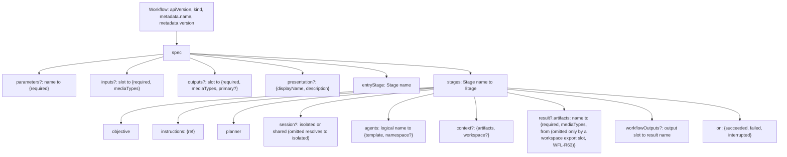
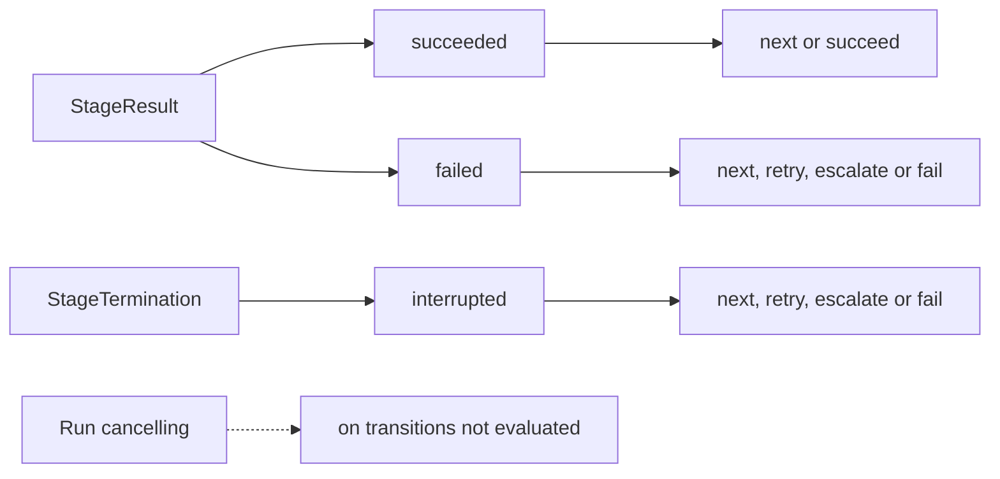
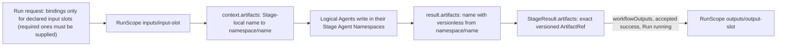

# Workflows

Requirement prefix: `WFL` · [Specification index](../README.md)

## Purpose and scope

A Workflow defines a reusable application security check or supporting
analysis as a sequence or graph of Stages. Workflows can run independently or
be selected by an [Audit](../audits/audits.md) as part of a broader assessment.

This document owns the Workflow definition: the `v1alpha1` document shape,
string parameters, presentation metadata, Stages and their `objective`,
`instructions`, Planner selector, Worker `session` policy and Agent bindings,
the `on` transitions and their typed actions, the retry action and its attempt
count, the escalation action and the closed union of its `executionConfig`,
Workflow input and output slots, Stage context and result artifacts, the slot
payload contract and media-type matching, the output-slot `primary` marker,
`workflowOutputs` mappings and the built-in workspace Workflow variants.

It leaves to other documents:

- the responsibility split between Workflow Scheduler, Planner and Worker, and
  the end-to-end path of one Run: [Overview](../overview.md);
- the configuration envelope, the `(kind, name, version)` identity, the
  `<id>@<version>` selector grammar, WorkflowCatalog loading and selector
  resolution, and the configuration-root text-resource ref contract used by
  Stage `instructions`: [Configuration catalog](catalog.md);
- AgentTemplates, ExecutionConfig profiles, the Workflow `spec.executionConfig`
  defaults, executionConfig layering and what an escalation override may
  select: [AgentTemplates](agent-templates.md);
- Runtime labels: [Runtime configuration](runtime-config.md);
- the WorkflowRun resource, Run creation and the Run snapshot:
  [Runs](../execution/runs.md);
- StageExecution lifecycle, transition decisions, retry eligibility, escalation
  attempt counting and pinning: [Scheduler](../execution/scheduler.md);
- Planner strategies: [Planners](../execution/planners.md); the runtime meaning
  of the `isolated` and `shared` session modes:
  [Worker](../execution/worker.md);
- Namespaces, reserved Namespaces, media-type grammar, Run input forks, and
  the transaction and lineage of the Workflow output binding:
  [Artifact store](../artifacts/artifact-store.md);
- the use of `primary` outputs in a Project:
  [Projects](../artifacts/projects.md);
- `context.workspace`: [Workspace](../tools/workspace.md);
- the code-analysis AgentTemplates used by the built-in Workflows:
  [Code analysis](../tools/code-analysis.md);
- the `auditTask` declaration of an Audit scan Workflow:
  [Audit scans](../audits/scans.md).

## Concepts

Terms are defined once in the [glossary](../glossary.md).

| Term | Meaning here |
| --- | --- |
| Workflow | A reusable, versioned definition of an application security check or supporting analysis as a sequence or graph of Stages. |
| WorkflowRun (Run) | The execution created by one Workflow invocation. |
| Stage | A named node of the Workflow graph with one objective, one Planner, Worker bindings, context, result contract and transitions. |
| Entry Stage | The Stage named by `entryStage`, where the graph starts. |
| Outcome | The key a Stage attempt selects in `on`: `succeeded` or `failed` from a StageResult, `interrupted` from a StageTermination. |
| Transition action | The one typed action an outcome selects: `next`, `retry`, `escalate`, `succeed` or `fail`. |
| Workflow parameter | A named string input declared in `spec.parameters`. |
| Input slot / output slot | A named public artifact slot of the Workflow, declared in `spec.inputs` / `spec.outputs`. |
| Context artifact | A Stage-local name bound to a versionless RunScope `(namespace, name)` in `context.artifacts`. |
| Result artifact | A Stage-local name in `result.artifacts` that may appear as a key of `StageResult.artifacts`. |
| `workflowOutputs` | The Stage's explicit mapping from Workflow output slots to its result artifact names. |
| Primary output | An output slot marked `primary: true`: a canonical user-facing result. |
| Logical Agent name | The key of a Stage `agents` mapping, visible to Planner. |
| Stage Agent binding | The object a logical Agent name maps to: an AgentTemplate selector and an optional Namespace. |
| Session policy | The Stage's `isolated` or `shared` Worker session mode. |
| Presentation metadata | Optional authored Catalog strings (`displayName`, `description`) with no execution semantics. |

## Model

### Workflow document

A Workflow definition declares:

- named string input parameters with required/optional status;
- named input artifact slots, including required/optional status and accepted
  media types;
- named output artifact slots, their acceptance contract and optional
  Project-recommendation `primary` marker;
- Stages, dependencies and product transition/escalation rules.



A Workflow `spec` may also carry `executionConfig` defaults
([AgentTemplates](agent-templates.md)) and, for an Audit scan Workflow, an
`auditTask` declaration with `auditTask.contract` (for example
`openapi-scan@1`) and `auditTask.stage` ([Audit scans](../audits/scans.md)).

### Outcomes and transition actions



### Artifact contract levels

Workflow artifact contracts have three distinct levels:

- `spec.inputs` and `spec.outputs` declare the public input and output slots of
  the reusable Workflow;
- `stage.result.artifacts` declares the Stage-local artifact names that may
  appear as keys in its `StageResult.artifacts` and the versionless RunScope
  binding from which Runtime may obtain each Worker-produced exact ref;
- `stage.workflowOutputs` explicitly maps Workflow output slots to those
  Stage-local result names.



## Requirements

### Workflow definition

**WFL-R1.** One Workflow invocation creates one `WorkflowRun` (`Run`).

**WFL-R2.** A Workflow definition declares named input and output slots.
The reusable definition owns these slot contracts; concrete input and output
bindings belong to one WorkflowRun, not to the reusable Workflow definition.

**WFL-R3.** The `v1alpha1` schema is an explicit state-machine graph
with a versioned document envelope, exactly one entry Stage (LIM-WFL-1), a
mapping of stable Stage names and Stage-local typed transitions.

WorkflowCatalog resolution of the `planner`, `template` and escalation
ExecutionConfig selectors into exact refs, the rejection of unknown or
ambiguous selectors, the Run snapshot that stores the resolved refs and the
rule that Scheduler never re-resolves the authoring strings while executing a
Run are owned by [CAT-R29 to CAT-R35](catalog.md).

### Parameters

**WFL-R4.** `spec.parameters` is a mapping of stable parameter names to
string-slot contracts. Each contract contains exactly one mandatory boolean
field, `required`; it has no default.

**WFL-R5.** `v1alpha1` has no parameter type declaration, because
every accepted parameter value is a string.

### Presentation metadata

**WFL-R6.** A Workflow may carry an optional `spec.presentation` object of
authored Catalog metadata with no execution semantics.

**WFL-R7.** When `presentation` is present, `displayName` and
`description` are both mandatory, strict UTF-8 and non-whitespace.
`displayName` is at most 160 Unicode code points (LIM-WFL-2) and `description`
at most 2000 Unicode code points (LIM-WFL-3). Unknown fields are invalid.

**WFL-R8.** The loader preserves the authored strings rather than
trimming or interpolating them; the length limits and the non-whitespace check
are validation only.

**WFL-R9.** The resolved `presentation` object is part of the complete
immutable Workflow definition and is persisted in every new Run snapshot.

**WFL-R10.** `presentation` does not alter the graph, inputs,
outputs, Planner prompts, placement or any other execution behavior.

**WFL-R11.** A persisted snapshot or authoring document without
`presentation` decodes with presentation absent and retains its existing
serialized shape.

**WFL-R12.** `presentation` is Workflow content, not separately editable
metadata: adding or changing it changes the exact `(name, version)` like any
other content change, under [CAT-R44](catalog.md) and, for the pre-production
shipped catalog, [CAT-R74](catalog.md).

**WFL-R13.** `presentation` does not introduce a Workflow digest; the
complete durable Run snapshot remains execution authority
([CAT-R34](catalog.md), [RUN-R24](../execution/runs.md)).

### Stages

**WFL-R14.** A Stage declares:

- one literal objective and one set of Stage-specific instructions;
- one exact Planner factory/version;
- one or more uniquely named Worker bindings;
- its Stage context and references to available Run artifacts;
- named result-artifact slots and their required/optional and media-type
  contracts.

**WFL-R15.** Every Stage declares a mandatory non-empty literal
`objective` and one mandatory Planner-instruction resource ref,
`instructions`:

```yaml
objective: |
  Produce an OpenAPI description that matches the service implementation.
instructions:
  ref: instructions/build-openapi.md
```

**WFL-R16.** `objective` states the Stage-specific desired outcome.
The resolved `instructions` text gives Planner Stage-specific operating
guidance and constraints, including how the logical Worker names may be used.

**WFL-R17.** Scheduler performs no parameter interpolation, expression
evaluation or prompt-template rendering in `objective` or the resolved
`instructions` text.

**WFL-R18.** Empty or whitespace-only objective or instruction text is
invalid.

**WFL-R19.** The Stage `instructions` object is a configuration-root
instruction resource ref; its shape (exactly one `ref`, not an ArtifactRef),
grammar, resolution and confinement to the configuration root are owned by
[CAT-R36 to CAT-R39](catalog.md).

**WFL-R20.** `objective` and `instructions` are semantic input, not
executable policy. Scheduler does not try to infer success from their text,
and they cannot override result contracts, Workflow transitions, budgets,
artifact grants, RuntimeSettings or platform safety constraints.

**WFL-R21.** Worker-wide reusable behavior remains in the selected
`AgentTemplate`; Stage instructions do not mutate that template.

### Stage Agent bindings

**WFL-R22.** Each Stage uses a non-empty `agents` mapping, with at least
one binding (LIM-WFL-4), from logical Agent name to an object-valued binding.
Each value is an object with the required `template` field and an optional
`namespace`. The authoring schema has no list or scalar shorthand.

```yaml
agents:
  oas_builder:
    template: openapi_builder@3
    namespace: oas
  reviewer:
    template: openapi_validator@3
```

**WFL-R23.** The mapping key is the stable logical name visible to
Planner, not a physical Runtime Agent or process identity. It becomes `name`
in the normalized internal binding.

**WFL-R84.** Stage names and logical Agent names use the shared name grammar
`[A-Za-z0-9][A-Za-z0-9_.-]*` of at most 128 characters (LIM-WFL-8), the public
`ConfigId` schema in which the public API and Operations show them. The rule
applies wherever a name is declared or referenced: `stages` keys,
`entryStage` and `next` targets; `agents` keys, the Stage and Agent keys of a
Workflow `executionConfig`, the `agents` keys of an ExecutionConfig document
and of an escalation `executionConfig`, `scanPlan.tools[].worker`, and an
AuditProfile `workerCompletion` Stage and Agent. WorkflowCatalog rejects any
other name at load, a persisted Workflow or Stage snapshot carrying one is
invalid on read, the ExecutionConfig manifest and Workflow transition schemas
and the private AllocationSpec `logicalAgentName` use the same grammar,
Control Plane rejects a placement binding outside it, and a Planner dispatch
and the Run events that record it accept only such a Worker name. So every
allocation Operations shows and every dispatch the Run detail shows has a
valid logical Worker name.

**WFL-R24.** `template` is an exact versioned selector
([CAT-R18 to CAT-R22](catalog.md)). It resolves to
the digest-bearing `AgentTemplateRef` owned by
[AgentTemplates](agent-templates.md), and the normalized binding stores that
exact ref:

```python
class StageAgentBinding(BaseModel):
    name: AgentName
    template: AgentTemplateRef
    namespace: NamespaceId | None = None
```

**WFL-R25.** `namespace` defaults to the mapping key (`name`) and
affects artifact tools only.

**WFL-R26.** Mapping order has no execution semantics. Names are
unique by construction; WorkflowCatalog also rejects duplicate YAML mapping
keys before schema validation rather than accepting a parser's last value.

How Scheduler resolves and carries each binding's effective Namespace
([ART-R27](../artifacts/artifact-store.md)), the Run-reserved Namespaces and
their access rules ([ART-R14](../artifacts/artifact-store.md)), the rule that
`inputs`, `outputs` and `skills` cannot be selected as an Agent Namespace
([ART-R16](../artifacts/artifact-store.md)), and the uniqueness of the
Namespaces of specialized namespace-bound toolsets within one Stage, with
deliberate reuse by a later Stage ([ART-R29](../artifacts/artifact-store.md)),
are owned by the Artifact store.

### Worker session policy

**WFL-R27.** Each Stage has one Worker `session` policy shared by all of
its logical Agent bindings:

```yaml
session: isolated  # or shared
```

**WFL-R28.** The authoring field is optional only to keep
ordinary Workflow YAML concise. Omission in a newly loaded Workflow resolves to
`isolated` before the resolved Workflow can be snapshotted.

**WFL-R29.** An explicit value must be the exact YAML string
`isolated` or `shared`; null, an empty or unknown string, a number, a sequence
or a mapping is invalid.

**WFL-R30.** Resolved Workflow and Stage snapshots and the
public Workflow read model always contain the effective value.

**WFL-R31.** The policy is immutable Stage semantics. Retry and
escalation create new StageExecutions and allocations but retain the Stage's
selected mode; an executionConfig override cannot change it.

**WFL-R32.** Planner, its dispatch tools and
`StageContentRequest` carry no session override, reset operation or ADK
session identifier.

**WFL-R33.** Persisted execution authority must contain the
explicit `isolated` or `shared` value in every Stage, including Workflows
embedded in AuditProfile snapshots. Missing, null, empty, unknown and
non-string values are invalid.

**WFL-R34.** Snapshot readers never infer a session mode or
repair the stored authority. Snapshots written before this field existed are
unsupported.

What each mode means for Worker conversations, including Router Stages, is
owned by [WRK-R65](../execution/worker.md).

### Transitions

**WFL-R35.** `entryStage` must name one key in `stages`.

**WFL-R36.** In `v1alpha1`, `on` must contain exactly the three keys
`succeeded`, `failed` and `interrupted`, each with one action object.

**WFL-R81.** Each transition selects exactly one typed action: `next`,
`retry`, `escalate`, `succeed` or `fail`.

**WFL-R37.** There are no ordered rules, error-code predicates,
expression language or implicit fallback in `on`.

**WFL-R82.** A future schema version may add ordered predicates without
changing snapshots validated as `v1alpha1`.

**WFL-R38.** A StageResult selects `succeeded` or `failed`; a
StageTermination selects `interrupted`. `cancelled` is intentionally absent,
because it is handled only by the enclosing WorkflowRun cancellation path.

**WFL-R39.** Workflow cancellation is not a graph edge: once the Run is
`cancelling`, Stage cancellation does not evaluate `on` transitions
(FAIL-WFL-1).

**WFL-R40.** Action validity is constrained by outcome:

- `succeeded` allows `next` or `succeed`;
- `failed` allows `next`, `retry`, `escalate` or `fail`;
- `interrupted` allows `next`, `retry`, `escalate` or `fail`.

**WFL-R41.** `next` names another Stage, and every `next` target must
exist.

**WFL-R42.** `retry` and `escalate` create a new StageExecution for the
same Stage rather than reopening the prior attempt.

**WFL-R43.** Every graph path must reach `succeed`, `fail` or a
bounded retry or escalation exhaustion action.

**WFL-R44.** Arbitrary cycles through `next` are rejected in
`v1alpha1`; the only permitted cycles are explicitly bounded `retry` and
`escalate` actions.

Rationale: this leaves a direct mapping to a future block editor without
introducing a second Scheduler DAG.

How Scheduler records the transition decision for an outcome and commits the
progression is owned by [Scheduler](../execution/scheduler.md).

### Retry action

**WFL-R45.** The only `v1alpha1` retry form is:

```yaml
retry:
  maxAttempts: 3
  then:
    next: fallback
```

**WFL-R46.** `maxAttempts` is an integer greater than or equal to two
(LIM-WFL-5) and counts the initial StageExecution. Thus `maxAttempts: 3`
permits at most two new retry executions.

**WFL-R47.** Every retry creates a new StageExecution with the next
attempt number, a `previous_execution_id` pointing to the prior attempt and,
after successful preparation, new allocations, a new Planner instance and a
new Planner Session (FAIL-WFL-1).

When a `retry` action creates the next attempt and when Scheduler evaluates
`then` instead (the `retryable` flag of StageError and StageTermination, the
attempt limit and the Run state), the allowed content of `then`, and the
absence of retry delay, backoff, error-code predicate and runtime override are
owned by [SCH-R80 to SCH-R83](../execution/scheduler.md). Whether capacity
backoff consumes a Workflow attempt is owned by
[SCH-R20](../execution/scheduler.md).

### Escalation action

**WFL-R48.** Escalation is a Workflow Scheduler decision, never a
model-facing Planner operation.

**WFL-R49.** An escalation that selects an ExecutionConfig profile
references it with `executionConfig.ref`:

```yaml
escalate:
  maxAttempts: 1
  executionConfig:
    ref: strong-oas-review@1
  then:
    fail: {}
```

**WFL-R50.** Alternatively, `executionConfig` may contain the inline
`planner`/`agents` object directly. The two shapes are a closed union: an
object contains exactly `ref`, or it contains the inline override; `ref` plus
inline fields is invalid, and there is no second merge layer inside a profile.

**WFL-R51.** Both forms produce the same normalized Stage-local
override.

The ExecutionConfig profile manifest and the inline override body, which refs
an override may select and what it cannot change, and the rule that the
Workflow author declares the escalation tier intentionally are owned by
[TPL-R83 to TPL-R88](agent-templates.md). The escalation `maxAttempts` bound
(LIM-SCH-5), what it counts, the effective executionConfig of an escalated
StageExecution and its pinning in the Run snapshot are owned by
[SCH-R84 to SCH-R90](../execution/scheduler.md).

### Artifact slots

**WFL-R52.** All slot names and Stage-local context and result names are
stable identifiers in their containing mapping.

**WFL-R53.** At Run creation, the caller supplies bindings only for
declared Workflow input slots; each supplied binding is forked to
`inputs/<input slot>` ([ART-R74, ART-R76](../artifacts/artifact-store.md)).

**WFL-R54.** Every artifact slot uses the same minimal payload
contract:

- `required` is a mandatory boolean; it has no default;
- `mediaTypes` is a mandatory, non-empty list of unique media types
  (LIM-WFL-6).

**WFL-R55.** Each media type in a slot must be a valid canonical media
type as defined by [ART-R63](../artifacts/artifact-store.md) (LIM-ART-2);
the artifact store, Audit packages, schemas, Runtime and UI share
[these cases](../../../api/testdata/v1alpha1/media-type-cases.json).

**WFL-R56.** Slot matching compares the artifact version's stored media
type ([ART-R64](../artifacts/artifact-store.md)) exactly, except that the
single value `*/*` explicitly accepts any media type. Other wildcards are
invalid, and `*/*` cannot be combined with specific values.

**WFL-R57.** `v1alpha1` has no artifact cardinality, size,
filename-extension or structured payload schema in a slot contract. One slot
binds at most one ArtifactRef (LIM-WFL-7).

**WFL-R58.** For a required Workflow input, the Run request must supply
a binding; an optional input may be absent.

**WFL-R83.** The trusted Run-creation operation
([ART-R76](../artifacts/artifact-store.md)) validates the media type of the
exact selected source version against the input slot before creating any Run
input forks.

### Stage context artifacts

**WFL-R59.** `context.artifacts` is a mapping from a Stage-local name to
an authoring binding with exactly three fields: `namespace`, `name` and the
mandatory boolean `required`. Scope is implicitly the current RunScope.

**WFL-R60.** A `revision` is invalid in a context binding in Workflow
YAML, because revisions belong to one concrete Run:

```yaml
context:
  artifacts:
    source:
      namespace: inputs
      name: source
      required: true
    previous_report:
      namespace: analysis
      name: report
      required: false
```

`context.workspace`, which sits next to `context.artifacts` in a Stage and
refers to context artifact aliases, is owned by
[Workspace](../tools/workspace.md) (WSP-R10 to WSP-R21).

### Stage result artifacts

**WFL-R61.** A Stage result artifact has, in addition to the slot payload
contract, a mandatory versionless `from` binding with exactly `namespace` and
`name`. Its Namespace must be assigned to at least one logical Agent of that
Stage.

**WFL-R62.** A revision is invalid in `from`, because the concrete
revision is created or observed only inside one Run.

**WFL-R63.** The sole exception to a mandatory `from` is a
Runtime-owned overlay `workspace_state` or `workspace_diff` export slot: it
omits `from`, and `context.workspace.export` supplies the trusted mapping
([WSP-R21](../tools/workspace.md)).

**WFL-R64.** `from` is invalid on Workflow input and output slots and
is never shown as a result-selection instruction to the Worker model.

**WFL-R65.** For a successful StageResult, every required Stage result
slot must be present. Optional result slots may be absent, but every present
result ref is validated against its declared media types regardless of Stage
outcome. Unknown result names are invalid.

### Workflow outputs

**WFL-R66.** A Workflow output slot additionally accepts an optional
boolean `primary`; omission is `false`. `primary` is invalid on Workflow inputs
and Stage result slots.

**WFL-R67.** `primary` is presentation and publication intent
only: it does not change StageResult validation, required-output success,
freezing, Scheduler transitions or Run success.

**WFL-R68.** `primary` identifies canonical user-facing results
for Project Workflow recommendations and create-only publication; how a
Project uses it is owned by [PRJ-R48 to PRJ-R50 and PRJ-R102](../artifacts/projects.md).

**WFL-R69.** Internal handoff outputs such as `workspace_state` and
`workspace_diff` normally remain non-primary; in built-in generator Workflows
they are not primary.

**WFL-R70.** Each `workflowOutputs` key must name a declared Workflow
output, and its value must name a result artifact declared by the same Stage.

**WFL-R71.** Scheduler considers the mapping only for an accepted
successful StageResult while the WorkflowRun is still `running`. The
StageResult value is an exact versioned ArtifactRef; Scheduler binds that
version to `outputs/<output slot>` without resolving the source's current
binding again, and creates that binding at most once per Run. The transaction,
the lineage and the outcome of a mapping that meets an existing binding are
owned by [ART-R90](../artifacts/artifact-store.md).

**WFL-R72.** There is no implicit output mapping based on artifact
Namespace, name, list position or matching slot names.

**WFL-R73.** Workers cannot write the reserved `outputs`
Namespace directly.

**WFL-R74.** A required Workflow output must be bound before Run
success; an optional output may remain absent.

**WFL-R75.** When applying `workflowOutputs`, Scheduler validates the
selected artifact against both the Stage result slot and the destination
Workflow output slot, so an incompatible concrete artifact can never be
accepted through the mapping.

**WFL-R76.** A mapping whose Stage result slot and Workflow output
slot declare media-type sets that cannot intersect is rejected at catalog
load.

**WFL-R85.** A Workflow graph in which a Stage maps a Workflow output that an
earlier successful Stage on the same path from `entryStage` already maps is
rejected at catalog load. With WFL-R40 and WFL-R44, a Run therefore maps each
Workflow output at most once ([ART-R90](../artifacts/artifact-store.md)).

### Built-in workspace Workflows

**WFL-R77.** The graph-backed workspace Workflows of the default
catalog ([CAN-R90](../tools/code-analysis.md)) are:

| Workflow | Planner | Discovery AgentTemplate | Placement effect |
|---|---|---|---|
| `openapi-from-workspace@5` | `passthrough@1` | `workspace_source_graph_analyst@1` | Selects all eleven operations; waits for complete local graph capacity |
| `likec4-from-workspace@5` | `passthrough@1` | `workspace_source_graph_analyst@1` | Same graph placement contract |
| `likec4-from-workspace-streamline@2` | `streamline@1` | `workspace_source_graph_analyst@1` | Same graph placement contract with modeled Stage decomposition |

**WFL-R78.** Historical source-backed and shallow/default workspace
Workflow versions are not published or archived.

**WFL-R79.** The portable `search_def` and `list_symbols` operations
remain available to operator-authored AgentTemplates, but the built-in project
Workflows never silently downgrade to them. There is no analyzer-aware
Scheduler branch or placement fallback.

**WFL-R80.** Built-in generator Workflows use canonical semantic
output slot names, including `openapi`, `likec4`, `docs` and domain-qualified
report names.

The discovery and taint AgentTemplates and the one-Stage
`taint-trace-from-workspace@2` Workflow are specified in
[Code analysis](../tools/code-analysis.md) (CAN-R90, CAN-R92, CAN-R132,
CAN-R133).

## Interfaces

A Workflow is a configuration document with the envelope
`apiVersion: contractor/v1alpha1`, `kind: Workflow` and `metadata.name` /
`metadata.version` ([Configuration catalog](catalog.md)); see the complete
example under [Examples](#examples).

`spec` fields:

| Field | Meaning | Rules |
| --- | --- | --- |
| `parameters` | Named string parameters | WFL-R4, WFL-R5 |
| `inputs` | Public input artifact slots | WFL-R53 to WFL-R58, WFL-R83 |
| `outputs` | Public output artifact slots, optionally `primary` | WFL-R54 to WFL-R57, WFL-R66 to WFL-R69, WFL-R74 |
| `presentation` | Optional `displayName` and `description` | WFL-R6 to WFL-R13 |
| `entryStage` | Name of the entry Stage | WFL-R35 |
| `stages` | Mapping of stable Stage names to Stages | WFL-R14; Stage fields below |
| `executionConfig` | Workflow-wide execution defaults | [AgentTemplates](agent-templates.md) |
| `auditTask` | Audit scan execution contract | [Audit scans](../audits/scans.md) |

Stage fields:

| Field | Meaning | Rules |
| --- | --- | --- |
| `objective` | Literal Stage outcome | WFL-R15 to WFL-R18, WFL-R20 |
| `instructions.ref` | Planner instruction resource | WFL-R19 |
| `planner` | Exact Planner factory selector | WFL-R14; [Planners](../execution/planners.md) |
| `session` | `isolated` or `shared` | WFL-R27 to WFL-R34 |
| `agents` | Logical Agent name to `{template, namespace?}` | WFL-R22 to WFL-R26 |
| `context.artifacts` | Stage-local name to `{namespace, name, required}` | WFL-R59, WFL-R60 |
| `context.workspace` | Workspace hydration | [Workspace](../tools/workspace.md) |
| `result.artifacts` | Stage-local result name to slot contract plus `from` (omitted only by a workspace export slot) | WFL-R61 to WFL-R65 |
| `workflowOutputs` | Workflow output slot to result name | WFL-R70 to WFL-R76, WFL-R85 |
| `on` | `succeeded`, `failed`, `interrupted` actions | WFL-R36 to WFL-R51, WFL-R81, WFL-R82 |

The strict WorkflowCatalog loader is the one validator of the authored `on`
actions and the escalation `executionConfig` union (WFL-R36, WFL-R40, WFL-R45,
WFL-R46, WFL-R50, WFL-R81). No JSON Schema describes the authored block: the
private schemas under `api/v1alpha1` cover only messages between the Server and
the Runtime, and the read model below carries the resolved transitions.

The public read model is `GET /v1/workflows` and
`GET /v1/workflows/{name}/versions/{version}` in
[contractor-public-v1.yaml](../../../api/openapi/contractor-public-v1.yaml); it
always contains each Stage's effective session value (WFL-R30). Which Workflow
Stages pin an exact AgentTemplate body is listed by the read-only
workflow-bindings endpoint owned by
[TPL-R109 and TPL-R110](agent-templates.md).

## Limits, failures and errors

Limits ([registry](../platform/limits.md)):

- LIM-WFL-1 — entry Stages per Workflow: exactly 1 (WFL-R3).
- LIM-WFL-2 — `presentation.displayName`: at most 160 Unicode code points
  (WFL-R7).
- LIM-WFL-3 — `presentation.description`: at most 2000 Unicode code points
  (WFL-R7).
- LIM-WFL-4 — Stage `agents` bindings: at least 1 (WFL-R22).
- LIM-WFL-5 — retry `maxAttempts`: integer of at least 2, counting the initial
  StageExecution (WFL-R46).
- LIM-WFL-6 — slot `mediaTypes`: at least 1 unique entry (WFL-R54).
- LIM-WFL-7 — ArtifactRefs bound per slot: at most 1 (WFL-R57).
- LIM-WFL-8 — Stage and logical Agent names: at most 128 characters in the
  shared name grammar (WFL-R84).
- Used here, owned elsewhere: LIM-ART-2 (media type length), LIM-SCH-5
  (escalation `maxAttempts`), LIM-WSP-1 to LIM-WSP-3 (workspace sources and
  targets).

Failure outcomes ([failure model](../platform/failure-model.md)):

- FAIL-WFL-1 — outcome of one Stage attempt handled by the declared `on`
  transition (WFL-R39, WFL-R42, WFL-R47).

This document defines no error codes. Errors of the AgentTemplate
workflow-bindings endpoint are owned by [AgentTemplates](agent-templates.md).

## Security

- Stage `objective` and `instructions` are semantic input, not executable
  policy, and cannot override result contracts, transitions, budgets, artifact
  grants, RuntimeSettings or platform safety constraints (WFL-R20).
- Stage `instructions` are configuration resources, never artifacts; their
  confinement to the configuration root is owned by
  [Configuration catalog](catalog.md) (WFL-R19).
- Workers cannot write the reserved `outputs` Namespace; Run outputs are bound
  only through explicit `workflowOutputs` (WFL-R72,
  WFL-R73).
- A result artifact's `from` binding is never shown to the Worker model as a
  result-selection instruction (WFL-R64).

## Invariants

- Every graph path ends in `succeed`, `fail` or a bounded retry or escalation
  exhaustion action; the only cycles are bounded `retry` and `escalate`
  (WFL-R43, WFL-R44).
- A Stage attempt is never reopened: retry and escalation always create a new
  StageExecution (WFL-R42).
- A Run maps each Workflow output at most once (WFL-R40, WFL-R44, WFL-R85).
- Every persisted Stage carries an explicit session mode (WFL-R33).
- `presentation` and `primary` never change execution behavior
  (WFL-R10, WFL-R67).

## Examples

### Two-Stage Workflow with retry and escalation

```yaml
apiVersion: contractor/v1alpha1
kind: Workflow

metadata:
  name: openapi-analysis
  version: "1"

spec:
  parameters:
    objective:
      required: true
    mode:
      required: false

  entryStage: build
  stages:
    build:
      objective: Build an OpenAPI description from the service source
      instructions:
        ref: instructions/build-openapi.md
      planner: passthrough@1
      session: isolated
      agents:
        builder:
          template: oas_builder@2
      on:
        succeeded:
          next: review
        failed:
          fail: {}
        interrupted:
          retry:
            maxAttempts: 2
            then:
              fail: {}

    review:
      objective: Review and improve the produced OpenAPI description
      instructions:
        ref: instructions/review-openapi.md
      planner: streamline@1
      session: shared
      agents:
        reviewer:
          template: oas_reviewer@1
      on:
        succeeded:
          succeed: {}
        failed:
          escalate:
            maxAttempts: 1
            executionConfig:
              ref: strong-oas-review@1
            then:
              fail: {}
        interrupted:
          fail: {}
```

### Slots, context, result and output mapping

```yaml
spec:
  inputs:
    source:
      required: true
      mediaTypes: [application/zip]

  outputs:
    openapi:
      required: true
      primary: true
      mediaTypes: [application/yaml, application/json]

  entryStage: build
  stages:
    build:
      objective: Build an OpenAPI description from the source
      instructions:
        ref: instructions/build-openapi.md
      planner: passthrough@1
      session: isolated
      agents:
        oas_builder:
          template: oas_builder@2

      context:
        artifacts:
          source:
            namespace: inputs
            name: source
            required: true

      result:
        artifacts:
          candidate:
            required: true
            mediaTypes: [application/yaml, application/json]
            from:
              namespace: oas_builder
              name: openapi

      workflowOutputs:
        openapi: candidate

      on:
        succeeded:
          succeed: {}
        failed:
          fail: {}
        interrupted:
          fail: {}
```

### Router Stage with two logical Agents

```yaml
objective: Build and review an OpenAPI description
instructions:
  ref: instructions/build-and-review.md
planner: router@1
agents:
  oas_builder:
    template: oas_builder@2
  reviewer:
    template: oas_reviewer@1
    namespace: shared_oas
context: ...
result: ...
workflowOutputs: ...
```

### Presentation metadata

```yaml
spec:
  presentation:
    displayName: OpenAPI from source
    description: Build and validate an OpenAPI document from a source archive.
```

## Non-goals

- Ordered transition rules, error-code predicates, an expression language or
  an implicit fallback in `v1alpha1` (WFL-R37).
- Parameter types other than string (WFL-R5).
- Arbitrary `next` cycles (WFL-R44).
- Artifact cardinality, size, filename-extension or structured payload schemas
  in slot contracts (WFL-R57).
- Implicit output mapping (WFL-R72).
- Retry delay, backoff, error-code predicates and runtime overrides
  ([SCH-R83](../execution/scheduler.md)).
- Workflow-declared Runtime labels
  ([Runtime configuration](runtime-config.md)).
