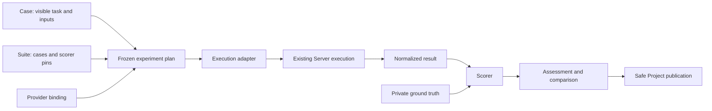
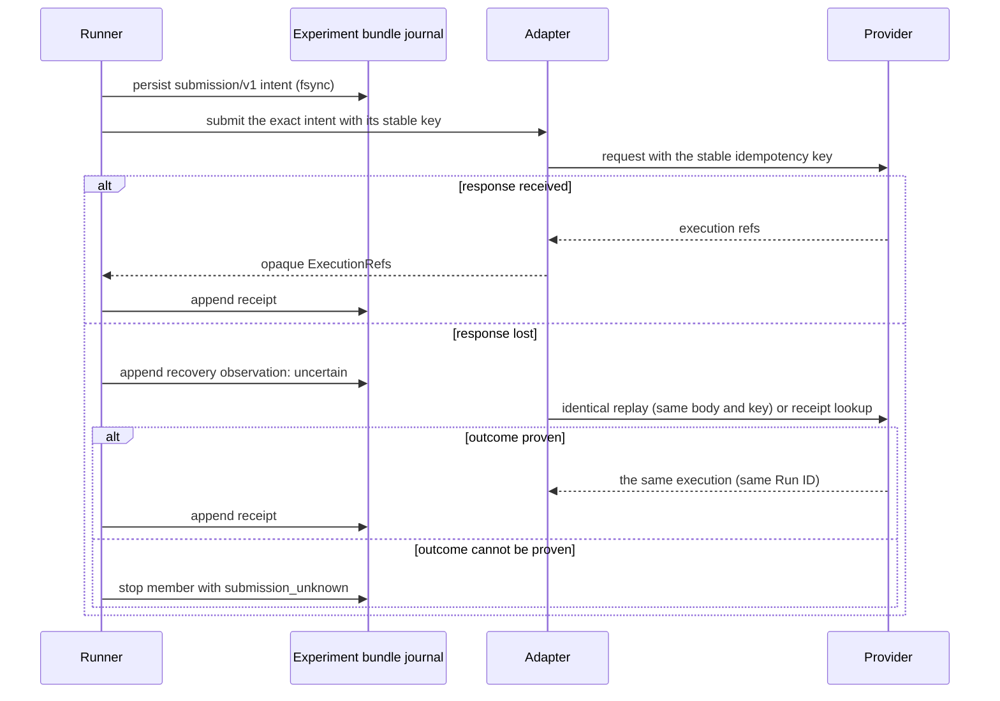
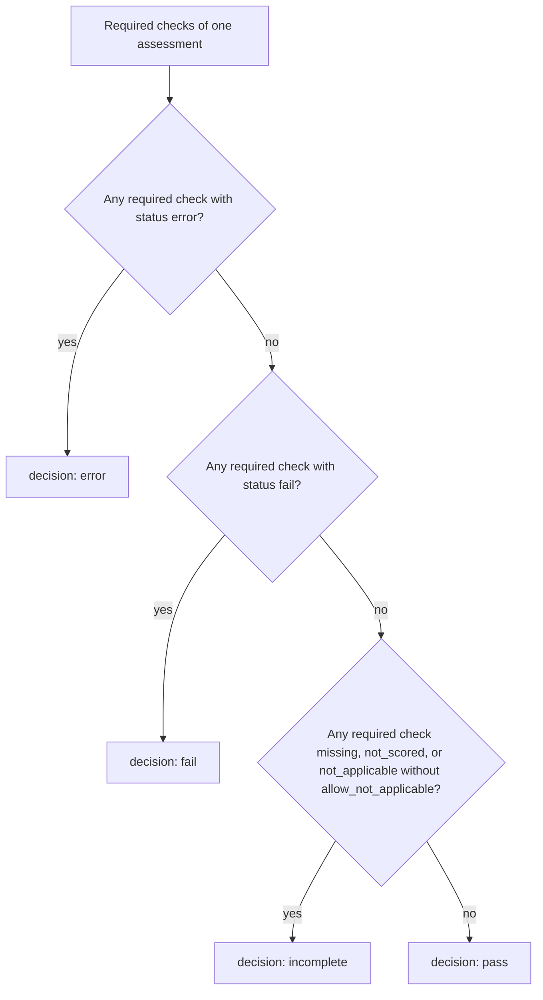

# Portable evaluation format

Requirement prefix: `EVF` · [Specification index](../README.md)

## Purpose and scope

This document owns the portable evaluation contract shared with
`playground-v2`: the evaluation documents and their immutable references,
cases and suites, provider bindings and the adapter contract, experiments,
frozen plans and member identity, durable submission and recovery, execution
results and assessments, comparison and denominators, the Contractor transport
and publication, v1 compatibility, the `playground-eval experiment` command
line and the conformance behaviour of the format.

Other documents own the adjacent concepts:

- Contractor execution, storage, identity and authorization:
  [Runs](../execution/runs.md), [Projects](../artifacts/projects.md),
  [ArtifactStore](../artifacts/artifact-store.md) and
  [Audits](../audits/audits.md).
- The user-facing experiment and comparison journey and native Server
  execution, assessment and comparison: [Managed Evals](managed-evals.md).
  Managed Evals consume this format rather than define a competing identity or
  result envelope; they also own the meaning of the `purpose=eval` and
  `eval.*` Run labels.
- The wording rules for model-visible tool descriptions and how tool
  docstrings reach the model: [Toolsets](../tools/toolsets.md).
- Deletion and retention of Project artifacts:
  [Retention and deletion](../artifacts/retention-and-deletion.md).
- Shared registries: [limits](../platform/limits.md),
  [errors](../platform/errors.md),
  [failure model](../platform/failure-model.md) and
  [lifecycle](../platform/lifecycle.md).

## Concepts

Each term is defined once in the [glossary](../glossary.md); the ones this
document owns are:

- **Case** — one evaluation task with its visible inputs, required
  capabilities and outputs, and private expected data
  (`playground.case/v2`).
- **Suite** — exact cases with their scorer configuration, thresholds and
  required checks (`playground.suite/v2`).
- **Provider** — an execution system registered under a `VersionedId`, for
  example `contractor@1`.
- **Binding** — the provider selection and the provider-specific execution and
  output mapping of one variant (`playground.binding/v1`).
- **Adapter** — the provider-specific implementation of the adapter operations
  (`preflight`, `prepare`, `submit`, `reconcile`, `observe`, `cancel`,
  `collect`) through which a case runs on existing Server execution.
- **Recorded-output provider** — a provider that serves recorded fixture
  results through the same interface as a real provider; it is used in
  conformance tests.
- **Normalizer** — an allowlisted, versioned local function that decodes or
  projects observed provider data into logical roles and evidence.
- **Execution projection** — the visible part of a case,
  `{id, task, inputs, requires, outputs}`; the only part of a case that crosses
  the adapter boundary.
- **Capability ID** — a versioned string, such as `source.archive@1`, naming a
  capability that a case requires or a binding claims.
- **Experiment** — one evaluation invocation: requested suites, variants,
  repetitions, order, budgets, comparison and publication
  (`playground.experiment/v1`).
- **Variant** — one `{id, binding}` entry of an experiment; in an A/B
  comparison the baseline and candidate variants are its two arms.
- **Plan** — the frozen, expanded experiment with its pins and expected member
  set (`playground.plan/v1`).
- **Member** — one expected execution of one case, sample and variant in a
  plan.
- **Sample** — the one-based repetition number of a case and variant in a
  plan.
- **Eligibility** — the planned status of a member: `eligible`, `unsupported`
  or `blocked`.
- **Expected denominator** — the complete expected member set of a plan,
  including unsupported and blocked members.
- **Pin** — the recorded exact identity of one dimension that affects an
  execution or its scoring, with its availability and evidence origin.
- **Required-equal dimension** — a pinned dimension that the experiment's
  `comparison.required_equal` declares must match between baseline and
  candidate.
- **Experiment bundle** — the local evaluator authority of one experiment:
  its immutable plan and records and an fsynced journal under an exclusive
  process lock.
- **Submission** — the durable per-member intent of one external mutation,
  with its receipts and recovery bookkeeping (`playground.submission/v1`).
- **Receipt** — an immutable record appended to a submission; authoritative
  receipts establish member association.
- **ExecutionRef** — the common opaque reference
  `{provider, connection_id, kind, id}` to one provider execution.
- **Result** — the observed execution and collected outputs of one member,
  independent of quality (`playground.result/v2`).
- **Assessment** — versioned scorer judgments over one exact result
  (`playground.assessment/v1`).
- **Comparison** — the report of expected denominators, pairing,
  completeness, quality and cost of the arms (`playground.comparison/v1`).
- **Pair** — the baseline and candidate members with the same
  `(suite_id, case_id, sample)`.
- **Publication projection** — the explicit, allowlisted safe projection of a
  private record that is written to a Project, carrying its own digest and a
  `source_record_sha256`.
- **Execution success**, **end-to-end pass** and **conditional quality** —
  the per-arm rates defined under
  [Comparison and denominators](#comparison-and-denominators).

## Model

### Documents

| Schema identity | Purpose | Publication |
| --- | --- | --- |
| `playground.case/v2` | One task, visible inputs, required capabilities/outputs, private expected data | Evaluator only; a visible projection crosses the adapter boundary |
| `playground.suite/v2` | Exact cases, scorer configuration, thresholds and required checks | Evaluator only; safe identity/digests may be published |
| `playground.binding/v1` | Provider selection and provider-specific execution/output mapping | Private authoring; publish an allowlisted resolved identity |
| `playground.experiment/v1` | Requested suites, variants, repeats and execution limits | Evaluator authoring |
| `playground.plan/v1` | Frozen, expanded experiment and expected member set | Private authority; a safe manifest projection may be published |
| `playground.submission/v1` | Durable per-member intent, receipt and recovery bookkeeping | Private authority; receipts may be projected |
| `playground.result/v2` | Observed execution and collected outputs, independent of quality | Portable record with a safe publication projection |
| `playground.assessment/v1` | Versioned scorer judgments over one exact result | Evaluator record; allowlisted score summary may be published |
| `playground.comparison/v1` | Expected denominators, pairing, completeness, quality and cost | Portable report and safe server projection |

### Data flow

A case and a suite, with a provider binding, are frozen into an experiment
plan. An execution adapter runs each member on existing Server execution and
returns a normalized result. A scorer judges the result against private ground
truth; assessments feed the comparison, which may be published safely to a
Project.

## Requirements

### Ownership and providers

**EVF-R1.** `playground-v2` owns datasets, hidden ground truth, suite
definitions, experiment planning, adapters, scorers, result serialization and
comparison.

**EVF-R2.** Contractor executes ordinary Workflows and Audits through
its public APIs. Evaluations reuse Contractor's evaluation Projects, Runs,
artifact store, queue, retries and metrics.

**EVF-R3.** The format must not introduce an eval Scheduler, direct
database access, an import of an internal Contractor package or a per-case
Server process.

**EVF-R4.** The `playground-v2` implementation of this format extends the
`playground_evals` modules and reuses their project, corpus and target
manifests, source packager, scorers and upstream oracles. A new format is not
a new benchmark dataset or a new implementation of all scorers.

**EVF-R5.** The format supports a Contractor execution provider,
with Workflow and Audit bindings, and a recorded-output provider used in
conformance tests.

**EVF-R6.** The same case and scorer must work with both
providers.

**EVF-R7.** Provider configuration may describe real differences in
capability; the common contract must not require ADK, tool names, Worker
counts, Workflow stages or ArtifactStore namespaces.

**EVF-R8.** External oracle protocols remain exact domain
requirements. In particular, WebExploitBench verification and judging must
observe the same target instance under the pinned CAGE contract; portability
does not replace that oracle with text matching.

**EVF-R9.** Native annotated diffs may remain an explicitly required
output format for annotation-specific suites; ordinary trace-quality suites
should consume neutral trace evidence rather than require a particular comment
syntax.

**EVF-R10.** This specification stays canonical in Contractor until it
is deliberately transferred; a cross-repository handoff pins or copies it
rather than maintaining divergent specifications.

### Documents and encoding

**EVF-R11.** Every document requires `schema_version`.

**EVF-R12.** Schemas are closed objects except for explicit
provider/scorer configuration and namespaced `extensions`. Extension data
cannot change identities, execution state, denominators or score semantics.

**EVF-R13.** An unknown schema version fails with
`schema_version_unsupported`. A reader never guesses v1 and never silently
discards required fields.

**EVF-R14.** A new incompatible meaning requires a new schema identity.
Optional additive extensions preserve existing meanings.

**EVF-R15.** Authoring accepts JSON or a JSON-compatible subset of
YAML: string object keys, and no custom tags, duplicate keys, aliases,
non-finite numbers or implicit date objects.

**EVF-R16.** Frozen records are persisted as UTF-8 JSON.

**EVF-R17.** Validation is JSON Schema validation plus semantic
validation; matching JSON types alone does not prove consistency or
completeness.

**EVF-R18.** Validation uses the repository's JSON Schema 2020-12
dialect and a local schema registry. It must not fetch remote schemas or
execute document-supplied code.

### Common types

The common types are:

- **EVF-R19.** `Id`: 1–128 ASCII characters (LIM-EVF-1),
  `[a-z0-9][a-z0-9._-]*`; case-sensitive.
- **EVF-R20.** `VersionedId`: `<Id>@<Id>`, at most 128 ASCII characters
  in total (LIM-EVF-2), for registered providers and scorers. Its version is
  opaque and matched exactly. The `@` separator is not accepted in ordinary
  member, case or variant IDs.
- **EVF-R21.** `Digest`: `sha256:` followed by 64 lowercase hex
  digits.
- **EVF-R22.** `DocumentRef`: `{resource, sha256}`. `resource` is a
  bundle-relative logical resource key, not an arbitrary host path or an
  executable import.
- **EVF-R23.** `BlobRef`: `{resource, sha256, media_type, size_bytes}`.
  The size is a nonnegative integer and the digest covers the exact bytes.
  Physical and provider locators live in the resolver/adapter registry.
  Missing bytes are explicit, never an empty blob.
- **EVF-R24.** Times are explicit UTC RFC3339 strings; durations are
  nonnegative integer milliseconds.
- **EVF-R25.** Provider and scorer IDs use `VersionedId`, for example
  `contractor@1` or `openapi-coverage@1`. Registrations are local allowlists,
  not automatic imports.

### Digests and immutable references

**EVF-R26.** Digests cover the exact retained bytes, not parsed
YAML equivalence or a cross-language canonicalization claim. A reserialization
has a different digest.

**EVF-R27.** Documents do not embed their own digest; the
referencing records and receipts carry it.

**EVF-R28.** Mutable aliases may be used to author an experiment but
are resolved before the plan is frozen. An execution never follows a later
`latest` input, suite or seed.

**EVF-R29.** Source archives pin their produced bytes and their
packager and exclusion configuration, not just the Git HEAD of a possibly
dirty workspace.

### Format limits

**EVF-R30.** The default format limits are:

| Bound | Default | Limit |
| --- | --- | --- |
| Size of one JSON/YAML document | 1 MiB | LIM-EVF-3 |
| Nesting depth | 32 | LIM-EVF-4 |
| Cases per suite | 1,000 | LIM-EVF-5 |
| Variants | 16 | LIM-EVF-6 |
| Repetitions | 100 | LIM-EVF-7 |
| Expanded members | 10,000 | LIM-EVF-8 |
| Input/output roles | 128 | LIM-EVF-9 |
| Evidence refs per result | 1,024 | LIM-EVF-10 |

**EVF-R31.** The expanded matrix is validated before any submit.

**EVF-R32.** Scorer and provider configuration and failure messages
must fit within the enclosing document bound.

**EVF-R33.** Input and output blobs have separate provider limits;
the Contractor artifact bound is checked by the Contractor adapter.

**EVF-R34.** If the member count and byte limits cannot both be met,
the work is split into explicit experiments; a plan or comparison is never
silently truncated.

**EVF-R35.** The 10,000-member ceiling (LIM-EVF-8) is a format limit,
not a promise that one plan document can contain 10,000 members. External
producers may use the format ceiling subject to each document's byte limit.
Managed native authoring applies a smaller effective matrix bound before
storing a draft ([Managed Evals](managed-evals.md), EVM-R63).

### Cases

**EVF-R36.** A `case/v2` document requires these fields:

| Field | Contract |
| --- | --- |
| `id` | Stable case identity within a suite |
| `task` | `{kind, objective, parameters}`; kind is a domain identifier, parameters are bounded strings and carry no execution-provider fields |
| `inputs` | Map of logical role to exact `BlobRef`; only these inputs are visible to execution |
| `requires` | Unique versioned capability IDs, e.g. `source.archive@1`, `output.openapi@1` |
| `outputs` | Map of role to `{media_types, required}`; logical roles such as `document`, `report`, `trace`, `findings` |
| `evaluation` | Private `{ground_truth, assertions}` maps of logical roles to exact `BlobRef` |
| `provenance` | Dataset/source identity, exact revisions/digests and applicable subset/target/oracle refs |

**EVF-R37.** An empty evaluation map is permitted only when the
selected scorer does not require expected data.

**EVF-R38.** A black-box case can provide public task and target
descriptions without providing target source.

**EVF-R39.** Target locators and lifecycle setup are resolved by the
evaluator's target service. Private flags and oracle state are never task
inputs.

**EVF-R40.** Cases describe the capabilities they need, not how
a Worker obtains them.

### Execution projection and hidden truth

**EVF-R41.** An explicit execution projection
`{id, task, inputs, requires, outputs}` is built for each case. It contains
neither `evaluation` nor raw project or corpus metadata.

**EVF-R42.** Adapters receive only the execution projection plus
their binding and target handle. Scorers receive expected data separately.

**EVF-R43.** No upload path may serialize a full Case, Suite, Plan or
project manifest to the evaluated system.

**EVF-R44.** Source packaging must preserve playground's existing
truth-exclusion boundary.

### Suites and scoring

**EVF-R45.** A `suite/v2` document requires `id`, `cases` (ordered
exact Case DocumentRefs), `scoring` and `provenance`.

**EVF-R46.** Duplicate case IDs, or one case ID resolving to different
bytes within a suite, are errors.

**EVF-R47.** A suite groups cases with compatible output and
scoring contracts; an experiment may combine several suites.

**EVF-R48.** `scoring.checks` contains unique check IDs and, for each
check: `scorer` (exact version), `implementation_sha256`, `parameters`,
`ground_truth_role` (nullable), `required` and `allow_not_applicable` (default
false).

**EVF-R49.** The local scorer registration declares the required
output roles and media types, the accepted expected-data schema, the metric
definitions and `accepts_partial` (default false).

**EVF-R50.** Provider statuses, tool counts and LLM names are not
correctness criteria. Domain conformance checks may explicitly require a
particular output contract.

**EVF-R51.** The suite decision is `all_required_pass`; a suite needs
at least one required check (LIM-EVF-12).

**EVF-R52.** An individual scorer may retain its documented
weighted scalar metric; there is no invented universal weighted score across
unrelated suites.

**EVF-R53.** A parameter or threshold, implementation, expected-data
or validator/oracle change produces a new pin and cannot retroactively rewrite
a previous assessment.

### Bindings

**EVF-R54.** A `binding/v1` document requires `id`, `provider`,
`capabilities`, `connection`, `settings`, `input_mapping`, `output_mapping`
and `normalizers`.

**EVF-R55.** `connection` is a local credential reference, never a
token or a credential-bearing URL.

**EVF-R56.** Generic schema validation delegates `settings` and the
mappings to the selected provider's closed schema.

**EVF-R57.** Mappings connect logical case roles to
provider-specific inputs and outputs; all required roles must resolve.

**EVF-R58.** Normalizers are allowlisted, versioned local
functions with pinned implementation digests. They may decode or project
observed data and preserve exact raw-evidence refs.

**EVF-R59.** A normalizer must not fabricate a finding, control,
verdict or missing artifact from hidden expectations.

**EVF-R60.** Contractor settings use `mode: workflow | audit`;
exactly one of `workflow` or `audit_profile` must be present (LIM-EVF-13).

**EVF-R61.** Workflow selectors, the AuditProfile name and version,
runtime labels, execution overrides, parameter mappings and artifact
namespaces exist only in the Contractor binding settings, not in portable
Cases or scorers.

**EVF-R62.** Runtime labels
([RuntimeConfig](../configuration/runtime-config.md)) are kept separate from
`eval.*` metadata.

**EVF-R63.** Contractor's exact-input, authorization and
profile/task authority rules apply to evaluation executions unchanged
([Projects](../artifacts/projects.md), [Audits](../audits/audits.md)).

### Adapter contract

**EVF-R64.** An adapter provides these operations:

| Operation | Required behavior |
| --- | --- |
| `preflight` | Resolve capabilities and exact effective config; report supported, unsupported or blocked with reason; no execution or target traffic |
| `prepare` | Produce visible input refs and persist a replayable submission intent; verify source/upload digests and exact revisions |
| `submit` | Submit that exact intent with its stable key; return opaque execution refs or uncertain outcome |
| `reconcile` | Recover an uncertain submission using that intent/key/authoritative receipt; never create a fresh sample implicitly |
| `observe` | Read authoritative execution state and available usage/evidence, with bounded pagination |
| `cancel` | Request cancellation; acceptance is not proof of remote termination |
| `collect` | Return normalized roles/evidence and completeness, including usable partial results on failure |

**EVF-R65.** The common `ExecutionRef` is
`{provider, connection_id, kind, id}` with an opaque `id`. Provider details
belong in a private receipt.

**EVF-R66.** Core code and scorers do not parse Contractor IDs and do
not need to know how many child Runs an Audit created.

**EVF-R67.** Capability IDs are versioned strings checked by provider
and scorer registrations. An unknown capability is unsupported, never silently
ignored or auto-installed.

**EVF-R68.** Binding capability claims are checked against the
registered adapter and the resolved provider configuration; an author cannot
enable a capability by naming it.

**EVF-R69.** The recorded-output provider supports the same
interface and fixture result contracts as a real provider. Provider parity
means unchanged case and scorer code over the same observations, not an
assertion that two different real systems behave identically.

### Experiments

**EVF-R70.** An `experiment/v1` document requires `id`, `suites`,
`variants`, `repetitions`, `order`, `budgets`, `comparison` and
`publication`, with these meanings:

- **EVF-R71.** `id` identifies one invocation, not a suite or a remote
  Run. Editing a frozen experiment requires a new invocation ID.
- **EVF-R72.** `suites` are exact Suite refs; `variants` are unique
  `{id, binding}` entries.
- **EVF-R73.** An A/B comparison requires exactly two variants
  (LIM-EVF-11). Collection may support more, but must not silently choose
  which pair to compare.
- **EVF-R74.** `repetitions` is an integer from 1 to 100 (LIM-EVF-7).
- **EVF-R75.** `order` is `{kind: alternating | seeded_shuffle, seed}`;
  `seeded_shuffle` requires an integer seed. The plan records the actual
  order.
- **EVF-R76.** `budgets` sets explicit `max_members`,
  `max_in_flight`, `wall_ms` and `max_observed_total_tokens` (nullable). There
  is no default permission to run without an execution budget.
- **EVF-R77.** An authoring or validation command never starts an
  evaluation.
- **EVF-R78.** `comparison` is
  `{baseline, candidate, required_equal, allowed_differences}`; explicit pin
  paths establish comparability rather than variant names.
- **EVF-R79.** `publication` is `{provider, connection, enabled}`.
  Disabled or local publication must work for other execution providers
  without importing Contractor.

### Frozen plan and member identity

**EVF-R80.** A `plan/v1` document requires `experiment_id`,
`created_at`, `experiment_ref`, the resolved `suites`, `variants`, `pins`,
`members`, `execution_order`, `budgets`, `comparison` and `publication`. Its
exact JSON bytes are frozen before the first submit.

**EVF-R81.** Each member records
`{member_id, suite_id, case_id, case_sha256, variant_id, sample, binding_sha256, eligibility, reason}`.
Samples are one-based integers.

**EVF-R82.** Member identity is the SHA-256 of the UTF-8 JSON
encoding, with no insignificant whitespace, of the array
`[experiment_id, suite_id, case_id, sample, variant_id]`. All 64 hex digits
are kept.

Rationale: IDs have the ASCII restriction of `Id`, so the identity encoding
has no Unicode or float ambiguity.

**EVF-R83.** A Contractor idempotency key is `eval-` plus the member
identity digest. Project and Audit create and start intents use distinct
operation suffixes within the provider's documented key bound.

**EVF-R84.** The member matrix is expanded once, before
submission.

**EVF-R85.** Eligibility is `eligible | unsupported | blocked`; a
reason is mandatory for `unsupported` and `blocked`.

**EVF-R86.** Unsupported and blocked members remain in the expected
denominator and in the capability coverage report.

**EVF-R87.** Fixing a frozen eligibility, configuration or source
mismatch creates a new plan and invocation; it does not silently remove
difficult cases.

**EVF-R88.** A transient transport failure before a preflight
completes leaves no executable plan (FAIL-EVF-1).

### Pins and comparability

**EVF-R89.** Pins include the dataset, ground-truth, scorer, normalizer,
validator, oracle and source bytes; the target reset specification; the model
or provider identifier and exposed model revision; sampling settings; the
resolved policy and budgets; tool declarations including docstrings;
instructions; Skill revisions; and adapter and runtime build identities.

Rationale: changing tool descriptions, including their docstrings, changes
model-visible guidance ([Toolsets](../tools/toolsets.md)).

**EVF-R90.** An unexposed model revision is explicitly unknown.

**EVF-R91.** Pin availability and evidence origin
(`observed | operator_supplied | unavailable`) are recorded per dimension.

**EVF-R92.** An operator-supplied expected pin is not itself proof
of the running provider.

**EVF-R93.** The read-only provider preflight must resolve the
required pins before execution; authored variant names cannot replace those
observations.

**EVF-R94.** A validator entrypoint hash alone does not pin its
external dependencies.

**EVF-R95.** Recorded oracle receipts prove association with
the selected result or session, not success of a real target campaign.

**EVF-R96.** A strict instruction A/B blocks when a required-equal
dimension cannot be established or has changed before submission. Missing
required pins block strict comparisons rather than turning into assumed
equality.

**EVF-R97.** A declared exploratory comparison retains unknowns
and cannot claim that the effect is isolated.

**EVF-R98.** For an instruction A/B, source, tasks, expected data,
scorers, tools and docstrings, Skills, model and sampling, and effective
budgets must match. Instruction bytes and their dependent template, Workflow
and AuditProfile wrapper version and digest refs may differ.

**EVF-R99.** Audit wrappers must preserve inventory, standards,
evidence, execution and interaction policy, except for the explicitly changed
child Workflow refs.

**EVF-R100.** The comparability check compares the resolved
settings, not just catalog selectors. It requires no raw secret or
confidential model request dump and uses safe metadata and digests.

### Durable submission and recovery

**EVF-R101.** The local experiment bundle is the evaluator authority:
immutable plan and records and an fsynced journal under an exclusive process
lock (LIFE-EVF-7).

**EVF-R102.** Server Runs and Audits remain the authority for
execution. Project artifacts are versioned publication copies, not a second
writable manifest authority.

**EVF-R103.** Resuming an experiment requires its bundle.

**EVF-R104.** A copied bundle must be handed over to one writer.

**EVF-R105.** Same-key provider replay still protects against
accidental duplicates.

**EVF-R106.** Before each external mutation, a `submission/v1` record is
persisted containing the member ID, plan digest, operation, stable idempotency
key, exact request digest, secret-free request payload or ref, and provider and
connection identity (LIFE-EVF-4).

**EVF-R107.** Credentials are resolved at call time.

**EVF-R108.** Updates append immutable receipts and recovery
observations; they do not overwrite the original intent.

**EVF-R109.** Snapshot and index replacement is atomic.

**EVF-R110.** An existing key with changed request bytes is a
conflict, not a retry strategy (FAIL-EVF-2).

**EVF-R111.** After a lost response, the submission is marked
`uncertain` and reconciled by identical provider replay or an authoritative
receipt lookup (FAIL-EVF-2).

**EVF-R112.** Another key, case or sample, WorkflowRun or Audit must
not be generated to hide the uncertainty.

**EVF-R113.** If the adapter cannot prove or recover the outcome,
that member stops with `submission_unknown`.

**EVF-R114.** Server Stage retries and Audit child attempts stay
inside the existing member; a new statistical repetition is a different
predeclared sample.

### Admission and budgets

**EVF-R115.** The runner keeps bounded client submission
bookkeeping, not a second remote Run state machine. It schedules no Workers
and changes no provider retry policy.

**EVF-R116.** Admission obeys `max_members` and `max_in_flight`.

**EVF-R117.** Wall and token observation limits stop further
submissions and request cancellation of owned active executions (FAIL-EVF-3).

**EVF-R118.** `max_observed_total_tokens` is an observation threshold,
**not a guaranteed hard spend cap**: usage may be delayed and in-flight work
may overshoot.

**EVF-R119.** Unknown usage is preserved and overshoot is reported;
hard per-Run policy limits stay with the execution provider.

**EVF-R120.** A restart does not reset spent time or tokens or the
original deadline.

### Targets

**EVF-R121.** Targets get explicit per-member lifecycle receipts
and a reset policy (LIFE-EVF-6).

**EVF-R122.** A stateful target or session of variant A is not reused
for variant B.

**EVF-R123.** A timeout is not proof that a replay or Automate
job or a target stopped; its receipt and actual cleanup outcome are retained
(FAIL-EVF-4).

### Execution results

**EVF-R124.** A `result/v2` document requires `experiment_id`,
`member_id`, `plan_sha256`, `observed_at`, `previous_result` (nullable
DocumentRef), `execution`, `collection`, `outputs`, `evidence`, `usage`,
`provenance` and `diagnostics`.

**EVF-R125.** `execution` contains opaque `refs`, `state`,
`started_at`, `finished_at` and `reason`. State is `not_submitted | accepted |
running | succeeded | failed | cancelled | unknown`.

**EVF-R126.** `finished_at` is null until the provider terminal
state is confirmed.

**EVF-R127.** A local timeout or cancellation request produces a
diagnostic and the last known provider state (or `unknown`), not a fabricated
terminal status (FAIL-EVF-3).

**EVF-R128.** Unsupported membership is recorded in Plan
eligibility, not as a successful execution.

**EVF-R129.** `collection` is
`{status: complete | partial | unavailable, gaps}`. Completeness refers to the
required output roles and their resolvable bytes; optional outputs do not
decide it.

**EVF-R130.** `outputs` maps logical roles to exact BlobRefs.

**EVF-R131.** `evidence` contains bounded `{id, kind, blob, location}`
entries (LIM-EVF-10). Locations use source-relative paths and one-based
inclusive line ranges, stable domain item keys, or opaque exchange refs.

**EVF-R132.** A normalizer cannot synthesize a source location from a
tool name.

**EVF-R133.** Raw output and evidence refs are preserved beside the
normalized data.

**EVF-R134.** Source citations must refer to the pinned source
snapshot. Scoring a post-annotation snapshot requires its exact digest and an
explicit mapping, not silent reuse of changed line numbers.

**EVF-R135.** Missing and invalid outputs remain explicit. A result
can be collected from a failed Run without asserting execution success
(FAIL-EVF-5).

**EVF-R136.** Later recovery produces a new result revision linked
by `previous_result`, preserving the earlier observation (LIFE-EVF-2).

### Usage

**EVF-R137.** `usage` separates measures, each
`{value, unit, completeness, source_refs, scope}`.

**EVF-R138.** A value is a nonnegative finite number or null.
Completeness is `complete | partial | unavailable`; `unavailable` requires
null, and partial numbers are lower or observed bounds, not full costs.

**EVF-R139.** A known zero requires complete observation.

**EVF-R140.** The core measures are `input_tokens`,
`output_tokens`, `total_tokens`, `cached_input_tokens`, `model_calls`,
`tool_calls`, `tool_failures` and `wall_ms`.

**EVF-R141.** A measure's scope identifies the member and the included
execution refs and attempts. It must include retries and all measured
planner, worker and finalizer work, or state the missing portion.

**EVF-R142.** `wall_ms` uses provider execution timestamps with a
declared interval, preferably creation or acceptance through terminal
completion, including provider queue time.

**EVF-R143.** `wall_ms` is not mixed with evaluator packaging,
polling, scoring or publication time; those may be separate measures. Missing
comparable timestamps make `wall_ms` unavailable.

**EVF-R144.** Authoritative cumulative totals are used once per
execution or attempt; successive poll snapshots are never added.

**EVF-R145.** Audit parent and child counters must not be
double-counted.

**EVF-R146.** Cached input tokens (`cached_input_tokens`) are a subset of
`input_tokens`, not an extra term in `total_tokens`.

**EVF-R147.** No token price or monetary cost is invented. An optional
monetary measure pins its currency, pricing source and date, and covered
usage.

**EVF-R148.** Contractor `reportsComplete` and `truncated`
propagate into completeness. Contractor's MetricsSummary does not expose
cached tokens.

### Assessments

**EVF-R149.** An `assessment/v1` document requires `id`,
`member_id`, `result_ref`, `suite_ref`, `scorer_pins`, private
`expected_refs`, `created_at`, `checks` and `decision`. Checks contain `id`,
`status`, `metrics`, `failures` and `evidence_refs`.

**EVF-R150.** Check status is
`pass | fail | not_applicable | not_scored | error`; a reason is required for
every status except `pass`.

**EVF-R151.** Metrics declare a name, a finite value or null, a unit,
a numerator and denominator when applicable, and completeness. Score values
are not mixed with execution usage.

**EVF-R152.** The assessment decision over required checks has this
precedence: `error`, then `fail`, then `incomplete`, otherwise `pass`.

**EVF-R153.** Missing or not-scored required checks, and
not-applicable checks that are not allowed, make the decision incomplete.

**EVF-R154.** An explicitly allowed not-applicable check does not
create a factual positive result.

**EVF-R155.** Optional-check failures remain visible but do not
change the decision.

**EVF-R156.** Each scorer documents its empty-denominator
behaviour. For detection, zero expected positives means recall is not
applicable, while a clean fixture still checks that there are no false
positives. 0/0 is never silently turned into 100%.

**EVF-R157.** Scoring incomplete output is allowed only for a scorer
that declares `accepts_partial`.

**EVF-R158.** Scorer errors do not rewrite provider state
(FAIL-EVF-6).

**EVF-R159.** Rescoring creates another immutable Assessment against
an exact Result and new scorer or expected-data pins; it never silently
updates an old score (LIFE-EVF-3).

**EVF-R160.** Comparisons select assessment refs explicitly.

**EVF-R161.** An LLM judge, if a suite deliberately uses one, is a
separately versioned and pinned evaluator with its own cost and provenance,
not an implicit fallback in generic normalization.

### Comparison and denominators

**EVF-R162.** `comparison/v1` records the experiment and plan refs,
the selected result and assessment refs, the baseline and candidate IDs,
expected member counts, membership conflicts, eligibility, execution,
collection and scoring completeness, quality, paired differences, usage,
diagnostics and `conclusion: pass | regressions | inconclusive`.

**EVF-R163.** A conclusion requires predeclared suite and
experiment gates. Missing required evidence or an unresolved member conflict
makes the conclusion `inconclusive` regardless of apparent averages.

**EVF-R164.** Members are paired by `(suite_id, case_id, sample)`.
The input, source and scorer pins and the required-equal execution dimensions
of a pair must agree.

**EVF-R165.** Per-family and per-suite denominators are stored
before any overall view.

**EVF-R166.** A comparison never silently compares only successful
runs or the first page.

For each arm, a comparison reports separately:

- **EVF-R167.** the expected, eligible, unsupported, blocked,
  submitted, terminal, missing, conflicting, collection-complete, scored and
  quality-passed member counts;
- **EVF-R168.** execution success = succeeded / expected;
- **EVF-R169.** end-to-end pass = eligible + succeeded + complete required
  outputs + passing assessment, counted once per member, divided by expected;
- **EVF-R170.** conditional quality among fully scored members,
  with its explicit denominator;
- **EVF-R171.** the paired count for each comparison dimension and
  the excluded-pair reasons.

**EVF-R172.** `pass@N` may be a separately labelled secondary metric; it
cannot replace per-attempt results.

**EVF-R173.** There is no silent retry or resample exemption from the
expected denominator.

**EVF-R174.** Two distinct provider executions claiming one
member are a conflict until explicitly adjudicated by receipts; neither
last-write-wins nor best-score selection is allowed.

**EVF-R175.** A Run with matching labels but no matching intent or
receipt is quarantined as unassociated and cannot prove membership.

**EVF-R176.** Quality is compared only where both assessments
support that dimension.

**EVF-R177.** A cost or latency comparison requires matching
measurement scopes and complete values in both arms; it includes technical
failures when those measurements are known.

**EVF-R178.** Excluded counts and observed partial values are
reported separately.

**EVF-R179.** p50 and p90 use the nearest rank `ceil(p * n)` of
the sorted values for n > 0, otherwise null.

**EVF-R180.** Totals always state the covered member count; incomplete
totals cannot support a cost-saving conclusion.

**EVF-R181.** Any confidence calculation records its method and
sample size. A small pilot makes no default claim of statistical
significance.

### Contractor Workflow mode

**EVF-R182.** Workflow mode reuses evaluation Projects and
`POST /v1/projects/{project_id}/runs` ([Projects](../artifacts/projects.md),
PRJ-R22).

**EVF-R183.** Both variants use the same exact input bytes, with
distinct immutable Workflow or AgentTemplate versions where instructions
change.

**EVF-R184.** Upload and source reuse must resolve and verify exact
revisions; a versionless ref after a create-only conflict is insufficient
(FAIL-EVF-7). The existing `put_exact_project_artifact` helper provides the
basis for that check.

**EVF-R185.** The adapter labels each Run with `purpose=eval`,
`eval.name`, `eval.id`, `eval.leg`, `eval.fixture`, `eval.case` and
`eval.sample` ([Managed Evals](managed-evals.md), EVM-R15); label values
follow the server's bounds ([Runs](../execution/runs.md)).

**EVF-R186.** Labels are indexes, not uniqueness, execution
configuration, score storage or authority.

**EVF-R187.** The adapter follows every page and uses authoritative
receipts for membership.

**EVF-R188.** Sample outputs come from the exact RunScope outputs
([ArtifactStore](../artifacts/artifact-store.md)). The Project
`outputs/<slot>` binding is a create-only publication convenience and does not
identify each sample's output.

### Contractor Audit mode

**EVF-R189.** Audit mode calls the ordinary Audit create, start and
observe APIs and the real importer. It does not forge trusted task or manifest
inputs or bypass the Audit controller ([Audit
execution](../audits/execution.md)).

**EVF-R190.** The adapter collects every item and child Run page
and maps normalized item keys to authoritative Audit refs.

**EVF-R191.** The existing stable-subject and ordinal matching is
preserved; a scorer does not replicate Contractor's canonical operation-key
algorithm.

**EVF-R192.** If child eval labels are unavailable, the adapter
uses receipt membership; label propagation is not a prerequisite.

**EVF-R193.** The existing Audit runner Project-kind behaviour is
retained where required. An evaluation Project may index its references
without pretending that the child Runs have a different membership.

**EVF-R194.** Historical `audit-results@1` samples and current
`audit-results@2` completion samples belong to separate experiments.

**EVF-R195.** `audit-results@1` is unavailable. New live
experiments must use the current completion contract and repin both
comparison arms.

### Publication

**EVF-R196.** The publisher takes an explicit allowlisted
projection, not a raw `asdict` of private records.

**EVF-R197.** The publisher writes schema-versioned JSON or
Markdown to non-reserved namespaces, such as `eval-manifests`,
`eval-results`, `eval-assessments` and `eval-comparisons`, using the existing
owner Project artifact APIs ([ArtifactStore](../artifacts/artifact-store.md)).

**EVF-R198.** A publication must omit expected-data refs, paths and
bytes, secret-bearing requests and locators, credentials and raw private
bindings. Source, result and config digests, safe judgments and exact public
execution refs may remain.

**EVF-R199.** A projection has its own digest and a
`source_record_sha256` linking it to the private record; it does not claim
identical bytes when fields were removed.

**EVF-R200.** Publication uses content-addressed create-only
artifact names within the server limits.

**EVF-R201.** After a conflict, exact replay verifies bytes, digest
and media type; a different body at the same name fails explicitly
(FAIL-EVF-8).

**EVF-R202.** A per-experiment index may advance with exact revision
CAS ([ArtifactStore](../artifacts/artifact-store.md), ART-R58) after all
referenced records are durable.

**EVF-R203.** A lost write response is reconciled, not blindly
retried with a new logical identity (FAIL-EVF-8).

**EVF-R204.** A publication failure leaves valid local results and a
pending receipt; publication resumes without repeating model execution
(FAIL-EVF-8).

**EVF-R205.** Publication is not score acceptance or execution
completion.

**EVF-R206.** The existing owner isolation, deletion and
retention rules ([Retention and
deletion](../artifacts/retention-and-deletion.md)) apply to all published
Project artifacts (LIFE-EVF-1).

**EVF-R207.** Deleted or unavailable evidence makes a later
comparison explicitly incomplete; a cached score cannot silently recreate
proof.

### v1 compatibility

**EVF-R208.** v1 suites and result files remain readable.

**EVF-R209.** Converters are local, deterministic and side-effect
free.

**EVF-R210.** Converters preserve the original bytes and their
digest; a v1 file is never overwritten in place and its score is never
silently changed (LIFE-EVF-5).

**EVF-R211.** Existing data is handled as follows:

| Existing data | v2 handling |
| --- | --- |
| `project/v1`, corpus/target manifests | Retain; materialize cases and source refs through existing loaders/packagers |
| `suite/v1` with workflow/adapter fields | Convert portable selection/scoring plus a generated explicit provider binding; preserve original suite provenance |
| `contractor-v2-audit` suite | Contractor provider, mode audit, exact profile and current input mappings |
| `result/v1` `contractor_*` IDs | Opaque provider execution refs; keep all child refs and source record digest |
| v1 `outcome` (`passed` or `failed`) and scalar score | Preserve as a legacy assessment, not inferred provider success/failure |
| v1 `harness_error` | Diagnostic/legacy evaluator error, provider execution state unknown unless independently evidenced |
| Missing experiment/sample/usage/pins | Explicit unknown/legacy-unpaired; never derive sample identity from timestamps, array order or a random local run ID |

A v1 result records its outcome as `outcome=passed|failed`.

**EVF-R212.** Legacy records can be displayed and scored under their
legacy provenance, but cannot enter a strict paired A/B without an explicit
member association backed by receipts and the required pins.

**EVF-R213.** An operator-supplied association is a new, attributed
record, never an unnoticed migration guess.

**EVF-R214.** Existing CLI commands remain usable through the
compatibility path.

**EVF-R215.** Unsupported legacy extension data is retained
privately and reported as such rather than lost or guessed.

### Command line

The `playground-eval experiment` command group provides:

- **EVF-R216.** `plan --spec FILE --environment FILE --out DIR`:
  resolve, validate and freeze the plan, including the read-only provider
  preflight (EVF-R93).
- **EVF-R217.** `run --plan FILE --environment FILE`: execute the
  selected frozen plan.
- **EVF-R218.** `resume --plan FILE --environment FILE`: reconcile
  the same durable intents and observations, without creating an implicit
  replacement sample.
- **EVF-R219.** `compare --plan FILE --selection FILE --environment FILE`:
  derive a comparison from explicitly selected retained records.
- **EVF-R220.** `publish --plan FILE --selection FILE --environment FILE --project ID`:
  publish or resume safe projections; `--initialize-local` explicitly
  initializes a local publication target. Connections remain
  environment-local.

**EVF-R221.** `validate` checks the existing catalogs and v2 format
documents.

**EVF-R222.** Invalid plans, missing required live settings and
incompatible schemas fail explicitly; an explicitly requested execution cannot
silently skip and pass.

### Diagnostics

**EVF-R223.** The core diagnostics include
`schema_version_unsupported`, `invalid_document`, `pin_mismatch`,
`capability_unsupported`, `submission_unknown`, `submission_conflict`,
`member_conflict`, `output_missing`, `output_invalid`, `scorer_error`,
`usage_incomplete` and `publication_conflict`. The codes are stable; bounded
explanatory text is not a machine-readable matching contract.

### Conformance

**EVF-R224.** Format validation and the pre-live gate use recorded
targets and deterministic stubs, not model-driven target campaigns.

The conformance fixtures freeze these failure behaviours:

- **EVF-R226.** Partial launch: resume verifies the immutable plan
  and journal and submits only the unsubmitted member, preserving all
  existing sample IDs and results (FAIL-EVF-2).
- **EVF-R227.** Lost create response: the intent was fsynced before the
  POST; the adapter replays the exact body and key and retains the same Run
  ID. A changed body or key is rejected locally (FAIL-EVF-2).
- **EVF-R228.** Duplicate labels: an unrelated Run that matches
  `eval.*` but has no valid receipt is quarantined. Two authenticated
  receipts claiming one member create a conflict and block that pair, without
  choosing the better result (EVF-R174, EVF-R175).
- **EVF-R229.** Unknown usage: the usage of B safe-query sample 1 (see
  [Examples](#examples)) remains unavailable, not zero. Later authoritative
  recovery creates a new Result revision and a new Comparison
  (EVF-R136).
- **EVF-R230.** Scorer or validator failure: the evaluator error is
  recorded separately from a succeeded Run; artifacts are retained and
  scoring is retried under a new Assessment without rerunning the model. An
  unavailable CLI is not a clean document (FAIL-EVF-6).
- **EVF-R231.** Changed source, Skill or policy: when a required pin
  differs at resume or pre-submit, resume or submission fails with
  `pin_mismatch` and does not silently continue the old experiment.
- **EVF-R232.** Publication conflict or lost response: the exact public
  projection and index CAS are recovered without overwriting another
  experiment or repeating execution (FAIL-EVF-8).
- **EVF-R233.** Ground-truth marker: a sentinel in hidden expected
  files must be absent from archives, execution projections, adapter requests
  and server publication bodies.
- **EVF-R234.** Unsupported capability: the member and its reason stay
  in the capability coverage and the expected denominator; there is no
  submission and no silently reduced suite (EVF-R86).
- **EVF-R235.** Local observation timeout: the remote running or
  unknown state and the cancel receipt are retained; the evaluator never
  asserts that the remote action was undone or stopped (FAIL-EVF-3).

## Interfaces

The JSON Schemas of the portable documents are in
[`api/evals/v1/portable/`](../../../api/evals/v1/portable/):
[common types](../../../api/evals/v1/portable/common.schema.json),
[case/v2](../../../api/evals/v1/portable/case-v2.schema.json),
[suite/v2](../../../api/evals/v1/portable/suite-v2.schema.json),
[binding/v1](../../../api/evals/v1/portable/binding-v1.schema.json),
[experiment/v1](../../../api/evals/v1/portable/experiment-v1.schema.json),
[plan/v1](../../../api/evals/v1/portable/plan-v1.schema.json),
[submission/v1](../../../api/evals/v1/portable/submission-v1.schema.json),
[result/v2](../../../api/evals/v1/portable/result-v2.schema.json),
[assessment/v1](../../../api/evals/v1/portable/assessment-v1.schema.json) and
[comparison/v1](../../../api/evals/v1/portable/comparison-v1.schema.json).
Document requirements: EVF-R36, EVF-R45,
EVF-R54, EVF-R70, EVF-R80,
EVF-R106, EVF-R124, EVF-R149,
EVF-R162.

| Interface | Requirements |
| --- | --- |
| Adapter operations `preflight`, `prepare`, `submit`, `reconcile`, `observe`, `cancel`, `collect` | EVF-R64 |
| `playground-eval experiment` `plan`, `run`, `resume`, `compare`, `publish` | EVF-R216–EVF-R220 |
| `validate` | EVF-R221, EVF-R222 |
| Contractor Workflow mode: `POST /v1/projects/{project_id}/runs` | EVF-R182 |
| Contractor Audit mode: Audit create, start and observe APIs | EVF-R189 |
| Publication to owner Project artifact APIs | EVF-R197 |

## Limits, failures and errors

Registry entries owned by this document:

- [LIM-EVF-1](../platform/limits.md): `Id` is 1–128 ASCII characters
  (EVF-R19).
- [LIM-EVF-2](../platform/limits.md): `VersionedId` is at most 128 ASCII
  characters (EVF-R20).
- [LIM-EVF-3](../platform/limits.md): 1 MiB per JSON/YAML document
  (EVF-R30).
- [LIM-EVF-4](../platform/limits.md): nesting depth 32 (EVF-R30).
- [LIM-EVF-5](../platform/limits.md): 1,000 cases per suite
  (EVF-R30).
- [LIM-EVF-6](../platform/limits.md): 16 variants (EVF-R30).
- [LIM-EVF-7](../platform/limits.md): 1–100 repetitions (EVF-R30,
  EVF-R74).
- [LIM-EVF-8](../platform/limits.md): 10,000 expanded members
  (EVF-R30, EVF-R35).
- [LIM-EVF-9](../platform/limits.md): 128 input/output roles
  (EVF-R30).
- [LIM-EVF-10](../platform/limits.md): 1,024 evidence refs per result
  (EVF-R30, EVF-R131).
- [LIM-EVF-11](../platform/limits.md): exactly two variants in an A/B
  comparison (EVF-R73).
- [LIM-EVF-12](../platform/limits.md): at least one required check per suite
  (EVF-R51).
- [LIM-EVF-13](../platform/limits.md): exactly one of `workflow` or
  `audit_profile` in Contractor binding settings (EVF-R60).
- [FAIL-EVF-1](../platform/failure-model.md): adapter `preflight`
  (EVF-R88).
- [FAIL-EVF-2](../platform/failure-model.md): adapter `submit` and
  `reconcile` of a member's external mutation (EVF-R110,
  EVF-R111, EVF-R113, EVF-R226,
  EVF-R227).
- [FAIL-EVF-3](../platform/failure-model.md): adapter `observe` and `cancel`
  of a remote execution (EVF-R117, EVF-R127,
  EVF-R235).
- [FAIL-EVF-4](../platform/failure-model.md): target lifecycle operations
  (EVF-R123).
- [FAIL-EVF-5](../platform/failure-model.md): adapter `collect`
  (EVF-R135).
- [FAIL-EVF-6](../platform/failure-model.md): scorer and validator invocation
  (EVF-R158, EVF-R230).
- [FAIL-EVF-7](../platform/failure-model.md): Contractor input upload and
  source reuse (EVF-R184).
- [FAIL-EVF-8](../platform/failure-model.md): publication of projections and
  the per-experiment index (EVF-R201, EVF-R203,
  EVF-R204, EVF-R232).
- [LIFE-EVF-1](../platform/lifecycle.md): published eval Project artifacts
  (EVF-R206).
- [LIFE-EVF-2](../platform/lifecycle.md): result revisions
  (EVF-R136).
- [LIFE-EVF-3](../platform/lifecycle.md): assessments (EVF-R159).
- [LIFE-EVF-4](../platform/lifecycle.md): submission intents and receipts
  (EVF-R106).
- [LIFE-EVF-5](../platform/lifecycle.md): v1 files (EVF-R210).
- [LIFE-EVF-6](../platform/lifecycle.md): per-member targets and sessions
  (EVF-R121).
- [LIFE-EVF-7](../platform/lifecycle.md): the experiment bundle
  (EVF-R101).

Error and stop codes owned by this document
([registry](../platform/errors.md)) are the core diagnostics of
EVF-R223. `schema_version_unsupported` is stated by
EVF-R13, `submission_unknown` by EVF-R113 and
`pin_mismatch` by EVF-R231.

## Security

Security-relevant requirements: separation of hidden ground truth from
execution (EVF-R39, EVF-R41, EVF-R42,
EVF-R43, EVF-R44, EVF-R233); document parsing
without remote schemas or document-supplied code (EVF-R15,
EVF-R18); credentials as local references resolved at call time and
secret-free submission records (EVF-R55, EVF-R106,
EVF-R107, EVF-R100); capability claims checked against
registrations (EVF-R67, EVF-R68); safe publication
projections (EVF-R196, EVF-R198, EVF-R199); and
Audit mode that neither forges trusted inputs nor bypasses the Audit
controller (EVF-R189). The shared model is in
[security](../platform/security.md).

## Examples

### Paired instruction A/B with failures

Illustrative data, not a runnable benchmark: suite `trace-small`, cases
`unsafe-query` and `safe-query`, two samples, variants `a` and `b`. The frozen
matrix has 8 members. Source, scorer, model, tools and Skills match;
instructions differ.

| Case | Sample | A | B |
| --- | ---: | --- | --- |
| unsafe-query | 1 | succeeded, quality pass, 80 tokens | succeeded, quality pass, 70 tokens |
| unsafe-query | 2 | succeeded, quality pass, 100 tokens | not submitted after client interruption |
| safe-query | 1 | succeeded, quality pass, 50 tokens | succeeded, quality fail (false positive), usage unavailable |
| safe-query | 2 | failed, not scored, 45 tokens | succeeded, quality pass, 60 tokens |

Expected per arm is 4. A has 4 submitted/terminal, 3 scored/passed, and
execution success and end-to-end pass of 3/4. B has 3
submitted/terminal/scored, 2 quality-passed, execution success 3/4 and
end-to-end pass 2/4. Conditional quality is 3/3 versus 2/3 and must not hide
A's failed Run or B's missing member. There are 3 pairs with terminal
execution observations, 2 with fully scored quality, and 2 with complete
comparable token usage (unsafe-query sample 1, safe-query sample 2). B's
observed token sum 130 covers only 2 of 4 expected members; it is not evidence
of lower total experiment cost. The overall conclusion remains inconclusive.

## Non-goals

- Assessment is available through the Python API; a generic assessment CLI is
  not part of this contract.
- Reconstructing an experiment bundle from server labels or artifacts is
  unsupported, and shared-machine distributed writers of one bundle are out
  of scope.
- The portable format has no Server eval endpoint or global aggregate query of
  its own; native Server execution, assessment and comparison belong to
  [Managed Evals](managed-evals.md).
