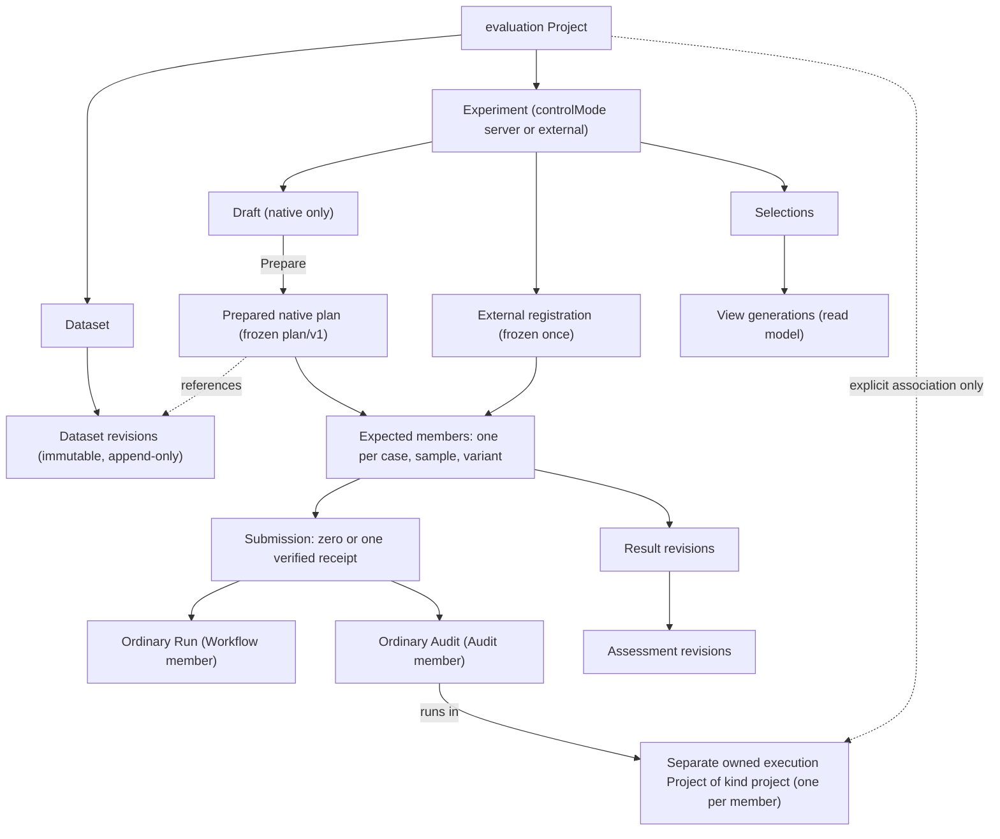
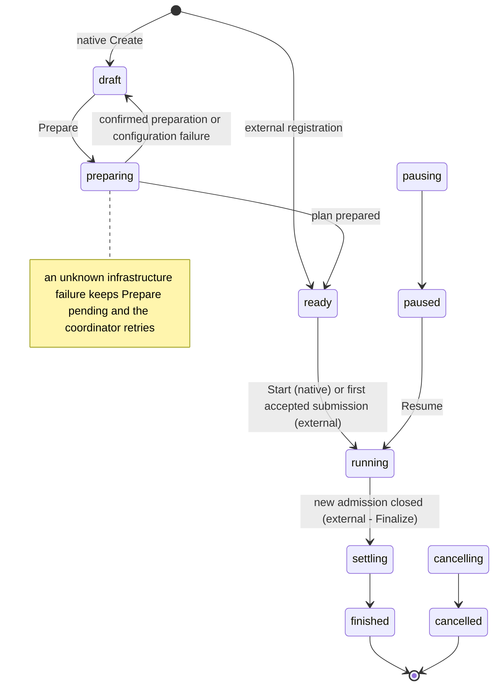
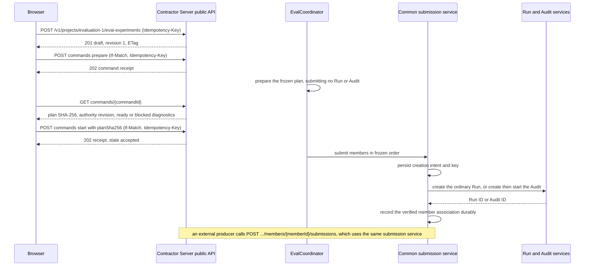

# Managed Evals

Requirement prefix: `EVM` · [Specification index](../README.md)

## Purpose and scope

This document owns Contractor's browser-managed experiment service and its
public producer API: evaluation datasets, native and external experiments,
their expected members, common managed submissions, results, assessments,
selections, read models, charts and the evaluation convention over WorkflowRun
metadata labels.

Other documents own the adjacent concepts:

- Portable document identities, member and pair identity, hidden-truth
  separation, scoring and comparison semantics, the CLI-only publication and
  recovery boundary and the portable format limits: [Portable evaluation
  format](format.md).
- Generic WorkflowRun metadata labels and their validation, and the WorkflowRun
  resource: [Runs](../execution/runs.md).
- The Project resource, the `evaluation` Project kind and the public Project
  collection, including how Managed Eval Audit execution Projects are excluded
  from it: [Projects](../artifacts/projects.md).
- Project deletion, including its fence over eval operations: [Retention and
  deletion](../artifacts/retention-and-deletion.md).
- Audits and their input, inventory, standards, worklist, importer and trusted
  child-Run authority: [Audits](../audits/audits.md) and [Audit
  execution](../audits/execution.md).
- The queue, global concurrency and StageExecution history:
  [Scheduler](../execution/scheduler.md).
- The model-free `passthrough@1` Planner: [Planners](../execution/planners.md).
- Public API conventions: [Public API](../api/public-api.md).
- The Evals user journey (configure, prepare, start, review and compare): [UI
  journeys](../ui/journeys.md); UI architecture: [UI](../ui/ui.md).
- Shared registries: [limits](../platform/limits.md),
  [errors](../platform/errors.md), [failure
  model](../platform/failure-model.md) and
  [lifecycle](../platform/lifecycle.md).

## Concepts

Each term is defined once in the [glossary](../glossary.md); the ones this
document owns are:

- **Managed Eval experiment** — an explicit, owner-scoped comparison of a
  baseline and a candidate arm inside an evaluation Project, with one frozen
  plan or registration, a fixed set of expected members and an authority
  revision.
- **Control mode** — the experiment's `controlMode`: `server` for a native
  experiment, `external` for an experiment driven by an external producer.
- **Native experiment** — an experiment in `server` control mode, authored in
  Contractor, prepared into a frozen plan and dispatched by the
  EvalCoordinator.
- **External producer** — an authorized client that registers and drives an
  external experiment through the public API and submits attributed results and
  assessments; the optional Playground client is one such producer.
- **EvalStore** — the component that persists private eval records, expected
  membership, receipts and Project deletion fences in Contractor's PostgreSQL
  database.
- **EvalCoordinator** — the Go Server component that dispatches, pauses,
  resumes and cancels native experiments under a durable claim.
- **Dataset revision** — an immutable set of exact visible case definitions
  with a source identity, revision and digest.
- **Native draft** — the mutable native setup: name, exact dataset and case
  selection, A/B bindings, input and parameter mapping, evaluation policy,
  repetitions, order and budgets.
- **Prepared native plan** — the exact portable plan/v1 and its reachable case,
  suite and binding resources, materialized by the Go implementation from a
  native draft and then frozen.
- **External registration** — the frozen external setup: a schema-versioned
  safe plan projection, the exact source plan digest, an explicit comparison
  policy and budgets, and the exact executable bindings and mappings supplied
  for managed submissions.
- **Arm** — one variant of the A/B comparison (baseline or candidate), bound to
  one exact Workflow or AuditProfile.
- **Pair ID** — the opaque public identity of a pair: the canonical hash of
  `[experiment_id,suite_id,case_id,sample]`, not a Run ID.
- **Managed submission** — the immutable member operation, with a request
  digest, a stable key and a verified execution receipt, that creates the
  member's ordinary Run or Audit.
- **Selection** — the explicit choice of exact result and assessment records
  that a view uses.
- **View generation** — one complete read model of an experiment for one
  selection revision, identified to clients by its `viewSnapshot`.
- **Authority revision** — the experiment `revision` and ETag that advance only
  on authority mutations and guard lifecycle and selection CAS.
- **Command receipt** — the durable record of an accepted experiment command,
  replayed for the same idempotency key and body.
- **Deletion fence** — the durable record that blocks new submissions and
  assessments for an experiment or Project that is being deleted.
- **Bin filter token** — an opaque, context-bound token that selects exactly
  the cohort of one displayed chart bin for drill-down.
- **Evaluation label convention** — the eval subsystem's use of the generic
  `purpose=eval` and `eval.*` WorkflowRun labels for correlation and discovery.
- **Legacy labelled Run** — an ordinary WorkflowRun grouped only by evaluation
  labels, outside any managed experiment's verified membership.

Member, sample, pair, end-to-end pass and conditional quality have the meanings
of the [portable format](format.md): a member's identity is the SHA-256 of
`[experiment_id,suite_id,case_id,sample,variant_id]` and its sample is
one-based. Results, assessments and comparisons also use the meanings of the
portable format; here they are exact immutable revisions with explicit
selection (EVM-R34).

## Model

An evaluation Project holds datasets and experiments. A native experiment moves
from a draft to one prepared plan; an external experiment is a frozen
registration. Either one fixes the expected members, each of which has at most
one verified submission creating an ordinary Run or a whole Audit. Results and
assessments are immutable revisions; selections pick exact ones, and the read
model publishes complete view generations from a selection.



### Experiment lifecycle

A native experiment starts in `draft` and an external registration in `ready`.
The diagram shows the states and transitions of EVM-R88, EVM-R89, EVM-R90 and
EVM-R97. The states in which Pause and Cancel are accepted are not enumerated
here; an unsupported command returns an explicit mode or state conflict
(EVM-R93).



### Fields named by the contract

- Experiment: opaque lookup `experimentId`, `portableExperimentId`, `name`,
  Project, `controlMode`, execution kind (Workflow or Audit), `state`,
  `revision` with its ETag, expected member count, `updatedAt`,
  `lastProducerActivityAt` and, once frozen, its plan identity (commands and
  submissions name the expected plan digest as `planSha256`).
- Native draft, as used in the [native setup example](#native-setup-and-start):
  `dataset`, `caseIds`, `variants`, `repetitions`, `order`, `checks`,
  `comparison` (with `baseline`, `candidate`, `gates`, `requiredEqual` and
  `allowedDifferences`) and `budgets` (`maxMembers`, `maxInFlight`, `wallMs`,
  `maxObservedTotalTokens`).
- External registration: the `contractor.eval-registration/v1` envelope
  (EVM-R136).

## Requirements

### Independence and authority

**EVM-R1.** Contractor must have no dependency on a Playground process, Python
package, repository, filesystem, hostname or callback, and must build and start
without Playground installed. Native Evals do not require Playground.

**EVM-R2.** Any authorized client can push datasets, author and start native
experiments, or drive external experiments and submit assessments through the
same public API.

**EVM-R237.** Native coordination and the public endpoints run in Contractor
Server; browser setup and optional external clients use the same protocol.

**EVM-R3.** Browser Evals setup, launch and comparison follow the [Evals
experience design](../../evals-experience-design.md) and this document.

**EVM-R4.** Managed Evals are an explicit additional server authority for new
managed experiments. They are not an upgrade of an old private CLI journal
inferred from labels or public projections, and they preserve the CLI-only
publication and recovery boundary of the [portable format](format.md).

**EVM-R5.** Authority over eval data and operations is assigned as follows:

| Data / operation | Authority |
| --- | --- |
| Dataset import provenance | Attributed producer assertion; exact imported visible bytes have their own digest |
| Native dataset revision, draft, frozen plan and expected members | Contractor EvalStore in its PostgreSQL database |
| Native experiment dispatch, pause, resume, cancel | Contractor EvalCoordinator under a durable claim |
| External plan and runner journal | External evaluator; server stores its registered safe manifest and source digest |
| Managed member submission, verified Run/Audit association | Common Contractor submission service used by either driver |
| Run/Stage/Worker execution and Audit child ownership | Existing Run/Audit services, Scheduler, Control Plane and Runtime |
| Native registered check / human assessment | Registered evaluator or authenticated reviewer, over an exact result |
| External assessment | Declared producer; validation of shape/provenance is not independent quality verification |
| View generation, complete denominators, pagination | Rebuildable Contractor read model from selected immutable records |

**EVM-R6.** `controlMode` is `server | external` and is immutable after
creation. It is not selected by `eval.*` labels.

**EVM-R7.** In external mode the native coordinator never dispatches, and the
UI does not pretend it can resume an unavailable producer.

**EVM-R8.** The external driver can finalize or cancel remaining submissions
through the generic protocol, without any server-to-producer request.

**EVM-R9.** Another client cannot take over an experiment using label matches
alone.

**EVM-R10.** The service targets the existing single-VM topology. The
coordinator is a Go Server component with PostgreSQL claims, not a new Worker
scheduler.

**EVM-R11.** The coordinator limits its own outstanding submissions according
to the frozen experiment and uses the ordinary queue and global concurrency
gates ([Scheduler](../execution/scheduler.md)).

**EVM-R12.** No separate Playground daemon or arbitrary plugin process is a
deployment requirement.

### Evaluation Run labels

Why evaluation motivates WorkflowRun metadata labels, and how the Evals UI
groups such Runs in an `evaluation` Project, is in [Runs](../execution/runs.md)
and [Projects](../artifacts/projects.md).

**EVM-R14.** The eval subsystem owns a convention over the generic WorkflowRun
metadata labels ([Runs](../execution/runs.md)). Generic Run label validation
and Scheduler behaviour do not add eval-specific branches.

**EVM-R15.** The convention uses these labels:

| Label | Meaning |
|---|---|
| `purpose=eval` | Classifies an ordinary WorkflowRun as an eval execution |
| `eval.name` | Stable human-readable suite or experiment name |
| `eval.id` | Opaque identity of one invocation of that suite, shared by all its Runs |
| `eval.leg` | Comparison leg such as `a`/`b` or `baseline`/`candidate` |
| `eval.fixture` | Stable fixture identity |
| `eval.case` | Stable case identity within the fixture |
| `eval.sample` | One-based decimal sample number within pass@N |

**EVM-R16.** One eval sample is one fresh WorkflowRun and therefore receives
natural Run artifact, memory, workspace and Worker-session isolation.

**EVM-R17.** `eval.sample` is not a Stage attempt number: Scheduler retry and
escalation remain visible through the ordinary StageExecution history inside
that Run.

**EVM-R18.** `eval.id` is not a WorkflowRun ID; it correlates the set of Run
IDs created by one eval invocation.

**EVM-R19.** The eval runner is responsible for using identical exact input
ArtifactRefs where an A/B comparison requires shared inputs, and for recording
the immutable Workflow and config refs that define each leg.

**EVM-R20.** Label values are indexes for discovery. They are not a replacement
for those snapshots or for the versioned eval result envelope.

**EVM-R21.** Labels remain useful for correlation but never establish
experiment membership, dispatch ownership or assessment authority. Managed
experiments own explicit member registration and verified submission receipts
separately.

**EVM-R22.** Legacy labelled Runs remain inspectable, and the grouping of
ordinary Runs by `eval.*` labels remains available as legacy history. Legacy
labelled Runs do not acquire verified experiment membership by label matching.

### Ownership and identity

**EVM-R23.** An evaluation Project, which remains the owner and storage
container of its experiments ([PRJ-R7](../artifacts/projects.md)), contains
datasets and experiments with the normal Project owner and `active`/`deleting`
semantics.

**EVM-R24.** The effective owner is the existing owner principal from
authentication; clients cannot supply an effective `ownerId`. Every Project,
Run, Audit and artifact that an eval resource references must be authorized
under that principal.

**EVM-R25.** A new native experiment uses a server-allocated experiment ID
compatible with the [portable format](format.md).

**EVM-R26.** An external registration may request its existing portable
experiment ID. Uniqueness is `(owner, project, experiment ID)`, with the source
plan digest immutably bound: a conflicting digest is rejected with 409, never
treated as a replacement.

**EVM-R27.** Public API lookup IDs are opaque server IDs, separate from the
portable experiment ID. A pair ID is the canonical hash of
`[experiment_id,suite_id,case_id,sample]`, not a Run ID.

**EVM-R28.** A native experiment has exactly one authoritative frozen plan
(LIM-EVM-1) and no second editable public manifest; all later records name its
digest.

**EVM-R29.** Hidden review and check material occupies the private evaluator
partition of the prepared plan, never the Run input projection.

**EVM-R30.** An external registration is frozen once, and all expected members
are identified before any submission. A registration cannot reconstruct the
external private plan or truth.

**EVM-R31.** Portable input and case digests that cannot be verified locally
are labelled producer-supplied, not observed equality pins.

**EVM-R32.** All expected members are retained, including unsupported, blocked
and unsubmitted ones (LIFE-EVM-1).

**EVM-R33.** A submission is an immutable member operation with a request
digest, a stable key and a verified execution receipt. Retries and response
loss never create a new sample, and a member has zero or one verified execution
receipt (LIM-EVM-2).

**EVM-R34.** Results, assessments and comparisons are exact immutable revisions
with explicit selection, using the meanings of the [portable
format](format.md). A superseding record preserves its predecessor
(LIFE-EVM-2).

### Revisions, CAS and validation

**EVM-R35.** Managed resources carry a `revision` and ETag used for selection
and lifecycle CAS.

**EVM-R36.** The experiment revision advances on draft edits, commands,
deletion, explicit owner selection and Project deletion fences. Native plan
preparation and coordinator observations, including admission, settlement,
token usage, first native selection and execution tombstones, update progress
and `updatedAt` without consuming that authority revision.

**EVM-R37.** A previously read ETag therefore remains valid for Pause or Cancel
until another authority mutation occurs. A stop that progress has since ruled
out passes that CAS check and fails with 409 `eval_not_ready`, or with 409
`eval_pin_mismatch` when it names another plan (FAIL-EVM-1).

**EVM-R38.** The browser drops such a rejected pending command and refetches
instead of replaying it, while a lost response or 5xx keeps the command for an
exact replay (FAIL-EVM-1).

**EVM-R39.** Content hashes are SHA-256 over exact retained bytes.

**EVM-R40.** A frozen plan or registration is schema-validated once, before it
is stored. Reads trust the immutable row and its database-generated digest.

Rationale: reads do not revalidate up to 1 MiB, the [portable
format](format.md) document bound (LIM-EVF-3), on every coordinator tick,
admission or collection.

**EVM-R41.** Secret values do not enter public DTOs, logs, cursors or error
text.

**EVM-R42.** Objects and arrays remain bounded by the [portable
format](format.md). DTO schema validation is closed, with explicitly versioned
extensions only.

### Datasets and drafts

**EVM-R43.** Dataset revision case fields follow case/v2's task, inputs,
capabilities and output roles ([portable format](format.md)).

**EVM-R44.** A dataset import omits private truth by default and retains the
original private case digest only as producer provenance; the visible revision
has a different digest.

**EVM-R45.** No remote source URL is fetched automatically.

**EVM-R46.** The native UI supports authoring visible cases with exact uploaded
or imported input artifacts and explicit output and check contracts, or
selecting a registered immutable dataset revision.

**EVM-R47.** Creating a subset or changing visible inputs produces a new
revision with provenance. It does not reuse the original case's digest or claim
that its private oracle remains applicable.

**EVM-R48.** Dataset revisions are append-only: another POST with the same
`datasetId` and a new idempotency key creates a new revision (LIFE-EVM-3).

**EVM-R49.** The selected cases are identical in A/B.

**EVM-R50.** A draft is saved under revision CAS; editing it invalidates prior
readiness.

**EVM-R51.** A missing body or field, an unknown key, a duplicate case, variant
or member, an invalid digest, an invalid role mapping or incompatible media is
rejected with 422 before side effects.

### Executables, evaluators and preparation

**EVM-R52.** The executable catalog consumes the current Workflow and
AuditProfile contracts and the supported execution override contracts.

**EVM-R53.** Each arm uses one exact binding (LIM-EVM-16), and the arms use
matching binding kinds.

**EVM-R54.** An AgentTemplate change requires an explicit executable Workflow
version or wrapper.

**EVM-R55.** No arbitrary Python scorer, document-named module or shell command
is imported.

**EVM-R56.** Registered native evaluators include required artifact, media and
schema checks that use allowlisted existing validators, and `human-review@1`.

**EVM-R57.** A validator reports the stated structural property, not overall
semantic correctness.

**EVM-R58.** A native human rubric or check configuration is versioned and
pinned separately from visible inputs.

**EVM-R59.** External semantic and domain scorers are supported through
attributed assessment ingestion.

**EVM-R60.** Preparation uses read-only resolution and existing capability
metadata, and records available, unavailable and producer-supplied pins
honestly.

**EVM-R61.** Unknown required-equal pins block readiness; a policy alias is not
an observed model revision.

**EVM-R62.** Unsupported members can remain in a valid manifest as ineligible
with reasons; they are never silently dropped or submitted.

**EVM-R63.** Native Create and draft update reject, with 422
`eval_limit_exceeded`, a matrix above 1,000 expanded members (LIM-EVM-3) or one
whose conservative serialized-plan estimate exceeds 1 MiB (LIM-EVM-4). The
estimate includes member and execution-order rows, comparison pin maps and
fixed plan overhead.

**EVM-R64.** The configured `maxMembers` budget may be larger for an existing
small draft, but it never raises this effective matrix bound.

**EVM-R65.** The UI defaults new native budgets to 1,000 members (LIM-EVM-5)
and checks the same estimate before saving.

**EVM-R66.** External registrations retain the [portable format](format.md)'s
10,000-member format ceiling (LIM-EVF-8) and per-document byte bound
(LIM-EVF-3).

### Workflow and Audit parity

**EVM-R67.** Both executable kinds, Workflow and Audit, are supported and
required in native and external control modes.

**EVM-R68.** The kind is chosen for the experiment: A/B use either two exact
Workflow bindings or two exact AuditProfile bindings. A mixed
Workflow-versus-Audit comparison fails preparation or registration explicitly.

**EVM-R69.** The common denominator is one member per `(case,sample,variant)`
(LIM-EVM-6), not the number of underlying Runs or Audit items: one sample is
one Run or one whole Audit, and child Runs do not increase the denominator.

**EVM-R70.** Workflow and Audit members differ as follows:

| Concern | Workflow member | Audit member |
| --- | --- | --- |
| Executable selection | Exact Workflow with resolved dependent versions/settings | Exact AuditProfile with resolved roles, inventory/standards and execution settings |
| Submission receipt | One ordinary Run | One ordinary Audit, with separate durable create/start receipts |
| Workspace | Exact visible case inputs forked into RunScope | Separate owned execution Project of kind `project` per member; the evaluation Project holds only its explicit association |
| Internal work | Stage/Worker attempts and retries | Audit rounds, check/discovery/assessment Runs, retries and child attempts |
| Evaluation progress | One terminal Run contributes one terminal member | One terminal Audit contributes one terminal member, regardless of child/item counts |
| Evidence navigation | Exact Run outputs and diagnostics | Exact Audit report/coverage/findings plus bounded child Run/item drill-down |

**EVM-R71.** The existing Audit service rejects evaluation Projects as
execution workspaces, and managed Evals preserve that boundary rather than
changing Project kind or using a special Audit creation bypass. Input,
inventory, standards, worklist, importer and trusted child-Run authority remain
with [Audits](../audits/audits.md).

**EVM-R72.** Private eval truth never becomes a trusted Audit checklist or task
manifest.

**EVM-R73.** Audit `completed` maps to technical execution success, not to a
passing quality assessment; the selected external, native or human checks
determine assessment. Successful execution alone does not imply high quality: a
quality assessment requires an explicitly selected evaluator or a human
decision.

**EVM-R74.** UI labels and drill-down follow the selected kind; they never
suggest that an Audit is just one child Run.

### Usage and duration accounting

**EVM-R75.** For either kind, token measures aggregate one authoritative
cumulative snapshot per unique Run or stage execution (LIM-EVM-7) across all
included roles and retries.

**EVM-R76.** For an Audit, all owned child executions are resolved through
authoritative Audit associations, not only item labels or the first item page;
discovery and assessment work counts too. An Audit item list alone is not a
complete execution inventory.

**EVM-R77.** The bounded managed member execution-list endpoint exposes these
authoritative associations to external clients as well as to the UI.

**EVM-R78.** Parent totals are never added to child totals, and successive
polling snapshots are never summed.

**EVM-R79.** Missing children, truncated reports or unavailable finalizer or
role accounting make the corresponding scope partial or unavailable. Child
counts do not change the expected member or scored denominator.

**EVM-R80.** Cached tokens remain a subset of input tokens.

**EVM-R81.** The model-free `passthrough@1` Planner reports explicit zero model
calls and token counters. For retained reports that omitted those counters,
collection derives the zeros only from the immutable Stage's exact
`passthrough@1` identity. Missing Worker or model-backed Planner counters
remain incomplete.

**EVM-R82.** Recollection creates new result revisions. An existing selected
result changes only through explicit selection, which preserves result and
assessment history.

**EVM-R239.** The StageMetrics that a member's observed usage and token
budget read are retained while the member exists
([OBS-R43](../platform/observability.md)). Recollecting a terminal member
after the telemetry retention period (LIM-OBS-8) therefore reproduces its
usage and creates no new result revision, and an external result is checked
against the same observation (EVM-R163). Once the experiment is purged they
expire like other telemetry, at the latest one retention period after their
last renewal, unless their Run is deleted first.

**EVM-R83.** `wall_ms` runs from the parent execution's `createdAt` to its
confirmed `finishedAt`, for both Run and Audit, matching the existing
Contractor provider interval. It includes queue and hold time and excludes
evaluator preparation, scoring and publication.

**EVM-R84.** Audit wall time is not the sum of child Run durations, because
children may overlap. Unavailable timestamps are not replaced by guessed child
bounds.

**EVM-R85.** Any separately reported active or service time must have a
distinct scope and cannot share the same comparison series.

**EVM-R86.** Progress-chart time is experiment wall time and is labelled
separately from per-member execution duration.

### Lifecycle

**EVM-R87.** The experiment lifecycle is kept distinct from result quality.

**EVM-R88.** The experiment lifecycle is `draft → preparing → ready → running →
settling → finished`. Native controls additionally use `pausing → paused →
running` and `cancelling → cancelled`.

**EVM-R89.** A confirmed preparation or configuration failure returns the
experiment to `draft` with a retained safe diagnostic and no Run or Audit
(FAIL-EVM-2).

**EVM-R90.** An unknown infrastructure failure keeps the Prepare command
pending in `preparing`, exposes `eval_preparation_unavailable` with the
recovery action `wait`, and retries through the coordinator. The original
internal cause reaches coordinator logging even when persisting the diagnostic
or the failed command succeeds. A successful retry clears the transient
diagnostic (FAIL-EVM-2).

**EVM-R91.** A frozen ready plan cannot be edited.

**EVM-R92.** Duplicate is native-only. It creates a new native draft with a new
identity, which requires another Prepare and Start, and returns 201 with the
new draft's `ExperimentReceipt` (EVM-R147). An external producer creates a new
portable invocation and registration itself, since Contractor cannot regenerate
its private plan.

**EVM-R93.** An unsupported command returns an explicit mode or state conflict
before any effect.

**EVM-R94.** An ordinary process restart reacquires the claim and reconciles
automatically. Reconciliation failures leave the experiment in its current
active state for retry (FAIL-EVM-3).

**EVM-R95.** A member whose reconciliation keeps failing stays outstanding and
holds its in-flight slot, but does not stop admission or publication of other
members, budget stops or the drain of the rest. Its error is reported after the
coordinator tick has done that work (FAIL-EVM-3).

**EVM-R96.** A `finished` experiment can have a `pass`, `regressions` or
`inconclusive` conclusion. `finished` means accepted executions have drained,
even if human review is still pending; awaiting assessment is separate from
execution progress. Later assessments can change the comparison without
restarting execution.

**EVM-R97.** An external registration starts `ready`. Its first accepted
submission starts its clock and moves it to `running`; Finalize moves it
through `settling` to `finished`.

**EVM-R98.** The API records `lastProducerActivityAt` on accepted producer
operations. An inactive producer is a freshness observation, not proof of
failure or completion; Run and Audit states remain authoritative. There is no
inferred heartbeat or server callback.

### Commands and idempotency

**EVM-R99.** Every mutating request uses a stable `Idempotency-Key`, and
mutable state transitions also require `If-Match`. A missing CAS precondition
is rejected with 428 and a stale one with 412 (FAIL-EVM-1).

**EVM-R100.** Command intent is persisted before side effects, and a command
receipt is returned.

**EVM-R101.** The same key and body replays that receipt, not another launch,
even after the revision advances and including a retry that races the original
request. A changed body, plan digest or requested revision under that key is
rejected with 409 (FAIL-EVM-1).

**EVM-R102.** Ownership and the current deletion fence are validated before a
new command is accepted.

**EVM-R103.** A timed-out response is not an unaccepted command. The browser
does not generate a new key on timeout; recovery polls the command, then reads
the experiment (FAIL-EVM-1).

**EVM-R104.** Command POST returns its accepted receipt, while command GET
observes completion.

**EVM-R105.** GET of a completed Prepare command returns the prepared plan
SHA-256, the current authority revision and ready or blocked diagnostics.
Prepare submits zero Runs and Audits.

**EVM-R106.** Start names the exact reviewed plan hash and the latest revision.
A stale hash or revision returns 409 or 412 without execution (FAIL-EVM-1).

**EVM-R107.** Mutable controls, including Prepare and Start, use the same
request and receipt pattern: an accepted 202 includes `commandId`, `state:
accepted`, `experimentRevision` and the command resource link.

### Coordinator claims and native controls

**EVM-R108.** Native coordinator claims use an expiring owner/epoch lease.
Durable intents and execution keys, rather than the lease alone, prevent
duplicate side effects (FAIL-EVM-3).

**EVM-R109.** A replacement claim holder first reconciles all uncertain
submissions (FAIL-EVM-3).

**EVM-R110.** Dispatch verifies the current control state and plan and records
its intent atomically; a stale holder cannot commit transitions (FAIL-EVM-3).

**EVM-R111.** An already committed intent can still need remote reconciliation
after Pause or Cancel was requested, and it remains counted as outstanding
(FAIL-EVM-3).

**EVM-R112.** Start initializes the deadline and accounting once and dispatches
in frozen order.

**EVM-R113.** Pause fences new intents, lets accepted work settle and resolves
uncertain submissions. `paused` requires no outstanding submission or
execution. A closed browser does not pause an experiment (FAIL-EVM-4).

**EVM-R114.** Resume uses the same plan, IDs, deadline and token high-water
marks; it never resets limits or reruns a terminal member. Only paused native
experiments are resumable. Expired remaining budget completes pending members
as not submitted with the budget reason (FAIL-EVM-4).

**EVM-R115.** Cancel fences new intents, requests normal Run and Audit
cancellation and remains `cancelling` until drain is confirmed. Unknown
outcomes stay unknown; pending members retain their original denominator and
not-submitted reason (FAIL-EVM-4).

**EVM-R116.** A terminal attempt is not resampled; duplicating an experiment or
creating a new one is explicit. Reassessment can run without new model
execution.

### Concurrency, budgets and deadlines

**EVM-R117.** Experiment concurrency counts whole active members, including
uncertain submissions and an Audit's parent lifetime; the Audit's child Runs
remain the Audit controller's work. Global Run concurrency and Audit limits
remain unchanged.

**EVM-R118.** Token thresholds account for known cumulative usage once, include
retries, Planners, Workers and finalizers when available, and expose missing
scope.

**EVM-R119.** A reached threshold stops new work and requests cancellation
according to the frozen policy; active work may overshoot (FAIL-EVM-4).

**EVM-R120.** Deadline and token enforcement remains active through `settling`
and recovery until all accepted executions have drained. Entering `settling`
only closes new admission; it does not release the frozen allowance for active
Runs and Audits.

**EVM-R121.** Pause does not extend wall time.

**EVM-R122.** Experiment limits are explicit; they are not new global defaults.

### Common managed submissions

**EVM-R123.** `POST /v1/eval-experiments/{id}/members/{memberId}/submissions`
resolves the frozen member recipe and creates its ordinary Run or Audit through
the existing domain services. The native coordinator calls the same service
internally.

**EVM-R124.** External callers choose when to submit, within eligibility,
deadline, total and concurrency limits and finalization fences. They cannot
replace the member recipe in the request.

**EVM-R125.** The first external submission initializes the immutable deadline
and accounting exactly once, in the same transaction that checks admission;
concurrent requests cannot exceed the frozen in-flight allowance. A later retry
never resets that clock.

**EVM-R126.** The exact creation intent and key are persisted before mutation;
a replay returns the same Run ID or Audit ID (FAIL-EVM-5).

**EVM-R127.** Audit create and start use distinct durable suboperations and
retain both receipts. A crash between them resumes the same Audit (FAIL-EVM-5).

**EVM-R128.** No synthetic child Run, checklist truth substitution or bypass of
importer authority is allowed.

**EVM-R129.** Normal Run creation retains the immutable input, Workflow and
Runtime snapshots and labels.

**EVM-R130.** A verified member association is durable before it is exposed as
successful. Submission POST acknowledges the durable request; the member view
exposes an execution only after the common submission service verifies its
association, and the response to a successful submission returns that verified
Run or Audit association (FAIL-EVM-5).

**EVM-R131.** Case input and output mappings name the case role as key and the
executable slot as value. Unmapped input roles retain their names; collisions
are invalid.

**EVM-R132.** Variant parameters override case task parameters, and
`$task.objective` substitutes the visible objective.

**EVM-R133.** Workflow variants use ordinary execution overrides. Audit
variants select exact AuditProfiles and cannot supply execution overrides until
the ordinary Audit service supports them.

**EVM-R134.** Managed submission keys are scoped by experiment lookup identity
and member ID, with distinct keys for Audit creation and start (FAIL-EVM-5).

Rationale: scoping prevents collisions between Projects that share a portable
invocation ID, without changing the frozen portable CLI key format.

**EVM-R135.** Local binding snapshots retained during external registration are
separate from the producer's attributed binding hashes.

### External registration and control

**EVM-R136.** An external client registers with `controlMode: external` and a
versioned `contractor.eval-registration/v1` envelope containing a safe plan
manifest, `sourcePlanSha256`, a safe source identity, exact member binding
recipes and the frozen comparison and budgets.

**EVM-R137.** The manifest uses the existing portable public projection shape
of the [portable format](format.md), historically named
`playground.public-projection/v1`. That schema name identifies a format, not a
required producer or a Playground server dependency.

**EVM-R138.** Native private plan fields cannot be guessed from that
projection; required mappings must be supplied and validated. Registration
reports unsupported and unavailable dimensions.

**EVM-R139.** `source.system: playground` is display provenance, never special
routing.

**EVM-R140.** An external runner may finalize only after its intended
submissions have been accounted for and all accepted operations are reconciled.
Finalization fences new submissions, represents the rest as not submitted and
drains and observes accepted work; it cannot claim remote termination
(FAIL-EVM-4).

**EVM-R141.** API cancellation of an external managed experiment also fences
future submissions and cancels known accepted executions, but must not claim
that an arbitrary external process or target has been stopped (FAIL-EVM-4).

**EVM-R142.** The UI reserves experiment control for native mode. External
clients can use these protocol controls, and the UI retains the normal
individual Run and Audit actions.

### Public API

**EVM-R143.** Managed Eval endpoints use the same public authentication, cookie
CSRF, origin, request-ID, error-envelope and method and HEAD rejection
conventions as the existing handlers ([Public API](../api/public-api.md)).

**EVM-R235.** All managed Eval endpoints reject HEAD consistently.

**EVM-R236.** There are no browser-to-Playground calls.

**EVM-R144.** JSON uses camelCase DTO fields; retained portable documents keep
their own schema.

**EVM-R145.** The managed Eval endpoints and their request and result contracts
are those listed under [Endpoints](#endpoints).

**EVM-R146.** Experiment collection rows use `ExperimentSummary`: identity,
name, Project, control and execution kind, state, revision, expected count and
update time. They do not include draft or setup data or private case documents.

**EVM-R147.** Create, draft update, duplicate and deletion return a stable
`ExperimentReceipt` with the experiment ID, the accepted revision and the
state. The current state is read separately from the detail; an exact replay
never silently substitutes a later revision for that receipt.

### Collection and evidence

**EVM-R148.** Evaluation partition data is never included in source packaging
or model inputs.

**EVM-R149.** Native rubrics and expected check settings live in owner-scoped
private eval storage, not in ordinary browsable Project artifact namespaces
inherited by execution.

**EVM-R150.** Native collection resolves the frozen binding's output roles
through registered normalizers and records exact raw evidence, completeness and
observed usage. It can retain useful partial outputs from failed executions; it
cannot fill missing observations from private expectations.

**EVM-R151.** An Audit binding creates one isolated execution Project of kind
`project` per member (LIM-EVM-8) and pins its visible inputs, so findings and
published outputs from another case or arm cannot become implicit inputs. How
these Projects are excluded from the public Project collection while staying
reachable by ID is specified by [PRJ-R9 and PRJ-R10](../artifacts/projects.md).

**EVM-R152.** Native validators run in explicitly allowed bounded paths over
exact artifacts. External check records do not trigger code import or a
callback.

**EVM-R153.** Human review requires an explicit actor, rubric pin and exact
result, with text and evidence bounds.

### Assessments and selection

**EVM-R154.** Registered required-check policy follows the precedence of the
[portable format](format.md): `error`, `fail`, `incomplete`, `pass`. Missing
required evidence or checks cannot become a pass.

**EVM-R155.** The actor of an assessment is derived from authentication.

**EVM-R156.** The server verifies the registered check identity and pins, the
member, result and plan association, evidence ownership and the declared
schema. Missing required evidence marks evidence completeness as incomplete,
regardless of the submitted check verdict.

**EVM-R157.** An external check verdict remains attributed to the external
producer. It cannot rewrite Run state, replace an assessment in place or become
a server-verified semantic judgment.

**EVM-R158.** External assessment provenance is visible beside native and human
judgments.

**EVM-R159.** The first native collected result and its first registered-check
assessment are selected through a recorded system selection under the
experiment lock, without advancing the owner CAS revision.

**EVM-R160.** Later revisions never silently replace the selected record.
External clients select exact ingested records explicitly.

**EVM-R161.** Human UI **Save and use** first persists the immutable review,
then posts the exact selection under CAS. If the selection conflicts, the
review is retained and the user must inspect the newer evidence. Neither step
reruns execution (FAIL-EVM-6).

**EVM-R162.** Reassess creates a new immutable revision. New selections use CAS
and preserve old reports.

**EVM-R163.** Result records distinguish server-observed execution and usage
from external collection claims; contradictory execution state is rejected.
Source provenance alone is neither trust nor an observed execution pin.

### Read model and summaries

**EVM-R164.** Read models are keyed by `(owner,experiment,plan digest,selection
revision)` and built from the complete expected member set.

**EVM-R165.** A candidate view generation becomes visible atomically, and only
when its rows and summaries are complete. An interrupted projection leaves the
last complete view visible with an explicit freshness flag (FAIL-EVM-7).

**EVM-R166.** The read model is rebuildable; changing the selected authority
still requires CAS.

Dirty marking and projection publication take the experiment's projection
queue before member projection rows. Source and evidence collection precedes
these private locks; it does not take an Audit controller claim afterward.
Member collection retries definite serialization failures and deadlocks with
a fresh transaction under PER-R16. An exhausted transaction conflict keeps
the member dirty without rotating its failure position. Only other failures
use the existing damaged-member rotation.

**EVM-R167.** A publication whose selected member documents, comparison policy,
pins and selection revision are unchanged keeps the current generation and only
marks it current.

**EVM-R168.** A new generation prunes the generations it supersedes. Every read
resolves the current snapshot inside one snapshot transaction, so no reader can
reach a replaced generation (LIFE-EVM-4).

**EVM-R169.** Summaries return expected, eligible, unsupported, blocked,
submitted, terminal, missing, conflicting, collection-complete, scored and
quality-passed counts per arm and suite.

**EVM-R170.** End-to-end pass uses the expected denominator; conditional scored
quality carries its own denominator.

**EVM-R171.** Technical failures retain known cost and time and remain in
compatible pairs.

**EVM-R172.** Cost and latency compare only complete matching scopes, with
included and excluded pair counts and reasons.

**EVM-R173.** p50 and p90 are computed by the nearest rank of the [portable
format](format.md).

**EVM-R174.** Unknown is null, and missing metrics are not zero. Partial totals
disclose coverage and cannot establish total cost savings.

### Conclusions and gates

**EVM-R175.** Membership conflicts and missing required evidence make the
conclusion `inconclusive`. A known regression still appears even when the
overall evidence is incomplete.

**EVM-R176.** Strict conclusions require declared gates and verified
required-equal pins.

**EVM-R177.** Native setup explicitly selects `minCandidateEndToEndPass` and
`maxQualityDrop`, each in [0,1] (LIM-EVM-9); the reviewed initial preset is 1
and 0. It may also select `maxTotalTokensRatio` >= 0 (LIM-EVM-10).

**EVM-R178.** These gates map to the existing portable experiment extension
`playground:comparison-gates` with snake_case keys. They are frozen in the
referenced experiment, not added to plan/v1's closed `comparison` object.

**EVM-R179.** All expected members must have terminal, collection-complete and
scored evidence before a conclusion.

**EVM-R180.** A candidate end-to-end pass below its gate, or a baseline minus
candidate conditional quality above the allowed drop, is a regression.

**EVM-R181.** A selected token-ratio gate additionally requires full compatible
coverage and a nonzero baseline total; otherwise the result is `inconclusive`.

**EVM-R182.** A complete result that satisfies all declared gates passes; the
UI says "Meets declared gates", not universal quality approval. Per-pair
regressions remain visible even if aggregate thresholds pass.

**EVM-R183.** An unsupported external gate extension remains an attributed
producer claim and cannot yield a native verdict.

**EVM-R184.** No best-of-N or success-only denominator replaces individual
attempts.

### Member execution lists

**EVM-R185.** Managed member execution lists use indexed authoritative Run and
Audit associations, not label search or item-to-Run guesses. Rows retain
unavailable or deleted refs with an explicit gap.

**EVM-R186.** Execution-list cursors bind to owner, member and an
execution-inventory revision. A new child execution association invalidates the
cursor for an explicit reload (FAIL-EVM-8).

**EVM-R187.** `inventoryComplete` requires a closed and drained parent dispatch
inventory and resolved accepted child intents. Observing one page or a terminal
child cannot establish completeness.

**EVM-R188.** An external collector follows every page before claiming complete
scope; each HTTP query remains bounded.

**EVM-R189.** The optional Playground client consumes this projection only
through the public API.

### Charts

**EVM-R190.** Charts are a projection of the same complete selected view as the
comparison tables, never a browser scan or an aggregation of the first member
page. Chart projections and kind-specific evidence navigation share the
comparison tables' exact membership, scope and missing-data semantics.

**EVM-R191.** `GET /v1/eval-experiments/{id}/charts/{chart}?viewSnapshot=...`
accepts an optional suite filter and a metric or measurement-scope selector
appropriate to that chart. Unknown charts or options and incompatible
combinations fail closed.

**EVM-R192.** Chart responses carry `viewSnapshot`, freshness, filters, scope,
units, included, expected and excluded counts, exclusion reasons and the
unfiltered experiment summary.

**EVM-R193.** Changing a view uses the same 409 reload contract as pairs
(EVM-R215); a filtered series is labelled explicitly.

**EVM-R194.** The quality chart shows end-to-end passed/expected counts and,
separately, scored/expected counts per arm. A conditional scored-quality mode
uses its explicitly named denominator. Technical success, check success and
external producer provenance remain distinct.

**EVM-R195.** The token and duration charts show distributions over complete
matching pairs for the chosen dimension and verified required-equal pins.
Technical failures remain included when measured. Server materialization
computes exact p50/p90 by nearest rank, with at most 20 shared equal-width bins
(LIM-EVM-11) spanning the pooled observed range.

**EVM-R196.** Bins are left-closed and right-open, except that the final bin
includes its upper edge; all-equal values use one bin. The response returns bin
counts, exact boundaries and deterministic filter tokens, so drill-down uses
exactly the displayed cohort, including missing-data and scope exclusions.

**EVM-R197.** Zero- and one-value cohorts are unavailable or single-point
views, not interpolated densities. Separate measurement scopes are never
pooled.

**EVM-R198.** The pair-difference chart shows B minus A in the selected raw
unit, one case and sample per row. It never divides by a zero baseline or
implies a quality verdict from cost alone.

**EVM-R199.** Pair-difference rows page through at most 100 exact pair IDs and
values (LIM-EVM-12) using the existing cursor rules, sorted by absolute
difference with frozen pair order as the tie-breaker, or by frozen order when
requested. The chart shows the total of comparable pairs and the
quality-regression flags. These row pages are explicitly paginated; they are
not the whole-experiment aggregate plotted above them.

**EVM-R200.** The progress chart shows observed terminal-member counts per arm
against fixed expected counts, with separate current assessment coverage.
Server observation timestamps and counts are persisted during view publication;
intermediate samples are not reconstructed from browser polls or
producer-provided wall clocks.

**EVM-R201.** The progress display is bounded to 200 time buckets (LIM-EVM-13),
retaining the last observed value per bucket, and the response returns
interval, observation range and aggregation metadata. It uses elapsed
experiment wall time, including pauses. Absence of observations is a gap, not
zero or proof of stalled execution. A latest complete snapshot supplies the
current endpoint; unknown historical progression remains unavailable.

**EVM-R202.** Bin filter tokens are opaque and bound to owner, experiment,
snapshot, suite and scope. Member and pair list endpoints accept them as
`binFilter` for bounded drill-down; a request that changes their context is
rejected rather than broadening access or membership.

**EVM-R203.** Exact percentiles come from retained complete cohorts, not
rounded histogram bins.

**EVM-R204.** Known all-arm partial totals stay separate from comparable-pair
totals; neither can establish complete experiment savings when coverage is
incomplete.

**EVM-R205.** An empty metric suppresses its plot while retaining a short
coverage explanation.

**EVM-R206.** A and B keep fixed blue and orange identities with text, shape
and line alternatives; status colours must not override variant identity.

**EVM-R207.** Every plot offers an equivalent bounded data table and accessible
detail controls.

**EVM-R208.** p50 and p90 are variation summaries, not error bars or claims of
statistical significance.

**EVM-R209.** Charts leave existing retained portable documents and comparison
rules unchanged.

### Pagination and view changes

**EVM-R210.** All managed Eval lists use keyset pagination with a default page
size of 25 (LIM-EVM-14) and a maximum of 100 (LIM-EVM-15). An oversized limit
is rejected with 422, not silently truncated. The member and document bounds of
the [portable format](format.md) remain in force.

**EVM-R211.** A cursor is opaque, signed and bound to owner, resource, filters
and sort. Experiment member and pair pages additionally bind to `viewSnapshot`.

**EVM-R212.** Mutable experiment and dataset lists bind to an owner collection
revision. A mutation invalidates the cursor and asks for an explicit reload
instead of silently skipping or repeating moved rows (FAIL-EVM-8).

**EVM-R213.** Sort is deterministic. Experiments are ordered newest first by
immutable creation time plus lookup ID, not by update time, which usage ticks
move without a collection revision change. Members and pairs are ordered by
frozen suite order, case order, sample and variant or member ID.

**EVM-R214.** Filters cannot alter the unfiltered `experimentSummary`, and any
`filteredCount` is labelled separately. Subsequent pages retain the same full
summary.

**EVM-R215.** A changed view yields 409 `eval_view_changed` with the new
snapshot ID; the client preserves its filters and explicitly restarts
pagination (FAIL-EVM-8).

**EVM-R216.** Missing or deleted view data is not reported as a guessed partial
total.

**EVM-R217.** No request scans all historical Runs or deserializes arbitrary
artifact listings. Requests use indexed bounded rows and one materialized
summary read (LIM-EVM-17).

### Authorization

**EVM-R218.** Standard bearer and cookie owner authentication applies. Unknown
or foreign resources return an owner-safe 404.

**EVM-R219.** Neither labels nor caller-supplied producer or owner strings
grant access.

**EVM-R220.** The ordinary private Worker API has no dataset, control or
assessment mutation capability.

**EVM-R221.** No secret is returned by capabilities, catalogs, or provenance or
error projections.

### Retention and deletion

**EVM-R222.** Dataset revisions referenced by frozen plans are retained until
those experiments are purged (LIFE-EVM-3).

**EVM-R223.** Experiment DELETE records a durable deletion fence, blocks new
submissions and assessments, cancels and drains accepted executions, then
removes the experiment's private data and public views according to the
existing artifact and Run retention rules ([Retention and
deletion](../artifacts/retention-and-deletion.md)) (LIFE-EVM-5).

**EVM-R224.** Experiment deletion never deletes an unrelated Run merely sharing
labels.

**EVM-R225.** Referenced completed Run and Audit records keep their normal
owner deletion behaviour. Subsequent evidence loss makes comparisons incomplete
and invalidates the affected materialized views (LIFE-EVM-6).

**EVM-R226.** Retained owner-scoped mutation receipts remain replayable after
experiment purge until the owning Project is purged (LIFE-EVM-7).

Project deletion and its fence over eval operations are specified by
[Retention and deletion](../artifacts/retention-and-deletion.md) (DEL-R41 to
DEL-R43, DEL-R52, DEL-R53). A Project deletion fence is an authority mutation
of each affected experiment (EVM-R36).

### Errors

**EVM-R227.** Managed Eval endpoints reuse the standard error envelopes. Stable
additional reasons include `eval_not_ready`, `eval_preparation_unavailable`,
`eval_pin_mismatch`, `eval_external_control`, `eval_view_changed`,
`eval_member_conflict`, `eval_evidence_unavailable`, `eval_producer_stale`,
`eval_budget_exhausted` and `eval_project_deleting`.

**EVM-R228.** Errors include safe recovery actions, not raw source or
credential details.

**EVM-R229.** Public input, conflict and authentication status mapping follows
the existing API conventions ([Public API](../api/public-api.md)).

### Compatibility and external clients

**EVM-R230.** The [portable format](format.md) and existing Playground frozen
bundles keep their exact bytes and local recovery authority.

**EVM-R231.** The optional client can import visible datasets, create native
experiments, or register external matrices and use the managed submission API.
It retains hidden truth and scorer code locally, collects exact outputs through
the normal public artifact APIs and sends attributed results and assessments.
It requires no reverse connection, SQL access or internal Go imports.

**EVM-R232.** The optional client's previous direct Run/Audit mode remains
usable and is labelled legacy/unassociated.

**EVM-R233.** Importing a report does not silently authorize native takeover,
invent a missing journal or resolve ambiguous receipt membership.

**EVM-R234.** The managed Eval contract is producer-neutral.

**EVM-R238.** Native Eval preparation resolves deployment model defaults and
explicit variant Run overrides into retained execution bindings, including
main, summary and late Planner policies. Dispatch uses that binding rather than
resolving mutable defaults again. It verifies that exact Workflow, profile,
template, model and Gateway dependencies still exist unchanged and rechecks
credentials under the ordinary execution lifecycle guard. A default-setting
change alone does not invalidate a prepared Eval; missing or changed pinned
catalog dependencies still fail as changed pins. Workflow and Audit members
share this rule, so explicit A/B model choices remain comparable.

## Interfaces

The public API schema is
[contractor-public-v1.yaml](../../../api/openapi/contractor-public-v1.yaml).
The [embedded data catalog](../../../api/evals/v1/README.md) and the
[conformance fixtures](../../../api/testdata/evals/README.md) define the closed
DTOs and the portable identity mapping; the
[EvalStore](../../../internal/evalstore/README.md) persists private records,
expected membership, receipts and Project deletion fences.

### Endpoints

| Method/path | Request / result |
| --- | --- |
| `GET /v1/eval-capabilities` | Safe modes, check IDs, import versions and paginated exact Workflow/AuditProfile selectors; optional `kind` filter; no host paths or tokens |
| `GET /v1/projects/{projectId}/eval-datasets` | Paginated dataset identities/revisions, safe provenance and case counts |
| `POST /v1/projects/{projectId}/eval-datasets` | `datasetId`, `name`, optional safe `source`, visible `cases`, private check/rubric partition; creates immutable revision |
| `GET /v1/projects/{projectId}/eval-datasets/{datasetId}/revisions/{revision}/cases` | Bounded visible case projections for setup; never private expected data |
| `POST /v1/projects/{projectId}/eval-experiments` | `name`, `controlMode`, native `draft` or external `registration`; allocates experiment lookup ID and draft/registration receipt |
| `GET /v1/eval-experiments` | Owner-scoped paginated experiment summaries, filter `projectId`, `state`, `datasetId`, `controlMode` |
| `GET /v1/eval-experiments/{id}` | Lifecycle, plan identity, control mode, capabilities, complete summary, selected view snapshot and ETag |
| `PATCH /v1/eval-experiments/{id}` | Full replacement `name,draft` under CAS; only mutable native drafts |
| `POST /v1/eval-experiments/{id}/commands` | `kind`, expected `planSha256` where frozen; kinds `prepare,start,pause,resume,cancel,finalize,duplicate`; 202 receipt or 201 new draft for duplicate |
| `GET /v1/eval-experiments/{id}/commands/{commandId}` | Durable accepted/running/completed/failed receipt and safe reason |
| `POST /v1/eval-experiments/{id}/members/{memberId}/submissions` | `planSha256`; managed replay-safe submission receipt; server mode rejects external dispatch |
| `GET /v1/eval-experiments/{id}/members` | Expected member page including zero/one verified receipt, state, result/assessment selection and conflicts; accepts a bound chart bin filter token |
| `GET /v1/eval-experiments/{id}/members/{memberId}/executions` | Owner-scoped paginated parent/child execution refs with kind, role/round, exact association, observed status and inventory completeness; all Audit roles, no private inputs |
| `POST /v1/eval-experiments/{id}/members/{memberId}/results` | Versioned external collection/result with exact execution/artifact refs; cannot override authoritative execution state or server usage |
| `GET /v1/eval-experiments/{id}/members/{memberId}/review` | Owner-only bounded review context: exact selected result, pinned rubric/check settings and evidence availability; omitted from execution and safe reports |
| `POST /v1/eval-experiments/{id}/members/{memberId}/assessments` | Registered native-check request, human decision or external record; exact result digest, check pins, actor/producer and predecessor |
| `POST /v1/eval-experiments/{id}/selections` | CAS selection of exact result/assessment refs; creates new view generation, never edits old records |
| `GET /v1/eval-experiments/{id}/pairs` | Snapshot-bound case/sample pairs and per-dimension completeness; full summary attached; accepts a bound chart bin filter token |
| `GET /v1/eval-experiments/{id}/pairs/{pairId}` | Exact A/B selected records, safe artifact/Run/Audit links and exclusion reasons |
| `GET /v1/eval-experiments/{id}/charts/{chart}` | Bounded selected-snapshot chart data; chart is `quality`, `tokens`, `duration`, `pair-deltas` or `progress`; scope, units and coverage are explicit |
| `GET /v1/eval-experiments/{id}/report` | Safe versioned JSON or Markdown export of one complete selected view snapshot |
| `DELETE /v1/eval-experiments/{id}` | CAS, durable fence/drain/purge receipt; see [retention and deletion](#retention-and-deletion) |

### Wire names

`ExperimentSummary` and `ExperimentReceipt` (EVM-R146, EVM-R147); the
`contractor.eval-registration/v1` envelope (EVM-R136) and the
`contractor.eval-assessment-input/v1` assessment input (see the
[example](#external-registration-and-assessment)); the portable
`playground.public-projection/v1` shape (EVM-R137) and the
`playground:comparison-gates` extension (EVM-R178); the `Idempotency-Key` and
`If-Match` headers (EVM-R99); the response fields `viewSnapshot`,
`experimentSummary`, `filteredCount`, `inventoryComplete` and
`lastProducerActivityAt`; and the `binFilter` parameter that member and pair
lists accept (EVM-R202).

## Limits, failures and errors

Limits ([registry](../platform/limits.md)):

- LIM-EVM-1 — one authoritative frozen plan per native experiment (EVM-R28).
- LIM-EVM-2 — zero or one verified execution receipt per member (EVM-R33).
- LIM-EVM-3 — native matrix: at most 1,000 expanded members (EVM-R63).
- LIM-EVM-4 — native matrix: conservative serialized-plan estimate at most 1
  MiB (EVM-R63).
- LIM-EVM-5 — UI default `maxMembers` budget of a new native experiment: 1,000
  members (EVM-R65).
- LIM-EVM-6 — one member per `(case,sample,variant)` (EVM-R69).
- LIM-EVM-7 — one authoritative cumulative token snapshot per unique Run or
  stage execution (EVM-R75).
- LIM-EVM-8 — one isolated execution Project of kind `project` per Audit member
  (EVM-R151).
- LIM-EVM-9 — `minCandidateEndToEndPass` and `maxQualityDrop` in [0,1]
  (EVM-R177).
- LIM-EVM-10 — `maxTotalTokensRatio` >= 0 (EVM-R177).
- LIM-EVM-11 — at most 20 bins per token or duration chart (EVM-R195).
- LIM-EVM-12 — at most 100 pair-difference rows per page (EVM-R199).
- LIM-EVM-13 — at most 200 progress time buckets (EVM-R201).
- LIM-EVM-14 — default list page size 25 (EVM-R210).
- LIM-EVM-15 — maximum list page size 100 (EVM-R210).
- LIM-EVM-16 — one exact binding per arm (EVM-R53).
- LIM-EVM-17 — one materialized summary read per managed Eval list, pair or
  chart request (EVM-R217).
- The portable format's document, nesting, case, variant, repetition and
  10,000-member limits, [LIM-EVF-3](../platform/limits.md) to
  [LIM-EVF-8](../platform/limits.md), belong to the [portable
  format](format.md).

Errors ([registry](../platform/errors.md)): 422 `eval_limit_exceeded` (EVM-R63,
[API-R6](../api/public-api.md)), `eval_not_ready` and `eval_pin_mismatch`
(EVM-R37), `eval_preparation_unavailable` (EVM-R90), `eval_view_changed`
(EVM-R215), and `eval_external_control`, `eval_member_conflict`,
`eval_evidence_unavailable`, `eval_producer_stale`, `eval_budget_exhausted` and
`eval_project_deleting` (EVM-R227).

Failure outcomes ([failure model](../platform/failure-model.md)):

- FAIL-EVM-1 — mutating requests and experiment commands (EVM-R37, EVM-R38,
  EVM-R99, EVM-R101, EVM-R103, EVM-R106).
- FAIL-EVM-2 — native plan preparation (EVM-R89, EVM-R90).
- FAIL-EVM-3 — coordinator claim and reconciliation (EVM-R94, EVM-R95,
  EVM-R108, EVM-R109, EVM-R110, EVM-R111).
- FAIL-EVM-4 — stopping and draining an experiment: Pause, Resume after budget
  expiry, Cancel, token and deadline thresholds, Finalize and external
  cancellation (EVM-R113, EVM-R114, EVM-R115, EVM-R119, EVM-R140, EVM-R141).
- FAIL-EVM-5 — member submission creating a Run or Audit (EVM-R126, EVM-R127,
  EVM-R130, EVM-R134).
- FAIL-EVM-6 — human review followed by selection (EVM-R161).
- FAIL-EVM-7 — read-model view publication (EVM-R165).
- FAIL-EVM-8 — paginated reads over a changing view, collection or execution
  inventory (EVM-R186, EVM-R212, EVM-R215).
- An external producer returning after the Project deletion fence is
  [FAIL-DEL-5](../platform/failure-model.md).

Lifecycle ([registry](../platform/lifecycle.md)):

- LIFE-EVM-1 — expected members (EVM-R32).
- LIFE-EVM-2 — result, assessment and comparison revisions (EVM-R34).
- LIFE-EVM-3 — dataset revisions (EVM-R48, EVM-R222).
- LIFE-EVM-4 — view generations (EVM-R168).
- LIFE-EVM-5 — Managed Eval experiments (EVM-R223).
- LIFE-EVM-6 — Run and Audit records referenced by an experiment (EVM-R225).
- LIFE-EVM-7 — owner-scoped mutation receipts (EVM-R226).
- Managed eval data of a deleted Project is
  [LIFE-DEL-9](../platform/lifecycle.md).

## Security

The security-relevant requirements are:

- ownership and authorization: EVM-R6, EVM-R9, EVM-R24, EVM-R143, EVM-R235,
  EVM-R202, EVM-R211, EVM-R218, EVM-R219 and EVM-R220;
- hidden truth and private evaluator data: EVM-R29, EVM-R44, EVM-R72, EVM-R148,
  EVM-R149, EVM-R151 and the endpoint rows that never return private expected
  data or private inputs (EVM-R145);
- no imported code, fetches or callbacks: EVM-R45, EVM-R55, EVM-R98, EVM-R152,
  EVM-R231 and EVM-R236;
- secrets: EVM-R41, EVM-R221 and EVM-R228;
- attribution: EVM-R155, EVM-R157 and EVM-R163.

Managed Eval Audit execution Projects are excluded from the public Project
collection by their registered association
([PRJ-R9](../artifacts/projects.md)). The shared model is in
[security](../platform/security.md).

## Observability

The original internal cause of an unknown preparation failure reaches
coordinator logging (EVM-R90), while secret values never enter logs, cursors or
error text (EVM-R41). Producer freshness is the recorded
`lastProducerActivityAt` (EVM-R98), and view freshness is an explicit flag on
the read model and chart responses (EVM-R165, EVM-R192). Shared rules are in
[observability](../platform/observability.md).

## Invariants

These properties follow from the cited requirements, which are authoritative.

1. Labels correlate Runs but never establish experiment membership, dispatch
   ownership, assessment authority or access (EVM-R9, EVM-R21, EVM-R219,
   EVM-R224).
2. The denominator is one member per `(case,sample,variant)`, independent of
   Runs, Audit children, retries and successes (EVM-R69, EVM-R79, EVM-R184).
   Owning tests: the conformance fixtures cover all four kind/control
   combinations, an Audit with multiple children, rounds and retries,
   overlapping child durations, missing child usage and duplicate observation
   replay.
3. Retries, replays and response loss never create a new sample or a second
   launch (EVM-R33, EVM-R101, EVM-R126).
4. Records are immutable; supersession and selection never edit a predecessor
   (EVM-R34, EVM-R160, EVM-R162).
5. Private eval truth never reaches Run inputs, model inputs, source packaging
   or an Audit checklist (EVM-R29, EVM-R72, EVM-R148).
6. Tables, summaries and charts read one complete selected view, and unknown is
   never zero (EVM-R165, EVM-R174, EVM-R190).
7. Contractor builds, starts and runs native Evals with Playground absent, and
   the contract is producer-neutral (EVM-R1, EVM-R234). Owning tests: an
   independent minimal HTTP client passes the same external registration,
   submission, replay and assessment tests without importing Playground, and
   the native UI process tests run with Playground entirely absent.
8. No request scans all historical Runs or deserializes arbitrary artifact
   listings; reads use indexed bounded rows and one materialized summary read
   (EVM-R217). Owning test: a 10,000-member fixture verifies query counts and
   response bounds.

## Examples

### Native setup and start

The following abbreviated case IDs and artifact refs stand for already
registered exact revisions; hashes in real requests are full SHA-256 values.

```http
POST /v1/projects/evaluation-1/eval-experiments
Idempotency-Key: ui-create-trace-1
Content-Type: application/json

{
  "name": "Trace instructions",
  "controlMode": "server",
  "draft": {
    "dataset": {"id": "trace-small", "revision": "r1"},
    "caseIds": ["unsafe-query", "safe-query"],
    "variants": [
      {"id": "a", "kind": "workflow", "selector": "trace-baseline@1", "executionConfig": {}},
      {"id": "b", "kind": "workflow", "selector": "trace-candidate@1", "executionConfig": {}}
    ],
    "repetitions": 2,
    "order": {"kind": "alternating"},
    "checks": [{"id": "evidence-review", "evaluator": "human-review@1", "rubricRevision": "r1", "required": true}],
    "comparison": {"baseline": "a", "candidate": "b", "gates": {"minCandidateEndToEndPass": 1, "maxQualityDrop": 0}, "requiredEqual": ["source", "tasks", "scorers"], "allowedDifferences": ["instructions"]},
    "budgets": {"maxMembers": 8, "maxInFlight": 1, "wallMs": 5400000, "maxObservedTotalTokens": null}
  }
}
```

The 201 response returns `experimentId`, `portableExperimentId`, `state:
draft`, `revision: 1`, `expectedMembers: 8`, `controlMode: server` and its
ETag. These example budgets are user-entered, not defaults or permission to
execute a live model. An actual strict instruction experiment also requires the
declared model, tools, Skills and runtime pins; the example's small
`requiredEqual` set is not proof that those dimensions match.

```http
POST /v1/eval-experiments/experiment-1/commands
If-Match: "1"
Idempotency-Key: ui-prepare-trace-1
Content-Type: application/json

{"kind":"prepare"}
```

The 202 response returns a command ID, and the completed command carries the
prepared plan SHA-256, the current authority revision and the ready or blocked
diagnostics (EVM-R105). Start then names the exact reviewed hash and the latest
revision:

```http
POST /v1/eval-experiments/experiment-1/commands
If-Match: "2"
Idempotency-Key: ui-start-trace-1
Content-Type: application/json

{"kind":"start","planSha256":"sha256:aaaaaaaaaaaaaaaaaaaaaaaaaaaaaaaaaaaaaaaaaaaaaaaaaaaaaaaaaaaaaaaa"}
```

Its accepted 202 receipt, its replay and recovery after a timeout follow
EVM-R107, EVM-R101 and EVM-R103.



### External registration and assessment

An external client registers with `controlMode: external` (EVM-R136), then
submits one registered member through the common submission endpoint with its
plan digest and a stable key; the response returns the verified Run or Audit
association. After collecting a result, it can post an assessment such as:

```json
{
  "schemaVersion": "contractor.eval-assessment-input/v1",
  "source": {"kind": "external", "producerId": "local-evaluator", "recordSha256": "sha256:bbbbbbbbbbbbbbbbbbbbbbbbbbbbbbbbbbbbbbbbbbbbbbbbbbbbbbbbbbbbbbbb"},
  "resultSha256": "sha256:cccccccccccccccccccccccccccccccccccccccccccccccccccccccccccccccc",
  "checks": [{"id": "evidence-review", "evaluator": "instruction-review@1", "implementationSha256": "sha256:dddddddddddddddddddddddddddddddddddddddddddddddddddddddddddddddd", "status": "fail", "reason": "Unsupported causal claim", "evidenceRefs": []}],
  "previousAssessmentSha256": null
}
```

The server verifies and attributes it as EVM-R156 and EVM-R157 require.

### Pair page

```http
GET /v1/eval-experiments/experiment-1/pairs?viewSnapshot=view-7&limit=1&filter=unresolved
```

```json
{
  "viewSnapshot": "view-7",
  "freshness": "current",
  "experimentSummary": {
    "expected": {"a": 4, "b": 4},
    "terminal": {"a": 4, "b": 3},
    "qualityPassed": {"a": 3, "b": 2},
    "completeTokenPairs": 2,
    "conclusion": "inconclusive"
  },
  "filteredCount": 2,
  "items": [{"pairId": "opaque-pair-id", "caseId": "unsafe-query", "sample": 2, "a": {"execution": "succeeded", "assessment": "pass"}, "b": {"execution": "not_submitted", "assessment": "incomplete"}}],
  "page": {"hasMore": true, "nextCursor": "opaque-cursor"}
}
```

The shortened example illustrates the projection, not a full schema fixture.

## Non-goals

- Mixed per-case program dispatch within an arm; each arm has one exact binding
  (EVM-R53).
- Mixed Workflow-versus-Audit comparisons; they fail explicitly (EVM-R68).
- An automatic LLM judge. External semantic and domain scorers enter through
  attributed assessment ingestion instead (EVM-R59).
- Arbitrary target provisioning and private Playground oracle protocols; they
  are not native capabilities.
- Historical trends across different experiments.
- Native takeover of, or migration from, the optional client's legacy direct
  mode (EVM-R232, EVM-R233).
