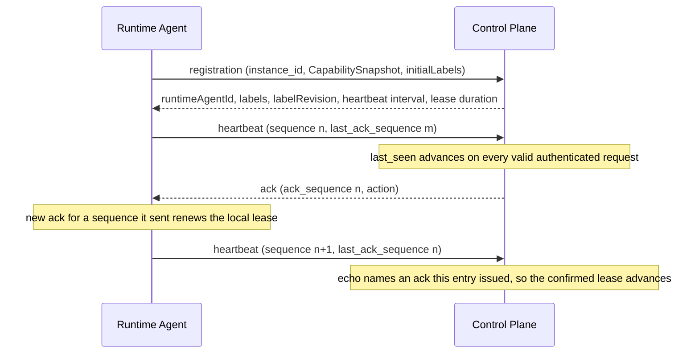

# Control Plane

Requirement prefix: `CTL` · [Specification index](../README.md)

## Purpose and scope

The Control Plane is the Server component that owns Runtime Agent
registration, availability and allocation. This document owns:

- the private Server/Runtime wire contract and the private control protocol;
- Runtime Agent registration, the process-scoped `instance_id` and the
  certificate-derived Runtime Agent principal;
- the registered startup capability snapshot and how placement checks it;
- heartbeat, the confirmed control lease and observed/authoritative
  reconciliation;
- the in-memory Runtime Agent Registry;
- capability-aware placement, atomic Stage reservation and allocation pinning;
- `AllocationSpec`, `WorkerHandle` and the Agent Card secret scan;
- slot capacity and the scope of one allocation;
- the private finalize, abort and release commands and two-phase release.

It leaves to other documents:

- StageExecution states, StageContext pinning, StageTermination, retry,
  escalation, capacity backoff, queue pause, Scheduler lanes, finalize and
  abort budgets, recovery of incomplete terminal releases and the Scheduler
  steps that call the Control Plane: [scheduler](scheduler.md).
- The WorkflowRun resource and its metadata labels: [runs](runs.md).
- The Runtime process, its startup capability probes, the Runtime-side
  watchdog and fencing actions, Worker creation and teardown inside the
  Runtime: [runtime-agent](runtime-agent.md).
- Planner construction and Planner non-goals: [planners](planners.md).
- The Worker State schema, Worker session modes and Worker results:
  [worker](worker.md).
- The deployment CA, mutual TLS and the reserved Control Plane URI SAN:
  [security](../platform/security.md).
- The single active Control Plane instance and its advisory lease:
  [persistence](../platform/persistence.md).
- AgentTemplate, ModelPolicy and ExecutionConfig layering:
  [agent-templates](../configuration/agent-templates.md).
- Runtime labels, RuntimeConfig resolution and merge, the content of
  `RuntimeSettings`, credentials and Gateways:
  [runtime-config](../configuration/runtime-config.md).
- Toolset capability granularity: [toolsets](../tools/toolsets.md); workspace
  capabilities and the `workspace` allocation value:
  [workspace](../tools/workspace.md); code-analysis capability levels:
  [code-analysis](../tools/code-analysis.md); the Caido adapter channel:
  [http-caido](../tools/http-caido.md); the Podman sandbox:
  [code-execution](../tools/code-execution.md); Agent Skill pinning:
  [skills](../tools/skills.md).
- Audit Worker completion contracts:
  [worker-completion](../audits/worker-completion.md).
- The Operations Runtime snapshot and performance-metrics collection:
  [operations](../operations/operations.md).
- The private Artifact API grant:
  [artifact-store](../artifacts/artifact-store.md).
- Shared registries: [limits](../platform/limits.md),
  [errors](../platform/errors.md),
  [failure model](../platform/failure-model.md) and
  [lifecycle](../platform/lifecycle.md).

## Concepts

Terms are defined once in [the glossary](../glossary.md); the ones this
document owns are:

- **Control Plane.** The Server component that owns Runtime Agent
  registration, availability, placement and allocation lifecycle.
- **Runtime Agent Registry.** The Control Plane's in-memory index of live
  Runtime Agent processes, their heartbeat state, control leases and slot
  availability.
- **`instance_id`.** The fresh random identity a Runtime Agent process
  generates at start; it correlates and routes, and is never reused after the
  process restarts.
- **Runtime Agent principal.** The stable `runtime_agent_id` derived from the
  authenticated leaf certificate's public key, with its durable Agent labels.
- **CapabilitySnapshot.** The immutable, positive set of WorkerRuntime,
  Toolset/tool, SandboxProfile and RuntimeAdapter capabilities a Runtime
  Agent proves before its first registration.
- **Slot.** The single unit of Runtime Agent capacity; one Runtime Agent
  process has exactly one.
- **Confirmed control lease.** The liveness lease that advances only through a
  new heartbeat request, acknowledgement and echo round trip.
- **Observed state.** What a Runtime Agent reports about its slot
  (`idle`, `allocated`, `draining` or `fenced`), as distinct from the Control
  Plane's authoritative allocation record.
- **Reconciliation.** The Control Plane's handling of a mismatch between
  observed and authoritative allocation state.
- **Allocation.** The assignment of one resolved Stage Agent binding to one
  Runtime Agent slot, identified by a globally unique, never reused
  `allocation_id`.
- **AllocationSpec.** The complete, Server-generated construction input for one
  allocation.
- **WorkerHandle.** The immutable value that lets the Workflow Scheduler and
  Planner address one prepared Worker.
- **Placement requirement.** The exact runtime, sandbox, tools, adapters and
  workspace constraints of one resolved Stage Agent binding.
- **Complete injective matching.** An assignment of every logical binding of a
  Stage to a distinct eligible Runtime Agent.
- **Write fence.** The fence on an allocation's grant that the Control Plane
  establishes, together with the authoritative terminal phase, before any
  outbound finalize or abort call; a write-fenced allocation never continues
  Worker execution.
- **Two-phase release.** Release in which the Runtime first confirms cleanup
  while staying `fenced`, and a later heartbeat `release` action lets it become
  `idle`.
- **Insufficient compatible capacity.** The temporary placement result
  returned when no complete matching currently exists.

## Model

### Runtime Agent registration

A Runtime Agent registration represents one running process. The minimal
registration describes:

```text
RuntimeAgentRegistration
  instance_id
  software_version
  started_at
  control endpoint
  A2A endpoint
  initial labels used only to seed a previously unseen certificate principal
  frozen startup WorkerRuntime, Toolset/tool, SandboxProfile and RuntimeAdapter capabilities
  observed_state
  allocation_id?
  apiVersion: contractor/v1alpha1
```

The capabilities are one immutable `CapabilitySnapshot`, built by the Runtime
Agent's startup probes ([runtime-agent](runtime-agent.md)), with four
composable dimensions:

```text
CapabilitySnapshot
  supported_runtimes: sorted set of exact WorkerRuntime refs
  supported_toolsets: sorted map of exact Toolset ref -> sorted non-empty tool set
  supported_sandbox_profiles: sorted set of exact SandboxProfile refs
  supported_runtime_adapters: sorted set of exact RuntimeAdapter refs
```

### Runtime Agent principal

The durable principal record is conceptually:

```text
RuntimeAgentPrincipal
  runtime_agent_id
  sorted labels
  monotonically increasing uint64 label_revision (starts at 1)
  created/updated timestamp and audit actor
```

### Heartbeat

A request contains:

```text
RuntimeAgentHeartbeat
  instance_id
  sequence
  last_ack_sequence?
  observed_state       idle | allocated | draining | fenced
  allocation_id?
  worker_stopped?
```

Control Plane responds with:

```text
RuntimeAgentHeartbeatAck
  ack_sequence         equal to the accepted request sequence
  action               continue | drain | release | reregister
  allocation_id?
```



### AllocationSpec

```text
AllocationSpec
  globally unique allocation_id
  run and stage identity
  logical Agent name and resolved Namespace
  complete AgentTemplate + exact ref
  exact resolvedSkills refs and package digests selected by WorkflowRun
  effective ModelPolicy + exact ref
  exact WorkerRuntimeRef
  RuntimeSettings supplied by Control Plane
  exact lease_expires_at, deadline and resource limits
```

The resolved settings travel as two fields; the content of `RuntimeSettings`
and of the provenance is specified in
[runtime-config](../configuration/runtime-config.md):

```text
AllocationSpec
  ...existing fields...
  runtimeSettings
  resolvedRuntimeConfigProvenance    safe refs/revisions/digests only
```

An AllocationSpec also carries the Stage's pinned `workerSessionMode`
([worker](worker.md)), the sorted `resolvedSkills` list outside the
digest-bearing AgentTemplate body ([skills](../tools/skills.md)), an optional
`workspace` value ([workspace](../tools/workspace.md)), an optional
Server-pinned completion contract
([worker-completion](../audits/worker-completion.md)) and the optional
`performanceMetrics` field (CTL-R133).

### WorkerHandle

A ready handle contains only what the Workflow Scheduler and Planner need to
address the prepared Worker:

- exact AgentTemplate ref;
- exact WorkerRuntime ref;
- globally unique `allocation_id`;
- external Agent Card;
- lease/deadline information.

### Allocation states

The Control Plane's authoritative view of one allocation and its slot:

```mermaid
stateDiagram-v2
    [*] --> Idle: confirmed round trip, both sides agree no allocation exists
    Idle --> Reserved: complete matching found, Stage set reserved atomically
    Reserved --> Idle: pinned revisions changed or recomputed settings no longer fit the selected adapter capabilities; unprepared reservation released, placement retried
    Reserved --> Ready: this Runtime Agent reports ready with a compatible Agent Card
    Reserved --> WriteFenced: a batch member failed preparation, batch drained
    Reserved --> Lost: confirmed control lease expired, or observed fenced or another allocation
    Ready --> WriteFenced: finalize or abort issued, or another batch member failed preparation
    Ready --> Lost: confirmed control lease expired, or observed fenced, idle or another allocation
    WriteFenced --> Lost: abort deadline passed without confirmed shutdown
    WriteFenced --> Released: StageExecution terminal (or Queue Pause exception), private Runtime cleanup acknowledged, route, grant and lease removed
    Lost --> Released: Runtime reconnects, reconciliation reissues abort or drain, cleanup acknowledged
    Released --> Idle: heartbeat release action confirmed, then confirmed idle heartbeat
```



Readiness is per allocation; the complete `WorkerHandle` map is returned only
when every allocation of the Stage is `Ready` (CTL-R93).

## Requirements

### Responsibilities and boundaries

**CTL-R1.** Control Plane owns Runtime Agent registration, availability
and allocation. It checks the WorkerRuntime selected by each AgentTemplate,
chooses free Runtime Agent capacity and returns ready `WorkerHandle` values to
the Workflow Scheduler.

**CTL-R2.** Control Plane manages allocation lifecycle, not Planner
algorithms, Worker objectives or A2A Task semantics.

**CTL-R3.** Physical placement belongs to Control Plane, not to
the Workflow Scheduler or a Planner. Control Plane sends the resolved template
of a Stage binding to one free Runtime Agent, and the allocation identity and
scoped access context are generated for that assignment. Ownership of product
semantics and of the binding's logical name and Namespace is specified in
[TPL-R66](../configuration/agent-templates.md).

**CTL-R4.** Control Plane verifies that the deployment supports the
template's runtime ref and places that ref directly in `AllocationSpec`. The
selected Runtime Agent validates it against its own build and creates the
Worker instance ([runtime-agent](runtime-agent.md)).

**CTL-R5.** Workflow YAML, AgentTemplate, Planner and public API input
cannot supply or select executable paths, modules, images or raw process
arguments.

### Private wire contract

**CTL-R6.** The private Server/Runtime surface has one current set of
strict models under `apiVersion: contractor/v1alpha1`. Registration, allocation
settings, reports and their consumers use the current fields under the
original model names, with one schema and fixture catalog
(CTL-R8).

**CTL-R7.** There is no parallel legacy model, `V2` alias,
conversion fallback or separate `privateProtocolVersion` negotiation, and the
registration request and response contain no separate private-protocol version
field. Missing required current fields, including required arrays, and unknown
fields fail strict validation rather than selecting another protocol; there is
no legacy registration fallback.

**CTL-R8.** Canonical JSON schemas live in
[`api/v1alpha1`](../../../api/v1alpha1/) and shared valid/invalid fixtures in
[`api/testdata/v1alpha1`](../../../api/testdata/v1alpha1/). Go/Python wire
parity checks use this single catalog, and strict Go/Python DTOs, JSON schemas
and fixtures must change together.

**CTL-R9.** The document version does not collapse
independently versioned Toolsets, completion contracts, workspace packages,
Audit package formats or A2A envelopes; their own versions remain explicit.

**CTL-R10.** Changes to this private surface require compatible
Server/Runtime builds rather than a silent downgrade to an older shape.

### Registration and process identity

**CTL-R11.** On process start a Runtime Agent generates a fresh random
`instance_id`. It retains that value in memory across registration retries and
Control Plane reconnects, but does not reuse it after its own restart.

**CTL-R12.** Registration with the same `instance_id` is idempotent
(FAIL-CTL-1). The `instance_id` is a correlation and routing identity, not an
authentication credential; mTLS authenticates the agent and derives its stable
principal.

**CTL-R13.** For the live instance, Control Plane records the last
accepted registration/heartbeat request, the issued and confirmed heartbeat
sequences, and the observed and authoritative single-slot facts.

**CTL-R14.** `software_version` is a bounded version string reported by
the Runtime Agent binary itself. It is observation metadata for Operations and
diagnostics; the Server neither substitutes its own build version nor treats
this string as a placement capability or trust assertion.

**CTL-R15.** The registration request carries the mandatory
`supportedRuntimeAdapters`, a sorted unique array that may be empty.

**CTL-R16.** The registration response returns the safe
`runtimeAgentId`, the authoritative `labels` and `labelRevision` beside the
heartbeat interval and lease duration (CTL-R39). Runtime may show them
in local diagnostics but does not use the returned labels to configure the
process or an active allocation.

**CTL-R17.** The accepted registration binds
`(runtime_agent_id, instance_id)` for the process lifetime. Every later
registration retry, heartbeat, private Artifact call and final report carrying
that `instance_id` or allocation must arrive through the same
certificate-derived principal; a different CA-valid peer is rejected.

**CTL-R144.** Control Plane associates lifecycle messages and final reports
with the Runtime Agent to which the allocation was issued.

**CTL-R145.** The principal binding (CTL-R17) and the report association
(CTL-R144) protect execution-state consistency only; they are not per-Agent
RBAC and give different Runtime Agents no different privileges.

**CTL-R18.** Control Plane and the private Artifact API bind every
live `instance_id`, allocation and report to that same principal, so a
different CA-valid Runtime Agent cannot claim the allocation or its
RuntimeSettings. This is consistency and secret-recipient binding, not a
label-derived permission model. The private Artifact API grant applies it as
[ART-R42](../artifacts/artifact-store.md).

**CTL-R19.** The registered control and A2A endpoints must present
a CA-valid leaf with the same SPKI fingerprint when Control Plane connects to
them; normal DNS/IP SAN verification still applies. A Runtime Agent therefore
cannot register another trusted agent's endpoint and cause Control Plane to
deliver that allocation's RuntimeSettings or A2A traffic to the wrong peer.

**CTL-R20.** A Runtime Agent cannot supersede another agent: only a
later process of the same certificate principal replaces an earlier
registration that shares its control or A2A endpoint. An overlapping endpoint
registered by a different principal leaves the other process, its allocation
and its control lease untouched.

**CTL-R21.** A restarted Runtime Agent under the same certificate
principal registers with a new `instance_id` and retains the Control Plane's
durable Agent labels. It cannot adopt a Worker or allocation belonging to its
previous process instance. The old registration becomes unavailable after its
confirmed control lease expires, and any active StageExecution using that
allocation enters `aborting`: the Workflow Scheduler records an interrupted
StageTermination, completes the bounded abort path and then applies the
declared interrupted policy, which is to retry with a new StageExecution, use a
configured escalation executionConfig or fail the Run
([scheduler](scheduler.md)).

### Runtime Agent principal and labels

**CTL-R22.** The Server derives the stable `runtime_agent_id` as
lowercase hex `SHA-256(DER SubjectPublicKeyInfo)` of the authenticated Runtime
Agent leaf certificate. The Runtime Agent does not claim this value in JSON.

Rationale: labels assigned through Operations need a stable subject, while
`instance_id` intentionally changes on every process restart.

**CTL-R23.** The principal binds durable Agent-label
configuration and observed process incarnations to an authenticated, trusted
peer but grants no different Runtime authorization role.

**CTL-R24.** Each concurrently running logical Runtime Agent must
use its own certificate/key pair, even on one VM; operators running two agents
on one VM issue two certificates from the same deployment CA. Two processes
using the same key are the same principal and cannot concurrently register as
two slots: a second live `instance_id` is rejected.

**CTL-R25.** Renewing a certificate with the same public key
retains the principal. Rotating the key creates a new principal whose initial
labels are seeded normally; labels are not copied automatically between
fingerprints. Operations may assign the same desired label set to the new
principal before retiring the old certificate.

**CTL-R26.** Registration carries a sorted `initialLabels` list.
On the first registration of an unseen principal, Control Plane validates that
every binding exists and atomically creates the principal record with that
label set (LIFE-CTL-4). On later registrations it ignores `initialLabels` for state
mutation and returns the database-authoritative label set: after the first
registration the Control Plane database is authoritative, so changing startup
arguments does not silently overwrite an Operations decision, and the operator
changes the durable set through Control Plane.

**CTL-R27.** Durable certificate principals and their label
assignments are configuration records only; they never imply that a process is
live, leased or eligible.

**CTL-R28.** A label or configuration change affects only a future
allocation; an allocated Worker retains its immutable RuntimeSettings snapshot.

**CTL-R139.** The Runtime Agent receives no mutable label-update command, does
not restart or re-probe its environment on a label change, never interprets the
label name and never mutates an active RuntimeSettings snapshot. Label-set
replacement is specified in [runtime-config](../configuration/runtime-config.md).

**CTL-R29.** A mismatch between the adapters a principal's labels
require and the adapters its live instance advertises is not a label mutation
error, because the principal may be offline or restart with a different
immutable environment. It makes that live instance ineligible for placement and
is visible in Operations.

### Capability snapshot

**CTL-R30.** The `CapabilitySnapshot` maps directly to the
registration fields; there is no second capability document or Server-side
environment catalog.

**CTL-R31.** Only positive capabilities are registered. Probe
failures remain bounded, redacted Runtime Agent startup diagnostics and are not
sent as placement facts. A Toolset with no usable exported tool is omitted.

**CTL-R32.** If no WorkerRuntime or no SandboxProfile passes its
probe, the process fails startup readiness and does not register an `idle`
slot. Empty Toolset and RuntimeAdapter lists are valid and can serve templates
and resolved settings that require neither.

**CTL-R33.** The RuntimeAdapter list contains at most 64
sorted unique exact refs (LIM-CTL-3); the complete registration request remains
subject to the private registration body bound.

**CTL-R34.** The computed snapshot is frozen for the lifetime of
`instance_id` and reused byte-for-byte across registration retries and Control
Plane reconnects. Control Plane rejects a registration retry that reuses the
`instance_id` with a different snapshot (FAIL-CTL-1). Heartbeats carry no
capability update.

**CTL-R35.** The deployment contract requires the process environment,
enabled factory set, executable resolution and local dependency configuration
to remain unchanged after registration. Applying an environment change,
including changed adapter code or local dependencies, requires restarting the
Runtime Agent, which creates a new `instance_id`, probes again and registers a
new snapshot.

**CTL-R36.** The `v1alpha1` registration shape treats the four
capability dimensions as composable sets, so a Runtime Agent must advertise
only runtimes, Toolsets/tools, sandboxes and Runtime adapters that can be
combined safely within that process. An environment with combination-specific
incompatibilities must expose their common safe subset or run separate Runtime
Agent processes with compatible registries.

**CTL-R37.** Capabilities cover only Runtime-owned prerequisites
available before an allocation ([runtime-agent](runtime-agent.md)). Availability of an LLM Gateway URL or token,
OTLP endpoint, HTTP proxy, Artifact API grant or other RuntimeSettings supplied
later in AllocationSpec is not a physical-agent placement capability; it
follows the ordinary bounded preparation or execution failure path.

**CTL-R38.** Advertised capabilities grant no different
authorization role to otherwise equal CA-trusted Runtime Agents. Runtime
Agents may advertise different execution capabilities because their immutable
process environments contain different runtime, tool or sandbox dependencies.

### Heartbeat and confirmed control lease

**CTL-R39.** The heartbeat interval is 10 seconds (LIM-CTL-1) and the
confirmed Runtime Agent control lease is 60 seconds (LIM-CTL-2). Control Plane
returns both values on registration, not in every acknowledgement, so that the
Server remains their authority and the agent does not depend on matching local
configuration.

**CTL-R40.** Each side measures lease expiry with its own monotonic
clock; no shared wall-clock timestamp is a lease authority.

**CTL-R41.** A Runtime Agent starts a strictly increasing heartbeat
`sequence` at process start and does not reset it across reconnects. The
acknowledgement's `ack_sequence` equals the accepted request sequence, and
`last_ack_sequence` echoes the newest response the Runtime Agent actually
received.

**CTL-R42.** Registration `last_seen` advances on every valid
authenticated heartbeat request and serves observation and routing
diagnostics.

**CTL-R43.** The confirmed control lease on Control Plane advances
only when `last_ack_sequence` advances and names an ack that the current
in-memory registration entry previously issued. Repeating the same ack never
extends the lease again, and receiving heartbeat requests alone does not keep
an allocation live or a slot eligible for placement.

**CTL-R44.** The Runtime Agent likewise renews its local confirmed
lease only after receiving a new ack for a heartbeat sequence that it actually
sent; a duplicate, delayed or unknown ack does not extend its watchdog.
Requests that reach Control Plane while all responses are lost therefore cannot
keep the confirmed lease alive indefinitely: the echoed ack stops advancing and
both sides expire (FAIL-CTL-2).

**CTL-R45.** An active allocation is live only while the confirmed control
lease is valid and the observed allocation matches Control Plane's
authoritative record, subject to the preparation transition of
CTL-R52. An idle process is eligible for placement only after the same
round trip is confirmed and both sides agree that no allocation exists.

**CTL-R46.** A heartbeat is only an observation: `idle`,
`fenced` or a different `allocation_id` can trigger reconciliation but can
never release, adopt or replace the authoritative allocation.

**CTL-R47.** When the confirmed lease expires on Control Plane, it
excludes the Runtime Agent from placement and irreversibly reports any active
allocation lost to the Workflow Scheduler, which enters `aborting` with an
interrupted StageTermination. A late ack cannot revive that allocation; only
reconciliation and a new allocation may return the slot to service
(FAIL-CTL-8).

**CTL-R48.** The Runtime Agent maintains the symmetric monotonic
watchdog over the same 60-second lease (LIM-CTL-2); its expiry actions and its
fenced state are specified in [runtime-agent](runtime-agent.md). While a fenced
agent keeps reporting an old allocation after a lost release response, Control
Plane repeats the idempotent `release` action (FAIL-CTL-7).

**CTL-R49.** An allocation-free re-registration after local
watchdog expiry starts a fresh Control Plane claim deadline, so the Runtime's
new local deadline cannot outlive Server authority.

**CTL-R50.** After Registry loss, an echoed ack from the
former Control Plane process is not recognized because the new in-memory entry
did not issue it. After re-registration, Control Plane acknowledges the next
heartbeat, and only echoing that new response establishes the fresh confirmed
control lease. The `reregister` heartbeat response itself never renews the
Runtime watchdog: if registration keeps failing, the old local deadline still
expires (FAIL-CTL-1).

Rationale: the process-monotonic heartbeat sequence avoids collision with a
delayed response without introducing a durable Server epoch or registration
generation.

### Observed/authoritative reconciliation

**CTL-R51.** Matching live allocation IDs and a confirmed lease
allow `continue`.

**CTL-R52.** After reservation and before the private `prepare`
commits locally, an authoritative allocation may transiently coexist with an
observed idle slot; this bounded preparation transition receives `continue` and
is not treated as allocation loss.

**CTL-R53.** Observed `draining` is valid only when Control Plane
has issued finalization or abort for that allocation.

**CTL-R54.** The write fence is a mandatory liveness signal: an
authoritative allocation whose grant is write-fenced is never allowed to
continue Worker execution. While Control Plane still owns it, every matching
`allocated` heartbeat receives `drain`, never `continue`, until the Worker
reports `draining`/`fenced` or the Runtime process exits. This is the fail-safe
when a private finalize or abort request is lost: a Runtime that did not
receive the explicit call still stops its Worker through reconciliation, or
exits if stop cannot be guaranteed (FAIL-CTL-5, FAIL-CTL-6).

**CTL-R55.** Terminal recovery need not reopen the Stage or
invent a new semantic terminal operation: missing reports remain incomplete
telemetry, while drain plus idempotent release eventually recovers the slot.

**CTL-R56.** Observed `fenced`, `idle` or another allocation while
Control Plane still owns an active allocation makes that allocation lost and
starts or resumes the bounded abort path (FAIL-CTL-8).

**CTL-R57.** Registration or a heartbeat that reports an active
`allocation_id` triggers reconciliation with durable StageExecution state
before that slot can receive new work. An allocation of a `finalizing`
StageExecution reissues its recorded finalization, one of an `aborting`
StageExecution reissues its recorded abort, and a terminal or unknown
allocation receives an idempotent drain/release action.

**CTL-R58.** Reconnection never adopts a Worker for continued
Planner execution.

**CTL-R59.** No mismatched process is offered for placement until it
reports the released state and completes a fresh confirmed round trip.

**CTL-R60.** A late report may be accepted as incomplete telemetry
that enriches related telemetry, but lease loss cannot be reversed into
successful completion of the interrupted StageExecution and a late report never
changes the StageTermination.

**CTL-R61.** A lost allocation is not offered for placement. If its
Runtime Agent later reconnects, reconciliation reissues the same abort before
the slot may become idle. If it remains disconnected, the agent's control-lease
watchdog ultimately destroys the Worker or exits the process.

### Runtime Agent Registry

**CTL-R62.** Control Plane keeps the live Runtime Agent
Registry in memory. Registrations, last-seen times, issued/confirmed heartbeat
sequences, control leases and current slot availability are not PostgreSQL
state, and heartbeat processing does not write one database row every 10
seconds (LIM-CTL-1).

**CTL-R63.** PostgreSQL retains only the durable execution
facts that refer to allocations, including their StageExecution association
and terminal outcome (LIFE-CTL-3).

**CTL-R64.** After a Server restart the in-memory Registry
starts empty and is not a recovery authority. A Runtime Agent process that
remained alive registers again with its existing process-scoped `instance_id`;
an agent process that also restarted uses a new one. Recovery still interrupts
every affected `preparing` or `running` StageExecution through durable
`aborting` because its Planner is not resumable, then drains any Worker
reported by the reconnected agent (FAIL-CTL-9).

**CTL-R65.** The Registry is a current live and reconciliation
index, not process history. A superseded or control-lease-expired process entry
is retired from memory as soon as it owns no authoritative allocation; an entry
that still owns an allocation remains until that allocation is reconciled and
released (LIFE-CTL-1).

**CTL-R66.** Retirement removes the full entry from the bounded
in-memory live Registry, not merely from the Operations snapshot: a superseded
or control-lease-expired process stays visible only while it owns an
authoritative allocation that still requires reconciliation, and after that
allocation is released, or immediately when it owned none, it is retired rather
than shown indefinitely as a fenced slot. Durable Runtime Agent principals
remain visible through their separate configuration resource.

**CTL-R67.** Registration performs the same expiry/retirement
sweep before enforcing the Registry's bounded live-index capacity, so
process-scoped IDs accumulated across Runtime restarts cannot permanently
exhaust admission and a new process-scoped UUID can register after any number
of historical restarts.

**CTL-R68.** Historical connection or audit data, if
introduced, belongs in a separate bounded durable facility.

**CTL-R69.** Multiple active Control Plane replicas, shared
fleet coordination and durable liveness state must not be approximated by
sharing an unfenced `runtime_agents` table. The single active Control Plane
instance per PostgreSQL database, on which the in-memory Registry and its lock
rely, is specified in [persistence](../platform/persistence.md).

### Capability-aware placement

**CTL-R70.** The currently connected fleet is not consulted while
loading a Workflow, resolving an AgentTemplate or creating a WorkflowRun; those
steps validate exact refs and tool names against Server descriptors. Physical
availability is ephemeral and is evaluated only while a StageExecution is in
`preparing`, so an eligible Runtime Agent may connect after the Run was
created.

**CTL-R71.** For one resolved Stage Agent binding, the placement
requirement is exactly:

```text
required runtime = AgentTemplate.runtime
required sandbox = AgentTemplate.sandboxProfile
required tools   = each AgentTemplate.toolsets[ref].tools
required adapters = RuntimeAdapters referenced by resolved Run + Agent label settings
required workspace mode = Stage context.workspace.mode, when workspace exists
required workspace storage = local for podman@1; otherwise no storage constraint
```

**CTL-R72.** For each candidate slot, Control Plane first
resolves the pinned default and Run-selected Runtime labels plus that
candidate's Agent Runtime labels and derives the required adapter set
([runtime-config](../configuration/runtime-config.md)).

**CTL-R73.** A Runtime Agent is a candidate only when it is
`idle`, has a confirmed control lease, is otherwise placement-eligible,
advertises the exact runtime and sandbox refs, its advertised tool set is a
superset of every selected tool for each exact Toolset ref, its advertised
adapter set contains every adapter required after combining that principal's
Agent labels with the pinned Run labels, and it satisfies the binding's
workspace requirements of CTL-R71. Placement checks the explicitly
reported exact runtime, tool, sandbox and adapter capabilities.

**CTL-R74.** Extra capabilities neither activate settings or
adapters, change Worker behavior nor become model-visible; extra advertised
tools are never exposed implicitly.

**CTL-R75.** Placement never requires a Run label name to appear in
the candidate's Agent label set: labels are configuration inputs, never an
equality or affinity predicate between Run and Runtime Agent. A Run `debug`
configuration applies to an unlabeled Runtime Agent when that process
advertises the resulting required adapter; Agent labels are only the
higher-precedence candidate-specific configuration layer defined in
[runtime-config](../configuration/runtime-config.md).

**CTL-R76.** When a candidate lacks a required adapter, Control Plane
tries another candidate or reports temporary insufficient compatible capacity.

**CTL-R77.** Placement rejects a selected Caido Toolset when the
effective labels do not resolve the `caido-graphql@1` adapter, and chooses an
Agent advertising that adapter ([http-caido](../tools/http-caido.md)).

**CTL-R78.** For a binding selecting `podman@1`, placement requires
the exact runtime, profile, selected tools and local direct workspace
capability, as well as the registered profile/tool compatibility. These are
binding-specific requirements: a different Worker in the Stage may continue to
use its own compatible profile ([code-execution](../tools/code-execution.md)).

**CTL-R79.** Apart from the `podman@1` requirement, workspace
`storage` is operational diagnostics: placement requires the requested
workspace mode and the exact Toolset/tool capabilities,
and the Scheduler does not prefer local over memory storage
([workspace](../tools/workspace.md)).

**CTL-R80.** When a binding pins an Audit completion contract,
placement requires a Runtime Agent that advertises the contract in
`capabilities.completionContracts` as well as the selected Toolset capability.
This capability, unlike resource diagnostics, constrains placement and direct
preparation and fails closed when unsupported; retry and placement preserve the pinned choice and
never downgrade silently to ordinary completion on an older Runtime
([worker-completion](../audits/worker-completion.md)).

**CTL-R81.** The optional resource-diagnostics capability
(`supportedPerformanceMetricsVersions`) does not constrain placement or change
the allocation lifecycle: a Server must not filter placement on it.

**CTL-R82.** WorkflowRun metadata labels do not participate in
Runtime capability matching or RuntimeConfig merge provenance, and a Runtime
process does not interpret `purpose` or `eval.*` ([runs](runs.md)).

**CTL-R83.** For a multi-Agent Stage, Control Plane must find a
complete injective matching between logical bindings and eligible single-slot
Runtime Agents before reserving anything. It must not greedily consume a
broadly capable agent when that would hide an existing complete assignment. A
deterministic maximum bipartite matching or an equivalent complete algorithm
satisfies this contract; the particular equally valid assignment is not
Workflow semantics.

**CTL-R84.** If no complete matching currently exists,
Control Plane returns temporary insufficient compatible capacity (FAIL-CTL-3).
This is not a Stage failure: the StageExecution remains `preparing`, no slot is
reserved and the Scheduler's bounded capacity backoff applies until capacity
appears, the execution deadline expires or cancellation is requested
([scheduler](scheduler.md)). It covers both busy compatible agents and an
environment capability that is not yet represented in the live fleet.

**CTL-R85.** Planner never chooses, observes or changes physical
placement.

### Atomic Stage reservation and allocation pinning

**CTL-R86.** Control Plane reserves capacity for the complete
Stage Worker set as one in-memory operation. Under the single Control Plane
instance's registry lock it either moves enough `idle` slots to `reserved` or
changes no slot at all; a Stage requiring three Workers therefore never holds
two slots while waiting for the third, and the Planner never receives a partial
`WorkerHandle` map.

**CTL-R87.** No database or network operation occurs while holding the
in-memory Runtime Registry lock.

**CTL-R88.** Allocation resolution has one durable linearization
point before any Runtime prepare request. Control Plane first reads candidate
principal label-set revisions and the current binding revisions for those
Agent labels; default and Run-selected Runtime-label refs already come from the
immutable Run snapshot. It then computes a complete compatible matching. After
reserving the complete slot set in memory, it locks the relevant Agent-label
binding rows in lexical order and the selected principal rows by
`runtime_agent_id`, verifies those revisions, re-resolves the settings and
durably records each exact revision plus the non-secret allocation config
snapshot. It sends no AllocationSpec before that transaction commits.

**CTL-R89.** All Run creation, binding mutation, Agent-label mutation
and allocation-pinning transactions use the same binding-then-principal lock
order.

**CTL-R90.** If any revision changed or the recomputed settings no
longer fit the selected adapter capabilities, Control Plane releases the
unprepared reservation and retries placement for the same StageExecution
(FAIL-CTL-4). A concurrent Agent-label or binding mutation serializes on those
rows: if allocation pinning commits first, the mutation affects the next
allocation; if the mutation commits first, this allocation observes the new set
or binding. Control Plane likewise drops a committed reservation that no
Runtime was asked to prepare when Queue Pause defers its Stage's admission
([SCH-R152](scheduler.md)): no Runtime observed a prepared allocation, so the
slot needs no reconciliation heartbeat, and unlike the release of a prepared
allocation no released reservation remains, so placement for the same
StageExecution can run again. A write-fenced, lost or prepared reservation is
not dropped this way.

**CTL-R91.** After reserving the full set, Control Plane creates one
globally unique `allocation_id` and one complete AllocationSpec per logical
Stage Agent binding, including that binding's effective ModelPolicy, resolved
RuntimeSettings, exact label/config provenance, the exact Run-pinned
`resolvedSkills` manifest and the Stage's pinned `workerSessionMode`, and then
may initialize those Runtime Agents concurrently.

**CTL-R92.** Reservation replay identity includes the Worker session mode
and the complete WorkflowRun metadata-label map. A retry of the same
`stage_execution_id` cannot reinterpret the mode: replay with another mode
conflicts rather than replacing an existing allocation, and a stale or altered
replay is rejected before Worker construction.

**CTL-R93.** Infrastructure preparation completes before the Planner
starts: the Planner starts only after every Runtime Agent reports ready and
Control Plane can return the complete `WorkerHandle` map.

**CTL-R94.** If any initialization fails, times out or returns an
incompatible Agent Card, including one incompatible with the required A2A
protocol, Control Plane drains and releases every allocation from that batch,
including Runtime Agents that became ready (FAIL-CTL-3).

**CTL-R146.** When any required Worker fails preparation, the Workflow
Scheduler receives no partial `WorkerHandle` map and no partial Planner
subagent set.

**CTL-R147.** After a failed preparation the Workflow Scheduler moves the
StageExecution through `aborting` with a retryable interrupted StageTermination
whose code identifies the infrastructure error. When the batch is cleared or
the abort deadline expires, the execution becomes terminal and Workflow policy
decides whether to create a new attempt (FAIL-CTL-3).

**CTL-R95.** `prepare_stage` is idempotent for `stage_execution_id`. A
retry after a lost response observes the same in-memory reservation/preparation
operation and cannot create a second Worker set. Loss of the Control Plane
process instead uses the interruption and cleanup recovery path of
CTL-R64 (FAIL-CTL-3).

### AllocationSpec

**CTL-R96.** AllocationSpec carries the complete resolved AgentTemplate and
the effective exact ModelPolicy as specified in
[TPL-R62](../configuration/agent-templates.md); the Runtime's digest checks are
in [TPL-R63](../configuration/agent-templates.md).

**CTL-R97.** Control Plane includes a resolved `RuntimeSettings`
snapshot in every AllocationSpec and sends it as one immutable snapshot over
mTLS; it never sends a RuntimeConfig document. `RuntimeSettings` contains
resolved connection and execution settings, not Worker semantics; its content,
precedence, pinning, adapter isolation and credential rules are specified in
[runtime-config](../configuration/runtime-config.md).

**CTL-R98.** `lease_expires_at` is copied from Control Plane's
confirmed allocation lease; the Runtime Agent does not derive a later value
from its local heartbeat settings.

**CTL-R99.** Private wire timestamps are normalized to UTC
microsecond precision, which Go, Python and PostgreSQL preserve exactly.

**CTL-R100.** Agent Skill packages are allocation data pinned by the
WorkflowRun, not Runtime environment capabilities or A2A Agent Card operations;
the Runtime never resolves an owner UserScope current skill binding
([skills](../tools/skills.md)).

**CTL-R101.** Every AllocationSpec carries the Stage's explicit
immutable Worker session mode ([worker](worker.md)).

**CTL-R102.** Every allocation receives a globally unique
`allocation_id` that is never reused. Scheduler-owned retry, configured
escalation and replacement create new StageExecutions and new allocation IDs.
This ID is the sole lifecycle, routing and report-correlation key; there is no
separate allocation generation.

**CTL-R103.** Repeated control commands for an active `allocation_id`
are idempotent, while commands and A2A requests for a released or unknown ID
are rejected. Stale, draining or released allocation identities cannot address
the current or a replacement Worker instance.

**CTL-R104.** Allocation identity is not A2A Task identity: one allocation
may serve a sequence of Tasks. Allocation, A2A Task/context, Contractor
invocation and ADK session IDs are distinct, and only the Runtime may create or
observe the ADK session identity.

### WorkerHandle and Agent Card

**CTL-R105.** One declared Stage Agent name maps to one allocation and
one handle (LIM-CTL-7), and one Stage binding produces one allocation and one
in-process Worker instance in one Runtime Agent.

**CTL-R106.** A ready `WorkerHandle` contains only the fields
listed in the model, and reports the exact template ref, runtime ref and
allocation identity returned by the prepared Runtime Agent.

**CTL-R107.** The ready handle echoes the exact `lease_expires_at`
supplied in `AllocationSpec`; it does not renew or reinterpret that
authoritative Control Plane lease. That timestamp proves that preparation
happened inside the then-current confirmed lease; it is not a frozen lifetime
deadline for later Planner calls.

**CTL-R108.** Successful sequenced heartbeat acknowledgements renew
the live Control Plane and Runtime watchdogs without mutating the immutable
`WorkerHandle`. Every A2A call keeps the Stage deadline, while authoritative
lease loss independently cancels the Scheduler invocation and the Runtime Agent
self-fences its Worker.

**CTL-R109.** A `WorkerHandle` contains no host path,
tool-sandbox handle or in-process Worker object, and no LLM Gateway token or
other RuntimeSettings secret.

**CTL-R110.** The Runtime before returning a handle and the Server
before accepting it scan the Agent Card for those secrets. A card value matches
a secret of any length exactly, and one of at least 16 UTF-8 bytes (LIM-CTL-5)
anywhere, except the exact protocol- or Server-fixed value at a trusted path
(such as the template description or the `stage` skill tag), so that a short
credential may coincide with fixed vocabulary. Every object key is scanned,
whatever its path, for secrets of at least 16 UTF-8 bytes.

**CTL-R111.** Both implementations share the trusted path table, the
Runtime's card shape and the leak cases in
[`agent-card-secret-scan-cases.json`](../../../api/testdata/v1alpha1/agent-card-secret-scan-cases.json).

### Capacity and execution scope

**CTL-R112.** One Runtime Agent process has one active slot (LIM-CTL-4)
and at most one in-process Worker instance; it never hosts multiple Workers
concurrently.

**CTL-R142.** A Runtime Agent process may create its next Worker only after
the prior allocation is released and fully cleared.

**CTL-R143.** A Stage needs one available Runtime Agent process per declared
named Worker before the Planner starts, and those processes may all run on the
same VM: a Stage declaring three named Workers needs three processes.

How slots relate to Scheduler lanes is specified in [scheduler](scheduler.md).

**CTL-R113.** One allocation lasts for the complete Planner
invocation and its finalization. The Planner may send multiple sequential A2A
Tasks to its Worker while the allocation is active; a Worker executes at most
one Task at a time (LIM-CTL-6), while separate Stage allocations may execute
concurrently.

**CTL-R114.** A draining allocation rejects new A2A work and
remains reserved until its StageExecution is terminal, except under
CTL-R123. A fenced slot rejects all work and remains unavailable
until authoritative reconciliation and release acknowledgement complete.

**CTL-R115.** The Planner cannot expand or replace the prepared set
during the invocation. Changing the set requires a new StageExecution decision
by the Workflow Scheduler under the Workflow policy.

### Finalization and abort

**CTL-R116.** Preparation, finalization, abort and acknowledged
release are always a private control protocol rather than A2A skills.

**CTL-R140.** Transport DTOs are defined by the versioned schemas under
`api/v1alpha1`.

**CTL-R141.** Finalization and abort enter through the Runtime Agent's
existing private control endpoint and do not wait for A2A cancellation to reach
a terminal Task state.

What the Runtime does inside finalization and abort is specified in
[runtime-agent](runtime-agent.md), the StageExecution lifecycle in
[scheduler](scheduler.md) and the report contracts in
[observability](../platform/observability.md).

**CTL-R117.** Finalization follows this flow:

```text
Workflow Scheduler
  -> Control Plane: finalize(finalization_id, allocations, deadline)
  -> Runtime Agent: mark allocation draining and reject new A2A Tasks
  -> same process: destroy Worker, close Toolsets, flush adapters and build one ExecutionReport
  -> Runtime Agent: return ExecutionReport plus RuntimeReport
  -> Workflow Scheduler: accept terminal StageResult
  -> Control Plane: release route, sandbox, lease and slot
```

**CTL-R118.** The finalize command is idempotent for
`finalization_id` (FAIL-CTL-5). When the Runtime Agent cannot guarantee by the
supplied deadline that its Worker stopped, it exits its own process rather than
reusing the slot ([runtime-agent](runtime-agent.md)); Control Plane then
records an incomplete report from the facts it can observe, and the Scheduler
accepts the already durable candidate.

**CTL-R119.** Abort uses a separate idempotent private control command,
`abort(abort_id, allocations, deadline)`, issued after the Workflow Scheduler
has recorded `aborting`, the StageTermination, the `abort_id` and the deadline;
the full abort flow is specified in [scheduler](scheduler.md). The command
performs no semantic work and does not depend on A2A `CancelTask` delivery. It
is idempotent for `abort_id`, and retries return the cached report when
available (FAIL-CTL-6).

**CTL-R120.** For a multi-Agent Stage, Control Plane establishes the write
fence and the authoritative terminal phase for every allocation before
performing any outbound Runtime call, then fans finalize or abort out
concurrently. Every allocation receives an independent request timeout bounded
by the same durable Stage deadline, so one unreachable Runtime cannot consume
another Runtime's opportunity to stop. One failure does not cancel sibling
calls, and reports and errors are folded back in deterministic logical-Agent
order.

**CTL-R121.** Control Plane drains aborting allocations through the
authoritative private control protocol. At the abort deadline, any allocation
that has not confirmed shutdown is marked lost and fenced and its reports are
recorded as incomplete (FAIL-CTL-6); the Scheduler then commits the terminal
state named by the StageTermination ([scheduler](scheduler.md)).

### Release

**CTL-R122.** Normally the allocation remains reserved through
`draining`/stopped state until the StageExecution becomes terminal, then
two-phase release begins; the Workflow Scheduler releases allocations only
after recording the terminal Stage outcome.

**CTL-R123.** The one exception is Queue Pause deferring an atomic
next/retry/escalation admission ([scheduler](scheduler.md)): drain and release
may then finish while the StageExecution retains its durable `finalizing`
candidate or `aborting` termination, immutable operation ID and deadline. This
does not authorize another Planner invocation or early result or output
acceptance.

**CTL-R124.** The private Runtime release request idempotently
confirms Toolset teardown and removes the SandboxProfile workspace and secrets,
but leaves the old allocation identity `fenced`. After its successful response,
Control Plane removes the allocation's route, grant and lease. A subsequent
heartbeat `release` action confirms that authoritative edge and lets the
Runtime Agent clear its retained identity and report and become `idle`. Control
Plane does not offer the slot until a confirmed heartbeat reports the matching
idle state (LIFE-CTL-2).

**CTL-R125.** A lost private release response leaves both sides
retry-safe, while a cleanup failure keeps that Runtime Agent fenced without
rewriting the terminal Stage outcome; a failed release retains the allocation
grant (FAIL-CTL-7).

**CTL-R126.** The outbound Runtime release calls of one batch are
concurrent and use independent bounded request contexts. Registry authority is
removed only for a member whose private Runtime cleanup was acknowledged;
failed members remain fenced and independently retryable (FAIL-CTL-7). The same fence-first
fan-out rule applies to cleanup after partial batch preparation. The deadlines
of release batches and failed-prepare cleanup, and the recovery of incomplete
terminal releases, are specified in [scheduler](scheduler.md).

### Protocol ownership and live Worker state

**CTL-R127.** The private control protocol owns registration,
heartbeat, reservation, AllocationSpec and RuntimeSettings delivery, readiness,
lease, idempotent Worker finalization and abort, execution/runtime report
transport, release and cleanup.

**CTL-R128.** While a Worker is live, the private control protocol
also owns the read-only allocation-correlated
`GET /private/v1/allocations/{allocation_id}/agent-state` transport. That route
returns only bounded Contractor-owned State to Control Plane; it is neither an
A2A operation nor a public or generic state API. Its schema and lifecycle are
specified in [worker](worker.md).

**CTL-R129.** The Runtime exposes live Worker State only through
that read-only endpoint; no private request can write an arbitrary ADK State
key or replace pinned allocation configuration.

**CTL-R130.** The Go Control Plane provides a bounded Runtime client
operation behind a narrow framework-neutral `WorkerStateReader`; Planner
packages do not construct HTTP requests or receive physical Runtime endpoint
data.

**CTL-R131.** Allocation proxy settings never intercept registration,
heartbeat, control, A2A or Artifact API traffic.

### Allocation resource diagnostics

**CTL-R132.** Private registration may carry the optional
`supportedPerformanceMetricsVersions: [1]`; omission or an empty list means
unsupported. A Runtime advertises version 1 only when it contains the Runtime
collector.

**CTL-R133.** When collection is enabled and the chosen Runtime supports
version 1, Control Plane adds this optional top-level field to its
Server-generated `AllocationSpec`:
`"performanceMetrics": {"version": 1, "intervalSeconds": 15}`
([LIM-CTL-8](../platform/limits.md)). The
interval is the allocation sampling cadence of the collection schedule in
[OPS-R86](../operations/operations.md). Omission disables sampling.

**CTL-R134.** Control Plane persists its decision (`requested`,
`disabled` or `unsupported`) alongside the allocation, so that final-report
attribution and restart recovery do not infer it from current process flags;
duplicate prepare uses the same decision. The decision is operational
metadata, not model-visible context or secret-bearing adapter configuration.

**CTL-R135.** Collection policy pinned on a previously prepared allocation
survives a Server restart as specified in
[OPS-R83](../operations/operations.md).

**CTL-R136.** The Server trusts allocation identity and policy from its
own envelope and validates the optional resource block of a final report
separately. A malformed or unrequested resource block cannot poison an
otherwise valid report: the Server omits the block, retains a safe diagnostic
and continues normal finalization (FAIL-CTL-10). Resource data remains within
the existing 1 MiB final-report limit
([LIM-OBS-7](../platform/limits.md),
[OBS-R40](../platform/observability.md)), and no raw samples are returned.

**CTL-R137.** Duplicate finalization or abort returns the same cached
report, and persistence never double-counts it.

**CTL-R138.** A registration that omits
`supportedPerformanceMetricsVersions` is valid, and the Server sends no
`performanceMetrics` request for its allocations. A prepare payload without
`performanceMetrics` runs with collection off. A Server build that does not
define the registration field rejects it as unknown (CTL-R7), so Servers are
upgraded before Runtimes that advertise it and a rollback is coordinated. There
is no transparent bidirectional compatibility and no fallback that hides a
protocol error.

## Interfaces

The Workflow Scheduler drives the Control Plane through this protocol:

```python
class ControlPlane(Protocol):
    async def prepare_stage(
        self,
        bindings: Collection[ResolvedStageAgentBinding],
        context: StageAllocationContext,
    ) -> Mapping[AgentName, WorkerHandle]: ...

    async def finalize_stage(
        self,
        handles: Collection[WorkerHandle],
        finalization_id: FinalizationId,
        deadline: datetime,
    ) -> Mapping[AgentName, AllocationFinalReport]: ...

    async def abort_stage(
        self,
        handles: Collection[WorkerHandle],
        abort_id: AbortId,
        deadline: datetime,
    ) -> Mapping[AgentName, AllocationFinalReport]: ...

    async def release_stage(
        self,
        handles: Collection[WorkerHandle],
        reason: ReleaseReason,
    ) -> Mapping[AgentName, AllocationReleaseAck]: ...
```

The end-to-end path of one Stage through the Control Plane:

```text
Workflow Scheduler selects a ready Stage and resolves its AgentTemplates
  -> Control Plane resolves pinned default/Run-selected Runtime labels plus candidate Agent Runtime labels
  -> Control Plane matches every template/adapter requirement against frozen capability snapshots
  -> Control Plane atomically selects a complete set of free Runtime Agents
  -> Runtime Agents reserve their slots and accept AllocationSpecs
  -> each Runtime Agent creates one in-process Worker instance
  -> each Runtime Agent publishes its allocation-scoped Agent Card
  -> Control Plane returns ready WorkerHandles
  -> Workflow Scheduler constructs the selected Planner over fixed WorkerHandles
  -> Planner WorkerInvoker tools <-> A2A <-> allocated Runtime Agents acting as Workers
  -> Planner returns candidate StageResult
  -> Workflow Scheduler durably enters finalizing
  -> Control Plane asks Runtime Agents to finalize their Worker instances
  -> Workflow Scheduler accepts terminal StageResult
  -> Control Plane releases allocation contexts, leases and slots
```

Private wire schemas under [`api/v1alpha1`](../../../api/v1alpha1/) include
[`agent-registration.schema.json`](../../../api/v1alpha1/agent-registration.schema.json),
[`agent-registration-response.schema.json`](../../../api/v1alpha1/agent-registration-response.schema.json),
[`agent-heartbeat.schema.json`](../../../api/v1alpha1/agent-heartbeat.schema.json),
[`allocation.schema.json`](../../../api/v1alpha1/allocation.schema.json),
[`runtime-report.schema.json`](../../../api/v1alpha1/runtime-report.schema.json),
[`agent-state.schema.json`](../../../api/v1alpha1/agent-state.schema.json) and
[`performance.schema.json`](../../../api/v1alpha1/performance.schema.json);
fixtures live under
[`api/testdata/v1alpha1`](../../../api/testdata/v1alpha1/) (CTL-R8).

The private live-state route is
`GET /private/v1/allocations/{allocation_id}/agent-state` (CTL-R128).

## Limits, failures and errors

- [LIM-CTL-1](../platform/limits.md): heartbeat interval 10 seconds
  (CTL-R39).
- [LIM-CTL-2](../platform/limits.md): confirmed control lease 60 seconds
  (CTL-R39, CTL-R48).
- [LIM-CTL-3](../platform/limits.md): at most 64 RuntimeAdapter refs per
  registration (CTL-R33).
- [LIM-CTL-4](../platform/limits.md): one active slot per Runtime Agent
  process (CTL-R112).
- [LIM-CTL-5](../platform/limits.md): 16 UTF-8 bytes, the minimum secret
  length matched anywhere inside an Agent Card value and scanned for in every
  object key (CTL-R110).
- [LIM-CTL-6](../platform/limits.md): one A2A Task at a time per Worker
  (CTL-R113).
- [LIM-CTL-7](../platform/limits.md): one allocation and one handle per
  declared Stage Agent name (CTL-R105).
- [LIM-CTL-8](../platform/limits.md): 15-second allocation resource sampling
  interval requested in `AllocationSpec` (CTL-R133).
- [FAIL-CTL-1](../platform/failure-model.md): Runtime Agent registration and
  re-registration (CTL-R12, CTL-R34,
  CTL-R50).
- [FAIL-CTL-2](../platform/failure-model.md): the heartbeat round trip
  (CTL-R44).
- [FAIL-CTL-3](../platform/failure-model.md): Stage preparation
  (CTL-R84, CTL-R94, CTL-R95, CTL-R147).
- [FAIL-CTL-4](../platform/failure-model.md): the allocation-pinning
  transaction (CTL-R90).
- [FAIL-CTL-5](../platform/failure-model.md): Worker finalization
  (CTL-R118, CTL-R54).
- [FAIL-CTL-6](../platform/failure-model.md): Worker abort
  (CTL-R119, CTL-R121, CTL-R54).
- [FAIL-CTL-7](../platform/failure-model.md): allocation release
  (CTL-R125, CTL-R126, CTL-R48).
- [FAIL-CTL-8](../platform/failure-model.md): control lease expiry and observed
  allocation loss (CTL-R47, CTL-R56, CTL-R61).
- [FAIL-CTL-9](../platform/failure-model.md): Server restart and Registry loss
  (CTL-R64).
- [FAIL-CTL-10](../platform/failure-model.md): validation of the resource block
  of a final report (CTL-R136).
- [LIFE-CTL-1](../platform/lifecycle.md) Runtime Agent Registry entry,
  [LIFE-CTL-2](../platform/lifecycle.md) authoritative allocation,
  [LIFE-CTL-3](../platform/lifecycle.md) durable allocation record,
  [LIFE-CTL-4](../platform/lifecycle.md) Runtime Agent principal.
- This document defines no error codes. Insufficient compatible capacity is a
  temporary placement result, and the code of a preparation StageTermination
  identifies the infrastructure error ([scheduler](scheduler.md)).

## Security

The deployment CA, mutual TLS on the private control protocol, the reserved
Control Plane URI SAN prefix and the Runtime Agent's checks on its Control
Plane peer are specified in [security](../platform/security.md), including the
equal trust of all Runtime Agents and the node trust boundary.

Within that boundary this document adds: the certificate-derived principal and
its binding of every request, report and RuntimeSettings to the issuing process
(CTL-R17, CTL-R18, CTL-R22, CTL-R24, CTL-R144);
SPKI verification of registered endpoints (CTL-R19,
CTL-R20); no executable input from Workflow, template, Planner or API
(CTL-R5); no secrets in a `WorkerHandle` and the Agent Card secret scan
(CTL-R109, CTL-R110); proxy settings that never carry
control traffic (CTL-R131). The principal and capabilities never grant a
different authorization role (CTL-R23, CTL-R38, CTL-R145).

## Observability

- `software_version` is observation metadata (CTL-R14); registration
  `last_seen` serves observation and routing diagnostics (CTL-R42);
  probe failures stay startup diagnostics (CTL-R31); an adapter
  mismatch is visible in Operations (CTL-R29).
- The Operations REST snapshot of the in-process Control Plane registry, its
  process generation and revision, its pagination cursors and its fields
  (including `lastAcceptedHeartbeat`, `confirmedLeaseUntil` and the separate
  observed and authoritative allocation fields) are specified in
  [operations](../operations/operations.md). Retired Registry entries leave
  that current-state snapshot (CTL-R66).

## Invariants

1. Physical placement belongs to Control Plane, not the Workflow Scheduler or
   Planner (CTL-R3).
2. One declared Stage Agent name maps to one allocation and handle
   (CTL-R105).
3. One Runtime Agent process has one slot and at most one in-process Worker
   instance; it never hosts multiple Workers concurrently and may create the
   next Worker only after the prior allocation is released and fully cleared
   (CTL-R112, CTL-R142).
4. Runtime Agent owns transport and allocation checks; its current Worker
   runtime owns every A2A Task under the allocation
   ([runtime-agent](runtime-agent.md)).
5. Allocation identity is not A2A Task identity; one allocation may serve a
   sequence of Tasks (CTL-R104).
6. Planner completion first moves its StageExecution to durable `finalizing`;
   Scheduler-owned cancellation or interruption instead moves it to durable
   `aborting`. The two transitions are mutually exclusive
   ([scheduler](scheduler.md)).
7. Worker finalization and abort cannot perform model or tool calls or artifact
   mutations, wait indefinitely for A2A Task cancellation, or exceed their
   durable control deadline ([runtime-agent](runtime-agent.md),
   CTL-R116, CTL-R141, CTL-R119).
8. The Workflow Scheduler releases allocations only after recording the
   terminal Stage outcome (CTL-R122, with the exception of
   CTL-R123).
9. Stale, draining or released allocation identities cannot address the
   current or a replacement Worker instance (CTL-R103).
10. A Runtime Agent recognizes a Control Plane peer by the reserved URI SAN
    prefix in a certificate signed by the deployment CA
    ([security](../platform/security.md)); Control Plane applies no per-agent
    authorization policy beyond allocation ownership consistency
    (CTL-R17, CTL-R145).
11. A Runtime Agent process restart creates a new process `instance_id`, may
    retain its certificate-derived principal and durable labels, and never
    resumes or adopts the previous process instance's allocation
    (CTL-R21).
12. The confirmed control lease advances only through a new monotonic
    request/ack/echo round trip; receiving heartbeat requests alone does not
    keep an allocation live or a slot eligible for placement
    (CTL-R43).
13. Local lease expiry drains and destroys the Worker, then leaves the Runtime
    Agent fenced with the old allocation identity until explicit release is
    acknowledged; it never silently becomes idle
    ([runtime-agent](runtime-agent.md), CTL-R48).
14. An observed and authoritative allocation mismatch triggers reconciliation
    and cannot itself release, adopt or replace an allocation
    (CTL-R46).
15. Live registrations, heartbeat sequence state and slot availability are
    in-memory Control Plane state; PostgreSQL does not serve as a heartbeat
    registry (CTL-R62).
16. An `allocation_id` is globally unique and never reused; no allocation
    generation exists (CTL-R102).
17. Capacity for one Stage is reserved all-or-nothing; the Planner never
    receives a partial WorkerHandle map (CTL-R86,
    CTL-R146).
18. A Runtime Agent advertises only runtime, Toolset/tool, SandboxProfile and
    RuntimeAdapter capabilities proven before first registration; that
    normalized snapshot is immutable for its process-scoped `instance_id` and
    is never changed by heartbeat (CTL-R31,
    CTL-R34).
19. Capability-aware placement requires set containment for each binding and a
    complete injective matching for the whole Stage; extra advertised tools are
    never exposed implicitly (CTL-R73, CTL-R83,
    CTL-R74).
20. The Runtime Agent's process environment is immutable after registration;
    changing dependencies, executable resolution or enabled factories requires
    a process restart, a new `instance_id` and new startup probes
    (CTL-R35).
21. A label or configuration change affects only a future allocation; the
    Runtime Agent never interprets the label name or mutates an active
    RuntimeSettings snapshot (CTL-R28, CTL-R139).
22. Allocation proxy settings never intercept registration, heartbeat,
    control, A2A or Artifact API traffic (CTL-R131).
23. Agent Skill packages are allocation data pinned by WorkflowRun, not
    Runtime environment capabilities or A2A Agent Card operations; the Runtime
    never resolves an owner UserScope current skill binding
    (CTL-R100).
24. The Runtime exposes live Worker State only through the read-only
    allocation-correlated Control Plane endpoint; no private request can write
    an arbitrary ADK State key or replace pinned allocation configuration
    (CTL-R129).
25. Every AllocationSpec carries the Stage's explicit immutable Worker session
    mode; reservation replay with another mode conflicts rather than replacing
    an existing allocation (CTL-R101, CTL-R92).
26. Allocation, A2A Task/context, Contractor invocation and ADK session IDs are
    distinct; only the Runtime may create or observe the ADK session identity
    (CTL-R104).

## Examples

### Injective matching

Agent A can perform source analysis and LikeC4 validation; agent B can perform
only source analysis. A Stage needing one source-only Worker and one LikeC4
validator is placeable as source-only -> B and validator -> A
(CTL-R83).

### Operation-level tool capabilities

Examples of operation-level tool capabilities (`likec4@1` without
`validate_likec4`, and the two capability levels of `code-analysis@1`) are in
[toolsets](../tools/toolsets.md) and
[CAN-R147](../tools/code-analysis.md). The placement point this document owns:
a binding is placeable on a Runtime Agent only when the agent's advertised tool
set contains every selected tool of each exact Toolset ref (CTL-R73).

### Run-selected adapter without an Agent label

A Run pins the `debug` Runtime label, whose configuration sets
`worker.telemetry` through the `otlp-http@1` adapter, and a candidate Runtime
Agent has no Agent labels. The candidate is eligible when its frozen capabilities
include `otlp-http@1`; it does not need a `debug` Agent label. If it lacks the
adapter, Control Plane tries another candidate or reports temporary
insufficient compatible capacity. If the candidate instead carries an Agent
label whose config supplies `worker.telemetry`, that higher layer replaces the
Run's telemetry block ([runtime-config](../configuration/runtime-config.md),
CTL-R75).

## Non-goals

- A registration generation, Server epoch, rotated fleet token or
  cross-process Worker continuation protocol; the stable principal is not an
  incarnation or Worker-continuation identity.
- Dynamic re-probing, capability withdrawal and in-place re-registration.
- Capability-profile expressions for combination-specific incompatibilities.
- Multiple active Control Plane replicas, shared fleet coordination and durable
  liveness state ([persistence](../platform/persistence.md)).
- Kubernetes CRDs or controllers, autoscaling and multi-host placement
  optimization.
- Concurrent Tasks inside one Worker allocation (CTL-R113).
- Dynamic Planner expansion of the Worker pool: see [planners](planners.md).
