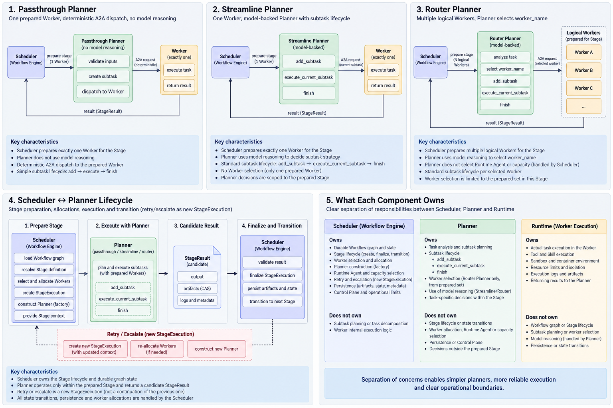
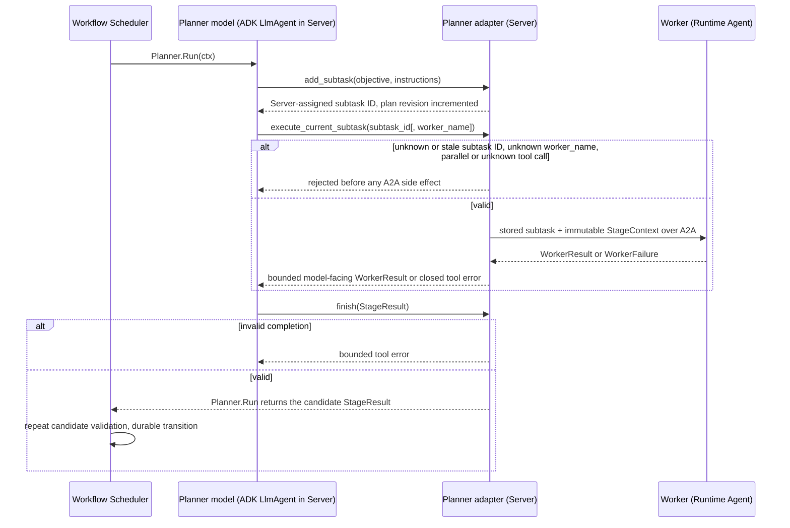
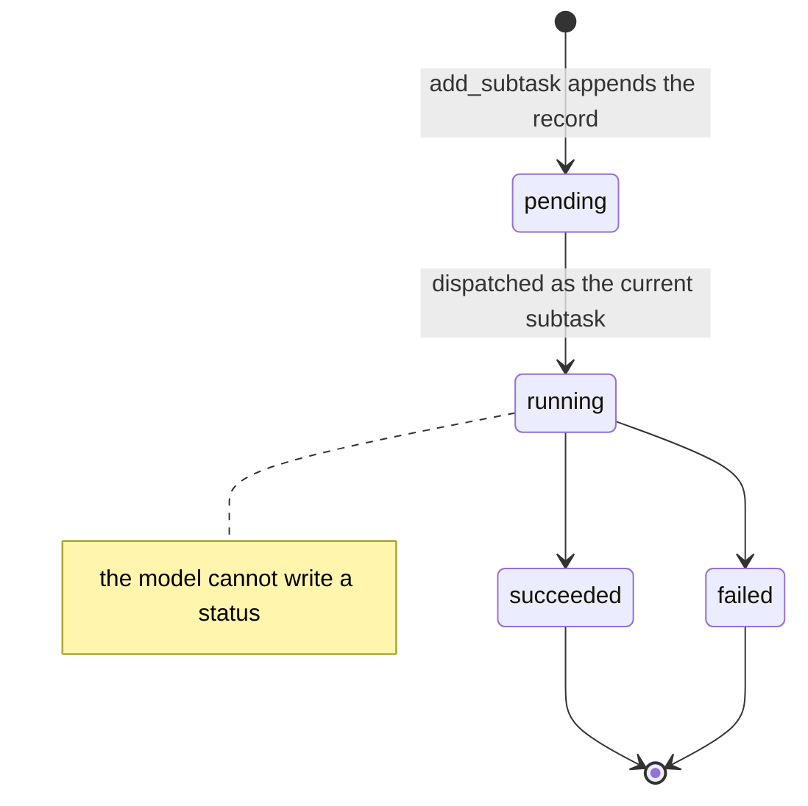

# Planners

Requirement prefix: `PLN` · [Specification index](../README.md)

## Purpose and scope

This document owns the Planner: the Server component that the Workflow
Scheduler constructs for one prepared Stage and that turns the Stage input
into one candidate StageResult by dispatching work to the fixed prepared
Worker set. It owns:

- the Planner boundary, `PlannerFactory` and the strategies `passthrough@1`,
  `streamline@1` and `router@1`;
- what a Planner receives from its Stage, and how the Passthrough Planner's
  Worker task is rendered;
- the bounded subtask plan, its operations and its status model;
- the Router `Available agents` roster;
- the Worker-dispatch execution functions, the Planner side of MemoryTools
  mirroring and the Worker State projection tools;
- completion semantics, `finish` and candidate delivery;
- Planner budgets and their stop codes, Planner model access and the handling
  of permanent Planner Gateway rejections;
- Planner Sessions, reduced durable facts and the typed plan projection;
- cross-Stage state and Planner non-goals.

It leaves to other documents:

- StageExecution states, the StageResult and StageTermination shapes,
  `finalizing`, `aborting`, retry and escalation, and the number of Planners
  per StageExecution: [Scheduler](scheduler.md);
- Workflow parameters as part of the WorkflowRun resource, and model-availability
  waiting: [Runs](runs.md);
- the prepared Worker set, `WorkerHandle` and `WorkerStateReader`:
  [Control Plane](control-plane.md);
- the Worker model boundary, `subtask_id`, the result finalizer,
  `WorkerResult`, `WorkerFailure`, the Worker-call deadline and live Worker
  State: [Worker](worker.md);
- ModelPolicy fields and the resolution of Planner model, Gateway and
  credential selections: [AgentTemplates](../configuration/agent-templates.md);
- `planner.telemetry` Runtime-label settings:
  [Runtime configuration](../configuration/runtime-config.md);
- Planner telemetry construction, spans and export:
  [Observability](../platform/observability.md);
- the MemoryTools contract, including how Planner memory functions are
  derived: [Memory](../tools/memory.md);
- Agent Skills, which Planners never inherit: [Skills](../tools/skills.md);
- workspace isolation between the Workers of a Router Stage:
  [Workspace](../tools/workspace.md);
- the model-free scan Planner `scan-plan@1`: [Scanners](../tools/scanners.md);
- the Planner Gateway error table: [Errors](../platform/errors.md).

<!-- from: 00#134, 00#30, 00#163, 01#110, 02#103, 04#9, 04#14, 07#73, 07#119, 08#38, 09#78, 10#16, 14#74, 32#1 -->

## Concepts

Terms are collected in the [glossary](../glossary.md); this document owns the
following ones.

| Term | Meaning here |
| --- | --- |
| Planner | The Server component constructed for one prepared Stage that runs one invocation over the fixed prepared Worker set and returns a candidate StageResult. |
| `PlannerFactory` | The replaceable Go abstraction that constructs a Planner for one prepared Stage. |
| Passthrough Planner (`passthrough@1`, `PassthroughPlanner`) | The deterministic, model-free baseline Planner that sends one Worker task to its sole Worker and maps the completion into a candidate. |
| Streamline Planner (`streamline@1`) | The model-backed Planner that works through a bounded subtask plan with exactly one logical Worker. |
| Router Planner (`router@1`) | The model-backed Planner that works through a bounded subtask plan and selects a logical Worker by `worker_name` for each dispatch. |
| Model-backed Planner | A `streamline@1` or `router@1` Planner, which runs one Google ADK Go `LlmAgent` inside Server. |
| Subtask (`PlannerSubtask`) | One plan record with a Server-assigned decimal string ID, its objective, its instructions and an adapter-controlled status. |
| Current subtask | The first unresolved subtask of the plan, named by `currentSubtaskId`. |
| Active dispatch | The in-flight Worker dispatch of the current subtask, holding a Server-generated call ID and the logical Worker name. |
| Plan revision | The unsigned counter that every committed visible plan change increments. |
| Execution function | `execute_current_subtask`, the Planner-specific function that dispatches the current subtask to a Worker. |
| `Available agents` section | The deterministic roster of logical Workers and their AgentTemplate descriptions that Server appends to the Router system instruction. |
| Planner Session | The database-backed Contractor session of one Planner, created for one StageExecution. |
| Reduced fact | A durable, allowlisted record derived from a Planner event; it never carries prompts, model text or generic tool payloads. |
| Typed Planner-plan projection | The validated durable projection of the subtask plan used for recovery and the Run UI. |
| Projection tool | A Server-side Planner tool that returns one fixed projection of a logical Worker's live State snapshot. |
| Planner timeline | The public sequence of fixed-kind reduced Planner facts. |

<!-- from: 00#134, 00#136, 00#140, 00#141, 00#142, 00#145, 00#159, 04#45, 04#46, 04#48, 14#75 -->

## Model

### Strategies

[](../../assets/contractor-planner.png)

<!-- from: 00#3 -->

A Planner is constructed through the `PlannerFactory` for one prepared Stage
and works over the fixed prepared Worker set. `streamline@1` and `router@1`
share the Go ADK dependency, the bounded subtask plan and `finish`; their
Worker-selection contract is deliberately different.

| Strategy | Implementation | Logical Workers | Worker dispatch | Model-facing Planner tools |
| --- | --- | --- | --- | --- |
| `passthrough@1` | Deterministic Go code, no model client | Exactly one | One deterministic Worker-task request | None |
| `streamline@1` | One Google ADK Go `LlmAgent` | Exactly one | `execute_current_subtask(subtask_id)` | `add_subtask`, `list_subtasks`, `finish`; when selected, mirrored MemoryTools with the sole Worker's signatures; projection tools without `worker_name` |
| `router@1` | One Google ADK Go `LlmAgent` | Fixed non-empty mapping | `execute_current_subtask(subtask_id, worker_name)` | `add_subtask`, `list_subtasks`, `finish`; when selected, mirrored MemoryTools; projection tools; each memory and projection tool with a constrained `worker_name` |

<!-- from: 00#134, 00#135, 00#136, 00#137, 00#138, 14#78, 08#42 -->

### Passthrough path

The Passthrough path from Stage input to candidate:

```text
StageSpec + StageContext + WorkerHandle
  -> A2A SendMessage
  -> Runtime renders semantic task for Worker model
  -> main tool-using model returns bounded terminal semantic text
  -> tool-free result finalizer serializes exact text + subtask_id
  -> WorkerModelResult(subtask_id, result)
  -> Runtime WorkerResult + deterministic observations + exact artifact refs
  -> StageResult
```

<!-- from: 00#160 -->

The steps between `A2A SendMessage` and the Runtime `WorkerResult` are owned
by [Worker](worker.md).
<!-- from: 00#160, 00#161 -->

### Model-backed dispatch

A model-backed Planner plans and dispatches through the Server-side adapter;
the model never addresses a Worker directly.



<!-- from: 00#140, 00#141, 00#145, 00#151, 00#156, 14#21 -->

### Subtask plan

| Element | Content |
| --- | --- |
| Subtask ID | Server-assigned decimal string: `0`, `1`, ... |
| Objective, instructions | The exact non-empty bounded text given to `add_subtask` |
| Status | `pending`, `running`, `succeeded` or `failed`; adapter-controlled |
| `currentSubtaskId` | The first unresolved record |
| `activeDispatch` | Optional: Server-generated call ID and logical Worker name |
| Revision | Unsigned; incremented by every committed visible plan change |

<!-- from: 00#140, 00#141, 04#46 -->



<!-- from: 00#141, 00#145 -->

The durable typed projection of this plan is specified in PLN-R96;
its public schemas are listed under [Interfaces](#interfaces).
<!-- from: 04#46 -->

## Requirements

### Planner boundary

**PLN-R1.** A Planner is constructed for one prepared Stage. The
replaceable Contractor abstraction is the Go `PlannerFactory`; the Workflow
Scheduler sees only the framework-neutral
`Planner.Run(context.Context) (StageContentResult, error)` boundary.
<!-- from: 00#134 -->

**PLN-R2.** `passthrough@1` is deterministic Go code. `streamline@1` and
`router@1` each construct one Google ADK Go `LlmAgent` behind the same
boundary, share that Go ADK dependency and use the same bounded subtask plan
and `finish` operation.
<!-- from: 00#134, 00#135 -->

**PLN-R3.** ADK types do not enter Scheduler, RunStore, A2A or
artifact contracts.
<!-- from: 00#134 -->

**PLN-R4.** Contractor does not depend on ADK's experimental
remote-agent/A2A API, so a change to that API cannot change the Planner or
Scheduler domain interfaces.
<!-- from: 00#146 -->

**PLN-R5.** Allocation routing comes only from the prepared
`WorkerHandle` and its Agent Card. The ADK agent and its live conversation stay
inside Server memory; an execution function crosses the process boundary
through A2A.
<!-- from: 00#146 -->

**PLN-R6.** A Planner may decompose and iterate, and Router may select
among the fixed logical names, but neither can:

- add or replace an Agent binding;
- choose a physical Runtime Agent;
- reserve capacity or initialize a Runtime Agent's Worker instance;
- change an AgentTemplate or Namespace;
- access a Worker sandbox directly.

<!-- from: 00#146, 00#147 -->

Changing the prepared Worker set during an invocation is governed by
[CTL-R115](control-plane.md).
<!-- from: 02#103 -->

### Strategies and Worker bindings

**PLN-R7.** `passthrough@1` and `streamline@1` each require exactly one
prepared logical Worker (LIM-PLN-1).
<!-- from: 00#136 -->

**PLN-R8.** `streamline@1` exposes exactly the Worker-dispatch function
`execute_current_subtask(subtask_id)`.
<!-- from: 00#136 -->

**PLN-R9.** `router@1` accepts a fixed, non-empty logical Worker mapping
(LIM-PLN-2) and exposes exactly the Worker-dispatch function
`execute_current_subtask(subtask_id, worker_name)`.
<!-- from: 00#136 -->

**PLN-R10.** The Router function schema constrains `worker_name` to the
exact Stage binding keys from the immutable Run snapshot.
<!-- from: 00#136 -->

### Stage input

**PLN-R11.** A Planner receives the `objective` and the resolved
instructions from the immutable StageSpec, the Run's string parameters from
StageContext, and the separately pinned artifact refs.
<!-- from: 00#81 -->

**PLN-R12.** Every Planner receives the complete Workflow parameter
object as read-only StageContext data. `v1alpha1` has no Stage-local parameter
projection or expression language.
<!-- from: 00#54 -->

**PLN-R13.** Parameters are not included in `AllocationSpec`; the
deterministic Planner adapter delivers the complete immutable StageContext with
each A2A subtask request. Parameters are never model-selected execution-tool
arguments.
<!-- from: 00#54 -->

**PLN-R14.** A model-backed strategy uses the Stage objective as its
global task and the instruction text as its operating guidance. Router
additionally receives the deterministic `Available agents` section
(PLN-R33).
<!-- from: 00#81 -->

### Passthrough Planner

**PLN-R15.** `PassthroughPlanner` is the baseline integration path. It sends
the deterministic Stage input to its one prepared Worker through the direct
A2A `WorkerInvoker`, waits for the remote invocation to complete and maps the
Runtime-owned response and artifact refs into `StageResult`.
<!-- from: 00#159 -->

**PLN-R16.** `PassthroughPlanner` has no reasoning step of its own. It
creates one private Worker-task request containing the Stage objective, the
resolved Stage instructions, the string parameters, the pinned input refs and
the declared result bindings.
<!-- from: 00#82 -->

**PLN-R17.** Runtime renders only the Planner-supplied task portion for
the Worker model, beginning deterministically as:

```text
Objective:
<Stage objective>

Task instructions:
<resolved Stage instructions text>
```

<!-- from: 00#82, 00#83 -->

**PLN-R18.** The rendered task also labels the string parameters and
the named exact artifact inputs for the selected tools. Declared result
bindings remain Runtime-private and are not rendered.
<!-- from: 00#84 -->

**PLN-R19.** Runtime adds no authored behavioral instruction of its
own: reusable Worker behavior comes from the AgentTemplate and task behavior
comes from the Planner.
<!-- from: 00#84 -->

**PLN-R20.** The rendered task never includes the A2A DTO name, API
version, allocation identity, StageExecution lifecycle, result-envelope
schema, retry policy or Scheduler transition.
<!-- from: 00#84 -->

**PLN-R21.** This rendering is the explicit Passthrough adapter
behavior; it does not turn the Stage instruction into reusable Worker
configuration.
<!-- from: 00#84 -->

The Passthrough request's fixed subtask ID `0` ([WRK-R29](worker.md)), the
Worker model and result-finalizer boundary ([WRK-R41](worker.md)) and the
deterministic mapping of `WorkerResult` and `WorkerFailure` into candidates
([WRK-R40](worker.md)) are owned by [Worker](worker.md).
<!-- from: 14#13, 00#161, 14#21 -->

**PLN-R22.** `PassthroughPlanner` knows neither which Runtime Agent
hosts the Worker nor how that process configured the selected runtime.
<!-- from: 00#162 -->

**PLN-R23.** More capable Planners preserve the same outer Stage
contract as `PassthroughPlanner`.
<!-- from: 00#162 -->

### Subtask plan

**PLN-R24.** The shared plan of `streamline@1` and `router@1` exposes
exactly two plan-management operations in addition to the Planner-specific
execution function and `finish`:

```text
add_subtask(objective, instructions)
list_subtasks()
```

<!-- from: 00#138, 00#139 -->

**PLN-R25.** The immutable Stage objective is the global task and is
not an argument to either operation.
<!-- from: 00#140 -->

**PLN-R26.** `add_subtask` appends one record containing its exact
non-empty bounded objective and instructions. Server assigns the next decimal
string ID (`0`, `1`, ...), so the model cannot choose, replace or reuse an ID.
<!-- from: 00#140 -->

**PLN-R27.** A Planner invocation contains at most 32 subtasks
(LIM-PLN-3).
<!-- from: 00#140 -->

**PLN-R28.** The plan has no edit, reorder, delete, skip, parent/child
decomposition or arbitrary metadata operation. Those capabilities require a
later plan version rather than hidden ADK State conventions.
<!-- from: 00#140 -->

**PLN-R29.** Each subtask has exactly one adapter-controlled status:
`pending`, `running`, `succeeded` or `failed`. The only execution path is
`pending -> running -> succeeded|failed`, and the model cannot write a status.
<!-- from: 00#141 -->

**PLN-R30.** `currentSubtaskId` names the first unresolved record. At
most one `activeDispatch` exists (LIM-PLN-4); it contains its Server-generated
call ID and the logical Worker name.
<!-- from: 00#141 -->

**PLN-R31.** Every committed visible plan change increments one
unsigned revision.
<!-- from: 00#141 -->

**PLN-R32.** `list_subtasks` returns a bounded typed projection of the
subtask records, `currentSubtaskId`, `activeDispatch` and revision, never raw
ADK State or model conversation.
<!-- from: 00#141 -->

### Router agent roster

**PLN-R33.** Before starting `router@1`, Server deterministically appends
an `Available agents` section to the resolved Planner system instruction.
Entries are sorted by logical name and contain the logical `worker_name` plus
that binding's resolved immutable `AgentTemplate.description`, for example:

```text
Available agents:
- oas_builder: Builds and updates an OpenAPI description.
- reviewer: Reviews an OpenAPI description for correctness and completeness.
```

<!-- from: 00#142, 00#143 -->

**PLN-R34.** The section tells Router the purpose for which each
logical agent is assigned. It is configuration-derived context, not
Planner-authored plan state.
<!-- from: 00#144 -->

**PLN-R35.** The section never contains a physical Runtime Agent
identity, allocation address, credential or capacity information.
<!-- from: 00#144 -->

**PLN-R36.** A later catalog edit cannot change the section for an
existing Run.
<!-- from: 00#144 -->

The Router roster cannot inspect Agent Skills to route
([SKL-R104](../tools/skills.md)), and the workspace isolation of a Router
Stage's logical Workers is specified in [Workspace](../tools/workspace.md).
<!-- from: 09#78, 10#16 -->

### Worker dispatch

**PLN-R37.** Both execution functions validate that `subtask_id`
is the exact current subtask in the Planner's validated plan.
<!-- from: 00#145 -->

**PLN-R38.** The execution functions accept no objective,
instructions, Run parameters or ArtifactRefs: their internal adapter supplies
the exact stored subtask and the immutable StageContext to the selected
`WorkerInvoker` A2A boundary. Consequently the model cannot restate or mutate
a subtask while dispatching it, nor choose a partial artifact or parameter
view for the Worker.
<!-- from: 00#145 -->

**PLN-R39.** An unknown or stale subtask ID and an unknown Worker
name are rejected before any A2A side effect (FAIL-PLN-3).
<!-- from: 00#145 -->

**PLN-R40.** A valid but semantically poor Router selection remains an
observable Planner routing decision; Server does not silently correct it.
<!-- from: 00#145 -->

**PLN-R41.** Only one tool call is executed per model turn
(LIM-PLN-5). A parallel or unknown tool selection is rejected before any
Worker side effect, and the model may correct it (FAIL-PLN-4).
<!-- from: 00#156 -->

**PLN-R42.** The current-subtask adapter verifies the stored
StageContext and every pinned ArtifactRef inside the same RunScope, supplies
that complete context to the selected Worker and applies the same Stage
deadline.
<!-- from: 00#156 -->

**PLN-R43.** Authoritative live lease loss cancels that context
independently (FAIL-PLN-3).
<!-- from: 00#156 -->

The dispatched Worker request carries the ID of the exact claimed
`PlannerSubtask` ([WRK-R29](worker.md)) and the Planner's effective
Worker-call deadline ([WRK-R6](worker.md)); `execute_current_subtask` returns
the bounded model-facing portion of `WorkerResult`, or the closed tool error of
a `WorkerFailure` ([WRK-R39](worker.md)).
<!-- from: 14#13, 01#110, 14#21 -->

### Memory functions

**PLN-R44.** The execution functions are the exact Worker-dispatch
functions, not necessarily the Planner's entire tool surface. When a prepared
Worker explicitly selects `memory-tools@1`, the model-backed Planner receives
the corresponding shared MemoryTools subset ([Memory](../tools/memory.md)).
<!-- from: 00#137 -->

**PLN-R45.** Streamline uses its sole Worker's MemoryTools signatures.
Router adds a required, per-operation constrained `worker_name` and never
receives one undifferentiated memory bag.
<!-- from: 00#137 -->

**PLN-R46.** No other Worker Toolset is mirrored to the Planner
implicitly.
<!-- from: 00#137 -->

How each mirrored operation and its `worker_name` enum are derived from the
prepared Workers, how `worker_name` resolves to a Stage binding and its Agent
Namespace, why `passthrough@1` synthesizes no Planner MemoryTools surface, and
how Planner memory calls are metered under `maxModelCalls` are specified in
[Memory](../tools/memory.md).
<!-- from: 08#38, 08#39, 08#42, 08#43 -->

### Worker State projection tools

Live Worker State is read through `WorkerStateReader`
([CTL-R130](control-plane.md)).
<!-- from: 14#74 -->

**PLN-R47.** Raw Worker State is never a Planner model tool.
Server-side projection tools load the complete snapshot, validate its
allocation, invocation and subtask correlation, run one fixed projection and
return only that projection.
<!-- from: 14#75 -->

**PLN-R48.** Projection tools accept no state key, JSONPath,
expression, field list or arbitrary aggregation program.
<!-- from: 14#75 -->

**PLN-R49.** The Streamline projection tools are:

| Tool | Result |
|---|---|
| `get_workspace_coverage()` | Counts/completeness for the sole Worker's last completed invocation. |
| `list_read_files(cursor="", limit=100)` | Bounded first-observation-ordered read paths. |
| `list_unread_files(cursor="", limit=100)` | Lexically ordered checkpoint scope minus read paths; unavailable when coverage is incomplete. |
| `get_worker_tool_usage()` | Sorted per-tool calls/failures and bounded invocation model/token counters. |

<!-- from: 14#76, 14#77 -->

**PLN-R50.** `router@1` exposes the same tool names with a mandatory
`worker_name`, constrained in each schema to the logical bindings for which
that projection is valid.
<!-- from: 14#78 -->

**PLN-R51.** Streamline's projection tools have no `worker_name`
parameter.
<!-- from: 14#78 -->

**PLN-R52.** `passthrough@1` has no model-facing Planner tools.
<!-- from: 14#78, 08#42 -->

**PLN-R53.** Workspace projection tools are present only when the
immutable Stage/Agent binding has a workspace and at least one selected
workspace-observing tool.
<!-- from: 14#78 -->

**PLN-R54.** The Planner toolset includes `get_worker_tool_usage` for
every modeled Worker binding; this does not add that tool to the Worker
toolset.
<!-- from: 14#78 -->

**PLN-R55.** A Worker never invokes State projections and remains
unaware of Planner, AgentTemplate and Runtime endpoint details.
<!-- from: 14#78 -->

**PLN-R56.** The projection tools always select the newest
`WorkerCompletion` already returned for that logical Worker; the model cannot
select an allocation, invocation, state revision or stale subtask.
<!-- from: 14#79 -->

**PLN-R57.** Before any matching completion, the projection tools
return `worker_state_unavailable`.
<!-- from: 14#79 -->

**PLN-R58.** The hidden selector contains the allocation ID,
invocation ID, subtask ID and state revision. A fetched snapshot must contain a
matching `last_completed_invocation`; otherwise the tool fails closed instead
of showing another invocation (FAIL-PLN-7).
<!-- from: 14#79 -->

**PLN-R59.** Collection cursors are opaque and bind the projection name,
logical Worker and state revision. A changed revision invalidates the cursor
with `worker_state_changed`.
<!-- from: 14#80 -->

**PLN-R60.** The collection `limit` is 1..100 (LIM-PLN-6).
<!-- from: 14#80, 14#77 -->

**PLN-R61.** Server may cache a validated snapshot by allocation ID and
ETag. The cache is StageExecution-local and is erased during Planner cleanup
(LIFE-PLN-1).
<!-- from: 14#80 -->

**PLN-R62.** A State-read failure does not rewrite an already returned
`WorkerResult`, change subtask status or fail the Stage automatically. It is a
bounded, correctable Planner tool error, and the compact observations already
returned with `execute_current_subtask` remain usable (FAIL-PLN-7).
<!-- from: 14#81 -->

**PLN-R63.** Only the live Planner conversation sees detailed
projection results. Durable Planner facts may record the tool name, logical
Worker, counts, outcome and stable error code, but never paths, raw State,
model or tool content, allocation ID or state revision.
<!-- from: 14#82 -->

**PLN-R64.** The projection tools add no public Operations or UI
endpoint.
<!-- from: 14#82 -->

### Completion

**PLN-R65.** The Planner strategy determines when its invocation is
semantically complete.
<!-- from: 00#149, 04#23 -->

**PLN-R110.** The Workflow Scheduler owns the durable StageExecution
transition.
<!-- from: 00#149, 04#25 -->

**PLN-R111.** A Planner returns a candidate StageResult; it neither writes
RunStore directly nor updates StageExecution storage.
<!-- from: 00#149, 04#25 -->

The candidate's shape and its validation by the Scheduler are specified in
[Scheduler](scheduler.md) (SCH-R25 to SCH-R35); the Worker never owns
StageResult ([WRK-R27](worker.md)).
<!-- from: 00#163, 14#5 -->

**PLN-R66.** `PassthroughPlanner` returns a candidate when its required
remote Worker invocation produces an immediate A2A `Message` or a terminal
Task (FAIL-PLN-2).
<!-- from: 00#150, 04#24 -->

**PLN-R67.** An A2A Task in `INPUT_REQUIRED` or `AUTH_REQUIRED` ends
the Passthrough invocation promptly with the non-retryable Planner error
`worker_input_required` or `worker_auth_required` respectively and produces no
StageResult candidate. Scheduler records an interrupted StageTermination
through bounded `aborting` and applies the Stage's `on.interrupted` action
([SCH-R39](scheduler.md)) (FAIL-PLN-2).
<!-- from: 00#150, 04#24 -->

**PLN-R68.** A more capable Planner may satisfy the requested
interaction and continue within its own budget.
<!-- from: 00#150 -->

**PLN-R69.** Model-backed `streamline@1` and `router@1` Planners
terminate semantically only through `finish(StageResult)`, which produces
either a `succeeded` or a `failed` candidate.
<!-- from: 00#151, 04#24 -->

**PLN-R70.** A failed candidate states only that the Planner could
not complete the Stage task; it does not select retry, escalation or any
Workflow transition.
<!-- from: 00#151, 04#25 -->

**PLN-R71.** `finish` validates outcome shape, declared result slots,
exact revisions and media types, but cannot accept or advance Artifact
bindings.
<!-- from: 00#151 -->

**PLN-R72.** An invalid completion call returns a bounded tool
error so the model may correct it within the remaining budget (FAIL-PLN-4).
<!-- from: 00#151 -->

**PLN-R73.** A successful `finish` requires at least one `succeeded`
subtask, no `pending` or `running` subtask and no active dispatch.
<!-- from: 00#141 -->

**PLN-R74.** A failed `finish` is allowed with incomplete plan
records only when no dispatch is active.
<!-- from: 00#141 -->

Rationale: a genuine blocker need not be disguised as completed work.
<!-- from: 00#141 -->

**PLN-R75.** The Workflow Scheduler independently repeats candidate
validation before acceptance, normalizes the candidate and may replace an
invalid claimed success with a failed `result_contract_violation`
([SCH-R35](scheduler.md)).
<!-- from: 00#151, 04#25 -->

**PLN-R113.** The Workflow Scheduler alone applies the declared outcome
policy, including any configured retry or escalation.
<!-- from: 00#151, 04#25 -->

**PLN-R76.** There is no model-facing `escalate` operation, and no
Planner tool can select escalation.
<!-- from: 00#151, 04#25 -->

**PLN-R77.** The Planner strategy maps an expected Worker failure
into a failed candidate with a stable error. This includes the Runtime-enforced
`worker_budget_exhausted` ([Worker](worker.md)), which is retryable and carries
complete bounded Worker budget metrics.
<!-- from: 04#24 -->

For `streamline@1` and `router@1`, a `WorkerFailure` becomes the existing
closed tool error of `execute_current_subtask` and marks that dispatch failed,
leaving the Planner to reason or finish within its remaining limits
([WRK-R39](worker.md)).
<!-- from: 14#21 -->

**PLN-R78.** An exception handled by the Planner strategy may become
a failed candidate with a stable Planner error.
<!-- from: 04#25 -->

**PLN-R112.** An exception escaping the Planner invocation, exhaustion
before a valid `finish`, or loss of the active Server or Planner before any
candidate is durable produces an `interrupted` StageTermination
([SCH-R37](scheduler.md)) (FAIL-PLN-5).
<!-- from: 04#25 -->

**PLN-R79.** Once a Planner has produced a candidate it performs no
further semantic work. It may request cancellation of outstanding A2A Tasks,
but candidate delivery does not depend on `CancelTask` succeeding or on
observing a terminal Task state (FAIL-PLN-6).
<!-- from: 00#157 -->

**PLN-R80.** The Workflow Scheduler's bounded `finalizing` path
authoritatively stops the Worker allocations and collects their reports;
Scheduler-owned cancellation or interruption instead uses the bounded
`aborting` path ([Scheduler](scheduler.md)).
<!-- from: 00#157 -->

### Budgets

**PLN-R81.** `streamline@1` and `router@1` receive `maxOutputTokens`,
`maxModelCalls`, `maxWorkerCalls` and `maxTotalTokens` from their exact
resolved ModelPolicy.
<!-- from: 00#154 -->

**PLN-R82.** `streamline@1` and `router@1` preserve the
ModelPolicy's optional `temperature`: an omitted value stays omitted and an
explicit zero is sent unchanged ([TPL-R26](../configuration/agent-templates.md)).
<!-- from: 00#154 -->

**PLN-R83.** The Stage/Planner deadline remains an execution limit
outside ModelPolicy and is always finite.
<!-- from: 00#154 -->

**PLN-R84.** An incompatible or incomplete Planner policy fails
Run initialization before capacity is prepared
([TPL-R27](../configuration/agent-templates.md)).
<!-- from: 00#154 -->

**PLN-R85.** Exhausting a hard model-call, token, Worker-call or
deadline budget without a valid terminal tool stops the strategy without a
semantic candidate. The Planner returns a stable safe error, and the Workflow
Scheduler enters bounded `aborting` with an interrupted StageTermination,
phase `running` and `retryable: true`, without awaiting outstanding A2A Tasks
(FAIL-PLN-5). The stable codes are `planner_model_call_limit`,
`planner_token_limit`, `planner_worker_call_limit` and
`planner_deadline_exceeded`.
<!-- from: 00#154, 04#24 -->

**PLN-R86.** Every successful Planner Gateway response must include
non-negative prompt, completion and total token usage. Missing or inconsistent
usage is a retryable invalid-response failure
(`planner_gateway_invalid_response`, [Errors](../platform/errors.md)) rather
than a way to bypass the cumulative budget (FAIL-PLN-1).
<!-- from: 00#154, 04#9 -->

### Model access and Gateway failures

Resolution of a model-backed Planner's own ModelPolicy, LLMGatewayConfig and
optional matching credential at Run initialization, the invalidity of such a
selection for a `passthrough@1` Stage, and the rule that Runtime labels never
select a Planner model or budget are specified in
[AgentTemplates](../configuration/agent-templates.md) (TPL-R81, TPL-R91,
TPL-R92).
<!-- from: 00#30 -->

**PLN-R87.** The Planner model alias comes from the Planner's ModelPolicy.
The Gateway URL and protocol and the non-secret credential reference come from
the Planner's independently resolved LLMGatewayConfig selection.
<!-- from: 00#155 -->

**PLN-R88.** A Planner resolves its pinned credential through the Server
secret boundary ([SEC-R28](../platform/security.md)) and never inherits a
Worker's token, Gateway or policy merely because both participate in the same
Stage.
<!-- from: 00#155 -->

**PLN-R89.** A modeled Server-side Planner retries a transient
Gateway failure inside its invocation, under model-availability recovery
([RUN-R31](runs.md), [Scheduler](scheduler.md#model-availability-recovery));
any other failed model request ends with the retryable
`planner_gateway_unavailable` ([Errors](../platform/errors.md)) (FAIL-PLN-1).
<!-- from: 04#8, 04#9 -->

**PLN-R90.** A request the Gateway permanently rejects, for example
with HTTP 401 or a declared permanent code such as `context_length_exceeded`,
ends the invocation without a candidate with the non-retryable Planner error
`planner_gateway_rejected`. Its message names only the safe classification
code, for example `gateway_access_denied` or a declared permanent code such as
`context_length_exceeded` (FAIL-PLN-1).
<!-- from: 00#154, 04#8 -->

**PLN-R91.** The Workflow Scheduler records
`planner_gateway_rejected` as an interrupted StageTermination with
`retryable: false`.
<!-- from: 04#8 -->

Rationale: a `retry` action then does not repeat a revoked credential, an
exhausted quota or an over-long prompt.
<!-- from: 04#8 -->

The complete Planner Gateway error table, with `planner_gateway_rejected`,
`planner_gateway_unavailable` and `planner_gateway_invalid_response`, is in the
[errors registry](../platform/errors.md).
<!-- from: 04#8, 04#9, 00#154 -->

### Planner Sessions and durable facts

The number of Planner instances, invocations, Sessions and ADK conversations
per StageExecution is specified in [Scheduler](scheduler.md) (SCH-R8,
LIM-SCH-2).
<!-- from: 04#14 -->

**PLN-R92.** Every Planner runs in Server with one database-backed
Contractor session. Its identity is created for one StageExecution and recorded
with that execution.
<!-- from: 04#45 -->

**PLN-R93.** `passthrough@1` writes bounded request and completion
events directly.
<!-- from: 04#45 -->

**PLN-R94.** `streamline@1` and `router@1` additionally supply
Google ADK with a SessionService adapter. Live conversation contents remain in
memory, while every non-partial ADK event is reduced, before its PostgreSQL
append, to author, allowed function names, action flags and aggregate token
counts (LIFE-PLN-2, LIFE-PLN-3).
<!-- from: 04#45 -->

**PLN-R95.** Prompt and model text, generic tool arguments and
results, provider bodies and unknown provider-controlled function names are
not durable.
<!-- from: 04#45 -->

**PLN-R96.** The narrow exception is the validated typed
Planner-plan projection required for recovery and the Run UI. It contains only
a monotonically increasing plan revision, ordered bounded subtask records with
stable IDs and adapter-controlled status (`pending`, `running`, `succeeded` or
`failed`), the current subtask ID, and an optional active dispatch with its
call ID and selected logical `worker_name`.
<!-- from: 04#46 -->

**PLN-R97.** In the projection, a Streamline dispatch's `worker_name`
is the sole Stage binding; a Router dispatch's is the value validated against
the immutable Stage mapping.
<!-- from: 04#46 -->

**PLN-R98.** The global task is always read from the immutable Stage
objective and is never copied from model output.
<!-- from: 04#46 -->

**PLN-R99.** No raw ADK State snapshot, prompt, hidden reasoning,
arbitrary tool payload or physical Runtime Agent identity belongs in the
projection.
<!-- from: 04#46 -->

**PLN-R100.** Planner MemoryTools calls use the StageExecution-bound
capability defined in [Memory](../tools/memory.md). A durable reduced fact may
name the allowlisted operation, logical Worker, note name, byte sizes and
stable outcome, but never note content, description, tags or Artifact
revision.
<!-- from: 04#47 -->

**PLN-R101.** Memory is neither copied into the typed plan
projection nor restored as ADK conversation state.
<!-- from: 04#47 -->

**PLN-R102.** Each committed reduced fact has a monotonically
increasing sequence within its Planner session and also participates in the
owning WorkflowRun's durable event sequence.
<!-- from: 04#48 -->

**PLN-R103.** The public Planner timeline uses only fixed fact kinds,
such as Planner started, completed or failed; plan changed; current subtask
changed; logical Worker dispatch selected, started or completed; and validated
finish requested. Its bounded payload may contain the typed plan projection or
change, the configured logical Worker name, an allowlisted action name,
success or a stable error code, and cumulative token and call counts.
<!-- from: 04#48 -->

**PLN-R104.** The timeline contains no raw ADK event, partial
model token, prompt, response, hidden reasoning, generic tool argument or
result, or provider error body.
<!-- from: 04#48 -->

**PLN-R105.** An event becomes stream-visible only after its reduced
database record commits.
<!-- from: 04#48 -->

**PLN-R106.** The database record supports inspection, statistics,
audit and completed-result recovery. A completed Planner session returns its
recorded candidate or failure without invoking ADK, the Gateway or a Worker
again (FAIL-PLN-8).
<!-- from: 04#49 -->

**PLN-R107.** The record is not authority for resuming a partially
completed model invocation: a session still running after process loss yields
a stable retryable invocation-in-progress error, and Workflow policy decides
whether a fresh StageExecution should retry (FAIL-PLN-8).
<!-- from: 04#49 -->

### Cross-Stage state

**PLN-R108.** Cross-Stage state passes through explicit Workflow
context, Stage results or artifacts, never through an implicitly shared
Planner instance.
<!-- from: 00#148 -->

**PLN-R109.** A later Stage may deliberately continue an Agent Namespace's
artifact-backed notes through the explicit MemoryTools contract
([Memory](../tools/memory.md)); that remains Run-scoped artifact state rather
than Planner-session inheritance.
<!-- from: 00#148 -->

## Interfaces

- Planner boundary: `PlannerFactory` and
  `Planner.Run(context.Context) (StageContentResult, error)` (PLN-R1).
- Worker dispatch: the direct A2A `WorkerInvoker` (PLN-R15,
  PLN-R38); the A2A request and completion media types are owned by
  [Worker](worker.md).
- Live Worker State: `WorkerStateReader` ([CTL-R130](control-plane.md)).
- Model-facing Planner functions: plan operations (PLN-R24), execution
  functions (PLN-R8, PLN-R9), `finish` (PLN-R69),
  MemoryTools ([Memory](../tools/memory.md)) and projection tools
  (PLN-R49, PLN-R50).
- Typed Planner-plan projection: the `PlannerPlan`, `PlannerSubtask` and
  `PlannerDispatch` schemas of the
  [public API](../../../api/openapi/contractor-public-v1.yaml).
- Planner timeline events: `PlannerEventData` in the
  [event schema](../../../api/events/contractor-events-v1.schema.json).

<!-- from: 00#134, 00#145, 00#159, 04#46, 04#48, 14#74 -->

## Limits, failures and errors

Limits ([registry](../platform/limits.md)):

- LIM-PLN-1 — prepared logical Workers of `passthrough@1` and `streamline@1`:
  exactly 1 (PLN-R7).
- LIM-PLN-2 — logical Worker mapping of `router@1`: fixed, at least 1
  (PLN-R9).
- LIM-PLN-3 — subtasks per Planner invocation: at most 32 (PLN-R27).
- LIM-PLN-4 — active dispatches per plan: at most 1 (PLN-R30).
- LIM-PLN-5 — tool calls executed per model turn: 1 (PLN-R41).
- LIM-PLN-6 — projection collection `limit`: 1..100, default 100
  (PLN-R49, PLN-R60).
- Planner instances, invocations and Sessions per StageExecution (LIM-SCH-2)
  belong to [Scheduler](scheduler.md); Planner budget fields to
  [AgentTemplates](../configuration/agent-templates.md).

<!-- from: 00#136, 00#140, 00#141, 00#156, 14#77, 14#80, 04#14 -->

Failure outcomes ([failure model](../platform/failure-model.md)):

- FAIL-PLN-1 — Planner Gateway model request (PLN-R86,
  PLN-R89, PLN-R90).
- FAIL-PLN-2 — Passthrough Worker invocation (PLN-R66,
  PLN-R67).
- FAIL-PLN-3 — Worker dispatch through an execution function
  (PLN-R39, PLN-R43).
- FAIL-PLN-4 — Planner model tool call (PLN-R41,
  PLN-R72).
- FAIL-PLN-5 — Planner invocation without a candidate (PLN-R78,
  PLN-R85, PLN-R112).
- FAIL-PLN-6 — A2A Task cancellation after a candidate (PLN-R79).
- FAIL-PLN-7 — Worker State projection read (PLN-R58,
  PLN-R62).
- FAIL-PLN-8 — Planner Session after process loss (PLN-R106,
  PLN-R107).

<!-- from: 04#8, 04#9, 00#154, 00#150, 00#145, 00#156, 00#151, 04#25, 00#157, 14#79, 14#81, 04#49 -->

Lifecycle ([registry](../platform/lifecycle.md)):

- LIFE-PLN-1 — Worker State snapshot cache (PLN-R61).
- LIFE-PLN-2 — Planner Session record (PLN-R94,
  PLN-R106).
- LIFE-PLN-3 — live ADK conversation (PLN-R94).

<!-- from: 14#80, 04#45, 04#49 -->

Errors ([registry](../platform/errors.md)):

- `worker_input_required`, `worker_auth_required` — non-retryable Planner
  errors for an A2A Task needing input or authorization (PLN-R67).
- `planner_model_call_limit`, `planner_token_limit`,
  `planner_worker_call_limit`, `planner_deadline_exceeded` — retryable budget
  stop codes (PLN-R85).
- `planner_gateway_rejected` — non-retryable permanent Gateway rejection
  (PLN-R90); `planner_gateway_invalid_response` (PLN-R86) and
  `planner_gateway_unavailable` (PLN-R89) complete the Planner Gateway error
  table owned by [Errors](../platform/errors.md).
- `worker_state_unavailable`, `worker_state_changed` — projection tool errors
  (PLN-R57, PLN-R59).
- the invocation-in-progress error, which has no assigned code — retryable
  (PLN-R107).
- `result_contract_violation` belongs to [Scheduler](scheduler.md) and
  `worker_budget_exhausted` to [Worker](worker.md).

<!-- from: 00#150, 04#24, 00#154, 04#8, 04#9, 14#79, 14#80, 04#49, 04#25 -->

## Security

- A Planner cannot choose physical Runtime Agents, reserve capacity, change
  bindings, templates or Namespaces, or reach a Worker sandbox
  (PLN-R6); allocation routing comes only from the prepared
  `WorkerHandle` (PLN-R5).
- The Router roster carries no physical identity, address, credential or
  capacity information (PLN-R35).
- Planner credentials are resolved through the Server secret boundary and never
  inherited from a Worker (PLN-R88).
- Durable Planner state excludes prompts, model text, generic tool payloads,
  provider bodies, memory content and projection details
  (PLN-R95, PLN-R99, PLN-R100,
  PLN-R63, PLN-R104).
- Raw Worker State is never a Planner model tool (PLN-R47).
- Trust boundaries and redaction are in [Security](../platform/security.md).

<!-- from: 00#144, 00#146, 00#147, 00#155, 04#45, 04#46, 04#47, 04#48, 14#75, 14#82 -->

## Observability

- Reduced Planner facts and the public Planner timeline: PLN-R102,
  PLN-R103, PLN-R105.
- The `planner.telemetry` settings for Planner invocations are specified in
  [RCF-R136](../configuration/runtime-config.md).
- Planner telemetry construction in Server, its adapter registry, the closed
  span vocabulary of Passthrough, Streamline and Router, and the bounded,
  supplementary export after the Planner returns are specified in
  [Observability](../platform/observability.md).

<!-- from: 04#48, 07#73, 07#119, 07#120, 07#121 -->

## Non-goals

- Dynamic Planner expansion of the Worker pool, and dynamic or concurrent
  Streamline/Router Worker expansion (see also [CTL-R115](control-plane.md)).
- Planner-selected AgentTemplates.
- Resuming a Planner invocation from its persisted ADK Session or private plan
  (PLN-R107).
- Plan edit, reorder, delete, skip, parent/child decomposition and arbitrary
  metadata operations (PLN-R28).
- A model-facing `escalate` operation (PLN-R76).
- A generic Planner `get_state`, arbitrary state keys or model-defined
  filters, with the other deferred live-State capabilities listed in
  [Worker](worker.md#non-goals).
- Non-goals of the surrounding execution model, owned by the linked
  documents:
  - Kubernetes CRDs or controllers, autoscaling and multi-host placement
    optimization ([Control Plane](control-plane.md));
  - concurrent StageExecutions within one WorkflowRun
    ([Scheduler](scheduler.md));
  - concurrent Tasks inside one Worker allocation
    ([Control Plane](control-plane.md));
  - artifact change subscriptions or a semantic merge service
    ([Artifact store](../artifacts/artifact-store.md));
  - cross-Run or user-scoped memory, automatic note injection, semantic
    retrieval, deletion or automatic eviction ([Memory](../tools/memory.md));
  - Agent Skill script execution, remote registry search, Run-, Stage- or
    Planner-selected skills, multi-owner shared skills and hot replacement
    inside an active Run ([Skills](../tools/skills.md));
  - Server-managed project paths, operator-checkout mutation and automatic
    synchronization between allocation workspaces
    ([Workspace](../tools/workspace.md)).

<!-- from: 05#29, 00#140, 00#151, 14#84 -->
