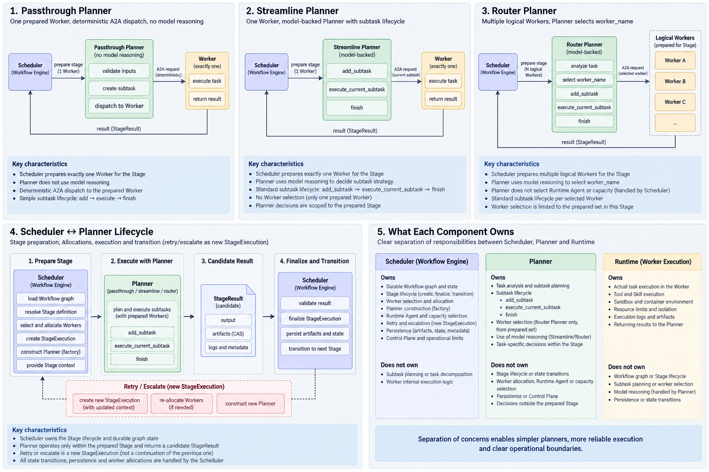
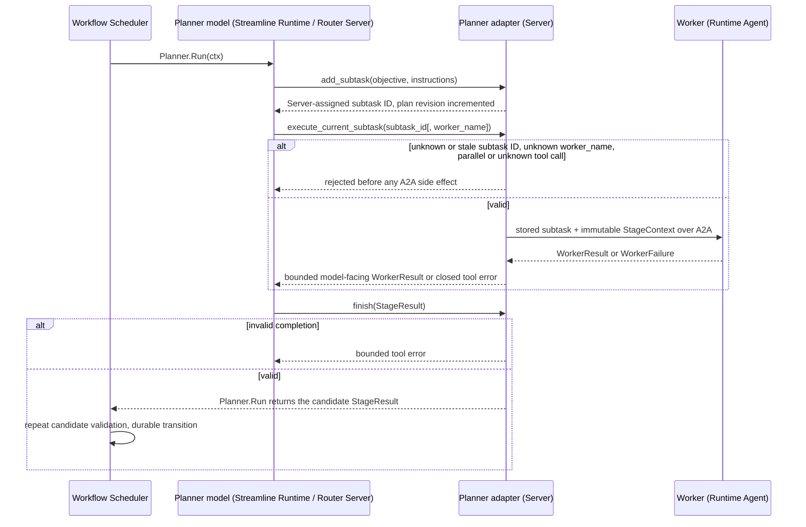
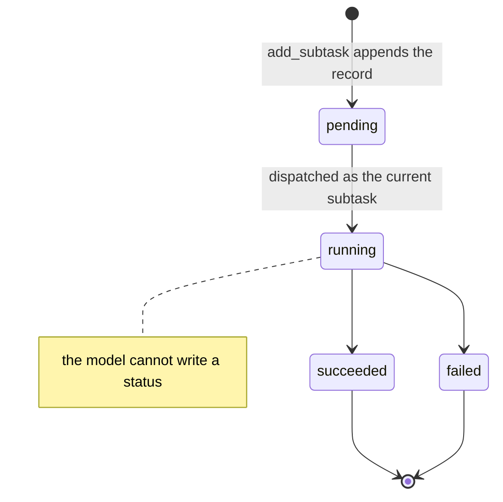

# Planners

Requirement prefix: `PLN` · [Specification index](../README.md)

## Purpose and scope

This document owns the Planner: the Stage execution boundary that the Workflow
Scheduler constructs for one prepared Stage and that turns the Stage input
into one candidate StageResult by dispatching work to the fixed prepared
Worker set. It owns:

- the Planner boundary, `PlannerFactory` and the strategies `passthrough@1`,
  `streamline@1` and `router@1`;
- what a Planner receives from its Stage, and how the Passthrough Planner's
  Worker task is rendered;
- the bounded subtask plan, its operations and its status model;
- the Router `Available agents` roster;
- the Worker-dispatch execution functions, the Planner side of MemoryTools
  mirroring and the Worker State projection tools;
- completion semantics, `finish` and candidate delivery;
- Planner budgets and their stop codes, Planner model access and the handling
  of permanent Planner Gateway rejections;
- Planner Sessions, reduced durable facts and the typed plan projection;
- `compact@1` Planner context compaction and its history reader;
- cross-Stage state and Planner non-goals.

It leaves to other documents:

- StageExecution states, the StageResult and StageTermination shapes,
  `finalizing`, `aborting`, retry and escalation, and the number of Planners
  per StageExecution: [Scheduler](scheduler.md);
- Workflow parameters as part of the WorkflowRun resource, and model-availability
  waiting: [Runs](runs.md);
- the prepared Worker set, `WorkerHandle` and `WorkerStateReader`:
  [Control Plane](control-plane.md);
- the Worker model boundary, `subtask_id`, the result finalizer,
  `WorkerResult`, `WorkerFailure`, the Worker-call deadline and live Worker
  State: [Worker](worker.md);
- ModelPolicy fields and the resolution of Planner model, Gateway and
  credential selections: [AgentTemplates](../configuration/agent-templates.md);
- `planner.telemetry` Runtime-label settings:
  [Runtime configuration](../configuration/runtime-config.md);
- Planner telemetry construction, spans and export:
  [Observability](../platform/observability.md);
- the MemoryTools contract, including how Planner memory functions are
  derived: [Memory](../tools/memory.md);
- Agent Skills, which Planners never inherit: [Skills](../tools/skills.md);
- workspace isolation between the Workers of a Router Stage:
  [Workspace](../tools/workspace.md);
- the model-free scan Planner `scan-plan@1`: [Scanners](../tools/scanners.md);
- the Planner Gateway error table: [Errors](../platform/errors.md).

## Concepts

Terms are collected in the [glossary](../glossary.md); this document owns the
following ones.

| Term | Meaning here |
| --- | --- |
| Planner | The component constructed for one prepared Stage that runs one invocation over the fixed prepared Worker set and returns a candidate StageResult; Server owns acceptance and durable progress. |
| `PlannerFactory` | The replaceable Go abstraction that constructs a Planner for one prepared Stage. |
| Passthrough Planner (`passthrough@1`, `PassthroughPlanner`) | The deterministic, model-free baseline Planner that sends one Worker task to its sole Worker and maps the completion into a candidate. |
| Streamline Planner (`streamline@1`) | The model-backed Planner that works through a bounded subtask plan with exactly one logical Worker. |
| Router Planner (`router@1`) | The model-backed Planner that works through a bounded subtask plan and selects a logical Worker by `worker_name` for each dispatch. |
| Model-backed Planner | A bounded Google ADK model loop: Streamline runs in Runtime; Router runs in Server. Both use Server-owned plan and tool operations. |
| Subtask (`PlannerSubtask`) | One plan record with a Server-assigned decimal string ID, its objective, its instructions and an adapter-controlled status. |
| Current subtask | The first unresolved subtask of the plan, named by `currentSubtaskId`. |
| Active dispatch | The in-flight Worker dispatch of the current subtask, holding a Server-generated call ID and the logical Worker name. |
| Plan revision | The unsigned counter that every committed visible plan change increments. |
| Execution function | `execute_current_subtask`, the Planner-specific function that dispatches the current subtask to a Worker. |
| `Available agents` section | The deterministic roster of logical Workers and their AgentTemplate descriptions that Server appends to the Router system instruction. |
| Planner Session | The database-backed Contractor session of one Planner, created for one StageExecution. |
| Reduced fact | A durable, allowlisted record derived from a Planner event; it never carries prompts, model text or generic tool payloads. |
| Typed Planner-plan projection | The validated durable projection of the subtask plan used for recovery and the Run UI. |
| Projection tool | A Server-side Planner tool that returns one fixed projection of a logical Worker's live State snapshot. |
| Planner timeline | The public sequence of fixed-kind reduced Planner facts. |
| Context checkpoint | One `compact@1` step that replaces the earlier complete tool groups of a live Planner conversation with a rolling summary, recorded by a content-free marker fact. |
| Compactor | The tool-free model call that writes the rolling summary of a context checkpoint. |
| History reader | `read_context_history`, the live Planner's paged reader of exact earlier validated Worker results. |

## Model

### Strategies

[](../../assets/contractor-planner.png)

A Planner is constructed through the `PlannerFactory` for one prepared Stage
and works over the fixed prepared Worker set. `streamline@1` and `router@1`
share the bounded subtask plan and `finish`; their
Worker-selection contract is deliberately different.

| Strategy | Implementation | Logical Workers | Worker dispatch | Model-facing Planner tools |
| --- | --- | --- | --- | --- |
| `passthrough@1` | Deterministic Go code, no model client | Exactly one | One deterministic Worker-task request | None |
| `streamline@1` | One Google ADK Python `LlmAgent` in a separate Runtime allocation | Exactly one | `execute_current_subtask(subtask_id)` | `add_subtask`, `list_subtasks`, `finish`; when selected, mirrored MemoryTools with the sole Worker's signatures; projection tools without `worker_name` |
| `router@1` | One Google ADK Go `LlmAgent` | Fixed non-empty mapping | `execute_current_subtask(subtask_id, worker_name)` | `add_subtask`, `list_subtasks`, `finish`; when selected, mirrored MemoryTools; projection tools; each memory and projection tool with a constrained `worker_name` |

### Passthrough path

The Passthrough path from Stage input to candidate:

```text
StageSpec + StageContext + WorkerHandle
  -> A2A SendMessage
  -> Runtime renders semantic task for Worker model
  -> main tool-using model returns bounded terminal semantic text
  -> tool-free result finalizer serializes exact text + subtask_id
  -> WorkerModelResult(subtask_id, result)
  -> Runtime WorkerResult + deterministic observations + exact artifact refs
  -> StageResult
```

The steps between `A2A SendMessage` and the Runtime `WorkerResult` are owned
by [Worker](worker.md).

### Model-backed dispatch

A model-backed Planner plans and dispatches through the Server-side adapter;
the model never addresses a Worker directly.



### Subtask plan

| Element | Content |
| --- | --- |
| Subtask ID | Server-assigned decimal string: `0`, `1`, ... |
| Objective, instructions | The exact non-empty bounded text given to `add_subtask` |
| Status | `pending`, `running`, `succeeded` or `failed`; adapter-controlled |
| `currentSubtaskId` | The first unresolved record |
| `activeDispatch` | Optional: Server-generated call ID and logical Worker name |
| Revision | Unsigned; incremented by every committed visible plan change |



The durable typed projection of this plan is specified in PLN-R96;
its public schemas are listed under [Interfaces](#interfaces).

## Requirements

### Planner boundary

**PLN-R1.** A Planner is constructed for one prepared Stage. The
replaceable Contractor abstraction is the Go `PlannerFactory`; the Workflow
Scheduler sees only the framework-neutral
`Planner.Run(context.Context) (StageContentResult, error)` boundary.

**PLN-R2.** `passthrough@1` is deterministic Go code. `streamline@1`
executes its Google ADK Python model loop in Runtime through PLN-R135; `router@1`
uses the shared Go ADK engine in Server. Both use the same Server-owned subtask
plan, budget and `finish` operations. The Go dependency is
`google.golang.org/adk/v2` v2.8.0; Runtime dependencies are pinned in `uv.lock`.
Native SDK compaction and resumability remain disabled. Each Runner receives
its resolved model-call ceiling explicitly; Server admission supplies the
classified budget stop before an additional provider call. The isolated
one-shot compactor permits two SDK attempts so its wrapper can refuse a second
provider operation.

**PLN-R3.** ADK types do not enter Scheduler, RunStore, A2A or
artifact contracts.
Server-owned plan, Worker-dispatch, finish, Memory and State operations accept
ordinary execution contexts. Their ADK bindings own SDK control actions:
an accepted finish skips summarization and escalates, a rejected finish does
neither, and a Worker budget stop skips summarization without escalation.
This separation preserves the same operation and persistence rules for both
modeled strategies. Runtime execution uses PLN-R135–137; it enables no resume.

**PLN-R4.** Contractor does not depend on ADK's experimental
remote-agent/A2A API, so a change to that API cannot change the Planner or
Scheduler domain interfaces.

**PLN-R5.** Allocation routing comes only from the prepared
`WorkerHandle` and its Agent Card. The live conversation stays in the process
that executes the model loop. Worker dispatch always crosses the existing
Server `WorkerInvoker`; a Runtime Planner cannot choose a peer URL.

**PLN-R6.** A Planner may decompose and iterate, and Router may select
among the fixed logical names, but neither can:

- add or replace an Agent binding;
- choose a physical Runtime Agent;
- reserve capacity or initialize a Runtime Agent's Worker instance;
- change an AgentTemplate or Namespace;
- access a Worker sandbox directly.

Changing the prepared Worker set during an invocation is governed by
[CTL-R115](control-plane.md).

### Strategies and Worker bindings

**PLN-R7.** `passthrough@1` and `streamline@1` each require exactly one
prepared logical Worker (LIM-PLN-1).

**PLN-R8.** `streamline@1` exposes exactly the Worker-dispatch function
`execute_current_subtask(subtask_id)`.

**PLN-R9.** `router@1` accepts a fixed, non-empty logical Worker mapping
(LIM-PLN-2) and exposes exactly the Worker-dispatch function
`execute_current_subtask(subtask_id, worker_name)`.

**PLN-R10.** The Router function schema constrains `worker_name` to the
exact Stage binding keys from the immutable Run snapshot.

### Stage input

**PLN-R11.** A Planner receives the `objective` and the resolved
instructions from the immutable StageSpec, the Run's string parameters from
StageContext, and the separately pinned artifact refs.

**PLN-R12.** Every Planner receives the complete Workflow parameter
object as read-only StageContext data. `v1alpha1` has no Stage-local parameter
projection or expression language.

**PLN-R13.** Parameters are not included in `AllocationSpec`; the
deterministic Planner adapter delivers the complete immutable StageContext with
each A2A subtask request. Parameters are never model-selected execution-tool
arguments.

**PLN-R14.** A model-backed strategy uses the Stage objective as its
global task and the instruction text as its operating guidance. Router
additionally receives the deterministic `Available agents` section
(PLN-R33).

### Passthrough Planner

**PLN-R15.** `PassthroughPlanner` is the baseline integration path. It sends
the deterministic Stage input to its one prepared Worker through the direct
A2A `WorkerInvoker`, waits for the remote invocation to complete and maps the
Runtime-owned response and artifact refs into `StageResult`.

**PLN-R16.** `PassthroughPlanner` has no reasoning step of its own. It
creates one private Worker-task request containing the Stage objective, the
resolved Stage instructions, the string parameters, the pinned input refs and
the declared result bindings.

**PLN-R17.** Runtime renders only the Planner-supplied task portion for
the Worker model, beginning deterministically as:

```text
Objective:
<Stage objective>

Task instructions:
<resolved Stage instructions text>
```

**PLN-R18.** The rendered task also labels the string parameters and
the named exact artifact inputs for the selected tools. Declared result
bindings remain Runtime-private and are not rendered.

**PLN-R19.** Runtime adds no authored behavioral instruction of its
own: reusable Worker behavior comes from the AgentTemplate and task behavior
comes from the Planner.

**PLN-R20.** The rendered task never includes the A2A DTO name, API
version, allocation identity, StageExecution lifecycle, result-envelope
schema, retry policy or Scheduler transition.

**PLN-R21.** This rendering is the explicit Passthrough adapter
behavior; it does not turn the Stage instruction into reusable Worker
configuration.

The Passthrough request's fixed subtask ID `0` ([WRK-R29](worker.md)), the
Worker model and result-finalizer boundary ([WRK-R41](worker.md)) and the
deterministic mapping of `WorkerResult` and `WorkerFailure` into candidates
([WRK-R40](worker.md)) are owned by [Worker](worker.md).

**PLN-R22.** `PassthroughPlanner` knows neither which Runtime Agent
hosts the Worker nor how that process configured the selected runtime.

**PLN-R23.** More capable Planners preserve the same outer Stage
contract as `PassthroughPlanner`.

### Subtask plan

**PLN-R24.** The shared plan of `streamline@1` and `router@1` exposes
exactly two plan-management operations in addition to the Planner-specific
execution function and `finish`:

```text
add_subtask(objective, instructions)
list_subtasks()
```

**PLN-R25.** The immutable Stage objective is the global task and is
not an argument to either operation.

**PLN-R26.** `add_subtask` appends one record containing its exact
non-empty bounded objective and instructions. Server assigns the next decimal
string ID (`0`, `1`, ...), so the model cannot choose, replace or reuse an ID.

**PLN-R27.** Each modeled Planner invocation contains at most its immutable
Workflow `maxSubtasks` selection ([WFL-R87](../configuration/workflows.md)),
with omission meaning 32 and an absolute maximum of 1000 (LIM-PLN-3).
The controller rejects an append at that count with `planner_subtask_limit`
without changing the plan. Completed and failed records continue to count.
The Planner session copies the Stage selection on creation and rejects
oversized persisted plans on write and read, including batched Run-detail
reads. A retry or summary continuation uses its pinned Stage selection rather
than consulting the current catalog.

**PLN-R28.** The plan has no edit, reorder, delete, skip, parent/child
decomposition or arbitrary metadata operation. Those capabilities require a
later plan version rather than hidden ADK State conventions.

**PLN-R29.** Each subtask has exactly one adapter-controlled status:
`pending`, `running`, `succeeded` or `failed`. The only execution path is
`pending -> running -> succeeded|failed`, and the model cannot write a status.

**PLN-R30.** `currentSubtaskId` names the first unresolved record. At
most one `activeDispatch` exists (LIM-PLN-4); it contains its Server-generated
call ID and the logical Worker name.

**PLN-R31.** Every committed visible plan change increments one
unsigned revision.

**PLN-R32.** `list_subtasks` returns a bounded typed projection of the
subtask records, `currentSubtaskId`, `activeDispatch` and revision, never raw
ADK State or model conversation.

### Router agent roster

**PLN-R33.** Before starting `router@1`, Server deterministically appends
an `Available agents` section to the resolved Planner system instruction.
Entries are sorted by logical name and contain the logical `worker_name` plus
that binding's resolved immutable `AgentTemplate.description`, for example:

```text
Available agents:
- oas_builder: Builds and updates an OpenAPI description.
- reviewer: Reviews an OpenAPI description for correctness and completeness.
```

**PLN-R34.** The section tells Router the purpose for which each
logical agent is assigned. It is configuration-derived context, not
Planner-authored plan state.

**PLN-R35.** The section never contains a physical Runtime Agent
identity, allocation address, credential or capacity information.

**PLN-R36.** A later catalog edit cannot change the section for an
existing Run.

The Router roster cannot inspect Agent Skills to route
([SKL-R104](../tools/skills.md)), and the workspace isolation of a Router
Stage's logical Workers is specified in [Workspace](../tools/workspace.md).

### Worker dispatch

**PLN-R37.** Both execution functions validate that `subtask_id`
is the exact current subtask in the Planner's validated plan.

**PLN-R38.** The execution functions accept no objective,
instructions, Run parameters or ArtifactRefs: their internal adapter supplies
the exact stored subtask and the immutable StageContext to the selected
`WorkerInvoker` A2A boundary. Consequently the model cannot restate or mutate
a subtask while dispatching it, nor choose a partial artifact or parameter
view for the Worker.

**PLN-R39.** An unknown or stale subtask ID and an unknown Worker
name are rejected before any A2A side effect (FAIL-PLN-3).

**PLN-R40.** A valid but semantically poor Router selection remains an
observable Planner routing decision; Server does not silently correct it.

**PLN-R41.** Only one tool call is executed per model turn
(LIM-PLN-5). A parallel or unknown tool selection is rejected before any
Worker side effect, and the model may correct it (FAIL-PLN-4).

**PLN-R42.** The current-subtask adapter verifies the stored
StageContext and every pinned ArtifactRef inside the same RunScope, supplies
that complete context to the selected Worker and applies the same Stage
deadline.

**PLN-R43.** Authoritative live lease loss cancels that context
independently (FAIL-PLN-3).

The dispatched Worker request carries the ID of the exact claimed
`PlannerSubtask` ([WRK-R29](worker.md)) and the Planner's effective
Worker-call deadline ([WRK-R6](worker.md)); `execute_current_subtask` returns
the bounded model-facing portion of `WorkerResult`, or the closed tool error of
a `WorkerFailure` ([WRK-R39](worker.md)).

### Memory functions

**PLN-R44.** The execution functions are the exact Worker-dispatch
functions, not necessarily the Planner's entire tool surface. When a prepared
Worker explicitly selects `memory-tools@1`, the model-backed Planner receives
the corresponding shared MemoryTools subset ([Memory](../tools/memory.md)).

**PLN-R45.** Streamline uses its sole Worker's MemoryTools signatures.
Router adds a required, per-operation constrained `worker_name` and never
receives one undifferentiated memory bag.

**PLN-R46.** No other Worker Toolset is mirrored to the Planner
implicitly.

How each mirrored operation and its `worker_name` enum are derived from the
prepared Workers, how `worker_name` resolves to a Stage binding and its Agent
Namespace, why `passthrough@1` synthesizes no Planner MemoryTools surface, and
how Planner memory calls are metered under `maxModelCalls` are specified in
[Memory](../tools/memory.md).

### Worker State projection tools

Live Worker State is read through `WorkerStateReader`
([CTL-R130](control-plane.md)).

**PLN-R47.** Raw Worker State is never a Planner model tool.
Server-side projection tools load the complete snapshot, validate its
allocation, invocation and subtask correlation, run one fixed projection and
return only that projection.

**PLN-R115.** Each changed State revision is decoded and validated once:
`WorkerStateReader` returns a snapshot it decoded with the strict private
decoder ([CTL-R149](control-plane.md)) and validated for that read alone, and
the projection service keeps it without copying or validating it again. An
unchanged revision is revalidated with `If-None-Match` and served from that
snapshot. Projections only read the snapshot. A changed-revision read at the
State's path bounds (10,000 scope paths and interactions, about 1.9 MB) costs
about 40,000 allocations and 10 to 13 MB; a deterministic test bounds both
with about 20 percent headroom, so a second decode or a copy of the snapshot
fails it. The wall time of such a read, 60 ms at most, depends on the host
and is measured by a benchmark beside that test, not gated.

Workspace coverage and ordered read/unread path collections are derived once
for each cached State and released with it on a new completion or Planner
close. Each page still revalidates the strong ETag and completion correlation;
pagination does not rescan the complete workspace on an unchanged revision.

**PLN-R48.** Projection tools accept no state key, JSONPath,
expression, field list or arbitrary aggregation program.

**PLN-R49.** The Streamline projection tools are:

| Tool | Result |
|---|---|
| `get_workspace_coverage()` | Counts/completeness for the sole Worker's last completed invocation. |
| `list_read_files(cursor="", limit=100)` | Bounded first-observation-ordered read paths. |
| `list_unread_files(cursor="", limit=100)` | Lexically ordered checkpoint scope minus read paths; unavailable when coverage is incomplete. |
| `get_worker_tool_usage()` | Sorted per-tool calls/failures and bounded invocation model/token counters. |

**PLN-R50.** `router@1` exposes the same tool names with a mandatory
`worker_name`, constrained in each schema to the logical bindings for which
that projection is valid.

**PLN-R51.** Streamline's projection tools have no `worker_name`
parameter.

**PLN-R52.** `passthrough@1` has no model-facing Planner tools.

**PLN-R53.** Workspace projection tools are present only when the
immutable Stage/Agent binding has a workspace and at least one selected
workspace-observing tool: a tool its Toolset descriptor lists as recording
workspace observations ([TLS-R38](../tools/toolsets.md)).

**PLN-R54.** The Planner toolset includes `get_worker_tool_usage` for
every modeled Worker binding; this does not add that tool to the Worker
toolset.

**PLN-R55.** A Worker never invokes State projections and remains
unaware of Planner, AgentTemplate and Runtime endpoint details.

**PLN-R56.** The projection tools always select the newest
`WorkerCompletion` already returned for that logical Worker; the model cannot
select an allocation, invocation, state revision or stale subtask.

**PLN-R57.** Before any matching completion, the projection tools
return `worker_state_unavailable`.

**PLN-R58.** The hidden selector contains the allocation ID,
invocation ID, subtask ID and state revision. A fetched snapshot must contain a
matching `last_completed_invocation`; otherwise the tool fails closed instead
of showing another invocation (FAIL-PLN-7).

**PLN-R59.** Collection cursors are opaque and bind the projection name,
logical Worker and state revision. A changed revision invalidates the cursor
with `worker_state_changed`.

**PLN-R60.** The collection `limit` is 1..100 (LIM-PLN-6).

**PLN-R61.** Server may cache a validated snapshot by allocation ID and
ETag. The cache is StageExecution-local and is erased during Planner cleanup
(LIFE-PLN-1).

**PLN-R62.** A State-read failure does not rewrite an already returned
`WorkerResult`, change subtask status or fail the Stage automatically. It is a
bounded, correctable Planner tool error, and the compact observations already
returned with `execute_current_subtask` remain usable (FAIL-PLN-7).

**PLN-R63.** Only the live Planner conversation sees detailed
projection results. Durable Planner facts may record the tool name, logical
Worker, counts, outcome and stable error code, but never paths, raw State,
model or tool content, allocation ID or state revision.

**PLN-R64.** The projection tools add no public Operations or UI
endpoint.

### Completion

**PLN-R65.** The Planner strategy determines when its invocation is
semantically complete.

**PLN-R110.** The Workflow Scheduler owns the durable StageExecution
transition.

**PLN-R111.** A Planner returns a candidate StageResult; it neither writes
RunStore directly nor updates StageExecution storage.

The candidate's shape and its validation by the Scheduler are specified in
[Scheduler](scheduler.md) (SCH-R25 to SCH-R35); the Worker never owns
StageResult ([WRK-R27](worker.md)).

**PLN-R66.** `PassthroughPlanner` returns a candidate when its required
remote Worker invocation produces an immediate A2A `Message` or a terminal
Task (FAIL-PLN-2).

**PLN-R114.** The A2A `WorkerInvoker` polls a Task that is still running
with `GetTask`: first after `a2a.pollInterval`, then after a delay that doubles
with every poll that finds the Task still running, up to 2 seconds or the
configured interval when that is longer (LIM-PLN-7). A Task that finishes
quickly is noticed after a few short polls, while a Worker call that runs for
minutes costs about 30 mTLS requests a minute instead of one per poll
interval; it is noticed at most one maximal delay after it ends.

**PLN-R67.** An A2A Task in `INPUT_REQUIRED` or `AUTH_REQUIRED` ends
the Passthrough invocation promptly with the non-retryable Planner error
`worker_input_required` or `worker_auth_required` respectively and produces no
StageResult candidate. Scheduler records an interrupted StageTermination
through bounded `aborting` and applies the Stage's `on.interrupted` action
([SCH-R39](scheduler.md)) (FAIL-PLN-2).

**PLN-R68.** A more capable Planner may satisfy the requested
interaction and continue within its own budget.

**PLN-R69.** Model-backed `streamline@1` and `router@1` Planners
terminate semantically only through `finish(StageResult)`, which produces
either a `succeeded` or a `failed` candidate.

**PLN-R70.** A failed candidate states only that the Planner could
not complete the Stage task; it does not select retry, escalation or any
Workflow transition.

**PLN-R71.** `finish` resolves model namespace/name selections from admitted
exact materials (PLN-R134), then validates outcome shape, declared result slots,
exact revisions and media types. It cannot accept or advance Artifact bindings.

**PLN-R72.** An invalid completion call returns a bounded tool
error so the model may correct it within the remaining budget (FAIL-PLN-4).

**PLN-R118.** A Planner verifies inside the current RunScope every exact
artifact reference of a Worker result it receives and of a Stage candidate it
returns, whether the candidate is mapped from a Worker completion, passed to
`finish` or recovered from a completed session (PLN-R106). Streamline and
Router also verify the StageContext refs of the Worker request that the
current-subtask step builds (PLN-R42). Passthrough sends the Stage request
unchanged; its StageContext refs are the exact refs the Scheduler resolved
when it created the StageExecution ([SCH-R15](scheduler.md)), and it does not
verify them again. A Planner classifies a failed verification by its typed
cause, never by error text:

- a rejected reference — malformed or versionless, naming no revision the
  RunScope holds, or answered with metadata of another revision — is
  non-retryable, because verifying it again gives the same answer: it is
  `result_contract_violation` for a Stage candidate, `invalid_worker_result`
  for a Worker result and `worker_request_invalid` for a Worker request;
- a failure that leaves the reference unverified, such as an unavailable
  database, a lock or statement timeout or a cancelled lookup, is retryable:
  `result_artifact_unavailable` for a Stage candidate or Worker result and
  `worker_artifact_unavailable` for a Worker request.

References are verified in name order, so a candidate or Worker result with
several failing references always fails with the same one. The class does not
change the caller's control flow: Passthrough ends its invocation with the
error (FAIL-PLN-2), while Streamline and Router return it as the tool error of
`execute_current_subtask`, or reject `finish` with `finish_rejected` of the
same retryability, and keep reasoning within their budget (PLN-R72, PLN-R77,
FAIL-PLN-3, FAIL-PLN-4). The Scheduler classifies its own revalidation the
same way ([SCH-R177](scheduler.md)).

Rationale: a reference the Worker never wrote does not appear when the same
candidate is verified again, so a retryable class would let a `retry` action
repeat a deterministic defect; a store that cannot answer must not end a Stage
that a later attempt can complete.

**PLN-R119.** The Passthrough `ExecutionReport` records its single Worker
invocation as one `a2a.invoke` tool call whose outcome is the Planner's
verdict on that invocation. The call succeeds when the Worker returns a
successful result that maps to a valid candidate. It fails when the invocation
errors, when the Worker returns a `WorkerFailure`, and when the Planner rejects
the completion or its candidate; a rejection fails the call with the
rejection's code and retryability and counts the invocation once. The
report-level error is the error the Planner returns, which is the rejection
unless recording the completion in the Planner session then fails. In that
case the Planner returns `planner_session_unavailable` (PLN-R106) instead of
the candidate or the rejection, and the call keeps its verdict, because the
session write is not part of the invocation.

**PLN-R120.** The Streamline and Router `ExecutionReport` lists the errors
of the invocation in order: the rejected tool selections (PLN-R41), then the
Planner failure that ended the invocation, then the error the Planner returns
when that differs. Its last error is therefore always the error the Planner
returns. When recording the outcome in the Planner session fails, that is
`planner_session_unavailable` (PLN-R106); a Planner failure the Planner could
not record precedes it, and a candidate it could not record stays visible as
its accepted `finish` call. Rejected tool selections stop being listed two
entries short of the report's error bound (LIM-OBS-5), so neither final error
is ever dropped.

**PLN-R73.** A successful `finish` requires at least one `succeeded`
subtask, no `pending` or `running` subtask and no active dispatch.

**PLN-R74.** A failed `finish` is allowed with incomplete plan
records only when no dispatch is active.

Rationale: a genuine blocker need not be disguised as completed work.

**PLN-R75.** The Workflow Scheduler independently repeats candidate
validation, with the same `StageResult` bounds, before acceptance and may
replace an invalid claimed success with a failed `result_contract_violation`
([SCH-R35](scheduler.md)).

**PLN-R113.** The Workflow Scheduler alone applies the declared outcome
policy, including any configured retry or escalation.

**PLN-R76.** There is no model-facing `escalate` operation, and no
Planner tool can select escalation.

**PLN-R77.** The Planner strategy maps an expected Worker failure
into a failed candidate with a stable error. This includes the Runtime-enforced
`worker_budget_exhausted` ([Worker](worker.md)), which is retryable and carries
complete bounded Worker budget metrics.

For `streamline@1` and `router@1`, a `WorkerFailure` becomes the existing
closed tool error of `execute_current_subtask` and marks that dispatch failed,
leaving the Planner to reason or finish within its remaining limits
([WRK-R39](worker.md)).

**PLN-R78.** An exception handled by the Planner strategy may become
a failed candidate with a stable Planner error.

**PLN-R112.** An exception escaping the Planner invocation, exhaustion
before a valid `finish`, or loss of the active Server or Planner before any
candidate is durable produces an `interrupted` StageTermination
([SCH-R37](scheduler.md)) (FAIL-PLN-5).

**PLN-R79.** Once a Planner has produced a candidate it performs no
further semantic work. It may request cancellation of outstanding A2A Tasks,
but candidate delivery does not depend on `CancelTask` succeeding or on
observing a terminal Task state (FAIL-PLN-6).

**PLN-R80.** The Workflow Scheduler's bounded `finalizing` path
authoritatively stops the Worker allocations and collects their reports;
Scheduler-owned cancellation or interruption instead uses the bounded
`aborting` path ([Scheduler](scheduler.md)).

### Budgets

**PLN-R81.** `streamline@1` and `router@1` receive `maxOutputTokens`,
`maxModelCalls`, `maxWorkerCalls` and `maxTotalTokens` from their exact
resolved ModelPolicy.

**PLN-R82.** `streamline@1` and `router@1` preserve the
ModelPolicy's optional `temperature`: an omitted value stays omitted and an
explicit zero is sent unchanged ([TPL-R26](../configuration/agent-templates.md)).

**PLN-R83.** The Stage/Planner deadline remains an execution limit
outside ModelPolicy and is always finite.

**PLN-R84.** An incompatible or incomplete Planner policy fails
Run initialization before capacity is prepared
([TPL-R27](../configuration/agent-templates.md)).

**PLN-R85.** Exhausting a hard model-call, token, Worker-call or
deadline budget without a valid terminal tool stops the strategy without a
semantic candidate. The Planner returns a stable safe error, and the Workflow
Scheduler enters bounded `aborting` with an interrupted StageTermination,
phase `running` and `retryable: true`, without awaiting outstanding A2A Tasks
(FAIL-PLN-5). The stable codes are `planner_model_call_limit`,
`planner_token_limit`, `planner_worker_call_limit` and
`planner_deadline_exceeded`.

**PLN-R86.** Every successful Planner Gateway response must include
non-negative prompt, completion and total token usage. Missing or inconsistent
usage is a retryable invalid-response failure
(`planner_gateway_invalid_response`, [Errors](../platform/errors.md)) rather
than a way to bypass the cumulative budget (FAIL-PLN-1).

Main-model and compactor response envelopes must contain exactly one JSON
value with no duplicate keys at any nesting level; provider extension fields
remain permitted. Main-model tool argument strings are independently decoded
with the same duplicate-key and trailing-data checks before tool dispatch.
An ambiguous envelope provides no trusted usage. If only its tool arguments
are rejected, valid envelope usage is still charged once before returning
`planner_gateway_invalid_response`.

### Model access and Gateway failures

Resolution of a model-backed Planner's own ModelPolicy, LLMGatewayConfig and
optional matching credential at Run initialization, the invalidity of such a
selection for a `passthrough@1` Stage, and the rule that Runtime labels never
select a Planner model or budget are specified in
[AgentTemplates](../configuration/agent-templates.md) (TPL-R81, TPL-R91,
TPL-R92).

**PLN-R87.** The Planner model alias comes from the Planner's ModelPolicy.
The Gateway URL and protocol and the non-secret credential reference come from
the Planner's independently resolved LLMGatewayConfig selection.

**PLN-R88.** A Planner resolves its pinned credential through the Server
secret boundary ([SEC-R28](../platform/security.md)) and never inherits a
Worker's token, Gateway or policy merely because both participate in the same
Stage.

**PLN-R89.** A modeled Server-side Planner retries a transient
Gateway failure inside its invocation, under model-availability recovery
([RUN-R31](runs.md), [Scheduler](scheduler.md#model-availability-recovery));
any other failed model request ends with the retryable
`planner_gateway_unavailable` ([Errors](../platform/errors.md)) (FAIL-PLN-1).

**PLN-R90.** A request the Gateway permanently rejects, for example
with HTTP 401 or a declared permanent code such as `context_length_exceeded`,
ends the invocation without a candidate with the non-retryable Planner error
`planner_gateway_rejected`. Its message names only the safe classification
code, for example `gateway_access_denied` or a declared permanent code such as
`context_length_exceeded` (FAIL-PLN-1).

**PLN-R91.** The Workflow Scheduler records
`planner_gateway_rejected` as an interrupted StageTermination with
`retryable: false`.

Rationale: a `retry` action then does not repeat a revoked credential, an
exhausted quota or an over-long prompt.

The complete Planner Gateway error table, with `planner_gateway_rejected`,
`planner_gateway_unavailable` and `planner_gateway_invalid_response`, is in the
[errors registry](../platform/errors.md).

### Invocation failure codes

**PLN-R121.** A Planner invocation that ends without a candidate for a reason
other than its budgets (PLN-R85), its Gateway (PLN-R89, PLN-R90), its session
(PLN-R106, PLN-R107) or its Worker invocation (PLN-R123) ends with one of these
codes, which the Scheduler records in an interrupted StageTermination
(FAIL-PLN-5):

- `planner_initialization_failed` — the Planner, or its tools, ADK agent or
  runner, could not be created; non-retryable;
- `planner_context_invalid` — the Planner context could not be encoded for
  the model; non-retryable;
- `planner_session_invalid` — the Planner session did not grant this
  invocation ownership, or its recorded completion is invalid; non-retryable;
- `planner_already_completed` — a model call was attempted after the Planner
  had produced its candidate; non-retryable;
- `planner_execution_failed` — ADK execution of a model-backed Planner failed;
  retryable;
- `planner_cancelled` — the caller cancelled the invocation or one of its
  Worker invocations; retryable.

**PLN-R122.** A Planner records these codes without ending its invocation:
`planner_tool_selection_invalid`, the execution report error of each rejected
parallel or unknown tool selection (PLN-R41, FAIL-PLN-4);
`planner_worker_unknown`, the non-retryable tool error of
`execute_current_subtask` and `read_context_history` for a Worker name that
names no available logical Worker (PLN-R39, PLN-R131, FAIL-PLN-3); and `planner_model_overlap`, the error of a
Planner model telemetry span that ended because the next model request started
before its response was recorded.

**PLN-R123.** The A2A `WorkerInvoker` ends a Worker invocation that yields no
WorkerCompletion with one of these codes, besides `worker_input_required` and
`worker_auth_required` (PLN-R67), `invalid_worker_result` (PLN-R118) and
`planner_cancelled` (PLN-R121). Passthrough ends its invocation with the code
(FAIL-PLN-2); Streamline and Router fail the dispatch and keep the Planner
running (FAIL-PLN-3):

- `invalid_worker_handle` — the Worker binding or allocation identity is
  missing, or the Worker's Agent Card or Runtime Agent principal is invalid or
  incompatible; non-retryable, nothing is sent;
- `invalid_stage_content` — the StageContentRequest violates its contract;
  non-retryable, nothing is sent;
- `invalid_a2a_response` — the Worker answered with an invalid or unsupported
  A2A response, Task or Task state, or with a payload that is not one bounded
  Agent DataPart of the WorkerCompletion media type; non-retryable;
- `worker_task_rejected` — the Worker rejected the A2A Task; non-retryable;
- `worker_task_cancelled` — the A2A Task was cancelled; retryable;
- `worker_task_failed` — the A2A Task failed without a Contractor result;
  retryable;
- `worker_deadline_exceeded` — the Worker invocation deadline expired;
  retryable;
- `worker_unavailable` — the Worker's A2A endpoint is unavailable or the
  invocation failed for another reason; retryable, except that an A2A client
  that is not configured is non-retryable.

### Planner Sessions and durable facts

The number of Planner instances, invocations, Sessions and ADK conversations
per StageExecution is specified in [Scheduler](scheduler.md) (SCH-R8,
LIM-SCH-2).

**PLN-R92.** Every Planner runs in Server with one database-backed
Contractor session. Its identity is created for one StageExecution and recorded
with that execution.

**PLN-R93.** `passthrough@1` writes bounded request and completion
events directly.

**PLN-R94.** `streamline@1` and `router@1` additionally supply
Google ADK with a SessionService adapter. Live conversation contents remain in
memory, while every non-partial ADK event is reduced, before its PostgreSQL
append, to author, allowed function names, action flags and aggregate token
counts (LIFE-PLN-2, LIFE-PLN-3).

**PLN-R95.** Prompt and model text, generic tool arguments and
results, provider bodies and unknown provider-controlled function names are
not durable.

**PLN-R96.** The narrow exception is the validated typed
Planner-plan projection required for recovery and the Run UI. It contains only
a monotonically increasing plan revision, ordered bounded subtask records with
stable IDs and adapter-controlled status (`pending`, `running`, `succeeded` or
`failed`), the current subtask ID, and an optional active dispatch with its
call ID and selected logical `worker_name`.

**PLN-R97.** In the projection, a Streamline dispatch's `worker_name`
is the sole Stage binding; a Router dispatch's is the value validated against
the immutable Stage mapping.

**PLN-R98.** The global task is always read from the immutable Stage
objective and is never copied from model output.

**PLN-R99.** No raw ADK State snapshot, prompt, hidden reasoning,
arbitrary tool payload or physical Runtime Agent identity belongs in the
projection.

**PLN-R100.** Planner MemoryTools calls use the StageExecution-bound
capability defined in [Memory](../tools/memory.md). A durable reduced fact may
name the allowlisted operation, logical Worker, note name, byte sizes and
stable outcome, but never note content, description, tags or Artifact
revision.

**PLN-R101.** Memory is neither copied into the typed plan
projection nor restored as ADK conversation state.

**PLN-R102.** Each committed reduced fact has a monotonically
increasing sequence within its Planner session and also participates in the
owning WorkflowRun's durable event sequence.

**PLN-R103.** The public Planner timeline uses only fixed fact kinds,
such as Planner started, completed or failed; plan changed; current subtask
changed; logical Worker dispatch selected, started or completed; and validated
finish requested. Its bounded payload may contain the typed plan projection or
change, the configured logical Worker name, an allowlisted action name,
success or a stable error code, and cumulative token and call counts.

**PLN-R104.** The timeline contains no raw ADK event, partial
model token, prompt, response, hidden reasoning, generic tool argument or
result, or provider error body.

**PLN-R105.** An event becomes stream-visible only after its reduced
database record commits.

**PLN-R106.** The database record supports inspection, statistics,
audit and completed-result recovery. A completed Planner session returns its
recorded candidate or failure without invoking ADK, the Gateway or a Worker
again (FAIL-PLN-8). A Planner whose session cannot be started or written
returns `planner_session_unavailable` instead of a candidate; Passthrough,
Streamline and Router apply the same rule (FAIL-PLN-9). The error is
retryable, except when the failed write records an outcome that another
attempt cannot change: a non-retryable Planner failure, or a failed candidate
whose error is non-retryable. Then `planner_session_unavailable` is
non-retryable too, so a Stage retry never invokes again a Worker whose failure
was final.

A validated in-memory `finish` and its `finish_requested` fact are not a
completed-session receipt. A required ADK event write failure, including the
final FunctionResponse append after that finish, prevents candidate completion
and retains the owning session-error classification and outcome retryability.
This does not move ordinary cancellation ahead of a successfully persisted
terminal turn: its completion write keeps the independent budget below.
If genuine cancellation or deadline expiry determines the stop code after a
failed required append, it cannot make a known final outcome or definite store
rejection retryable; the original write and stop causes remain in the private
error chain.

A summarized Worker result is a failed candidate with the non-retryable
`worker_summarized` error ([SCH-R171](scheduler.md)), so a failed write of it
returns non-retryable `planner_session_unavailable`. The Scheduler records an
interrupted StageTermination with `retryable: false`: a `retry` action under
`on.interrupted` takes its `then` branch, and the summary continuation does
not start, because it needs the recorded candidate
([SCH-R174](scheduler.md)).

Rationale: a retryable error would turn the summary into an ordinary Stage
retry that dispatches the Worker again from the start, discarding its saved
progress and bypassing the single `on.summarized` escalation. Reopen this if
recording the completion and accepting the candidate become one durable step,
so that a summarized candidate can reach its continuation after a session
outage.

A session write that is refused as invalid returns the non-retryable
`planner_session_rejected` instead of `planner_session_unavailable` or
`planner_plan_persistence_failed`, whether it starts the session or records a
request, plan progress, a fact, a redacted ADK event or the completion. A
write is refused as invalid when its session state or Run event JSON exceeds
its bounded size, measured on the submitted JSON before the write or on the
stored jsonb text, which can be longer, by the database; or when the session
already holds its limit of recorded facts. Repeating the same write is
refused the same way, so it is a deterministic rejection, never an outage. It
is non-retryable like every other deterministic store rejection rather than
retryable like the budget stops of PLN-R85: a fresh StageExecution receives
the same request, Workflow and AgentTemplate, and nothing bounds the plan or
completion it builds below the size that was refused, so a retry would most
likely repeat the rejection after another full invocation. Reopen this when a
retried invocation is given a smaller state budget than the one that was
refused.

Fact receipt capacity is derived from the session's pinned `maxSubtasks`:
`3 × effective maxSubtasks + 1` (LIM-PLN-19). Each subtask can select one
dispatch and change the current subtask twice when added just in time; the
last receipt records the accepted finish. Replaying an identical fact uses
its existing receipt. The same bound applies on durable writes and reads;
the independent state byte bound still applies to the entire session.

**PLN-R124.** The durable state of one Planner session, which holds its
request, plan, recorded facts and completion, is at most 2 MiB (2,097,152
bytes) of stored jsonb text, counted as `octet_length(state::text)`
(LIM-PLN-9). The PostgreSQL CHECK constraint `planner_session_state_size` is
the authoritative measure. Before each write the Planner session service and
the Run store check the submitted compact JSON against the same 2 MiB, and the
session service checks the stored state it reads. jsonb re-serialisation can
lengthen a value, adding a space after every `:` and `,` as it does for Run
event data ([LIM-API-25](../platform/limits.md)), so a state that passes the
pre-checks can still be refused by the constraint. Either refusal is the
deterministic rejection of PLN-R106.

**PLN-R107.** The record is not authority for resuming a partially
completed model invocation: a session still running after process loss yields
the stable retryable error `planner_invocation_in_progress`, and Workflow
policy decides whether a fresh StageExecution should retry (FAIL-PLN-8). The
session span of the refused start carries that code.

### Saved summary continuation

**PLN-R116.** A fresh Streamline summary continuation receives the complete
original objective, instructions, parameters, exact input refs and unchanged
result contract, plus a distinct `continuation` object containing summary,
exact summary artifact and prior recorded result refs. The summary is untrusted
partial progress and cannot rewrite task authority. Separate Scheduler control
fields are absent from model input; artifact refs keep their ordinary identities.
The complete JSON input is bounded by
[LIM-PLN-8](../platform/limits.md); overflow fails before model-client creation,
without truncation or removing the saved summary.

**PLN-R117.** Continuation guidance plans remaining work and reuses recorded
artifacts. Memory guidance is emitted only for selected Memory tools, using
the same Run/Namespace and operation subset. Model-backed `finish` keeps all
PLN-R71/PLN-R73 checks; a partial summary or missing report cannot become final
success. Summarized Worker calls inside Streamline consume its existing finite
plan/model/Worker-call budgets and do not request another strategy escalation.

### Context compaction

**PLN-R125.** A `streamline@1` or `router@1` Stage selects its context
management with `plannerContextManagement`
([WFL-R90](../configuration/workflows.md)). Streamline selects and projects
conversation groups in Runtime; Router uses the Go engine. Both share Server
compactor acceptance, cumulative budgets, exact-result history and marker writes. `none` keeps the whole conversation. `compact@1` lets the
invocation replace earlier turns with one rolling summary; its compactor is the
Planner execution selection's exact `compactorModelPolicy`, selected through
Workflow executionConfig rather than the context block
([TPL-R117](../configuration/agent-templates.md),
[TPL-R118](../configuration/agent-templates.md)) and calls the Planner's
effective Gateway with the Planner's credential, with no tools and without
in-invocation Gateway recovery. The selection is Planner-only and never enters
`AllocationSpec`. Compaction never marks a result summarized, never falls back
to terminal summarization and is off for every Passthrough Planner, including
the Passthrough base of a summary escalation (WFL-R86). That escalation's
target Streamline invocation may independently select compact@1 in its pinned
StageSpec; this does not change the source Worker or make compaction emit a
terminal summary. The shipped modelled Planner Stages and summary-continuation
targets explicitly select the shared compactor@1 policy. ADK native compaction
stays off.

**PLN-R126.** A context checkpoint is due before a main model request when the
latest main model response of the current checkpoint generation reported
prompt tokens at or above `min(floor(window × contextWindowRatio), window −
maxOutputTokens)` of the main Planner ModelPolicy, no tool call is open, no
Worker dispatch is active and more than `keepRecentGroups` complete groups
follow the last checkpoint. A complete group is one function call with all its
responses or one standalone message. Compactor tokens never change this
measurement. A due checkpoint after `maxCompactions` checkpoints ends the
invocation with `planner_compaction_limit_exceeded` (cycle).

**PLN-R127.** A due checkpoint ends the current Runner turn at the complete
group boundary; the Planner owner then makes one compactor call outside ADK
callbacks and continues the same invocation with a new user turn in the same
session. The plan, its revision, the execution state, tools, Session and
StageExecution IDs, prepared Worker handles and every budget counter are kept.
Each compactor call is admitted against, and charged once to, the main
Planner's cumulative `maxModelCalls` and `maxTotalTokens` (PLN-R81); known
usage of a rejected response is charged too, and missing usage is
`planner_gateway_invalid_response` (PLN-R86). The compactor's own output and
request bounds add limits but no second total budget. The original Planner
deadline bounds the call, and each request also obeys its executor's effective Gateway operation timeout, the
same as a main model request.

**PLN-R128.** Before transport, the complete serialized compactor request in
bytes (including its response schema), plus a framing reserve of 1,024 tokens
(1,024 + 128 per message above eight messages) and the compactor
`maxOutputTokens`, must fit both the
compactor `contextWindowTokens` and its `maxTotalTokens`, and the request must
fit the 4 MiB Gateway request bound; otherwise the invocation ends with
`planner_compaction_failed` (input_capacity), without truncating a group or
substituting a model. The compactor is a separate tool-free ADK `LlmAgent`
with `OutputSchema` requiring an object with one string `summary`, a private
in-memory session and a model wrapper allowing exactly one provider call.
It is not a Scheduler Worker and does not inherit the main Planner's tools or
session history. Admission uses the final ADK-built request, including SDK
instructions and the schema. The Gateway adapter transmits the ADK response
schema as strict JSON Schema through `response_format`, requiring `summary`
and forbidding additional properties;
the instruction alone is not the format contract. A Gateway rejection keeps
the ordinary failure classification, with no schema-free retry. The reply is
accepted only when it finished with `stop`, called no tool, reports usage
within the compactor limits and is exactly one
JSON object `{"summary": …}` whose trimmed, non-empty UTF-8 summary is at most
16 KiB (LIM-PLN-13) and smaller than the source it replaces. Any other reply
ends the invocation with `planner_compaction_failed` and a bounded reason:
`tool_output`, `output_limit` (finish `length` or usage over the limit),
`empty` (empty or declined, finish `content_filter`), `invalid` (another or
missing finish, or not that JSON object), `oversized` or `ineffective`. The
first main response after a checkpoint that still reaches the trigger also
ends it as `ineffective`. Gateway failures keep FAIL-PLN-1. Nothing is
retried, and no fallback continues the conversation.

**PLN-R129.** After a checkpoint, every main model request is a deterministic
projection: the protected first user message (the Stage input), one checkpoint
message and the complete groups after the last checkpoint, at most 1 MiB of
recent tail (LIM-PLN-14). The checkpoint message states that the summary is
untrusted lossy memory and carries the summary and a bounded plan view: plan
revision, subtask status counts, the current subtask and the active dispatch,
never the whole plan or all prior results. The summary cannot add artifact
references, change subtask IDs, statuses or the plan revision, authorize work
or repeat a completed dispatch. The engine accepts only complete, final,
unbranched session events with unique IDs and matched tool call and response
IDs; any other event ends the invocation with `planner_compaction_failed`
(scope). Raw history, the summary, the history index and transient copies are
kept within LIM-PLN-15 and LIM-PLN-16; reaching a bound ends the invocation
with `planner_compaction_limit_exceeded` naming it (group, retained, tail or
peak) before more work starts.

**PLN-R130.** A checkpoint becomes visible only after its content-free marker
is appended through the required reduced-fact append of PLN-R106: a
`planner.activity` fact of the Planner agent with no function calls, results or
token usage. Raw context and the summary are never durable (PLN-R94). Any
failure of that append, including an acknowledgement lost after a commit,
fences the invocation: no further model or Worker call and no candidate. A
refused append is `planner_session_rejected`, any other failure
`planner_session_unavailable`; the marker is never appended again. A finish
whose required append fails after checkpoints still cannot complete
(FAIL-PLN-9). Cancellation takes precedence and the Planner joins its Runner,
compactor call and session write before it returns (FAIL-PLN-10).

**PLN-R131.** A `compact@1` Planner also has the tool `read_context_history`,
which pages the exact validated Worker results of this invocation, with their
exact artifact references, oldest first: Streamline takes `{cursor?}`, Router
`{worker_name, cursor?}` with `worker_name` limited to its logical Workers. A
page holds at most 8 fragments and 32 KiB of encoded JSON; a fragment holds at
most 16 KiB of UTF-8 cut at a rune boundary (LIM-PLN-17). Cursors are opaque
128-bit values bound to the session, checkpoint generation, index revision,
view and Worker; advancing consumes a cursor, at most 8 are live and the
oldest is evicted first (LIM-PLN-18). A foreign, stale, consumed or evicted
cursor returns the tool error `history_cursor_invalid` without data, a cursor
that cannot be issued `history_unavailable`, and an unknown `worker_name`
`planner_worker_unknown` (PLN-R122). The reader exists only in the live
invocation's memory; it adds no HTTP endpoint. The owner releases the raw
ledger, summary, index and cursors before `Run` returns, after joining the
Runner, model calls and session writes (LIFE-PLN-4). Retaining the Planner to
read its execution report does not retain this invocation context.

### Cross-Stage state

**PLN-R108.** Cross-Stage state passes through explicit Workflow
context, Stage results or artifacts, never through an implicitly shared
Planner instance.

**PLN-R109.** A later Stage may deliberately continue an Agent Namespace's
artifact-backed notes through the explicit MemoryTools contract
([Memory](../tools/memory.md)); that remains Run-scoped artifact state rather
than Planner-session inheritance.

**PLN-R135.** Streamline executes its model loop in one separately accounted
`planner@1` allocation, alongside its sole Worker. Server keeps the framework-neutral
Planner boundary, canonical plan, budgets, exact-result acceptance, Memory and
State operations. Its Runtime factory cannot construct a Go model client.
The main model uses the exact Planner execution selection. The compactor uses
its independently pinned policy with that same Gateway and credential and no
Gateway recovery. `none`, `compact@1`, document recovery, Memory and State retain
their existing semantics; deterministic Planners and Router execute on Server.

**PLN-R136.** The Runtime Planner core takes an injected model and `PlannerHost`
operation interface. It imports neither Server transport, A2A, allocation bootstrap
nor registration. The Server adapter alone binds operations to the allocation's
ordinary mTLS private transport. This permits another host implementation without
changing the model loop; no local persistence backend, offline execution or resume
is implied. The wire shapes and bounds are in `planner-execution.schema.json`
and LIM-PLN-23/24. The 4 MiB operation/reply ceiling accommodates the 2 MiB
canonical session state plus the Stage objective and operation envelope.
`before_model` admits a model call; `after_model` charges its
usage and admits at most one known tool. Tool operations use existing Server
owners. Compactor admission, reply acceptance and checkpoint publication retain
PLN-R127–130, with Runtime holding the raw ledger and summary and Server holding
the exact-result history index. Their combined retained accounting obeys the
existing compaction bounds. Only a confirmed marker permits the next projection.

**PLN-R137.** One live invocation serializes operations by increasing sequence
under its original deadline and Run claim. Admission requires the current
allocation grant, Runtime principal and process instance, the active Stage host
and exact Planner allocation. The host retains only the last encoded operation
and reply in bounded invocation memory. One identical transport retry replays
that reply without repeating a mutation, usage charge, dispatch or marker; a
changed payload, skipped sequence or unadmitted operation is permanently invalid.
No new durable receipt, lease or queue is added. A disconnected HTTP request does
not revoke an admitted operation: Stage cancellation owns it, and Planner.Run
joins it before removing the host and allowing allocation release. Process loss
uses ordinary interruption/fresh-attempt recovery; it never adopts a former host.

## Interfaces

- Planner boundary: `PlannerFactory` and
  `Planner.Run(context.Context) (StageContentResult, error)` (PLN-R1).
- Worker dispatch: the direct A2A `WorkerInvoker` (PLN-R15,
  PLN-R38); the A2A request and completion media types are owned by
  [Worker](worker.md).
- Live Worker State: `WorkerStateReader` ([CTL-R130](control-plane.md)).
- Model-facing Planner functions: plan operations (PLN-R24), execution
  functions (PLN-R8, PLN-R9), `finish` (PLN-R69),
  MemoryTools ([Memory](../tools/memory.md)), projection tools
  (PLN-R49, PLN-R50) and the `compact@1` history reader (PLN-R131).
- Typed Planner-plan projection: the `PlannerPlan`, `PlannerSubtask` and
  `PlannerDispatch` schemas of the
  [public API](../../../api/openapi/contractor-public-v1.yaml).
- Planner timeline events: `PlannerEventData` in the
  [event schema](../../../api/events/contractor-events-v1.schema.json).

## Limits, failures and errors

Limits ([registry](../platform/limits.md)):

- LIM-PLN-1 — prepared logical Workers of `passthrough@1` and `streamline@1`:
  exactly 1 (PLN-R7).
- LIM-PLN-2 — logical Worker mapping of `router@1`: fixed, at least 1
  (PLN-R9).
- LIM-PLN-3 — subtasks per Planner invocation: Workflow-selected 1..1000, default 32 (PLN-R27).
- LIM-PLN-4 — active dispatches per plan: at most 1 (PLN-R30).
- LIM-PLN-5 — tool calls executed per model turn: 1 (PLN-R41).
- LIM-PLN-6 — projection collection `limit`: 1..100, default 100
  (PLN-R49, PLN-R60).
- LIM-PLN-9 — durable state of one Planner session: at most 2 MiB of stored
  jsonb text (PLN-R124).
- LIM-PLN-10 to LIM-PLN-12 — `compact@1` trigger ratio, recent groups and
  checkpoints per invocation (WFL-R90, PLN-R126).
- LIM-PLN-13 to LIM-PLN-16 — `compact@1` summary, recent tail, retained data
  and accounted peak (PLN-R128, PLN-R129).
- LIM-PLN-17, LIM-PLN-18 — history reader pages and cursors (PLN-R131).
- Planner instances, invocations and Sessions per StageExecution (LIM-SCH-2)
  belong to [Scheduler](scheduler.md); Planner budget fields to
  [AgentTemplates](../configuration/agent-templates.md).

Failure outcomes ([failure model](../platform/failure-model.md)):

- FAIL-PLN-1 — Planner Gateway model request (PLN-R86,
  PLN-R89, PLN-R90).
- FAIL-PLN-2 — Passthrough Worker invocation (PLN-R66,
  PLN-R67).
- FAIL-PLN-3 — Worker dispatch through an execution function
  (PLN-R39, PLN-R43).
- FAIL-PLN-4 — Planner model tool call (PLN-R41,
  PLN-R72).
- FAIL-PLN-5 — Planner invocation without a candidate (PLN-R78,
  PLN-R85, PLN-R112).
- FAIL-PLN-6 — A2A Task cancellation after a candidate (PLN-R79).
- FAIL-PLN-7 — Worker State projection read (PLN-R58,
  PLN-R62).
- FAIL-PLN-8 — Planner Session after process loss (PLN-R106,
  PLN-R107).
- FAIL-PLN-9 — Required Planner session write, including completion after the
  Planner has its outcome (PLN-R106).
- FAIL-PLN-10 — `compact@1` context checkpoint: compactor call, marker append
  and continuation (PLN-R127 to PLN-R130).

Lifecycle ([registry](../platform/lifecycle.md)):

- LIFE-PLN-1 — Worker State snapshot cache (PLN-R61).
- LIFE-PLN-2 — Planner Session record (PLN-R94,
  PLN-R106).
- LIFE-PLN-3 — live ADK conversation (PLN-R94).
- LIFE-PLN-4 — `compact@1` checkpoint state and history index (PLN-R129,
  PLN-R131).

Errors ([registry](../platform/errors.md)):

- `worker_input_required`, `worker_auth_required` — non-retryable Planner
  errors for an A2A Task needing input or authorization (PLN-R67).
- `planner_model_call_limit`, `planner_token_limit`,
  `planner_worker_call_limit`, `planner_deadline_exceeded` — retryable budget
  stop codes (PLN-R85).
- `planner_gateway_rejected` — non-retryable permanent Gateway rejection
  (PLN-R90); `planner_gateway_invalid_response` (PLN-R86) and
  `planner_gateway_unavailable` (PLN-R89) complete the Planner Gateway error
  table owned by [Errors](../platform/errors.md).
- `worker_state_unavailable`, `worker_state_changed` — projection tool errors
  (PLN-R57, PLN-R59).
- `invalid_worker_result`, `worker_request_invalid` — non-retryable rejections
  of a Worker result or request, including a rejected exact artifact
  reference; `result_artifact_unavailable`, `worker_artifact_unavailable` —
  retryable failures to verify a result or request artifact (PLN-R118);
  `finish_rejected` — a rejected `finish` call, retryable only when its
  candidate artifacts could not be verified (PLN-R72, PLN-R118).
- `planner_session_unavailable` — the Planner session could not be started
  or written; retryable, except that a failed write of a non-retryable Planner
  failure or failed candidate is non-retryable (PLN-R106, PLN-R119, PLN-R120).
- `planner_invocation_in_progress` — retryable; the Planner session is still
  running after process loss (PLN-R107).
- `planner_plan_persistence_failed` — retryable; Streamline or Router could
  not record plan progress or a fact for a reason other than a refused write
  (PLN-R106).
- `planner_session_rejected` — non-retryable; the Planner session refused a
  write as invalid, such as a state over its bounded size (PLN-R106).
- `planner_initialization_failed`, `planner_context_invalid`,
  `planner_session_invalid`, `planner_already_completed`,
  `planner_execution_failed`, `planner_cancelled` — invocation failure codes
  (PLN-R121); `planner_tool_selection_invalid`, `planner_worker_unknown`,
  `planner_model_overlap` — recorded without ending the invocation (PLN-R122).
- `planner_compaction_failed`, `planner_compaction_limit_exceeded` —
  non-retryable `compact@1` failures with a bounded reason or limit
  (PLN-R126, PLN-R128 to PLN-R130); `history_cursor_invalid`,
  `history_unavailable` — history reader tool errors (PLN-R131).
- `invalid_worker_handle`, `invalid_stage_content`, `invalid_a2a_response`,
  `worker_task_rejected`, `worker_task_cancelled`, `worker_task_failed`,
  `worker_deadline_exceeded`, `worker_unavailable` — Worker invocation failure
  codes of the A2A `WorkerInvoker` (PLN-R123).
- `result_contract_violation` belongs to [Scheduler](scheduler.md); a
  Planner raises it, non-retryable, for a candidate that violates the Stage
  result contract, including a rejected result reference (PLN-R118).
  `worker_budget_exhausted` belongs to [Worker](worker.md).

## Security

- A Planner cannot choose physical Runtime Agents, reserve capacity, change
  bindings, templates or Namespaces, or reach a Worker sandbox
  (PLN-R6); allocation routing comes only from the prepared
  `WorkerHandle` (PLN-R5).
- The Router roster carries no physical identity, address, credential or
  capacity information (PLN-R35).
- Planner credentials are resolved through the Server secret boundary and never
  inherited from a Worker (PLN-R88).
- Durable Planner state excludes prompts, model text, generic tool payloads,
  provider bodies, memory content and projection details
  (PLN-R95, PLN-R99, PLN-R100,
  PLN-R63, PLN-R104).
- Raw Worker State is never a Planner model tool (PLN-R47).
- Trust boundaries and redaction are in [Security](../platform/security.md).

## Observability

- Reduced Planner facts and the public Planner timeline: PLN-R102,
  PLN-R103, PLN-R105.
- A compactor call is a Planner model span with operation `model.compact`
  that carries only the model alias, token usage, outcome and safe error code;
  the summary and compacted history never enter span attributes or durable
  facts (PLN-R127, PLN-R130).
- The `planner.telemetry` settings for Planner invocations are specified in
  [RCF-R136](../configuration/runtime-config.md).
- Planner telemetry construction in Server, its adapter registry, the closed
  span vocabulary of Passthrough, Streamline and Router, and the bounded,
  supplementary export after the Planner returns are specified in
  [Observability](../platform/observability.md).

## Non-goals

- Dynamic Planner expansion of the Worker pool, and dynamic or concurrent
  Streamline/Router Worker expansion (see also [CTL-R115](control-plane.md)).
- Planner-selected AgentTemplates.
- Resuming a Planner invocation from its persisted ADK Session or private plan
  (PLN-R107), including from a context checkpoint; durable transcripts,
  checkpoint tables and cross-Stage history (PLN-R130).
- Plan edit, reorder, delete, skip, parent/child decomposition and arbitrary
  metadata operations (PLN-R28).
- A model-facing `escalate` operation (PLN-R76).
- A generic Planner `get_state`, arbitrary state keys or model-defined
  filters, with the other deferred live-State capabilities listed in
  [Worker](worker.md#non-goals).
- Non-goals of the surrounding execution model, owned by the linked
  documents:
  - Kubernetes CRDs or controllers, autoscaling and multi-host placement
    optimization ([Control Plane](control-plane.md));
  - concurrent StageExecutions within one WorkflowRun
    ([Scheduler](scheduler.md));
  - concurrent Tasks inside one Worker allocation
    ([Control Plane](control-plane.md));
  - artifact change subscriptions or a semantic merge service
    ([Artifact store](../artifacts/artifact-store.md));
  - cross-Run or user-scoped memory, automatic note injection, semantic
    retrieval, deletion or automatic eviction ([Memory](../tools/memory.md));
  - Agent Skill script execution, remote registry search, Run-, Stage- or
    Planner-selected skills, multi-owner shared skills and hot replacement
    inside an active Run ([Skills](../tools/skills.md));
  - Server-managed project paths, operator-checkout mutation and automatic
    synchronization between allocation workspaces
    ([Workspace](../tools/workspace.md)).


**PLN-R132.** A document review may recover one unusable main model reply
after all planned work has settled, at least one Worker has succeeded, and
validated Worker results contain each required result binding. Every prepared
Worker template must select TPL-R119 document@1. The response must have an
explicit STOP with no usable text or function call, or an explicit length
finish. Required usage must be valid in either case. The single allowance is
shared across both reasons. A length reply contributes no executable calls,
even when its finish arguments parse. Request one complete concise finish at
the pinned output ceiling.

The same Planner execution charges the rejected reply and submits one fixed
request for a complete finish. It enforces exactly one finish at the model
response boundary before any dispatch. Mixed or other calls fail without tool
effects. The ordinary finish validator, session receipt and candidate publication
own acceptance. Budget and deadline exhaustion, session failure, filtering,
unknown finish metadata and malformed responses retain their classifications.
The model-free passthrough strategy never calls a Planner model.

**PLN-R133.** Before every admitted main request, both modeled Planners project
one current factual block after context compaction and before input telemetry.
It shows plan revision/status counts/current ID and status, used/max/free plan
slots, additional model calls after this admission and remaining Worker calls.
The existing successful-finish predicate supplies the plan blocker; absence of
that blocker promises no artifact-validation success. This projection does no
artifact reads, does not alter limits or recovery, and carries no task text,
token/time countdown or raw SDK State. It is request-only (LIM-WRK-39), never a
session event or compactor input. Repeated preparation replaces only its own
object. Counters come from their existing owners; no parallel store is added.

**PLN-R134.** Modeled finish.artifacts maps declared result slots to closed
namespace/name selectors, rejecting nested revision fields. The deterministic Go
adapter supplies exact versions from each logical Worker's latest accepted result
refs, then trusted Stage inputs/continuation when no Worker produced that address.
Sequential results from one Worker replace its prior selection; differing versions
from distinct Workers or input roles are ambiguous and rejected. Exact inspector,
CanFinish and Scheduler validation remain unchanged. Private refs survive ADK
compaction, are bounded by LIM-PLN-21/22, and end with executionState. Recovered
completed Stage results keep their existing exact validation path. Model summaries
and mutable alias lookups cannot supply a missing version; no extra artifact lookup or persistent registry is introduced. A Runtime
Planner reaches this same Server-owned operation through PLN-R136. Returned/input metadata retain revisions.
