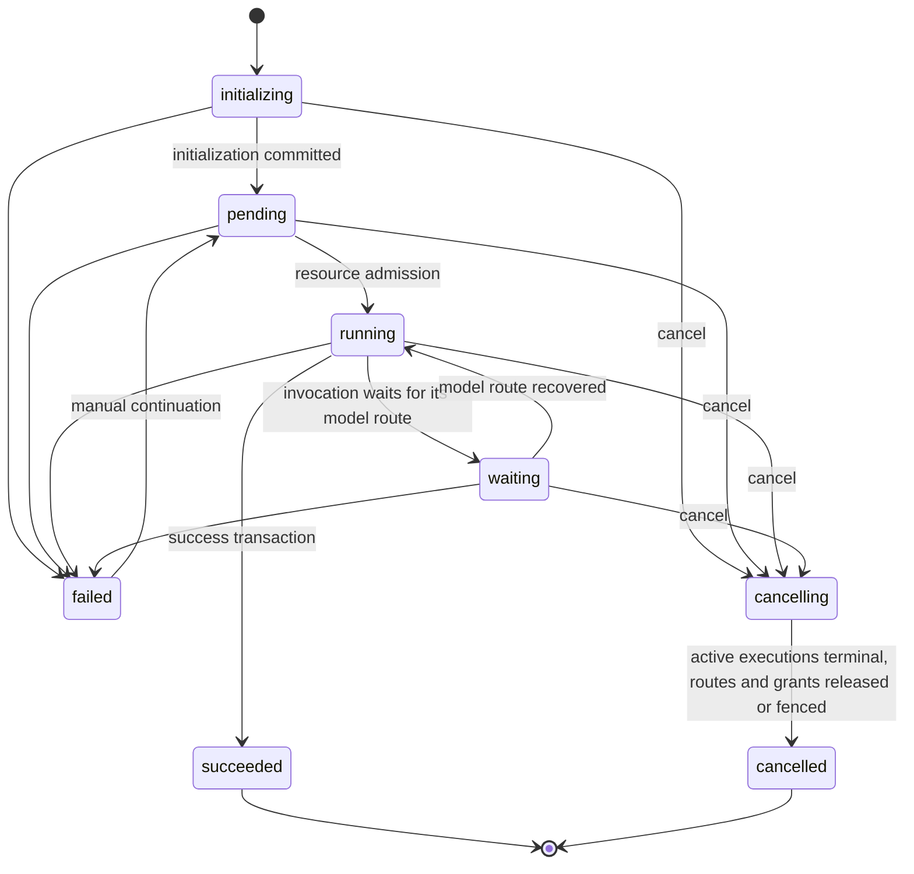
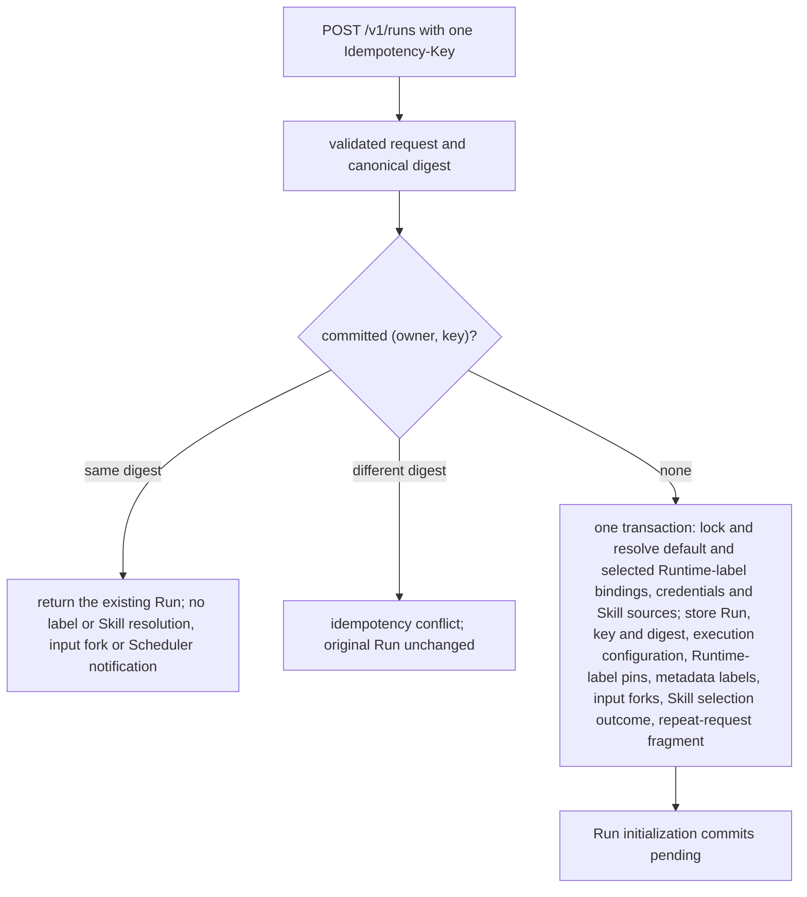
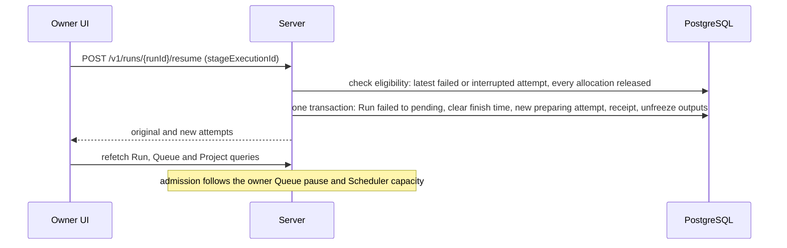

# Runs

Requirement prefix: `RUN` · [Specification index](../README.md)

## Purpose and scope

This document owns the WorkflowRun resource: its durable lifecycle and the
records that accompany it, the conditions that commit Run success and Run
failure, cancellation and its race with success, the create-Run request
(Workflow parameters, Runtime-label selection, metadata labels and create
idempotency), the pinning of the selected Runtime labels in the Run-creation
transaction, the Run snapshot, Run initialization and resource admission, the
`waiting` state, manual continuation of a failed Run, the public Run status and
detail projections, the repeat-draft projection and the metadata-label filters
of the owner Run collection.

It leaves to other documents:

- Workflow definitions, Stages, artifact slots and their media-type rules,
  `workflowOutputs` validation and the Stage Worker session policy:
  [Workflows](../configuration/workflows.md).
- Workflow loading and validation, the exact `(name, version)` configuration
  key, Workflow selector resolution and Stage instruction resolution:
  [Configuration catalog](../configuration/catalog.md).
- The shape, layering and resolution order of the `executionConfig` override,
  AgentTemplate resolution, ModelPolicy and LLMGatewayConfig selection and the
  published LLM configurations a Run form selects:
  [AgentTemplates](../configuration/agent-templates.md).
- RuntimeConfig bindings, their row lock order and merge precedence,
  RuntimeConfig credentials and RuntimeSettings, label rebinding, what Run
  responses show of the pinned bindings and the meaning of the `runtime_*`
  error codes: [RuntimeConfig](../configuration/runtime-config.md).
- StageExecution lifecycle, retry and escalation, Run claims and execution
  lanes, the one-active-StageExecution limit and the model-availability
  recovery gate: [Scheduler](scheduler.md).
- Allocation replay identity and placement: [Control Plane](control-plane.md).
- Delivery of Workflow parameters to Planners as StageContext data:
  [Planners](planners.md).
- Input forks, the reserved `inputs`, `outputs`, `skills` and
  `contractor-system` Namespaces, Workflow output binding and freezing, and
  publication: [Artifact store](../artifacts/artifact-store.md).
- Projects, Project Runs and the global Queue:
  [Projects](../artifacts/projects.md).
- Run hard deletion and retention:
  [Retention and deletion](../artifacts/retention-and-deletion.md).
- Agent Skill resolution and forks at Run initialization:
  [Skills](../tools/skills.md).
- Public API conventions, including the JSON request limit, the idempotency
  header, the error envelope, API versioning and the `run` event stream:
  [Public API](../api/public-api.md).
- Execution report envelopes and the propagation of metadata labels to
  telemetry: [Observability](../platform/observability.md).
- The eval convention over metadata labels and managed eval membership:
  [Managed Evals](../evals/managed-evals.md).
- Run pages, the Queue and Completed views, including the Completed view's
  `lifecycle=terminal` filter, and the Run form: [UI](../ui/ui.md).
- The end-to-end path of one Run: [Overview](../overview.md).

## Concepts

Terms are defined once in the [glossary](../glossary.md); the ones this
document owns are:

| Term | Meaning here |
| --- | --- |
| WorkflowRun | The durable execution record that one Workflow invocation creates; "Run" for short. Concrete input and output bindings belong to one Run, not to the reusable Workflow definition. |
| Standalone Run | A WorkflowRun created without a Project. |
| Run snapshot | The complete validated and dependency-resolved Workflow snapshot stored with a Run; the execution authority for that Run. |
| Workflow parameters | The string mapping a Run request supplies separately from its artifact-slot bindings. |
| Metadata labels | The immutable `labels` key/value string map that identifies, groups and queries one WorkflowRun. |
| Canonical request digest | The digest of the validated create-Run request that Server binds to the authenticated owner and the `Idempotency-Key`. |
| Resource admission | The step that moves a `pending` Run to `running`. |
| WorkflowRunError | The stable machine-readable error that a `failed` Run records. |
| WorkflowRunCancellation | The immutable cancellation record of the winning cancel request. |
| Manual continuation | The owner's explicit continuation of an eligible failed Run from its latest `failed` or `interrupted` StageExecution. |
| Manual-continuation receipt | The durable record of one manual continuation, unique per source execution. |
| Repeat draft | The owner-only, read-only projection of a terminal Run that the UI uses to configure another Run. |
| Repeat-request fragment | The bounded non-secret part of the create-Run request that Run creation retains for the repeat draft. |
| AttemptDiagnostics | The optional public projection of normalized Planner and Worker report errors in Run status. |

This document also uses Runtime labels, the `runtimeLabels` names a Run selects
to pin RuntimeConfig bindings; that term is owned by
[RuntimeConfig](../configuration/runtime-config.md).

## Model

### WorkflowRun

One Workflow invocation creates one WorkflowRun. A Run durably records:

- the Run snapshot (RUN-R23);
- the immutable Workflow parameters;
- the normalized executionConfig;
- the pinned default and Run-selected Runtime-label configurations;
- the immutable metadata labels;
- the exact input and Agent Skill forks in its RunScope;
- the nullable `project_id`, which is immutable membership and query
  metadata, not a Scheduler input
  ([Projects](../artifacts/projects.md), PRJ-R27);
- its lifecycle state, the first `started_at` and its finish time;
- a WorkflowRunError while `failed`, and a WorkflowRunCancellation while
  `cancelling` or `cancelled`;
- the repeat-request fragment (RUN-R99).

### Run lifecycle

WorkflowRun has an explicit durable lifecycle:

```text
initializing -> pending -> running -> succeeded
                           |   ^
                           v   |
                          waiting

initializing / pending / running / waiting -> failed
initializing / pending / running / waiting -> cancelling -> cancelled
```

Manual continuation adds the one transition out of `failed`:



| State | Meaning |
| --- | --- |
| `initializing` | The validated Workflow snapshot, immutable Run parameters, normalized executionConfig, pinned default and Run-selected Runtime-label configurations, immutable metadata labels and exact input and Agent Skill forks are being committed. |
| `pending` | Initialization or manual continuation has committed, but resource admission has not occurred. |
| `running` | The admitted Stage may execute Planner, model and tool work. |
| `waiting` | The current invocation waits for recovery of its model route (RUN-R30). |
| `cancelling` | Cancellation intent is durable (RUN-R42). |
| `succeeded`, `cancelled`, `failed` | Terminal states (RUN-R39). |

### Error and cancellation records

```python
class WorkflowRunError(BaseModel):
    code: str
    message: str
    stage_execution_id: StageExecutionId | None = None


class WorkflowRunCancellation(BaseModel):
    code: Literal["user_cancelled"]
    requested_at: datetime
    requested_by: str | None = None
    reason: str | None = None
```

### Create-Run request

| Field | Shape | Meaning | Owner |
| --- | --- | --- | --- |
| `workflow` | Workflow selector, for example `likec4-from-workspace@5` | Selects the exact Workflow document | [Configuration catalog](../configuration/catalog.md) |
| `parameters` | string-to-string map | Workflow parameters | this document |
| `artifacts` | Workflow input slot to `ArtifactRef` | Input bindings in the source scope of the endpoint | [Artifact store](../artifacts/artifact-store.md) (ART-R74) |
| `runtimeLabels` | optional sorted unique array of names | Runtime-label selection | this document for the field; [RuntimeConfig](../configuration/runtime-config.md) for resolution |
| `labels` | optional key/value string map | Metadata labels | this document |
| `executionConfig` | optional top-level object with the `planner`/`workers`/`stages` shape | Reference-only execution override | [AgentTemplates](../configuration/agent-templates.md) |
| `Idempotency-Key` header | exactly one bounded key | Create idempotency | this document; header conventions in [Public API](../api/public-api.md) |

### Two label domains

There are two deliberately separate label domains:

| Field | Shape | Meaning |
| --- | --- | --- |
| `runtimeLabels` | sorted unique array of names | Selects and pins RuntimeConfig bindings such as `debug` or `caido` under [RuntimeConfig](../configuration/runtime-config.md) |
| `labels` | key/value string map | Immutable metadata describing one WorkflowRun |

### Run creation



## Requirements

### Run creation request

**RUN-R1.** `POST /v1/runs` accepts a Workflow selector, a string
`parameters` mapping, `artifacts` input bindings, an optional top-level
`runtimeLabels` array, an optional `labels` map and an optional top-level
reference-only `executionConfig` override.

**RUN-R2.** At Run creation `WorkflowCatalog` resolves the Workflow selector
to the exact Workflow document it names
([Configuration catalog](../configuration/catalog.md)).

**RUN-R3.** For a required Workflow input the Run request must supply a
binding; an optional input may be absent. The source scope, version selection,
media-type validation and fork of each supplied input follow
[ART-R74 to ART-R79](../artifacts/artifact-store.md).

**RUN-R4.** `executionConfig` is the reference-only override specified by
[TPL-R70, TPL-R76 and TPL-R77](../configuration/agent-templates.md).

**RUN-R5.** A caller may select only published configurations
it is authorized to use. The single-owner UI exposes all active published
configurations.

**RUN-R6.** `runtimeLabels` is one optional top-level array of
Runtime label names and is sorted and unique in the canonical request. A
Workflow does not declare Runtime labels. Run-selected Runtime labels are
immutable. During Run creation Server first pins the `default` binding and then
resolves every selected label binding to its exact RuntimeConfig ref. It
validates the Run-level configuration, pins every binding revision, config
digest and non-secret credential ref, and stores that snapshot in the same
transaction as the Run. The row lock order of those bindings is specified in
[RCF-R134](../configuration/runtime-config.md), and their merge precedence in
[RuntimeConfig](../configuration/runtime-config.md).

**RUN-R7.** The public Runtime-label field is `runtimeLabels`.
Server must not accept a Runtime-label array and the metadata map under one
overloaded `labels` field.

**RUN-R8.** Server, UI and bundled clients are upgraded together.
Durable RuntimeConfig snapshot tables and refs carry no dependency on the
public field name. Incompatible public changes follow the API-version rule of
the [Public API](../api/public-api.md).

**RUN-R9.** A WorkflowRun may be created without a Project; such a
Run is standalone, and Server creates no default Project for it
([PRJ-R1](../artifacts/projects.md)). A Project Run is created through
`POST /v1/projects/{project_id}/runs` with the ordinary create-Run body and
idempotency header ([PRJ-R22, PRJ-R97](../artifacts/projects.md)).

### Workflow parameters

**RUN-R10.** The Run request supplies Workflow parameters as a string
mapping, separately from its artifact-slot bindings.

**RUN-R11.** Before the Run becomes schedulable, Server must reject
missing required parameters, unknown names and every non-string value,
including numbers, booleans, arrays, objects and null.

**RUN-R12.** Server performs no coercion, trimming,
interpolation or structured parsing of parameters. An empty string is a valid
supplied string.

**RUN-R13.** The exact validated mapping is stored durably with the
Run and is immutable for its lifetime (LIFE-RUN-1). Retrying a Stage does not
re-read or modify it. How Planners receive the mapping is specified in
[Planners](planners.md).

**RUN-R14.** In `v1alpha1` no separate count, name-length,
value-length or total-size limit applies to string parameters. The Run request
as a whole is bounded by the public JSON request limit of the
[Public API](../api/public-api.md), and the validated mapping is stored as
ordinary Run data within that bound.

**RUN-R15.** Parameters are ordinary persisted Run data, not a
secret channel. Callers must not place credentials or provider tokens in them;
deployment and allocation-scoped secrets enter Runtime Agent only through
`RuntimeSettings`.

**RUN-R16.** Structured, repeated or binary input belongs in a
declared Workflow artifact slot, using an appropriate media type such as
`application/json`, rather than inside the parameter contract. Contractor does
not inspect a string merely because its contents happen to resemble JSON.

### Create idempotency

**RUN-R17.** Public `POST /v1/runs` requires exactly one bounded
`Idempotency-Key` (LIM-RUN-1).

**RUN-R18.** Server binds the key to the authenticated owner and a
canonical digest of the validated request. The validated request includes the
Workflow selector, parameters, input refs, the sorted `runtimeLabels`, the
normalized metadata-label map and the optional reference-only executionConfig
override. The digest includes the supplied executionConfig selectors, the
sorted explicit `runtimeLabels` list and, independently of that list, the
complete metadata-label map sorted by key. The pinned `default` RuntimeConfig
binding is a resolved dependency rather than caller input.

**RUN-R19.** An already committed `(owner, idempotency key)` is
looked up and its digest compared before Server resolves any mutable Workflow
dependency, such as a managed credential or a current Runtime-label binding,
including `default` (FAIL-RUN-1). An exact replay therefore returns the
existing Run, with its original labels, even if such a dependency was later
deleted.

**RUN-R20.** A retry with the same owner, key and digest returns the
existing Run and does not repeat label or Skill resolution, input forks or
Scheduler notification (FAIL-RUN-1). Skill replay behaviour is specified in
[Skills](../tools/skills.md).

**RUN-R21.** Reusing the key with a different digest is the
permanent `idempotency_conflict` (API-R69), including a changed label key or
value when Workflow inputs and executionConfig are otherwise equal. The
original Run is unchanged (FAIL-RUN-1).

Rationale: losing the successful HTTP response cannot create a second
WorkflowRun or semantic execution.

### Run creation transaction and snapshot

**RUN-R22.** Run creation, its immutable Workflow snapshot, the
binding of the idempotency key and digest, execution-config resolution,
Runtime-label pinning (RUN-R6), metadata-label insertion, the exact input
forks and the complete Agent Skill current-source selection outcome commit in
one transaction. A committed Run therefore never exists with a partially
stored label set. A transient Skill-selection failure aborts Run creation
([Skills](../tools/skills.md)).

**RUN-R23.** Creating a Run stores the complete validated and
dependency-resolved Workflow snapshot specified by
[CAT-R33](../configuration/catalog.md), including each Stage's explicit Worker
session mode ([Workflows](../configuration/workflows.md)). What execution
configuration the snapshot holds, and that it never holds secret bytes, is
specified in [AgentTemplates](../configuration/agent-templates.md).

**RUN-R24.** The durable Run snapshot, rather than later configuration edits
or UI state, is the execution authority for its Run, within the Runtime-label
precedence for the physical Worker route specified in
[RuntimeConfig](../configuration/runtime-config.md). Each StageExecution takes
its AgentTemplate from the snapshot rather than from a fresh catalog lookup.
That no separately computed Workflow digest exists and that Scheduler never
consults configuration files to reinterpret the Run are specified in
[CAT-R34, CAT-R35](../configuration/catalog.md).

**RUN-R25.** Metrics and audit records identify the effective
ModelPolicy, LLMGatewayConfig and credential refs of a Run, so consumption can
be grouped without exposing a token.

### Run initialization

**RUN-R26.** No Stage may start while a Run is `initializing`. No
Stage is selected until every input fork succeeds and its exact source version
is recorded ([ART-R78](../artifacts/artifact-store.md)); a partially
initialized Run is never schedulable.

**RUN-R27.** An initialization error moves the Run to `failed` with a
stable error and no StageExecution (FAIL-RUN-2). Missing or invalid current
Agent Skill packages fail that Run's initialization; a committed missing-source
result fails it with `skill_artifact_not_found` ([Skills](../tools/skills.md)).

### Admission and the waiting state

**RUN-R28.** Run initialization commits `pending`. Resource admission
sets `running` and the Run's first `started_at`. Each Stage records its own
`admitted_at`, which starts that Stage's wall-clock budget, so a queued Stage
can wait for capacity without consuming its execution deadline
([Scheduler](scheduler.md)).

**RUN-R29.** Admission, cancellation and finalization share Run-first
transaction locking.

**RUN-R30.** A live invocation waiting for model availability sets its
Run to `waiting`. `waiting` is an active state: leases, cancellation,
retention, credentials, queue and Audit and eval reconciliation must treat it
as non-terminal.

**RUN-R31.** While the Run is `waiting`, the StageExecution
retains its existing lifecycle state and invocation identity. Runtime and
modeled Planner clients retry only the interrupted model request, with the
same serialized input; tools and findings already produced by the invocation
are not replayed (FAIL-RUN-3). The recovery gate itself is specified in
[Scheduler](scheduler.md).

**RUN-R32.** Public `RunStatus.recovery` contains a safe cause and
timing and whether a manual retry is required.

**RUN-R33.** `POST /v1/runs/{runId}/retry-gateway` is
owner-scoped and preserves the current invocation. Local recovery settings are
described in the
[local stack guide](../../guides/local-stack.md#model-availability-and-queued-runs).

### Run success

**RUN-R34.** Run success is committed only when all of the
following are true:

- Workflow policy selected an explicit successful terminal transition;
- no StageExecution remains active and policy selects no further Stage;
- every required Workflow output slot has an exact versioned source ref;
- the corresponding `outputs/<slot name>` bindings are created and frozen.

An optional Workflow output may remain absent.

**RUN-R35.** Accepting the StageResult that causes success, applying
its Workflow-output mapping, freezing all required outputs and changing
`running -> succeeded` are one database transaction
([ART-R92](../artifacts/artifact-store.md), FAIL-ART-6). Frozen Run outputs are
never implicitly published or overwritten in UserScope
([ART-R95](../artifacts/artifact-store.md)).

### Run failure

**RUN-R36.** `failed` requires a WorkflowRunError.

**RUN-R37.** Run failure is committed with a stable machine-readable
error when Workflow policy explicitly selects failure, retry and escalation
paths are exhausted, Run initialization fails, or the graph is quiescent
without a valid successful terminal transition. Graph exhaustion with a
missing required output is `failed`, not an indefinitely running Run.

**RUN-R38.** Scheduler executes at most one StageExecution at a time per
WorkflowRun (LIM-SCH-1, [Scheduler](scheduler.md)), so a policy-selected
failure is committed only after that execution is terminal. Any future
parallel-Stage scheduling inside one Run must add a bounded failure-drain state
before allowing other active executions.

**RUN-R39.** `succeeded` and `cancelled` are immutable terminal
states. `failed` is terminal unless the owner explicitly continues an eligible
Run (RUN-R46).

### Cancellation

**RUN-R40.** `cancelling` and `cancelled` require the same
immutable WorkflowRunCancellation, recorded by the winning cancel request.

**RUN-R41.** Cancellation is accepted from `initializing`,
`pending`, `running` or `waiting` by compare-and-set. Repeating cancellation is
idempotent; cancellation of any terminal Run returns that existing terminal
state without mutation (FAIL-RUN-4).

**RUN-R42.** While a Run is `cancelling`, no new StageExecution or
Workflow-output mapping is allowed, and active executions are stopped through
their bounded `aborting` path unless they already entered `finalizing`.

**RUN-R43.** `cancelling -> cancelled` occurs after all active
StageExecutions are terminal and their Server-side routes and grants are
released or durably fenced. An unreachable Runtime Agent cannot keep the Run in
`cancelling` after its bounded Stage abort deadline (FAIL-RUN-4).

**RUN-R44.** Run cancellation and successful progression serialize on the
WorkflowRun row:

- if the transaction that accepts the final StageResult, maps outputs and sets
  `succeeded` commits first, a later cancel is an idempotent no-op;
- if `cancelling` commits first, Scheduler starts no new Stage and accepts no
  later Workflow-output mapping;
- a StageExecution already in `finalizing` still reaches its own terminal
  StageResult for audit, but that result neither advances the cancelling Run
  nor creates its Workflow output bindings;
- a StageExecution still in `preparing` or `running` enters `aborting` with a
  cancelled StageTermination.

**RUN-R45.** The terminal transition that commits first is
authoritative; message arrival time and volatile Planner state do not determine
the winner.

### Manual continuation of a failed Run

**RUN-R46.** The owner may explicitly continue an ordinary failed Run
from its latest `failed` or `interrupted` StageExecution after every allocation
is released, through `POST /v1/runs/{runId}/resume`. Continuation is not a
mutation of a terminal StageExecution and does not revive it or replay its
Planner session.

**RUN-R47.** One transaction changes the Run from `failed` to
`pending`, clears its finish time, creates a new `preparing` attempt of the
same Stage, records a durable manual-continuation receipt and unfreezes the
Run's `outputs` bindings without changing their current revisions, so later
Scheduler publication may advance them
([ART-R97](../artifacts/artifact-store.md)).

**RUN-R48.** The new attempt increments `attempt`, links
`previousExecutionId` and copies the failed attempt's exact StageSpec,
StageContext pins and effective execution configuration, including escalation.
It records an immutable `resumeSourceExecutionId` equal to its
`previousExecutionId`, retains the source's execution configuration variant
and escalation ordinal, and is linked to its receipt in the same transaction.

**RUN-R49.** Manual continuation leaves Run configuration,
exact input and configuration pins, completed StageExecutions, successful
Stages, accepted results and existing artifact revisions unchanged. The
original automatic `fail` transition decision remains immutable.

**RUN-R50.** The manual-continuation receipt is unique per source
execution. Repeating the same request returns the same target even if that
target has already failed; another manual attempt must name that newer failed
execution (FAIL-RUN-5).

**RUN-R51.** Manual continuation does not reset automatic retry
or escalation counters. Only original automatic escalation attempts consume
escalation ordinal positions; manual attempts neither create nor reset that
budget. The new attempt still increments the overall attempt number used by
retry limits.

**RUN-R52.** Continuation is unavailable for initialization
failures with no failed Stage, cancelled or succeeded Runs, incomplete cleanup,
deleting Projects, already-published outputs, Audit-managed Runs and
evaluation Runs (FAIL-RUN-5). Audit-managed and evaluation Runs retain their
controller-owned lifecycle.

**RUN-R53.** A continued Run's admission still follows the
owner's Queue pause and the normal Scheduler capacity limits
([Scheduler](scheduler.md)).

**RUN-R54.** At most 1,024 attempts remain representable
(LIM-RUN-2).

**RUN-R55.** `RunStatus.resumeStageExecutionId` exposes
eligibility; a client must take eligibility from it, not infer it from `state`
alone.

**RUN-R56.** `POST /v1/runs/{runId}/resume` takes the expected
`stageExecutionId`, which doubles as the durable idempotency identity. The
response identifies the original and the new attempts.

**RUN-R57.** For an eligible failed Run the Run detail page offers
**Continue from failed stage**, with an explicit confirmation that names the
Stage and warns that model and tool calls, including external side effects,
will repeat. After the request the UI refreshes the Run, Queue and Project
queries without optimistically changing lifecycle state.

Rationale: a new attempt repeats model and tool work and can repeat external
side effects, so the UI asks for confirmation.



### Metadata labels

**RUN-R58.** `POST /v1/runs` accepts the metadata `labels` map
independently of `runtimeLabels`. Labels are used only to identify, group and
query concrete Runs.

Rationale: the first motivating use is evaluation. One eval invocation may
create many ordinary WorkflowRuns for fixtures, cases, repeated samples and A/B
legs, and a shared label set must make those Runs discoverable without
introducing a second execution path into Scheduler. The Evals UI may organize
these Runs in an `evaluation` Project ([Projects](../artifacts/projects.md));
this remains an owner-facing grouping and does not alter the generic label or
execution contract.

**RUN-R59.** Runtime labels may change infrastructure
resolution. Metadata labels never change Workflow semantics, configuration
resolution, Scheduler eligibility, queue priority, placement, Runtime
capabilities, authorization, budgets, tools, Skills, model selection or
artifact access.

**RUN-R60.** Omitting `labels` is equivalent to an empty map.
Explicit `null`, an array or non-string values are invalid.

**RUN-R61.** A label map has at most 32 entries (LIM-RUN-3).

**RUN-R62.** A key is 1–63 ASCII bytes (LIM-RUN-4) and matches:

```text
[a-z][a-z0-9]*(?:[._-][a-z0-9]+)*
```

**RUN-R63.** A value is UTF-8 of at most 256 bytes after JSON
decoding (LIM-RUN-5). An empty string is valid and represents a key-only label;
an empty-valued label is distinct from an absent key, including in exact
filters and idempotency identity.

**RUN-R64.** A value must not contain U+0000.

Rationale: U+0000 has no PostgreSQL `text` representation.

**RUN-R65.** Values are opaque: they may contain paths, spaces or
punctuation, and Server performs no case folding or semantic parsing.

**RUN-R66.** The `contractor.` key prefix is reserved for future
Server-owned keys; caller-supplied keys in that namespace are rejected.

**RUN-R67.** The strict request decoder rejects duplicate JSON object
keys rather than resolving them by last-value-wins behaviour.

**RUN-R68.** A label key or value with an invalid shape or bounds,
or a reserved caller key, fails Run creation with `400`; no Run, input fork or
label row is created (FAIL-RUN-1).

**RUN-R69.** Labels are safe metadata, not a secret container. A
caller must not place credentials, tokens, prompts, source excerpts or other
confidential payloads in them. Server does not promise value redaction after
accepting a label.

Rationale: Server cannot reliably infer secrecy from arbitrary text.

**RUN-R70.** The normalized metadata-label map is immutable for
the complete WorkflowRun lifetime; there is no endpoint to add, replace or
delete a label.

**RUN-R71.** Labels belong to the Run owner and follow owner
isolation. They grant no access and are not trusted claims about the caller.
Operations may display them, but neither Scheduler nor Control Plane
authorizes behaviour from their contents.

**RUN-R72.** Metadata labels are durable first-class indexed
data, not a substring encoded into `run_id`, a log field or an artifact name.
Storage must enforce one value per `(run_id, key)` (LIM-RUN-6), the entry, key
and value bounds, and atomic insertion with the Run.

**RUN-R73.** Terminal retention of metadata labels follows the
WorkflowRun retention policy (LIFE-RUN-2,
[Retention and deletion](../artifacts/retention-and-deletion.md)).

**RUN-R74.** Successful Run-create, Run detail and Run list
projections expose the complete normalized map. Lifecycle events carry
`run_id` and do not repeat the full map in every event.

**RUN-R75.** Generic Run label validation and Scheduler behaviour
add no eval-specific branches. The eval convention over generic labels and
managed eval membership are specified in
[Managed Evals](../evals/managed-evals.md).

**RUN-R76.** The UI's label key/value editor and exact filters never
share controls with RuntimeConfig selection. Conventional `eval.*` shortcuts
are presentation over the generic label query and do not create an eval-only
Server execution path.

**RUN-R77.** Planner and Worker traces may carry metadata labels
as bounded attributes. The UI therefore treats label values as
telemetry-visible safe metadata and warns against secrets, and it does not use
labels as authorization, scheduling or Run success signals. Propagation to
Planner spans and into each `AllocationSpec` as `runMetadataLabels` is
specified in [Observability](../platform/observability.md); allocation replay
identity in [Control Plane](control-plane.md). A telemetry exporter failure is
a bounded best-effort telemetry failure; the semantic Run outcome is unchanged
(FAIL-RUN-9).

### Run collection queries

**RUN-R78.** The owner Run-list endpoint accepts a repeated exact
`label` selector of the form `label=<key>=<value>`. The first `=` separates key
from value; the remaining decoded characters belong to the value. Repeated
selectors are a logical AND.

**RUN-R79.** Only exact key/value equality is supported: no
existence, inequality, set, regex, prefix or OR syntax.

**RUN-R80.** An invalid selector fails the request with
`400` and no partial interpretation; an unknown or unmatched pair returns an
empty owner-scoped page (FAIL-RUN-6).

**RUN-R81.** Label filtering composes with the existing owner,
state and keyset-pagination constraints. Pagination remains stable
newest-first and must neither leak foreign-owner labels nor produce duplicate
Runs when a Run has several matching labels. The query must be index-backed
rather than scan and deserialize every historical Run.

**RUN-R82.** The newest-first `/v1/runs` collection accepts the additive
`lifecycle=terminal` filter that the Completed view uses. Its application
before keyset pagination and its intersection with `state` and metadata-label
filters are specified in [UI-R104, UI-R105](../ui/ui.md).

### Run status and detail

**RUN-R83.** Run responses expose both the explicit Runtime
labels and the pinned default and label config refs. What the successful
response and detail surface show of those pins, and the secrets they never
expose, is specified in [RCF-R168](../configuration/runtime-config.md).

**RUN-R84.** Run detail exposes final Agent-label and config
provenance only after an allocation snapshot commits; the public
`StageAttempt.runtimeConfiguration` is omitted before that boundary. Once
present, its per-logical-Worker entries contain only the sorted Agent-label
pins, required RuntimeAdapter refs, closed field origins and
`pinned | release_pending | released` cleanup status. It omits allocation IDs,
physical Runtime Agent IDs, endpoints, credentials and the complete
`RuntimeSettings`, and current Operations state is never joined into historical
Run detail.

**RUN-R85.** The stable errors of the Runtime-label API
contract, including Run creation with `runtimeLabels`, include
`runtime_label_unknown`, `runtime_config_conflict`, `runtime_config_invalid`,
`runtime_credential_in_use`, `runtime_label_in_use` and
`runtime_agent_label_not_applicable`, defined by
[RuntimeConfig](../configuration/runtime-config.md), and the existing
precondition and idempotency errors of the
[Public API](../api/public-api.md). Error bodies remain bounded and
secret-free.

**RUN-R86.** Run detail shows the selected execution-config refs and
their origin (`workflow`, `run override`, inline escalation or exact
ExecutionConfig ref) and never reconstructs authority from browser state.

**RUN-R87.** A Run detail response includes the event cursor of the
Run's `run` stream ([Public API](../api/public-api.md)).

**RUN-R88.** The Run detail handler verifies ownership before it
loads related Stage data.

**RUN-R89.** The Run detail readers for allocations, metrics and
Planner plans, and the Planner session store, must provide batch reads.
PostgreSQL uses at most one query per related collection, independent of the
number of Stages (LIM-RUN-7).

**RUN-R90.** Metrics and Planner-plan readers remain optional
dependencies. Unavailable or malformed metrics omit diagnostics without hiding
healthy peers or the durable Run state. A configured Planner-plan reader must
validate the exact session, Stage and invocation identity; a missing session or
a read failure fails the request, while a valid session without a plan omits
that optional field (FAIL-RUN-7).

**RUN-R91.** The authenticated owner's Run status exposes aggregate
counts, report completeness and one optional `AttemptDiagnostics` projection
when StageMetrics exists. Diagnostics contain only normalized Planner and
Worker report errors: the participant kind, the logical Agent name for a
Worker, a bounded stable code, a message of at most 4,096 bytes (LIM-RUN-8) and
an optional `retryable`.

**RUN-R92.** Planner entries are ordered before Workers, Workers are
sorted by logical Agent name and source error order is preserved. At most the
newest 128 entries in that deterministic sequence are returned (LIM-RUN-9); any
source or projection overflow sets `truncated`.

**RUN-R93.** Before this projection, the mandatory
persistence-boundary policy has already removed configured secrets and bounded
every error. The projection additionally replaces URL-shaped text and rejects
non-contract error codes.

**RUN-R94.** Raw model output, prompts, provider bodies and URLs, tool
calls, tool arguments and results, stack traces, physical Runtime addresses and
report, session and allocation identities are never part of public Run status.

**RUN-R95.** An absent StageMetrics record omits diagnostics; a
present record with no normalized errors returns an empty list, so the UI can
distinguish "no participant errors" from "telemetry unavailable".

### Repeat draft

**RUN-R96.** For every terminal Run the detail page may offer
**Configure another Run**. This is not continuation, Scheduler retry or
mutation of execution history.

**RUN-R97.** `GET /v1/runs/{run_id}/repeat-draft` is an owner-only,
read-only projection. For an ordinary Run it returns the exact Workflow ref,
Project membership, string parameters, requested Runtime labels, user metadata
labels, the requested executionConfig patch and each verified original
UserScope or ProjectScope input ref. It is the only owner access to the
retained `contractor-system` fragment and rechecks authorization and source
scopes on every read.

**RUN-R98.** The projection never returns the frozen RunScope
input fork as a reusable source and never resolves a missing revision to the
current binding. A repeat Run uses authorized exact source refs rather than
treating RunScope refs as UserScope or ProjectScope inputs.

**RUN-R99.** Run creation retains the bounded non-secret request
fragment that the projection needs, in the same transaction as the input forks.
The fragment stores the exact original source refs and the requested execution
selections; it may retain credential identities, and must not retain
credential values or resolved RuntimeSettings. It is held in the `repeat-request`
binding of the hidden `contractor-system` Namespace
([ART-R17, ART-R18](../artifacts/artifact-store.md)).

**RUN-R100.** Existing durable Run fields remain authoritative
for parameters, labels and Runtime-label selection.

**RUN-R101.** A repeat requires a valid retained fragment that
matches its Run's Workflow and Project. A missing or invalid fragment returns a
blocking notice and no draft; neither lineage nor current or effective
configuration may reconstruct the original request (FAIL-RUN-8).

**RUN-R102.** An explicitly retained empty executionConfig object
is valid; an omitted or null object is invalid. Repeat-draft reads never
repair or rewrite retained data.

**RUN-R103.** The projection validates that the exact Workflow,
Project, source revisions, selected configurations, credential identities and
Runtime-label bindings are still usable. Missing values and changed bindings
are explicit stable notices (FAIL-RUN-8).

**RUN-R104.** For an Audit-managed Run the projection returns only
its owning Project and Audit context and no ordinary draft.

**RUN-R105.** Evaluation labels are copied only into a visible review
state; the browser neither strips them silently nor creates reserved Audit
labels.

## Interfaces

The public API schema is
[contractor-public-v1.yaml](../../../api/openapi/contractor-public-v1.yaml);
shared conventions are in the [Public API](../api/public-api.md).

| Endpoint | Use | Requirements |
| --- | --- | --- |
| `POST /v1/runs` | Create a standalone Run | RUN-R1, RUN-R17, RUN-R22 |
| `GET /v1/runs` | Owner Run collection, newest first, with `state`, `lifecycle=terminal` and `label` filters | RUN-R78, RUN-R82 |
| `GET /v1/runs/{runId}` | Run status and detail | RUN-R83, RUN-R88, RUN-R91 |
| `POST /v1/runs/{runId}/cancel` | Request cancellation of a non-terminal Run | RUN-R41 |
| `POST /v1/runs/{runId}/resume` | Manual continuation of a failed Run | RUN-R46, RUN-R56 |
| `POST /v1/runs/{runId}/retry-gateway` | Manual retry of a blocked model route | RUN-R33 |
| `GET /v1/runs/{runId}/repeat-draft` | Repeat draft of a terminal Run | RUN-R97 |
| `POST /v1/projects/{project_id}/runs` | Create a Project Run ([Projects](../artifacts/projects.md)) | RUN-R9 |

Public fields owned here: `parameters`, `runtimeLabels`, `labels`,
`RunStatus.recovery`, `RunStatus.resumeStageExecutionId`,
`StageAttempt.runtimeConfiguration` and `AttemptDiagnostics`.

## Limits, failures and errors

Limits ([registry](../platform/limits.md)):

- LIM-RUN-1 — `Idempotency-Key` per create-Run request: exactly one
  (RUN-R17).
- LIM-RUN-2 — representable attempts: at most 1,024 (RUN-R54).
- LIM-RUN-3 — metadata-label entries per Run: at most 32
  (RUN-R61).
- LIM-RUN-4 — metadata-label key length: 1–63 ASCII bytes
  (RUN-R62).
- LIM-RUN-5 — metadata-label value length: at most 256 bytes of UTF-8 after
  JSON decoding (RUN-R63).
- LIM-RUN-6 — values per `(run_id, key)`: exactly one (RUN-R72).
- LIM-RUN-7 — PostgreSQL queries per related collection for one Run detail
  read: at most one, independent of the number of Stages (RUN-R89).
- LIM-RUN-8 — AttemptDiagnostics message: at most 4,096 bytes
  (RUN-R91).
- LIM-RUN-9 — AttemptDiagnostics entries returned: at most the newest 128
  (RUN-R92).
- Workflow parameters have no separate limit; the create request is bounded by
  the public JSON request limit of the [Public API](../api/public-api.md)
  (RUN-R14). One active StageExecution per WorkflowRun is LIM-SCH-1
  ([Scheduler](scheduler.md)).

Failure outcomes ([failure model](../platform/failure-model.md)):

- FAIL-RUN-1 — Run creation and create idempotency (RUN-R19,
  RUN-R20, RUN-R21, RUN-R68).
- FAIL-RUN-2 — Run initialization (RUN-R27).
- FAIL-RUN-3 — model request interrupted by model unavailability
  (RUN-R31).
- FAIL-RUN-4 — Run cancellation (RUN-R41, RUN-R43).
- FAIL-RUN-5 — manual continuation (RUN-R50,
  RUN-R52).
- FAIL-RUN-6 — Run-list label selector (RUN-R80).
- FAIL-RUN-7 — Run detail read with optional readers (RUN-R90).
- FAIL-RUN-8 — repeat-draft projection (RUN-R101,
  RUN-R103).
- FAIL-RUN-9 — export of metadata labels to telemetry (RUN-R77).
- Input fork initialization and its recovery: FAIL-ART-2; the success
  transaction: FAIL-ART-6 ([Artifact store](../artifacts/artifact-store.md)).

Metadata-label failures:

| Failure | Result | Where |
| --- | --- | --- |
| Invalid key/value shape or bounds | `400`; no Run, input fork or label row is created | RUN-R68 |
| Reserved caller key | `400`; no mutation | RUN-R68 |
| Changed labels under an existing idempotency key | Existing idempotency conflict; original Run is unchanged | RUN-R21 |
| Invalid list selector | `400`; no partial interpretation | RUN-R80 |
| Valid selector with no match | Empty owner-scoped page | RUN-R80 |
| Allocation label-map mismatch or invalid bounds | Private protocol invariant failure before Worker construction | [Control Plane](control-plane.md) |
| Telemetry exporter failure | Bounded best-effort telemetry failure; semantic Run outcome is unchanged | RUN-R77 (FAIL-RUN-9) |

Lifecycle ([registry](../platform/lifecycle.md)):

- LIFE-RUN-1 — Workflow parameter mapping (RUN-R13).
- LIFE-RUN-2 — WorkflowRun metadata labels (RUN-R70,
  RUN-R73).
- The WorkflowRun itself and its hard deletion: LIFE-DEL-1
  ([Retention and deletion](../artifacts/retention-and-deletion.md)); the
  `contractor-system` bindings that hold the repeat-request fragment:
  LIFE-ART-1; Run `outputs` bindings: LIFE-ART-2
  ([Artifact store](../artifacts/artifact-store.md)).

Errors ([registry](../platform/errors.md)):

- `user_cancelled` — the cancellation code of WorkflowRunCancellation
  (RUN-R40).
- `skill_artifact_not_found` is defined by [Skills](../tools/skills.md); the
  `runtime_*` codes by [RuntimeConfig](../configuration/runtime-config.md)
  (RUN-R85).

## Security

Security-relevant requirements: parameters are not a secret channel
(RUN-R15); Run creation accepts only reference-only execution overrides
([TPL-R70](../configuration/agent-templates.md), RUN-R4) and only authorized
published configurations (RUN-R5); Runtime-label pins hold only non-secret
credential refs (RUN-R6); consumption is attributable without exposing a token
(RUN-R25); metadata labels are not a secret container, grant no access and are
owner-isolated (RUN-R69, RUN-R71, RUN-R81); Run responses never expose
resolved secrets or RuntimeSettings (RUN-R84, RUN-R85;
[RCF-R168](../configuration/runtime-config.md) through RUN-R83); public Run
status excludes model, tool and identity data (RUN-R93, RUN-R94); Run detail
checks ownership first (RUN-R88); and the repeat draft is owner-only, rechecks
authorization and source scopes and retains no credential values (RUN-R97,
RUN-R99). The shared model is in [security](../platform/security.md).

## Observability

Metrics and audit records identify the effective ModelPolicy,
LLMGatewayConfig and credential refs (RUN-R25). Planner and Worker
traces may carry metadata labels as bounded attributes (RUN-R77);
telemetry export failure never changes the Run outcome (FAIL-RUN-9). Lifecycle
events carry `run_id` rather than the label map (RUN-R74). Shared
rules, including report envelopes and label propagation, are in
[observability](../platform/observability.md).

## Invariants

1. `runtimeLabels` configure infrastructure; `labels` describe one Run.
2. Metadata labels are immutable, owner-scoped, bounded and atomically durable
   with Run creation.
3. Metadata labels are neither authorization claims nor Scheduler inputs.
4. An eval sample is an ordinary WorkflowRun; eval adds no hidden execution
   path to Scheduler, Control Plane or Runtime.
5. Planner and Runtime may attach labels to traces but never expose them to the
   model or use them as unbounded metric dimensions.
6. Filtering is exact, conjunctive, owner-isolated and compatible with stable
   keyset pagination.
7. Labels aid discovery but never replace immutable Workflow, config, input or
   result provenance.
8. Cancel and success serialize on the durable Run row; the first committed
   transition wins.

## Examples

Workflow parameters and an artifact binding in a Run request:

```yaml
parameters:
  objective: Find authorization vulnerabilities
  mode: strict

artifacts:
  source:
    namespace: projects
    name: payment-service-source
```

A create-Run body selecting Runtime labels:

```json
{"workflow":"likec4-from-workspace@5","runtimeLabels":["caido","debug"],"labels":{"purpose":"eval"},"parameters":{},"artifacts":{}}
```

A create-Run body with both label domains:

```json
{
  "workflow": "openapi-from-workspace@5",
  "runtimeLabels": ["debug"],
  "labels": {
    "purpose": "eval",
    "eval.name": "openapi-regression",
    "eval.id": "eval_01k4example",
    "eval.leg": "a",
    "eval.fixture": "vulnyapi",
    "eval.case": "sqli-01",
    "eval.sample": "2"
  },
  "parameters": {},
  "artifacts": {}
}
```

Run-list label selectors:

```text
GET /v1/runs?label=purpose=eval&label=eval.id=eval_01k4example
GET /v1/runs?label=eval.name=openapi-regression&label=eval.leg=b
```

## Non-goals

- A multi-tenant policy for which published configurations a caller may
  select is deferred.
- Concurrent Stages inside one Run are not supported
  ([Scheduler](scheduler.md)).
- Mutable metadata labels are not supported. A future mutable operator-tag
  feature requires its own compare-and-set contract and must not silently
  weaken eval provenance.
