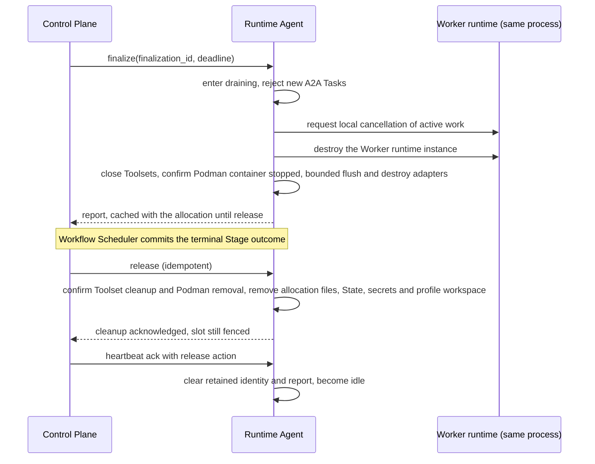

# Runtime Agent

Requirement prefix: `RTA` · [Specification index](../README.md)

## Purpose and scope

A Runtime Agent is the long-running process that hosts the Worker of one
allocation at a time. This document owns:

- the Runtime Agent process, its one exclusive slot and its in-process Worker
  runtime factories;
- startup capability discovery: the enabled local FactoryRegistry, the probe
  semantics of each factory kind, the probe budgets and the RuntimeAdapter
  allowlist;
- the Runtime-side watchdog over the confirmed control lease and the
  `draining` and `fenced` slot states;
- the Runtime side of one allocation: the preparation order, finalization,
  abort and release, and the allocation resources each step creates or
  removes;
- the `local-workdir@1` SandboxProfile and the Runtime work root;
- allocation-scoped infrastructure adapters, HTTP proxy injection, the bounded
  subprocess launcher, the bypass of Contractor traffic and adapter teardown;
- the allocation-scoped A2A endpoint, its Agent Card and A2A Task handling,
  including `worker_execution_failed` and `worker_busy`;
- the placement of the private agent-state handler inside the Runtime;
- the measured interval, sampler and accumulator of allocation resource
  metrics.

It leaves to other documents:

- registration, the process-scoped `instance_id`, the Runtime Agent principal,
  the `CapabilitySnapshot` shape and its registration rules, heartbeat and the
  Server side of the confirmed control lease, reconciliation, placement,
  reservation, `AllocationSpec`, `WorkerHandle`, the Agent Card secret scan,
  slot capacity, the private finalize, abort and release commands and
  two-phase release: [Control Plane](control-plane.md);
- StageExecution states including `finalizing` and `aborting`, their
  deadlines, the terminal barrier and release ordering:
  [Scheduler](scheduler.md);
- the Worker model boundary, `WorkerCompletion` and the stage-content
  payloads, ADK session identity and session modes, Worker State, the
  agent-state endpoint contract and the LLM Gateway client:
  [Worker](worker.md);
- AgentTemplate digests, `SandboxProfileRef` and the template's runtime ref:
  [AgentTemplates](../configuration/agent-templates.md);
- RuntimeSettings content, Runtime labels and their provenance, and the
  meaning of proxy targets: [Runtime configuration](../configuration/runtime-config.md);
- the Server's Toolset descriptor registry, tool capability granularity and
  tool channel declarations: [Toolsets](../tools/toolsets.md);
- the workspace storage provider, hydration, WorkspaceSession lifecycle and
  the allocation-wide cleanup task: [Workspace](../tools/workspace.md);
- fetching, validating and loading Agent Skill packages:
  [Skills](../tools/skills.md);
- the Podman sandbox and its probes: [Code execution](../tools/code-execution.md);
- artifact bytes outside A2A: [Artifact store](../artifacts/artifact-store.md);
- mutual TLS, Control Plane peer recognition, the Runtime credential boundary,
  secret retention and redaction, and control-channel trust roots:
  [Security](../platform/security.md);
- telemetry export semantics: [Observability](../platform/observability.md);
- the `runtime.resources` report fields and their validation:
  [Operations](../operations/operations.md).

## Concepts

Terms are defined once in [the glossary](../glossary.md); the ones this
document owns are:

- **Runtime Agent.** One long-running process with one exclusive slot whose
  code implements both the Runtime Agent and the Worker behaviour.
- **Worker runtime factory.** An in-process factory, known by an exact
  WorkerRuntime ref such as `adk@1`, that creates the Worker instance of an
  allocation.
- **FactoryRegistry.** The Runtime Agent's enabled local set of WorkerRuntime,
  Toolset, SandboxProfile and RuntimeAdapter factories.
- **Capability probe.** A bounded startup check by which one enabled factory
  proves what it can honor in the process environment.
- **Work root.** The operator-configured, dedicated directory below which the
  Runtime creates allocation directories.
- **Allocation directory.** The fresh directory, named `allocation-<32 hex>`,
  that `local-workdir@1` creates below the work root for one allocation.
- **Owner marker.** The sibling file that the Runtime writes before creating an
  allocation directory and by which it recognizes that directory as its own.
- **AllocationAdapterHost.** The allocation-owned holder of the RuntimeAdapters
  present in the resolved settings.
- **Bounded subprocess launcher.** The Runtime-owned launcher through which a
  selected tool runs its bounded subprocesses, including the child-only proxy
  environment of `tool-subprocess`.
- **Local watchdog.** The Runtime Agent's monotonic timer over the confirmed
  control lease.
- **`draining`.** The slot state in which the Runtime rejects new A2A work
  while its Worker stops and after it has exited; the allocation remains
  reserved until the private release after its terminal StageExecution, or
  local lease loss, moves the slot to `fenced`.
- **`fenced`.** The slot state in which the Runtime rejects all work and keeps
  the old allocation identity until release is authoritatively acknowledged.
- **Shutdown grace.** The bound within which the Runtime stops and destroys its
  Worker after lease loss, before forced termination.
- **`AllocationFinalReport`.** The report that finalization or abort produces,
  cached with the allocation until release.
- **Allocation-scoped A2A endpoint.** The Runtime Agent's one stable
  authenticated A2A address, configured from the active AgentTemplate while
  the slot is allocated.
- **Measured interval.** The window during which the Runtime samples the
  resource metrics of one allocation.

Worker is defined in [Worker](worker.md); `CapabilitySnapshot`,
`instance_id`, the confirmed control lease, `AllocationSpec` and two-phase
release in [Control Plane](control-plane.md); SandboxProfile in
[AgentTemplates](../configuration/agent-templates.md).

## Model

### Slot states

A Runtime Agent reports its slot as `idle`, `allocated`, `draining` or
`fenced` in every heartbeat ([Control Plane](control-plane.md)). On the
Runtime side the slot moves as follows:

```mermaid
stateDiagram-v2
    [*] --> startup
    startup --> [*] : no WorkerRuntime or no SandboxProfile passes, or Podman probe cleanup is unconfirmed, so startup readiness fails and no idle slot is registered
    startup --> idle : probes complete, marked orphan allocation directories removed, idle slot registered
    idle --> allocated : slot reserved for an AllocationSpec
    idle --> fenced : local watchdog expires with no allocation
    allocated --> draining : finalize, abort or drain
    allocated --> draining : local watchdog expires
    draining --> fenced : watchdog path, Worker destroyed within the shutdown grace, report cached
    draining --> fenced : private release after the terminal Stage outcome
    draining --> [*] : Worker stop cannot be guaranteed, process exits
    fenced --> fenced : release cleanup fails, release retry repeats cleanup
    fenced --> idle : heartbeat release action after acknowledged cleanup
    fenced --> idle : after watchdog expiry, release action, then a re-registration response re-arms the watchdog
    fenced --> idle : no allocation existed; a confirmed response establishes that the authoritative slot is unallocated and re-arms the watchdog
```

### Allocation resources

The resources that one allocation holds in the Runtime, and where each is
created and removed:

| Resource | Created | Ends |
| --- | --- | --- |
| Allocation adapters in the `AllocationAdapterHost` | Preparation step 2, before any sandbox, Toolset or Worker resource | Closed by finalization or abort after a bounded flush; release keeps them closed and erases their secrets |
| `local-workdir@1` allocation directory (the profile workspace) | Preparation step 3 | Removed at release before cleanup is acknowledged; marked orphans removed at startup |
| WorkspaceSession and its local, memory or overlay files | Preparation step 4, when `AllocationSpec.workspace` is present | Removed at release |
| Podman execution container (`podman@1`) | Preparation step 4, after local direct hydration | Stop confirmed by finalization or abort; removal confirmed by release |
| Loaded Skill objects and extracted allocation-local skill files | Preparation step 5 | Removed at release |
| Contractor State, instrumentation reducers, selected Toolsets, native ADK SkillToolset | Preparation step 6 | Toolsets closed by finalization or abort; State removed at release |
| Worker runtime instance | Preparation step 6 | Destroyed by finalization, abort or lease loss |
| A2A Server and Agent Card | Preparation step 7 | Deactivated during finalization, abort, release and local lease loss (RTA-R26) |
| RuntimeSettings | Received in `AllocationSpec` | Erased at release |
| Access tokens | Held for the allocation | Erased at release |
| Allocation identity and cached report | Report built by finalization or abort, or snapshotted after local lease loss (RTA-R23, RTA-R26) | Cleared after the heartbeat `release` action |

### Finalization and two-phase release



## Requirements

### Process and Worker runtime

**RTA-R1.** A Runtime Agent is one long-running process with one
exclusive slot (LIM-CTL-4). Runtime Agent and Worker behaviour are implemented by the same
code and execute in that same process. `Worker` names the temporary
allocation-scoped role and runtime instance, not another service, daemon,
subprocess or container.

**RTA-R2.** There is no separate domain `WorkerImplementation` or
`WorkerImplementationCatalog`, and Control Plane does not select an executable
or image. Runtime Agent code contains the supported in-process Worker runtime
factories, conceptually:

```text
adk@1 -> AdkWorkerRuntimeFactory
```

**RTA-R3.** The selected Runtime Agent validates the WorkerRuntime
ref that Control Plane places in `AllocationSpec` against its own build and
creates the Worker instance. Control Plane's deployment check and the
exclusion of executable paths, modules, images and raw process arguments from
Workflow YAML, AgentTemplate, Planner and public API input are
[CTL-R4 and CTL-R5](control-plane.md).

**RTA-R4.** Runtime Agent control code validates the
AllocationSpec but does not interpret the template's domain instructions. Its
selected in-process Worker runtime consumes those instructions and configures
the same process's A2A Server; an incompatible runtime or Agent Card fails
preparation before the Planner starts (FAIL-RTA-3).

**RTA-R5.** The Worker runtime may use ADK or another future
in-process adapter without changing Workflow Scheduler or Planner contracts.

**RTA-R103.** The Worker runtime's dependencies live in the Runtime Agent
deployment, not in Contractor Server.

**RTA-R104.** The Worker runtime receives no PostgreSQL or S3 credential.

**RTA-R105.** The Worker runtime cannot outlive the Runtime Agent process
(LIFE-RTA-4).

The rest of the Runtime Agent's credential boundary (artifact access uses the
allocation-bound Server API, model access uses the supplied LLM Gateway
settings, the Runtime Agent receives no database or S3 credential, and no
database URL appears in AgentTemplate, AllocationSpec or Runtime Agent
configuration supplied by Control Plane) is specified in
[Security](../platform/security.md);
the allocation-scoped telemetry exporter credential is
[SCH-R74](scheduler.md).

### Startup capability discovery

**RTA-R6.** An installed factory and a usable capability are
different facts. Before its first registration, each Runtime Agent builds its
enabled local FactoryRegistry, including its own installed and enabled
ToolsetFactory registry, and runs bounded capability probes against the
process environment. The result is one immutable `CapabilitySnapshot`, whose
shape is defined in [Control Plane](control-plane.md#runtime-agent-registration).

**RTA-R101.** Installed code alone is not a capability: the Runtime Agent
advertises a Toolset ref only under the complete-contract rule of
[Toolsets](../tools/toolsets.md).

**RTA-R7.** The Runtime enables every installed built-in adapter by
default. An immutable startup allowlist may narrow that installed surface with
repeated `--runtime-adapter <ref>` flags or the comma-separated
`CONTRACTOR_RUNTIME_ADAPTERS` environment value. Only factories in that set
are probed, and only successful probes are advertised.

**RTA-R8.** The allowlist cannot add an implementation,
manufacture a positive capability or change after registration; changing it
means starting a new process incarnation. It is an environment and deployment
boundary, not a label or allocation setting.

Every enabled factory owns its local probe semantics (RTA-R9 to RTA-R12).

**RTA-R9.** A WorkerRuntime probe verifies that the adapter and its
Runtime-owned local prerequisites can construct that exact runtime contract.
For `adk@1` this includes the pinned ADK Skill models, package loader and
native SkillToolset required by [Skills](../tools/skills.md), but no
particular skill package; installed skill names are never advertised
([Skills](../tools/skills.md)).

**RTA-R10.** A Toolset probe returns the exact subset of `exported_tools`
that can honor their complete contracts, including required local
executables, libraries and compatible versions. Filesystem Toolsets
additionally require the immutable workspace storage provider of
[Workspace](../tools/workspace.md). What honoring a complete contract means,
for example that an operation which could only return `validator unavailable`
is omitted while independent tools stay, is specified in
[Toolsets](../tools/toolsets.md).

**RTA-R11.** A SandboxProfile probe proves that the profile can prepare and
clean an isolated probe resource under its operator-owned root. A cleanup
failure is a failed probe.

**RTA-R12.** A RuntimeAdapter probe proves that its local code and
dependencies can construct that exact typed adapter contract without
contacting a configured endpoint.

**RTA-R102.** Supported RuntimeAdapter refs include `otlp-http@1`,
`http-proxy@1` and `caido-graphql@1`. Their bounded startup probes verify only
that local implementation dependencies can construct the adapter; they do not
contact an OTLP endpoint, proxy, Caido endpoint, LLM Gateway or credential
service. The snapshot remains immutable for `instance_id`; changing adapter
code or local dependencies requires a Runtime Agent restart
([CTL-R35](control-plane.md)).

**RTA-R13.** Ordinary factory probes have a 12-second timeout
(LIM-RTA-1), and the complete startup probe phase has a 30-second timeout when
Podman is disabled (LIM-RTA-2). Opt-in Podman discovery
([Code execution](../tools/code-execution.md)) has a 60-second total budget
(LIM-RTA-3) and a shared profile and execution probe bounded to 30 seconds
(LIM-RTA-4), including an 8-second cleanup reserve (LIM-RTA-5).

**RTA-R14.** Unconfirmed Podman cleanup during discovery
prevents registration; it is not an optional capability omission
(FAIL-RTA-1).

**RTA-R15.** A probe timeout, cancellation or unexpected exception
means that the factory or the affected tool is unavailable. An optional
failure does not prevent unrelated capabilities from being advertised
(FAIL-RTA-1).

**RTA-R16.** Probes must not use Workflow or User artifacts, make
an LLM call or perform domain work.

**RTA-R17.** Probes may create only uniquely named, bounded
resources below a Runtime-owned probe or work root and must remove them before
reporting success (LIFE-RTA-7).

**RTA-R18.** Probes invoke external programs directly without a
shell, with closed stdin, bounded output and the same effective executable
search and configuration that the real tool will use.

**RTA-R19.** Runtime workspace-provider initialization
([Workspace](../tools/workspace.md)) is shared preparation inside the same
complete 30-second startup probe phase (LIM-RTA-2). It validates private local
or memory storage and cleanup primitives but does not download Run artifacts
or hydrate a tree before an allocation. Filesystem factory probes reuse the
frozen provider and therefore remain within the per-factory probe timeout
(LIM-RTA-1).

**RTA-R20.** Capability probes cover only Runtime-owned
prerequisites available before an allocation. They do not probe an LLM Gateway
URL or token, OTLP endpoint, HTTP proxy, Artifact API grant or other
RuntimeSettings supplied later in AllocationSpec. The availability of those
per-allocation dependencies follows the ordinary bounded preparation or
execution failure path (RTA-R42, RTA-R106, RTA-R43) and is not a
physical-agent placement capability.

How the snapshot is registered, which capabilities are omitted, the
startup-readiness failure when no WorkerRuntime or SandboxProfile passes, the
RuntimeAdapter list bound (LIM-CTL-3) and the freezing of the snapshot for the
lifetime of `instance_id` are specified in
[CTL-R30 to CTL-R35](control-plane.md).

### Confirmed-lease watchdog

The Runtime Agent renews its local confirmed lease only on a new ack for a
heartbeat sequence it actually sent ([CTL-R44](control-plane.md)).

**RTA-R21.** The Runtime Agent maintains the symmetric monotonic
watchdog over the confirmed control lease. If 60 seconds (LIM-CTL-2) pass
without a new valid ack, the agent performs steps RTA-R22 to RTA-R26 in order
(FAIL-RTA-2).

**RTA-R22.** Step 1 after local lease expiry: the Runtime Agent rejects new
A2A Tasks and enters `draining`.

**RTA-R23.** Step 2 after local lease expiry: the Runtime Agent asks its
active in-process Worker runtime to abort and snapshots the accumulated report
without further semantic work.

**RTA-R24.** Step 3 after local lease expiry: the Runtime Agent stops and
destroys that Worker instance within the configured shutdown grace,
`CONTRACTOR_SHUTDOWN_GRACE_SECONDS` (default 10 seconds, LIM-RTA-6), which is
also the bound before forced termination after lease loss.

**RTA-R25.** Step 4 after local lease expiry: if in-process termination cannot
be guaranteed, the Runtime Agent exits its process instead of reusing the slot.

**RTA-R26.** Step 5 after local lease expiry: otherwise the Runtime Agent
deactivates the allocation's A2A identity, secrets and access context, retains
its allocation ID and cached final report, and enters `fenced` rather than
`idle` (LIFE-RTA-5).

**RTA-R27.** Local confirmed-lease loss invokes the same bounded
adapter teardown as finalization and abort while the Worker self-terminates.
It never waits for an exporter beyond the remaining local grace deadline, and
the Runtime Agent remains fenced even when telemetry cannot be delivered
(FAIL-RTA-9).

**RTA-R28.** A fenced agent continues registration and heartbeat
retries. It cannot accept another allocation until Control Plane explicitly
acknowledges release of the old allocation.

**RTA-R29.** If no allocation existed when the local lease
expired, the agent still remains fenced until a confirmed response establishes
that the authoritative slot is unallocated.

**RTA-R30.** A lost release response is safe: the agent continues
reporting the old allocation as fenced, and Control Plane repeats the
idempotent release action ([CTL-R48](control-plane.md)) (FAIL-RTA-5).

**RTA-R31.** After local watchdog expiry, a `release` action
clears the old allocation but keeps the slot fenced. The agent re-registers,
and only a successful response that re-arms the watchdog permits `idle`. That
allocation-free re-registration starts a fresh Control Plane claim deadline
([CTL-R49](control-plane.md)), so the Runtime's new local deadline cannot
outlive Server authority.

How abort and lease loss stop workspace operations, cancel work, skip export
and delete the WorkspaceSession is specified in
[Workspace](../tools/workspace.md).

### Allocation preparation

**RTA-R32.** For one allocation the Runtime Agent performs preparation
steps RTA-R33 to RTA-R41 in order.

**RTA-R33.** Preparation step 1: the Runtime Agent reserves its only slot and
validates `AllocationSpec` against its frozen startup runtime, Toolset/tool,
SandboxProfile and RuntimeAdapter capability snapshot, including the effective
digest-bearing ModelPolicy, the exact `resolvedSkills` manifest and the
mandatory `workerSessionMode`.

**RTA-R34.** Preparation step 2: the Runtime Agent constructs the selected
allocation-scoped infrastructure adapters and validates their typed handle set
before creating any sandbox, Toolset or Worker resource.

**RTA-R35.** Preparation step 3: the Runtime Agent asks the selected
SandboxProfile to prepare the allocation-local scratch.

**RTA-R36.** Preparation step 4: if `AllocationSpec.workspace` is present, the
Runtime Agent creates a private WorkspaceSession, downloads its exact RunScope
ZIP and state refs through the existing Artifact API, hydrates the selected
local or memory storage and establishes a checkpoint. For `podman@1`, it
prepares the allocation-owned container only after local direct hydration and
before any Toolset or Worker receives execution access.

**RTA-R37.** Preparation step 5: the Runtime Agent binds the private Artifact
client and fetches and validates the exact RunScope Agent Skill packages
selected for the Run ([Skills](../tools/skills.md)).

**RTA-R38.** Preparation step 6: the Runtime Agent validates the resolved
AgentTemplate projection; prepares allocation-local Contractor State,
instrumentation reducers, the selected tools and the native ADK SkillToolset;
and then passes only the minimal `WorkerBuildContext` plus the effective
ModelPolicy selected by the Run's ResolvedExecutionConfig to the in-process
Worker runtime factory.

**RTA-R39.** Preparation step 7: the Runtime Agent configures its own A2A
Server and Agent Card for that allocation.

**RTA-R40.** Preparation step 8: the Runtime Agent binds model access to the
allocation context.

**RTA-R41.** Preparation step 9: the Runtime Agent reports ready and handles
the Worker's A2A Tasks itself.

The detailed sequences inside steps 4 and 5 are specified elsewhere: secure
hydration of `application/zip` sources and optional overlay state, returning
ready only after every step succeeds, in [Workspace](../tools/workspace.md);
starting the Podman container with `/workspace` bound to the hydrated content
in [Code execution](../tools/code-execution.md); and reading every exact
`resolvedSkills[].artifact`, verifying, extracting and loading it into one
native ADK SkillToolset in [Skills](../tools/skills.md).

**RTA-R42.** After reservation, the Runtime Agent validates
the exact typed settings against its frozen capability snapshot before
creating a workspace, tool or Worker.

**RTA-R106.** Malformed settings, a missing required secret, a digest
mismatch or a local adapter construction failure is a bounded preparation
failure (FAIL-RTA-3).

Retryability of these preparation failures is
[FAIL-R16, FAIL-R17, FAIL-R20 and FAIL-R21](../platform/failure-model.md)
(FAIL-FAIL-5). The fail-closed rules for unknown fields, duplicate JSON keys,
an unrecognized exact adapter ref, multiple proxy credential variants and
secrets in provenance are [RCF-R164](../configuration/runtime-config.md).

**RTA-R43.** Remote OTLP or proxy availability is not a startup
capability. Telemetry delivery failure is best-effort (FAIL-RTA-9); an
unavailable required HTTP proxy produces the ordinary bounded LLM or tool HTTP
failure and can therefore affect the semantic Stage outcome (FAIL-RTA-8).

**RTA-R44.** The Runtime Agent constructs an
`AllocationAdapterHost` before constructing the sandbox, any Toolset or the
Worker. The host owns only adapters present in the resolved settings and
injects explicit clients and handles into the model client and the selected
Toolset factories (LIFE-RTA-6). Label names and complete RuntimeConfig
documents are not supplied to the model.

**RTA-R45.** The Runtime Agent must have the implementation that
matches the `SandboxProfileRef` of the resolved AgentTemplate in AllocationSpec
and rejects allocation preparation if it does not (FAIL-RTA-3). What a
SandboxProfile ref may carry is specified in
[AgentTemplates](../configuration/agent-templates.md).

**RTA-R46.** The `local-workdir@1` SandboxProfile is prepared
before any Toolset factory or Worker can run. Failure to create its fresh
allocation directory is an allocation-preparation failure (FAIL-RTA-3).

Before creating the Worker, the Runtime Agent verifies the instruction,
policy-dependency and AgentTemplate digests carried in AllocationSpec. The
verification rule, its non-retryable `template_digest_mismatch` preparation
failure and the ban on recomputing an identity or fetching replacement
content are owned by [AgentTemplates](../configuration/agent-templates.md).
Cleanup after a partial preparation is specified in
[Workspace](../tools/workspace.md).

### The `local-workdir@1` SandboxProfile

**RTA-R47.** `local-workdir@1` is a built-in SandboxProfile whose
behaviour is RTA-R48 to RTA-R52.

**RTA-R48.** `local-workdir@1` creates a new empty directory owned by one
allocation before constructing the selected Toolsets (LIFE-RTA-1).

**RTA-R49.** `local-workdir@1` chooses the allocation directory internally
below the operator-configured Runtime Agent work root and never serializes its
host path into AgentTemplate, StageExecution, A2A messages or ArtifactRefs.

**RTA-R50.** `local-workdir@1` provides an allocation-local workspace handle
only to the runtime and Toolset factories that need it, and never reuses the
allocation directory for another allocation.

**RTA-R51.** `local-workdir@1` keeps the allocation directory until release,
then acknowledges release only after its contents are removed; a cleanup
failure leaves the Runtime Agent fenced and unavailable for placement, so that
the slot cannot reuse dirty state (FAIL-RTA-5).

**RTA-R52.** `local-workdir@1` removes recognized orphan allocation
directories below its dedicated work root on Runtime Agent startup, before the
slot can report `idle`.

The opt-in `podman@1` SandboxProfile is specified in
[Code execution](../tools/code-execution.md).

**RTA-R53.** A directory is recognized as an allocation directory
only by an exact `allocation-<32 hex>` name plus a sibling owner marker that
the Runtime writes before creating the directory and removes after removing
it (LIFE-RTA-2). Unmarked entries, including those left by releases before
markers existed, are never removed; only exact marker-owned Runtime work
directories are cleanup targets.

The workspace provider's startup cleanup below the exact configured
`workRoot`, including what happens to a stale directory that cannot be
removed, and how local removal restores owner `rwx`, uses pinned directory
descriptors, never follows links and removes the ownership marker last, are
specified in [Workspace](../tools/workspace.md).

**RTA-R54.** Despite the type name, `local-workdir@1` is lifecycle
isolation, not an OS security boundary. Worker and tools still run in the
Runtime Agent process with that process's filesystem, network and subprocess
privileges. The profile promises no container, mount, syscall, process or
network isolation and adds no process, container, filesystem-permission or
network security boundary.

**RTA-R55.** Selected Toolsets remain responsible for safe
input handling. Stronger future profiles require new exact refs rather than
changing `local-workdir@1` semantics.

### Allocation-scoped adapters and proxying

**RTA-R56.** The Runtime Agent applies Worker proxy and
telemetry settings only through allocation-owned adapter objects. It does not
mutate process-global proxy environment or trust stores.

**RTA-R57.** Registration, heartbeat, control, A2A and Artifact API
traffic always bypasses the Worker proxy. MemoryTools uses that same Artifact
client and adds no proxied endpoint.

**RTA-R58.** Finalization and abort close adapters after a bounded
best-effort telemetry flush (FAIL-RTA-9); release idempotently ensures that
they remain closed and erases their retained settings secrets (LIFE-RTA-6).

**RTA-R59.** HTTP proxy configuration is never applied through
process-global environment, global certificate stores or module-global
clients. The meanings of the `llm-gateway`, `tool-http` and `tool-subprocess`
targets are [RCF-R106](../configuration/runtime-config.md).

Proxy targets are injection contracts, not transparent network interception.
Each exported tool's declaration of whether it consumes the Runtime-owned HTTP
client or the bounded subprocess launcher, the Runtime's validation of that
declaration against the factory registration, and the duty of an affected
tool to use the injected handle are specified in
[Toolsets](../tools/toolsets.md).

**RTA-R60.** For `tool-subprocess`, the bounded launcher constructs a
child-only `HTTP_PROXY`/`HTTPS_PROXY`/`NO_PROXY` and trust-bundle environment,
closes it after the process exits and treats every proxy-auth value as secret
(LIFE-RTA-8).

**RTA-R61.** Private Contractor hosts are in the bypass set, and
the child receives no Runtime client certificate, Artifact grant or Control
Plane token unless its separate selected tool contract explicitly requires an
allocation-scoped handle.

**RTA-R62.** The child's own outcome reaches the calling tool
unchanged: any exit code (a validator exits 1 for findings), a timeout or an
output-limit breach is reported by that tool as it would be without a proxy.

**RTA-R63.** Only failing to prepare, launch or clean up the
route is an adapter failure, `proxy_subprocess_failed`, and it counts as a
failed adapter operation (FAIL-RTA-7).

**RTA-R64.** Each child runs in a task the launcher owns.
Cancelling the calling tool stops the child before the call ends. Closing the
adapter stops running children and removes their CA files without cancelling
the calling tool's own task, whose call then fails with
`proxy_subprocess_failed` (FAIL-RTA-7, LIFE-RTA-8).

**RTA-R65.** The `v1alpha1` generic subprocess environment can carry
unauthenticated or Basic-authenticated proxy URLs but cannot faithfully encode
Bearer proxy authentication for an arbitrary executable. If `tool-subprocess`
is selected with `http-proxy-bearer@1`, the launcher therefore returns a
bounded fail-closed tool error; it never retries directly and never translates
the Bearer token into Basic credentials (FAIL-RTA-7).

**RTA-R66.** Model and tool HTTP clients support both credential
kinds.

**RTA-R67.** For a selected target, proxying is fail-closed: a
connection, authentication or TLS failure is returned as the bounded model or
tool error and never retries the same request directly (FAIL-RTA-8).

**RTA-R68.** The model client may perform the bounded same-route SDK
retry series of [Worker](worker.md) (WRK-R11 to WRK-R14); every physical
attempt still uses this allocation's proxy and is visible in its adapter
operation counters.

**RTA-R69.** Proxy credentials are sent only to the configured
proxy authority.

**RTA-R70.** The optional CA bundle augments the Runtime's ordinary
public trust roots only for targeted allocation clients; it never replaces or
augments the private Contractor mTLS context.

Related rules owned elsewhere: the bypass of the private
registration/heartbeat/control endpoint, the A2A server and the Artifact API
client, the immutability of control-channel trust roots, and the scope,
readability and removal of temporary CA bundles are in
[Security](../platform/security.md), as are the in-memory retention,
redaction and erasure of secret fields and the failure of a token that
expires during a long allocation; the adapter-implementation boundary
(RCF-R4) and the use of label names and exact refs only as bounded telemetry
attributes (RCF-R167) are in
[Runtime configuration](../configuration/runtime-config.md); exporter error
handling and the bounded flush and close of telemetry senders are in
[Observability](../platform/observability.md).

### Allocation-scoped A2A endpoint

**RTA-R71.** The Runtime Agent itself exposes one stable
authenticated A2A address (LIM-RTA-7). While its slot is allocated, the same
process configures its A2A Server and external Agent Card from the active
AgentTemplate.

**RTA-R72.** An opaque allocation routing key may be carried in the
[`AgentInterface.tenant`](https://a2a-protocol.org/v1.0.0/specification) field
defined by A2A 1.0, which leaves its routing semantics opaque. It is not an
authentication credential.

**RTA-R73.** The Agent Card exposes one strict Contractor
stage-content skill (LIM-RTA-8). Its input mode is
`application/vnd.contractor.stage-content+json` and its output mode is
`application/vnd.contractor.worker-completion+json`; the payloads and the
response media-type check are [WRK-R38](worker.md). The AgentTemplate's
selected tools remain internal model capabilities and are not advertised as
independent A2A skills.

**RTA-R74.** The external card declares the endpoint's mutual-TLS
security requirement. The Planner client is configured with the Server's
Control Plane certificate; the advertised `tenant` remains only the opaque
route selector and is never treated as a credential.

**RTA-R75.** The A2A endpoint authenticates the Server as a Control Plane
peer through mTLS.

**RTA-R76.** The A2A endpoint validates that `tenant` matches the active
allocation and lease.

**RTA-R77.** The A2A endpoint delivers every A2A operation and stream to the
current in-process Worker runtime.

**RTA-R78.** The A2A endpoint rejects stale, expired or released allocations.

**RTA-R79.** The A2A endpoint is deactivated during finalization, abort and
release.

**RTA-R107.** The A2A endpoint has no responsibilities beyond RTA-R75 to
RTA-R79.

**RTA-R80.** The transport layer does not plan work or assemble
results. The in-process Worker runtime owns Task semantics, including every
A2A Task under the allocation, while the surrounding Runtime Agent owns
transport, allocation and lease checks.

**RTA-R81.** A2A owns interaction with a Runtime Agent's already
prepared Worker instance: messages and streams, Task state and continuation,
cancellation, progress and artifact refs. How normal durable artifact bytes,
Agent Skill package bytes and workspace source and state bytes stay out of
A2A is [ART-R100, ART-R112 and ART-R113](../artifacts/artifact-store.md).

**RTA-R82.** Every executed Task reaches a terminal state with a
Contractor result. An exception escaping the Worker invocation becomes a
bounded retryable `worker_execution_failed` WorkerCompletion on a `failed`
Task, never a Task left `working` or a provider or exception message
(FAIL-RTA-6).

**RTA-R83.** `CancelTask` cancels only the Worker invocation started by
that Task ID. Cancelling a Task that was rejected as `worker_busy`, already
finished or never ran leaves the active invocation of another Task untouched
(FAIL-RTA-6).

The separation of allocation, A2A Task and context, Contractor invocation and
ADK session identities is [WRK-R69](worker.md). One Runtime Agent has one
active slot, so a Stage with three named Workers needs three Runtime Agent
processes ([CTL-R112 and CTL-R143](control-plane.md)); one Worker executes at most one Task
at a time, and draining and fenced allocations reject work
([CTL-R113 and CTL-R114](control-plane.md)).

### Finalization and abort

**RTA-R84.** Finalization and abort enter through the Runtime Agent's
existing private control endpoint.

**RTA-R108.** Finalization and abort perform no new semantic work: the same
process stops its current Worker runtime, converts accumulated metrics to
`ExecutionReport` and returns the report.

**RTA-R109.** Neither finalization nor abort is exposed as an A2A skill or
waits for A2A cancellation to reach a terminal Task state.

**RTA-R85.** Worker finalization performs no model or tool calls
and cannot mutate artifacts. It only serializes already accumulated data,
destroys the in-process runtime instance and closes allocation-owned Toolsets
before returning. An active A2A Task is asked to cancel locally, but
finalization does not wait for the A2A protocol to report a terminal state.

**RTA-R86.** Before each graceful terminal A2A
`WorkerCompletion`, the Runtime closes the matching observation snapshot and
performs any declared overlay auto export ([Workspace](../tools/workspace.md)).

**RTA-R87.** On finalization or abort, the Runtime rejects new Tasks,
requests cancellation of active work, destroys the Worker runtime instance,
closes every selected Toolset, confirms that the Podman execution container
stopped when present, bounded-flushes and destroys allocation adapters and
serializes the report (LIFE-RTA-4).

**RTA-R88.** The finalize command is idempotent for
`finalization_id`. The Runtime Agent waits only until the supplied deadline;
if it cannot guarantee that the Worker stopped, it exits its own process
rather than reusing the slot (FAIL-RTA-4). Control Plane then records an
incomplete report from the facts it can observe, and Scheduler accepts the
already durable candidate (see also [CTL-R118](control-plane.md)).

**RTA-R89.** The Runtime Agent keeps the resulting
`AllocationFinalReport` with the allocation until `release` (LIFE-RTA-5). If
the response is lost, repeating the same `finalization_id` returns that cached
report even though the Worker has already exited; a different finalization ID
for the same draining allocation is rejected (FAIL-RTA-4).

The abort command's idempotence for `abort_id` is
[CTL-R119](control-plane.md). Retention of workspace data until release for
idempotent finalization and replay is specified in
[Workspace](../tools/workspace.md); the snapshot and cleanup of ADK sessions
and carried State, which must be cleared before the slot is reused, are
[WRK-R75 to WRK-R77](worker.md).

### Release

**RTA-R90.** After the terminal Stage outcome is committed, an
idempotent private release removes allocation State, the WorkspaceSession and
every disposable local, memory or overlay file, loaded Skill objects,
extracted allocation-local skill files, RuntimeSettings, access tokens and the
profile workspace (LIFE-RTA-3; the profile workspace is LIFE-RTA-1, the
WorkspaceSession LIFE-WSP-1, Worker State LIFE-WRK-3, allocation-local Skill
state LIFE-SKL-3 and RuntimeSettings LIFE-RCF-6 and LIFE-SEC-1).

**RTA-R110.** The private release confirms Toolset cleanup and Podman
container removal before disposing mounted files.

**RTA-R111.** The private release retains the allocation identity and cached
report in `fenced` state (LIFE-RTA-5).

**RTA-R91.** During release, the Runtime Agent acknowledges local
cleanup only after removing the `local-workdir@1` allocation directory, while
continuing to report the old allocation identity as `fenced`. A cleanup
failure keeps the slot unavailable, and an idempotent release retry repeats
cleanup. A lost HTTP response is therefore safe: neither side can infer an
idle slot (FAIL-RTA-5).

**RTA-R92.** After Control Plane has removed its authority, a
subsequent heartbeat `release` action confirms that edge; only then does the
Runtime Agent clear the retained identity and report, become `idle` and free
the slot (LIFE-RTA-5).

The allocation-wide cleanup task (run off the event-loop thread, awaited under
one finite cleanup deadline, joined rather than duplicated by a retry) and the
removal of the private local directory or memory namespace are specified in
[Workspace](../tools/workspace.md); the Control Plane side of two-phase
release is [CTL-R124 to CTL-R126](control-plane.md).

### Live Worker State handler

**RTA-R93.** The thin ASGI handler of the private agent-state
route lives beside the allocation lifecycle routes and delegates to
`AllocationService`, which verifies that the exact allocation owns the live
Worker. The Worker implementation returns a framework-neutral
`AgentStateSnapshot`; the HTTP layer never reaches directly into the ADK
Session.

The route `GET /private/v1/allocations/{allocation_id}/agent-state`, its
accepted peer, caching, 4 MiB body bound (LIM-WRK-17) and errors
(`allocation_not_found`, `agent_state_unavailable`) are
[WRK-R112 to WRK-R122](worker.md).

### Allocation resource measurement

**RTA-R94.** The Runtime starts measuring after accepting
allocation ownership, before expensive prepare work. It stops and freezes the
measurement after bounded Worker and adapter teardown, immediately before the
cached finalize or abort response is built.

**RTA-R95.** A failed prepare follows the existing cleanup and
report delivery rules; metrics add no new required response or lifecycle.

**RTA-R96.** Release occurs after the final report and is
outside the measured interval. Idle time before or after the allocation and a
later allocation never enter its sample.

**RTA-R97.** The Runtime keeps a constant-size accumulator and one
cancellable sampler (LIM-RTA-9), with no overlapping reads and no leaked
sampler after prepare failure, abort, watchdog drain or release.

**RTA-R98.** Measurement failure changes only resource
completeness, not Worker report completeness or semantic outcomes
(FAIL-RTA-10).

**RTA-R99.** If the Runtime is lost before reporting, the Server
records unknown resources; there is no periodic delivery or crash recovery of
the accumulator (FAIL-RTA-10).

**RTA-R100.** No sampling happens while idle or when the request is
absent.

The `runtime.resources` fields of `RuntimeReport`, their validity rules, the
meaning of `complete` and the process-wide scope of the values are
[OPS-R174 to OPS-R181](../operations/operations.md); the collection request and
the persisted decision are [CTL-R132 to CTL-R138](control-plane.md).

## Interfaces

Startup configuration:

| Setting | Form | Meaning |
| --- | --- | --- |
| RuntimeAdapter allowlist | Repeated `--runtime-adapter <ref>` flags or the comma-separated `CONTRACTOR_RUNTIME_ADAPTERS` value; absent means every installed built-in adapter | Narrows the probed and advertised adapters (RTA-R7) |
| Shutdown grace | `CONTRACTOR_SHUTDOWN_GRACE_SECONDS`, default 10 seconds | Bound for stopping the Worker after lease loss (RTA-R24) |
| Work root | Operator configuration; a dedicated directory | Parent of allocation directories (RTA-R49); probes create resources below a Runtime-owned probe or work root (RTA-R17) |
| Workspace storage provider | Immutable process configuration | [Workspace](../tools/workspace.md) |

A2A endpoint: one stable authenticated address per Runtime Agent with an
allocation routing key in `AgentInterface.tenant` (RTA-R71,
RTA-R72). Request content uses
`application/vnd.contractor.stage-content+json`
([`stage-content.schema.json`](../../../api/v1alpha1/stage-content.schema.json))
and the terminal response
`application/vnd.contractor.worker-completion+json`
([`worker-completion.schema.json`](../../../api/v1alpha1/worker-completion.schema.json)).

Private Runtime routes, reached only by Control Plane: the private control
endpoint that receives prepare, finalize, abort and release
([Control Plane](control-plane.md)), and
`GET /private/v1/allocations/{allocation_id}/agent-state`
([Worker](worker.md)). The private surface is the one strict
`contractor/v1alpha1` contract with one schema and fixture catalog under
[`api/v1alpha1`](../../../api/v1alpha1/) ([CTL-R6 and CTL-R8](control-plane.md)).

## Limits, failures and errors

Limits ([registry](../platform/limits.md)):

- LIM-RTA-1 — 12-second timeout of an ordinary factory probe
  (RTA-R13, RTA-R19).
- LIM-RTA-2 — 30-second complete startup probe phase when Podman is disabled
  (RTA-R13, RTA-R19).
- LIM-RTA-3 — 60-second total budget of opt-in Podman discovery
  (RTA-R13).
- LIM-RTA-4 — 30-second shared Podman profile and execution probe
  (RTA-R13).
- LIM-RTA-5 — 8-second cleanup reserve inside LIM-RTA-4
  (RTA-R13).
- LIM-RTA-6 — 10-second default shutdown grace after lease loss
  (RTA-R24).
- LIM-RTA-7 — one stable A2A address per Runtime Agent (RTA-R71).
- LIM-RTA-8 — one Contractor stage-content skill per Agent Card
  (RTA-R73).
- LIM-RTA-9 — one cancellable sampler and a constant-size accumulator per
  measured allocation (RTA-R97).
- Owned elsewhere: the 60-second confirmed control lease (LIM-CTL-2), at most
  64 RuntimeAdapter refs (LIM-CTL-3), one slot per process (LIM-CTL-4) and one
  Task at a time per Worker (LIM-CTL-6) in [Control Plane](control-plane.md);
  the 4 MiB agent-state body (LIM-WRK-17) in [Worker](worker.md).

Failure outcomes ([failure model](../platform/failure-model.md)):

- FAIL-RTA-1 — startup capability probes (RTA-R14,
  RTA-R15).
- FAIL-RTA-2 — Worker self-termination after local lease loss
  (RTA-R21).
- FAIL-RTA-3 — allocation preparation on the Runtime (RTA-R4,
  RTA-R106, RTA-R45, RTA-R46); adapter preparation and its retryability are
  FAIL-FAIL-5.
- FAIL-RTA-4 — Worker finalization on the Runtime (RTA-R88,
  RTA-R89); the Control Plane side is FAIL-CTL-5.
- FAIL-RTA-5 — allocation release cleanup (RTA-R51,
  RTA-R91, RTA-R30); the Control Plane side is FAIL-CTL-7.
- FAIL-RTA-6 — A2A Task execution and cancellation (RTA-R82,
  RTA-R83).
- FAIL-RTA-7 — the `tool-subprocess` proxy route (RTA-R63,
  RTA-R64, RTA-R65).
- FAIL-RTA-8 — proxied model and tool HTTP requests (RTA-R67,
  RTA-R68, RTA-R43); an unavailable required proxy is FAIL-FAIL-6.
- FAIL-RTA-9 — telemetry flush during teardown (RTA-R58,
  RTA-R27, RTA-R43); delivery, queueing and final flush outcomes are
  FAIL-FAIL-7.
- FAIL-RTA-10 — allocation resource measurement (RTA-R98,
  RTA-R99).

Lifecycle ([registry](../platform/lifecycle.md)):

- LIFE-RTA-1 — `local-workdir@1` allocation directory (RTA-R48,
  RTA-R51, RTA-R52).
- LIFE-RTA-2 — allocation directory owner marker (RTA-R53).
- LIFE-RTA-3 — allocation access tokens removed by private release
  (RTA-R90); the other state that release removes is LIFE-RTA-1,
  LIFE-WSP-1, LIFE-WRK-3, LIFE-SKL-3, LIFE-RCF-6 and LIFE-SEC-1.
- LIFE-RTA-4 — Worker runtime instance (RTA-R105, RTA-R87).
- LIFE-RTA-5 — retained allocation identity and cached
  `AllocationFinalReport` (RTA-R26, RTA-R89, RTA-R111,
  RTA-R92).
- LIFE-RTA-6 — allocation adapters and their settings secrets
  (RTA-R44, RTA-R58).
- LIFE-RTA-7 — capability probe resources (RTA-R17).
- LIFE-RTA-8 — child proxy environment and CA files of `tool-subprocess`
  (RTA-R60, RTA-R64).

Errors ([registry](../platform/errors.md)):

- `worker_execution_failed` — retryable; an exception escaped the Worker
  invocation (RTA-R82).
- `worker_busy` — rejection of an A2A Task while the Worker is busy
  (RTA-R83).
- `proxy_subprocess_failed` — the `tool-subprocess` route could not be
  prepared, launched or cleaned up, or the adapter closed while the child ran
  (RTA-R63, RTA-R64).
- Owned elsewhere: `template_digest_mismatch`
  ([AgentTemplates](../configuration/agent-templates.md));
  `runtime_adapter_prepare_failed` ([Failure model](../platform/failure-model.md));
  `allocation_not_found` and `agent_state_unavailable` ([Worker](worker.md)).

## Security

The security model, mutual TLS and the trust boundary are specified in
[Security](../platform/security.md). This document adds:

- `local-workdir@1` is lifecycle isolation, not an OS security boundary
  (RTA-R54, RTA-R55); allocation directory host paths never leave the
  Runtime (RTA-R49), and an allocation directory is never reused for another
  allocation (RTA-R50);
- the Worker runtime holds no PostgreSQL or S3 credential (RTA-R104);
- the A2A endpoint requires mutual TLS with a Control Plane peer, and
  `tenant` is never a credential (RTA-R72, RTA-R74,
  RTA-R75, RTA-R76);
- lease loss deactivates the allocation's A2A identity, secrets and access
  context (RTA-R26); release erases RuntimeSettings, access tokens and
  adapter secrets (RTA-R90, RTA-R58);
- Worker proxying is allocation-scoped, fail-closed and never carries
  Contractor control, A2A or Artifact traffic (RTA-R56,
  RTA-R57, RTA-R59, RTA-R67, RTA-R69,
  RTA-R70);
- subprocess children receive only a child-only proxy environment, no Runtime
  credentials, and no Bearer-to-Basic translation (RTA-R60,
  RTA-R61, RTA-R65).

## Observability

- Probe diagnostics: [CTL-R31](control-plane.md).
- Every physical proxied model attempt is visible in the allocation's adapter
  operation counters (RTA-R68); a failed `tool-subprocess` route counts
  as a failed adapter operation (RTA-R63).
- Telemetry flush is bounded and best-effort; after lease loss it never waits
  for an exporter beyond the remaining local grace deadline, and the Runtime
  stays fenced even when telemetry cannot be delivered (RTA-R58, RTA-R27);
  exporter metrics and span content are specified in
  [Observability](../platform/observability.md).
- Resource measurement covers exactly the measured interval
  (RTA-R94 to RTA-R100).

## Invariants

1. The Runtime Agent owns transport and allocation checks; its current Worker
   runtime owns every A2A Task under the allocation (RTA-R80).
2. Worker finalization and abort cannot perform model or tool calls or
   artifact mutations, wait indefinitely for A2A Task cancellation, or exceed
   their durable control deadline (RTA-R85, RTA-R88, RTA-R108,
   RTA-R109).
3. Local lease expiry drains and destroys the Worker, then leaves the Runtime
   Agent fenced with the old allocation identity until explicit release is
   acknowledged; it never silently becomes idle (RTA-R21 to
   RTA-R26, RTA-R28).
4. A slot whose allocation cleanup failed stays fenced and cannot reuse dirty
   state (RTA-R51, RTA-R91).

The invariants on one slot and one Worker per process, immutability of the
process environment, label changes, proxy bypass and identity separation are
listed in [Control Plane](control-plane.md#invariants); those on the
`finalizing`/`aborting` race and the durable deadlines in
[Scheduler](scheduler.md).

## Examples

### Agent Card of an allocated Runtime Agent

```text
external Agent Card
  skills = [contractor_stage_content]
  supportedInterfaces[0].url = https://runtime-agent-7.internal/private/v1/allocations/allocation-123/a2a
  supportedInterfaces[0].protocolBinding = JSONRPC
  supportedInterfaces[0].protocolVersion = 1.0
  supportedInterfaces[0].tenant = allocation-123

Runtime Agent active slot
  allocation-123 -> in-process Worker runtime created from AgentTemplate
```

## Non-goals

- OS-level isolation in `local-workdir@1`: the profile provides no container,
  mount, syscall, process or network isolation; a stronger profile is a new
  exact ref (RTA-R54, RTA-R55).
- Bearer proxy authentication for arbitrary child processes; supporting it
  requires a future versioned local relay contract (RTA-R65).
- Dynamic re-probing, capability withdrawal and in-place re-registration
  ([Control Plane](control-plane.md#non-goals)).
