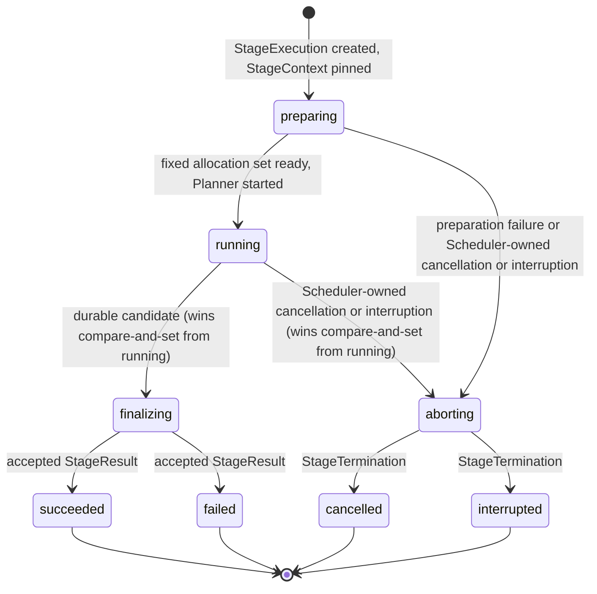
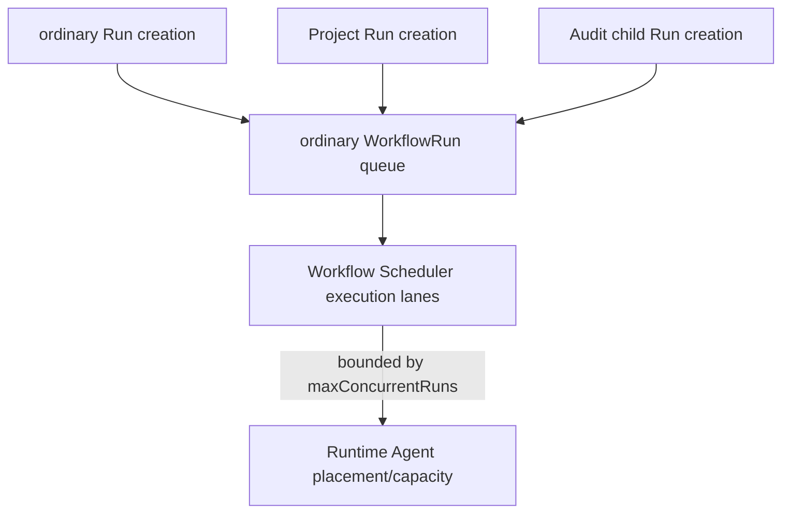
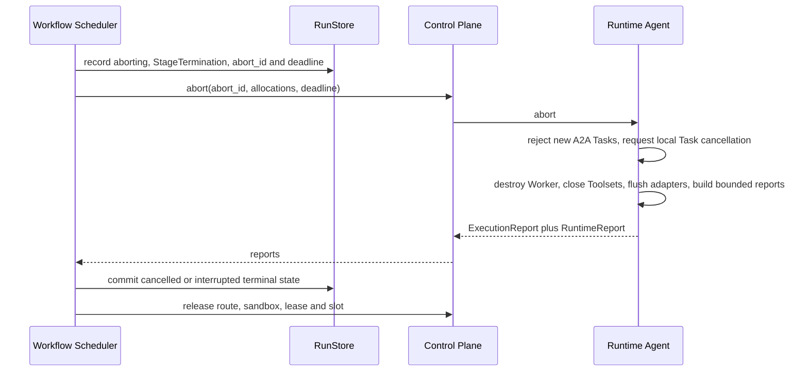

# Scheduler

Requirement prefix: `SCH` · [Specification index](../README.md)

## Purpose and scope

This document owns the Workflow Scheduler and the durable boundary around one
Stage attempt, the `StageExecution`: its identity, lifecycle and terminal facts
(`StageResult` and `StageTermination`), the StageContext snapshot, preparation
and capacity deferral, the `finalizing` and `aborting` paths, Workflow
progression through transition decisions, retry and escalation, terminal
allocation release and its recovery, Server-side recovery, the
model-availability recovery gate, durable Run claims and execution lanes, the
global concurrency limit and the owner queue pause gate. Planner decides when
its strategy has finished; Workflow Scheduler remains the only component that
commits durable StageExecution state.

It leaves to other documents:

- Workflow definitions, namely Stages, `entryStage`, transition actions and
  their schema, the retry `maxAttempts` count, artifact slots, bindings and
  `workflowOutputs` validation: [Workflows](../configuration/workflows.md).
- ExecutionConfig layering, including the escalation layer that Run
  initialization resolves: [AgentTemplates](../configuration/agent-templates.md).
- RuntimeSettings, runtime labels and credentials:
  [Runtime configuration](../configuration/runtime-config.md).
- The WorkflowRun resource and its states, Run initialization and admission,
  the `waiting` state, Run failure and its error, cancellation and manual
  continuation of a failed Run: [Runs](runs.md).
- Runtime Agent registration and principals, the confirmed control lease,
  capability-aware placement, atomic Stage allocation, the finalize and abort
  control commands and two-phase allocation release:
  [Control Plane](control-plane.md); the Runtime side of an allocation:
  [Runtime Agent](runtime-agent.md).
- Planner strategies, completion semantics, `finish`, Planner Sessions and
  Planner budgets: [Planners](planners.md); the Worker model boundary and
  Worker budgets: [Worker](worker.md).
- Exact result-ref verification, the write fence and Workflow output binding
  to `outputs/<output slot>`: [Artifact store](../artifacts/artifact-store.md).
- The global Queue read model: [Projects](../artifacts/projects.md); the Runs
  surface, Run hard deletion and Project deletion:
  [Retention and deletion](../artifacts/retention-and-deletion.md).
- The concurrency setting resource, its range, default, rationale and API, the
  supported deployment topology and process timeout settings:
  [Operations](../operations/operations.md).
- Execution report shapes, report identity binding and telemetry:
  [Observability](../platform/observability.md).
- Agent Skill pinning at Run initialization: [Skills](../tools/skills.md);
  the scan-planning journal fenced by the Scheduler claim:
  [Scanners](../tools/scanners.md).
- Shared registries: [limits](../platform/limits.md),
  [errors](../platform/errors.md),
  [failure model](../platform/failure-model.md) and
  [lifecycle](../platform/lifecycle.md).

## Concepts

Terms are defined once in the [glossary](../glossary.md); the ones this
document owns are:

| Term | Meaning here |
| --- | --- |
| Workflow Scheduler | The Server component that claims WorkflowRuns and creates, progresses and durably records their StageExecutions; "Scheduler" for short. |
| StageExecution | One attempt to execute one Stage, a reusable named node of a Workflow definition, in one WorkflowRun. There is no additional `StageAttempt` entity. |
| StageContext | The immutable snapshot of exact artifact versions that one StageExecution pins before it requests any allocation. |
| Candidate | The StageResult a Planner returns, before Scheduler validates, normalizes and stores it. |
| StageResult | The normalized semantic result of one Planner invocation, with `StageOutcome` `succeeded` or `failed`. |
| StageTermination | The durable Scheduler decision that an execution ends without an accepted semantic result, producing `cancelled` or `interrupted`. |
| Transition decision | The immutable record, keyed by the source `stage_execution_id`, of the Workflow progression chosen for one Stage outcome. |
| Finalization | The bounded `finalizing` path that drains Workers after a durable candidate, identified by `finalization_id`. |
| Abort | The bounded `aborting` path for Scheduler-owned cancellation or interruption, identified by `abort_id`. |
| Capacity deferral | Keeping a StageExecution `preparing`, with no slot reserved, while compatible Runtime capacity is missing. |
| Run claim | The durable PostgreSQL claim through which one execution lane owns one WorkflowRun. |
| Execution lane | One Scheduler loop that holds at most one Run claim while it performs one bounded progression attempt. |
| Maintenance loop | A bounded, dedicated loop for safety and recovery maintenance that consumes no execution lane. |
| Owner queue pause | The owner-scoped durable admission gate stored as `OwnerQueueControl`. |
| Terminal release recovery | Recovery that retries the incomplete allocation releases of terminal StageExecutions. |
| Recovery gate | Persisted model-availability state for one owner, resolved gateway digest, model, credential identity and model HTTP proxy route. |

The write fence is defined in [Artifact store](../artifacts/artifact-store.md);
`maxConcurrentRuns` as a stored setting in [Operations](../operations/operations.md).

## Model

### StageExecution lifecycle



| State | Meaning |
| --- | --- |
| `preparing` | The StageContext artifact snapshot is pinned, exact templates are loaded and required allocations are prepared. |
| `running` | One Planner invocation may use the fixed Worker set. |
| `finalizing` | Planner has stopped and its candidate result plus exact artifact versions are durable; allocations are draining and reports are collected. |
| `aborting` | Scheduler has durably rejected semantic completion, stored the StageTermination and fenced further work; cancellation and drain are bounded by the recorded abort deadline. |
| `succeeded`, `failed` | Terminal; contain an accepted StageResult. |
| `cancelled`, `interrupted` | Terminal; contain a StageTermination. |

### Terminal facts

`StageResult` and `StageTermination` represent different terminal facts:

- `StageResult` is the normalized semantic result of a Planner invocation. It
  produces terminal execution state `succeeded` or `failed` and may reference
  exact result artifacts. `StageOutcome` is `succeeded` or `failed`.
- `StageTermination` is a durable Scheduler decision that execution must end
  without an accepted semantic result; when it is recorded and what it produces
  is stated in SCH-R41.

```python
class StageError(BaseModel):
    code: str
    message: str
    retryable: bool


class StageResult(BaseModel):
    outcome: StageOutcome
    artifacts: dict[str, ArtifactRef] = Field(default_factory=dict)  # revision required
    content: StageContent | None = None
    error: StageError | None = None
```

```python
class StageTermination(BaseModel):
    outcome: Literal["cancelled", "interrupted"]
    code: str
    message: str
    retryable: bool
    phase: Literal["preparing", "running"]
    occurred_at: datetime
```

### Owner queue control

```text
OwnerQueueControl
  owner_id       primary key, derived from authentication
  paused         boolean
  revision       opaque concurrency token
  updated_at
```

### Execution lanes



## Requirements

### Scheduler authority

**SCH-R1.** The durable outer unit of execution is the `StageExecution`: one
attempt with at most one Planner invocation and exactly one terminal
`StageResult` or `StageTermination` (LIM-SCH-2, LIM-SCH-4). The execution model has no Server-side
Task DAG in addition to the Workflow; Planner may keep a private plan, but
Planner subtasks, Router selections and A2A Task IDs never become additional
Workflow Stages.

**SCH-R2.** Workflow Scheduler is the only component that commits durable
StageExecution state. Planner strategy determines when its invocation is
semantically complete ([Planners](planners.md)); Planner returns a candidate
StageResult and never writes RunStore or updates StageExecution storage.

Rationale: this separation keeps Planner strategies independent of RunStore
and gives cancellation, recovery and result acceptance one durable writer.

**SCH-R3.** Workflow Scheduler owns the durable transition and any configured
retry or escalation. The Planner cannot request escalation, advance or rewrite
the Workflow graph, and no Planner tool can select escalation.

**SCH-R4.** Workflow Scheduler never chooses physical placement; placement
belongs to the Control Plane ([Control Plane](control-plane.md)). Planner never
chooses, observes or changes physical placement.

**SCH-R163.** A Run's Workflow snapshot is immutable, so the Scheduler decodes
and validates it ([CAT-R35, CAT-R76](../configuration/catalog.md)) once per Run
and snapshot digest and reuses the validated snapshot on later steps of that
Run. The reuse is keyed by the Run identity, the Workflow identity and schema
version the Run records and the SHA-256 digest of the stored snapshot text; any
difference decodes and validates the snapshot again, and a snapshot that fails
validation is never kept. Every step works on its own copy. The Scheduler keeps
at most LIM-SCH-15 decoded snapshots and evicts the least recently used Run, so
an evicted Run is decoded again on its next step.

### StageExecution identity and scope

**SCH-R5.** Each StageExecution records at least:

- its `stage_execution_id`, `run_id` and stable Stage name;
- an attempt number for that stable Stage name within the Run and an optional
  `previous_execution_id`;
- a reference to the WorkflowRun's exact validated snapshot and the selected
  Stage specification within it;
- its StageContext pins (SCH-R15);
- exact AgentTemplate and WorkerRuntime refs plus Runtime Agent process
  identities for participants that were prepared;
- globally unique allocation IDs and, when Planner started, its invocation and
  session IDs;
- lifecycle timestamps, one terminal outcome (LIM-SCH-4), separate
  StageMetrics and any accepted exact artifact versions.

**SCH-R6.** Exact AgentTemplate refs, Run-pinned Agent Skill refs and
digests, WorkerRuntime refs, Runtime Agent process identities and allocation
IDs are recorded with the StageExecution for provenance; they are not
duplicated inside presentation content.

**SCH-R7.** Durable provenance records the exact AgentTemplate, Run-pinned
Agent Skill artifact refs and digests, effective ModelPolicy, LLMGatewayConfig
and non-secret credential refs, WorkerRuntimeRef, allocation ID and Runtime
Agent process identity. It never records ephemeral access material or
secret-bearing RuntimeSettings values.

**SCH-R8.** One StageExecution owns at most one root Planner instance, one
Planner invocation and one durable Contractor Planner Session (LIM-SCH-2). An
ADK-backed strategy also owns one live in-memory ADK conversation bound to that
Session; deterministic `passthrough@1` does not.

**SCH-R9.** The Planner instance, invocation and Session do not exist until
preparation succeeds and the fixed allocation set is ready; Workflow Scheduler
then creates them and starts Planner. They are required from `running` onward
on the normal result path.

**SCH-R10.** An allocation lives through Planner invocation and finalization
and may serve multiple sequential A2A Tasks while running. A Worker handles at
most one Task at a time ([LIM-CTL-6](../platform/limits.md)); different
prepared Workers run on different allocated Runtime Agent processes and may
execute concurrently.

**SCH-R11.** Retry and escalation never reopen a StageExecution. Each creates a
new StageExecution for the same Stage with the next attempt number and a
`previous_execution_id` pointing to the prior attempt and, after successful
preparation, new allocations, a new Planner instance and a new Planner Session
and, for an ADK-backed strategy, a new live ADK conversation.

**SCH-R12.** Cross-attempt state is explicit. A retry may receive Workflow
context, accepted prior results and Run-scoped artifact refs selected by
Workflow policy. It never inherits the previous attempt's pinned context
implicitly, nor the previous Planner's framework-private state or subtask plan.

### Normal execution sequence

**SCH-R13.** For the normal, successfully prepared StageExecution path,
Workflow Scheduler owns this sequence:

1. resolve and durably pin the StageContext artifact snapshot;
2. load and verify every exact AgentTemplate dependency of the selected Stage;
3. ask Control Plane to resolve pinned Run-selected Runtime labels plus
   candidate Agent Runtime labels, capability-match the resulting adapter
   requirements and atomically prepare all required Worker allocations from
   current live Runtime Agent registrations;
4. construct one Planner through the selected `PlannerFactory`;
5. invoke the Planner once with the fixed prepared Worker set;
6. validate and durably record the candidate `StageResult` plus exact
   referenced artifact versions, entering `finalizing`;
7. ask Control Plane to drain the Workers and collect execution and runtime
   reports;
8. atomically persist the terminal result and, only while the Run is still
   `running`, apply any declared Workflow output mapping and progression;
9. release every Stage allocation.

The Control Plane side of steps 3, 7 and 9, including the private finalize
command, is specified in [Control Plane](control-plane.md).

**SCH-R14.** Infrastructure preparation completes before Planner starts.
Planner is not invoked when required context cannot be resolved or any required
allocation fails to become ready, and Workflow Scheduler never receives a
partial WorkerHandle map or Planner subagent set.

### StageContext snapshot

**SCH-R15.** Workflow artifact references are logical and contain no revision.
When it creates each StageExecution, before requesting any allocation,
Scheduler creates the immutable `StageContext`: it resolves every present
context binding to an exact RunScope `ArtifactRef` at its current revision and
records that version with the StageExecution, and it records explicit absence
for each missing optional binding. The resolved artifact mapping passed to
Planner omits the absent entries. The retained-version check is
[ART-R81](../artifacts/artifact-store.md).

**SCH-R16.** Each concrete `AllocationSpec` carries its own copy of the
workspace projection using the exact StageContext refs
([Workspace](../tools/workspace.md)).

**SCH-R17.** A missing required binding is detected before allocation and
enters the preparation abort path with
`StageTermination(outcome="interrupted", code="context_artifact_missing", retryable=false, phase="preparing")`,
a non-retryable `interrupted` StageTermination, without allocating a Worker or
creating a Planner or Planner Session (FAIL-SCH-3).

**SCH-R18.** The StageContext snapshot is immutable: writes during the attempt
may advance logical bindings but cannot change the exact refs already present
in its StageContext ([ART-R82](../artifacts/artifact-store.md)).

**SCH-R161.** A retry is a new StageExecution and resolves and pins a fresh
StageContext snapshot, so it may deliberately observe bindings advanced, and
artifacts committed, by the previous attempt.

`context.artifacts` is data dependency and provenance, not an authorization
allowlist: Worker access remains governed by its allocation-bound RunScope
tools and grants ([ART-R83](../artifacts/artifact-store.md)).

### Preparation and capacity

**SCH-R19.** Temporary lack of sufficient compatible capacity is not a Stage
failure. When Control Plane reports insufficient compatible capacity ([Control
Plane](control-plane.md)), the StageExecution remains `preparing`, no slot is
reserved and Workflow Scheduler retries with bounded backoff until capacity
appears, the execution deadline expires or cancellation is requested
(FAIL-SCH-1). This covers both busy compatible agents and an environment
capability that is not yet represented in the live fleet.

**SCH-R20.** Capacity backoff while preparing one attempt is an infrastructure
concern and does not consume another Workflow attempt.

Stage admission, `admitted_at` and when the Stage wall-clock budget starts are
specified in [RUN-R28](runs.md).

**SCH-R22.** A preparation failure before Planner start still produces a
durable execution outcome: a non-capacity preparation failure records a
`StageTermination` and never synthesizes a Planner, Planner Session or
StageResult.

**SCH-R23.** Once all required slots have been atomically reserved, an
initialization failure, timeout or incompatible Agent Card makes Control Plane
drain and release the whole batch, including Runtime Agents that became ready
([Control Plane](control-plane.md)). Workflow Scheduler receives no partial map
and moves the StageExecution through `aborting` with a retryable `interrupted`
StageTermination whose code identifies the infrastructure error. When the batch
is cleared or the abort deadline expires, the execution becomes terminal and
Workflow policy decides whether to create a new attempt (FAIL-SCH-2).

**SCH-R24.** Allocations already prepared before a later preparation failure
are released before Workflow Scheduler applies the Workflow's declared Stage
failure or retry policy.

### Candidate results

**SCH-R25.** A normally completed Planner invocation produces one
framework-neutral semantic result candidate, a `StageResult` (see [Terminal
facts](#terminal-facts)).

**SCH-R26.** A successful candidate has no `error` and satisfies the Stage's
required artifact contract.

**SCH-R27.** A failed candidate has an `error`; failed results may retain
useful partial content or artifacts.

**SCH-R28.** Presentation `content` is bounded and excludes thoughts and
function protocol.

**SCH-R29.** Large or durable output is an `ArtifactRef`, never inline content.

**SCH-R30.** Every result ref contains a revision and identifies the exact
version selected by Planner.

**SCH-R31.** Scheduler validates result refs in the current RunScope, never
directly in UserScope, and never replaces their revision with the current
binding.

**SCH-R32.** Every `artifacts` key is a Stage-local result name declared by the
Stage; Workflow output mappings select results by that name rather than by
list position or by parsing an ArtifactRef.

**SCH-R33.** Metrics are not part of StageResult and cannot change its outcome.

**SCH-R34.** `StageContent` is a bounded Contractor presentation DTO. An ADK
adapter may map to and from `google.genai.types.Content`, but the core result
does not expose an ADK type. Its exact text and structured-part shape is an
implementation decision.

**SCH-R35.** Workflow Scheduler validates the candidate with the same
`StageResult` bounds the Planner applied ([WRK-R37](worker.md)) and stores it
unchanged while entering `finalizing`; RunStore rejects, rather than repairs,
a candidate that fails them. It may replace an invalid claimed success with a
failed `result_contract_violation`. Final report collection may update
StageMetrics but never rewrites this semantic result.

**SCH-R36.** Scheduler-driven cancellation or interruption is never represented
as a StageResult; it uses the distinct `StageTermination` contract.

Rationale: this keeps a preparation failure, a lost Worker or an external
cancellation from looking like a semantic Planner decision.

**SCH-R37.** Scheduler records an `interrupted` StageTermination when an
exception escapes the Planner invocation, when the Planner is exhausted before
a valid `finish`, or when the active Server or Planner is lost before any
candidate is durable (FAIL-SCH-4). The Planner-side mapping of handled
exceptions and expected Worker failures into failed candidates is specified in
[Planners](planners.md).

**SCH-R38.** When a Planner exhausts a hard
model-call/token/Worker-call/deadline budget without a valid terminal tool,
Scheduler records the stable budget error as a retryable, running-phase
interrupted StageTermination through bounded `aborting`, without awaiting
outstanding A2A Tasks.

**SCH-R39.** When `PassthroughPlanner` returns the non-retryable
`worker_input_required` or `worker_auth_required` error for an A2A
`INPUT_REQUIRED` or `AUTH_REQUIRED` state ([Planners](planners.md)), Scheduler
interrupts the Stage and applies `on.interrupted`.

### StageTermination

**SCH-R40.** A StageTermination `code` is stable and machine-readable and its
`message` is diagnostic. `retryable` is an input to Workflow policy, not an
instruction to reopen or automatically retry the same StageExecution.

**SCH-R41.** A StageTermination is recorded when the execution enters
`aborting`, produces terminal state `cancelled` or `interrupted`, and never
publishes declared outputs.

### Lifecycle and cardinalities

**SCH-R42.** The minimum StageExecution lifecycle is
`preparing -> running -> finalizing -> succeeded | failed` and
`preparing | running -> aborting -> cancelled | interrupted`, with the state
meanings given in [StageExecution lifecycle](#stageexecution-lifecycle).

**SCH-R43.** The cardinalities of a StageExecution depend on its lifecycle
state:

- before Planner starts, Planner invocation, Planner Session, StageResult and
  StageTermination may all be absent;
- `running` and normal `finalizing` require exactly one Planner invocation and
  one Planner Session (LIM-SCH-2);
- `aborting` requires exactly one StageTermination and no accepted
  StageResult (LIM-SCH-14); Planner invocation and Session may be absent when
  abort began during preparation;
- `succeeded` and `failed` require exactly one accepted StageResult and no
  StageTermination (LIM-SCH-4);
- `cancelled` and `interrupted` require exactly one StageTermination and no
  accepted StageResult (LIM-SCH-4); Planner invocation and Session are absent
  when termination happened during preparation and present when Planner had
  already started.

**SCH-R44.** Every terminal StageExecution contains exactly one of an accepted
`StageResult` or a `StageTermination`, never both (LIM-SCH-4). A StageResult
belongs to Planner completion; a StageTermination belongs to
Scheduler-controlled interruption or cancellation. A rejected or superseded
Planner candidate may be retained for audit but is not an accepted StageResult
(LIFE-SCH-1).

**SCH-R45.** Terminal states are immutable and a terminal StageExecution is
never rerun. Workflow Scheduler may apply the declared policy by creating
another StageExecution for retry or configured escalation (LIFE-SCH-1).

### Entering finalizing

**SCH-R46.** Before asking any Worker to stop, Workflow Scheduler atomically
records:

- the candidate StageResult, without assuming telemetry completeness;
- the exact committed versions or revisions referenced by that result;
- the Planner session identity and the available Planner report;
- a unique `finalization_id`, deadline and the allocation set to drain;
- the Server-side write fence that makes Artifact API writes from those
  allocations fail from this transition onward
  ([ART-R86](../artifacts/artifact-store.md)).

Scheduler verifies that `(RunScope, namespace, name, revision)` exists and
resolves to a retained immutable version, and locks that version for the same
transition. It never substitutes the current binding, even when that binding
has advanced since Planner selected the result
([ART-R84, ART-R85](../artifacts/artifact-store.md)).

**SCH-R47.** The candidate result and its exact referenced artifact versions
are durable before normal Worker drain begins; Workflow Scheduler persists the
candidate before stopping Workers, then accepts the terminal StageResult, then
releases allocations, except that, when Queue Pause defers next, retry or
escalation admission, drain and release may finish before acceptance
(SCH-R68).

**SCH-R48.** After the transition to `finalizing`, neither Planner nor Worker
may change the semantic result or its referenced artifact versions, and the
private Artifact API rejects new writes even if a stale Worker Task remains
active ([ART-R86, ART-R88](../artifacts/artifact-store.md)).

**SCH-R49.** Workflow Scheduler's bounded `finalizing` path authoritatively
stops the Worker allocations and collects their reports; Scheduler-owned
cancellation or interruption instead uses the bounded `aborting` path.
Candidate delivery by the Planner is specified in [Planners](planners.md).

**SCH-R50.** Once `finalizing` is durable, the Stage result has won this
StageExecution race and a later cancellation cannot replace it with a
StageTermination. If Run `cancelling` committed first, the StageResult remains
valid for audit but cannot advance the Workflow or create Run `outputs/<slot>`
bindings ([ART-R91](../artifacts/artifact-store.md)).

**SCH-R51.** StageMetrics is a separate StageExecution field populated while
finalizing or aborting. It is not embedded into, or used to rewrite, the stored
StageResult or StageTermination, and missing telemetry never invalidates an
otherwise valid StageResult or StageTermination. Report shapes are specified in
[Observability](../platform/observability.md).

### Entering aborting

**SCH-R52.** `aborting` is the bounded path for external cancellation, loss of
a required participant, an unrecoverable Planner invocation error, or another
Scheduler-owned interruption. Workflow Scheduler atomically records:

- the StageTermination, including its origin phase and stable reason;
- a unique `abort_id`, the abort deadline and every allocation that must stop;
- the write fence for those allocations and the fact that no Planner
  candidate may now be accepted.

The StageTermination and its abort deadline are durable before abort drain
begins.

**SCH-R53.** The transition to `finalizing` and the transition to `aborting`
compete through one durable compare-and-set from `running`; only one may win
(FAIL-SCH-5). A Planner candidate arriving after `aborting` starts may be
retained for diagnostics but can never become the StageResult or replace a
durable StageTermination.

**SCH-R54.** After recording `aborting`, Scheduler cancels the in-process
Planner invocation and requests A2A Task cancellation best-effort (FAIL-SCH-6).
Neither a successful `CancelTask` response nor an observed terminal A2A Task is
required for progress. Control Plane drains the allocations through the
authoritative private control protocol.

**SCH-R55.** Abort uses a separate, idempotent private control command and
proceeds in this order:

1. Workflow Scheduler records `aborting`, the StageTermination, `abort_id` and
   deadline in RunStore;
2. Workflow Scheduler asks Control Plane to
   `abort(abort_id, allocations, deadline)`;
3. each Runtime Agent rejects new A2A Tasks and requests local Task
   cancellation;
4. in the same process, the Worker is destroyed, Toolsets are closed, adapters
   are flushed and bounded reports are built;
5. the Runtime Agent returns ExecutionReport plus RuntimeReport;
6. Workflow Scheduler commits the `cancelled` or `interrupted` terminal state;
7. Control Plane releases route, sandbox, lease and slot.



**SCH-R56.** The abort command performs no semantic work and does not depend on
A2A `CancelTask` delivery. It is idempotent for `abort_id`; retries return the
cached report when available (FAIL-SCH-7).

**SCH-R57.** Scheduler waits no longer than the durable abort deadline. At that
deadline any allocation that has not confirmed shutdown is marked lost and
fenced, its reports are recorded as incomplete, and Scheduler deterministically
commits the terminal state named by the StageTermination (FAIL-SCH-7).

**SCH-R58.** An execution aborted during `preparing` follows the same contract.
If it has no Planner and no reserved allocations, `aborting` can complete
immediately after the durable transition.

**SCH-R59.** Finalization and abort cannot perform semantic work, model or tool
calls, or artifact mutations, and cannot wait indefinitely for A2A Task
cancellation. Neither A2A cancellation delivery nor terminal Task observation
can extend finalization or abort past its durable deadline.

### Terminal barrier

**SCH-R60.** Worker MemoryTools mutations use the allocation-grant write
fence. Planner mutations lock the active Run and Stage in the Artifact
transaction. Scheduler fences all grants before the durable `finalizing` or
`aborting` transition, and Planner calls finish synchronously before a
candidate. The full barrier ordering is
[MEM-R97](../tools/memory.md) and its `memory_forbidden` outcome is
[MEM-R63](../tools/memory.md); fence serialization with Artifact mutations is
[ART-R87](../artifacts/artifact-store.md).

**SCH-R61.** Neither Planner nor Worker memory content enters durable session
facts or execution telemetry.

Worker workspace export finishes before Scheduler observes terminal A2A state
and enters its write-fenced transition; the export rules are specified in
[Workspace](../tools/workspace.md).

### Operation budgets

The separate process budgets for HTTP requests, Scheduler store operations,
the claim lease, stored terminal deadlines and Runtime batch preparation and
cleanup are specified in
[OPS-R15, OPS-R16](../operations/operations.md).

**SCH-R63.** Finalize and abort use the earlier of the caller deadline and the
stored terminal deadline; the cleanup setting imposes no further cap on those
phases (FAIL-SCH-8, FAIL-SCH-7).

**SCH-R64.** Recovery and repeated requests reuse the saved operation ID and
deadline, including after a restart or a process-setting change.

**SCH-R65.** Each release batch has one cleanup deadline and each prepare
batch one prepare deadline; the Scheduler store-operation budget caps neither.
Failed-prepare cleanup shares one deadline across abort and release, and a
failed release retains the allocation grant.

**SCH-R66.** Inner requests may end earlier, but cannot extend the enclosing
operation or relinquish unconfirmed resource ownership. Physical workspace
disposal applies these bounds ([Workspace](../tools/workspace.md)).

### Allocation release

**SCH-R67.** Workflow Scheduler releases a Stage's allocations only after
recording its terminal outcome: normally an allocation remains reserved through
draining or stopped state until the StageExecution becomes terminal, then
two-phase release begins ([Control Plane](control-plane.md)). The only
exception is SCH-R68.

**SCH-R68.** When Queue Pause defers an atomic next, retry or escalation
admission (SCH-R155), drain and release may finish while the StageExecution
retains its durable `finalizing` candidate or `aborting` termination, immutable
operation ID and deadline. This does not authorize another Planner invocation
or early result or output acceptance, and it preserves all normal teardown,
fencing and release-acknowledgement requirements.

**SCH-R69.** A release cleanup failure keeps the Runtime Agent fenced ([Control
Plane](control-plane.md)) without rewriting the terminal Stage outcome
(FAIL-SCH-9).

**SCH-R70.** Each durable Stage allocation records bounded release-attempt and
release-completion metadata separately from its immutable provenance
(LIFE-SCH-2).

**SCH-R71.** Terminal release recovery selects only a bounded,
least-recently-attempted batch of incomplete terminal releases. It retries each
still-live allocation independently, so one member of a partially released
multi-Agent Stage cannot hide another (FAIL-SCH-9).

**SCH-R72.** A cleanup error is reported and retried but never prevents
Scheduler from claiming an unrelated WorkflowRun.

**SCH-R73.** Retrying cannot repair a live grant whose provenance differs from
the terminal durable allocation. Because allocation IDs are never reused,
recovery reports the divergence, write-fences that grant and releases it once
the Stage the grant names is terminal or unknown. A grant still named by an
active Stage is left to that Stage's own release; the durable row is then
marked released because the grant no longer exists.

**SCH-R74.** A Runtime Agent has no PostgreSQL or long-lived external telemetry
credential. It may receive an allocation-scoped exporter credential only inside
RuntimeSettings ([Runtime configuration](../configuration/runtime-config.md)),
holds it in memory and erases it during release.

### Workflow progression

**SCH-R75.** After a Planner terminates, Workflow Scheduler interprets the
StageResult under the Workflow's declared Stage policy and, while the Run
remains `running`, selects the next Stage, a retry or a configured escalation.
When Scheduler records a StageTermination, Workflow policy makes the same outer
progression decision without pretending that Planner returned a semantic
result, again only while the Run is `running`.

**SCH-R76.** Workflow cancellation is not a graph edge: once the Run is
`cancelling`, Stage cancellation does not evaluate `on` transitions
([WFL-R39](../configuration/workflows.md)), and terminal Stage outcomes
contribute only to reaching Run quiescence.

**SCH-R77.** For every accepted StageResult or committed interrupted
StageTermination while the Run remains `running`, Scheduler records one
immutable transition decision keyed by the source `stage_execution_id`
(LIM-SCH-12). The
decision is exactly one of `next`, `retry`, `escalate`, `succeed` or `fail`. A
`next`, `retry` or `escalate` decision includes the target Stage name and the
newly created StageExecution ID; an escalation decision additionally identifies
its resolved escalation action and effective executionConfig snapshot. Terminal
decisions have no target.

**SCH-R78.** Completing the source execution, applying successful output
mappings ([ART-R90](../artifacts/artifact-store.md)), recording the transition
decision, and either creating and pinning the target execution or making the
Run terminal are one database transaction (FAIL-SCH-10). Recovery therefore
observes either the old active source or the complete committed progression and
never manufactures a second attempt for the same outcome.

When a policy-selected Run failure is committed relative to the Run's single
active StageExecution (SCH-R114), and the conditions and error of Run failure,
are specified in [RUN-R37 and RUN-R38](runs.md).

### Retry

**SCH-R80.** Both StageError and StageTermination carry a required boolean
`retryable`. A `retry` action creates the next attempt only when that value is
`true`, the attempt limit is not exhausted and the WorkflowRun is still
`running`; otherwise Scheduler immediately evaluates `then`. The retry attempt
limit is the action's `maxAttempts` ([LIM-WFL-5](../platform/limits.md)),
which counts the initial StageExecution
([Workflows](../configuration/workflows.md)).

**SCH-R81.** `then` contains exactly one `next` or `fail` action
(LIM-SCH-13); a nested retry and a successful termination are invalid there.

**SCH-R82.** `retryable` does not trigger retry by itself. A `failed` or
`interrupted` transition using `next` or `fail` follows that declared action
regardless of the flag.

**SCH-R83.** Workflow `v1alpha1` has no retry delay, backoff, error-code
predicate or runtime override.

### Escalation

**SCH-R84.** An escalation action's `maxAttempts` is a positive integer
(LIM-SCH-5) and counts only new escalated executions, not the execution whose
outcome selected the action.

**SCH-R85.** Each escalation creates a new StageExecution with the next
ordinary Stage attempt number, a `previous_execution_id`, the Scheduler
decision kind `escalate`, and an exact effective executionConfig resolved from
the Run's base Stage configuration plus this action's override. Escalation
overrides do not accumulate across attempts. Only escalation applies its
declared pinned executionConfig override; retry does not.

**SCH-R86.** All referenced configuration bodies and digests are resolved and
pinned in the immutable Run snapshot before the Run starts, with every declared
escalation variant resolved at Run initialization
([AgentTemplates](../configuration/agent-templates.md)). The Scheduler decision
selects one already pinned variant rather than performing configuration lookup;
escalation never consults mutable files or UI state.

**SCH-R87.** Unlike retry, escalation does not consult the `retryable` flag of
the source StageError or StageTermination, including that of a failed Planner
candidate; that flag gates ordinary retry only. The explicit outcome branch,
the action's own attempt limit and a still-`running` WorkflowRun are the
complete eligibility rule, so a failed candidate produced by a model-backed
Planner cannot enable or suppress an escalation indirectly.

**SCH-R88.** When the escalation limit is exhausted, Scheduler evaluates
`then`, which contains exactly one `next` or `fail` action (SCH-R81).

**SCH-R89.** The escalation counter belongs to that exact declared action
across the StageExecution ancestry and is not reset by alternating outcomes.

**SCH-R90.** An escalation policy under `failed` never applies to
`interrupted`, or vice versa; each outcome needs its own explicit escalation
configuration.

### Manual continuation attempts

Manual continuation of a failed Run, including how the new attempt copies the
source's StageSpec, StageContext pins and effective execution configuration
and how it affects retry and escalation counters, is specified in
[RUN-R46 to RUN-R51](runs.md).

### Allocation loss

**SCH-R93.** When Control Plane irreversibly reports an active allocation lost,
for example after confirmed control lease expiry or after a Runtime Agent
process restart that cannot adopt its previous allocation ([Control
Plane](control-plane.md)), any active StageExecution using that allocation
enters `aborting` with an interrupted StageTermination. Workflow Scheduler
completes the bounded abort path and then applies the declared `interrupted`
policy: retry with a new StageExecution, a configured escalation
executionConfig, or Run failure (FAIL-SCH-11).

**SCH-R94.** Lease loss cannot be reversed into successful completion of the
interrupted StageExecution; a late report may be accepted only as incomplete
telemetry.

**SCH-R95.** The interrupted StageTermination records the specific loss reason,
for example `control_lease_expired` or `runtime_state_mismatch`, rather than
collapsing every loss into one code.

### Recovery

**SCH-R96.** WorkflowRun recovery uses durable Scheduler state, not live ADK
sessions. The validated Workflow snapshot, exact input forks, completed
StageExecutions, accepted results and exact artifact versions survive Server
restart (FAIL-SCH-12).

**SCH-R97.** The in-memory Runtime Agent Registry does not survive Server
restart and is not a recovery authority; still-running agent processes register
again ([Control Plane](control-plane.md)).

**SCH-R98.** Every allocation reported after re-registration, or by a
heartbeat, is reconciled by its globally unique ID with durable StageExecution
state before its slot can receive new work: a matching `finalizing` execution
resumes its recorded idempotent finalization, a matching `aborting` execution
resumes its recorded idempotent abort, and a terminal or unknown allocation is
drained and released. Reconnection never adopts a Worker for continued Planner
execution.

**SCH-R99.** A `finalizing` execution with a durable candidate and pinned
versions reissues the same idempotent finalization, then accepts the candidate
even if reports remain incomplete (FAIL-SCH-8).

**SCH-R100.** A `preparing` or `running` execution without a candidate enters
`aborting`, because its Planner is not resumable: Scheduler records a retryable
interrupted StageTermination, remaining allocations stop or become lost at the
abort deadline, any Worker reported by a reconnected agent is drained, and
Workflow Scheduler then chooses the declared retry, configured escalation or
Run failure action.

**SCH-R101.** A Runtime Agent process restart never reattaches its old Worker;
the affected in-process Worker no longer exists, and an affected `preparing` or
`running` StageExecution follows the same `aborting -> interrupted` path.

**SCH-R162.** Expiry of either side's confirmed Runtime Agent control lease
([Control Plane](control-plane.md)) follows the same path as SCH-R100:
Scheduler records a retryable interrupted StageTermination. The agent
independently drains and terminates its Worker on local lease expiry, then
remains fenced with the allocation ID until release is acknowledged.

**SCH-R102.** Durable state the Scheduler cannot progress
(`scheduler_state_invalid` or `unsupported_workflow_shape`) ends the Run as
`failed`, or `cancelled` once cancellation owns it, in one transaction with
every active StageExecution: `preparing` and `running` become `interrupted`
with that code, `aborting` commits its stored StageTermination, and
`finalizing` accepts its durable candidate without Workflow progression or
output binding, exactly as during cancellation. Every Stage is then terminal,
so terminal release recovery drains and releases its allocations and the Run
can later be deleted (FAIL-SCH-13).

**SCH-R103.** Retry after recovery always creates a fresh StageExecution and,
if preparation succeeds, a fresh Planner Session. Planner Session persistence
does not imply Planner resume: a Planner session still running after process
loss yields the stable retryable invocation-in-progress error
([Planners](planners.md)), and Workflow policy decides whether a fresh
StageExecution should retry.

### Model-availability recovery

While the Run is `waiting`, StageExecution state follows
[RUN-R31](runs.md).

**SCH-R105.** Server persists a recovery gate for the owner, resolved gateway
digest, model, credential identity and model HTTP proxy route. Active
invocations recover before new queued work.

**SCH-R106.** One leased probe checks a blocked route (LIM-SCH-11); stale
successful responses cannot reopen it. Repeated failure reports are idempotent
even when other invocations report failures between retries. A probe lease
lasts its holder's own request timeout (`workerRequestTimeout` for a Runtime
Worker, `plannerTimeout` for a Server-side Planner) plus the initial probe
delay, never the longer of the two. Admitting a Stage onto a blocked, due
route that no live invocation waits for reserves that probe for the admitted
Run until its first request. A later admission of the same Run first
relinquishes its earlier reservations, so its own reservation never refuses
it and a route it no longer admits is freed.

**SCH-R107.** The automatic recovery window is bounded; manual retry reopens
it, while cancellation and the admitted Stage wall-clock limit remain
effective. Terminated invocations relinquish their recovery waits: every
transaction that ends a Stage, whether it accepts a result, commits a
termination, finishes a cancelled Run or fails an unprogressable Run, also
drops that Stage's waits and route membership and relinquishes any probe its
Run holds or reserved, without reopening the route or resetting its retry
window, so another Run can probe at once.

**SCH-R108.** A Runtime call or Server-side Planner request that abandons a
granted attempt, through cancellation or an unexpected failure at any point
before its terminal update is acknowledged (including while reporting the
outcome), re-delivers that idempotent update as a bounded best effort, the
Planner on a context detached from its cancelled invocation, so the leased
probe is not held until it expires. An attempt abandoned before any outcome
reports `released`, which relinquishes the probe without reopening the blocked
route or resetting its retry window; a cancelled attempt is never reported as
a Gateway failure. A terminal update (`succeeded`, `finished` or `released`)
is accepted from a write-fenced allocation and while the Run is cancelling;
`acquire` and `failed` are not, so an ending Stage neither starts a model call
nor makes its Run wait (FAIL-SCH-14).

**SCH-R109.** A request the Gateway received but did not answer within the
participant's own request timeout (`workerRequestTimeout` or `plannerTimeout`)
is reported as `released` and is not resent; the model call fails as transient.
`finished` is reserved for an observed non-retryable response (FAIL-SCH-14).

Rationale: a slow model is not an outage, and the Gateway may still be
generating its answer.

**SCH-R110.** Cancellation before a grant is known sends nothing and leaves an
unknown lease to its expiry or to the end of its Stage (SCH-R107).

**SCH-R111.** A Server-side Planner retries a transient database failure while
recording an observed outcome a bounded number of times. A model reply or
permanent rejection is kept, and its usage charged, even when that recording
still fails: the route and waits reconcile on a later update, the probe lease
expiry or the end of the Stage (FAIL-SCH-15).

**SCH-R112.** A retryable failure must be recorded before its request is
resent.

**SCH-R113.** Model-availability recovery does not persist or restore an ADK
session after Runtime process loss. Which model request is retried during
`waiting` is specified in [Runs](runs.md).

### Run claims and execution lanes

**SCH-R114.** One WorkflowRun has at most one active StageExecution
(LIM-SCH-1). Scheduler concurrency exists only across different WorkflowRuns;
it permits neither concurrent Stages inside one Run nor concurrent Tasks inside
one Runtime Agent. The production Scheduler admits bounded execution lanes
across different Runs without changing this rule.

**SCH-R115.** At startup the Scheduler reads the durable concurrency setting
before admitting work. Its production loop is a supervisor with at most
`maxConcurrentRuns` execution lanes (LIM-SCH-6).

**SCH-R116.** Each lane owns at most one durable Run claim while it performs
one bounded progression attempt (LIM-SCH-7), and repeatedly:

1. claims at most one runnable WorkflowRun through PostgreSQL;
2. registers that Run for in-process cancellation;
3. renews the exact claim while progressing it;
4. executes one bounded Run/Stage lifecycle attempt;
5. removes its own cancellation registration, then releases the claim before
   selecting more work (LIFE-SCH-3).

**SCH-R117.** The cancellation registration is keyed by the exact claim: once
the claim is released, another lane of the same process may claim the Run, and
the finishing lane can neither shadow nor remove that lane's cancellation or
allocation-loss interrupt.

**SCH-R118.** The registration also tracks the StageExecution the lane is
currently progressing, so an allocation loss interrupts the lane only when the
loss names that exact StageExecution. A loss for an already finished Stage,
whose owner stopped after completion but before its release succeeded while the
Run advanced to a later Stage, interrupts nothing; its fenced grant is
reclaimed by terminal release recovery (FAIL-SCH-11).

**SCH-R119.** Cancelling Planner execution does not cancel claim renewal: the
same lane owns the Run throughout cancellation and allocation-loss cleanup.
Losing the claim interrupts both ordinary work and cleanup. A terminal Run
transition clears its claim atomically; renewal racing that transition treats
it as completion (FAIL-SCH-16).

**SCH-R120.** The `FOR UPDATE SKIP LOCKED` claim boundary is authoritative:
different lanes cannot claim the same Run, and a claim cannot be silently
stolen before expiry (FAIL-SCH-16).

**SCH-R121.** Claim ordering prioritizes cancellation and rotates
capacity-deferred work: cancelling Runs retain priority over ordinary running
and initialization work, and releasing the claim after an
`insufficient capacity` result moves that Run behind already-runnable peers of
the same priority. Capacity deferral is therefore fair across Runs: an older
graph Stage cannot monopolize polling while a newer shallow Stage could use an
otherwise idle memory Runtime.

**SCH-R122.** A paused or capacity-ineligible Run releases its lane after a
bounded admission or placement attempt, so it cannot indefinitely occupy all
execution capacity.

**SCH-R123.** A deferred Run ranks behind pending work for 30 seconds after it
defers (LIM-SCH-8); it then competes in its own state's tier again, so a Run
that stays blocked takes at most one claim per window and newer Runs cannot
starve it.

**SCH-R124.** Scheduler claims WorkflowRuns with its authoritative lifecycle
query; the Queue read model and its lack of position guarantees are specified
in [PRJ-R90 to PRJ-R92](../artifacts/projects.md).

**SCH-R125.** `RunOnce` is a deterministic single-claim primitive for focused
tests and recovery tools and may perform one maintenance tick before that
claim. Production lanes use the claim and progression primitive directly; the
supervisor owns maintenance, lane creation and resizing and never wraps
concurrent calls around `RunOnce`.

**SCH-R126.** All objects shared across lanes must be proven concurrency-safe.
In particular, Planner factories, allocation coordination, Artifact and
credential services, Run cancellation registration, clocks and ID generation,
and test doubles may not rely on serialization by a single production loop.
PostgreSQL transaction and claim boundaries remain the source of durable
ordering.

The durable Scheduler claim also fences Planner-side journals such as the
scan-planning journal, which only the claim owner may mutate
([Scanners](../tools/scanners.md)).

### Global concurrency limit

**SCH-R127.** Contractor exposes one durable Operations setting,
`maxConcurrentRuns`, that limits how many different WorkflowRuns the supported
Server process may actively progress at the same time. The setting is global
because Runtime Agent capacity and the Workflow Scheduler are deployment
resources, not owner- or Project-local resources. Its stored form, range,
default and API are specified in [Operations](../operations/operations.md).

**SCH-R128.** `maxConcurrentRuns` is the only Contractor setting for concurrent
WorkflowRun execution. It applies identically to standalone, Project,
Evaluation and Audit child Runs, and it introduces no second queue, no Audit
execution pool and no special scheduling based on Run labels.

**SCH-R129.** The limit is not the number of records whose durable state is
`running`; it bounds concurrent Scheduler execution lanes. A `running` Run
remains `running` while it lacks Scheduler or compatible Runtime capacity.

**SCH-R130.** Reaching the limit never rejects ordinary Run creation. Newly
created Runs remain in the existing Queue read model until a lane and
compatible Runtime capacity are available; the setting is execution control,
not a queue-length quota.

**SCH-R131.** `0` is deliberately invalid for `maxConcurrentRuns`
([LIM-OPS-7](../platform/limits.md)).
Owner Queue Pause is the explicit way to stop new normal Stage admission for
one owner, and it never stops cancellation, recovery, finalization or release
(SCH-R148).

That a Run does not pin the setting, and what editing it can and cannot change,
is specified in [OPS-R46, OPS-R51 and OPS-R52](../operations/operations.md).

**SCH-R133.** The database value is the desired limit. The Server applies a
committed update to its in-process supervisor and sends a wake hint; a bounded
periodic refresh also reconciles the value, so correctness never depends on
delivery of that hint. Restart reads the same durable row before new work is
admitted (FAIL-SCH-17).

**SCH-R134.** An increase starts additional lanes promptly and admits waiting
work without restart.

**SCH-R135.** A decrease is a drain operation:

- no active Run or Planner call is cancelled merely because the limit fell;
- current lanes finish their bounded claim attempt and release it normally;
- the supervisor starts no replacement attempt while active lanes exceed the
  new limit, and no new claim starts at or above the lower desired value;
- once drained, concurrency remains at or below the new value.

**SCH-R136.** Outside the decrease-drain interval, no more than the configured
`N` distinct WorkflowRuns hold Scheduler execution lanes, including
initialization and cancellation work, and no Run ever has two lanes (LIM-SCH-6,
LIM-SCH-7).

**SCH-R137.** Upgrade and restart preserve effective serial behaviour until an
operator changes the seeded value from one
([LIM-OPS-7](../platform/limits.md)).

**SCH-R138.** A settings update that commits immediately before process failure
is still observed by the restarted Server. The HTTP response does not promise
that a newly added lane has already acquired Runtime capacity before returning
(FAIL-SCH-17).

**SCH-R139.** Each Runtime Agent process supplies exactly one slot
([LIM-CTL-4](../platform/limits.md)). One WorkflowRun counts as one Scheduler
lane (LIM-SCH-7) even when its selected Stage needs several named Workers and therefore
several Runtime Agent slots. The setting is consequently an upper bound, not a
promise of utilization:

```text
actual concurrent Runs <= maxConcurrentRuns
actual concurrent Runs is additionally constrained by compatible Agent slots
```

**SCH-R140.** Runtime incompatibility or insufficient slots can lower actual
concurrency but cannot make a deferred Run monopolize all lanes.

**SCH-R141.** Adding or removing Runtime Agents does not automatically rewrite
the configured limit.

**SCH-R142.** Audit child Runs consume the same global lanes as every other
Run. AuditProfile contains no concurrency knob; its internal dispatch
look-ahead follows the current global setting, and its total submitted-Run
budget remains independent ([Audit execution](../audits/execution.md)).

**SCH-R143.** The concurrency settings API is Operations-authorized, strict,
CSRF-protected, CAS-safe, restart-durable, audited and represented by the exact
OpenAPI contract.

**SCH-R144.** The independently deployed UI handles initial load, invalid
input, pending update, stale revision, reconnect invalidation, Server error and
refresh of the concurrency setting without guessing an effective value.

### Owner queue pause

**SCH-R145.** Queue pause is an owner-scoped durable admission gate stored as
`OwnerQueueControl`, not a process-local toggle and not a new WorkflowRun
state. `owner_id` is derived from authentication.

**SCH-R146.** Absence of an `OwnerQueueControl` row means running.
`GET /v1/queue/control` returns the effective state. `PUT /v1/queue/control`
accepts exactly `{"paused": true|false}` and a strong `If-Match` for an
existing representation; repeating the same desired state is idempotent
(FAIL-SCH-18).

**SCH-R147.** The Queue tab renders one authoritative **Pause queue** or
**Resume queue** action and refetches after mutation.

**SCH-R148.** Pause blocks only new normal semantic work; cancellation,
recovery, finalization and release cannot be paused and must continue to make
progress. Pausing has drain semantics.

**SCH-R149.** Server may continue accepting new Runs while paused; they remain
visible and wait.

**SCH-R150.** A semantic Stage already admitted before the pause linearization
point may finish normally, including finalization and release.

**SCH-R151.** Scheduler must not admit the owner's next normal Stage after the
pause commits.

**SCH-R152.** A pending Run's not-yet-admitted Stage, such as a manual
continuation or a capacity-deferred attempt created before the pause, reserves
no Runtime slot while paused: Scheduler reads the gate before placement, as it
does for lack of capacity, and admission still rechecks it atomically. When a
pause commits after placement became durable but before admission, admission
observes the pause and Scheduler discards that never admitted, unprepared
placement: one transaction deletes its durable allocation rows, relinquishes
any recovery probe its admission reserved and drops its live reservation, so
no slot stays reserved for the pause. The first claim after resume places the
Stage again as the same attempt, consuming no retry. If the discard fails, the
placement stays durable and live and the next claim reuses it.

**SCH-R153.** Cancellation, abort, recovery of an already admitted Stage and
allocation release continue while paused; result acceptance and output
publication also continue when they do not admit another Stage. A Project
deletion request can therefore always make progress
([DEL-R50](../artifacts/retention-and-deletion.md)).

**SCH-R154.** Resume makes waiting Runs eligible after a restart without
rewriting them.

**SCH-R155.** If completion would admit a next Stage, retry or escalation,
acceptance of the current result or termination, output mapping, transition
decision and creation of the new attempt remain one transaction, and pause
defers that transaction. The current StageExecution retains its durable
`finalizing` candidate or `aborting` termination, with the same operation ID
and deadline; drain and two-phase allocation release may finish while admission
waits (SCH-R68). Resume applies the saved outcome without invoking the previous
Planner again. Cancellation and completion that only terminalizes the Run
remain available while paused.

**SCH-R156.** The pause update and normal Stage admission share one database
serialization boundary: a process that observed an older state cannot begin a
new semantic Stage after the pause transaction commits (FAIL-SCH-18). Pause
does not suspend an in-flight HTTP or model call and does not promise an exact
queue position.

**SCH-R157.** Owner Queue Pause, the global concurrency setting and Runtime
placement solve different problems: Queue Pause controls normal Stage admission
for one owner; `maxConcurrentRuns` bounds Scheduler work across all owners;
Runtime placement decides whether the selected Stage's exact allocation set can
run on currently eligible agents.

**SCH-R158.** A paused owner must not prevent another owner from using
available lanes. Already admitted work drains under the Queue pause contract.
Cancellation of a Run currently owned by a lane interrupts that lane through
the in-process cancellation path; other cancelling Runs retain claim priority.

### Maintenance

**SCH-R159.** Allocation-loss polling, terminal allocation-release recovery,
expired telemetry cleanup and comparable safety and recovery maintenance are
not semantic Workflow execution and consume no execution lane. They run through
bounded dedicated maintenance loops, so lowering the limit or pausing an owner
cannot disable cleanup. Their control calls may overlap lane work without
allowing another StageExecution for the same Run.

**SCH-R160.** Cancellation, Project deletion, terminal release, allocation-loss
recovery and cleanup converge at every valid limit. Project deletion's use of
ordinary cancellation is specified in [DEL-R44,
DEL-R46](../artifacts/retention-and-deletion.md).

## Interfaces

- Owner queue control: `GET /v1/queue/control` and `PUT /v1/queue/control`
  (SCH-R146) in
  [contractor-public-v1.yaml](../../../api/openapi/contractor-public-v1.yaml);
  public API conventions are in [Public API](../api/public-api.md).
- The concurrency setting endpoint `/v1/operations/settings/scheduler` and its
  `/operations/settings` UI are specified in
  [Operations](../operations/operations.md).
- The private `finalize` command and the Control Plane and Runtime side of
  `abort` are specified in [Control Plane](control-plane.md); the abort order
  and its idempotence are SCH-R55 and SCH-R56.
- `StageResult`, `StageError` and `StageTermination` are given under
  [Terminal facts](#terminal-facts); ExecutionReport, RuntimeReport and
  StageMetrics shapes are in [Observability](../platform/observability.md).

## Limits, failures and errors

Limits ([registry](../platform/limits.md)):

- LIM-SCH-1 — active StageExecutions per WorkflowRun: at most 1 (SCH-R114).
- LIM-SCH-2 — root Planner instances, Planner invocations and Planner Sessions
  per StageExecution: at most 1 each, and exactly 1 Planner invocation and 1
  Planner Session in `running` and normal `finalizing`; for an ADK-backed
  strategy, live in-memory ADK conversations: at most 1 (SCH-R1, SCH-R8,
  SCH-R43).
- LIM-SCH-4 — terminal facts per terminal StageExecution: exactly 1 accepted
  StageResult or StageTermination, never both (SCH-R1, SCH-R5, SCH-R43,
  SCH-R44).
- LIM-SCH-5 — escalation `maxAttempts`: integer of at least 1 (SCH-R84).
- LIM-SCH-6 — execution lanes per Server process: at most `maxConcurrentRuns`
  (SCH-R115, SCH-R136).
- LIM-SCH-7 — Run claims per lane and lanes per Run: at most 1 (SCH-R116,
  SCH-R136, SCH-R139).
- LIM-SCH-8 — deferred (paused or capacity-ineligible) Run ranked behind
  pending work: 30 seconds, at most 1 claim per window while it stays blocked
  (SCH-R123).
- LIM-SCH-11 — leased probes per blocked model-availability route: at most 1
  (SCH-R106).
- LIM-SCH-12 — transition decisions per source StageExecution outcome:
  exactly 1 (SCH-R77).
- LIM-SCH-13 — actions in the `then` of a retry or escalate action: exactly 1
  `next` or `fail` (SCH-R81).
- LIM-SCH-14 — terminal facts per `aborting` StageExecution: exactly 1
  StageTermination and no accepted StageResult (SCH-R43).
- LIM-SCH-15 — decoded Workflow snapshots kept per Server process: at most 64
  Runs and 64 MiB of stored snapshot text (SCH-R163).
- Used here, owned elsewhere: concurrent A2A Tasks per Worker
  ([LIM-CTL-6](../platform/limits.md), SCH-R10), slots per Runtime Agent
  process ([LIM-CTL-4](../platform/limits.md), SCH-R139), the
  `maxConcurrentRuns` range and default ([LIM-OPS-7](../platform/limits.md),
  SCH-R131, SCH-R137) and retry `maxAttempts`
  ([LIM-WFL-5](../platform/limits.md), SCH-R80).

Errors ([registry](../platform/errors.md)):

- `context_artifact_missing` — a required Stage context binding is missing
  (SCH-R17).
- `result_contract_violation` — Scheduler replaced an invalid claimed success
  with a failed result (SCH-R35).
- `scheduler_state_invalid`, `unsupported_workflow_shape` — durable state the
  Scheduler cannot progress (SCH-R102).
- `control_lease_expired`, `runtime_state_mismatch` — allocation-loss reasons
  of an interrupted StageTermination (SCH-R95); a control lease expiry records
  a retryable StageTermination (SCH-R162).
- Planner and Worker error codes (`worker_input_required`,
  `worker_auth_required`, `worker_budget_exhausted` and the
  invocation-in-progress error) are owned by [Planners](planners.md) and
  [Worker](worker.md); `memory_forbidden` by [Memory](../tools/memory.md).

Failure outcomes ([failure model](../platform/failure-model.md)):

- FAIL-SCH-1 — Runtime capacity for a Stage (SCH-R19).
- FAIL-SCH-2 — allocation batch initialization (SCH-R23).
- FAIL-SCH-3 — StageContext resolution (SCH-R17).
- FAIL-SCH-4 — Planner invocation (SCH-R37).
- FAIL-SCH-5 — `finalizing` versus `aborting` (SCH-R53).
- FAIL-SCH-6 — A2A Task cancellation (SCH-R54).
- FAIL-SCH-7 — abort control command (SCH-R56, SCH-R57).
- FAIL-SCH-8 — finalize control command (SCH-R99, SCH-R63).
- FAIL-SCH-9 — allocation release (SCH-R69, SCH-R71).
- FAIL-SCH-10 — progression transaction (SCH-R78).
- FAIL-SCH-11 — allocation loss (SCH-R93, SCH-R118).
- FAIL-SCH-12 — Server restart (SCH-R96).
- FAIL-SCH-13 — unprogressable durable state (SCH-R102).
- FAIL-SCH-14 — model call under the recovery gate (SCH-R108, SCH-R109).
- FAIL-SCH-15 — recording an observed model outcome (SCH-R111).
- FAIL-SCH-16 — Run claim renewal (SCH-R119, SCH-R120).
- FAIL-SCH-17 — concurrency setting update (SCH-R133, SCH-R138).
- FAIL-SCH-18 — owner queue control update (SCH-R146, SCH-R156).

Lifecycle ([registry](../platform/lifecycle.md)):

- LIFE-SCH-1 — StageExecution (SCH-R44, SCH-R45).
- LIFE-SCH-2 — durable Stage allocation and its grant (SCH-R70).
- LIFE-SCH-3 — Run claim (SCH-R116).
- Run hard deletion, which removes StageExecutions and durable allocation rows
  with all other execution state once allocation release has completed, is
  owned by
  [Retention and deletion](../artifacts/retention-and-deletion.md).

## Security

- Durable provenance never records ephemeral access material or
  secret-bearing RuntimeSettings values (SCH-R7).
- The write fence revokes allocation writes at the `finalizing` or `aborting`
  transition (SCH-R46, SCH-R60, [ART-R86](../artifacts/artifact-store.md));
  `context.artifacts` is not an authorization allowlist
  ([ART-R83](../artifacts/artifact-store.md)).
- A Runtime Agent holds no PostgreSQL or long-lived telemetry credential
  (SCH-R74).
- `OwnerQueueControl` is keyed by an owner derived from authentication
  (SCH-R145); the concurrency settings API is Operations-authorized and
  CSRF-protected (SCH-R143).
- The trusted Server envelope binds each execution report to Run,
  StageExecution, allocation and logical Agent name
  ([Observability](../platform/observability.md)).

## Observability

- StageMetrics is a separate StageExecution field populated while finalizing or
  aborting; missing telemetry never invalidates a terminal fact (SCH-R51).
- Memory content never enters durable session facts or execution telemetry
  (SCH-R61).
- Report shapes, completeness and idempotent report delivery are specified in
  [Observability](../platform/observability.md).

## Invariants

These properties follow from the cited requirements, which are authoritative.

1. One StageExecution is one attempt and owns at most one Planner invocation
   and one Planner Session; both are required only after Planner starts
   (SCH-R8, SCH-R9).
2. Planner owns completion semantics; Workflow Scheduler is the only durable
   StageExecution writer (SCH-R2).
3. Every terminal StageExecution contains exactly one accepted StageResult or
   one StageTermination (SCH-R44).
4. `finalizing` and `aborting` are mutually exclusive compare-and-set outcomes;
   a late Planner candidate cannot replace a durable StageTermination
   (SCH-R53).
5. The candidate result and exact referenced artifact versions are durable
   before normal Worker drain begins; the StageTermination and its abort
   deadline are durable before abort drain begins (SCH-R47, SCH-R52).
6. Finalization and abort perform no semantic work or artifact mutation, and
   neither A2A cancellation delivery nor terminal Task observation extends them
   past their durable deadline (SCH-R59).
7. Missing telemetry never invalidates an otherwise valid StageResult or
   StageTermination (SCH-R51).
8. Planner Session persistence does not imply Planner resume (SCH-R103).
9. Allocations are released after the StageExecution is terminal, except when
   Queue Pause defers atomic next, retry or escalation admission (SCH-R67,
   SCH-R68).
10. Planner never receives a partial WorkerHandle map (SCH-R14).
11. No Run ever has two lanes or two active StageExecutions (SCH-R114,
    SCH-R136).
12. Increasing the limit admits waiting work without restart; decreasing it
    drains without cancelling active Runs or starting replacement work above
    the new limit (SCH-R134, SCH-R135).
13. Pause is owner-scoped and durable and blocks only new normal semantic work;
    cancellation, recovery, finalization and release cannot be paused
    (SCH-R145, SCH-R148).
14. Cancellation, Project deletion, terminal release, allocation-loss recovery
    and cleanup converge at every valid limit (SCH-R160).

## Examples

With two compatible idle agents and `maxConcurrentRuns = 2`, two independent
one-Worker Runs may execute together. A single two-Worker Stage may instead
use both agents while consuming one Run lane.

## Non-goals

The Scheduler does not provide:

- concurrent StageExecutions within one WorkflowRun; adding them would require
  a bounded failure-drain state before other active executions are allowed;
- per-owner, per-Project, per-Workflow or per-Audit execution quotas;
- user-visible queue positions, priority editing, or fairness guarantees beyond
  the capacity-deferral rotation of SCH-R121 and SCH-R123;
- automatic scaling or automatic limit changes based on Runtime Agent count;
- Runtime Agent multi-slot processes;
- manual force-release, force-run or force-cancel Operations actions;
- resuming a Planner invocation from its persisted ADK Session or private
  plan;
- active-active Server replicas: two independently active Schedulers would
  each apply their local lane count; the supported topology is specified in
  [Operations](../operations/operations.md).

Other non-goals of Planner and Control Plane execution, such as dynamic
Worker pool expansion and concurrent Tasks inside one allocation, are listed in
[Planners](planners.md) and [Control Plane](control-plane.md).
