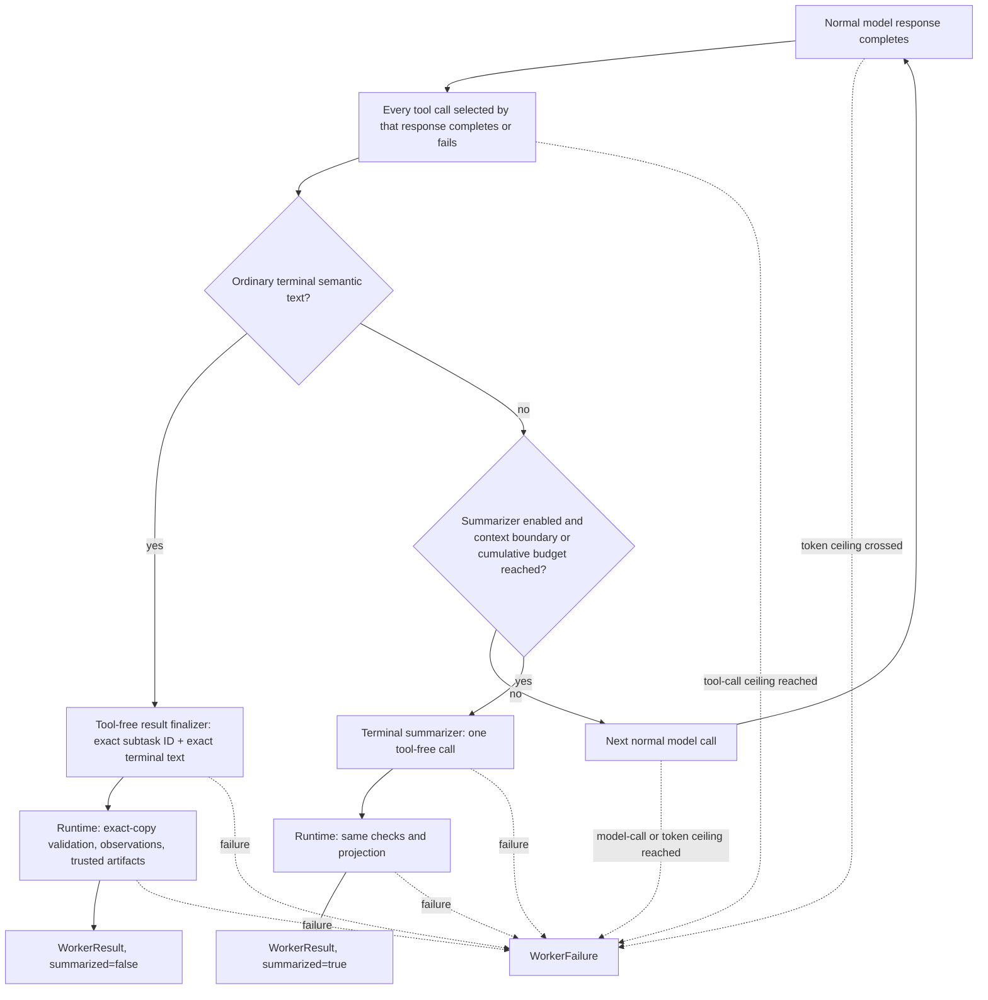
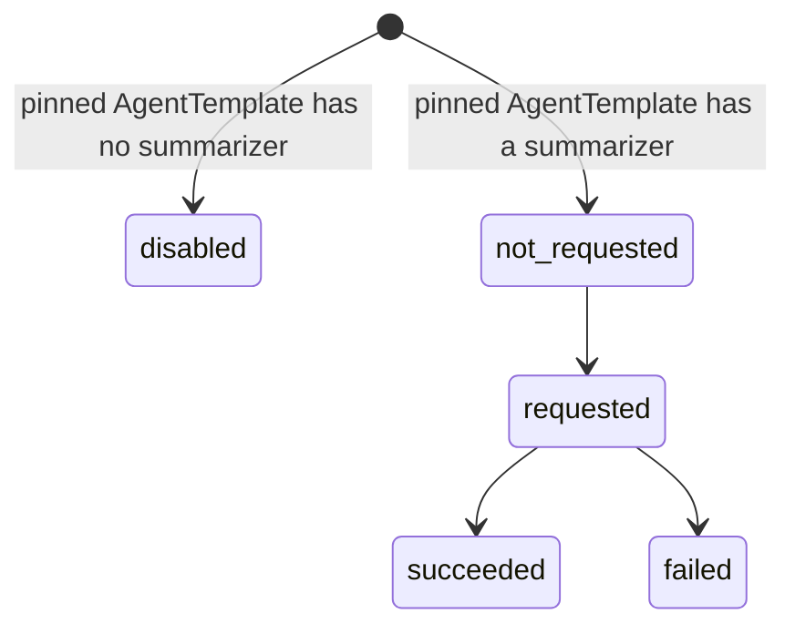

# Worker

Requirement prefix: `WRK` · [Specification index](../README.md)

## Purpose and scope

This document owns four closely related boundaries of a Worker invocation:

- the terminal semantic text produced by the main Worker model and its strict
  structured projection;
- the trusted `WorkerResult` assembled by Runtime Agent for Planner;
- deterministic invocation observations accumulated in allocation-local State;
- the read-only path by which explicit Server-side Planner tools inspect that
  live State without exposing arbitrary keys to the model.

Around those boundaries it also owns the Worker context built from an
AgentTemplate, the Worker's LLM Gateway client and its failure classification,
Worker budget enforcement, the one Runtime-owned completion boundary and its
ordinary result finalizer, ADK session modes and allocation-local State, the
schema and lifecycle of the private agent-state endpoint, and the optional
terminal summarizer owned by Runtime Agent.

It leaves to other documents:

- the Runtime Agent process and its one exclusive slot, the Worker runtime's
  deployment dependencies and credential boundary, A2A transport, allocation
  and lease checks, the Agent Card, A2A Task handling and the HTTP handler
  beside the allocation lifecycle routes: [Runtime Agent](runtime-agent.md);
- the private control protocol, including the allocation-correlated
  agent-state transport: [Control Plane](control-plane.md);
- AgentTemplate, Worker runtime selection, ModelPolicy field requirements and
  the `summarizer` configuration block:
  [AgentTemplates](../configuration/agent-templates.md);
- the Stage Worker session policy field and its immutability:
  [Workflows](../configuration/workflows.md);
- Runtime labels and LLM Gateway routes:
  [Runtime configuration](../configuration/runtime-config.md);
- Planner task rendering, the Passthrough pipeline, `finish` and the Planner
  projection tools over live State: [Planners](planners.md);
- StageExecution, retry and escalation: [Scheduler](scheduler.md);
- Gateway `failureSignatures` and the shared Gateway failure-classification
  fixture: [Failure model](../platform/failure-model.md);
- the `audit-check-results@1` completion strategy:
  [Audit Worker completion](../audits/worker-completion.md);
- overlay workspace auto-export: [Workspace](../tools/workspace.md);
- Agent Skill packages and activated-skill State: [Skills](../tools/skills.md);
- the ArtifactStore, result-binding carriage in private A2A input and the ADK
  artifact service adapter: [Artifact store](../artifacts/artifact-store.md).

## Concepts

Terms are defined once in the [glossary](../glossary.md).

| Term | Meaning here |
| --- | --- |
| Worker | The temporary, allocation-scoped role and runtime instance created in process from one AgentTemplate for one allocation; not another service, daemon, subprocess, container or operating-system process ([Runtime Agent](runtime-agent.md), [AgentTemplates](../configuration/agent-templates.md)). |
| Main Worker model | The tool-using ADK Worker Agent that runs AgentTemplate behavior over one task. |
| Terminal Worker text | The bounded semantic text the main Worker model ends with: what one exact subtask produced, and nothing about Contractor lifecycle. |
| Subtask ID | The opaque, mandatory `subtask_id` of a private Worker request, supplied by Planner. |
| Result finalizer | The ephemeral, tool-free ADK agent that copies the subtask ID and the terminal Worker text exactly into a `WorkerModelResult`. |
| `WorkerModelResult` | The internal two-field model-produced result `(subtask_id, result)`. |
| `WorkerResult` | The trusted result Runtime assembles from the validated semantic result, Runtime-owned observations, exact trusted artifact refs and the Runtime-owned `summarized` flag. |
| `WorkerFailure` | A Runtime-authored technical failure `(code, message, retryable)`. |
| `WorkerCompletion` | The versioned private A2A union carrying exactly one `WorkerResult` or `WorkerFailure`. |
| `StageResult` | The Planner-authored, Scheduler-accepted decision whether a whole Stage succeeded ([Planners](planners.md)). |
| Completion boundary | The one Runtime-owned point at which an invocation's semantic completion resolves to `continue`, `complete` or `fail`. |
| Session mode | The Stage's `isolated` or `shared` Worker session policy. |
| Contractor-owned Worker State | The reserved, versioned, bounded `contractor` subtree of ADK State; "full state" always means this subtree. |
| `WorkerStateStore` | The canonical allocation-local store of the Contractor-owned Worker State. |
| `WorkerInstrumentationPlugin` | The one ADK plugin that observes run, model and tool callbacks and feeds typed reducers. |
| `ObservationExtractor` | A narrow per-tool converter from one completed tool call to a typed, bounded, content-free fact. |
| Workspace observation coverage | What the Worker actually exposed to the model during one A2A invocation. |
| `lean@1` | The fixed, Runtime-authored compact observation projection carried by `WorkerResult`. |
| Terminal summarization | Stopping the normal Worker loop, making one separate tool-free model call and returning a final `WorkerResult` with `summarized: true`. |
| Context compaction | Rewriting older events so that the same Worker can continue using tools. |
| Context boundary | The prompt-token boundary at which an enabled summarizer is requested. |
| Cumulative budget | The optional soft boundary on summed provider-reported tokens of the normal loop in one invocation. |

## Model

### Result layers

The word "result" refers to four different facts. They are separate
contracts:

1. **Terminal Worker text** is authored by the main tool-using model. It says
   what one exact subtask produced, and nothing about Contractor lifecycle.
2. **`WorkerModelResult`** is emitted by a separate tool-free ADK result
   finalizer, which must copy that text and the Runtime-supplied subtask ID
   exactly.
3. **`WorkerResult`** is assembled by Runtime. It combines the validated
   semantic result with Runtime-owned observations, exact trusted artifact refs
   and a Runtime-owned summarization flag.
4. **`StageResult`** is authored by Planner and accepted by Scheduler. It
   decides whether the complete Stage succeeded or failed.

The model-produced schema is intentionally small. The result finalizer and the
terminal summarizer both produce it:

```python
class WorkerModelResult(BaseModel):
    subtask_id: str
    result: str
```

The ordinary completion path has two phases:

```text
main ADK Worker: AgentTemplate behavior + task + selected tools, no output_schema
  -> bounded terminal semantic text
tool-free ADK result finalizer: exact subtask ID + exact terminal text
  -> WorkerModelResult(subtask_id, result)
Runtime: exact-copy validation + observations + trusted artifacts
  -> WorkerResult(summarized=false)
```

The flow below combines that path with the safe-boundary check of the optional
terminal summarizer and the failure exits. Every hard-budget exit sits before
the next side effect (WRK-R23, WRK-R25):



### Observations

One instrumentation plugin feeds independent reducers:

```text
WorkerInstrumentationPlugin
  -> MetricsReducer                allocation-wide report counters/details
  -> InvocationMetricsReducer      bounded facts for the current invocation
  -> WorkspaceObservationReducer   model-visible filesystem interaction facts
  -> future typed reducers         only through reviewed safe extractors
```

Workspace observation State, created per invocation:

```python
class WorkspaceInteraction(BaseModel):
    path: str
    first_ordinal: int
    last_ordinal: int
    discovery_calls: int
    read_calls: int
    match_calls: int
    mutation_calls: int


class WorkspaceObservationState(BaseModel):
    workspace_digest: str
    scope_paths: list[str]             # lexical, bounded checkpoint universe
    scope_complete: bool
    interactions: list[WorkspaceInteraction]
    detail_complete: bool
```

The `lean@1` observation projection carried by `WorkerResult`:

```python
class ToolObservationCount(BaseModel):
    calls: int
    failures: int


class WorkspaceObservationSummary(BaseModel):
    scoped_files: int
    scope_complete: bool
    discovered_files: int
    read_files: int
    matched_files: int
    modified_files: int
    detail_complete: bool
    unread_files: int | None = None
    files_read: list[str]              # at most 25, first-observation order
    files_read_truncated: bool


class WorkerObservations(BaseModel):
    profile: Literal["lean@1"]
    tools: dict[str, ToolObservationCount]
    workspace: WorkspaceObservationSummary | None = None
    truncated: bool
```

### Contractor-owned Worker State

```python
class ContractorWorkerState(BaseModel):
    schema_version: Literal[2]
    state_revision: int
    metrics: AllocationMetricsState
    current_invocation: InvocationState | None
    last_completed_invocation: InvocationState | None
```

The closed summarizer section of the State moves through these values:



## Requirements

### Worker context

**WRK-R1.** AgentTemplate is the sole authored, reusable
Worker-behavior contract. The Runtime Agent allocation layer consumes the
resolved template and builds a minimal Worker context containing the
description, instruction text, card version, effective model policy, optional
resolved summarizer policy, instantiated tools and prepared skills.

**WRK-R2.** `WorkerBuildContext` does not contain an
`AgentTemplate`; neither the ADK implementation nor its model sees a template
ref, digest, manifest or allocation projection.

**WRK-R3.** The Stage objective and instructions remain separate
per-task semantic input ([Workflows](../configuration/workflows.md),
[Planners](planners.md)). The AgentTemplate's explicit Toolset selections own
the domain tools, and its explicit `skills` refs own the bounded native ADK
SkillToolset ([Skills](../tools/skills.md)).

**WRK-R4.** A Runtime label may configure a proxy, a telemetry
exporter or an already selected Toolset adapter, but cannot add a tool,
Toolset, skill, instruction or Worker behavior
([Runtime configuration](../configuration/runtime-config.md)). Runtime Agent
receives typed settings and never interprets label names.

**WRK-R5.** The main Worker model sees only the resolved
AgentTemplate behavioral instructions, the Planner-supplied objective and task
instructions, the exact opaque `subtask_id`, immutable string parameters and
named exact input ArtifactRefs, and its explicitly selected tools and skills.
It sees no Contractor result schema or lifecycle envelope.

How the semantic task is rendered for the Worker model, and which transport,
allocation and lifecycle facts the rendered task never contains, is owned by
[Planners](planners.md).

**WRK-R6.** The private `StageContentRequest.deadline` carries the
Planner's effective Worker-call deadline: the Stage deadline for passthrough,
the smaller of the Stage and Planner wall-clock deadlines for streamline and
router, and the smaller of the Stage and scan-job deadlines for scan workers.

**WRK-R7.** The deadline is Runtime control data and is not
placed in the Worker model prompt.

**WRK-R157.** Each outbound call retains its own request timeout.

**WRK-R158.** Audit completion uses that absolute deadline for the whole
invocation, including reminders, model recovery and publication; it does not
turn `requestTimeoutSeconds` into a whole-invocation cap.

How the Audit strategy converts and applies the deadline is owned by
[Audit Worker completion](../audits/worker-completion.md).

### LLM Gateway client

**WRK-R8.** The Python Runtime implements `openai-compatible@1`
with a Contractor-owned ADK `BaseLlm` adapter and an allocation-owned HTTPX
Chat Completions client. The Runtime dependency set excludes the OpenAI and
LiteLLM Python SDKs; LiteLLM, when selected, remains the one shared external
Gateway.

**WRK-R9.** The adapter sends the exact resolved model alias,
translates ADK text and function-call history, tools and strict response
schemas to Chat Completions, and projects model text and reasoning, function
calls, finish reason and provider-reported usage back to ADK. Successful JSON
responses are projected directly into ADK types without constructing
general-purpose SDK models.

**WRK-R10.** Non-text task data remains an Artifact. An unsupported
inline content part fails closed instead of disappearing from the model
request.

**WRK-R11.** The Gateway client uses `max_retries=3`, meaning one
initial HTTP attempt and at most three transport retries (LIM-WRK-1).
Its retry classification includes connection loss, timeouts and retryable HTTP
statuses such as 408, 409, 429 and 5xx (FAIL-WRK-1).

**WRK-R12.** Transport retries honor `retry-after-ms`, numeric or
HTTP-date `Retry-After`, and explicit `x-should-retry` overrides. A finite
server delay over 120 seconds stops transport retries
(LIM-WRK-2); an invalid or nonpositive delay uses bounded exponential
backoff with jitter.

**WRK-R13.** One outer Runtime deadline caps the entire attempt
series, retry waits included, at the resolved `requestTimeoutSeconds` plus 60
seconds (LIM-WRK-3). An enclosing Stage cancellation or deadline can
stop it earlier.

**WRK-R14.** Every attempt retains the same allocation-owned Gateway
route and never falls back around a configured proxy.

**WRK-R15.** The attempt series is one logical ModelPolicy call,
because Runtime receives at most one usable response. If a response was lost
after the Gateway accepted it, repeated Gateway work and billing are possible,
and only the final received response's usage can be added to the Worker token
counters; Gateway-side quotas therefore remain the hard authority for all
physical attempts (FAIL-WRK-1).

**WRK-R16.** A received response that the adapter then rejects
(invalid tool-call JSON, an unsupported part, an empty choice) is still a
failed model call, but its reported usage is added to the Worker, invocation,
budget and summarizer token counters like an accepted response. The boundary
error keeps only those numeric counters, never response content.

**WRK-R17.** The client logs neither request payloads nor provider
responses, and releases provider response buffers before retry waits.

**WRK-R18.** After the transport attempt series ends, Runtime
classifies the final failure from bounded error metadata. Connection failures,
timeouts and HTTP 408, 409, 429 or 5xx are retryable. Other HTTP errors,
including 400, 401, 403, 404, 413 and 422, are non-retryable. Explicit
`insufficient_quota`, `budget_exceeded` and `context_length_exceeded` codes are
non-retryable even when the status would otherwise allow retry. Provider
bodies and headers are not retained in errors (FAIL-WRK-1).

Gateway-specific `failureSignatures`, and the shared fixture that keeps the
Server-side Planner and Runtime Worker classifiers identical, are owned by the
[failure model](../platform/failure-model.md).

**WRK-R19.** The ordinary Worker and the result finalizer preserve
that retryable flag under `worker_gateway_unavailable`, including for permanent
request, authorization and context or quota errors; terminal summarization
preserves it under `worker_summarization_failed`. Wrapping an error never
grants another semantic attempt.

**WRK-R159.** Cancellation of a Gateway call propagates through the
existing lifecycle.

**WRK-R20.** Workflow policy, not Runtime, decides whether a
retryable Worker failure causes another attempt by creating a fresh
StageExecution ([Scheduler](scheduler.md)). The retryable flag is separate from
the client's bounded transport retries.

**WRK-R21.** An adapter failure while constructing a request from
ADK content is a local, deterministic `worker_gateway_invalid_request` failure
with `retryable: false`, distinct from a Gateway transport or HTTP response
failure (FAIL-WRK-2).

### Worker budgets

**WRK-R22.** Each prepared Python ADK Worker independently
enforces the cumulative model-call, tool-call and provider-reported token
ceilings embedded in its exact ModelPolicy. The ModelPolicy fields that an
`adk@1` Worker, a Worker with terminal summarization and a Worker summarizer
policy require are owned by [AgentTemplates](../configuration/agent-templates.md).

**WRK-R23.** Worker Runtime checks call and tool capacity before
starting the next operation, and adds the provider-reported
`total_token_count` after each completed model response. Crossing the token
ceiling stops the loop before a response tool call is executed; reaching the
ceiling permits a valid structured semantic result but no later operation.

**WRK-R24.** Missing token usage is recorded explicitly and
never disables the independent model-call and tool-call ceilings.

**WRK-R25.** Exhaustion stops before the next side effect.
Runtime then constructs one safe `WorkerFailure` with code
`worker_budget_exhausted`, the exhausted dimension in bounded metrics, and
`retryable: true`; the model does not serialize that failure. It is neither a
Planner budget termination nor a direct StageExecution write: Passthrough
supplies a normal failed candidate to Scheduler, whose Workflow transition
owns whole-Stage retry.

### Result layers and the wire contract

**WRK-R26.** Worker model, Runtime, Planner and Scheduler own separate
result layers ([Result layers](#result-layers)). The main tool-using Worker
model returns bounded terminal semantic text; Runtime completes it through the
mandatory one-shot result finalizer, attaches deterministic observations and
trusted exact result artifacts, and returns a `WorkerResult` or a separate
technical `WorkerFailure`. Planner alone turns one or more such completions
into a `StageResult` candidate.

**WRK-R27.** The Worker does not own `StageResult`: a
model-backed Planner decides Stage completion through `finish`, and Workflow
Scheduler validates and durably accepts that candidate.

**WRK-R28.** Allocation drain and finalization perform no model
or tool calls.

**WRK-R29.** Every private Worker request contains a mandatory
`subtask_id`. Streamline and Router copy the ID of the exact claimed
`PlannerSubtask`; the baseline Passthrough Planner uses the fixed ID `0`. The
ID is opaque to the Worker and distinct from the A2A Task ID, invocation ID,
allocation ID and StageExecution ID. Runtime includes it in the semantic task
input and, after ordinary Worker completion, supplies the exact ID and the
bounded terminal text to the result finalizer.

**WRK-R30.** Both `WorkerModelResult` fields are mandatory and
non-empty, and unknown fields are rejected. `subtask_id` is 1..128 bytes and
matches `[A-Za-z0-9][A-Za-z0-9._:-]{0,127}` (LIM-WRK-4). `result` is
bounded to 64 KiB of UTF-8 (LIM-WRK-5).

**WRK-R31.** `result` is the factual result intended for the
calling Planner, not a transport envelope, retry decision, Stage outcome or
telemetry container.

**WRK-R32.** The main Worker does not serialize
`WorkerModelResult` and does not receive it as an output schema.
`WorkerModelResult` is internal to the Python Runtime and its ADK adapter: it
never crosses A2A and has no Server-domain counterpart. Only the
Runtime-authored `WorkerCompletion` is a shared Go/Python wire contract.

**WRK-R33.** Runtime does not ask either model, the main Worker
model or the result finalizer, to serialize `WorkerResult`,
`WorkerCompletion` or `StageResult`.

**WRK-R34.** `WorkerCompletion` is a versioned, strict
private A2A union in which exactly one of `result` and `failure` is present.
`invocation_id` and `state_revision` are control metadata for Server
correlation and never enter a model-facing Planner tool result.

**WRK-R35.** `WorkerResult` has no outcome or error field:
receiving it means that the Worker model produced one valid semantic
completion. Runtime, tool, provider, budget and contract failures use
`WorkerFailure`.

**WRK-R36.** `WorkerFailure.code` matches
`[a-z][a-z0-9_]{0,63}` (LIM-WRK-6), and its already-sanitized,
non-empty `message` is at most 4,096 UTF-8 bytes (LIM-WRK-7).
`invocation_id` is an opaque Runtime-generated 1..128-byte identifier
(LIM-WRK-8), and `state_revision` is positive.

**WRK-R37.** The 256 KiB encoded limits for `StageContentRequest`,
`WorkerCompletion`, the Planner-facing `WorkerResult` and the resulting
`StageResult` (LIM-WRK-9) count compact UTF-8 JSON bytes. Optional HTML (`<`,
`>`, `&`) and JavaScript line-separator escaping must not consume extra budget
in one language; required JSON escaping, object and envelope overhead and
exact integer digits still count. A `StageResult` also has a non-null
`artifacts` map of at most 128 entries and a `summary` of at most 64 KiB. In
the Server each message's own validator is the single definition of its
bounds: every Planner, the Workflow Scheduler and RunStore apply the same
`StageResult` check, so a candidate one of them accepts is never rejected by
another for its size. The 64 KiB result-text bound (LIM-WRK-5),
model-output bounds and outer transport limits are separate limits.

**WRK-R38.** The A2A request DataPart uses
`application/vnd.contractor.stage-content+json` and the terminal response
DataPart uses `application/vnd.contractor.worker-completion+json`. The Agent
Card ([Runtime Agent](runtime-agent.md)) and each request advertise the latter
as the accepted output mode. A missing or different response media type fails
closed before payload decoding.

**WRK-R164.** The Planner decodes the terminal `WorkerCompletion` from the
bytes of the A2A response that carried it with the strict private decoder
([CTL-R149](control-plane.md)), never from the A2A SDK's generic value: a
duplicate key anywhere in it is rejected and an integer keeps its exact
digits. An A2A DataPart is a `google.protobuf.Value`, whose numbers are
doubles, and the Runtime renders every integer that way (`7.0`); a number
written as an integral double therefore counts as that integer, while a
fractional number or one outside the member's range is rejected. Integers
above 2^53 cannot cross this DataPart exactly: the Runtime's encoding rounds
them to the nearest double before the Planner reads them.

**WRK-R39.** For Streamline and Router,
`execute_current_subtask` returns the bounded model-facing portion of
`WorkerResult`. A `WorkerFailure` becomes that tool's existing closed tool
error and marks the dispatch failed, leaving Planner to reason or finish
within its remaining limits.

**WRK-R40.** Passthrough deterministically maps a
`WorkerResult` to a succeeded `StageResult` candidate and a `WorkerFailure` to
a failed candidate with the same safe error; Scheduler and Planner retain
their independent Stage result-contract validation. Neither mapping lets the
Worker select retry or escalation.

The complete Passthrough path from `StageSpec` to `StageResult` is owned by
[Planners](planners.md).

### Model boundary and result finalizer

**WRK-R41.** The main Worker model authors only the semantic result
text. Runtime computes observations and matches each declared
`resultArtifacts` binding against exact refs actually observed through
allocation-bound tools. Neither the main Worker model nor the result finalizer
can select the Stage outcome, artifact slot, revision, `summarized`,
retryability or lifecycle transition. Runtime, tool, provider and budget
failures are a separate `WorkerFailure`.

**WRK-R42.** The selected `adk@1` implementation never
combines tools and an output schema in the main Worker Agent. The rule is
unconditional: Runtime does not branch on a model or adapter capability flag.

Rationale: a generic LLM Gateway may route the same alias to backends with
different grammar behavior, and an adapter's advertised capability is not
proof that the selected downstream model accepts both features in one request.

**WRK-R43.** Every ordinary completion therefore has two phases
([Result layers](#result-layers)): the main ADK Worker, with AgentTemplate
behavior, the task and its selected tools but no `output_schema`, produces
bounded terminal semantic text; a tool-free ADK result finalizer turns the
exact subtask ID and exact terminal text into
`WorkerModelResult(subtask_id, result)`; Runtime performs exact-copy
validation, adds observations and trusted artifacts and returns
`WorkerResult(summarized=false)`. This is the default ordinary completion
strategy. The optional terminal summarizer (WRK-R149) and the
`audit-check-results@1` strategy (WRK-R64) are the exceptions.

**WRK-R44.** The result finalizer is an ephemeral ADK `LlmAgent`,
`Runner` and in-memory Session. It uses the same allocation model client,
pinned ModelPolicy and LLM Gateway as the main Worker, but receives no tools,
Agent Skills, workspace handles, Artifact client, task objective or
instructions, parameters, input refs, prior conversation or arbitrary State.

**WRK-R45.** The result finalizer sees only the exact opaque
`subtask_id` supplied by Runtime, the exact bounded terminal text emitted by
the main Worker, and ADK's schema guidance for the two-field
`WorkerModelResult`. It does not see result bindings, artifact grants, Runtime
observations, `summarized`, state revision, physical placement,
RuntimeSettings, lifecycle, retryability or Scheduler policy.

**WRK-R46.** The finalizer's deterministic input document contains
only `subtaskId` and `resultText`, is at most 256 KiB encoded
(LIM-WRK-10), and is destroyed with the invocation
(LIFE-WRK-1). Its instruction permits exact serialization only:
it may not summarize, correct, reinterpret or reformat either value.

**WRK-R47.** Missing, blank, over-64 KiB (LIM-WRK-5) or
known-secret-bearing terminal text is rejected before the finalizer.

**WRK-R48.** The finalizer makes exactly one provider call
(LIM-WRK-11). It has no repair or retry loop, and Runtime never
makes a second finalizer or repair call (FAIL-WRK-3).

**WRK-R49.** The finalizer call and its provider-reported usage
count against the same normal Worker `maxModelCalls` and `maxTotalTokens` as
main turns, and appear in the same Worker metrics and live State. Workflow
authors must include this mandatory call in the normal Worker budget; Runtime
does not grant hidden finalization capacity.

**WRK-R50.** The finalizer must echo the exact subtask ID. Runtime
compares the parsed value to the request and rejects a mismatch as
`worker_result_subtask_mismatch`. The value placed in the trusted result is
always copied from the request, never trusted from model output.

**WRK-R51.** Runtime requires byte-for-byte equality between the
finalized `result` and the main Worker's terminal text; a rewrite is
`worker_result_finalizer_mismatch`.

Rationale: these checks detect stale, malformed or semantic-changing
serialization without letting either model redirect or rewrite a result.

**WRK-R52.** An unsupported or invalid provider structured response
fails closed with a bounded stable Worker error (FAIL-WRK-3). Runtime accepts the main
final text only after the mandatory finalizer has returned the strict schema
and exact-copy validation has succeeded.

**WRK-R53.** Ordinary result-finalizer and terminal-summarizer
outputs pass through the bounded model-JSON decoder before the common Runtime
result assembly. How the Audit strategy's trusted completion fields enter that
assembly is owned by [Audit Worker completion](../audits/worker-completion.md).

### Trusted artifact projection

**WRK-R54.** The trusted artifact projection is authoritative.
Runtime, not the Worker model, maps only exact refs observed through completed
allocation-bound tool calls in the same invocation to the immutable
Server-declared result bindings
([ART-R101](../artifacts/artifact-store.md)). It ignores any artifact-like
text or unknown field produced by the model.

**WRK-R55.** The model may receive refs as ordinary selected-tool
arguments and results, but never serializes the A2A envelope or chooses a
result slot or revision.

**WRK-R56.** Two Runtime-owned sources extend the observed-ref
projection, and neither accepts model-authored refs: overlay auto-export adds
its exact refs after the ordinary observed-ref projection and before
`WorkerCompletion` is published ([Workspace](../tools/workspace.md)), and the
`audit-check-results@1` strategy supplies only Runtime-verified publication
receipts ([Audit Worker completion](../audits/worker-completion.md)).

ArtifactStore bytes, the ADK `BaseArtifactService` adapter and its use of
`save_artifact` are owned by [Artifact store](../artifacts/artifact-store.md)
(ART-R100, ART-R102 to ART-R105).

### Result failures

**WRK-R57.** Malformed or missing model output, a subtask
mismatch, an internal finalizer failure and a finalizer exact-copy mismatch
are retryable Worker failures, because a fresh StageExecution may succeed. An
internal finalizer boundary failure uses `worker_result_finalizer_failed`
(FAIL-WRK-3).

**WRK-R58.** A `MAX_TOKENS` finish from the Worker or its result
finalizer uses retryable `worker_output_limit_exceeded`, not
`worker_result_missing`. Runtime accounts the consumed tokens but does not
accept the truncated text (even valid-looking JSON), call the finalizer on it,
or start an unbudgeted continuation. Workflow policy owns any retry; operators
can adjust the per-response output limit or the model reasoning
configuration.

**WRK-R59.** Deterministic size, secret-retention and invalid
binding violations are non-retryable.

**WRK-R60.** The secret-retention scan (`unsafe_worker_result`)
covers every allocation RuntimeSettings credential: the LLM Gateway token,
telemetry header values, HTTP proxy credentials, the Caido bearer token and
the credentials Runtime injects for the HTTP origin target. Endpoints and CA
bundles are not credentials, and results may name them (a same-host deployment
audits services next to its own); the Agent Card check additionally rejects
those.

**WRK-R61.** A credential value of at least 16 UTF-8 bytes
(LIM-WRK-12) is rejected anywhere in the result text; a shorter value,
such as a proxy username, only when it is the whole text, so that an ordinary
word cannot fail a result. The LLM Gateway token is rejected at any length.

The stable result failure codes are listed under
[Limits, failures and errors](#limits-failures-and-errors).

### Completion boundary

**WRK-R62.** Every Worker has one Runtime-owned semantic completion
boundary, reached while the invocation and its session can still continue and
before `WorkerCompletion` or terminal invocation State is published. It is not
allocation drain or finalize. The boundary returns exactly one of:

- `continue`: a bounded Runtime-authored reminder; the same invocation resumes;
- `complete`: a trusted `WorkerResult` ready for normal lifecycle processing;
- `fail`: a bounded `WorkerFailure`, with no fabricated successful result.

**WRK-R63.** The shared boundary lives in `core/worker_completion.py`;
the Audit implementation lives with `toolsets/audit_results`. Worker
orchestration binds a prepared completion implementation to the identical
trusted contract and all its required tools under one owner; missing, mixed or
forged owners fail preparation. The common runner does not infer Audit
behavior from tool names or import an Audit-specific completion policy. This
organization does not enable additional publicly selectable completion
strategies.

**WRK-R64.** When no completion contract is selected, the ordinary
strategy applies: the terminal text passes through the one-shot tool-free LLM
serializer to the trusted projection, the optional terminal summarizer applies
unchanged, and there is no mandatory Audit tool check. The opt-in
`audit-check-results@1` strategy at the same boundary, including its
completeness gate, continuation within one logical invocation, publication and
accounting, is owned by [Audit Worker completion](../audits/worker-completion.md).

### Session modes

**WRK-R65.** `isolated` gives every admitted sequential Worker
invocation a fresh ADK conversation while retaining only the bounded eligible
allocation-local State (WRK-R73). `shared` deliberately keeps one
conversation for sequential invocations sent to the same logical Worker
allocation. In a Router Stage, `shared` still never joins conversations between
logical Workers: each binding owns a distinct allocation and session service.

The Stage's choice of mode and its immutability are owned by
[Workflows](../configuration/workflows.md).

**WRK-R66.** An ADK-based Worker uses one allocation-local
in-memory SessionService inside the Runtime Agent process. AllocationSpec
carries the Stage's explicit mode to the generic `adk@1` runtime. The mode is
not a WorkerRuntime factory ref and does not create a second
behavior-specific implementation.

**WRK-R67.** A non-ADK Worker runtime provides equivalent
execution and report behavior without exposing an ADK contract.

**WRK-R68.** Runtime Agent receives no database credentials, and
its A2A Task-to-session mapping remains an implementation detail within the
allocation.

**WRK-R69.** Allocation identity, A2A Task and context identity,
Contractor Worker invocation identity and ADK session identity are four
separate domains. Runtime creates opaque ADK session IDs according to the
pinned Stage mode; none is derived from, equal by contract to, or exposed
through the allocation ID, A2A payload, `WorkerCompletion`, Agent Card, public
API or Planner tools. A rejected request therefore cannot infer whether a
prior session exists.

**WRK-R70.** Sessions are lazy invocation resources: Runtime creates
none while preparing the allocation. A request must first pass A2A payload,
tenant and lease validation, the accepting-versus-draining check and the
single-invocation lock. Invalid, stale, draining and concurrent-busy requests
are rejected without creating a session.

Once a request is admitted:

- **WRK-R71.** `shared` creates at most one opaque session per
  allocation (LIM-WRK-13) and reuses it for every sequential
  invocation in that allocation. Its ADK events and eligible State survive an
  ordinary success, a modeled Worker failure or a budget failure until
  allocation shutdown.
- **WRK-R72.** `isolated` creates a new opaque session for every
  invocation and supplies its ID explicitly to Runner and State
  synchronization. It copies no prior event, deletes the completed session
  inside the shielded invocation finalizer, and releases the invocation lock
  only after that deletion succeeds.

**WRK-R73.** In isolated mode Runtime carries a deep copy of eligible
State from one completed invocation to the next invocation of the same
allocation. The combined JSON encoding of that non-Contractor State is at most
4 MiB (LIM-WRK-14). Ordinary unprefixed State plus ADK `app:` and
`user:` State is eligible; `temp:` State is discarded, and no event is
converted into State. App and user maps remain owned by the same
allocation-local service and are never process-global. Values that cannot be
copied or encoded safely, or that exceed the bound, fail closed
(FAIL-WRK-4).

**WRK-R74.** The `contractor` subtree is never carried from
the ADK session snapshot. Every new isolated session receives it only from the
latest canonical `WorkerStateStore` revision, so a model, tool or stale
session cannot replace the trusted metrics and observation reducer. Allocation
secrets never enter either carried State or conversation events.

Activated-skill State, which is separate from the `contractor` subtree and may
follow the carry rule above, is owned by [Skills](../tools/skills.md).

**WRK-R75.** State already committed by ADK is snapshotted after
success, modeled failure, budget failure or cancellation. Snapshot and
isolated-session deletion execute as part of the existing
cancellation-shielded invocation finalizer.

**WRK-R76.** Failure to create, snapshot, bound or delete a session
fences the Worker from subsequent work (FAIL-WRK-4).

**WRK-R77.** Finalize, abort and release retry cleanup
idempotently. The Runtime slot cannot be reused until all owned sessions,
carried values, app and user maps and session identifiers are cleared. If
bounded cleanup cannot prove this before the control deadline, the allocation
remains fenced and the Runtime process is not reused (LIFE-WRK-2).

### Secrets

**WRK-R78.** RuntimeSettings secrets supplied by Control Plane
are held outside ADK Session, State, events and model-visible instruction and
context. They configure clients such as the LLM Gateway adapter and are never
a telemetry source.

**WRK-R79.** Secrets are held in typed allocation context and
injected into already constructed clients and adapters. They are forbidden in
ADK State by invariant, not merely redacted on export. Runtime may initialize
safe, closed, non-secret State before Runner starts; there is no remote generic
State mutation API.

### Instrumentation

**WRK-R80.** An ADK Worker reserves one bounded `contractor` subtree in
its in-memory State and uses one Contractor `WorkerInstrumentationPlugin`,
registered on the ADK `App` supplied to `Runner`. The plugin observes run,
model and tool callback boundaries and feeds the independent allocation
metrics and invocation-observation reducers in that subtree
([Observations](#observations)).

**WRK-R81.** The plugin exists for lifecycle correlation; it is
not one untyped data bucket. Metrics and observations have different retention
and projection rules. Collecting per-tool metrics through the plugin must
not change the content of the `ExecutionReport` and must not count a call
twice.

**WRK-R82.** During finalization the Worker converts the metrics
reducer to the framework-neutral `ExecutionReport`. Raw ADK State is never a
Contractor wire or persistence schema.

**WRK-R83.** The result finalizer has a separate ephemeral ADK
Runner but reports its one model call through typed hooks on the same
invocation plugin. It therefore updates the same normal budget, metrics and
Contractor-owned State reducers and does not create a second uncorrelated
instrumentation State. Its prompt and output are never retained in that State.

**WRK-R84.** Model spans of the result-finalizer call mark
`model.phase=result_finalizer`.

**WRK-R85.** The plugin never generically copies tool arguments or
results into State. Each selected tool may register a narrow
`ObservationExtractor` that converts a completed call into a typed, bounded,
content-free fact. Unknown tools have metrics counts but contribute no domain
observation. An extractor failure is a safe instrumentation error: it sets
observation completeness false and cannot change or fabricate the tool result
(FAIL-WRK-5).

**WRK-R86.** Only a completed callback changes semantic
observations. A failed or cancelled call increments safe metrics but does not
claim that a file was read or changed. Parallel callback order is normalized by
the plugin's monotonic call ordinal and committed under one state lock.

### Workspace observations

**WRK-R87.** Workspace observation coverage measures what the Worker
actually exposed to the model during one A2A invocation. It is not
code-analysis scan coverage and does not claim that every file internally
parsed by Tree-sitter or Trailmark was read by the model.

**WRK-R88.** At invocation start, Runtime creates one
`WorkspaceObservationState` over the effective managed-text checkpoint
([Observations](#observations)).

The operation semantics are:

- **WRK-R89.** A successful `read_file` records its normalized relative
  path as read.
- **WRK-R90.** A successful `grep` records only paths whose returned
  matches were visible.
- **WRK-R91.** A successful `glob` or `ls` discovers the returned
  normalized managed-text file paths but does not mark their contents read;
  directory entries are not file coverage.
- **WRK-R92.** Successful Edit and annotation mutations record the
  affected managed-text file paths as modified.
- **WRK-R93.** `workspace-changes` records as modified only the file
  paths present in its returned bounded page.
- **WRK-R94.** Code-analysis coverage remains its own typed response
  and observation section and does not mark every internally scanned file as
  read.
- **WRK-R95.** Retries increment operation counts, while unique
  coverage counts each path once.

**WRK-R96.** Interactions are ordered by first completed observation
ordinal, with the relative path as a deterministic tie-breaker.

**WRK-R97.** Model-visible projections never contain host paths,
file contents, grep patterns, edit text, diffs, parser payloads or Artifact
revisions.

**WRK-R98.** The checkpoint scope admits at most 10,000 paths and
2 MiB of encoded path detail (LIM-WRK-15). Interaction detail
independently admits at most 10,000 paths (LIM-WRK-16).

**WRK-R99.** A Workspace larger than either bound remains usable:
the corresponding `*_complete` flag becomes false, counts are reported as
observed lower bounds, and no projection may claim exact unread coverage.

**WRK-R100.** The complete encoded `AgentStateSnapshot` containing
Contractor State is capped at 4 MiB (LIM-WRK-17). State admission
reserves the fixed envelope overhead rather than allowing a valid State value
to become an oversized HTTP response.

**WRK-R101.** The per-section bounds are maxima, not reservations:
optional path and detail admission stops earlier and marks the corresponding
completeness or truncation field when the shared ceiling would otherwise be
crossed. Mandatory schema fields and saturating aggregate counters have
reserved capacity, including while current and last-completed invocations
coexist.

**WRK-R102.** The immediate result uses one fixed `lean@1` projection
([Observations](#observations)). `discovered_files`, `read_files`,
`matched_files` and `modified_files` are unique managed-text path counts under
the operation semantics above. `files_read` holds at most 25 paths in
first-observation order (LIM-WRK-18), and `files_read_truncated`
is true exactly when `files_read` omits part of the `read_files` set. Tool
names are sorted and zero-call tools are omitted.

**WRK-R103.** `unread_files` is present only when both scope and
interaction detail are complete, and is the cardinality of
`scope_paths - observed_read_paths`. It is not arithmetic subtraction of the
two exposed counts, because a Worker may read a file created after the
checkpoint.

**WRK-R104.** The compact projection is always Runtime-authored. A
later named profile may change what is surfaced, but cannot reinterpret
results already stamped `lean@1`.

The precise future composition of the projection remains an evaluation
subject.

### Worker State lifecycle and contents

**WRK-R105.** Every live allocation-local ADK Session contains one
reserved `contractor` subtree. In `shared` mode this is the allocation's reused
session; in `isolated` mode Runtime rehydrates each fresh session from the
canonical allocation-local `WorkerStateStore`. That canonical subtree
(`ContractorWorkerState`, [Contractor-owned Worker State](#contractor-owned-worker-state))
is the only State surface Runtime exports.

**WRK-R106.** `current_invocation` is created immediately before
`Runner.run_async` and contains the Runtime-generated invocation ID, the
authoritative subtask ID, phase, invocation metrics and typed observation
sections. On every success, failure or cancellation it is atomically closed and
becomes `last_completed_invocation`. Beginning the next invocation does not
mutate the previous completed snapshot; completing it replaces that one-slot
history. Allocation-wide metrics continue across sequential invocations.

**WRK-R107.** State schema version 2 includes the nullable most-recent
provider prompt-token count in invocation metrics and a required closed
summarizer section. The section is `disabled` when the pinned AgentTemplate has
no summarizer; otherwise it moves monotonically through
`not_requested -> requested -> succeeded|failed`.

**WRK-R108.** The summarizer section retains only the normal-loop
state revision that caused the request, bounded one-call numeric summarizer
model and token usage, and one stable failure code. It never retains the
summary prompt or result.

**WRK-R109.** Every committed mutation increments `state_revision`.

**WRK-R160.** Snapshot reads take an immutable deep copy under the same
lock as State mutations; JSON encoding happens after the lock is released, so
a large read cannot block tool callbacks.

**WRK-R161.** Counters saturate and detail admission stops at the declared
bounds rather than evicting facts and changing earlier ordering.

**WRK-R110.** "Full state" always means the complete
Contractor-owned, versioned and bounded subtree. It excludes arbitrary or
framework-private ADK Session keys and conversation events; prompts, model
output history, hidden reasoning and complete tool payloads; activated-skill
framework State; Runtime Agent lifecycle and registry internals; and
RuntimeSettings, endpoints, headers, tokens and credentials.

**WRK-R111.** State is volatile. It exists only in the allocated
Runtime process and is destroyed with the Worker or on release. Durable metrics
use the bounded final report; durable domain state uses ArtifactStore and
MemoryTools (LIFE-WRK-3).

### Private agent-state endpoint

The read-only allocation-correlated route is transported by the private control
protocol ([Control Plane](control-plane.md)); it is neither an A2A operation
nor a public or generic state API. Its schema and lifecycle are defined here.

**WRK-R112.** The Python Runtime Agent exposes
`GET /private/v1/allocations/{allocation_id}/agent-state`. Its exact successful
JSON body is `AgentStateSnapshot` ([Interfaces](#interfaces)), and unknown fields
are rejected.

**WRK-R113.** The response deliberately does not repeat
`allocation_id`: request routing and the live allocation lookup establish that
identity, while `state.state_revision` establishes snapshot identity.

**WRK-R114.** The Worker implementation returns a framework-neutral
`AgentStateSnapshot`; the HTTP layer never reaches directly into the ADK
Session. The handler itself is owned by [Runtime Agent](runtime-agent.md).

The endpoint:

- **WRK-R115.** accepts only a Control Plane mTLS peer
  ([Control Plane](control-plane.md));
- **WRK-R116.** has no request body and no model- or user-provided
  state key;
- **WRK-R117.** returns the whole exportable Contractor State and the
  strong ETag `"contractor-agent-state-v1-<stateRevision>"`, derived only from
  its positive revision; the ETag format is its own independently versioned
  `v1` cache contract;
- **WRK-R118.** honors a matching `If-None-Match` with `304` and no body,
  for bounded Server-side caching;
- **WRK-R119.** sends `Cache-Control: private, no-cache`, so revision
  revalidation remains usable without accepting an unvalidated cached body,
  and a body no larger than 4 MiB including the response envelope
  (LIM-WRK-17);
- **WRK-R120.** is available for the active allocation while its Worker
  State exists;
- **WRK-R121.** returns the closed, safe `allocation_not_found` or
  `agent_state_unavailable` errors for stale, preparing,
  draining-with-destroyed-State or released slots;
- **WRK-R122.** never persists, mutates, resumes or reconstructs
  State.

### Planner access to live State

The Server-side Planner projection tools that read the snapshot are owned by
[Planners](planners.md).

**WRK-R123.** Planner models can call only explicit typed
projections, and never select a State key, physical Worker, allocation,
invocation or revision.

### Lifecycle and races

- **WRK-R124.** One allocation permits one active Worker invocation
  (LIM-WRK-19). State transitions and snapshot reads serialize without
  holding a lock across network, model or tool I/O.
- **WRK-R125.** A result is published only after the matching
  invocation State has been atomically closed, so
  `WorkerCompletion.state_revision` names a snapshot that already contains its
  observations.
- **WRK-R126.** A later invocation may replace
  `last_completed_invocation`; hidden correlation prevents an old Planner result
  from reading the new invocation.
- **WRK-R127.** Finalize and abort stop new reads once Worker State is
  destroyed. Final reports are built from the same reducer snapshot before
  destruction and remain the only durable metrics path.
- **WRK-R128.** Release erases State, ETag and cache material,
  observations, prompts and clients before the slot may become idle
  (LIFE-WRK-3).
- **WRK-R129.** Observation or State export failure can reduce
  telemetry completeness, but cannot invent a semantic Worker success or an
  artifact ref (FAIL-WRK-5).
- **WRK-R130.** A stale snapshot, truncated coverage or an
  unavailable Runtime is explicit and is never represented as complete
  coverage.

### Terminal summarization

**WRK-R131.** A long-running Worker should be able to stop before its
hard context or token budget and still return one useful typed semantic
result. For this, Runtime Agent owns an optional, deterministic terminal
summarizer, enabled by the AgentTemplate's `summarizer` block with fixed
`terminal@1` semantics ([AgentTemplates](../configuration/agent-templates.md)).

**WRK-R132.** Absence of `summarizer` preserves hard-budget behavior
exactly.

**WRK-R133.** The summarizer uses the same pinned Worker
LLMGatewayConfig and credential as the normal Worker but its own exact
ModelPolicy and model alias, whose required fields are owned by
[AgentTemplates](../configuration/agent-templates.md). Runtime enforces that
policy's one-call bound and, when `maxTotalTokens` is supplied, checks it
against the reported usage after that call.

#### Trigger

**WRK-R134.** An enabled normal Worker ModelPolicy must pin
`contextWindowTokens`.

**WRK-R162.** Runtime derives one prompt boundary from the effective Worker
policy and the resolved summarizer configuration as below; the second term
reserves the configured maximum normal response.

```text
context_boundary = min(
  floor(contextWindowTokens * contextWindowRatio),
  contextWindowTokens - maxOutputTokens,
)
```

**WRK-R163.** Configuration is invalid when
`maxOutputTokens >= contextWindowTokens`.

**WRK-R135.** Runtime requests summarization when the most recent
completed normal response reports `prompt_token_count >= context_boundary`.

**WRK-R136.** The optional `cumulativeBudget` independently
compares the sum of provider-reported `total_token_count` across all completed
normal-loop model calls in this A2A invocation. It is a soft cumulative
spending boundary that can stop a long sequence of individually small calls
before its expensive tail. It does not describe model context capacity and
does not replace the normal Worker policy's hard cumulative `maxTotalTokens`.

**WRK-R137.** Missing provider usage never invents a token estimate
and therefore cannot trigger the affected rule. A zero-valued total produced by
an adapter for an omitted provider `usage` object is also unavailable.

**WRK-R138.** Non-negative counters are internally
inconsistent when `prompt + completion > total` or cached input exceeds prompt
input. Runtime then drops that response's token counters closed, increments
`tokenUsageUnavailable`, and lets the independent model-call and tool-call
limits continue to bound execution.

**WRK-R139.** Independent model, tool and hard-token budgets remain
mandatory alongside the soft triggers.

Rationale: the context rule observes the last completed valid provider prompt,
not an exact tokenization of the prospective prompt after new tool results. Its
ratio and output reserve are a deterministic pre-emptive boundary, not a
guarantee that every provider will accept the next request.

These trigger rules apply to the ordinary completion strategy; the
`audit-check-results@1` contract rejects summarizer configuration
([Audit Worker completion](../audits/worker-completion.md)).

**WRK-R140.** The trigger is checked at a safe boundary:

1. a model response completes;
2. every tool call selected by that response either completes or fails;
3. if the main Worker response contains ordinary terminal semantic text,
   Runtime completes it through the mandatory result finalizer and returns it
   with `summarized: false`;
4. otherwise, before starting another normal model call, reaching either the
   derived context boundary or the optional cumulative budget requests terminal
   summarization.

**WRK-R141.** No in-flight tool is cancelled merely because a
completed response crossed a soft threshold, and no new normal tool or model
call starts after the request: a soft trigger starts no additional normal
Worker side effect.

**WRK-R142.** Hard exhaustion or a provider context failure that
occurs before this boundary uses the existing Worker failure path and does not
retroactively invoke the summarizer.

**WRK-R143.** The instrumentation plugin records only a private
`summarization_requested` control signal and must not make a nested LLM call
inside an ADK callback. The Runtime invocation coordinator unwinds the normal
Runner and invokes the independent summarizer afterward.

#### Input

**WRK-R144.** The summarizer has no Contractor or domain tools,
Agent Skills, Artifact client, MemoryTools or workspace handles. Its input is
one Runtime-built bounded document containing:

- the authoritative subtask ID, objective and task instructions;
- the immutable string parameters and named inputs already visible to the
  Worker;
- a chronological, non-thought projection of model-visible normal-loop events;
- the deterministic latest `WorkerObservations`.

**WRK-R145.** Trusted result bindings remain private Runtime data
and are not supplied as a separate summarizer input. An ArtifactRef may
reappear only if it was already part of a bounded model-visible event
projection.

**WRK-R146.** Runtime never includes system or runtime internals,
hidden thought, credentials, headers, provider exceptions, host paths or
arbitrary ADK State. Before projection it replaces the allocation's host paths,
the LLM Gateway token and every RuntimeSettings credential or private endpoint
of at least 16 UTF-8 bytes (LIM-WRK-12) with `[REDACTED]`; the
credentials are those scanned by WRK-R60, plus the private
endpoints.

**WRK-R147.** The event projection is capped at 512 KiB
(LIM-WRK-20). Immutable task data is retained first; the newest
complete event groups that fit are retained next, preserving their original
order, and a deterministic `transcriptTruncated` marker reports any omission.
Tool payloads remain subject to their existing model-visible bounds.

**WRK-R148.** The 512 KiB projection is the only local
document-size admission; it does not establish that the complete request fits
the summarizer model's context. There is no additional byte-to-token estimate,
framing reserve or context-based history trimming. Runtime sends the bounded
projection with the pinned instructions and output schema, and the Gateway
decides context acceptance. Context failures keep their non-retryable
classification (WRK-R18).

#### Output and failure

**WRK-R149.** The summarizer model uses the same strict two-field
`WorkerModelResult` schema. Runtime performs the same exact subtask check,
secret scan, UTF-8 and size bound, artifact projection and final wire
validation as for a normal result, then sets `summarized: true`; the model
cannot set or clear that flag. Deterministic observations are copied from the
completed normal loop rather than authored by the summarizer.

**WRK-R150.** Because the tool-free terminal summarizer
already produces the strict `WorkerModelResult`, Runtime projects its valid
result directly, without invoking the ordinary result finalizer after it and
without a normal-budget charge for finalization. The summarizer has its own
soft-limit and accounting semantics and, when used, replaces the ordinary
result-finalizer phase.

**WRK-R151.** Once terminal summarization is requested, Runtime makes
exactly one logical summarizer call (LIM-WRK-21), subject to the
bounded Gateway transport attempt series (WRK-R11).

**WRK-R152.** Missing, invalid, mismatched or oversized summarizer
output, or exhaustion of its independent budget, returns the safe retryable
`worker_summarization_failed` with a more specific bounded cause in metrics.
Provider failures use the same outer code but preserve Gateway retryability:
authorization, invalid-request and context or quota failures are not made
retryable by wrapping them (FAIL-WRK-6).

**WRK-R153.** Runtime never resumes the normal Worker or attempts
semantic repair after a failed summary.

#### State, metrics and lifecycle

**WRK-R154.** The summarizer input and output are not retained
separately. The semantic output exists only in the returned `WorkerResult` and
the live Planner conversation; durable Stage content remains Planner-owned
(LIFE-WRK-4).

**WRK-R155.** `ExecutionMetrics` carries a separate optional
summarizer aggregate, so that normal Worker usage and terminal summarization
cost can be evaluated independently. The aggregate contains attempt, success
and failure counts, model calls, provider-reported input, output and total
tokens, a missing-usage count and bounded stable failure-code counts. It
contains no transcript or result text and no endpoint or model-provider body.
The immutable AllocationSpec supplies exact summarizer ModelPolicy and Gateway
attribution.

**WRK-R156.** Summarization is semantic work and therefore occurs only
inside the active A2A invocation while allocation writes are allowed. It never
runs during finalize, abort, lease-loss drain, report collection or release.
Cancellation winning before its result stops the call and produces no
`WorkerResult`; normal bounded abort semantics apply
(FAIL-WRK-6).

## Interfaces

### A2A Worker completion

The private A2A request carries Stage content
(`application/vnd.contractor.stage-content+json`); the terminal response
carries a `WorkerCompletion`
(`application/vnd.contractor.worker-completion+json`), WRK-R38:

```python
class WorkerResult(BaseModel):
    subtask_id: str
    result: str
    observations: WorkerObservations
    artifacts: dict[str, ArtifactRef]  # mandatory non-null; may be empty
    summarized: bool


class WorkerFailure(BaseModel):
    code: str
    message: str
    retryable: bool


class WorkerCompletion(BaseModel):
    api_version: Literal["contractor/v1alpha1"]
    result: WorkerResult | None = None
    failure: WorkerFailure | None = None
    invocation_id: str
    state_revision: int
```

### Agent-state endpoint

```http
GET /private/v1/allocations/{allocation_id}/agent-state
```

Exact successful JSON body:

```python
class AgentStateSnapshot(BaseModel):
    api_version: Literal["contractor/v1alpha1"]
    state: ContractorWorkerState
```

### LLM Gateway

Worker model calls use the `openai-compatible@1` Chat Completions protocol
through the allocation's pinned Gateway route (WRK-R8).

## Limits, failures and errors

Limits ([registry](../platform/limits.md)):

- LIM-WRK-1: Gateway client `max_retries=3`, one initial attempt and
  at most three transport retries (WRK-R11).
- LIM-WRK-2: a finite server retry delay over 120 seconds stops
  transport retries (WRK-R12).
- LIM-WRK-3: the attempt series is capped at `requestTimeoutSeconds`
  plus 60 seconds (WRK-R13).
- LIM-WRK-4: `subtask_id` 1..128 bytes (WRK-R30).
- LIM-WRK-5: result text 64 KiB of UTF-8 (WRK-R30, WRK-R37, WRK-R47).
- LIM-WRK-6: `WorkerFailure.code` 1 to 64 characters
  (WRK-R36).
- LIM-WRK-7: `WorkerFailure.message` 4,096 UTF-8 bytes
  (WRK-R36).
- LIM-WRK-8: `invocation_id` 1..128 bytes
  (WRK-R36).
- LIM-WRK-9: `StageContentRequest`, `WorkerCompletion`, Planner-facing
  `WorkerResult` and `StageResult` 256 KiB each (WRK-R37).
- LIM-WRK-10: result-finalizer input document 256 KiB
  (WRK-R46).
- LIM-WRK-11: one result-finalizer provider call per ordinary
  completion (WRK-R48).
- LIM-WRK-12: 16 UTF-8 bytes, the length from which a credential is
  rejected anywhere in a result, and from which a RuntimeSettings credential
  or private endpoint is replaced with `[REDACTED]` in the summarizer input
  (WRK-R61, WRK-R146).
- LIM-WRK-13: at most one ADK session per `shared` allocation
  (WRK-R71).
- LIM-WRK-14: isolated-mode carried State 4 MiB (WRK-R73).
- LIM-WRK-15: checkpoint scope 10,000 paths and 2 MiB
  (WRK-R98).
- LIM-WRK-16: interaction detail 10,000 paths (WRK-R98).
- LIM-WRK-17: `AgentStateSnapshot` and agent-state response body
  4 MiB (WRK-R100, WRK-R119).
- LIM-WRK-18: `files_read` 25 paths (WRK-R102).
- LIM-WRK-19: one active Worker invocation per allocation
  (WRK-R124).
- LIM-WRK-20: summarizer event projection 512 KiB
  (WRK-R147).
- LIM-WRK-21: one logical summarizer call per invocation
  (WRK-R151).

Errors ([registry](../platform/errors.md)):

- `worker_gateway_unavailable`, `worker_gateway_invalid_request`
  (WRK-R19, WRK-R21);
- `worker_budget_exhausted` (WRK-R25);
- result failures: `worker_result_missing`, `worker_output_limit_exceeded`,
  `worker_result_invalid`, `worker_result_subtask_mismatch`,
  `worker_result_finalizer_mismatch`, `worker_result_finalizer_failed`,
  `worker_result_too_large` and `unsafe_worker_result`, alongside
  `worker_budget_exhausted` and domain and runtime failures
  (WRK-R57 to WRK-R61);
- `worker_summarization_failed` (WRK-R152);
- `allocation_not_found`, `agent_state_unavailable` (WRK-R121).

`worker_busy` and `worker_execution_failed` are owned by
[Runtime Agent](runtime-agent.md).

Failure outcomes ([failure model](../platform/failure-model.md)):

- FAIL-WRK-1: an LLM Gateway model call and its transport attempt
  series (WRK-R11 to WRK-R20).
- FAIL-WRK-2: request construction from ADK content
  (WRK-R21).
- FAIL-WRK-3: the result-finalizer call
  (WRK-R48, WRK-R52, WRK-R57).
- FAIL-WRK-4: ADK session creation, snapshot, bounding, carry and
  deletion (WRK-R73, WRK-R76).
- FAIL-WRK-5: observation extraction and State export
  (WRK-R85, WRK-R129).
- FAIL-WRK-6: the terminal summarizer call
  (WRK-R152, WRK-R156).

Lifecycle ([registry](../platform/lifecycle.md)):

- LIFE-WRK-1: the result finalizer's ephemeral Runner, Session and
  input document (WRK-R46).
- LIFE-WRK-2: allocation-local ADK sessions and carried State
  (WRK-R72, WRK-R77).
- LIFE-WRK-3: the Contractor-owned Worker State
  (WRK-R111, WRK-R128).
- LIFE-WRK-4: summarizer input and output (WRK-R154).

## Security

The security-relevant rules of this document are:

- the Worker context and what each model sees: WRK-R2,
  WRK-R4, WRK-R5, WRK-R44,
  WRK-R45, WRK-R144, WRK-R145;
- models cannot select outcome, slot, revision, retryability or lifecycle:
  WRK-R41, WRK-R50, WRK-R54,
  WRK-R55, WRK-R149;
- secrets: WRK-R17, WRK-R60,
  WRK-R61, WRK-R78,
  WRK-R79, WRK-R74, WRK-R146;
- identity separation: WRK-R69;
- the read-only endpoint and Planner access: WRK-R110,
  WRK-R115, WRK-R116, WRK-R122,
  WRK-R123, WRK-R97.

mTLS peer identity itself is owned by [Security](../platform/security.md).

## Observability

- Instrumentation plugin, reducers and `ExecutionReport`: WRK-R80,
  WRK-R81, WRK-R82, WRK-R85,
  WRK-R86.
- Result-finalizer accounting and the `model.phase=result_finalizer` span:
  WRK-R49, WRK-R83, WRK-R84.
- Token usage accounting: WRK-R16, WRK-R24,
  WRK-R138.
- Summarizer State and the `ExecutionMetrics` summarizer aggregate:
  WRK-R108, WRK-R155.

Metrics and OTLP conventions shared by every component are owned by
[Observability](../platform/observability.md).

## Invariants

These properties follow from the cited requirements, which are authoritative.

1. The Worker model authors only the exact subtask ID echo and the semantic
   result text (WRK-R41, WRK-R50).
2. Runtime authors observations, the `summarized` state, artifact refs and all
   technical failures; Planner authors the Stage outcome (WRK-R26,
   WRK-R27, WRK-R149).
3. The outbound subtask ID is copied from the trusted request and must match
   the model's echo (WRK-R50).
4. Observations describe completed model-visible operations, never filesystem
   access inferred from an implementation detail (WRK-R86,
   WRK-R87).
5. Metrics and observations share callback correlation but have independent
   typed reducers and retention (WRK-R81).
6. The private endpoint exports only bounded Contractor-owned State and cannot
   mutate it (WRK-R122).
7. Credentials and secret-bearing configuration never enter ADK State
   (WRK-R79).
8. Planner models call only explicit typed projections and never select a
   State key, physical Worker, allocation, invocation or revision
   (WRK-R123).
9. Live State is advisory context; artifacts remain durable data and final
   reports remain durable telemetry (WRK-R111).
10. A stale snapshot, truncated coverage or unavailable Runtime is explicit and
    never represented as complete coverage (WRK-R130).
11. Absence of `summarizer` preserves hard-budget behavior exactly
    (WRK-R132).
12. A soft trigger starts no additional normal Worker side effect
    (WRK-R141).
13. Runtime, never either model, owns `summarized` (WRK-R149).
14. The summarizer has one call, no tools and an independent pinned ModelPolicy
    (WRK-R133, WRK-R144, WRK-R151).
15. Summarizer failure cannot resume the normal loop or invoke a repair loop
    (WRK-R153).
16. Normal and summarizer usage remain separately attributable and secret-free
    (WRK-R155).
17. Finalize, abort and release never invoke the summarizer
    (WRK-R156).

## Non-goals

- A Worker-facing semantic `fail` tool or model-authored failure status is
  deliberately not defined.
- There is deliberately no `PUT`, `PATCH` or generic command counterpart to the
  agent-state endpoint, and no endpoint mutates ADK State during execution.
  Configuration and credentials arrive once through the pinned allocation
  prepare contract; per-invocation semantic parameters arrive through
  `StageContentRequest`; cancellation and finalization already have explicit
  typed lifecycle commands; and shared mutable Planner and Worker information
  belongs in MemoryTools and artifacts.
- A generic Planner `get_state`, arbitrary state keys or model-defined filters.
- Generic or secret-backed ADK instruction templating. Future ADK instruction
  templating may consume an explicitly specified safe initial-state schema: a
  later closed schema may seed approved non-secret allocation and task values
  without adding a remote State-write endpoint. Arbitrary placeholders and
  secret-backed values are out of scope.
- Public or UI access, historical snapshots or persistence of detailed paths.
- Dynamic configuration or credential replacement inside an allocation.
- User-defined observation reducers or YAML A/B profiles.
- Exact byte or range coverage, and claims that static-analysis scanning equals
  model-visible file reading.
- Context compaction: Google ADK has experimental compaction machinery, but
  Contractor neither enables nor wraps it. ADK `EventsCompactionConfig` and
  continuing after compaction are not supported; an explicit future compaction
  strategy is separate from the terminal path.
- Rolling, hierarchical, extractive and artifact-backed summarization
  strategies; introducing one requires an explicit discriminator rather than
  changing `terminal@1` semantics.
- Summarizer retries, tool access or model-authored observations.
- A separate summarizer Gateway or credential, or an executionConfig override
  of the summarizer.
- Estimated-token triggers when provider usage is absent.
- Reactive recovery after a provider has already rejected the context length.
- UI mutation of summarizer policy for an existing Run or allocation.
