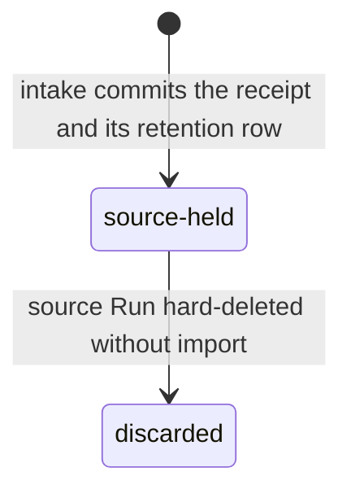
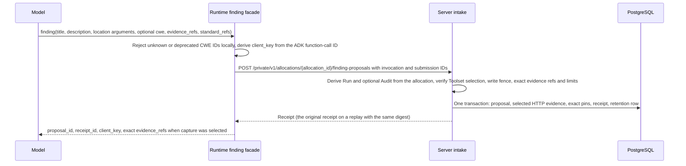
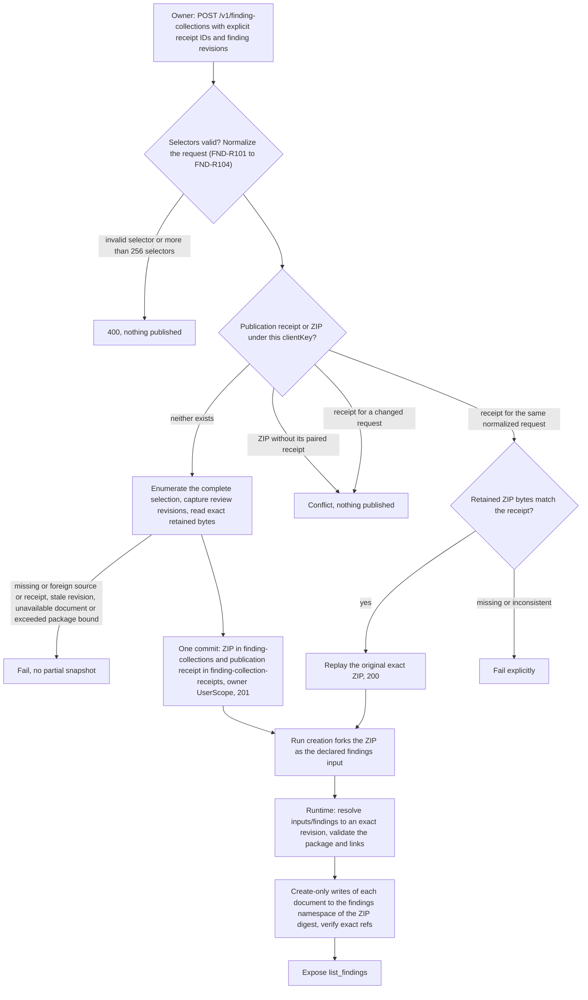

# Findings

Requirement prefix: `FND` · [Specification index](../README.md)

## Purpose and scope

This document owns finding proposals: the `contractor.audit.finding-proposal.v1`
schema, the finding authoring Toolsets and their `finding` tool, trusted
intake and proposal receipts, typed locations, selected HTTP evidence, the
bundled CWE catalog, how annotation artifacts become finding evidence, and how
long a proposal of an ordinary Run stays readable. It also owns finding
collections: the immutable collection package, its publication by the Server,
its preparation inside Runtime, the `list_findings` reader tool, and the
bundled configurations that produce or read findings.

It leaves to other documents:

- HTTP sessions, the outgoing request records that a `request_id` resolves
  against (their capacity, content, ownership, invocation binding and
  erasure), which captured exchanges `finding(request_id=...)` can attach and
  that they are not truncated, the `http_request` header and response bounds
  including `http_response_invalid`, ambient session authentication and what
  `http_session_get` reports (`auth_kind`, redacted headers, cookie names and
  count): [HTTP and Caido tools](../tools/http-caido.md).
- The Project target credential that Runtime injects on the target origin:
  [projects](../artifacts/projects.md).
- Annotation tools, annotation identity and the `changed=false` result:
  [code analysis](../tools/code-analysis.md).
- The `contractor.audit.package.v1` transport and its limits, standard
  packages, and how Audit import treats pinned standard references (Audit
  import of CWE references is FND-R153): [audits](../audits/audits.md).
- Retention of Audit child-Run proposals while the Audit collects its child
  Runs: [Audit execution](../audits/execution.md).
- Import of ordinary-Run proposals into an Audit, finding triage, review
  decisions, direct verification and finding backtrace:
  [review and reports](../audits/review-and-reports.md).
- `submit_check_result` and completion of Audit checks inside the Worker:
  [worker completion](../audits/worker-completion.md).
- Hard deletion of a Run and purge of its RunScope as a whole:
  [retention and deletion](../artifacts/retention-and-deletion.md).
- ArtifactStore refs and names, the write fence and Workflow input forks:
  [artifact store](../artifacts/artifact-store.md).
- AgentTemplate Toolset selection:
  [agent templates](../configuration/agent-templates.md); Workflow input
  slots: [workflows](../configuration/workflows.md).
- Generic Audit-local SARIF export: FND-R197 through FND-R208 below. Future
  consumer-specific profiles:
  [proposal 0028](../../proposals/0028-finding-analysis-and-sarif.md);
  redacted evidence for autonomous engagement Audits:
  [proposal 0033](../../proposals/0033-autonomous-pentest-audits.md).
- Shared registries: [limits](../platform/limits.md),
  [errors](../platform/errors.md),
  [failure model](../platform/failure-model.md) and
  [lifecycle](../platform/lifecycle.md).

## Concepts

Terms are defined once in [the glossary](../glossary.md); the ones this
document owns are:

- **FindingProposal.** The immutable candidate and evidence envelope that a
  Worker submits through `finding`; it may describe an observation, a
  hypothesis or a finding with evidence, and it never confirms a
  vulnerability by itself.
- **Proposal receipt.** The trusted intake record, identified by
  `receipt_id`, that the Server commits together with the proposal artifact;
  a generic artifact write cannot forge one.
- **Client key.** The proposal key `client_key`, scoped to the trusted
  invocation; it never becomes a global finding ID.
- **Creation facade.** One of the Toolsets `security-findings@1`,
  `security-findings-code@1` and `security-findings-http@1`, each exporting
  the model-visible tool `finding` with its own required arguments.
- **Typed location.** A closed Source or Web object that records where the
  producer claims a finding is.
- **Selected HTTP evidence.** The `http_exchange` snapshot of one captured
  outgoing request that the HTTP facade copies into a proposal when it
  receives a `request_id`.
- **Runtime target credential marker.** The literal
  `[runtime-target-credential]`, captured in place of the Project target
  credential that Runtime injects.
- **Finding collection.** A frozen selection of existing receipts and
  available review observations, published as one immutable ZIP and consumed
  as an ordinary input artifact.
- **Collection entry.** One selected receipt inside a collection, with its
  origin, retention state, proposal document, evidence links and review
  observations.
- **Collection document.** The exact retained bytes of one proposal or
  evidence artifact inside a collection, identified by a document ID derived
  from its scope, exact ref and content metadata.
- **Canonical snapshot.** The nullable current assessment of one Project Finding,
  captured at an explicit revision for a frozen collection.
- **Publication receipt.** The small JSON artifact in
  `finding-collection-receipts/<clientKey>` that records the normalized
  request digest and the exact ZIP metadata of one published collection.
- **Prepared reader.** The `list_findings` tool of one allocation after
  Runtime has materialized and verified every document of its bound
  collection in the current Run.

## Model

### FindingProposal

A proposal is one JSON document under the schema
`contractor.audit.finding-proposal.v1` (see the
[proposal example](#finding-proposal)).

| Field | Content |
| --- | --- |
| `schema` | `contractor.audit.finding-proposal.v1` |
| `client_key` | Invocation-scoped key (FND-R9, FND-R25) |
| `title`, `description` | Authored text |
| `subject` | `{kind, key}`, or an explicitly unknown `null` |
| `hypothesis` | Optional |
| `preconditions` | List of preconditions |
| `standard_refs` | Entries of `scheme`, `version` and `requirement_id` |
| `evidence_ids` | Evidence IDs, mapped by intake to the receipt's exact evidence refs (FND-R93) |
| `proposed_checks` | Entries with `objective` and `method` |
| `severity_suggestion` | Suggested severity, for example `medium` |
| `limitations` | Distinct, nonblank values (FND-R10) |
| `locations` | Optional typed locations |
| `http_exchange` | Optional selected HTTP evidence |

### Location objects

A location is exactly one closed object:

- **Source:** required `file`, optional `line` or
  `range: {start_line, end_line}`.
- **Web:** required `url`, optional `method`.

### HTTP exchange snapshot

`http_exchange` embeds a copied snapshot of one captured request in the
proposal:

| Field | Content |
| --- | --- |
| `request_id` | The selected request record |
| `request_tag` | Tag of that record |
| `attempts` | Nonempty list of attempts |
| `response_body_evidence_id` | Optional evidence ID of the full selected exchange containing the final response body |

Each attempt has `method`, `url`, `headers` (`{name,value}` rows), canonical
`body_base64`, exactly one of `status` or `error`, and optional
`response_headers`. `error` is `transport_error` or `cancelled`.

### Collection package

| Member ID | Path | Content |
| --- | --- | --- |
| `collection` | `collection.json` | Canonical collection metadata, `application/json` |
| Each document ID | `documents/<document ID>` | Exact retained proposal or evidence bytes |

The transport manifest is `manifest.json`.

### Collection metadata objects

| Object | Fields |
| --- | --- |
| Collection | `schema: contractor.findings.collection.v2`, `snapshot_at`, `sources`, `documents`, `entries` |
| Source | `kind: run\|audit`, `id` |
| Document | `id`, `scope: {kind: run\|project\|user, id}`, exact `ref`, `digest`, `media_type`, `size_bytes` |
| Entry | `selected_sources`, `receipt_id`, `proposal_id`, `run_id`, `invocation_id`, optional `audit_origin`, optional `audit_holds`, `retention`, `proposal_document_id`, `evidence`, optional `finding` |
| Audit origin | `audit_id`, `execution_id`, `role` |
| Evidence link | `evidence_id`, `document_id` |
| Finding snapshot | `project_id`, `finding_id`, `revision`, nullable `state`; optional coherent `verdict`, `severity`, `duplicate_target_id` |

### Receipt retention of an ordinary-Run proposal

An entry's `retention` records one of the receipt states `source-held`,
`project-held` or `discarded` (FND-R83). A proposal of an ordinary Run stays
readable in its source RunScope (FND-R63); hard deletion of the source Run
discards it when it was never imported (FND-R154, and
[retention and deletion](../artifacts/retention-and-deletion.md), DEL-R28).
Project retention is specified by FND-R214. The
receipt itself stays as tombstone provenance until its Project is deleted
(DEL-R61).



## Requirements

### Proposal contract

**FND-R1.** One current schema, `contractor.audit.finding-proposal.v1`,
carries the proposal fields and the intake and receipt authority. It permits
an explicitly unknown `subject: null` and adds optional `locations` and
`http_exchange`. There is no alternate proposal schema.

**FND-R2.** A missing subject is never synthesized from a URL, title or
run ID. Verification inventory uses the existing receipt identity when a
subject is unknown; this does not rewrite the proposal's subject.

**FND-R3.** A proposal may describe an observation, a hypothesis or a
finding with evidence. Hypothesis, proposed checks, annotations and
reproduction instructions remain optional under the generic contract;
scenario instructions can require more detail without changing the tool
schema.

**FND-R4.** `hypothesis` is optional, including for a finding
discovered directly by a Workflow. The FindingProposal remains the candidate
and evidence envelope; it does not imply a separate prior hypothesis or a
mandatory later verification Run.

**FND-R5.** Omission of the hypothesis alone never means that
verification was performed. When a source Workflow counts as the verifier of
its own finding is specified in
[review and reports](../audits/review-and-reports.md#direct-findings-verified-inside-the-source-workflow).

**FND-R6.** Generic Audit results and findings do not require
annotations, `trace_id`, a function or a sink.

**FND-R7.** A standard ref contains `scheme`, `version` and
`requirement_id`. Unknown IDs are rejected when a standards package is
configured.

**FND-R8.** A missing standard mapping is shown as unmapped, never
interpreted as compliance.

**FND-R9.** `client_key` is scoped to the trusted invocation and
never becomes a global finding ID.

**FND-R10.** `limitations` contains distinct, nonblank values of at
most 512 UTF-8 bytes each (LIM-FND-1), matching the coverage gaps retained
for proposed checks. Intake rejects a proposal that exceeds this bound before
publishing its receipt.

### Annotations as evidence

**FND-R11.** A Workflow chooses whether annotated source and its state
or diff are outputs.

**FND-R12.** An annotation artifact may exist without a finding. It
becomes evidence only through an explicit reference to an existing exact
artifact revision; a finding cannot refer to a future workspace export.

**FND-R13.** Artifact availability alone does not prove a
vulnerability or trace coverage.

**FND-R152.** Annotation identity and participation in an investigation are
different facts. An existing annotation comment or a repeated annotation call
returning `changed=false` ([code analysis](../tools/code-analysis.md)) does
not prove that the current Worker checked that path.

**FND-R14.** A shared function can be reached with different inputs and
controls; matching a function or `file + CWE` does not justify merging
findings.

### Finding Toolsets

**FND-R15.** `security-findings@1` is an optional AgentTemplate Toolset.

**FND-R16.** An AgentTemplate that creates findings selects exactly one
creation facade in `AgentTemplate.toolsets`:

| Toolset | Required model arguments | Optional location arguments |
| --- | --- | --- |
| `security-findings@1` | `title`, `description` | typed `locations` |
| `security-findings-code@1` | `title`, `description`, `file` | `line` or `range` |
| `security-findings-http@1` | `title`, `description`, `url`, `method` | `request_id` |

**FND-R17.** Each creation facade exports the single visible name
`finding`. Selection is fixed before the Worker starts, and duplicate visible
tool names are rejected.

**FND-R18.** Each creation facade also accepts optional `cwe`, exact
`evidence_refs` and typed `standard_refs`.

**FND-R19.** The creation facades share one publisher for normalization,
intake and receipt handling. There is no parallel old authoring
implementation.

**FND-R187.** All creation facades accept optional `proposed_checks`, preserving
the ordered proposal entries `objective` and `method` (at most 512). Each
objective is nonblank UTF-8 text of at most 64 KiB without NUL; each method is
the existing bounded proposal identifier. Unknown method names may be recorded
as suggestions; trusted admission validates registered methods and the pinned
profile's mapping before execution. No suggestion accepts a Workflow ref, role,
phase, capability or approval grant. Omission produces an empty array. Invalid
entries fail before intake and publish no receipt; retries retain the ordinary
invocation and tool-call submission identity.

**FND-R20.** `security-findings@1` also exports `list_findings`, which can
be selected independently of a creation facade: AgentTemplate selection can
expose creation, reading or both.

**FND-R21.** Selecting reading grants no publication or analyst mutation authority. Current Finding
ownership and commands are FND-R209 through FND-R219.

**FND-R22.** A finding call records an ordinary proposal receipt. Its explicit publish_problem flag
additionally requests canonical Project problem publication under FND-R210. The Worker
never chooses the Project or Audit, grants approval or starts work.

**FND-R23.** Model-visible arguments contain no `audit_id`,
`project_id`, owner or Run identity, or execution override.

**FND-R24.** `finding(...)` uses the selected general, code or HTTP
interface and its allocation-bound intake receipt.

**FND-R157.** The same client key with identical content is idempotent;
changed content conflicts (FAIL-FND-1).

**FND-R25.** The hidden `client_key` is `call-` followed by the full
SHA-256 of the nonempty ADK function-call ID. The existing invocation
namespace and submission identity remain unchanged.

**FND-R26.** A transport retry of the same event reuses the exact
submission bytes; different tool calls remain different proposals. A missing
call identity fails before submission (FAIL-FND-1).

**FND-R27.** A successful `finding` call returns `proposal_id`,
`receipt_id` and `client_key`. An Audit Worker copies the returned key into
`submit_check_result(proposal_keys=...)`
([worker completion](../audits/worker-completion.md)).

**FND-R28.** Finding creation never suppresses or merges proposals by content
and never guesses a subject. Qualified deterministic equality adds only the
system-owned correlation projection (FND-R174 through FND-R178).

### CWE classification

**FND-R29.** Optional `cwe` maps to a `standard_refs` entry with scheme
`CWE`, version `4.20` and the explicit `CWE-NNN` weakness ID.

**FND-R30.** The bundled catalog records MITRE's versioned XML archive
URL, the archive and XML SHA-256 and its weakness IDs, excluding Weakness
entries with `Status="Deprecated"`.

**FND-R31.** Unknown or deprecated IDs fail locally, both in `cwe` and in
explicit `standard_refs` entries with scheme `CWE`; such an entry must also
use version `4.20`. Rejected references never reach intake, and no live
taxonomy lookup occurs.

**FND-R32.** Updating the catalog or its version requires reviewing the
mapping and the external benchmark binding together.

**FND-R153.** Audit import accepts known `CWE@4.20` references without
pinning CWE as an Audit standard; they are incidental classifications and
cannot satisfy an assigned checklist entry. Unknown CWE IDs and other versions
are rejected.

Audit import of pinned standard references is specified in
[audits](../audits/audits.md).

### Typed locations

**FND-R33.** A location is exactly one closed Source or Web object (see
[Location objects](#location-objects)).

**FND-R34.** Source coordinates are one-based and inclusive; a range end
cannot precede its start.

**FND-R35.** File paths are case-sensitive relative POSIX paths. Backslashes,
colons, empty, dot or parent components and control characters are rejected.

**FND-R36.** A URL must be an absolute HTTP or HTTPS URL with a host and a
valid nonzero port if one is present, and must contain no userinfo,
backslash, whitespace, control characters or malformed percent escapes.

**FND-R37.** Methods are nonempty ASCII HTTP tokens.

**FND-R38.** Authored spelling, query order, escaping and fragments are
preserved. Locations are not fetched or normalized, GET is not inferred and
paths are not remapped.

**FND-R39.** Locations are bounded as follows:

| Bound | Value and basis |
| --- | --- |
| Locations | 256 per finding (LIM-FND-2), matching the existing per-finding evidence capacity |
| File | 4096 UTF-8 bytes (LIM-FND-3), matching the retained path bound |
| URL | 8192 UTF-8 bytes (LIM-FND-4), matching the HTTP tool URL bound (LIM-HTP-8) |
| Method | 64 ASCII bytes (LIM-FND-5), matching the bounded HTTP method field |
| Line and range endpoints | 1–9007199254740991 (LIM-FND-6), JSON/JavaScript exact integers |

**FND-R40.** Absent or empty locations encode by omission. Explicit
`null`, unknown fields, `file` together with `url`, `line` together with
`range`, and malformed coordinates fail. Array order is retained.

**FND-R41.** Locations are producer claims, not proof of source identity,
reachability or exploitation. The benchmark must separately verify exact
source bytes.

### Selected HTTP evidence

**FND-R42.** The HTTP facade requires `url` and `method` even without a
captured source. The general and HTTP facades accept optional `request_id`
or `caido_request_id`, mutually exclusive. Omitting both permits a finding
without captured HTTP evidence.

**FND-R43.** A supplied source resolves only against the allocation's
bounded HTTP/Caido buffer, with the same-invocation ownership rule of
[HTTP and Caido tools](../tools/http-caido.md) (HTP-R71, HTP-R72). An invalid,
expired or foreign source returns a repairable error; the caller can select a
current source or omit it (FAIL-FND-2). The request is mandatory; a missing or
incomplete response is saved with its truthful failure or partial outcome.

**FND-R46.** Creating a finding never sends or replays traffic.

**FND-R47.** The authored location and the observed request remain
separate facts; neither silently replaces the other.

**FND-R48.** For direct HTTP capture the Server derives the optional
`http_exchange` proposal/report projection described in
[HTTP exchange snapshot](#http-exchange-snapshot). Each projected attempt has
exactly one of `status` or `error`; its errors are `transport_error` or
`cancelled`. The full evidence artifact preserves response completeness and
all capture error codes. A capture that this limited projection cannot
represent truthfully has no embedded projection; its evidence remains intact.

**FND-R49.** Only a finding-selected exchange becomes an ordinary HTTP
evidence artifact, using media type
`application/vnd.contractor.http-exchange+json` and schema
`contractor.http.exchange.v1`. The Server creates a frozen binding in the
RunScope namespace `finding-proposals`, named `http.exchange.<proposal_id>`,
and appends its exact descriptor to the receipt's evidence. No independent save
tool or automatic publication of ordinary traffic is required. An exact
previously saved exchange can be reused through `evidence_refs`.

**FND-R50.** A selected exchange retains actual target headers and body
bytes, including model-supplied `Authorization` and `Cookie`, under the
credential rules below. The HTTP proposal projection also includes captured
request bytes. Headers and bodies are not added to history summaries, metrics
or serialized Worker state.

**FND-R51.** Private transport credentials remain outside the
target request capture.

**FND-R52.** The Project target credential that Runtime injects on the
target origin ([projects](../artifacts/projects.md)) is never known to the
model, and proposals are model-readable, so its `Authorization` value is
captured as the marker `[runtime-target-credential]`. Values that the model
supplied or set in its session are its own and are retained as sent.

The ordinary `http-tools@1` finding capture is not the redacted projection
proposed for autonomous engagement evidence: it keeps credentials the model
supplied itself and replaces only the Runtime-injected Project target
credential with the placeholder `[runtime-target-credential]`. The full
redaction of credentials and session material proposed for
autonomous engagement evidence is described in
[proposal 0033](../../proposals/0033-autonomous-pentest-audits.md).

**FND-R53.** Selected HTTP evidence mirrors the existing HTTP bounds:
an outgoing structured body or raw Caido request of at most 1 MiB per attempt
(LIM-FND-7), at most 64 KiB per structured header block (LIM-FND-8), at most
13 attempt records (LIM-FND-9), and at most 16 MiB of response bytes per
attempt (LIM-HTP-15). Direct HTTP retains only the final response body;
intermediate response records explicitly have `complete: false`.

**FND-R54.** The request header block bounded by LIM-FND-8 is the
complete set of headers actually sent, not only the model-supplied headers.

`http_request` keeps every sent block within that bound: it limits the
model-supplied headers to 48 KiB (LIM-HTP-3), reserving the rest for
Runtime-added headers, and refuses before sending any request whose complete
block would exceed 64 KiB (LIM-FND-8)
([HTTP and Caido tools](../tools/http-caido.md), HTP-R24, HTP-R25).

**FND-R55.** The proposal document and embedded report projection retain
the 8 MiB limit (LIM-FND-10). The complete private submission, including
selected capture, is at most 64 MiB (LIM-FND-32). All evidence of one
proposal, the stored sizes of its exact evidence refs plus the selected HTTP
exchange Artifact, totals at most 64 MiB (LIM-FND-50). Intake rejects a new
proposal over this quota permanently as `invalid_finding_request` (400) and
stores no receipt or Artifact; a replay returns its receipt before the quota
is checked (FND-R60). Oversized content fails explicitly; selected evidence is
never silently truncated.

### Intake

### Selected exchange artifact

**FND-R160.** The selected artifact is a closed JSON object with `schema`,
`capture` and `finding`. `finding` contains Server-derived `proposal_id` and
`receipt_id`; Runtime and the model cannot supply this association. The private
submission carries only optional `httpEvidence: capture`. Intake returns
`evidence`, an ordered array of exact Artifact descriptors, including when empty.

**FND-R161.** `capture` has `source: http|caido`, string `request_id`, optional
`request_tag` (required for HTTP), and 1–13 `attempts`. Each attempt has a
mandatory `request: {method,url,message}`, an optional
`response: {status,message,complete}`, and optional `error`. An absent response
requires an error; a complete response cannot also claim an error. Outcomes are
`transport_error`, `timeout`, `cancelled`, `response_invalid`,
`response_too_large`, `response_unavailable`, `target_denied` or
`request_invalid`. `response_unavailable` records missing response capture
without diagnosing a target transport failure. HTTP status 4xx/5xx is response data. Missing optional values are omitted, never `null`.

**FND-R162.** HTTP messages have `kind: structured`, ordered duplicate-preserving
`headers: [{name,value}]` and canonical `body_base64`. Caido messages have
`kind: raw` and canonical `data_base64` preserving scrubbed raw bytes; an empty
raw request is invalid. Source and message kinds must agree. HTTP IDs are
canonical decimal integers 1–9007199254740991; Caido IDs are nonempty strings
of at most 256 UTF-8 bytes without ASCII control characters. The owning schema
is [http-exchange.schema.json](../../../api/v1alpha1/http-exchange.schema.json);
Go and Runtime validate the shared capture cases. Capture decoding applies
the HTTP body/header and complete private-submission bounds; the ordinary
Audit document/string limits must not shrink a valid base64 body.

**FND-R56.** Runtime submits a proposal through the allocation-bound private
route `POST /private/v1/allocations/{allocation_id}/finding-proposals`.

**FND-R57.** The trusted adapter supplies the correlated invocation and
stable submission IDs.

**FND-R58.** The Server derives the Run and the optional Audit identity
from the allocation and trusted Run provenance. It verifies the Toolset
selection, the current write fence
([artifact store](../artifacts/artifact-store.md), ART-R86), the exact
evidence refs in that Run and all payload and count limits.

**FND-R59.** One PostgreSQL transaction creates the immutable proposal
Artifact and any selected HTTP exchange Artifact, verifies and pins their
exact evidence, and records the receipt and retention row. Rejection or
rollback exposes neither a selected exchange binding nor its finding.
Filesystem candidate blobs follow the existing orphan cleanup rules.
A generic artifact write cannot forge a receipt or its selected HTTP binding.

**FND-R60.** Replay of `(allocation_id, invocation_id, submission_id)` with
the same canonical digest returns the original receipt; a different digest
conflicts (FAIL-FND-1).

**FND-R61.** Receipt replay remains readable after the write fence, while a
new submission is rejected (FAIL-FND-1).

**FND-R62.** Intake and the fence transition are serialized by the
allocation write-authorization critical section that ordinary private
artifact writes use.

**FND-R158.** The intake transaction also stores the receipt's report
projection: the canonical JSON of the proposal's title, description, subject,
hypothesis, `preconditions`, standard references, severity suggestion, limitations,
locations and HTTP exchange, validated by the same rules as the proposal and
bounded by the proposal document size. `preconditions` is required, preserves
the original strings and order, and encodes an empty list as `[]`; absent or
null conditions are invalid. Conditions count in the existing proposal and
projection limits. It is immutable with the receipt, and Audit
reports read it instead of the proposal artifact
([review and reports](../audits/review-and-reports.md), REV-R195). This bounded
projection makes the conditions available in the standalone report without
artifact hydration; the first-proposal reference supplies attribution. The
forward transition for retained projections follows
[PER-R43](../platform/persistence.md#PER-R43).

**FND-R185.** One source Run admits at most 4,096 proposal receipts
(LIM-FND-46). A replay (FND-R60) returns its receipt before the count and
consumes nothing. A new submission counts the Run's receipts and inserts its
own under one per-Run transaction lock, so concurrent final submissions admit
exactly one; a submission beyond the limit fails permanently as
`invalid_finding_request` (400), and a rejected or rolled-back submission
admits no receipt or Artifact. The limit bounds the receipts the count
matches, not its execution: the count reads every receipt of the Run, and
the PostgreSQL plan may read more.

**FND-R186.** The Audit inbox (`GET /v1/audits/{auditId}/finding-proposals`)
lists, oldest first in receipt (creation time, receipt ID) order, the
Audit's native receipts whose source Run still exists and every receipt the
Audit holds, each once (REV-R141, REV-R142). An imported receipt keeps its
own creation time, not the time of its hold. Each hold keeps an immutable
copy of its receipt's creation time: the database copies it when the hold is
inserted, rejects a hold that names another time, and rejects every update of
a hold. The Audit's holds are indexed in receipt order. The read takes the
first page after the cursor from the native receipts and from the held
receipts, each in index order, merges them, and reads only the merged page's
receipts whole. Its work therefore grows with the page size and never with
the Audit's other receipts and holds, or with other Audits' or owners'
receipts. The next-Round builder's held-only view
([execution](../audits/execution.md), AUX-R60) reads the same held branch.

The held branch is bounded by ordering holds by receipt time, not by a limit
on the holds one Audit keeps. A hold limit would bound each page by that
limit rather than by the page. It would also give owner imports and Audit
collection a new rejection. The copied time changes nothing an owner sees,
and the database enforces it for every hold writer. With 20,150 holds in one
Audit, a held page of 200 receipts read every hold (20,150 hold and about
20,350 receipt rows) when holds were ordered by their own time. With the
receipt-time order it reads 200 hold and 402 receipt rows. A next-Round pass
of 51 calls reads 10,001 holds in all, where it read 1,082,650. The
index on hold time was replaced, because no reader asks for an Audit's holds
in hold-time order. Reopen the decision if a receipt's creation time can ever
change, or if a reader needs an Audit's holds in hold-time order.



### Deterministic producer fingerprint evidence

**FND-R163.** Intake derives an immutable optional fingerprint projection on
its existing receipt. Neither the proposal nor the private receipt response,
model-visible `finding` facades or `list_findings` contract changes. The model
supplies no matching descriptor, hash, producer identity or stability claim.
The owner finding view exposes `fingerprint` from its first receipt; this is
correlation evidence and does not set an analyst verdict or severity.

**FND-R164.** The closed initial adapter `pinned-sarif-native/v1` consumes
only exact Stage input artifacts also selected as finding evidence: one Git
source with immutable import provenance and one `application/sarif+json`
report. It reads no other Run artifacts and performs no fetch or model call.
The report must use SARIF 2.1.0, one matching Git provenance entry per relevant
run, an explicit driver name and version, and a full nonempty `fingerprints`
map. `partialFingerprints` alone, prose, CWE or a rule ID do not qualify.
This binding proves the owner's selected report and source basis, not that a
scanner actually executed or that a vulnerability is confirmed. Runtime
scanner output without this owner-pinned provenance remains unavailable.

**FND-R165.** A qualifying result binds the finding to the machine observation:
its title equals the exact `ruleId`, its description equals literal
`message.text` with no formatting arguments, and it has one primary source
location and no subject, hypothesis, extra classification, preconditions,
checks, limitations or HTTP exchange. Severity is independent. A different
issue at the same coordinate does not inherit a native key. Rephrased or
enriched findings remain ordinary observations with an unavailable native
key. This is deterministic validation of the supported native projection;
report prose never enters the key. The qualifying record must uniquely match
the finding's exact relative source path and primary start line, or complete range. Absolute paths,
base URI remapping, traversal, ambiguous result selection and mismatched Git
provenance do not qualify. Record position selects evidence only and is not
part of equality. Hash lowercase SHA-256 over RFC 8785 canonical JSON of
`["contractor/producer-issue/v1", ["git", repository],
"contractor/pinned-sarif", "snapshot/v1", ruleId,
["snapshot", [commit, sourceDigest]], [driverName, driverVersion, fingerprints]]`.
The repository and commit come from trusted Git import metadata. Native keys
are scoped to this exact snapshot; cross-commit stability is not inferred.
Severity, prose, Run identity and record order do not affect equality.

**FND-R166.** Strictly validate projection writes and reads. The schema is
`contractor.finding.fingerprint-projection.v1`; availability is `available`
with algorithm, value, adapter, rule, Git repository/commit, source digest,
exact report/source descriptors and record locator, or `unavailable` with
one closed reason and no key fields. Reasons are `not_recorded`,
`not_provided`, `input_limit`, `producer_key_unavailable`,
`producer_report_invalid`, `producer_record_ambiguous`, `asset_unavailable`
and `discarded`. Absent, unsupported, malformed optional reports or optional
preparation bounds preserve a valid ordinary finding. Foreign exact refs,
integrity and storage errors retain their existing permanent/retryable class
and never commit a partial receipt (FAIL-FND-1). Limits are LIM-FND-33 through
LIM-FND-37. No permissive legacy decoder or historical reparse exists.

**FND-R167.** Resolve optional exact inputs before the short intake
transaction. Fingerprint and anchor preparation share at most one Stage read,
made only when either needs a Stage input; that snapshot selects optional
inputs and rejects a Stage of another Run before the transaction, and the
transaction reads the Stage again for provenance and authorization. The transaction revalidates selected evidence and stores the
projection atomically with the receipt. Reconcile replay from the receipt
before reading optional sources, including after source Run deletion; equal
keys from independent calls retain independent receipts. Audit-held projections survive source deletion and one destination's purge;
when their receipt becomes discarded, erase all derived key content and
record only `discarded` (LIFE-FND-1). Project purge owns final row deletion.

### Exact-source structural correlation evidence

**FND-R168.** The Runtime publisher may prepare a closed optional
`derived_anchors` value from existing source locations and explicitly selected
exact evidence. This field belongs only to the authenticated private publisher;
all model-visible finding facades, descriptions, arguments and response shapes,
and `list_findings`, stay unchanged. No model emits a hash, parser profile or
issue-context claim. Generic Artifact writes cannot stamp a trusted derivation.
Missing source, unknown coordinates or optional preparation limits preserve the
ordinary finding with an unavailable projection. No extra artifact or receipt is
created, and evidence order/count and analyst triage remain independent.

**FND-R169.** Derive only from one unambiguous selected ZIP, at most 32
selected locations, 8 MiB compressed input and distinct parsed source, 4 MiB per
file, and 20000 archive entries with 128 MiB declared expansion. Use only exact
case-sensitive relative paths, at most 512 UTF-8 bytes and 32 components; reject
unsafe, duplicate, encrypted, link/special or conflicting archive entries.
Parse each selected UTF-8 file once outside the event loop with pinned
Tree-sitter 0.25.2 and language-pack 1.14.3. Discard its AST before the next
file. Profiles `python/statement-v1`, `javascript/statement-v1` and
`typescript/statement-v1` support `.py`, `.js/.mjs/.cjs` and `.ts`, respectively;
other languages, including TSX, are explicitly unsupported.
Use only already cached versioned grammars during publication; missing or
unloadable grammars yield `anchor_parser_unavailable`, without a lazy download.
Runtime installation/test preparation owns prefetching pinned parser assets.

**FND-R184.** The publisher of one allocation may retain the bytes of at most
one selected exact ZIP within the LIM-FND-38 input bound and reuse them for a
later finding that selects the same exact ref. Each finding still resolves the
metadata of every selected ref, and reuse requires the media type and size that
this resolution reports; otherwise the source is read again and checked as a
fresh read is. Reuse counts as a content observation of the exact revision, as
a read does. Concurrent findings of one exact ref share one read; a failed,
cancelled or expired read retains nothing. Selecting another exact ZIP replaces
the retained bytes, and allocation release discards them. ASTs and derivations
are never retained, so each publication parses its selected files again.

**FND-R170.** Resolve an exact inclusive line/range to one supported
statement. Python statements must be direct children of a module/block;
JavaScript/TypeScript support lexical/variable declarations, expression,
return and throw statements. A definition's complete range, several statements
on a line, missing nodes and parser errors never select an arbitrary node.
Use the common CRLF/CR/LF coordinate scheme; parser rows alone are insufficient.
Canonical ordered AST kinds/fields/leaves preserve exact identifiers, literals,
punctuation and block structure. Ignore ordinary comments and inter-token trivia;
retain directive comments (`#!`, `//#`, `//!`, `/*!`, `/**`, type/noqa/nosec,
pragma, coding, pyright/mypy/fmt/pylint/eslint/tslint, coverage, prettier, source
mapping and `@` directives), hashbangs and standalone string directives.
Enclosing headers, callable binding names, decorators and retained directives
produce a signature digest. Ordered named-child paths distinguish repeated
statements; no renaming, fuzzy mapping or inferred symbol identity occurs.
A parse/derivation visits at most 100000 nodes/steps, retains at most 256 KiB of
canonical token bytes, limits structural path depth to 128 and canonical depth
to 64, and cooperatively checks a 10-second budget. The whole optional Runtime
preparation has its separate 30-second deadline and joins cancelled parsing.

**FND-R171.** The Server strictly validates the closed
`contractor.finding.anchors-derived.v1` record, at most 16 KiB. Available records
contain exact source ref/digest and 1–32 anchors, each with file/range,
language/profile/grammar, exact file digest, signature digest, named-child path
and node digest; optional context has a closed scheme/rule/proof. It verifies
that the source is selected evidence and an immutable Stage input, checks its
trusted Git repository/commit and exact archive/member digests before mutation
locks, then revalidates allocation/evidence authority in the intake transaction.
Unknown/missing/null members, forged refs, changed selectors, wrong hashes or
unsupported declared schemes are permanent validation failures under existing
intake codes. Infrastructure/read errors retain their class. An admissible
source without trusted Git identity yields `asset_unavailable`; ownership is
still enforced by ordinary intake. Go validates authenticated derivations and
exact bytes; it does not implement a second AST normalizer.

**FND-R172.** Site keys hash RFC 8785 JSON
`["contractor/structural-site/v1", ["git", repository], file, profile, grammar,
signatureDigest, path, nodeDigest]`. They are candidate evidence only. A shared
sink or CWE does not establish issue equivalence. The initial machine-local
scheme recognizes one simple literal assignment/declaration of an unencrypted
Ed25519 PKCS8 private key, validates it with the pinned cryptographic parser,
and requires sole CWE-321 classification, one source location and no additional
issue claims or HTTP evidence. Its rule is
`source.private-key-literal.ed25519/v1`, context `node-local/v1`, and context
digest hashes `["node-local-private-key/v1", "ed25519", literalDigest]`.
The literal is bounded to 512 decoded bytes and never copied into metadata or
logs. This check establishes the local issue instance, not exploitability or
an analyst verdict. Other languages, key formats and flow-sensitive problems
have no qualified local context. Snapshot issue keys hash
`["contractor/snapshot-issue-anchor/v1", ["git", repository],
[commit, sourceDigest], ruleId, siteKey, contextScheme, contextDigest]`.
Keys are lowercase SHA-256 hex. Cross-snapshot automatic matching is forbidden;
site-only records expose `issue_context_unavailable`.

**FND-R173.** Retain `contractor.finding.anchors-projection.v1` inline on
the immutable receipt, bounded to 32 KiB, with the authenticated source/basis and
Server-computed keys, or one unavailable reason. The owner finding view exposes
`anchors` from its first receipt; private/model reader responses do not change.
Reasons are `not_recorded`, `not_provided`, `input_limit`, `asset_unavailable`,
`selector_unavailable`, `anchor_language_unsupported`, `anchor_parser_unavailable`, `source_invalid`,
`source_missing`, `parse_error`, `anchor_ambiguous` and `discarded`.
Existing receipt replay precedes source reads; transport retries use byte-identical prepared
submissions. Independent calls remain separate observations. Audit holds retain
exact sources and derivations after source Run deletion, another Audit's purge
does not remove them, and discard clears every derived field to the unavailable
`discarded` marker. Existing Project purge owns final deletion. Limits are
LIM-FND-38 through LIM-FND-41; failures/lifecycle reuse FAIL-FND-1 and LIFE-FND-1.

### Automatic correlation across Audits

**FND-R174.** Qualified publication admits one canonical Project Finding. Its first receipt freezes
the primary key: a qualified contractor/producer-issue/v1 key under pinned-sarif-
native/v1 first, otherwise exactly one distinct qualified contractor/snapshot-issue-
anchor/v1 issue key. Several distinct issue keys are primary_key_ambiguous; site-only,
unsupported or missing keys are no_qualified_key; both original projections marked
not_recorded remain not_recorded. Later sources never change the primary key or bridge
separate schemes. Every independent receipt and result survives. No model or human
confirmation participates in automatic equality.

**FND-R175.** The canonical row stores immutable primary algorithm/value, unavailable reason, Project
scope and group hash: SHA-256 hex of RFC 8785 JSON ["contractor/finding-group/v1",
project_id, algorithm, value]. Qualified keys are unique within the Project. Its
immutable owner_id is derived from the Project on insert and exists solely to bound
owner-index scans; a database trigger verifies it and prevents later identity changes.
It is neither another state owner nor an authorization fallback. There is no
representative Audit Finding or background synchronization.

**FND-R176.** The former automatic-duplicate presentation over separate Audit Findings is retired.
Lists return canonical Project summaries; exact source receipts retain the independent
observations. A shared qualified key resolves to the same Finding identity on write,
without a representative reader or copied current state.

**FND-R177.** The existing finding_correlation_fences row owns the exact Project revision
(1..9007199254740991), initialized atomically when the Project is created and removed
only with that Project. A missing required fence is an integrity failure, never revision
1. Canonical publication, analyst edits and source/result availability advance it in
their owning transaction; replay does not. Writers lock the Project FOR SHARE NOWAIT
then its fence FOR NO KEY UPDATE NOWAIT, preserving existing Run/Audit authority order.
Contention uses SQLSTATE 40001, bounded whole-transaction retries and
storage_transaction_conflict 503. Audit purge removes execution membership without
deleting Project sources or advancing canonical state. Project and Audit Finding pages
pin this revision. Owner-wide lists use live owner-scoped keysets. This reuses the
existing lock domain: moving revision onto the Project row would falsely contend with
ordinary Run and Artifact admission; adding another lock or receipt mechanism is
rejected. Reopen this boundary only if Project admission locking changes.

**FND-R178.** Source collection and negative rechecks append ordinary immutable results without
changing current analyst fields, duplicate target or Finding revision. Audit deletion
removes only execution-local membership and holds; Project sources and exact material
remain. Frozen reports remain historical captures. Final Project deletion releases the
canonical rows, receipts and material in bounded dependency order.

### Bounded candidate, comparison and member reads

**FND-R179.** Owner-authorized read-only candidate, two-Audit comparison and
all-member endpoints expose current correlation without changing receipt,
triage, review or evidence state. They use default 20/max 100 rows, at most
256 KiB JSON, a 1024-byte signed cursor and the registered
`finding_correlation_stale` (409) and
`finding_correlation_item_too_large` (422) errors. Cursors bind owner, Project,
source finding/receipt, exact selection, limit and policy. Project-wide reads
fence the dedicated Project revision; Audit and pair restrictions fence only
their selected Audit revisions. Recheck the fence once, after the last bounded
hydration read; a changed fence outranks that read's error and requires
restarting. Missing or foreign sources use the same 404.
Existing classified storage conflicts retain the retryable 503
`storage_transaction_conflict`.

**FND-R180.** Candidate scope defaults to Project; `scope=audit` restricts to
the source Audit. A selected target Audit belongs to the same owned Project.
An optional source receipt must actually contribute to the source finding;
otherwise use its first receipt. Match that selected source against each
target's immutable first receipt, while always retaining the source finding's
existing primary equality. Supporting receipts are searchable as explicitly
selected sources, with no unbounded target-contribution fanout. Fixed tiers
are primary equality, selected qualified producer equality, structural site,
and exact Project/nonnull-subject/tagged-family hints. Each target appears
only at its strongest tier. Site/family and secondary matches never regroup
findings. Return at most eight reason pairs with explicit truncation and
limitations; no title/description/LLM similarity participates.

**FND-R181.** Strong tiers seek their exact Project/Audit group directly.
Weaker tiers examine an indexed work window of at most 897 matching-input
rows, plus at most 100 result summaries and up to three source lookup/exclusion rows, within
the 1000-row work budget. Cursors retain examined-row and tier progress;
empty progress pages may have `hasMore`. A compact comparison projection on
the existing immutable receipt bounds each matching/display read to 32 KiB.
Its display title is an explicitly truncated 256-character preview; full
material remains on finding detail. Optional family hints are unavailable
when more than 32 refs or a version over 160 UTF-8 bytes exceeds that hint
contract. Never truncate a key into guessed equality. Structural and qualified
producer keys retain their owning exact projections. Discard clears this
comparison projection; no new table, receipt or Artifact hold is introduced.

**FND-R182.** Compare exactly two distinct owned Audits in one Project into
exact primary groups (`both`, `left-only`, `right-only`) and individually
identified `unmatched` observations. Recursive next-group index seeks skip
high-multiplicity groups; unmatched rows have their own keyset phase. Return
one bounded preview per side, pair-relative smallest-ID representative and
all-member navigation. Every selected observation is reachable exactly once
through its group or unmatched row. Previews preserve first receipt, source
Workflow/digest, retained Run availability, current triage, proposal/analyst
severity and semantic assessment. Receipt equality identifies shared import;
`previewsShareReceipt` describes only the shown previews, never whole-group
independent-discovery totals. Profile and baseline digest (explicitly
`postgres-jsonb-text/v1`) give context; coverage is `not-compared`. One-sided
or unmatched observations never imply a fixed/new vulnerability or clean scan.
No whole-comparison totals or complete-coverage claims are inferred.

**FND-R183.** The separate automatic-group member API is retired. Canonical Finding sources are
reached through bounded Project source pages; Audit lists query indexed membership in
those same canonical identities. There is no source-specific Finding identity or current
state.

### Proposals of ordinary Runs

**FND-R63.** A proposal of an ordinary, non-Audit Run stays readable in
its source RunScope until it is either imported by exact revision into an
Audit or durably discarded (LIFE-FND-1).

**FND-R154.** Deleting a source Run discards only source-held receipts without retained Project
material, erasing their report/fingerprint/anchor/comparison projections and preserving
bounded immutable receipt provenance for exact replay. Project-held receipts retain
their exact proposal, evidence and result material after both Run and Audit deletion.
Losing the last Audit membership does not discard Project material. Only normal Project
cleanup deletes those receipts and Artifacts (FND-R214).

### Finding collections

**FND-R64.** A finding collection is a frozen selection of existing
receipts and available review observations. It is an ordinary input
artifact, usable by both ordinary Workflows and Audit child Runs, and it
creates no verification inventory or checks.

**FND-R65.** Annotations, diffs, logs and reports are possible
evidence documents; their semantic validation belongs to the consumer.

**FND-R66.** A collection performs no implicit deduplication by
function, subject, description or evidence digest.

### Collection package format

**FND-R67.** A collection has the media type
`application/vnd.contractor.findings-collection+zip`. It reuses the bounded
`contractor.audit.package.v1` ZIP transport ([audits](../audits/audits.md))
with `kind: finding-collection` and no `entry_point`.

**FND-R68.** Reusing this transport does not make a collection an Audit
execution result. Existing result importers continue to require their own
package kind and envelopes.

**FND-R69.** The package contains the members listed in
[Collection package](#collection-package). The `package_id` of its
`manifest.json` is `collection-` followed by the full lowercase SHA-256 of
the canonical `collection.json` bytes.

**FND-R70.** Each document occurs once, including a document shared by
multiple entries. No undeclared members and no unused documents are
accepted.

**FND-R71.** The existing package codec validates ZIP integrity and paths
before any document is exposed.

**FND-R72.** Both metadata documents, `manifest.json` and
`collection.json`, use RFC 8785 canonical JSON: UTF-8 with no BOM and no
trailing newline.

**FND-R73.** Collection decoding rejects noncanonical representations,
unknown or duplicate keys, wrong key case, missing required fields, invalid
Unicode and unsupported schema versions.

**FND-R74.** Optional members are omitted, never `null` or an empty
placeholder.

**FND-R75.** Embedded proposal bytes retain their original representation
and are independently decoded under the current
`contractor.audit.finding-proposal.v1` contract.

### Collection metadata

**FND-R76.** Every field of the
[collection metadata objects](#collection-metadata-objects) is required unless marked
optional. Arrays are always arrays, including when empty.

**FND-R77.** ID values use the Audit-domain identifier contract: 1–160 ASCII
bytes (LIM-FND-11) matching `[A-Za-z0-9][A-Za-z0-9._:-]*`. Exact ArtifactRefs keep
the Artifact plane's own namespace, name and revision constraints
([artifact store](../artifacts/artifact-store.md), ART-R11).

**FND-R78.** `snapshot_at` is UTC RFC3339Nano ending in `Z`, with
insignificant fractional zeros omitted. It records when the selection was
captured; it is not a query for the latest database state.

**FND-R79.** Sources identify the requested Run or Audit scopes. Each entry explicitly records
selected_sources, a sorted nonempty subset of the collection sources authorized during
selection. This captures selection separately from native producer origin and surviving
Audit holds; JSON provenance never grants authority.

**FND-R80.** A document's `scope` identifies where the exact retained
bytes were read: a producer Run, or an authorized retained Project or User
artifact. The entry origin still identifies the producing Run and invocation
even when the retained bytes came from an Audit hold in ProjectScope.

**FND-R81.** No owner identity or source scope in the collection JSON
grants read access.

**FND-R82.** Optional `audit_holds` contains up to 64 sorted, unique Audit
IDs (LIM-FND-12) that hold retained copies of the receipt. It preserves source
membership independently of producer origin and review state; it does not
create a finding ID or imply confirmation. Absent or empty holds encode by
omitting the member.

**FND-R83.** Retention is source-held, project-held or discarded. It never substitutes for exact
package byte availability. Audit membership is independent of the Project material
owner.

**FND-R84.** A discarded receipt can be included only if all its
selected exact bytes remain available through an authorized retained copy;
otherwise publication fails.

**FND-R85.** After its source Run is deleted, a receipt is read from
the retained copy of an Audit source that selected it (the lowest such Audit
ID holding one), never from another destination's copy; without such a copy
publication fails.

**FND-R86.** An optional finding snapshot contains canonical project_id, finding_id, revision and
nullable state, with coherent optional verdict, severity and duplicate_target_id.
Revision is an exact integer in 1..9007199254740991. Unassessed state stays null; no
source rating supplies a current assessment.

**FND-R87.** Collection v2 has no per-Audit review observations, current assessment IDs or Finding
decision IDs. The optional canonical snapshot is a historical capture and never a
mutation capability.

**FND-R88.** Canonical identities and selected source identities in a collection are provenance, not
dereference capabilities. Runtime reads only the exact documents materialized in its
current Run.

**FND-R89.** An ordinary producer has no invented Audit origin or review. A receipt may link to one
canonical Project Finding independently of whether any Audit selected it.

**FND-R90.** Sources and each entry selected_sources sort by (kind,id), documents by id, entries by
receipt_id and evidence by evidence_id, in ascending ASCII lexical order. Keys are
unique within their containing array.

**FND-R91.** If source selections overlap, the publisher keeps one receipt
entry and merges its distinct review observations. Different receipts remain
distinct even when they have identical subjects or bytes.

**FND-R92.** An entry's proposal document must be nonempty JSON and
decode as a FindingProposal. Its `evidence_ids` set must equal the entry's
evidence-link IDs exactly; the proposal's array order need not be lexical.

**FND-R93.** The publisher preserves intake's mapping of `evidence-1`,
`evidence-2` and so on to the receipt's sorted exact refs; it does not
renumber links after sorting the collection.

**FND-R94.** The optional canonical Finding snapshot never rewrites the original proposal, source
rating or independent verification results.

### Document identity and bounds

**FND-R95.** `media_type` is the normalized lowercase MIME type without
parameters, as stored by the Artifact plane. `digest` is `sha256:` followed
by 64 lowercase hex characters. `size_bytes` is the exact byte length,
including zero for empty evidence.

**FND-R96.** The document ID is `doc-` followed by the full lowercase
SHA-256 of the RFC 8785 encoding of this array, in this exact order:

```text
[scope.kind, scope.id, ref.namespace, ref.name, ref.revision,
 digest, media_type, size_bytes]
```

Rationale: including the scope prevents two Runs with identical binding names
and revisions from colliding, even when their content bytes are identical.
Documents with the same entire identity can be shared within the package.

**FND-R97.** A collection stays within these bounds:

| Limit | Value |
| --- | --- |
| Sources | 1–64 (LIM-FND-14) |
| Entries | 0–256 (LIM-FND-15) |
| Documents | 0–1023 (LIM-FND-16) |
| Evidence links per entry | 0–256 (LIM-FND-17) |
| Review observations per entry | 0–32 (LIM-FND-18) |
| Collection JSON | 1 MiB (LIM-FND-19) |
| Proposal document | 1 byte–8 MiB (LIM-FND-20) |
| Evidence document | 0–16 MiB (LIM-FND-21) |
| Sum of document bytes | At most 16 MiB (LIM-FND-22) |
| Complete ZIP | At most 16 MiB, including metadata and headers (LIM-FND-23) |

**FND-R98.** The transport additionally limits manifest bytes,
expansion, JSON depth and node count ([audits](../audits/audits.md),
AUD-R128). All these bounds apply simultaneously; the entry limit is not a
promise that every selection of 256 large proposals fits. An oversized
selection fails and can be explicitly narrowed.

**FND-R99.** An empty successful selection contains empty `entries` and
`documents`. Missing bytes never turn a nonempty selection into an empty
one.

### Collection publication

**FND-R100.** The Server owns owner-authorized source selection, snapshot
capture, assembly and publication through the existing Artifact plane, in
response to the owner-authenticated `POST /v1/finding-collections` (see the
[publication request example](#publication-request)). No new findings
database is introduced.

**FND-R101.** `clientKey` is an Artifact name of 1–128 bytes (LIM-ART-1;
[artifact store](../artifacts/artifact-store.md), ART-R11). Selector
identities use 1–128 ASCII bytes (LIM-FND-24) under the Audit-domain
identifier pattern of FND-R77.

**FND-R102.** Sources are unique by kind and ID; receipt IDs and finding
IDs are unique within a source. Both arrays are required, and a Run source
has an empty `findings` array.

**FND-R103.** A request has at most 256 selectors across all sources
(LIM-FND-25); a request over this bound is rejected like an invalid selector
(`400`, FAIL-FND-3). The expansion of finding contributions must also fit the
package entry and byte bounds.

**FND-R104.** Overlap across sources is permitted and deduplicates only
the same receipt identity. Input order is normalized for replay identity.

**FND-R105.** Selection explicitly names receipt IDs or canonical Finding IDs/revisions within a Run
or Audit source. There is no implicit review queue or automatic publication from
selection.

**FND-R155.** The caller enumerates its desired receipt IDs using existing
paginated APIs. Empty arrays explicitly select nothing; there is no implicit
"all", live filter or fallback to the first page.

**FND-R156.** Admission, retention and review policy is expressed by the
selected IDs and finding revisions.

**FND-R106.** Selecting a Finding through an Audit includes its explicitly associated receipts from
that Audit, preserving every selected independent source. It never hydrates all lifetime
sources merely to fill a page.

**FND-R107.** Selection is fully enumerated before any bytes are fetched.
Page limits, missing retained bytes or exceeded package limits cannot produce
a successful partial snapshot.

**FND-R108.** Selected rejected, unreviewed or discarded records are not
silently skipped. An unavailable exact document fails the entire publication
(FAIL-FND-3).

**FND-R109.** A missing or foreign source or receipt is `404 not_found`; a
stale finding revision is `409 conflict`; invalid selectors are
`400 invalid_request`; package codec failures keep their bounded `422` Audit
package codes `audit_document_invalid`, `audit_schema_unsupported`,
`audit_limit_exceeded`, `audit_package_invalid`, `audit_package_path_invalid`,
`audit_package_member_forbidden`, `audit_digest_mismatch` and
`audit_reference_invalid` (FAIL-FND-3).

**FND-R110.** The Server checks source ownership and correspondence to
existing records, captures the available review revisions and reads the
exact retained bytes with matching digest, MIME type and size. Publication
exposes a complete package atomically.

**FND-R159.** Publication reads its selection in a number of statements that
does not grow with its entries (LIM-FND-15): one read authorizes every
source, one read per source authorizes the receipts it selects (for an Audit
source after one read expands its selected findings to all their receipts,
LIM-FND-25), one read each loads the selected receipts, their Audit holds,
the Audits that own those holds and the source Runs that still exist, and
the exact documents are read in batches. Only the sources (LIM-FND-14) and the document batches
(LIM-FND-16) add statements to the one repeatable-read transaction that
holds the publication's lock (FND-R116).

**FND-R111.** A successful response contains `artifact` (`ref`, `digest`,
`mediaType`, `sizeBytes`), `snapshotAt`, `entryCount` and `replayed`.
Creation returns `201`; replay returns `200`.

**FND-R112.** The exact ZIP is written to the authenticated owner's
`finding-collections/<clientKey>` binding, and a small ordinary JSON artifact
in `finding-collection-receipts/<clientKey>` records the normalized request
digest and the exact ZIP metadata. Both writes commit together.

**FND-R113.** The publication receipt is publication metadata, not a
second finding store or review authority.

**FND-R114.** The same key and normalized request replay the original
exact ZIP before sources or current reviews are looked up. A changed request
conflicts permanently with `idempotency_conflict` (409, not retryable), like
an Idempotency-Key bound to another request: only a new key can publish the
changed selection. A pre-existing ZIP without the paired receipt conflicts, and
missing or inconsistent retained ZIP bytes fail explicitly (FAIL-FND-3).

**FND-R115.** The existing Artifact-plane lifecycle rules apply to
these UserScope bindings and their exact revisions; publication does not
modify them on replay (LIFE-FND-2).

**FND-R116.** If a transaction aborts before publication, the explicit source
IDs remain fixed; a retry validates the requested finding revisions again and
either captures them or conflicts. Concurrent snapshots use repeatable-read
transactions and bounded retry on definite PostgreSQL serialization aborts
(FAIL-FND-3).

**FND-R117.** Retries reuse an already published exact snapshot or a
previously fixed selection; if that selection cannot be recovered exactly,
they fail explicitly. They never silently recompute a newer collection under
the same publication identity (FAIL-FND-3).

**FND-R118.** Retention of the published ZIP retains the required bytes
independently of later source-Run deletion (LIFE-FND-2).

**FND-R119.** The collection ZIP is passed as a declared ordinary Workflow
input. Public Run creation continues to fork declared artifacts through its
existing mechanism ([artifact store](../artifacts/artifact-store.md),
ART-R80). It does not follow the collection's JSON refs or gain
collection-specific recursive input handling.

### Reader preparation

**FND-R120.** For `security-findings@1` the declared input slot is `findings`,
required and accepting `application/vnd.contractor.findings-collection+zip`.
Workflow validation requires this slot only when an agent selects
`list_findings`. The existing ToolsetSelection contract needs no new fields.

**FND-R121.** Preparation resolves `inputs/findings` once to an exact
revision; later binding changes do not alter the prepared snapshot.

**FND-R122.** Runtime owns allocation-local preparation of the reader
Toolset and performs it in these steps (FAIL-FND-4, LIFE-FND-3):

1. Resolve the selected declared collection input to an exact current-Run
   ref, and validate the complete package and all proposal and evidence links
   before any write.
2. For each embedded document, derive a versionless current-Run destination:
   namespace `findings-<full SHA-256 hex of exact ZIP bytes>`, name equal to
   the document ID. `FindingCollectionTargets` specifies this pure mapping;
   its output is a write target, not an exact read receipt.
3. Materialize each document through the existing allocation ArtifactClient
   using create-only writes. On a replay or conflict, read the existing
   destination and verify its exact bytes, digest, MIME type and size:
   identical content can be reused, while different content fails without
   being overwritten. Record the exact revisions actually returned.
4. Expose `list_findings` only after every document has a verified exact ref.
   A failed preparation may leave ordinary unexposed intermediate artifacts;
   a replay verifies and reuses them, and existing Run cleanup owns their
   lifecycle.

**FND-R123.** A failed preparation reports one bounded code of the
findings tool vocabulary ([errors](../platform/errors.md), ERR-R23) as the
allocation error. `findings_collection_unavailable` (the collection input)
and `findings_document_unavailable` (a document destination) are retryable
only for a lost Artifact API transport or an Artifact API error marked
retryable. An invalid collection (`findings_collection_invalid`,
`findings_digest_mismatch`, `findings_reference_invalid`, FND-R143), an
oversized one (`findings_limit_exceeded`) and `findings_document_conflict`
are non-retryable for the recorded Run snapshot (FAIL-FND-4).

**FND-R124.** The Toolset may perform this internal materialization even
in a reader-only configuration; this grants no model-visible creation
operation. It uses the existing `WriteInputsAndIntermediates` allocation
policy and leaves `ReadCurrentRun` intact.

**FND-R125.** Source refs stay separate as provenance. Preparation needs
no Runtime read of a foreign Run.



### Reader tool

**FND-R126.** The reader tool has this interface:

```text
list_findings(subject_kind?, subject_key?, limit?, cursor?)
    -> {items: [...], next_cursor: string|null}
```

**FND-R127.** The collection input is fixed by the selected Toolset version,
never by model-supplied Run, Project, Audit or owner IDs. One prepared reader
binds one collection.

**FND-R128.** Filtering compares the original proposal subject exactly and
case-sensitively. `subject_key` requires `subject_kind`; absent values mean
no filter, while empty strings are invalid.

**FND-R129.** `limit` defaults to 20 and ranges from 1 to 100 (LIM-FND-26).

**FND-R130.** Each reader item returns receipt_id, proposal_id, run_id, invocation_id,
selected_sources, optional audit_origin and audit_holds, retention, original subject,
title_preview, description_preview, has_hypothesis, proposal, evidence and an optional
canonical finding snapshot. There is no reviews array or per-source current problem
state.

**FND-R131.** `proposal` is
`{ref, digest, media_type, size_bytes, source: {scope, ref}}`, and each
`evidence` item adds `evidence_id` to that shape. The top-level `ref` is the
verified exact consumer ref; `source.ref` preserves the retained source ref.

**FND-R132.** Each preview is `{text, truncated}`: the title is at most 512
UTF-8 bytes (LIM-FND-27) and the description at most 2048 bytes
(LIM-FND-28), cut only at a code point boundary.

**FND-R133.** The full proposal text, hypothesis and checks remain
available through `read_artifact(proposal.ref)`, and all evidence remains
available through its exact refs.

**FND-R134.** Results keep receipt order after filtering. The canonical JSON
response is at most 256 KiB (LIM-FND-29). Whole items are added until the
item or byte bound is reached, accounting for the final cursor.

**FND-R135.** If one complete item cannot fit, the tool returns
`findings_limit_exceeded`, never an empty page or truncated evidence or
review arrays (FAIL-FND-5).

**FND-R136.** `next_cursor` is `null` exactly when no matching entries
remain. Empty selections and filters with no matches return
`items: [], next_cursor: null`.

**FND-R137.** The cursor is unpadded base64url of canonical JSON with
exactly these fields:

```text
{version: 1, collection_digest: "sha256:...", subject_kind: string|null,
 subject_key: string|null, after_receipt_id: string}
```

**FND-R138.** The decoded cursor JSON is at most 1024 bytes
(LIM-FND-30) and the encoded cursor at most 1366 ASCII bytes
(LIM-FND-31).

**FND-R139.** Cursor values must match the bound exact ZIP digest and
the requested filters, and `after_receipt_id` must exist among the matching
entries. `limit` may change between calls.

**FND-R140.** A wrong version, a malformed cursor, an unknown receipt,
or changed filters or snapshot fail explicitly with `findings_cursor_invalid`
(FAIL-FND-5).

**FND-R141.** A cursor is a position token, not an authorization grant.
It carries no signature, because the collection boundary is already fixed.

**FND-R142.** Invalid arguments (`findings_arguments_invalid`), an
invalid cursor (`findings_cursor_invalid`), an item over the byte limit
(`findings_limit_exceeded`), a call after the allocation released the reader
(`findings_reader_unavailable`) and a successful empty page are distinct
outcomes; each failure is non-retryable. An invalid collection and missing
or conflicting prepared artifacts fail preparation instead (FND-R123), so the
tool is never exposed over them (FAIL-FND-5).

**FND-R143.** The Runtime decodes a collection with its own bounded codes,
the counterparts of the Server's Audit package codes (FND-R109):
`findings_collection_invalid` for a wrong media type, a malformed or unsafe
archive, non-canonical or schema-invalid JSON or an invalid proposal;
`findings_digest_mismatch` for a member or document whose bytes, size or
metadata disagree with the manifest; `findings_reference_invalid` for a
document ID, entry link, proposal evidence ID or review that does not
resolve; and `findings_limit_exceeded` for an exceeded bound. An error
reports only its code, never source bytes (FAIL-FND-4, FAIL-FND-5).

**FND-R144.** Preparation and reads cannot confirm findings or mutate
review state.

### Current contract and bundled configurations

**FND-R145.** Server, Runtime, configurations, clients and the benchmark
binding use this one current contract together. Collections retain exact
proposal bytes that satisfy it.

**FND-R146.** The API and machine reports expose typed coordinates and
selected exchange evidence. The UI displays authored coordinates without
inferred links or web previews.

The configuration catalog provides these opt-in configurations:

**FND-R147.** `openapi-operation-trace@3` binds
`audit-openapi-operation-trace@2` and `audit_openapi_operation_tracer@2`. It
retains the structural graph and source tools, adds text evidence writing and
`finding`, and uses human-required finding confirmation. Its canonical results
carry the client keys of successful proposals; `operation-resolution`
coverage keeps its existing meaning.

**FND-R148.** `findings-review@1` uses `findings_analyst@1`, accepts only
the required `findings` collection input and publishes a Markdown `report`.
It selects `list_findings`, `read_artifact` and text report writing. Its
generic analysis requires no hypothesis, annotation, OpenAPI input or Audit
origin.

**FND-R149.** The ordinary `source-findings-review@1` Workflow uses the
code facade. Source verifier and tracer templates select the code facade; the
HTTP verifier selects the HTTP facade.

**FND-R150.** No duplicate template or Workflow versions exist for
compatibility. External benchmark bindings consume the retained public
receipts of the ordinary Workflow.

### Conformance

**FND-R151.** The
[shared fixture](../../../api/testdata/findings/finding-collection-v2.fixture.json)
is the conformance reference for the Go and Python codecs and for Runtime
preparation. It contains generic function and configuration subjects,
ordinary Run and Audit origins, an optional hypothesis, a review without a
decision ID, and identical evidence bindings from different Runs. Codec tests
require exact conformance and reject inconsistent metadata, byte content and
evidence membership.

### Optional typed analysis evidence

**FND-R191.** A proposal may select zero or one ordinary evidence document
with media type `application/vnd.contractor.finding-analysis+json` and schema
`contractor.finding.analysis.v1`. The document is closed canonical RFC 8785
JSON; `client_key` equals the containing proposal's key. Its required arrays
are `sources`, `locations`, `flows` and `http_exchanges`. Optional fields are
`rule`, `primary_location_id` and `primary_http_exchange_id`; explicit nulls,
unknown or case-variant members, repeated keys and invalid Unicode fail.
The text Artifact writer validates the authoring shape and canonicalizes this
media type off the event loop, joining work on cancellation. Proposal,
collection and model-visible finding tool schemas remain unchanged.

**FND-R192.** Analysis sources are `{id, kind: archive|file, artifact_ref}`.
Locations are `{id, source_id, path, file_digest}` with optional `region` and
`symbol`. Regions have required `start_line` and optional `end_line`,
`start_column`, `end_column`; symbols have required `name` and optional
`qualified_name`, `language`, `kind`, `signature`. Every dependency is an exact
ref explicitly selected by the same receipt; analysis cannot reference itself
or another analysis, choose another scope or cause a store/network lookup.
Source identity includes exact scope/version, not just matching content.
After source deletion, the trusted receipt-to-Audit-hold mapping binds original
refs to the requesting Audit's verified retained copies; byte equality alone
does not create an alias. Original source identity and capture origin remain
provenance and do not grant access to the deleted Run.
Collection publication checks recorded digest/size against bytes, resolves
only the selected UTF-8 file or ZIP member and checks its file SHA-256.
Paths are relative case-sensitive POSIX paths without backslashes, colons,
control characters, empty/dot/dot-dot components or symlinks. All locations
of a plain file agree on its logical path. Lines and Unicode code-point
columns are one-based; end columns are exclusive, require start columns and
must fit the exact text. CRLF is one terminator, tabs one code point. Empty
files have no invented first line. Invalid supplied coordinates fail; missing
coordinates stay missing, without source discovery or remapping edited files.

**FND-R193.** Flows have `id`, `kind: call-path|data-flow|execution-trace`,
`description`, `completeness: complete|partial`, `steps`, `edges`, `gaps` and
exact `evidence_refs`. Steps have `id`, `roles`, `message`, `evidence_refs`,
optional `location_id`, `value`, `value_state`. Roles are `source`,
`propagation`, `call`, `return`, `validation`, `sanitizer`, `sink`,
`observation`; value states are `unknown`, `tainted`, `derived`, `validated`,
`clean`. Edges have `from`, `to`, `relation`, `basis`, `evidence_refs`,
optional `argument_binding: {caller_value, callee_parameter}`; relations are
`call`, `return`, `argument`, `assignment`, `transform`, `control`,
`observation`. Gaps have `after_step_id`, `before_step_id`, `reason`.
Every consecutive step pair has exactly one edge or gap. Unlocated steps
have gaps to their neighbors. Complete data-flow starts at a located source,
ends at a located sink, has coordinates for every step and evidence for every
edge; argument transfer needs an explicit binding. A gap makes a flow partial.
`producer-asserted` evidence never establishes semantic truth; a
`tool-reported` edge needs a recognized durable relation decoder. No such
code-relation decoder is admitted by this contract: copied graph output or
annotations must remain producer assertions. Validation never invents an edge,
sanitizer effect, overloaded callee or primary location.

**FND-R194.** HTTP analysis exchanges have `id`, exact `evidence_ref`,
`decoder`, optional `operation: {document_ref, pointer, method, path_template}`
and `implementation_location_id`. Decoder `contractor-http-exchange/v1`
strictly reads the current HTTP/Caido captured-exchange envelope and preserves
its original finding association, including reuse by a later proposal.
A capture in the reserved `finding-proposals/http.exchange.<proposal_id>`
Run binding has Runtime capture origin; an uploaded copy has producer origin.
Decoder `http-response-body/v1` projects only the retained media type; a body
cannot recover a request or status. Unknown decoders fail. The projection
contains only known method, URI without query/fragment/userinfo, response
status and content type, with omitted field names and producer/capture origin.
Bodies, headers and credentials are not embedded. A Caido raw response must
parse under its decoder and agree with its recorded status. An OpenAPI
operation must resolve its exact `/paths/<escaped-path>/<method>` JSON Pointer
in a selected JSON/YAML OpenAPI document; operation IDs and handler names are
not join keys. An implementation link must name an existing analysis location.

**FND-R195.** The optional rule is `{id, version, name, description}` with
optional absolute HTTPS `help_uri` without userinfo; no documentation URL is
fetched. Rule IDs use the Audit identifier grammar extended with `/` and `-`,
at most 160 ASCII bytes. All local IDs are unique in their containing array;
primary IDs must resolve. Analysis is at most 1 MiB, 32 sources, 256 locations,
32 flows with 128 steps each, 32 exchanges, 16 KiB per text field and depth 32
(LIM-FND-47). Collection selection/document bounds remain FND-R97/FND-R98.
One resolver bounds distinct selected input bytes to 16 MiB and source ZIP
expanded bytes to 64 MiB, entries per archive to 10,000 and each member to
4 MiB (LIM-FND-48). It checks directories before allocating ZIP records, reads
only selected members, verifies their actual lengths/CRC and reuses exact
source caches across receipts; no per-finding store read or parent scan occurs.

**FND-R196.** Invalid analysis, missing dependencies, conflicting paths,
digests, coordinates or edges reject the whole collection with a bounded
`audit_document_invalid` 422 before publication (FAIL-FND-7). Existing source
owner checks, finite PostgreSQL retries and publication-key replay remain
unchanged. Cancellation remains cancellation and joins all work; ambiguous
publication reuses its existing paired receipt. Resolver caches are transient
and released with the call; analysis remains ordinary evidence under its
existing Run/Audit/Project retention and purge rules (LIFE-FND-6). Validation
does not change triage, proposal severity, duplicate identity or collection
format and does not assert that authored descriptions are secret-free.


## Audit finding exports

**FND-R197.** An owner creates one synchronous export of explicit finding IDs
and exact revisions from one Audit. The public route supplies Audit authority;
foreign/missing findings and non-member presentation receipts return the existing
non-disclosing not-found class, stale revisions conflict. Empty selects none;
there is no implicit whole-Audit or cross-Audit selection. The closed request
selects `format: sarif`, `profile: generic`, `clientKey` and `findings`, with
optional `includeDuplicates` defaulting to false. Limits are LIM-FND-49.

**FND-R198.** The frozen snapshot retains every selected finding, its complete
contribution membership, explicit presentation receipt (default first receipt),
its own current decision/rating/assessment, qualified primary correlation key
and policy, resolved native analysis, exact original and retained evidence
identities and trusted Git origin. Supporting contributions do not replace
presentation fields or inherit another finding's rating. HTTP projections omit
headers, bodies, query, userinfo and fragments; raw evidence remains subject to
existing Artifact authority. The snapshot records schema, time, exporter and
policy versions plus normalized request digest. Rendering consults this snapshot
alone and calls no model, network or store.

**FND-R199.** `includeDuplicates: false` emits one selected representative per
connected group of qualified primary-key equality and explicit same-Audit manual
duplicate links. Prefer a selected non-duplicate, then the lexically first
finding ID. Shared targets outside the selection may connect selected siblings,
but neither targets nor peers are selected implicitly. Similar text, titles,
weak candidates and overlapping contributions never establish equality. The
representative retains its own triage and presentation; all selected member IDs
remain in output properties, and all canonical decisions remain in the
snapshot. `true` emits every selected finding. The option does not change native
Audit state, and `resultCount` may be below `selectedCount`.

**FND-R200.** Snapshot, SARIF, diagnostics and replay receipt publish atomically
as frozen bindings in the existing ProjectScope namespace of the owning Audit;
no new table or independent lifecycle is introduced (LIFE-FND-7). The
Audit-local `clientKey` and normalized request determine export identity. Omitted
and explicit false duplicate inclusion normalize identically; changing the
option or selection with the same key returns permanent `idempotency_conflict`.
Replay verifies immutable descriptors/digests and returns original bytes before
reading live findings, source evidence or current reviews (FAIL-FND-8).

**FND-R201.** The public collection is
`POST /v1/audits/{auditId}/findings/exports`. It returns 201 for publication,
200 for replay and `Location` pointing to
`GET /v1/audits/{auditId}/findings/exports/{exportId}/content`.
The `/snapshot` and `/diagnostics` sibling resources download the original JSON.
All downloads check current Audit ownership/deletion state, serve attachments
with Artifact transfer/storage/write budgets and never regenerate content.
The OpenAPI document owns exact fields, headers and classified errors, including
retryable 503 `storage_transaction_conflict` with `Retry-After`.

### Generic SARIF rendering

**FND-R202.** The `generic/1` policy renders one SARIF 2.1.0 run for the
owning Audit from its frozen snapshot, without network, model, filesystem or
store discovery. Exporter version `1.1.1` identifies the structured renderer.
The actual output bytes must conform to the official OASIS Errata 01 JSON
Schema (SHA-256 `c3b4bb2d6093897483348925aaa73af03b3e3f4bd4ca38cef26dcb4212a2682e`)
and FND-R203 through FND-R208. Regression tests check actual renderer output
against the pinned schema, independent semantic checks and golden fixtures;
full output checks and schema embedding run only in tests, with offline-only
schema loading. Production validates frozen inputs and enforces deterministic
construction invariants and resource bounds. Renderer defects detectable only
by the full output checks are caught by the regression suite; reopen this
boundary if externally supplied SARIF projections enter rendering or the
validated-input and deterministic-construction boundary changes. Snapshot and
SARIF remain bounded to 16 MiB each;
diagnostics remain bounded to 4 MiB and 4096 items. Construction accounts for
repeated locations, flows and presentations before accumulating oversized output.

**FND-R203.** Only the selected presentation receipt supplies a result's
physical locations, rule, flows and classifications. Supporting receipt
identities, exact proposal/evidence descriptors and origins remain in result
properties; every selected contribution and independent decision remains in the
snapshot. Properties preserve the presentation's native analysis and the
selected group's independent findings. Results, registries and diagnostics
have deterministic ordering; canonical JSON output ends in one newline.

**FND-R204.** Explicit source roots derive from the verified original exact
source identity, kind and digest. A relative path is escaped segment by segment
under its own `contractor-source://<root>/` base; the same path in distinct roots
never identifies one file. Artifacts carry the exact member/file SHA-256.
Regions retain validated Unicode code-point columns and exclusive ends,
with `columnKind: unicodeCodePoints`; missing regions remain file-level.
Only an explicit native primary location becomes `locations`; other native
locations become `relatedLocations`. Symbols retain names, kinds, language and
signature. Neither a flow endpoint nor a proposal's unverified path implies a
primary location. Git provenance requires retained trusted Git metadata for the
exact selected repository archive; metadata on an independently named file
cannot establish a repository-relative mapping.

**FND-R205.** A native flow emits separate located segments, each with at least
two points, split at every explicit gap, missing location or missing region.
No projected adjacency may cross a native gap or skip a native step. Original
step order, edge relation, argument binding, roles, value state, claimed
completeness and gaps remain distinguishable from projected execution order.
Call paths, data flows and execution traces retain their native kinds. Partial
projections are labelled and diagnosed. Complete data-flow claims with missing
coordinates fail rendering. Until a trusted code-relation decoder exists,
relations remain producer-asserted and `tool-reported` claims fail; sanitizer,
validation and clean-state claims do not imply safety or whole-program coverage.

**FND-R206.** Versioned native rule definitions become driver rules; absent
rules use `contractor/unclassified` with a warning, and conflicting definitions
under one rule ID fail rendering. Classification adapters project only exact
`CWE@4.20`, `asvs@4.0.3` and `owasp-asvs@5.0.0` tuples already admitted at intake;
other tuples remain native properties with `classification_unmapped`. Run
taxonomy definitions and result taxa do not establish a rule-wide mapping.
The driver omits `supportedTaxonomies` and rule taxonomy relationships until
an explicit versioned native rule mapping exists; result tuples cannot supply
that mapping (SARIF Errata 01 section 3.19.26). Export does not infer aliases
or fetch a taxonomy. Qualified registered automatic keys alone become fingerprints; absent keys yield a warning, without a weak
text or location fallback.

**FND-R207.** The selected finding's own frozen review determines SARIF rating:
confirmed findings use `kind: fail`, with high/critical → error, medium → warning,
and low/informational → note; unrated confirmed findings use warning and an
explicit diagnostic. Other review states use `kind: review`, `level: none`.
Proposal severity remains a separately labelled suggestion. Grouping never
borrows another member's rating or implies baseline state, suppression, fix,
remediation, complete-scan coverage or a numeric security score.

**FND-R208.** Only the explicitly selected safe HTTP projection supplies
`webRequest` and `webResponse`: method, sanitized target URI, known status and
base response Content-Type. Request/response bodies, other headers, URI query,
fragment and userinfo are omitted with a diagnostic; raw Caido and structured
HTTP captures follow the same policy. Exact OpenAPI operation pointers remain
native provenance, without inferred code locations. A finding without native
analysis still exports its identity, text and independent review, with
`analysis_missing`; it never acquires a synthetic file, source line or flow.

## Interfaces

- `finding`: the model-visible tool of each creation facade, with the
  arguments of FND-R16 and FND-R18 and the result of FND-R27.
- `list_findings(subject_kind?, subject_key?, limit?, cursor?)`: the reader
  tool (FND-R126).
- `POST /private/v1/allocations/{allocation_id}/finding-proposals`: the
  allocation-bound private intake route (FND-R56).
- `POST /v1/finding-collections`: operation `publishFindingCollection` in the
  [public API schema](../../../api/openapi/contractor-public-v1.yaml), which
  owns the precise HTTP field spelling and the error envelopes.
- Media type `application/vnd.contractor.findings-collection+zip`, schema
  `contractor.findings.collection.v2` for `collection.json`, and schema
  `contractor.audit.finding-proposal.v1` for proposals.

### Exact proposed-check indexes

**FND-R188.** Finding intake derives a private
`contractor.audit.finding-checks-projection.v1` index from the final exact
proposal bytes and the same validated document it publishes. The index holds
at most 512 ordinal headers and 256 KiB serialized JSON (LIM-FND-52): byte offsets, lengths
and fragment digests, registered method/phase and canonical plan digest/size,
plus exact subject and limitations fragment locations. It stores no objective
prose and grants no source, route or execution authority. Unknown methods and
oversized typed plans remain explicit unsupported headers without rejecting an
otherwise valid ordinary finding.

**FND-R189.** A source adapter first proves the receipt and destination Audit
hold, then reads the exact original content or its byte-identical retained
copy through ArtifactStore. It verifies and strictly decodes only selected
check and context fragments, and recomputes registered plan digests. A missing
index is data-migration-pending, never a fallback to a full proposal parser or
mutable current content. Discard clears all index entries and context; existing
Run/Audit/Project deletion owns its lifecycle (LIFE-FND-5).

**FND-R190.** Existing retained receipts receive their indexes only through
the explicit bounded `data-migrate finding-checks` operation. It reads actual
exact proposal bytes using the configured inline or filesystem blob reader,
strictly validates the current FindingProposal, and compare-and-sets the
previously NULL index against the unchanged receipt descriptor. Each batch
examines at most 128 small source headers and reads at most 32 exact proposals
and 64 MiB payload. Committed indexes are durable progress and replay unchanged;
the operation creates no receipt or lease. Missing, corrupt, unavailable or
invalid sources fail explicitly without changing their provenance or inventing
an empty index. Cancellation/transient I/O leaves remaining rows NULL. Ordinary
finding readers and profiles without typed mappings retain their existing path.

## Limits, failures and errors

- [Limits](../platform/limits.md): proposal `limitations` LIM-FND-1;
  encoded proposal LIM-FND-10 and complete submission LIM-FND-32; proposal evidence LIM-FND-50; locations LIM-FND-2 to
  LIM-FND-6; selected HTTP evidence LIM-FND-7, LIM-FND-8 and LIM-FND-9,
  where LIM-FND-7 mirrors LIM-HTP-5 and LIM-FND-9 mirrors LIM-HTP-7 and
  LIM-HTP-9; collection IDs LIM-FND-11, Audit holds LIM-FND-12 and review
  revisions LIM-FND-13; collection bounds LIM-FND-14 to LIM-FND-23;
  publication selectors LIM-FND-24 and LIM-FND-25; reader page size
  LIM-FND-26, previews LIM-FND-27 and LIM-FND-28, response LIM-FND-29 and
  cursor LIM-FND-30 and LIM-FND-31; producer fingerprints LIM-FND-33 to LIM-FND-37; retained receipt
  identities LIM-FND-51 and the checks projection LIM-FND-52. Bounds cited here but owned elsewhere: the
  `contractor.audit.package.v1` transport bounds by
  [audits](../audits/audits.md) (AUD-R128); the Artifact name bound of
  `clientKey` (LIM-ART-1) by [artifact store](../artifacts/artifact-store.md)
  (ART-R11); the 48 KiB model-supplied header bound (LIM-HTP-3) and the
  HTTP tool URL bound (LIM-HTP-8, mirrored by LIM-FND-4) by
  [HTTP and Caido tools](../tools/http-caido.md).
- [Failure model](../platform/failure-model.md): FAIL-FND-1 finding intake
  (FND-R157, FND-R26, FND-R60, FND-R61); FAIL-FND-2
  HTTP evidence selection (FND-R43, FND-R46, FND-R55); FAIL-FND-3 collection
  publication (FND-R103, FND-R108, FND-R109, FND-R114, FND-R116, FND-R117);
  FAIL-FND-4 reader preparation (FND-R122, FND-R123); FAIL-FND-5
  `list_findings` reads (FND-R135, FND-R140, FND-R142, FND-R143).
- [Lifecycle](../platform/lifecycle.md): LIFE-FND-1 ordinary-Run finding
  proposal (FND-R63, FND-R154); LIFE-FND-2 published collection and publication
  receipt (FND-R115, FND-R118); LIFE-FND-3 prepared collection
  documents in the current Run (FND-R122).
- [Errors](../platform/errors.md): the findings tool vocabulary ERR-R23,
  whose preparation codes are named in FND-R123 and FND-R143 and whose
  `list_findings` codes are named in FND-R135, FND-R140 and FND-R142; the
  public publication codes `not_found`, `conflict`, `invalid_request`, the
  Audit package codec codes (FND-R109) and `idempotency_conflict` (FND-R114).

## Security

- Finding creation is candidate registration only: it grants no
  confirmation, approval, Run creation or ProjectScope publication
  (FND-R22), and the model cannot name an Audit, Project, owner or Run
  (FND-R23). The Server derives identity from the allocation and
  trusted Run provenance (FND-R58), and a generic artifact write cannot
  forge a receipt (FND-R59).
- Reading findings grants no emission, confirmation or review authority
  (FND-R21, FND-R144). The reader collection is fixed by the
  Toolset, not by model-supplied IDs (FND-R127); collection JSON grants no
  read access (FND-R81) and a cursor is not an authorization grant
  (FND-R141).
- Selected HTTP evidence retains target `Authorization` and `Cookie` values
  in the proposal but does not add them to history summaries, metrics or
  serialized worker state (FND-R50); private transport credentials are never captured
  (FND-R51); the injected Project target credential is captured as
  `[runtime-target-credential]` (FND-R52).
- Location validation rejects path traversal components, userinfo and
  control characters (FND-R35, FND-R36), and locations are never fetched
  (FND-R38).

## Observability

Selected target `Authorization` and `Cookie` headers and request bodies are not
added to HTTP history summaries, metrics or serialized worker state (FND-R50). Reader tool
errors never carry source bytes (FND-R143).

## Invariants

1. Every proposal receipt comes from trusted intake in the same transaction
   as its proposal Artifact and evidence verification (FND-R59).
2. A finding call, a collection publication, preparation and reads never
   confirm a finding or change review state (FND-R22, FND-R64,
   FND-R113, FND-R144).
3. A collection is complete or not published: no partial snapshot is ever
   successful, and a publication identity never yields a recomputed newer
   collection (FND-R107, FND-R117).
4. Review observations never rewrite the original proposal bytes
   (FND-R94).
5. The Go and Python codecs and Runtime preparation conform exactly to the
   shared collection fixture (FND-R151).
6. A hold's copied receipt time equals its receipt's creation time, so an
   Audit inbox page reads its page of holds in receipt order (FND-R186).

## Examples

### Finding proposal

```yaml
schema: contractor.audit.finding-proposal.v1
client_key: call-a0ddf7e6b4a3842cf1ea197a5ae69b54cda7c48610a998574f64e8a00d0ecee2
title: Possible ownership check gap
description: Evidence suggests an ownership decision may be missing on a traced path.
subject: {kind: openapi-operation, key: op-stable-key}
hypothesis: An actor may access an object outside the expected ownership rule.
preconditions: [Known actor role, Known expected ownership rule]
standard_refs: []
evidence_ids: [evidence-1]
proposed_checks:
  - objective: Establish whether the ownership predicate dominates the selected data access.
    method: static-trace
severity_suggestion: medium
limitations: [Live behavior has not been verified]
```

`client_key` is `call-` followed by the SHA-256 of the ADK function-call ID
(FND-R25), here of `adk-function-call-7`, and `evidence-1` names the first of
the receipt's sorted exact evidence refs (FND-R93).

### Publication request

```json
{
  "clientKey": "review-snapshot-1",
  "sources": [
    {"kind": "run", "id": "run-1", "receiptIds": ["receipt-1"], "findings": []},
    {"kind": "audit", "id": "audit-1", "receiptIds": [],
     "findings": [{"findingId": "finding-2", "revision": 3}]}
  ]
}
```

### Reader configuration

```yaml
# Workflow spec
inputs:
  findings:
    required: true
    mediaTypes: [application/vnd.contractor.findings-collection+zip]

# AgentTemplate spec
toolsets:
  - ref: security-findings@1
    tools: [list_findings] # Add finding when this agent also creates proposals.
  - ref: run-artifacts@1
    tools: [read_artifact]
```

The end-to-end path of a proposal from an ordinary Run to an Audit is shown in
[review and reports](../audits/review-and-reports.md#proposal-from-an-ordinary-run).

## Project ownership and historical sources

**FND-R209.** A problem has one Project Finding identity and one optional current
analyst assessment. Audits reference that identity through execution membership.
They own no mutable Finding, source status, confirmation or review authority.
Unassessed state is explicitly null. Reopening is an analyst action and records
its own rationale, actor and time. Immutable first-source identity and claim do
not change when another source or check arrives.

**FND-R210.** Intake creates a Project Finding only when the producer explicitly
requests problem publication (`publishProblem`, exposed by the Runtime tool as
`publish_problem`) with a nonempty problem assertion and selected exact evidence
in an active ordinary Project. Ordinary observations, hypotheses, positive-property
results and refuted problem checks are retained without inventing publication
intent. Evidence, supported results, qualified keys and severity suggestions never
stand in for that intent. Invalid publication preserves the ordinary receipt and
reports its permanent publication error; it alone does not fail a Run.

**FND-R211.** A source is an immutable receipt and its provenance, evidence and
independent result history, with an optional link to the canonical Finding.
It has no current problem state or separate analyst mutation commands. Qualified
producer/structural equality uses the existing Project fence and algorithm; equal
qualified publications attach independent receipts to one identity. Weak or
unavailable keys never merge by prose, evidence or inferred semantic similarity.
Replay adds neither a source nor another material binding.

**FND-R212.** The owner edits the canonical Project Finding directly with a current
revision and idempotency key: true positive plus severity, false positive, needs
evidence, reopen, or a same-Project duplicate target. Rationale is required; actor
and time are authoritative. Verdict/state, severity and duplicate target form one
closed coherent shape. Foreign targets, self references, cycles and paths exceeding
127 target records fail without a partial edit. The existing keyed mutation receipt
captures the returned revision; replay returns that exact snapshot even after later
edits. A stale revision never overwrites a newer assessment. No Finding review
request, expiration, renewal or confirmation policy participates.

**FND-R213.** Current Project, Audit, owner list, UI and command readers select the
same canonical state and revision. Audit membership is an indexed execution filter,
not a representative Finding or a state copy. Source collection and negative
rechecks append independent result facts and never call the analyst edit operation.
Current reads do not derive an aggregate verification verdict from the latest or
first source. AI severity suggestions remain distinct from the analyst rating.

**FND-R214.** Exact source and result material is frozen in ordinary Project
Artifacts before the producing Run/Audit can release its execution holds. Reading
creates no hold. Source Run or Audit purge does not remove the Project Finding,
its independent receipts, evidence or accepted results, including incidental
discoveries. Project deletion clears duplicate edges and releases sources,
Findings, receipts and ordinary Artifacts through bounded owner cleanup; no orphan
hold may block the parent. A deleting Project admits no new publication or edit.

**FND-R215.** The pre-release cutover is one atomic transformation after current
Runs have finished and their results have been collected. It preserves old Audit
snapshots, exact result bytes and fact/selection metadata as opaque immutable
ordinary Project Artifacts, then removes executable old Audit rows and old
operational Finding/intake rows. The new operational model starts empty. Working
code neither decodes old AuditProfile nor resumes old Audits; continued research
starts a new Audit. There is no old model reader/writer, fallback, digest-chain
rewrite, synchronization or semantic promotion from historical records.

**FND-R216.** Lists use compact immutable title/subject/severity-suggestion previews
and canonical current fields, with explicit title/subject truncation flags. Full
claims, evidence and source histories are separate bounded detail reads. A source
page has at most 64 rows plus one storage sentinel; Finding lists use the ordinary
public page bound. Mutations and cleanup process at most 128 primary records and
1 MiB metadata per slice. Work and bytes are bounded independently of lifetime
history cardinality, including a Finding with 10000 independent sources.

**FND-R217.** Project-scoped Finding/source/history continuations and Audit-filtered
Finding/candidate/comparison pages pin the Project revision. Audit revision additionally
fences execution membership. Each read rechecks the fence after its last selected read;
concurrent edits conflict. Owner-wide Finding lists instead use live owner-scoped
keysets and promise no cross-Project snapshot. Both forms bound candidates before
current-state filters and Project-visibility checks. A page can contain no matches while
hasMore is true; clients follow nextCursor until hasMore is false. No reader supplies a
default missing revision or scans arbitrary foreign owners.

**FND-R218.** A frozen report captures one Project revision throughout resumable
page assembly and checks it when publishing accepted links. A concurrent edit
restarts the build rather than mixing states from different Project revisions.
Artifacts of a different pinned build use different immutable names. Ordinary
Round result associations retain canonical Project/Finding identities alongside
their independent execution results; they do not copy current analyst state.
Frozen exports and collections describe an explicit historical capture and never
authorize a future mutation.

**FND-R219.** Source/result/analyst-edit history uses the ordinary immutable Artifact
metadata, exact reads, publication and retention mechanisms. History listing does
not deserialize an old Finding model or hydrate a whole source fanout. Source
history is historical data, never a second executable assessment ledger.

## Non-goals

- Compatibility variants of old development shapes: the application uses one
  current finding schema and interface set, and old shapes are not supported
  through adapters or migrations (FND-R1, FND-R145).
- A separate findings database or second finding store (FND-R100,
  FND-R113).
- Suppression or merging of findings by implicit content similarity (FND-R14,
  FND-R28, FND-R66); qualified automatic labels retain every observation.
- Collection-specific recursive input handling (FND-R119).
- Live CWE taxonomy lookup (FND-R31).
- GitHub-specific upload/profile, source maps and remediation inference. Generic
  Audit-local SARIF export is specified by FND-R197 through FND-R208.
