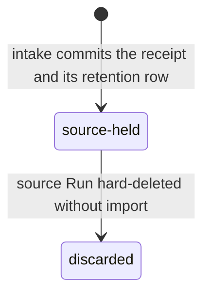
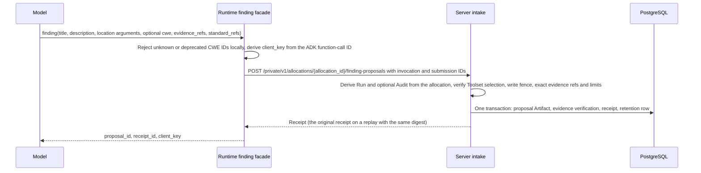
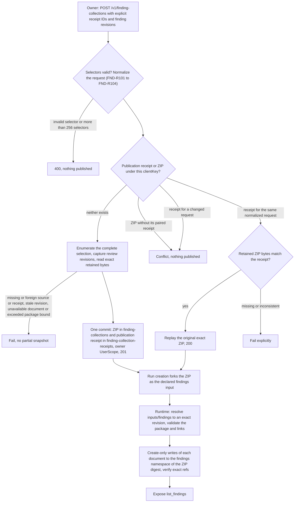

# Findings

Requirement prefix: `FND` · [Specification index](../README.md)

## Purpose and scope

This document owns finding proposals: the `contractor.audit.finding-proposal.v1`
schema, the finding authoring Toolsets and their `finding` tool, trusted
intake and proposal receipts, typed locations, selected HTTP evidence, the
bundled CWE catalog, how annotation artifacts become finding evidence, and how
long a proposal of an ordinary Run stays readable. It also owns finding
collections: the immutable collection package, its publication by the Server,
its preparation inside Runtime, the `list_findings` reader tool, and the
bundled configurations that produce or read findings.

It leaves to other documents:

- HTTP sessions, the outgoing request records that a `request_id` resolves
  against (their capacity, content, ownership, invocation binding and
  erasure), which captured exchanges `finding(request_id=...)` can attach and
  that they are not truncated, the `http_request` header and response bounds
  including `http_response_invalid`, ambient session authentication and what
  `http_session_get` reports (`auth_kind`, redacted headers, cookie names and
  count): [HTTP and Caido tools](../tools/http-caido.md).
- The Project target credential that Runtime injects on the target origin:
  [projects](../artifacts/projects.md).
- Annotation tools, annotation identity and the `changed=false` result:
  [code analysis](../tools/code-analysis.md).
- The `contractor.audit.package.v1` transport and its limits, standard
  packages, and how Audit import treats pinned standard references (Audit
  import of CWE references is FND-R153): [audits](../audits/audits.md).
- Retention of Audit child-Run proposals while the Audit collects its child
  Runs: [Audit execution](../audits/execution.md).
- Import of ordinary-Run proposals into an Audit, finding triage, review
  decisions, direct verification and finding backtrace:
  [review and reports](../audits/review-and-reports.md).
- `submit_check_result` and completion of Audit checks inside the Worker:
  [worker completion](../audits/worker-completion.md).
- Hard deletion of a Run and purge of its RunScope as a whole:
  [retention and deletion](../artifacts/retention-and-deletion.md).
- ArtifactStore refs and names, the write fence and Workflow input forks:
  [artifact store](../artifacts/artifact-store.md).
- AgentTemplate Toolset selection:
  [agent templates](../configuration/agent-templates.md); Workflow input
  slots: [workflows](../configuration/workflows.md).
- SARIF export and finding analysis:
  [proposal 0028](../../proposals/0028-finding-analysis-and-sarif.md);
  redacted evidence for autonomous pentest Audits:
  [proposal 0033](../../proposals/0033-autonomous-pentest-audits.md).
- Shared registries: [limits](../platform/limits.md),
  [errors](../platform/errors.md),
  [failure model](../platform/failure-model.md) and
  [lifecycle](../platform/lifecycle.md).

## Concepts

Terms are defined once in [the glossary](../glossary.md); the ones this
document owns are:

- **FindingProposal.** The immutable candidate and evidence envelope that a
  Worker submits through `finding`; it may describe an observation, a
  hypothesis or a finding with evidence, and it never confirms a
  vulnerability by itself.
- **Proposal receipt.** The trusted intake record, identified by
  `receipt_id`, that the Server commits together with the proposal artifact;
  a generic artifact write cannot forge one.
- **Client key.** The proposal key `client_key`, scoped to the trusted
  invocation; it never becomes a global finding ID.
- **Creation facade.** One of the Toolsets `security-findings@1`,
  `security-findings-code@1` and `security-findings-http@1`, each exporting
  the model-visible tool `finding` with its own required arguments.
- **Typed location.** A closed Source or Web object that records where the
  producer claims a finding is.
- **Selected HTTP evidence.** The `http_exchange` snapshot of one captured
  outgoing request that the HTTP facade copies into a proposal when it
  receives a `request_id`.
- **Runtime target credential marker.** The literal
  `[runtime-target-credential]`, captured in place of the Project target
  credential that Runtime injects.
- **Finding collection.** A frozen selection of existing receipts and
  available review observations, published as one immutable ZIP and consumed
  as an ordinary input artifact.
- **Collection entry.** One selected receipt inside a collection, with its
  origin, retention state, proposal document, evidence links and review
  observations.
- **Collection document.** The exact retained bytes of one proposal or
  evidence artifact inside a collection, identified by a document ID derived
  from its scope, exact ref and content metadata.
- **Review observation.** The captured Audit review state of one finding at
  one revision, recorded as provenance inside a collection entry.
- **Publication receipt.** The small JSON artifact in
  `finding-collection-receipts/<clientKey>` that records the normalized
  request digest and the exact ZIP metadata of one published collection.
- **Prepared reader.** The `list_findings` tool of one allocation after
  Runtime has materialized and verified every document of its bound
  collection in the current Run.

## Model

### FindingProposal

A proposal is one JSON document under the schema
`contractor.audit.finding-proposal.v1` (see the
[proposal example](#finding-proposal)).

| Field | Content |
| --- | --- |
| `schema` | `contractor.audit.finding-proposal.v1` |
| `client_key` | Invocation-scoped key (FND-R9, FND-R25) |
| `title`, `description` | Authored text |
| `subject` | `{kind, key}`, or an explicitly unknown `null` |
| `hypothesis` | Optional |
| `preconditions` | List of preconditions |
| `standard_refs` | Entries of `scheme`, `version` and `requirement_id` |
| `evidence_ids` | Evidence IDs, mapped by intake to the receipt's exact evidence refs (FND-R93) |
| `proposed_checks` | Entries with `objective` and `method` |
| `severity_suggestion` | Suggested severity, for example `medium` |
| `limitations` | Distinct, nonblank values (FND-R10) |
| `locations` | Optional typed locations |
| `http_exchange` | Optional selected HTTP evidence |

### Location objects

A location is exactly one closed object:

- **Source:** required `file`, optional `line` or
  `range: {start_line, end_line}`.
- **Web:** required `url`, optional `method`.

### HTTP exchange snapshot

`http_exchange` embeds a copied snapshot of one captured request in the
proposal:

| Field | Content |
| --- | --- |
| `request_id` | The selected request record |
| `request_tag` | Tag of that record |
| `attempts` | Nonempty list of attempts |
| `response_body_evidence_id` | Optional evidence ID of the final response-body artifact |

Each attempt has `method`, `url`, `headers` (`{name,value}` rows), canonical
`body_base64`, exactly one of `status` or `error`, and optional
`response_headers`. `error` is `transport_error` or `cancelled`.

### Collection package

| Member ID | Path | Content |
| --- | --- | --- |
| `collection` | `collection.json` | Canonical collection metadata, `application/json` |
| Each document ID | `documents/<document ID>` | Exact retained proposal or evidence bytes |

The transport manifest is `manifest.json`.

### Collection metadata objects

| Object | Fields |
| --- | --- |
| Collection | `schema: contractor.findings.collection.v1`, `snapshot_at`, `sources`, `documents`, `entries` |
| Source | `kind: run\|audit`, `id` |
| Document | `id`, `scope: {kind: run\|project\|user, id}`, exact `ref`, `digest`, `media_type`, `size_bytes` |
| Entry | `receipt_id`, `proposal_id`, `run_id`, `invocation_id`, optional `audit_origin`, optional `audit_holds`, `retention`, `proposal_document_id`, `evidence`, `reviews` |
| Audit origin | `audit_id`, `execution_id`, `role` |
| Evidence link | `evidence_id`, `document_id` |
| Review observation | `audit_id`, `finding_id`, `revision`, `state`; optional `decision_id`, `assessment_id`, `duplicate_target_id` |

### Receipt retention of an ordinary-Run proposal

An entry's `retention` records one of the receipt states `source-held`,
`audit-held` or `discarded` (FND-R83). A proposal of an ordinary Run stays
readable in its source RunScope (FND-R63); hard deletion of the source Run
discards it when it was never imported (FND-R154, and
[retention and deletion](../artifacts/retention-and-deletion.md), DEL-R28).
This document does not specify when a receipt enters `audit-held`.



## Requirements

### Proposal contract

**FND-R1.** One current schema, `contractor.audit.finding-proposal.v1`,
carries the proposal fields and the intake and receipt authority. It permits
an explicitly unknown `subject: null` and adds optional `locations` and
`http_exchange`. There is no alternate proposal schema.

**FND-R2.** A missing subject is never synthesized from a URL, title or
run ID. Verification inventory uses the existing receipt identity when a
subject is unknown; this does not rewrite the proposal's subject.

**FND-R3.** A proposal may describe an observation, a hypothesis or a
finding with evidence. Hypothesis, proposed checks, annotations and
reproduction instructions remain optional under the generic contract;
scenario instructions can require more detail without changing the tool
schema.

**FND-R4.** `hypothesis` is optional, including for a finding
discovered directly by a Workflow. The FindingProposal remains the candidate
and evidence envelope; it does not imply a separate prior hypothesis or a
mandatory later verification Run.

**FND-R5.** Omission of the hypothesis alone never means that
verification was performed. When a source Workflow counts as the verifier of
its own finding is specified in
[review and reports](../audits/review-and-reports.md#direct-findings-verified-inside-the-source-workflow).

**FND-R6.** Generic Audit results and findings do not require
annotations, `trace_id`, a function or a sink.

**FND-R7.** A standard ref contains `scheme`, `version` and
`requirement_id`. Unknown IDs are rejected when a standards package is
configured.

**FND-R8.** A missing standard mapping is shown as unmapped, never
interpreted as compliance.

**FND-R9.** `client_key` is scoped to the trusted invocation and
never becomes a global finding ID.

**FND-R10.** `limitations` contains distinct, nonblank values of at
most 512 UTF-8 bytes each (LIM-FND-1), matching the coverage gaps retained
for proposed checks. Intake rejects a proposal that exceeds this bound before
publishing its receipt.

### Annotations as evidence

**FND-R11.** A Workflow chooses whether annotated source and its state
or diff are outputs.

**FND-R12.** An annotation artifact may exist without a finding. It
becomes evidence only through an explicit reference to an existing exact
artifact revision; a finding cannot refer to a future workspace export.

**FND-R13.** Artifact availability alone does not prove a
vulnerability or trace coverage.

**FND-R152.** Annotation identity and participation in an investigation are
different facts. An existing annotation comment or a repeated annotation call
returning `changed=false` ([code analysis](../tools/code-analysis.md)) does
not prove that the current Worker checked that path.

**FND-R14.** A shared function can be reached with different inputs and
controls; matching a function or `file + CWE` does not justify merging
findings.

### Finding Toolsets

**FND-R15.** `security-findings@1` is an optional AgentTemplate Toolset.

**FND-R16.** An AgentTemplate that creates findings selects exactly one
creation facade in `AgentTemplate.toolsets`:

| Toolset | Required model arguments | Optional location arguments |
| --- | --- | --- |
| `security-findings@1` | `title`, `description` | typed `locations` |
| `security-findings-code@1` | `title`, `description`, `file` | `line` or `range` |
| `security-findings-http@1` | `title`, `description`, `url`, `method` | `request_id` |

**FND-R17.** Each creation facade exports the single visible name
`finding`. Selection is fixed before the Worker starts, and duplicate visible
tool names are rejected.

**FND-R18.** Each creation facade also accepts optional `cwe`, exact
`evidence_refs` and typed `standard_refs`.

**FND-R19.** The creation facades share one publisher for normalization,
intake and receipt handling. There is no parallel old authoring
implementation.

**FND-R20.** `security-findings@1` also exports `list_findings`, which can
be selected independently of a creation facade: AgentTemplate selection can
expose creation, reading or both.

**FND-R21.** Selecting reading does not imply finding emission, Audit
confirmation or review authority. Those mutations are owned by the Audit
review contract ([review and reports](../audits/review-and-reports.md)).

**FND-R22.** A `finding` call registers a candidate. It does not confirm a
vulnerability, create an AuditItem or Run, publish to ProjectScope or grant
approval. The Worker never chooses the Project or Audit and never starts
work.

**FND-R23.** Model-visible arguments contain no `audit_id`,
`project_id`, owner or Run identity, or execution override.

**FND-R24.** `finding(...)` uses the selected general, code or HTTP
interface and its allocation-bound intake receipt.

**FND-R157.** The same client key with identical content is idempotent;
changed content conflicts (FAIL-FND-1).

**FND-R25.** The hidden `client_key` is `call-` followed by the full
SHA-256 of the nonempty ADK function-call ID. The existing invocation
namespace and submission identity remain unchanged.

**FND-R26.** A transport retry of the same event reuses the exact
submission bytes; different tool calls remain different proposals. A missing
call identity fails before submission (FAIL-FND-1).

**FND-R27.** A successful `finding` call returns `proposal_id`,
`receipt_id` and `client_key`. An Audit Worker copies the returned key into
`submit_check_result(proposal_keys=...)`
([worker completion](../audits/worker-completion.md)).

**FND-R28.** Finding creation introduces no content-based deduplication and
no guessed subject.

### CWE classification

**FND-R29.** Optional `cwe` maps to a `standard_refs` entry with scheme
`CWE`, version `4.20` and the explicit `CWE-NNN` weakness ID.

**FND-R30.** The bundled catalog records MITRE's versioned XML archive
URL, the archive and XML SHA-256 and its weakness IDs, excluding Weakness
entries with `Status="Deprecated"`.

**FND-R31.** Unknown or deprecated IDs fail locally, both in `cwe` and in
explicit `standard_refs` entries with scheme `CWE`; such an entry must also
use version `4.20`. Rejected references never reach intake, and no live
taxonomy lookup occurs.

**FND-R32.** Updating the catalog or its version requires reviewing the
mapping and the external benchmark binding together.

**FND-R153.** Audit import accepts known `CWE@4.20` references without
pinning CWE as an Audit standard; they are incidental classifications and
cannot satisfy an assigned checklist entry. Unknown CWE IDs and other versions
are rejected.

Audit import of pinned standard references is specified in
[audits](../audits/audits.md).

### Typed locations

**FND-R33.** A location is exactly one closed Source or Web object (see
[Location objects](#location-objects)).

**FND-R34.** Source coordinates are one-based and inclusive; a range end
cannot precede its start.

**FND-R35.** File paths are case-sensitive relative POSIX paths. Backslashes,
colons, empty, dot or parent components and control characters are rejected.

**FND-R36.** A URL must be an absolute HTTP or HTTPS URL with a host and a
valid nonzero port if one is present, and must contain no userinfo,
backslash, whitespace, control characters or malformed percent escapes.

**FND-R37.** Methods are nonempty ASCII HTTP tokens.

**FND-R38.** Authored spelling, query order, escaping and fragments are
preserved. Locations are not fetched or normalized, GET is not inferred and
paths are not remapped.

**FND-R39.** Locations are bounded as follows:

| Bound | Value and basis |
| --- | --- |
| Locations | 256 per finding (LIM-FND-2), matching the existing per-finding evidence capacity |
| File | 4096 UTF-8 bytes (LIM-FND-3), matching the retained path bound |
| URL | 8192 UTF-8 bytes (LIM-FND-4), matching the HTTP tool URL bound (LIM-HTP-8) |
| Method | 64 ASCII bytes (LIM-FND-5), matching the bounded HTTP method field |
| Line and range endpoints | 1–9007199254740991 (LIM-FND-6), JSON/JavaScript exact integers |

**FND-R40.** Absent or empty locations encode by omission. Explicit
`null`, unknown fields, `file` together with `url`, `line` together with
`range`, and malformed coordinates fail. Array order is retained.

**FND-R41.** Locations are producer claims, not proof of source identity,
reachability or exploitation. The benchmark must separately verify exact
source bytes.

### Selected HTTP evidence

**FND-R42.** The HTTP facade requires `url` and `method` even without a
`request_id`. A missing ID permits a finding without captured evidence.

**FND-R43.** A `request_id` resolves only against the outgoing request
records of the HTTP session, under the ownership and same-invocation rule of
[HTTP and Caido tools](../tools/http-caido.md) (HTP-R71, HTP-R72). A supplied
expired, incomplete or foreign ID returns a repairable error; the caller may
choose a current ID or omit it (FAIL-FND-2).

That a failed or incomplete exchange cannot be attached as successful
evidence (HTP-R73), that `http_request` does not truncate the captured
exchange and that a completed request stays usable by
`finding(request_id=...)` (HTP-R59) are specified in
[HTTP and Caido tools](../tools/http-caido.md).

A response whose headers this evidence contract cannot retain, including a
header block over 64 KiB (LIM-FND-8), fails `http_response_invalid` as
specified in [HTTP and Caido tools](../tools/http-caido.md) (HTP-R58).

**FND-R46.** Creating a finding never sends or replays traffic.

**FND-R47.** The authored location and the observed request remain
separate facts; neither silently replaces the other.

**FND-R48.** `http_exchange` embeds a copied snapshot in the selected
proposal with the fields listed in
[HTTP exchange snapshot](#http-exchange-snapshot); each attempt has exactly
one of `status` or `error`, and `error` is `transport_error` or `cancelled`.

**FND-R49.** An existing final response-body artifact is pinned
through normal exact evidence references. No new artifact is created for
each outgoing request.

**FND-R50.** A request explicitly selected by an HTTP finding retains
its actual target headers and body in full inside that proposal, including
`Authorization` and `Cookie`. The selected target `Authorization` and `Cookie`
headers and request bodies are not added to history summaries, metrics or
serialized worker state.

**FND-R51.** Private transport credentials remain outside the
target request capture.

**FND-R52.** The Project target credential that Runtime injects on the
target origin ([projects](../artifacts/projects.md)) is never known to the
model, and proposals are model-readable, so its `Authorization` value is
captured as the marker `[runtime-target-credential]`. Values that the model
supplied or set in its session are its own and are retained as sent.

The ordinary `http-tools@1` finding capture is not the redacted projection
proposed for autonomous pentest evidence: it keeps credentials the model
supplied itself and replaces only the Runtime-injected Project target
credential with the placeholder `[runtime-target-credential]`. The full
redaction of credentials and session material proposed for
autonomous pentest evidence is described in
[proposal 0033](../../proposals/0033-autonomous-pentest-audits.md).

**FND-R53.** Selected HTTP evidence mirrors the existing HTTP bounds:
an outgoing body of at most 1 MiB per attempt (LIM-FND-7, mirroring
LIM-HTP-5), at most 64 KiB per header block (LIM-FND-8), and at most ten
redirects plus three attempts, 13 records in total (LIM-FND-9, mirroring
LIM-HTP-7 and LIM-HTP-9).

**FND-R54.** The request header block bounded by LIM-FND-8 is the
complete set of headers actually sent, not only the model-supplied headers.

`http_request` keeps every sent block within that bound: it limits the
model-supplied headers to 48 KiB (LIM-HTP-3), reserving the rest for
Runtime-added headers, and refuses before sending any request whose complete
block would exceed 64 KiB (LIM-FND-8)
([HTTP and Caido tools](../tools/http-caido.md), HTP-R24, HTP-R25).

**FND-R55.** The 8 MiB proposal and submission limit
(LIM-FND-10) applies to the encoded snapshot. An oversized finding fails
explicitly; evidence is never silently truncated. The size and truncation
semantics of the original response artifact are unchanged.

### Intake

**FND-R56.** Runtime submits a proposal through the allocation-bound private
route `POST /private/v1/allocations/{allocation_id}/finding-proposals`.

**FND-R57.** The trusted adapter supplies the correlated invocation and
stable submission IDs.

**FND-R58.** The Server derives the Run and the optional Audit identity
from the allocation and trusted Run provenance. It verifies the Toolset
selection, the current write fence
([artifact store](../artifacts/artifact-store.md), ART-R86), the exact
evidence refs in that Run and all payload and count limits.

**FND-R59.** One PostgreSQL transaction creates the immutable proposal
Artifact, verifies its exact evidence, records the receipt and commits the
retention row. A generic artifact write cannot forge a receipt.

**FND-R60.** Replay of `(allocation_id, invocation_id, submission_id)` with
the same canonical digest returns the original receipt; a different digest
conflicts (FAIL-FND-1).

**FND-R61.** Receipt replay remains readable after the write fence, while a
new submission is rejected (FAIL-FND-1).

**FND-R62.** Intake and the fence transition are serialized by the
allocation write-authorization critical section that ordinary private
artifact writes use.

**FND-R158.** The intake transaction also stores the receipt's report
projection: the canonical JSON of the proposal's title, description, subject,
hypothesis, standard references, severity suggestion, limitations, locations
and HTTP exchange, validated by the same rules as the proposal and bounded by
the proposal document size. It is immutable with the receipt, and Audit
reports read it instead of the proposal artifact
([review and reports](../audits/review-and-reports.md), REV-R195).



### Proposals of ordinary Runs

**FND-R63.** A proposal of an ordinary, non-Audit Run stays readable in
its source RunScope until it is either imported by exact revision into an
Audit or durably discarded (LIFE-FND-1).

**FND-R154.** Hard deleting its source Run atomically marks every unimported
proposal discarded, purges its proposal and evidence revisions with the
RunScope, and retains only bounded tombstone provenance; an imported proposal
is protected by the destination Audit's own exact holds (LIFE-FND-1).

Rationale: Run deletion therefore cannot leak abandoned proposals or silently
remove evidence already retained by an Audit.

Hard deletion of a Run as a whole is specified in
[retention and deletion](../artifacts/retention-and-deletion.md) (DEL-R28,
DEL-R29). Import is specified in
[review and reports](../audits/review-and-reports.md#proposal-import-from-ordinary-runs),
which also shows the
[end-to-end example](../audits/review-and-reports.md#proposal-from-an-ordinary-run).

### Finding collections

**FND-R64.** A finding collection is a frozen selection of existing
receipts and available review observations. It is an ordinary input
artifact, usable by both ordinary Workflows and Audit child Runs, and it
creates no verification inventory or checks.

**FND-R65.** Annotations, diffs, logs and reports are possible
evidence documents; their semantic validation belongs to the consumer.

**FND-R66.** A collection performs no implicit deduplication by
function, subject, description or evidence digest.

### Collection package format

**FND-R67.** A collection has the media type
`application/vnd.contractor.findings-collection+zip`. It reuses the bounded
`contractor.audit.package.v1` ZIP transport ([audits](../audits/audits.md))
with `kind: finding-collection` and no `entry_point`.

**FND-R68.** Reusing this transport does not make a collection an Audit
execution result. Existing result importers continue to require their own
package kind and envelopes.

**FND-R69.** The package contains the members listed in
[Collection package](#collection-package). The `package_id` of its
`manifest.json` is `collection-` followed by the full lowercase SHA-256 of
the canonical `collection.json` bytes.

**FND-R70.** Each document occurs once, including a document shared by
multiple entries. No undeclared members and no unused documents are
accepted.

**FND-R71.** The existing package codec validates ZIP integrity and paths
before any document is exposed.

**FND-R72.** Both metadata documents, `manifest.json` and
`collection.json`, use RFC 8785 canonical JSON: UTF-8 with no BOM and no
trailing newline.

**FND-R73.** Collection decoding rejects noncanonical representations,
unknown or duplicate keys, wrong key case, missing required fields, invalid
Unicode and unsupported schema versions.

**FND-R74.** Optional members are omitted, never `null` or an empty
placeholder.

**FND-R75.** Embedded proposal bytes retain their original representation
and are independently decoded under the current
`contractor.audit.finding-proposal.v1` contract.

### Collection metadata

**FND-R76.** Every field of the
[collection metadata objects](#collection-metadata-objects) is required unless marked
optional. Arrays are always arrays, including when empty.

**FND-R77.** ID values use the Audit-domain identifier contract: 1–160 ASCII
bytes (LIM-FND-11) matching `[A-Za-z0-9][A-Za-z0-9._:-]*`. Exact ArtifactRefs keep
the Artifact plane's own namespace, name and revision constraints
([artifact store](../artifacts/artifact-store.md), ART-R11).

**FND-R78.** `snapshot_at` is UTC RFC3339Nano ending in `Z`, with
insignificant fractional zeros omitted. It records when the selection was
captured; it is not a query for the latest database state.

**FND-R79.** `sources` records the requested Run and Audit scopes. Every
entry must match a Run source through `run_id`, or an Audit source through
its Audit origin, an Audit hold or a review observation. This is a
consistency check, not proof of server authority.

**FND-R80.** A document's `scope` identifies where the exact retained
bytes were read: a producer Run, or an authorized retained Project or User
artifact. The entry origin still identifies the producing Run and invocation
even when the retained bytes came from an Audit hold in ProjectScope.

**FND-R81.** No owner identity or source scope in the collection JSON
grants read access.

**FND-R82.** Optional `audit_holds` contains up to 64 sorted, unique Audit
IDs (LIM-FND-12) that hold retained copies of the receipt. It preserves source
membership independently of producer origin and review state; it does not
create a finding ID or imply confirmation. Absent or empty holds encode by
omitting the member.

**FND-R83.** `retention` captures the existing receipt state:
`source-held`, `audit-held` or `discarded`. It never substitutes for package
byte availability.

**FND-R84.** A discarded receipt can be included only if all its
selected exact bytes remain available through an authorized retained copy;
otherwise publication fails.

**FND-R85.** After its source Run is deleted, a receipt is read from
the retained copy of an Audit source that selected it (the lowest such Audit
ID holding one), never from another destination's copy; without such a copy
publication fails.

**FND-R86.** A review `revision` is an integer in 1–9007199254740991
(LIM-FND-13). `state` is `proposed`, `confirmed`, `rejected`, `duplicate` or
`needs-evidence`.

**FND-R87.** The optional review IDs (`decision_id`, `assessment_id`,
`duplicate_target_id`) are copied only when present in the captured server
record; in particular, current projections can have `duplicate` or
`needs-evidence` without `current_decision_id`. The collection does not infer
a decision or assessment.

**FND-R88.** These IDs are provenance, not dereference capabilities
or full decision documents. A later review requires a new snapshot.

**FND-R89.** An ordinary Run proposal has no invented Audit origin,
finding ID or review state.

**FND-R90.** Sources are sorted by `(kind, id)`, documents by `id`, entries
by `receipt_id`, each entry's evidence by `evidence_id` and its reviews by
`(audit_id, finding_id)`, in ascending ASCII lexical order. Each key is
unique, and proposal IDs are also unique across entries.

**FND-R91.** If source selections overlap, the publisher keeps one receipt
entry and merges its distinct review observations. Different receipts remain
distinct even when they have identical subjects or bytes.

**FND-R92.** An entry's proposal document must be nonempty JSON and
decode as a FindingProposal. Its `evidence_ids` set must equal the entry's
evidence-link IDs exactly; the proposal's array order need not be lexical.

**FND-R93.** The publisher preserves intake's mapping of `evidence-1`,
`evidence-2` and so on to the receipt's sorted exact refs; it does not
renumber links after sorting the collection.

**FND-R94.** Review observations never replace or rewrite the original
proposal.

### Document identity and bounds

**FND-R95.** `media_type` is the normalized lowercase MIME type without
parameters, as stored by the Artifact plane. `digest` is `sha256:` followed
by 64 lowercase hex characters. `size_bytes` is the exact byte length,
including zero for empty evidence.

**FND-R96.** The document ID is `doc-` followed by the full lowercase
SHA-256 of the RFC 8785 encoding of this array, in this exact order:

```text
[scope.kind, scope.id, ref.namespace, ref.name, ref.revision,
 digest, media_type, size_bytes]
```

Rationale: including the scope prevents two Runs with identical binding names
and revisions from colliding, even when their content bytes are identical.
Documents with the same entire identity can be shared within the package.

**FND-R97.** A collection stays within these bounds:

| Limit | Value |
| --- | --- |
| Sources | 1–64 (LIM-FND-14) |
| Entries | 0–256 (LIM-FND-15) |
| Documents | 0–1023 (LIM-FND-16) |
| Evidence links per entry | 0–256 (LIM-FND-17) |
| Review observations per entry | 0–32 (LIM-FND-18) |
| Collection JSON | 1 MiB (LIM-FND-19) |
| Proposal document | 1 byte–8 MiB (LIM-FND-20) |
| Evidence document | 0–16 MiB (LIM-FND-21) |
| Sum of document bytes | At most 16 MiB (LIM-FND-22) |
| Complete ZIP | At most 16 MiB, including metadata and headers (LIM-FND-23) |

**FND-R98.** The transport additionally limits manifest bytes,
expansion, JSON depth and node count ([audits](../audits/audits.md),
AUD-R128). All these bounds apply simultaneously; the entry limit is not a
promise that every selection of 256 large proposals fits. An oversized
selection fails and can be explicitly narrowed.

**FND-R99.** An empty successful selection contains empty `entries` and
`documents`. Missing bytes never turn a nonempty selection into an empty
one.

### Collection publication

**FND-R100.** The Server owns owner-authorized source selection, snapshot
capture, assembly and publication through the existing Artifact plane, in
response to the owner-authenticated `POST /v1/finding-collections` (see the
[publication request example](#publication-request)). No new findings
database is introduced.

**FND-R101.** `clientKey` is an Artifact name of 1–128 bytes (LIM-ART-1;
[artifact store](../artifacts/artifact-store.md), ART-R11). Selector
identities use 1–128 ASCII bytes (LIM-FND-24) under the Audit-domain
identifier pattern of FND-R77.

**FND-R102.** Sources are unique by kind and ID; receipt IDs and finding
IDs are unique within a source. Both arrays are required, and a Run source
has an empty `findings` array.

**FND-R103.** A request has at most 256 selectors across all sources
(LIM-FND-25); a request over this bound is rejected like an invalid selector
(`400`, FAIL-FND-3). The expansion of finding contributions must also fit the
package entry and byte bounds.

**FND-R104.** Overlap across sources is permitted and deduplicates only
the same receipt identity. Input order is normalized for replay identity.

**FND-R105.** Selection is explicit about receipts versus admitted Audit
findings and about any retention or review filters.

**FND-R155.** The caller enumerates its desired receipt IDs using existing
paginated APIs. Empty arrays explicitly select nothing; there is no implicit
"all", live filter or fallback to the first page.

**FND-R156.** Admission, retention and review policy is expressed by the
selected IDs and finding revisions.

**FND-R106.** Selecting an Audit finding includes all its contributing
selected-source receipts, not just `FirstProposal`.

**FND-R107.** Selection is fully enumerated before any bytes are fetched.
Page limits, missing retained bytes or exceeded package limits cannot produce
a successful partial snapshot.

**FND-R108.** Selected rejected, unreviewed or discarded records are not
silently skipped. An unavailable exact document fails the entire publication
(FAIL-FND-3).

**FND-R109.** A missing or foreign source or receipt is `404`; a stale
finding revision is `409`; invalid selectors are `400`; package codec
failures keep their bounded `422` codes (FAIL-FND-3).

**FND-R110.** The Server checks source ownership and correspondence to
existing records, captures the available review revisions and reads the
exact retained bytes with matching digest, MIME type and size. Publication
exposes a complete package atomically.

**FND-R111.** A successful response contains `artifact` (`ref`, `digest`,
`mediaType`, `sizeBytes`), `snapshotAt`, `entryCount` and `replayed`.
Creation returns `201`; replay returns `200`.

**FND-R112.** The exact ZIP is written to the authenticated owner's
`finding-collections/<clientKey>` binding, and a small ordinary JSON artifact
in `finding-collection-receipts/<clientKey>` records the normalized request
digest and the exact ZIP metadata. Both writes commit together.

**FND-R113.** The publication receipt is publication metadata, not a
second finding store or review authority.

**FND-R114.** The same key and normalized request replay the original
exact ZIP before sources or current reviews are looked up. A changed request
conflicts. A pre-existing ZIP without the paired receipt conflicts, and
missing or inconsistent retained ZIP bytes fail explicitly (FAIL-FND-3).

**FND-R115.** The existing Artifact-plane lifecycle rules apply to
these UserScope bindings and their exact revisions; publication does not
modify them on replay (LIFE-FND-2).

**FND-R116.** If a transaction aborts before publication, the explicit source
IDs remain fixed; a retry validates the requested finding revisions again and
either captures them or conflicts. Concurrent snapshots use repeatable-read
transactions and bounded retry on definite PostgreSQL serialization aborts
(FAIL-FND-3).

**FND-R117.** Retries reuse an already published exact snapshot or a
previously fixed selection; if that selection cannot be recovered exactly,
they fail explicitly. They never silently recompute a newer collection under
the same publication identity (FAIL-FND-3).

**FND-R118.** Retention of the published ZIP retains the required bytes
independently of later source-Run deletion (LIFE-FND-2).

**FND-R119.** The collection ZIP is passed as a declared ordinary Workflow
input. Public Run creation continues to fork declared artifacts through its
existing mechanism ([artifact store](../artifacts/artifact-store.md),
ART-R80). It does not follow the collection's JSON refs or gain
collection-specific recursive input handling.

### Reader preparation

**FND-R120.** For `security-findings@1` the declared input slot is `findings`,
required and accepting `application/vnd.contractor.findings-collection+zip`.
Workflow validation requires this slot only when an agent selects
`list_findings`. The existing ToolsetSelection contract needs no new fields.

**FND-R121.** Preparation resolves `inputs/findings` once to an exact
revision; later binding changes do not alter the prepared snapshot.

**FND-R122.** Runtime owns allocation-local preparation of the reader
Toolset and performs it in these steps (FAIL-FND-4, LIFE-FND-3):

1. Resolve the selected declared collection input to an exact current-Run
   ref, and validate the complete package and all proposal and evidence links
   before any write.
2. For each embedded document, derive a versionless current-Run destination:
   namespace `findings-<full SHA-256 hex of exact ZIP bytes>`, name equal to
   the document ID. `FindingCollectionTargets` specifies this pure mapping;
   its output is a write target, not an exact read receipt.
3. Materialize each document through the existing allocation ArtifactClient
   using create-only writes. On a replay or conflict, read the existing
   destination and verify its exact bytes, digest, MIME type and size:
   identical content can be reused, while different content fails without
   being overwritten. Record the exact revisions actually returned.
4. Expose `list_findings` only after every document has a verified exact ref.
   A failed preparation may leave ordinary unexposed intermediate artifacts;
   a replay verifies and reuses them, and existing Run cleanup owns their
   lifecycle.

**FND-R123.** A failed preparation reports its bounded `findings_*` code
as the allocation error. `findings_collection_unavailable` and
`findings_document_unavailable` are retryable only for a lost Artifact API
transport or an Artifact API error marked retryable; invalid or oversized
collections and `findings_document_conflict` are non-retryable for the
recorded Run snapshot (FAIL-FND-4).

**FND-R124.** The Toolset may perform this internal materialization even
in a reader-only configuration; this grants no model-visible creation
operation. It uses the existing `WriteInputsAndIntermediates` allocation
policy and leaves `ReadCurrentRun` intact.

**FND-R125.** Source refs stay separate as provenance. Preparation needs
no Runtime read of a foreign Run.



### Reader tool

**FND-R126.** The reader tool has this interface:

```text
list_findings(subject_kind?, subject_key?, limit?, cursor?)
    -> {items: [...], next_cursor: string|null}
```

**FND-R127.** The collection input is fixed by the selected Toolset version,
never by model-supplied Run, Project, Audit or owner IDs. One prepared reader
binds one collection.

**FND-R128.** Filtering compares the original proposal subject exactly and
case-sensitively. `subject_key` requires `subject_kind`; absent values mean
no filter, while empty strings are invalid.

**FND-R129.** `limit` defaults to 20 and ranges from 1 to 100 (LIM-FND-26).

**FND-R130.** Each item returns `receipt_id`, `proposal_id`, `run_id`,
`invocation_id`, optional `audit_origin` and `audit_holds`, `retention`, the
original `subject`, `title_preview`, `description_preview`, `has_hypothesis`,
`proposal`, `evidence` and `reviews`. Reviews have the
[review observation](#collection-metadata-objects) shape.

**FND-R131.** `proposal` is
`{ref, digest, media_type, size_bytes, source: {scope, ref}}`, and each
`evidence` item adds `evidence_id` to that shape. The top-level `ref` is the
verified exact consumer ref; `source.ref` preserves the retained source ref.

**FND-R132.** Each preview is `{text, truncated}`: the title is at most 512
UTF-8 bytes (LIM-FND-27) and the description at most 2048 bytes
(LIM-FND-28), cut only at a code point boundary.

**FND-R133.** The full proposal text, hypothesis and checks remain
available through `read_artifact(proposal.ref)`, and all evidence remains
available through its exact refs.

**FND-R134.** Results keep receipt order after filtering. The canonical JSON
response is at most 256 KiB (LIM-FND-29). Whole items are added until the
item or byte bound is reached, accounting for the final cursor.

**FND-R135.** If one complete item cannot fit, the tool returns an
explicit limit error, never an empty page or truncated evidence or review
arrays (FAIL-FND-5).

**FND-R136.** `next_cursor` is `null` exactly when no matching entries
remain. Empty selections and filters with no matches return
`items: [], next_cursor: null`.

**FND-R137.** The cursor is unpadded base64url of canonical JSON with
exactly these fields:

```text
{version: 1, collection_digest: "sha256:...", subject_kind: string|null,
 subject_key: string|null, after_receipt_id: string}
```

**FND-R138.** The decoded cursor JSON is at most 1024 bytes
(LIM-FND-30) and the encoded cursor at most 1366 ASCII bytes
(LIM-FND-31).

**FND-R139.** Cursor values must match the bound exact ZIP digest and
the requested filters, and `after_receipt_id` must exist among the matching
entries. `limit` may change between calls.

**FND-R140.** A wrong version, a malformed cursor, an unknown receipt,
or changed filters or snapshot fail explicitly (FAIL-FND-5).

**FND-R141.** A cursor is a position token, not an authorization grant.
It carries no signature, because the collection boundary is already fixed.

**FND-R142.** Invalid arguments, an invalid collection or cursor, missing
or conflicting prepared artifacts, byte limits and a successful empty page
are distinct outcomes (FAIL-FND-5).

**FND-R143.** Codec errors reuse the existing bounded codes
`audit_invalid`, `audit_schema_unsupported`, `audit_limit_exceeded`,
`audit_reference_invalid`, `audit_package_invalid` and
`audit_digest_mismatch`. Tool transport maps them to its existing error
envelope and never returns source bytes in error text (FAIL-FND-5).

**FND-R144.** Preparation and reads cannot confirm findings or mutate
review state.

### Current contract and bundled configurations

**FND-R145.** Server, Runtime, configurations, clients and the benchmark
binding use this one current contract together. Collections retain exact
proposal bytes that satisfy it.

**FND-R146.** The API and machine reports expose typed coordinates and
selected exchange evidence. The UI displays authored coordinates without
inferred links or web previews.

The configuration catalog provides these opt-in configurations:

**FND-R147.** `openapi-operation-trace@3` binds
`audit-openapi-operation-trace@2` and `audit_openapi_operation_tracer@2`. It
retains the structural graph and source tools, adds text evidence writing and
`finding`, and uses human-required finding confirmation. Its canonical results
carry the client keys of successful proposals; `operation-resolution`
coverage keeps its existing meaning.

**FND-R148.** `findings-review@1` uses `findings_analyst@1`, accepts only
the required `findings` collection input and publishes a Markdown `report`.
It selects `list_findings`, `read_artifact` and text report writing. Its
generic analysis requires no hypothesis, annotation, OpenAPI input or Audit
origin.

**FND-R149.** The ordinary `source-findings-review@1` Workflow uses the
code facade. Source verifier and tracer templates select the code facade; the
HTTP verifier selects the HTTP facade.

**FND-R150.** No duplicate template or Workflow versions exist for
compatibility. External benchmark bindings consume the retained public
receipts of the ordinary Workflow.

### Conformance

**FND-R151.** The
[shared fixture](../../../internal/auditdomain/testdata/finding-collection-v1.fixture.json)
is the conformance reference for the Go and Python codecs and for Runtime
preparation. It contains generic function and configuration subjects,
ordinary Run and Audit origins, an optional hypothesis, a review without a
decision ID, and identical evidence bindings from different Runs. Codec tests
require exact conformance and reject inconsistent metadata, byte content and
evidence membership.

## Interfaces

- `finding`: the model-visible tool of each creation facade, with the
  arguments of FND-R16 and FND-R18 and the result of FND-R27.
- `list_findings(subject_kind?, subject_key?, limit?, cursor?)`: the reader
  tool (FND-R126).
- `POST /private/v1/allocations/{allocation_id}/finding-proposals`: the
  allocation-bound private intake route (FND-R56).
- `POST /v1/finding-collections`: operation `publishFindingCollection` in the
  [public API schema](../../../api/openapi/contractor-public-v1.yaml), which
  owns the precise HTTP field spelling and the error envelopes.
- Media type `application/vnd.contractor.findings-collection+zip`, schema
  `contractor.findings.collection.v1` for `collection.json`, and schema
  `contractor.audit.finding-proposal.v1` for proposals.

## Limits, failures and errors

- [Limits](../platform/limits.md): proposal `limitations` LIM-FND-1;
  encoded proposal submission LIM-FND-10; locations LIM-FND-2 to
  LIM-FND-6; selected HTTP evidence LIM-FND-7, LIM-FND-8 and LIM-FND-9,
  where LIM-FND-7 mirrors LIM-HTP-5 and LIM-FND-9 mirrors LIM-HTP-7 and
  LIM-HTP-9; collection IDs LIM-FND-11, Audit holds LIM-FND-12 and review
  revisions LIM-FND-13; collection bounds LIM-FND-14 to LIM-FND-23;
  publication selectors LIM-FND-24 and LIM-FND-25; reader page size
  LIM-FND-26, previews LIM-FND-27 and LIM-FND-28, response LIM-FND-29 and
  cursor LIM-FND-30 and LIM-FND-31. Bounds cited here but owned elsewhere: the
  `contractor.audit.package.v1` transport bounds by
  [audits](../audits/audits.md) (AUD-R128); the Artifact name bound of
  `clientKey` (LIM-ART-1) by [artifact store](../artifacts/artifact-store.md)
  (ART-R11); the 48 KiB model-supplied header bound (LIM-HTP-3) and the
  HTTP tool URL bound (LIM-HTP-8, mirrored by LIM-FND-4) by
  [HTTP and Caido tools](../tools/http-caido.md).
- [Failure model](../platform/failure-model.md): FAIL-FND-1 finding intake
  (FND-R157, FND-R26, FND-R60, FND-R61); FAIL-FND-2
  HTTP evidence selection (FND-R43, FND-R46, FND-R55); FAIL-FND-3 collection
  publication (FND-R103, FND-R108, FND-R109, FND-R114, FND-R116, FND-R117);
  FAIL-FND-4 reader preparation (FND-R122, FND-R123); FAIL-FND-5
  `list_findings` reads (FND-R135, FND-R140, FND-R142, FND-R143).
- [Lifecycle](../platform/lifecycle.md): LIFE-FND-1 ordinary-Run finding
  proposal (FND-R63, FND-R154); LIFE-FND-2 published collection and publication
  receipt (FND-R115, FND-R118); LIFE-FND-3 prepared collection
  documents in the current Run (FND-R122).
- [Errors](../platform/errors.md): `findings_collection_unavailable`,
  `findings_document_unavailable`, `findings_document_conflict`
  (FND-R123); `audit_invalid`, `audit_schema_unsupported`,
  `audit_limit_exceeded`, `audit_reference_invalid`, `audit_package_invalid`,
  `audit_digest_mismatch` (FND-R143). Publication statuses are listed
  in FND-R109.

## Security

- Finding creation is candidate registration only: it grants no
  confirmation, approval, Run creation or ProjectScope publication
  (FND-R22), and the model cannot name an Audit, Project, owner or Run
  (FND-R23). The Server derives identity from the allocation and
  trusted Run provenance (FND-R58), and a generic artifact write cannot
  forge a receipt (FND-R59).
- Reading findings grants no emission, confirmation or review authority
  (FND-R21, FND-R144). The reader collection is fixed by the
  Toolset, not by model-supplied IDs (FND-R127); collection JSON grants no
  read access (FND-R81) and a cursor is not an authorization grant
  (FND-R141).
- Selected HTTP evidence retains target `Authorization` and `Cookie` values
  in the proposal but does not add them to history summaries, metrics or
  serialized worker state (FND-R50); private transport credentials are never captured
  (FND-R51); the injected Project target credential is captured as
  `[runtime-target-credential]` (FND-R52).
- Location validation rejects path traversal components, userinfo and
  control characters (FND-R35, FND-R36), and locations are never fetched
  (FND-R38).

## Observability

Selected target `Authorization` and `Cookie` headers and request bodies are not
added to HTTP history summaries, metrics or serialized worker state (FND-R50). Reader tool
errors never carry source bytes (FND-R143).

## Invariants

1. Every proposal receipt comes from trusted intake in the same transaction
   as its proposal Artifact and evidence verification (FND-R59).
2. A finding call, a collection publication, preparation and reads never
   confirm a finding or change review state (FND-R22, FND-R64,
   FND-R113, FND-R144).
3. A collection is complete or not published: no partial snapshot is ever
   successful, and a publication identity never yields a recomputed newer
   collection (FND-R107, FND-R117).
4. Review observations never rewrite the original proposal bytes
   (FND-R94).
5. The Go and Python codecs and Runtime preparation conform exactly to the
   shared collection fixture (FND-R151).

## Examples

### Finding proposal

```yaml
schema: contractor.audit.finding-proposal.v1
client_key: call-a0ddf7e6b4a3842cf1ea197a5ae69b54cda7c48610a998574f64e8a00d0ecee2
title: Possible ownership check gap
description: Evidence suggests an ownership decision may be missing on a traced path.
subject: {kind: openapi-operation, key: op-stable-key}
hypothesis: An actor may access an object outside the expected ownership rule.
preconditions: [Known actor role, Known expected ownership rule]
standard_refs: []
evidence_ids: [evidence-1]
proposed_checks:
  - objective: Establish whether the ownership predicate dominates the selected data access.
    method: static-trace
severity_suggestion: medium
limitations: [Live behavior has not been verified]
```

`client_key` is `call-` followed by the SHA-256 of the ADK function-call ID
(FND-R25), here of `adk-function-call-7`, and `evidence-1` names the first of
the receipt's sorted exact evidence refs (FND-R93).

### Publication request

```json
{
  "clientKey": "review-snapshot-1",
  "sources": [
    {"kind": "run", "id": "run-1", "receiptIds": ["receipt-1"], "findings": []},
    {"kind": "audit", "id": "audit-1", "receiptIds": [],
     "findings": [{"findingId": "finding-2", "revision": 3}]}
  ]
}
```

### Reader configuration

```yaml
# Workflow spec
inputs:
  findings:
    required: true
    mediaTypes: [application/vnd.contractor.findings-collection+zip]

# AgentTemplate spec
toolsets:
  - ref: security-findings@1
    tools: [list_findings] # Add finding when this agent also creates proposals.
  - ref: run-artifacts@1
    tools: [read_artifact]
```

The end-to-end path of a proposal from an ordinary Run to an Audit is shown in
[review and reports](../audits/review-and-reports.md#proposal-from-an-ordinary-run).

## Non-goals

- Compatibility variants of old development shapes: the application uses one
  current finding schema and interface set, and old shapes are not supported
  through adapters or migrations (FND-R1, FND-R145).
- A separate findings database or second finding store (FND-R100,
  FND-R113).
- Implicit or content-based deduplication of findings (FND-R14,
  FND-R28, FND-R66).
- Collection-specific recursive input handling (FND-R119).
- Live CWE taxonomy lookup (FND-R31).
- SARIF export, which remains a separate draft
  ([proposal 0028](../../proposals/0028-finding-analysis-and-sarif.md)).
