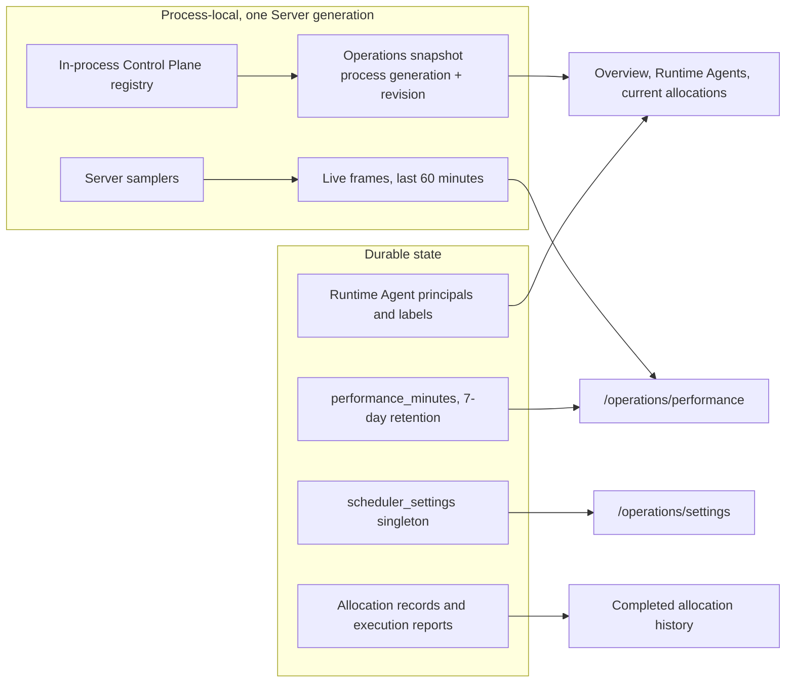
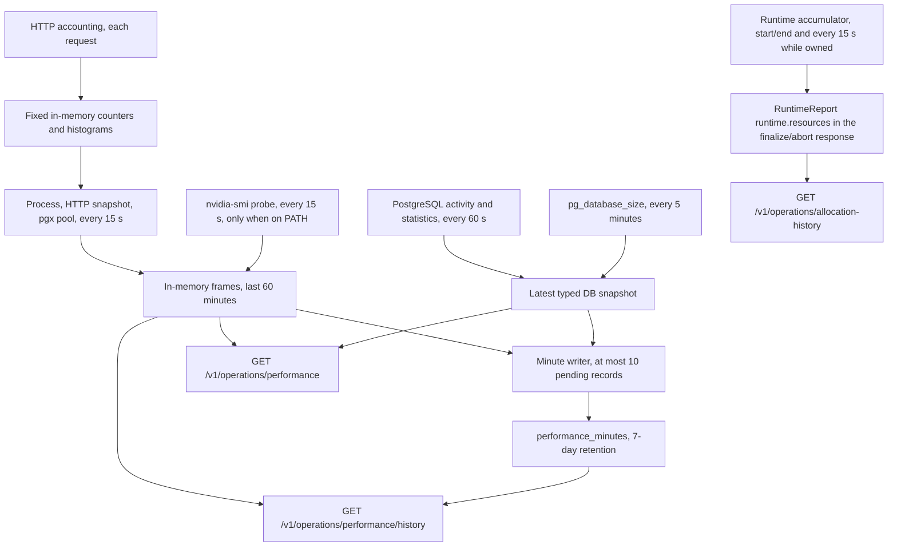
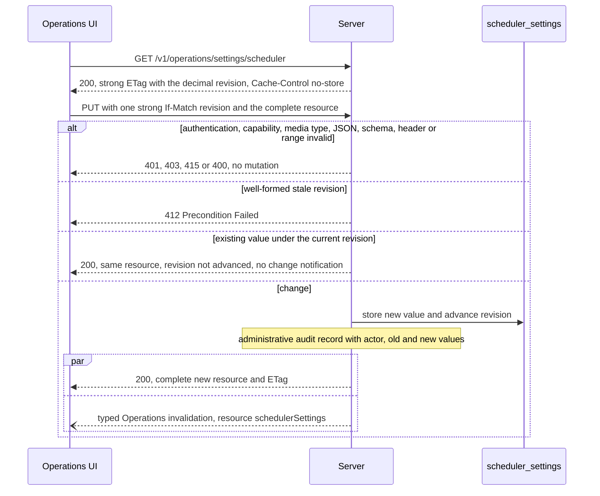

# Operations

Requirement prefix: `OPS` · [Specification index](../README.md)

## Purpose and scope

This document owns the Operations surface of Contractor: the read-only live
observation of Runtime Agents and allocations, the durable deployment settings
edited there (the global Workflow Scheduler concurrency setting), the
Operations surfaces for Runtime Agent principals, labels, RuntimeConfigs and
runtime credentials, Server process settings and the boundaries between
operational budgets, performance metrics (Server, HTTP, process, connection
pool, PostgreSQL, host GPU, history and completed-allocation resources), Go
profiling, the deployment boundary and the operator command-line entry
points.

It leaves to other documents:

- system purpose, the single-VM baseline, host placement of Server,
  PostgreSQL, Runtime Agents and UI, and trust boundaries:
  [Overview](../overview.md);
- the session-level PostgreSQL advisory lease that keeps one active Server per
  database, the standby Server's behaviour and the connection pooling that
  lease requires: [Persistence](../platform/persistence.md);
- Scheduler admission, lanes, Queue Pause, drain after a decrease and the
  concurrency invariants that the concurrency setting drives:
  [Scheduler](../execution/scheduler.md);
- Runtime Agent registration, principals, heartbeat and lease, slot
  reconciliation, placement, retirement of process entries, the private
  registration and `AllocationSpec` fields for performance collection, the
  persisted collection decision and final-report ingestion:
  [Control plane](../execution/control-plane.md);
- the Runtime-side measurement window, sampler and accumulator for allocation
  resources: [Runtime agent](../execution/runtime-agent.md);
- RuntimeConfig, runtime labels, credentials and their API resources:
  [Runtime config](../configuration/runtime-config.md);
- managed configuration roots and durable hard-link publication:
  [Catalog](../configuration/catalog.md);
- execution reports, model, tool and token accounting and report retention,
  OTLP traces and logging: [Observability](../platform/observability.md);
  Worker budget enforcement and finalization:
  [Worker](../execution/worker.md);
- Runtime-local workspace budgets and the workspace capability that Operations
  displays: [Workspace](../tools/workspace.md);
- the Podman sandbox and its host requirements:
  [Code execution](../tools/code-execution.md);
- payload backends, their startup flags and the offline blob cleanup command:
  [Blob storage](../artifacts/blob-storage.md);
- local browser sessions, password hashing and the local-auth bootstrap
  settings: [Security](../platform/security.md);
- public API conventions, the error envelope and the live event WebSocket:
  [Public API](../api/public-api.md);
- UI architecture, the separate Web UI service and label and binding dialogs:
  [UI](../ui/ui.md); user journeys: [Journeys](../ui/journeys.md);
- shared registries: [limits](../platform/limits.md),
  [errors](../platform/errors.md),
  [failure model](../platform/failure-model.md) and
  [lifecycle](../platform/lifecycle.md).

Operator guides complement this document: the
[operational timeout reference](../../operations/timeout-configuration.md),
[Operations performance](../../operations/performance.md) and
[Go profiling](../../operations/go-profiling.md).

## Concepts

Terms are collected in the [glossary](../glossary.md); this document owns the
following ones.

- **Operations surface.** The authenticated Operations area of the API and UI:
  a read-only observation of Runtime Agents and allocations plus explicitly
  editable deployment settings and infrastructure configuration resources.
- **Operations snapshot.** The current-state REST view of the in-process
  Control Plane registry, identified by a process generation and a revision.
- **Process generation.** A random value carried by the Operations snapshot
  that changes whenever the Server restarts.
- **Snapshot revision.** An unsigned decimal counter of the Operations snapshot
  that every observable registry change advances.
- **Process settings.** The typed, non-secret, restart-only settings in
  `ServerConfig.spec`.
- **Deployment setting.** A durable, explicitly editable Operations resource
  that applies to the whole deployment rather than to an owner, Project or Run.
- **Scheduler settings.** The singleton deployment setting that holds
  `maxConcurrentRuns`, `maxConcurrentToolRuns`, its revision and its update
  time.
- **Performance metrics.** Contractor's own collection, storage and
  presentation of Server, HTTP, connection-pool, PostgreSQL and host GPU
  measurements and of completed-allocation resource summaries.
- **Sample group.** A set of performance measurements collected together that
  carries its own observation time, last attempt and result, coverage and
  status.
- **Frame.** One 15-second in-memory record of Server performance
  measurements.
- **Minute record.** One row of `performance_minutes` holding the minute
  aggregates of one Server generation.
- **Server generation.** The identity of one Server boot in performance
  history; counters from different generations are never subtracted.
- **Allocation resource summary.** The optional `runtime.resources` block of a
  `RuntimeReport` describing Runtime process consumption during one
  allocation.
- **Allocation history.** The durable list of terminal allocations with their
  resource summaries or the reason none is available.
- **Diagnostic listener.** The separate loopback-only HTTP listener that serves
  an allowlist of Go profiles when `--pprof` is enabled.

## Model

### Operations resources

The Operations surface combines a process-local view of the live Control Plane
registry with durable resources.



### Snapshot entries

The Operations snapshot describes Runtime Agent process entries and current
allocations. Each allocation keeps its authoritative state (owned by the
Control Plane) and the Runtime's observation side by side: for example an
authoritative `reserved` allocation can carry an idle observation, and an
allocation whose Runtime is observed `allocated` reports `observedPhase`
`prepared`. Slot states are `idle`, `reserved`, `busy`, `draining` and
`fenced`, using the reconciliation vocabulary of
[Control plane](../execution/control-plane.md).

### Scheduler settings

The authoritative singleton setting is:

```text
maxConcurrentRuns:     integer, 1..32, default 1
maxConcurrentToolRuns: integer, 1..32, default 2
revision:              positive monotonic integer
updatedAt:             UTC timestamp
```

### Collection schedule

| Data | Schedule | Storage |
| --- | --- | --- |
| HTTP accounting | Each admitted HTTP request and completion | Fixed in-memory counters and histograms |
| Server process, HTTP snapshot, working pgx pool | Every 15 seconds (LIM-OPS-1) | Last 60 minutes in memory (LIM-OPS-2) |
| Available NVIDIA host GPUs | Every 15 seconds (LIM-OPS-1), only when `nvidia-smi` is on Server's PATH | Last 60 minutes in memory (LIM-OPS-2) and minute history |
| PostgreSQL activity and cumulative statistics | Every 60 seconds (LIM-OPS-3) | Latest typed snapshot and minute history |
| PostgreSQL database size | Every 5 minutes (LIM-OPS-4) | Latest typed snapshot and minute history |
| Server/DB history write | Every minute (LIM-OPS-5) | Minute aggregates, 7-day retention (LIM-OPS-6) |
| Allocation process resources | At start/end and every 15 seconds while owned ([LIM-CTL-8](../platform/limits.md)) | Constant-size allocation accumulator and final report |



### Allocation resource summary

The optional `runtime.resources` block of `RuntimeReport` has these fields:

| Field | Meaning |
| --- | --- |
| `version` | `1` |
| `scope` | `runtime_process` |
| `status` | `complete`, `partial`, or `unavailable` |
| `reason` | Optional bounded enum: `unsupported_platform`, `read_failed`, `sampling_gap`, `counter_reset`, `invalid_report` |
| `durationSeconds` | Monotonic duration of this collection interval |
| `cpuUserSeconds`, `cpuSystemSeconds` | End-minus-start process CPU counters |
| `rssStartBytes`, `rssEndBytes` | Successful boundary RSS observations, if available |
| `rssPeakObservedBytes` | Maximum successful RSS observation inside this interval |
| `rssSampleCount` | Number of successful RSS observations, including boundaries |
| `maxSampleGapSeconds` | Largest uncovered interval, including missing boundaries |

Allocation history shows each terminal allocation's resources as `disabled`,
`unsupported`, `pending`, `available`, `partial` or `unavailable`, derived from
the trusted collection policy recorded for the allocation (`requested`,
`disabled` or `unsupported`) and the available report.

## Requirements

### Deployment boundary

**OPS-R1.** The Server and the ordinary Runtime target Linux and macOS.
The allocation-scoped Podman backend requires the Linux host capabilities in
[Code execution](../tools/code-execution.md).

**OPS-R2.** Cross-compilation or a working remote browser does not
establish a tested native Runtime, filesystem or sandbox on another operating
system.

**OPS-R3.** Platform-dependent resource observations may
return `unsupported_platform`.

Host placement of one active Server/Control Plane, PostgreSQL, single-slot
Runtime Agents and the separate UI service, the single-VM baseline and its
loopback transports are defined in [Overview](../overview.md). The PostgreSQL
advisory lease that limits a database to one active Server, the standby's
`/readyz` behaviour and the pooling mode the lease connection needs are defined
in [Persistence](../platform/persistence.md). The Web UI is its own build
artifact and service ([UI](../ui/ui.md)). Which payload backend the active
Server and any replica sharing its registry use is defined in
[Blob storage](../artifacts/blob-storage.md).

**OPS-R4.** The example Deployment uses one replica and `Recreate`
updates.

**OPS-R5.** Active-active Server replicas are unsupported: two
independently active Schedulers would each apply their local lane count.

**OPS-R6.** Kubernetes without a PVC is an explicitly supported
deployment, and Kubernetes examples require no PVC. The payload backend
behaviour of such a deployment is defined in
[Blob storage](../artifacts/blob-storage.md) (BLB-R5, BLB-R6, BLB-R20).

**OPS-R7.** A read-only root filesystem with PostgreSQL blob
storage must work without a blob or tmp volume.

**OPS-R8.** Mutable managed configuration is a separate
concern from Artifact storage. An example may mount a memory-backed `emptyDir`
at its configured managed root and must then document explicitly that this
configuration is also ephemeral.

**OPS-R9.** The no-PVC example loses every API-published managed
version on pod replacement, so it must use baked-in operator versions and must
not bind credentials, admin keys or RuntimeConfigs to Gateways published in
that root.

**OPS-R10.** Durable managed publication requires a persistent
managed configuration root that supports hard links; see
[SYS-R21](../overview.md). This is not an Artifact storage requirement.

**OPS-R11.** Memory-backed volumes count towards container memory
and are not durable; see the
[Kubernetes volume contract](https://kubernetes.io/docs/concepts/storage/volumes/#emptydir).

### Process settings and operational budgets

**OPS-R12.** `ServerConfig.spec` contains typed, non-secret process
settings. They are distinct from published Workflow and ModelPolicy documents,
RuntimeConfig label overlays and the durable Scheduler concurrency setting.

**OPS-R13.** Process settings are resolved once with the
precedence defaults < YAML < environment < flags, validated before startup,
and require a restart to change (FAIL-OPS-1).

**OPS-R14.** Effective-setting diagnostics expose resolved
durations and bounded counts, not credentials, URLs or secret paths.

**OPS-R15.** Process settings keep separate budgets for:

- individual Runtime and A2A HTTP requests (`runtimeRequestTimeout`);
- Scheduler store operations (`scheduler.operationTimeout`);
- the Scheduler claim lease and polling (`scheduler.claimDuration`,
  `scheduler.pollInterval`, `scheduler.leaseScanInterval`);
- stored Scheduler terminal budgets (`scheduler.finalizationTimeout` and
  `scheduler.abortTimeout`);
- Runtime batch preparation (`runtimeLifecycle.prepareTimeout`);
- Runtime batch cleanup (`runtimeLifecycle.cleanupTimeout`);
- Project lifecycle operations and claims;
- Audit controller polling, claims and operations;
- database budgets;
- A2A polling;
- credential-management HTTP;
- whole Git import, wire and decoded bytes and source archive admission
  (`gitImport`, [GIT-R92](../artifacts/git-import.md)).

**OPS-R16.** Increasing one transport timeout cannot silently
enlarge an operation or reset a stored deadline: changing the HTTP timeout
changes neither the other budgets nor an already recorded terminal deadline.

**OPS-R17.** Credential-management HTTP limits do not control LLM
inference, and Audit claim batches do not replace AuditProfile child Run
batching or global Scheduler concurrency.

**OPS-R18.** The
[operational timeout reference](../../operations/timeout-configuration.md) is
the single table of configuration paths, defaults, limits, environment and
flag mappings and migration rules. It also specifies input precedence,
validation, database timeout ordering and the handling of conflicting DSN and
environment inputs.

Terminal deadline and cleanup behaviour is defined in
[Scheduler](../execution/scheduler.md); Runtime-local workspace budgets,
including the local workspace operation timeout, are defined in
[Workspace](../tools/workspace.md).

**OPS-R19.** No process setting adds an Operations UI mutation or
hot reload.

### Operations surface

#### Observation

**OPS-R20.** The Operations surface is read-only for execution state.

**OPS-R21.** For the live deployment, Operations shows at least:

- Runtime Agent instance ID, software version, observed state, last accepted
  heartbeat, confirmed lease horizon and current allocation ID;
- the Runtime Agent's frozen positive capability snapshot: exact runtime and
  SandboxProfile refs, each exact Toolset ref and its available tool names, and
  exact RuntimeAdapter refs;
- the certificate-derived Runtime Agent principal and its authoritative durable
  label set;
- `idle`, `reserved`, `busy`, `draining` and `fenced` slot state, using the
  authoritative and observed reconciliation vocabulary of
  [Control plane](../execution/control-plane.md);
- allocation ID, WorkflowRun, StageExecution, logical Worker binding,
  AgentTemplate, effective ModelPolicy and LLMGatewayConfig refs;
- allocation prepare, finalize, abort and release state and a bounded failure
  reason;
- safe aggregate call, tool, token and error counters and whether a
  ModelPolicy execution-safety dimension was exhausted.

**OPS-R22.** Operations never exposes certificate bytes or
label-supplied secrets.

How Operations displays a Runtime Agent's workspace capability (storage,
supported modes and limits) without workspace refs, paths or content is
defined in [Workspace](../tools/workspace.md).

**OPS-R23.** The Operations page is an observation surface. It
cannot force a Runtime Agent to idle, reassign an allocation, mark a Stage
successful or bypass bounded abort or release.

#### Live snapshot

**OPS-R24.** The REST snapshot is mutex-consistent with the
in-process Control Plane registry and carries a random process generation and
an unsigned decimal revision.

**OPS-R25.** Every observable registration, heartbeat,
reservation, lifecycle, report or release change advances the revision. A
Server restart changes the generation.

**OPS-R26.** Pagination cursors pin both the generation and the
revision and fail closed when either is stale, which causes the UI to fetch a
new snapshot (FAIL-OPS-2).

**OPS-R27.** The snapshot is a current-state view, not durable
allocation history: an allocation disappears from it after authoritative
release ([LIFE-CTL-2](../platform/lifecycle.md)).

Retirement of superseded and control-lease-expired Runtime Agent process
entries from the live registry, and therefore from the snapshot, is defined in
[Control plane](../execution/control-plane.md).

Live invalidation of the snapshot uses the `operations` stream of the live
event WebSocket, which starts from the snapshot's generation and revision; the
stream's content, cursor, retention and resynchronisation rules are defined in
[Public API](../api/public-api.md).

**OPS-R28.** `lastAcceptedHeartbeat` and
`confirmedLeaseUntil` are absent between a new registration and the
corresponding first accepted or confirmed heartbeat; the snapshot does not
manufacture either timestamp from registration time.

**OPS-R29.** Observed and authoritative fields remain
separate. A reserved allocation with an idle observation is `reserved`.

**OPS-R30.** An observed `allocated` Runtime proves that the
Worker role was prepared but does not prove that an A2A call is currently
executing, so allocation `observedPhase` reports `prepared`, not a guessed
`busy`. The derived slot may still be `busy`, because the allocation
exclusively owns that single slot.

**OPS-R31.** A fenced observation remains visible beside an
unreleased authoritative allocation during reconciliation.

**OPS-R32.** Until a final Runtime report arrives, allocation
metrics are an incomplete zero aggregate. The live projection retains only safe
counters and the exhausted budget dimension.

#### Runtime Agent principals and infrastructure configuration

**OPS-R33.** The durable Runtime Agent principal and label
configuration ([Runtime config](../configuration/runtime-config.md)) is an
Operations resource separate from the live registry view. It remains listable
while no process for that certificate principal is connected and does not
claim liveness.

**OPS-R34.** When an instance is live, the current-state
projection links it to that principal and its pinned active allocation
settings. Process-local Operations revisions govern only the live registry
view.

**OPS-R35.** Operations provides the following authenticated,
audited surfaces:

- create, list and get immutable RuntimeConfig versions and their safe
  digests;
- create write-only typed runtime credentials, and delete them when unpinned
  ([LIFE-RCF-5](../platform/lifecycle.md),
  [RCF-R128](../configuration/runtime-config.md));
- create, rebind and remove labels with `If-Match` compare-and-set
  ([LIFE-RCF-4](../platform/lifecycle.md));
- inspect a Runtime Agent principal, its current `instance_id`, frozen adapter
  capabilities and authoritative labels;
- replace one principal's complete label set with compare-and-set;
- remove an offline principal record only after its label set is empty and no
  live instance or allocation refers to it; a later registration seeds it anew
  ([LIFE-CTL-4](../platform/lifecycle.md));
- select zero or more labels on the Run creation form;
- inspect a Run's pinned labels and a StageExecution's safe resolved config
  provenance and adapter status.

The REST resources behind these surfaces are defined in
[Runtime config](../configuration/runtime-config.md) and the
[public API schema](../../../api/openapi/contractor-public-v1.yaml).
Idempotency keys, revision preconditions and stale-revision handling of binding
and Agent-label dialogs are defined in [UI](../ui/ui.md).

#### Overview and Runtime Agent cards

**OPS-R36.** Operations Overview leads with observed idle,
reserved/busy and draining/fenced slots.

**OPS-R37.** An idle count does not establish compatible
capacity for a particular Run. Navigation exposes Runtime Agents,
configuration and Server-owned Run wait reasons.

**OPS-R38.** Snapshot generation and revision and
live-connection details are disclosed under Diagnostics, independently from
readiness.

**OPS-R39.** A Runtime Agent card combines the durable identity with
its current process observation: a shortened copyable Agent ID,
Server-reported availability, process liveness, slot occupancy, heartbeat age,
workspace modes and saved label chips. Missing observations stay explicit.

**OPS-R40.** Supported adapter chips describe startup
capabilities, not remote endpoint health or compatibility with every
Workflow.

**OPS-R41.** Missing adapters and allocation reconciliation
appear as visible warnings; an idle process observation never overrides the
authoritative slot.

**OPS-R42.** A current allocation link opens its exact entry, with a
Run link when the current snapshot supplies the matching allocation identity.

**OPS-R43.** Full identities, label revision, lease timestamps
and exact capabilities live under each card's diagnostics disclosure. The
process inventory is a separate collapsed diagnostic view.

**OPS-R44.** Edit labels opens the shared accessible Dialog with an
isolated draft and the expected revision. Dismissing it performs no mutation;
a changed revision requires an explicit reload and review before retry
(FAIL-OPS-3).

### Scheduler concurrency setting

What the setting limits, its admission semantics, why it is global rather than
owner- or Project-local, why `0` is invalid and Queue Pause is the way to stop
normal admission, and the concurrency invariants it drives are defined in
[Scheduler](../execution/scheduler.md).

#### Resource and storage

**OPS-R45.** Besides observation, Operations contains
durable, explicitly editable deployment settings. The global Workflow
Scheduler concurrency settings are among them, edited at
`/operations/settings`.

**OPS-R46.** Editing the Scheduler concurrency settings changes
future Run admission only. It cannot manufacture Run state, force an
allocation, or bypass Queue Pause, cancellation and cleanup contracts.

**OPS-R47.** The setting is an authoritative singleton with the
fields in [Scheduler settings](#scheduler-settings): `maxConcurrentRuns`, the
size of the `model` lane pool, is an integer from 1 to 32 with default 1
(LIM-OPS-7); `maxConcurrentToolRuns`, the size of the `tool` lane pool for
Stages that call no model ([SCH-R175](../execution/scheduler.md)), is an
integer from 1 to 32 with default 2 (LIM-OPS-34); `revision` is a positive
monotonic integer carried on the wire as a decimal string (see
[Examples](#examples)) and `updatedAt` is a UTC timestamp. Both values share
the one revision.

**OPS-R48.** The setting is persisted as a dedicated typed
`scheduler_settings` singleton, not a generic string or JSON settings bag.
`Operations / Settings` is a UI grouping; every future setting keeps its own
typed validation, storage and API resource.

**OPS-R49.** A forward-only PostgreSQL migration creates and seeds
exactly one `scheduler_settings` row with `maxConcurrentRuns = 1` and
`revision = 1`; the migration that adds `maxConcurrentToolRuns` sets it to 2
on that row without advancing the revision. Upgrade and restart therefore
preserve effective serial behaviour of model work until an operator changes
the seeded value from one.

**OPS-R50.** Database checks enforce the 1..32 ranges
(LIM-OPS-7, LIM-OPS-34), and a stored update must change at least one value
and advance the revision by one. A missing or invalid singleton is a storage invariant
failure, not an invitation to guess a default at runtime
(LIFE-OPS-5).

Rationale: the upper bound of 32 is a deliberately finite single-host bound,
not an estimate derived from the current number of agents. Raising it requires
an explicit contract and a load and recovery gate rather than an unbounded
integer accepted by old Servers.

**OPS-R51.** The setting is deployment state. It is not
part of Workflow, RuntimeConfig, ExecutionConfig, owner Queue control,
Project, Run or Audit snapshots, so a Run does not pin the value that existed
when it was created.

**OPS-R52.** Changing the setting affects future Scheduler
admission for every owner and every nonterminal Run of the changed pool.

#### Settings API



**OPS-R53.** The singleton has a resource-oriented API of
exactly `GET /v1/operations/settings/scheduler` and
`PUT /v1/operations/settings/scheduler`. There is no action endpoint, Run
identifier, `force` query parameter, `POST` or `DELETE` form of this resource.

**OPS-R54.** An authorized `GET` returns `200 OK`,
`Cache-Control: no-store` and a strong ETag containing the decimal revision
(see [Examples](#examples)).

**OPS-R55.** `PUT` is an idempotent replacement of the
editable settings resource. `maxConcurrentRuns` is required;
`maxConcurrentToolRuns` may be omitted, which keeps its stored value, so a
client that predates it replaces only the model pool size. It requires
`Content-Type: application/json`, the Operations capability, normal browser
CSRF protection and exactly one strong `If-Match` revision (see
[Examples](#examples)).

**OPS-R56.** Unknown fields, a missing `maxConcurrentRuns`, a `null` value, a
value outside 1..32 (LIM-OPS-7, LIM-OPS-34), a weak, multiple or malformed
ETag, or an unsupported media type fail without mutation (FAIL-OPS-4).

**OPS-R57.** A well-formed stale revision returns
`412 Precondition Failed`.

**OPS-R58.** A successful change returns the complete new
resource and its ETag.

**OPS-R59.** Replacing the resource with its existing value under
the current revision returns that same resource without advancing the
revision or emitting a false change notification.

**OPS-R60.** Authentication failures use `401`, a missing
Operations capability uses `403`, an unsupported request media type uses
`415`, malformed JSON, schema or header or an out-of-range value uses `400`,
and a valid but stale revision uses `412`. These responses use the bounded
public error envelope of [Public API](../api/public-api.md).

**OPS-R61.** The mutation writes the ordinary safe administrative
audit record with the actor and the old and new numeric values. Neither the
public response nor logs expose credentials or execution payloads.

The settings API and UI invariants are
[SCH-R143](../execution/scheduler.md) and
[SCH-R144](../execution/scheduler.md); the settings resource is represented in
the [public API schema](../../../api/openapi/contractor-public-v1.yaml).

**OPS-R63.** A committed change emits a typed Operations
invalidation with resource `schedulerSettings` and no resource ID. The event
is a process-local hint; how the UI refetches the authoritative singleton and
shows a concurrently saved value after a revision conflict is defined in
[UI](../ui/ui.md).

#### Settings UI

**OPS-R64.** Operations navigation contains `Settings` at
`/operations/settings`. Its first card is `Workflow scheduling`, which
contains:

- a numeric `Concurrent Runs using a model` input for `maxConcurrentRuns`
  constrained to 1..32 (LIM-OPS-7) and a numeric
  `Concurrent Runs without a model` input for `maxConcurrentToolRuns`
  constrained to 1..32 (LIM-OPS-34), each explaining which Runs it bounds;
- the saved values and the unsaved-change state, with the setting names, their
  lane pools and the revision under Technical details;
- Save and reset actions with pending, success and safe error feedback; one
  save sends both values against the revision the edit started from, so it
  never keeps a stored value the operator did not see;
- concise copy distinguishing these global bounds from owner Queue Pause and
  Runtime Agent capacity, and stating that a Run using a model gets a shared
  Runtime Agent first ([CTL-R155](../execution/control-plane.md)).

How the independently deployed UI handles the setting without guessing an
effective value is [SCH-R144](../execution/scheduler.md).

### Model selection

**OPS-R223.** The optional compiled deployment catalog exposes all deployed
models and their compatible role policies. `GET /v1/operations/settings/models`
returns whether the facility is configured, safe capabilities and policy
selectors, and the saved selection, revision, catalog digest and update time.
An absent catalog returns `configured: false` and an empty list. It does not
invent model capabilities or call a provider. Collection and identifier bounds
are [LIM-CAT-6](../platform/limits.md), [LIM-CAT-10](../platform/limits.md) and
[LIM-CAT-11](../platform/limits.md).

**OPS-R224.** PostgreSQL owns one current default model plus optional Planner,
Worker, summarizer and Audit completion overrides. Startup initializes an absent
row from `model-selection.json` once; restarting with changed bootstrap selection
must not replace saved operator choices. Every selected effective role must have
a deployed compatible policy. Unknown or incompatible saved selection rejects
startup, rather than silently choosing another model. The singleton has no
delete API and its database row cannot be deleted.

**OPS-R225.** `PUT /v1/operations/settings/models` replaces the whole selection
using one strong `If-Match` binding both revision and catalog digest. Missing or
malformed preconditions and invalid choices return `400`; stale revision or
catalog returns `412`. No-op replacement with the current precondition keeps
revision and timestamp. One semantic change increments revision exactly once;
concurrent replacements have one winner. Database conflicts follow the public
`503 storage_transaction_conflict` contract. GET reconciles an ambiguous response;
no retry performs inference, provisions credentials or edits Gateway routes.
Successful changes invalidate the `modelSelection` Operations resource.

**OPS-R226.** Operations Settings lets the operator choose a default and each
role override from the complete bounded catalog. It displays server-confirmed
saved selection and context capacity, collapses optional role overrides, shows
a concrete unsaved-change preview, preserves unsaved edits during refresh,
and reports stale conflicts with an explicit reload action. It never claims a
save before the Server confirms it. Defaults apply at execution resolution under
[TPL-R111](../configuration/agent-templates.md); existing Runs, Audit drafts and
prepared Evals retain their pinned model choices.

### Performance metrics

#### Scope and ownership

**OPS-R66.** Operations displays current Server and PostgreSQL
performance, optional host GPU measurements, a bounded history and resource
summaries for completed allocations.

**OPS-R67.** Contractor owns collection, storage and
presentation of performance metrics. No Prometheus, Grafana, exporter service
or external time-series database is required.

**OPS-R68.** While the feature is enabled, the Server collects
its own process, HTTP and pool measurements continuously. The Runtime collects
process resources only during an explicitly requested allocation and returns
aggregates in the existing finalize/abort response.

**OPS-R69.** Performance telemetry cannot affect placement
eligibility, semantic outcomes, lease confirmation, write fencing or release
eligibility.

**OPS-R70.** Disabling performance collection does not disable
execution accounting, safety budgets or the report lifecycle, which belong to
[Worker](../execution/worker.md) and
[Observability](../platform/observability.md).

**OPS-R71.** The optional allocation resource collection
request and its diagnostic capability advertisement are owned here. The
capability does not constrain placement or change the allocation lifecycle.
Their wire fields, the persisted per-allocation decision and the protocol
compatibility rules are defined in
[Control plane](../execution/control-plane.md).

**OPS-R72.** Invalid resource measurements are isolated from
otherwise valid execution reports
([FAIL-CTL-10](../platform/failure-model.md)).

**OPS-R73.** Server and Runtime process performance collection supports
Linux and macOS. The Server uses gopsutil and the Runtime uses psutil to read
cumulative user/system CPU seconds and current RSS bytes for their own process.
Server collection and command builds work with cgo disabled, including on macOS
Intel and ARM. Other library-supported hosts may provide the same measurements;
unsupported process measurements are unknown with a bounded reason and never
prevent startup or execution (FAIL-OPS-5). A failed CPU or RSS read preserves
independently available measurements and retries only at the next scheduled
observation. Collection does not enumerate processes or launch subprocesses.

#### Startup switches

**OPS-R74.** The Server has these performance and profiling startup
switches:

| Flag | Environment | Default | Meaning |
| --- | --- | --- | --- |
| `--performance-metrics` | `CONTRACTOR_PERFORMANCE_METRICS` | `true` | Enable Server/DB collection, performance history writing and requests for allocation resource summaries |
| `--pprof` | `CONTRACTOR_PPROF` | `false` | Enable the separate Go diagnostic listener |
| `--pprof-listen` | `CONTRACTOR_PPROF_LISTEN` | `127.0.0.1:6060` | Numeric loopback IP and TCP port for that listener |

**OPS-R75.** Boolean environment values accept `true` or `false`.
Explicit CLI values take precedence. An invalid effective configuration fails
startup with a safe error (FAIL-OPS-1).

**OPS-R76.** The switches are immutable for one Server
process; changing them requires a restart.

**OPS-R213.** There is no writable Operations setting or browser action for
these switches.

**OPS-R214.** The switches are not Workflow, AgentTemplate or RuntimeConfig
authoring fields.

**OPS-R77.** With `--performance-metrics=false` the Server does not
install the HTTP accounting middleware, allocate sample or history buffers,
start sampler, writer or retention timers, or open the diagnostic DB pool.

**OPS-R78.** With `--performance-metrics=false` the Server omits
performance collection requests from newly prepared allocations.

**OPS-R79.** With `--performance-metrics=false` the Server returns
explicit `enabled: false` from the current-performance API, with no
manufactured current measurements.

**OPS-R80.** With `--performance-metrics=false` the Server keeps
existing retained history available through explicitly requested bounded
reads; disabling does not delete data or expose expired rows.

**OPS-R81.** With `--performance-metrics=false` the Server pauses this
feature's physical time-series retention cleanup until re-enabled, while
ordinary Run and Project deletion and existing execution-report cleanup
continue (LIFE-OPS-6).

**OPS-R82.** With `--performance-metrics=false` the Server preserves
existing execution metrics, budgets, OTLP trace adapters, logging, health and
readiness behaviour and immutable report ingestion.

**OPS-R83.** A previously prepared allocation retains its pinned
collection instruction even if the Server restarts with metrics disabled.
Recovery may accept that allocation's final report through the existing report
path; there is no remote command to toggle collection partway through an
allocation (FAIL-OPS-6).

**OPS-R84.** The API and UI distinguish the current collection
policy from the policy recorded for a historical allocation.

**OPS-R85.** `--pprof` is independent of
`--performance-metrics`: all four boolean combinations work. Disabling either
facility does not disable Go's ordinary runtime and GC bookkeeping or the
runtime's default heap sampling, and does not promise zero total diagnostic
overhead.

#### Collection and bounded records

**OPS-R86.** Collection follows the schedule and storage in
[Collection schedule](#collection-schedule).

**OPS-R87.** Initial measurements are taken after initialization
without delaying readiness.

**OPS-R88.** The first CPU or rate measurement needs two
observations; an absent baseline is unknown.

**OPS-R89.** Rates and durations use monotonic elapsed time; display and
history use UTC timestamps.

**OPS-R90.** Skipped ticks are not replayed in a catch-up burst.

**OPS-R91.** Every sample group carries its own `observedAt`, last
attempt and result, coverage and bounded status (`ok`, `partial`,
`unavailable`).

**OPS-R92.** A cached 5-minute database-size value is never
relabelled as a fresh 15-second measurement.

**OPS-R93.** The UI derives staleness from the last successful
observation and the group's declared interval; two missed intervals mark the
group stale (LIM-OPS-8).

**OPS-R94.** Performance error codes never contain SQL, DSNs,
credentials, filesystem paths or raw driver messages.

**OPS-R95.** Performance records are bounded: at most 240 completed
15-second frames plus one active frame (LIM-OPS-9), at most 32 KiB
encoded per frame or minute record (LIM-OPS-10) and at most 8 MiB of
retained live frames (LIM-OPS-11).

**OPS-R96.** Records should be compact and typed.

**OPS-R97.** Exceeding a byte or count limit evicts the oldest live
frames or omits optional details with explicit partial coverage; core counters
must not silently become zero.

**OPS-R98.** Performance collection keeps no unbounded labels and
no per-request records.

#### HTTP, process and pool measurements

**OPS-R99.** Both public and private Server HTTP listeners are
instrumented with fixed dimensions: `surface` (`public`, `private`), a fixed
HTTP-method allowlist with `other`, and status class (`1xx` through `5xx`, or
`no_response`). Histogram totals are per surface.

**OPS-R100.** Raw paths, query strings, user, Run and allocation IDs
and exception text never become dimensions.

**OPS-R101.** Health and readiness, performance-read APIs and the
profiling listener are excluded from the workload HTTP aggregates.

**OPS-R102.** In-flight requests increment at entry and decrement
exactly once on completion, panic or disconnect (FAIL-OPS-7).

**OPS-R103.** Ordinary response count, status, duration and
histogram are recorded at completion, including implicit HTTP 200 and safe
handling of failures before headers.

**OPS-R104.** Instrumentation preserves streaming, flushing, HTTP
hijacking, cancellation and WebSocket behaviour. WebSocket upgrades count as
handshakes; connection lifetime is not ordinary request latency.

**OPS-R105.** HTTP errors mean 5xx or no response. 4xx responses are
visible separately and are not treated as server failures.

**OPS-R106.** HTTP histogram bucket upper bounds in seconds are
`0.005, 0.01, 0.025, 0.05, 0.1, 0.25, 0.5, 1, 2.5, 5, 10, 30, 60, +Inf`
(LIM-OPS-12). Count, sum and buckets are retained, and approximate
p50, p95 and p99 are derived when reading.

**OPS-R107.** An estimate in the overflow bucket is displayed
as `>60s`, not as a fabricated finite quantile.

**OPS-R108.** Empty intervals have zero completed requests and
unknown latency quantiles.

**OPS-R109.** Aggregation merges buckets and counts and never
averages percentile values.

**OPS-R110.** Process readings include user and system CPU
seconds, RSS bytes, Go heap live bytes, goroutine count, completed GC cycle
count and the cumulative GC pause histogram.

**OPS-R111.** Process readings use selected runtime counters and
inexpensive OS process readings; collection does not force GC or build heap or
stack profiles.

**OPS-R112.** CPU utilization is
`delta(user + system CPU seconds) / monotonic elapsed seconds`, displayed in
used CPU cores. It is not host load or a percentage of a container CPU limit.

**OPS-R113.** Pool readings come from the application's existing
`pgxpool.Stat()` in memory: acquired, idle, total and max connections,
successful acquisition count and time, waits on an empty pool and cancelled
acquisitions.

**OPS-R114.** A mean successful acquisition time is not a p95 and does
not include cancelled attempts. Pool, probe and HTTP latency remain distinct.

**OPS-R115.** Readiness remains an independent dependency check:
`/healthz` reports process liveness, and `/readyz` uses a bounded check of the
working DB connection path and returns 503 when that path is unusable
(FAIL-OPS-8).

**OPS-R116.** The total DB wait of `/readyz` is at most one
second (LIM-OPS-13), and it depends neither on metrics being enabled nor
on a cached minute-old DB sample.

#### PostgreSQL collector

**OPS-R117.** The PostgreSQL collector uses one additional pool with
`MaxConns=1` and `MinConns=0` (LIM-OPS-14), the existing database
connection configuration and a fixed `application_name` identifying
performance maintenance. The pool is separate from the work pool and from
LISTEN connections.

**OPS-R118.** A collector startup or reconnect failure marks DB
metrics unavailable and must not make an otherwise working Server fail
startup. The collector retries only on a subsequent scheduled cycle
(FAIL-OPS-9).

**OPS-R119.** The collector requires no extension, superuser,
server setting change or automatic role grant.

**OPS-R120.** Every minute (LIM-OPS-3) the collector executes fixed aggregate
SELECTs restricted to `current_database()`:

1. `pg_stat_database`: `xact_commit`, `xact_rollback`, `deadlocks`,
   `temp_files`, `temp_bytes`, `blks_read`, `blks_hit` and `stats_reset`.
2. `pg_stat_activity`: client connections by state, the count waiting with
   `wait_event_type = 'Lock'`, the longest open transaction and the longest
   idle-in-transaction age. The collector's own backend is excluded and query
   text is not fetched.
3. `pg_stat_user_tables`: aggregate estimated live and dead tuple counts and
   available manual and autovacuum activity timestamps and counts. These are
   estimates, not a bloat measurement or a declaration that the database needs
   manual vacuuming.

**OPS-R121.** Activity and lock values are point observations; short
waits between samples can be missed.

**OPS-R122.** Database counters are cumulative and include other users
of the same database as well as Contractor's own monitoring and history
traffic. Rates are computed from actual observed intervals; a `stats_reset`
change or a counter decrease invalidates the delta.

**OPS-R123.** Buffer hits describe PostgreSQL's buffer cache, not the
OS cache, and rollbacks are not a count of application errors.

**OPS-R124.** The collector does not enable
`track_io_timing`, `pg_stat_statements` or other extra instrumentation.

**OPS-R125.** Every five minutes (LIM-OPS-4) the collector separately executes:

```sql
SELECT pg_database_size(current_database());
```

This measures database files, including tables, indexes and TOAST, across the
database's tablespaces; it is neither free filesystem space nor total cluster
or WAL usage. PostgreSQL inspects directory and file metadata to answer it, so
it is not a constant-time counter read.

**OPS-R126.** The size query must not gate the minute collector
or be recomputed on API reads.

**OPS-R127.** The DB budgets are: connection or acquisition at most
250 ms per attempt (LIM-OPS-15); lock timeout 100 ms
(LIM-OPS-16); statement timeout 750 ms for statistics and 1500 ms for
size and history maintenance (LIM-OPS-17); client query deadline
1 s and 2 s respectively (LIM-OPS-18); and at most 5 s for a complete
minute collection cycle (LIM-OPS-19). Earlier caller or shutdown
deadlines win.

**OPS-R128.** The collector reuses the existing database budget and
cleanup mechanisms; transaction-local overrides cannot leak into the working
pool.

**OPS-R129.** Every collector transaction ends before the next cycle,
so cached PostgreSQL snapshots do not persist.

**OPS-R130.** Size and maintenance operations are separately
scheduled, serial and bounded. They never create a queue of collector queries
or immediate retries.

**OPS-R131.** Ordinary DB roles can see restricted session details
only for their own or member roles. The collector detects visibility and
configuration limitations and marks affected aggregates partial or unknown
instead of counting hidden state as zero.

**OPS-R132.** The optional operator grant of `pg_read_all_stats` for
full session visibility is documented
([Operations performance](../../operations/performance.md)); Contractor never
issues it automatically.

**OPS-R133.** Missing privileges or disabled PostgreSQL
statistics do not disable the independent HTTP, process and pool metrics.

Rationale: [PostgreSQL statistics](https://www.postgresql.org/docs/current/monitoring-stats.html)
define cumulative versus current observations and visibility restrictions;
[PostgreSQL database-size functions](https://www.postgresql.org/docs/current/functions-admin.html#FUNCTIONS-ADMIN-DBSIZE)
and [their implementation](https://doxygen.postgresql.org/dbsize_8c_source.html)
explain the separately scheduled file-size query.

#### Host GPU measurements

**OPS-R134.** GPU observations support local model deployments. They
cover physical NVIDIA devices visible to the Server, including their use by
other applications, and are not attributed to a model, Run, allocation or
Runtime Agent. A remote model router's GPU usage is outside their scope.

**OPS-R135.** When performance metrics are enabled, the Server
resolves `nvidia-smi` on its PATH once at construction without running it. If
it is absent or not executable, the GPU reader is disabled and the optional
`gpu` group is omitted; this is normal operation, not a startup, readiness or
collection error.

**OPS-R136.** Installing the binary later requires a Server restart.
With metrics disabled there is no GPU lookup and no subprocess.

**OPS-R137.** The normal 15-second sampler (LIM-OPS-1) executes a fixed, read-only
query without a shell or retries. Each probe has a two-second deadline
(LIM-OPS-20), inherits Server cancellation, discards stderr and
retains at most 16 KiB of stdout (LIM-OPS-21) and eight devices
(LIM-OPS-22).

**OPS-R138.** GPU probes never run in HTTP handlers.

**OPS-R139.** Driver failures, timeouts and malformed output only
invalidate GPU measurements; process, HTTP, pool and database collection
remain independent (FAIL-OPS-10).

**OPS-R140.** No driver, exporter or optional binary is
installed automatically.

**OPS-R141.** Each device has a stable GPU UUID and model name. The
available fields are device utilization percent, used and total framebuffer
memory in bytes (converted from `nvidia-smi` MiB), temperature in Celsius, and
power draw and power limit in watts.

**OPS-R142.** Unsupported individual fields are omitted; a measured
zero remains zero. Device identity is independent of row order.

**OPS-R143.** Current GPU cards are hidden when no measurements are
available, and unsupported fields have no placeholder rows. Cards identify
the Server host scope and retain freshness and staleness indicators.

**OPS-R144.** Optional GPU groups extend the existing version-1 JSON
records without a database migration. Old records without GPU data remain
valid, and GPU absence does not make otherwise valid Server minute records
partial.

**OPS-R145.** Per-device gauge summaries retain last, min and max
values, observation counts and timestamps in the seven-day history
(LIM-OPS-6). Retained history remains readable after current
collection stops.

**OPS-R146.** History charts appear only for metrics with
observations in the selected range, preserve gaps and Server generations, and
show the last observed value in each aggregate interval.

**OPS-R147.** At most the eight most recently observed device
identities are displayed (LIM-OPS-23).

**OPS-R215.** Each physical GPU has its own current card.

**OPS-R216.** History uses four shared charts (utilization, used VRAM,
temperature, power draw) with one coloured series per device.

**OPS-R148.** A UUID-keyed palette is shared by card markers and
chart legends and is retained through refreshes, row reordering and range
changes within the view. Legends identify model plus short UUID and show the
last observed value; numeric summaries remain available per device.

**OPS-R149.** Missing sensors omit only that device's series, and gaps
and restarts split each series independently.

#### Performance history

**OPS-R150.** Minute history is stored in `performance_minutes`,
created by the forward-only schema migrations and separate from Stage execution
truth. Rows are keyed by `(server_generation, minute_start)` and carry a
schema version, observation coverage, a typed bounded aggregate payload and an
expiry.

**OPS-R151.** Each Server boot creates a new generation; counters
from different boots are never subtracted.

**OPS-R152.** A partial final minute may be written during bounded
shutdown.

**OPS-R153.** The writer uses the single performance DB pool, writes
minute batches with idempotent keys and keeps at most ten pending minute
records (LIM-OPS-24). On overflow it drops the oldest unwritten minutes
and increments a loss diagnostic (FAIL-OPS-11).

**OPS-R154.** Request handlers and samplers never wait for
the writer.

**OPS-R155.** Cleanup runs at most once a minute, deletes at most 1,000
expired performance rows within the maintenance deadline
(LIM-OPS-25) and never uses an unbounded `DELETE` or `VACUUM`
(LIFE-OPS-6).

**OPS-R156.** Expired data is excluded from reads regardless of
physical cleanup timing.

**OPS-R157.** Run and Project deletion remove linked
allocation reports independently of `performance_minutes`
([Retention and deletion](../artifacts/retention-and-deletion.md)).

**OPS-R158.** Counts and histograms aggregate events; CPU uses
CPU-time over elapsed-time deltas; gauges preserve last, min, max and observed
coverage.

**OPS-R159.** Sparse DB observations keep their actual timestamps and are
not counted repeatedly as new measurements.

**OPS-R160.** Minute boundaries, partial windows and missing
samples must have deterministic, tested behaviour.

**OPS-R161.** Restart, writer loss and disabled periods produce gaps. Fine
history is volatile; minute history survives restart (LIFE-OPS-7).

**OPS-R162.** An unavailable DB still allows current and in-memory
performance reads.

**OPS-R163.** The performance read endpoints are read-only and
use the existing authenticated Operations authority.

**OPS-R164.** `GET /v1/operations/performance` returns the
enabled state, generation, intervals, current groups, freshness and collector
and writer diagnostics. No SQL runs on this path.

**OPS-R165.**
`GET /v1/operations/performance/history?from=...&to=...&step=15s|1m|5m|1h`
returns bounded series, coverage and generation boundaries. `15s` is limited
to the current process's last hour (LIM-OPS-26); durable queries are
limited to seven days and at most 1,000 points (LIM-OPS-27).
Excessive ranges and point counts are rejected explicitly.

**OPS-R166.** Fine samples use point bounds
`from <= observedAt < to`. Durable reads select retained minute records with
`from <= minuteStart < to` and then group them into UTC-aligned intervals of
the requested step.

**OPS-R167.** An aggregate's `minuteStart` identifies the
interval start, which can precede `from`; clients accept it when
`[minuteStart, minuteStart + stepSeconds)` overlaps `[from, to)`. The
requested window stays unchanged, partial first intervals are retained with
their actual observed coverage, and intervals wholly outside the window are
rejected.

**OPS-R168.** `GET /v1/operations/allocation-history`
returns durable terminal-allocation resource summaries with an optional exact
Run filter, a default page size of 50 and a maximum of 100
(LIM-OPS-28), a descending `(finished_at, allocation_id)` keyset
cursor and a pinned upper boundary for subsequent pages.

**OPS-R169.** `finished_at` is the owning StageExecution's durable
terminal timestamp, available even without a Runtime report, so a late report
cannot reorder the history. Resource interval timestamps remain separate.

**OPS-R170.** Allocation history applies the existing owner
authorization in SQL.

**OPS-R171.** Performance DTOs follow public API conventions and generated
TypeScript contracts.

**OPS-R172.** Current metrics use their own timestamps, not
Control Plane registry revisions; sampling must not advance live-registry
cursors or emit heartbeat-like events.

**OPS-R173.** Bounded history queries use the normal authorized
request DB budgets. They remain available when collection is off, without
starting the diagnostic pool.

#### Allocation resources

How the Server requests collection for an allocation
(`supportedPerformanceMetricsVersions` at registration, the optional
`performanceMetrics` field of `AllocationSpec`), how it persists its decision
(`requested`, `disabled` or `unsupported`), the Server-first upgrade rule, and
how it validates and ingests the `runtime.resources` block of a final report
are defined in [Control plane](../execution/control-plane.md). When the
Runtime measures, how its sampler and constant-size accumulator behave, and
what happens when the Runtime is lost before reporting are defined in
[Runtime agent](../execution/runtime-agent.md).

**OPS-R174.** The existing `RuntimeReport` carries an optional
`runtime.resources` block with the fields in
[Allocation resource summary](#allocation-resource-summary).

**OPS-R175.** Optional unknown numeric values are absent, not
zero. Present values are finite and nonnegative.

**OPS-R176.** Average CPU is derived from the available CPU deltas
and duration and never divides by zero. CPU remains a boundary delta despite
skipped intermediate samples.

**OPS-R177.** Negative, NaN, infinite or overflowing values and
inconsistent sample, boundary or peak combinations are rejected at the
telemetry boundary (FAIL-OPS-12).

**OPS-R178.** `complete` means both boundaries and the
scheduled measurements succeeded without an uncovered gap greater than twice
the 15-second interval (LIM-OPS-29). It never asserts that the true RSS
peak was captured.

**OPS-R179.** Resource fields cover the entire Runtime process,
including its service work and memory retained from earlier allocations. They
exclude subprocesses and containers, including the Podman sandboxes of
[Code execution](../tools/code-execution.md).

**OPS-R180.** The UI must label that scope and call the RSS value
an observed peak.

**OPS-R181.** The process-lifetime RSS high-water mark is never
used as an allocation-local peak, and collection neither traces Python object
allocations nor forces garbage collection.

**OPS-R182.** Allocation resource summaries use the existing
30-day terminal execution-report retention (LIM-OBS-8) of
[Observability](../platform/observability.md)
([LIFE-OBS-2](../platform/lifecycle.md)).

**OPS-R183.** Allocation history includes terminal allocation
records even when their report is missing and shows `disabled`,
`unsupported`, `pending`, `available`, `partial` or `unavailable` from trusted
policy and available reports, rather than silently omitting failures. An
allocation whose report was received and has since expired (OPS-R182) is
`unavailable` with reason `report_expired`; one released without a report,
or whose report has no usable resources, is `unavailable` with reason
`report_missing`.
The Server records on the allocation that a report was stored, so an
expired report is never shown as one the Runtime failed to deliver.

**OPS-R184.** Every allocation must retain an explicit
`requested`, `disabled` or `unsupported` policy.

**OPS-R217.** Resource history rejects a missing or invalid stored policy
instead of inventing a legacy projection.

**OPS-R218.** Report ingestion likewise rejects an absent or unsupported
envelope policy before persisting or replaying a report.

**OPS-R185.** A valid policy with missing or partial
observations remains a supported resource state.

**OPS-R186.** Allocation resources that were not collected are
never reconstructed.

**OPS-R187.** Late reports follow the related-telemetry rules of
[Observability](../platform/observability.md) (OBS-R39); no frozen Stage
outcome or StageMetrics is rewritten to populate history.

#### Performance presentation

**OPS-R188.** `/operations/performance` shows Server, HTTP and
Database cards and charts, time ranges and explicit last-update, partial,
stale and disabled states.

**OPS-R189.** The page polls current snapshots every 15 seconds
(LIM-OPS-30) only while it is visible, coalesces requests and cancels
them on navigation.

**OPS-R190.** Historical reads occur on range changes, with a
bounded refresh for a range that follows the present. Browser tabs do not
multiply collection work.

**OPS-R191.** The Performance page and the durable
completed-allocation history are separate from the live registry view: they
do not extend the live registry's retention, and periodic samples do not
advance its revisions.

**OPS-R192.** A Completed/history view sits alongside the current
allocations page; the live registry still removes released allocations.

**OPS-R193.** The Completed view comes from durable Run,
allocation and report joins and uses existing indexes plus narrowly required
new indexes. It shows the Run link, logical Worker, outcome, duration, CPU
seconds and cores, observed RSS peak and completeness.

**OPS-R194.** The Completed view has no execution mutation
controls and never exposes payloads, SQL, secrets or raw profiles.

**OPS-R195.** Run attempt details show resources through the
same safe projection, without creating another store.

### Go profiling

**OPS-R196.** With `--pprof=false` the Server creates no diagnostic
listener and starts no CPU, trace, block or mutex collection.

**OPS-R197.** Enabling `--pprof` exposes a dedicated explicit
HTTP mux on the configured numeric loopback address only. Wildcard and
non-loopback addresses and invalid ports are rejected, and an explicitly
enabled listener that cannot bind fails startup cleanly (FAIL-OPS-13).

**OPS-R198.** The diagnostic listener stops through the same
bounded Server shutdown lifecycle.

**OPS-R199.** The diagnostic mux answers 403 unless the request
`Host` is a loopback IP literal or `localhost` (with an optional port), so a
browser page cannot reach it through DNS rebinding.

**OPS-R200.** Public and private application muxes never serve
`/debug/pprof/*`, regardless of settings, and Go profiling is never exposed
through the Operations browser API.

**OPS-R201.** The Server does not serve
`http.DefaultServeMux`, because importing `net/http/pprof` registers global
handlers as a side effect.

**OPS-R202.** The diagnostic mux registers only an explicit
allowlist, and a generic Index prefix must not bypass it. In particular it
never exposes `cmdline`, which may contain command-line credentials.

**OPS-R203.** The allowlist is an index, symbol lookup, CPU
`profile`, `heap`, `allocs`, `goroutine`, `threadcreate` and execution
`trace`.

**OPS-R204.** CPU sampling starts only on request, with a
default of 30 s and an allowed range of 1..60 s (LIM-OPS-31).
Execution trace defaults to 1 s with an allowed range of 1..10 s
(LIM-OPS-32).

**OPS-R205.** Duration parameters are validated on every
supported timed or delta endpoint; invalid, duplicate and out-of-range values
are rejected rather than silently falling back.

**OPS-R206.** CPU and trace requests share one active-session slot
with no waiting queue, and a conflict returns 409. At most one additional
instantaneous or delta profile request is permitted, also without a waiting
queue (LIM-OPS-33).

**OPS-R207.** Cancellation and shutdown release the slots and stop
any active recording within the existing shutdown deadline.

**OPS-R208.** Block and mutex profiling remain off: there are
no sampling-rate flags for them, and `runtime.MemProfileRate` is not altered.

**OPS-R209.** Ordinary performance collection never invokes
the profiling handlers or forces GC.

**OPS-R210.** Profile requests may be expensive, including an
explicitly requested heap GC, so their cost is measured separately from
background metrics and from merely enabling the idle listener.

**OPS-R211.** Profiles stream to the diagnostic client. They are
not stored in PostgreSQL or execution reports and are not served through
Operations (LIFE-OPS-9).

**OPS-R212.** Operator documentation covers local use and SSH
tunnelling, including a bounded example (see [Examples](#examples) and
[Go profiling](../../operations/go-profiling.md)).

Rationale: [Go HTTP profiling](https://pkg.go.dev/net/http/pprof) defines the
standard diagnostic transport and on-demand profiles;
[Go diagnostics](https://go.dev/doc/diagnostics) describes profiling overhead.

### Optional local trace viewer

**OPS-R219.** The optional local trace-viewer profile uses one digest-pinned
Phoenix container with SQLite state bind-mounted below `.local/phoenix` and
its HTTP UI/OTLP port published only on loopback. Explicit startup reuses its
named container and bounds readiness probes; stop removes only that container
and retains the data directory. The profile does not modify PostgreSQL, live
RuntimeConfig bindings or exporter semantics. The collector projects the
standard GenAI attributes of [OBS-R59](../platform/observability.md) into its
native LLM views; the exporters contain no collector-specific mapping. See the
[operator guide](../../../deploy/phoenix/README.md).

## Interfaces

### Operations API

All Operations resources are in the
[public API schema](../../../api/openapi/contractor-public-v1.yaml) and follow
the conventions of [Public API](../api/public-api.md).

| Resource | Methods | Rules |
| --- | --- | --- |
| `/v1/operations/settings/models` | `GET`, `PUT` | OPS-R223 to OPS-R226 |
| `/v1/operations/settings/scheduler` | `GET`, `PUT` | OPS-R53 to OPS-R63 |
| `/v1/operations/performance` | `GET` | OPS-R164 |
| `/v1/operations/performance/history` | `GET` | OPS-R165 to OPS-R167 |
| `/v1/operations/allocation-history` | `GET` | OPS-R168 to OPS-R170 |

The Operations snapshot resources are in the public API schema. The
RuntimeConfig, runtime label, runtime credential and Runtime Agent principal
resources under `/v1/operations/` are defined in
[Runtime config](../configuration/runtime-config.md).

### Server command line

`contractor server run` accepts the performance and profiling switches of
OPS-R74. Other startup inputs are owned elsewhere:

- process settings and their flags and environment variables: the
  [operational timeout reference](../../operations/timeout-configuration.md)
  (OPS-R18);
- `--artifact-blob-backend` and `--artifact-blob-path`:
  [Blob storage](../artifacts/blob-storage.md);
- the local browser session bootstrap settings (`--local-auth-file`,
  `--browser-origin`, `--insecure-loopback-cookie`, `--trusted-proxy` and
  their environment equivalents): [Security](../platform/security.md);
- the local workspace operation timeout: [Workspace](../tools/workspace.md).

Operator commands outside the Server process:

- `contractor server auth hash-password` emits the local-auth bootstrap YAML;
  its input handling and password bounds are defined in
  [Security](../platform/security.md);
- the offline blob cleanup command, with its dry-run default and explicit
  apply option, is defined in [Blob storage](../artifacts/blob-storage.md).

## Limits, failures and errors

Limits ([registry](../platform/limits.md)):

- LIM-OPS-1 — 15-second Server and GPU sampling interval (OPS-R86,
  OPS-R137);
- LIM-OPS-2 — 60 minutes of in-memory frames (OPS-R86);
- LIM-OPS-3 — 60-second PostgreSQL statistics interval
  (OPS-R86, OPS-R120);
- LIM-OPS-4 — 5-minute database-size interval (OPS-R86, OPS-R125);
- LIM-OPS-5 — one-minute history write (OPS-R86);
- LIM-OPS-6 — 7-day minute history retention (OPS-R86,
  OPS-R145);
- LIM-OPS-7 — `maxConcurrentRuns` 1..32, default 1 (OPS-R47);
- LIM-OPS-34 — `maxConcurrentToolRuns` 1..32, default 2 (OPS-R47);
- LIM-OPS-8 — two missed intervals mark a group stale
  (OPS-R93);
- LIM-OPS-9, LIM-OPS-10, LIM-OPS-11 — live frame bounds
  (OPS-R95);
- LIM-OPS-12 — HTTP histogram buckets (OPS-R106);
- LIM-OPS-13 — `/readyz` DB wait (OPS-R116);
- LIM-OPS-14 — performance pool size (OPS-R117);
- LIM-OPS-15, LIM-OPS-16, LIM-OPS-17,
  LIM-OPS-18, LIM-OPS-19 — collector DB budgets
  (OPS-R127);
- LIM-OPS-20, LIM-OPS-21, LIM-OPS-22 — GPU probe
  bounds (OPS-R137);
- LIM-OPS-23 — displayed GPU identities (OPS-R147);
- LIM-OPS-24 — pending minute records (OPS-R153);
- LIM-OPS-25 — history cleanup batch (OPS-R155);
- LIM-OPS-26, LIM-OPS-27 — history query bounds
  (OPS-R165);
- LIM-OPS-28 — allocation history page size
  (OPS-R168);
- LIM-OPS-29 — `complete` resource gap bound (OPS-R178);
- LIM-OPS-30 — Performance page polling (OPS-R189);
- LIM-OPS-31, LIM-OPS-32, LIM-OPS-33 — profiling
  bounds (OPS-R204, OPS-R206).

The final-report size limit (LIM-OBS-7) and the 30-day execution-report
retention (LIM-OBS-8) are owned by
[Observability](../platform/observability.md), the 15-second allocation
resource sampling interval (LIM-CTL-8) by
[Control plane](../execution/control-plane.md), the retained
Operations invalidations by [Public API](../api/public-api.md), the lease
keepalive and tolerance values by [Persistence](../platform/persistence.md)
and the local workspace operation timeout by
[Workspace](../tools/workspace.md).

Failure outcomes ([failure model](../platform/failure-model.md)):

- FAIL-OPS-1 — process setting and switch validation at startup
  (OPS-R13, OPS-R75);
- FAIL-OPS-2 — paging the Operations snapshot (OPS-R26);
- FAIL-OPS-3 — Edit labels dialog submission (OPS-R44);
- FAIL-OPS-4 — Scheduler settings replacement (OPS-R56);
- FAIL-OPS-5 — process measurement readings (OPS-R73);
- FAIL-OPS-6 — collection policy across a Server restart
  (OPS-R83);
- FAIL-OPS-7 — HTTP accounting of failed or interrupted requests
  (OPS-R102);
- FAIL-OPS-8 — `/readyz` database check (OPS-R115);
- FAIL-OPS-9 — PostgreSQL collector connection and queries
  (OPS-R118);
- FAIL-OPS-10 — `nvidia-smi` probe (OPS-R139);
- FAIL-OPS-11 — minute history writer (OPS-R153);
- FAIL-OPS-12 — telemetry-boundary rejection of invalid
  `runtime.resources` values (OPS-R177); Runtime measurement failure is
  [FAIL-RTA-10](../platform/failure-model.md) and Server-side validation and
  ingestion of the block is [FAIL-CTL-10](../platform/failure-model.md);
- FAIL-OPS-13 — diagnostic listener and profile requests
  (OPS-R197).

Lifecycle ([registry](../platform/lifecycle.md)):

- LIFE-OPS-5 — `scheduler_settings` singleton (OPS-R50);
- LIFE-OPS-6 — `performance_minutes` rows (OPS-R155);
- LIFE-OPS-7 — in-memory performance frames (OPS-R161);
- LIFE-OPS-9 — Go profiles (OPS-R211).

The lifecycles of entities this document refers to but does not own are
registered by their owners: the authoritative allocation behind a snapshot
entry is [LIFE-CTL-2](../platform/lifecycle.md) (OPS-R27), the Runtime Agent
principal is [LIFE-CTL-4](../platform/lifecycle.md) (OPS-R35), label bindings
and runtime credentials are [LIFE-RCF-4](../platform/lifecycle.md) and
[LIFE-RCF-5](../platform/lifecycle.md) (OPS-R35), and allocation resource
summaries, as part of the execution report, are
[LIFE-OBS-2](../platform/lifecycle.md) (OPS-R182).

Errors ([registry](../platform/errors.md)):

- Scheduler settings: `400`, `401`, `403`, `415` and `412`
  (OPS-R60); no wire code is defined for them here;
- `/readyz` not ready: `503` (OPS-R115);
- startup: invalid process settings or performance/profiling switches fail
  startup with a safe error (OPS-R75);
- profiling: `403` for a non-loopback `Host` (OPS-R199), `409` for a
  busy CPU or trace session slot (OPS-R206), rejected durations
  (OPS-R205);
- performance history: rejected excessive range or point count
  (OPS-R165);
- resource reasons: `unsupported_platform`, `read_failed`, `sampling_gap`,
  `counter_reset` and `invalid_report` (OPS-R174,
  OPS-R3).

## Security

Operations surfaces are authenticated: the Scheduler settings mutation
requires the Operations capability and browser CSRF protection, performance
reads use the existing Operations authority, and configuration surfaces and
settings mutations are audited (OPS-R35, OPS-R55,
OPS-R61, OPS-R163). Operations never exposes certificate bytes or
label-supplied secrets (OPS-R22). Effective-setting diagnostics expose
resolved durations and bounded counts, not credentials, URLs or secret paths
(OPS-R14). Performance error codes never contain SQL, DSNs, credentials,
filesystem paths or raw driver messages (OPS-R94). The Completed history view
never exposes payloads, SQL, secrets or raw profiles (OPS-R194). Neither the
settings response nor logs expose credentials or execution payloads
(OPS-R61). The Go
diagnostic listener is opt-in, loopback-only, protected against DNS rebinding
and limited to an allowlist without `cmdline` (OPS-R197,
OPS-R199, OPS-R202). The no-PVC Kubernetes example
binds no credentials, admin keys or RuntimeConfigs to Gateways in an ephemeral
managed root (OPS-R9). The GPU probe runs a fixed read-only query
without a shell (OPS-R137). Trust boundaries, mTLS identity and the
browser session are defined in [Security](../platform/security.md).

## Observability

Performance metrics are separate from execution telemetry: disabling them
preserves execution metrics, budgets, OTLP trace adapters, logging and report
ingestion (OPS-R82), and their HTTP dimensions never include raw
paths or identifiers (OPS-R100). OTLP traces, telemetry content
rules and execution-report retention are defined in
[Observability](../platform/observability.md).

## Invariants

1. Performance telemetry never affects placement eligibility, semantic
   outcomes, lease confirmation, write fencing or release eligibility
   (OPS-R69).
2. The Operations surface never mutates execution state
   (OPS-R20, OPS-R23, OPS-R194).
3. Upgrade and restart preserve effective serial behaviour until an operator
   changes `maxConcurrentRuns` from one (OPS-R49).
4. The Scheduler settings API is Operations-authorized, strict,
   CSRF-protected, CAS-safe, restart-durable, audited and represented by the
   exact OpenAPI contract (OPS-R55, OPS-R56,
   OPS-R61, [SCH-R143](../execution/scheduler.md)).
5. Counters from different Server generations are never subtracted
   (OPS-R151), and core counters never silently become zero
   (OPS-R97).
6. Allocation resources that were not collected are never reconstructed
   (OPS-R186).

## Examples

Reading the Scheduler settings returns:

```json
{
  "maxConcurrentRuns": 2,
  "maxConcurrentToolRuns": 4,
  "revision": "4",
  "updatedAt": "2026-09-05T12:00:00Z"
}
```

Replacing them under the current revision:

```http
PUT /v1/operations/settings/scheduler
If-Match: "4"
Content-Type: application/json

{"maxConcurrentRuns": 3, "maxConcurrentToolRuns": 6}
```

Running the Server with only the diagnostic listener and taking a bounded CPU
profile:

```sh
contractor server run --performance-metrics=false --pprof=true
go tool pprof 'http://127.0.0.1:6060/debug/pprof/profile?seconds=30'
```

## Non-goals

- Explicit administrative recovery operations are not part of the Operations
  surface; if they are later required, they need separate idempotent Server
  commands and audit contracts.
- Manual force-release, force-run or force-cancel Operations actions. The other
  concurrency non-goals (quotas, queue positions, automatic scaling,
  concurrent StageExecutions within one Run, multi-slot Runtime Agents) are
  listed in [Scheduler](../execution/scheduler.md).
- A current-utilization gauge derived from allocation count or from the number
  of durable `running` records, because neither equals active Scheduler
  lanes.
- Active-active Server replicas; a distributed global semaphore and a shared
  Control Plane Registry are separate features.
- Host-wide CPU, container or cgroup limits, child-process resources, Podman
  resources, Python profiling, live Runtime polling, per-allocation time
  series, SQL statement profiling and external exports.
- Route-specific HTTP breakdowns.
- SQL latency and error instrumentation for all application statements.
- An S3 payload backend; see [Blob storage](../artifacts/blob-storage.md).
