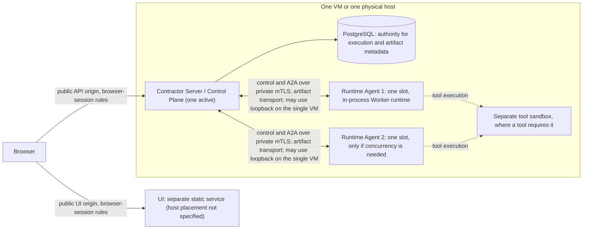
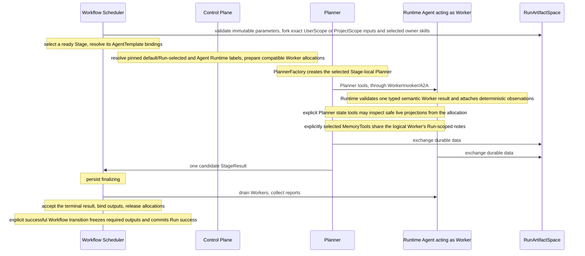
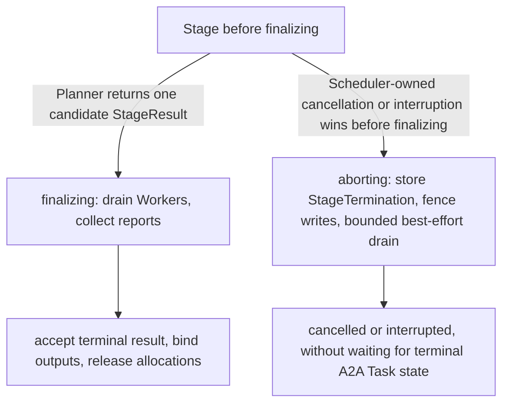

# System overview

Requirement prefix: `SYS` · [Specification index](README.md)

## Purpose and scope

Contractor v2 is an Application Security orchestration platform. Workflows
define reusable security checks and supporting analyses. An Audit is the
higher-level abstraction that coordinates WorkflowRuns into a Project-bound
assessment with shared scope, evidence, findings, coverage and review.

This document owns the system-level view of Contractor: the split of
responsibility between Workflows, the Workflow Scheduler, Planners and Workers;
the generic execution core; the deployables and the single-host topology; the
trust boundaries between deployables; and the end-to-end path of one
WorkflowRun, including the Stage aborting path and the race between Run
cancellation and success.

Other documents own the details:

- Term definitions: [glossary](glossary.md).
- Workflow definitions, Stages, transitions and slots:
  [Workflows](configuration/workflows.md).
- AgentTemplates, ModelPolicies, ExecutionConfigs and toolset selection:
  [AgentTemplates](configuration/agent-templates.md).
- Managed configuration roots and their publication:
  [Configuration catalog](configuration/catalog.md).
- The WorkflowRun resource, creation, admission, cancellation and outputs:
  [Runs](execution/runs.md).
- StageExecution, claims, lanes, retry, owner pause and recovery:
  [Scheduler](execution/scheduler.md).
- Runtime Agent registration, mTLS identity, placement, allocation and
  release: [Control plane](execution/control-plane.md).
- The Runtime process, its startup probes and its A2A endpoint:
  [Runtime Agent](execution/runtime-agent.md).
- Planners and Planner tools: [Planners](execution/planners.md).
- Worker results, observations, live state and session modes:
  [Worker](execution/worker.md).
- The ArtifactStore and RunArtifactSpace:
  [ArtifactStore](artifacts/artifact-store.md); payload backends:
  [Blob storage](artifacts/blob-storage.md).
- Audits, AuditProfiles and their coordination contract:
  [Audits](audits/audits.md).
- The security mechanisms behind each trust boundary:
  [Security](platform/security.md); browser sessions:
  [Public API](api/public-api.md).
- Supported host operating systems, sandbox host requirements and the
  deployment boundary: [Operations](operations/operations.md).

## Concepts

Each term is defined once in the [glossary](glossary.md). This document
defines:

- **Contractor v2** — an Application Security orchestration platform in which
  Workflows define reusable security checks and supporting analyses, and Audits
  coordinate WorkflowRuns into Project-bound assessments with shared scope,
  evidence, findings, coverage and review.
- **Catalog of checks** — the extensible set of security checks; check-specific
  behavior lives in versioned Workflow, Planner and AgentTemplate definitions,
  instructions, Skills and toolsets.
- **Execution core** — the generic machinery in which the Workflow Scheduler
  manages Run and Stage lifecycles without branching on security-check types.
- **Single-VM baseline** — the baseline deployment layout in which one
  Contractor Server process, PostgreSQL and one or two single-slot Runtime
  Agent processes (the second only if concurrency is needed) run on one VM.
- **Aborting path** — the path a Stage takes when Scheduler-owned cancellation
  or interruption wins before `finalizing`: StageTermination is stored, writes
  are fenced and a bounded best-effort drain ends in `cancelled` or
  `interrupted`.

The components and concepts this overview names, and the documents that own
them:

| Component or concept | Owning document |
|---|---|
| Workflow | [Workflows](configuration/workflows.md) |
| Workflow Scheduler | [Scheduler](execution/scheduler.md); WorkflowRun progression: [Runs](execution/runs.md) |
| Planner, Planner state tools | [Planners](execution/planners.md) |
| AgentTemplate | [AgentTemplates](configuration/agent-templates.md) |
| Worker session mode, Worker State | [Worker](execution/worker.md) |
| Control Plane | [Control plane](execution/control-plane.md) |
| Runtime Agent | [Runtime Agent](execution/runtime-agent.md) |
| Runtime label, Runtime adapter | [RuntimeConfig](configuration/runtime-config.md) |
| Run metadata label | [Runs](execution/runs.md) |
| ArtifactStore, UserScope, RunArtifactSpace | [ArtifactStore](artifacts/artifact-store.md) |
| Agent Skill, SkillCatalog | [Skills](tools/skills.md) |
| MemoryTools | [Memory](tools/memory.md) |
| WorkspaceFS | [Workspaces](tools/workspace.md) |
| HTTP/Caido tools | [HTTP and Caido tools](tools/http-caido.md) |
| Code analysis, Taint annotations | [Code analysis](tools/code-analysis.md) |
| Project, ProjectScope, Queue | [Projects](artifacts/projects.md) |
| Queue control | [Scheduler](execution/scheduler.md) |
| Audit, AuditProfile | [Audits](audits/audits.md) |

## Model

### Deployables and topology

A deployment consists of the Contractor Server with its Control Plane,
PostgreSQL, one or more single-slot Runtime Agent processes and the UI static
service (SYS-R10 to SYS-R17). The diagram shows the single-host topology and
the transport rules between deployables (SYS-R15, SYS-R18, SYS-R19).



### Single-VM baseline

The baseline deployment may use this layout (SYS-R14):

```text
one VM
  Contractor Server process
  PostgreSQL
  Runtime Agent process 1 (one slot, Worker runtime executes in-process)
  Runtime Agent process 2 (one slot, only if concurrency is needed)
```

### End-to-end path of one Run

Each WorkflowRun executes its selected Workflow along this path (SYS-R25):

```text
Workflow
  -> Workflow Scheduler validates immutable parameters and forks exact UserScope or ProjectScope inputs and selected owner skills into RunArtifactSpace
  -> selects a ready Stage
  -> resolve its AgentTemplate bindings
  -> Control Plane resolves pinned default/Run-selected Runtime labels plus Agent Runtime labels and prepares compatible Worker allocations
  -> PlannerFactory creates the selected Stage-local Planner
  -> Planner tools talk through WorkerInvoker/A2A to allocated Runtime Agents acting as Workers
  -> Runtime validates one typed semantic Worker result and attaches deterministic observations
  -> explicit Planner state tools may inspect safe live projections from that allocation
  -> explicitly selected MemoryTools let Planner and each logical Worker share that Worker's Run-scoped notes
  -> all participants exchange durable data through RunArtifactSpace
  -> Planner returns one candidate StageResult
  -> Workflow Scheduler persists finalizing, drains Workers and collects reports
  -> Workflow Scheduler accepts the terminal result, binds outputs and releases allocations
  -> an explicit successful Workflow transition freezes required outputs and commits Run success
```

The same path by participant:



### Stage completion

If Scheduler-owned cancellation or interruption wins before `finalizing`, the
alternative path is `aborting` (SYS-R22). The complete StageExecution state
machine is in [Scheduler](execution/scheduler.md).



## Requirements

### Responsibility split

**SYS-R1.** A Workflow defines a reusable application security check or
supporting analysis as a sequence or graph of Stages.

**SYS-R2.** A Workflow can run independently of an Audit or be selected by an
Audit as part of a broader assessment.

**SYS-R3.** An Audit coordinates ordinary WorkflowRuns.

**SYS-R25.** Each Run executes a selected Workflow through the
[end-to-end path](#end-to-end-path-of-one-run).

**SYS-R4.** The Workflow Scheduler executes the Workflow graph and owns the
Stage lifecycle.

**SYS-R5.** The Planner owns decisions inside one prepared Stage.

**SYS-R6.** Worker runtimes and their heavy dependencies must remain outside
the Server, Scheduler and Planner packages.

### Generic execution core

**SYS-R7.** The catalog of checks is extensible. Check-specific behavior
belongs in versioned Workflow, Planner and AgentTemplate definitions,
instructions, Skills and toolsets.

**SYS-R8.** The execution core remains generic: the Scheduler manages Run and
Stage lifecycles and must not branch on security-check types.

An AuditProfile defines how selected Workflows participate in an assessment;
[Audits](audits/audits.md) owns that coordination contract.

### Deployment topology

**SYS-R9.** The target deployment is one VM or one physical host (LIM-SYS-1).

**SYS-R10.** One active Server/Control Plane (LIM-SYS-2; one active Server per
PostgreSQL database is [LIM-PER-1](platform/limits.md),
[PER-R1](platform/persistence.md)), PostgreSQL and one or more lightweight
Runtime Agent processes (LIM-SYS-3) may all run on, and share, that host.

**SYS-R11.** Each Runtime Agent has a single slot
([LIM-CTL-4](platform/limits.md), [CTL-R112](execution/control-plane.md)).

**SYS-R12.** A Runtime Agent and its Worker runtime are one process: the Worker
runtime executes in-process (LIM-SYS-5).

**SYS-R13.** Tool execution may still use a separate sandbox where a tool
requires it.

**SYS-R14.** The baseline deployment may use the
[single-VM baseline](#single-vm-baseline) layout: one Contractor Server
process, PostgreSQL, one single-slot Runtime Agent process, and a second
single-slot Runtime Agent process only if concurrency is needed (LIM-SYS-3).

**SYS-R15.** On the single VM, control, A2A and artifact transports may use
loopback.

**SYS-R16.** No deployment requires Kubernetes, a controller, a separate
control-plane service, distributed scheduling, a child Worker process or a
remotely managed AgentTemplate service; none of them is a prerequisite.

**SYS-R17.** The UI is a separate static service.

The host operating systems the Server and the Runtime target, the Linux host
capabilities the allocation-scoped Podman backend requires, and the
`unsupported_platform` result of platform-dependent resource observations are
specified in [Operations](operations/operations.md).

### Trust boundaries and authorities

**SYS-R18.** Public UI and API origins use the browser-session rules of the
[Public API](api/public-api.md).

**SYS-R19.** Server-to-Runtime control and A2A traffic use the private mTLS
contract ([Control plane](execution/control-plane.md),
[Security](platform/security.md)).

**SYS-R20.** PostgreSQL remains the authority for execution metadata and for
artifact metadata with either payload backend; the artifact side is
[BLB-R1](artifacts/blob-storage.md).

**SYS-R21.** Managed configuration storage must support the durable hard-link
publication of managed configuration
([Configuration catalog](configuration/catalog.md)).

### Stage and Run completion

**SYS-R22.** If Scheduler-owned cancellation or interruption wins before
`finalizing`, the Stage takes the alternative `aborting` path: the Scheduler
stores StageTermination, fences writes, performs a bounded best-effort drain
and reaches `cancelled` or `interrupted` without waiting for terminal A2A Task
state (FAIL-SYS-1). The abort sequence and its deadlines are in
[Scheduler](execution/scheduler.md) (SCH-R52 to SCH-R58).

**SYS-R23.** A WorkflowRun owns its states separately from the Stage: the
nonterminal `initializing`, `pending`, `running`, `waiting` and `cancelling`,
and the terminal `succeeded`, `failed` and `cancelled`.

**SYS-R24.** Cancel and success serialize on the durable Run row; the first
committed transition wins (FAIL-SYS-2). The per-order effects are in
[Runs](execution/runs.md) (RUN-R44).

## Limits, failures and errors

Registry entries owned by this document:

- [LIM-SYS-1](platform/limits.md): one host, a VM or a physical host, per
  target deployment (SYS-R9).
- [LIM-SYS-2](platform/limits.md): one active Server/Control Plane on the
  deployment host, enforced by the advisory lease of
  [PER-R2](platform/persistence.md) (SYS-R10); see also LIM-PER-1.
- [LIM-SYS-3](platform/limits.md): one or more Runtime Agent processes; in the
  single-VM baseline, a second one only if concurrency is needed (SYS-R10,
  SYS-R14).
- [LIM-SYS-5](platform/limits.md): one process for a Runtime Agent and its
  Worker runtime (SYS-R12).
- [FAIL-SYS-1](platform/failure-model.md): the Worker drain of a Stage whose
  cancellation or interruption wins before `finalizing` (SYS-R22); see also
  FAIL-SCH-6, FAIL-SCH-7.
- [FAIL-SYS-2](platform/failure-model.md): concurrent cancel and success of a
  WorkflowRun (SYS-R24); see also FAIL-RUN-4.

The slot bound of SYS-R11 is [LIM-CTL-4](platform/limits.md), owned by the
[Control plane](execution/control-plane.md).

This document owns no error codes. The `unsupported_platform` result of
platform-dependent resource observations belongs to
[Operations](operations/operations.md).

## Security

The trust boundaries between deployables are SYS-R18 and SYS-R19.
[Security](platform/security.md) owns the deployment trust domain, mTLS
identity, authentication, secrets and the full trust-boundary model.
