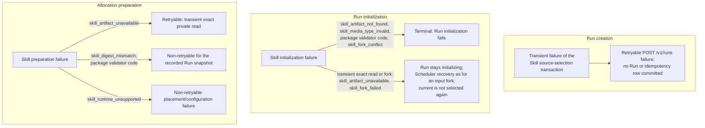

# Error and stop codes

Requirement prefix: `ERR` · [Specification index](../README.md)

## Purpose and scope

This document is the registry of error and stop codes. Each code is defined
once. Its registry row gives the HTTP status where the code has one, whether
the code is retryable, its meaning and the requirement that defines it. The
rows owned by every document are assembled into the [Registry](#registry) at
the end of this document.

This document owns the code vocabularies of:

- Planner Gateway errors;
- Worker result failures;
- Memory tool errors;
- Agent Skill package validation, Run initialization and allocation
  preparation;
- workspace and filesystem tools;
- code-analysis and taint annotation tools;
- HTTP and Caido tools;
- the public API's error codes, generated from the Server's error registry.

It leaves to other documents:

- the rules that raise each code and act on it: the domain document linked
  from each vocabulary below;
- codes that other domains define: listed under
  [Codes and error rules owned by other documents](#codes-and-error-rules-owned-by-other-documents);
- outcome classes, retryability, idempotency and receipts, ambiguous writes
  and cancellation ownership: [Failure model](failure-model.md);
- the bounded public error envelope: [Public API](../api/public-api.md).

## Concepts

Each term is defined once in the [glossary](../glossary.md).

- **Error code** — a stable, bounded identifier of one failure class that a
  component reports to a model, an API caller or the Scheduler.
- **Stop code** — an error code with which a Planner invocation or a
  StageExecution ends without a semantic candidate and which is recorded in
  its interrupted StageTermination, for example the Planner budget codes of
  [Planners](../execution/planners.md).
- **Retryable classification** — whether another attempt may succeed after
  the failure a code reports. For Memory codes it means a retry without
  changing the input (ERR-R3); for a Worker or Stage failure it means that a
  fresh StageExecution may succeed. The rule that decides whether a retryable
  failure leads to another attempt is owned by [Worker](../execution/worker.md).
- **Model-visible error vocabulary** — the set of error codes a toolset
  returns to the model.
- **Closed vocabulary** — a model-visible error vocabulary that lists every
  code its toolset may return. A list of codes introduced with "include" is
  not exhaustive.
- **Package validator code** — one of the Agent Skill package classification
  codes of ERR-R4.

## Requirements

### Planner Gateway errors

**ERR-R1.** The Planner Gateway errors are:

| Code | Retryable | Meaning |
| --- | --- | --- |
| `planner_gateway_rejected` | no | Permanent classification: HTTP 401/403 or another permanent 4xx, a declared permanent provider code, an `x-should-retry: false` hint or an oversized response |
| `planner_gateway_unavailable` | yes | Any other failed model request, such as a transient failure sent without a recovery authority or an unavailable recovery authority |
| `planner_gateway_invalid_response` | yes | An HTTP 2xx reply without a usable choice or valid token usage; its valid usage is still charged |

The rules for retrying a transient failure inside a Planner invocation,
ending the invocation on these errors and recording them in a StageTermination
are owned by [Planners](../execution/planners.md).

### Worker result failures

**ERR-R2.** Stable Worker result failures include:

- `worker_result_missing`;
- `worker_output_limit_exceeded`;
- `worker_result_invalid`;
- `worker_result_subtask_mismatch`;
- `worker_result_finalizer_mismatch`;
- `worker_result_finalizer_failed`;
- `worker_result_too_large`;
- `unsafe_worker_result`;
- the `worker_budget_exhausted` code of [Worker](../execution/worker.md) and
  domain and runtime failures.

The conditions that raise each of these codes and their retryability are
owned by [Worker](../execution/worker.md).

### Memory tool errors

**ERR-R3.** The model-facing stable Memory error codes are:

| Code | Meaning | Retryable without changing input |
| --- | --- | --- |
| `memory_invalid` | Invalid name, tags, UTF-8 or request shape | no |
| `memory_not_found` | Requested current note does not exist | no |
| `memory_too_large` | Resulting canonical note exceeds 32 KiB (LIM-MEM-1) | no |
| `memory_namespace_full` | A create would exceed 128 active notes (LIM-MEM-8), or the Run has used up its Artifact revision limit (LIM-ART-6) | no |
| `memory_changed` | Hidden Artifact CAS conflict or ambiguous newer value | yes, after re-read |
| `memory_forbidden` | Tool/Worker/Stage capability or write fence rejects it | no |
| `memory_unavailable` | Bounded infrastructure failure | yes |

The note limits and the operations that raise these codes are owned by
[Memory](../tools/memory.md).

### Agent Skill errors

**ERR-R4.** The Skill package validator codes are:

- `skill_archive_invalid` for malformed/encrypted/unsupported ZIP structure;
- `skill_path_invalid` for a non-portable, duplicate or escaping member path;
- `skill_member_forbidden` for a script, unknown root, link or special member;
- `skill_manifest_invalid` for encoding, frontmatter or body violations;
- `skill_name_mismatch` when directory/artifact/frontmatter names differ;
- `skill_limit_exceeded` for any per-member, count or aggregate bound.

The package bounds and the validators that use these codes are owned by
[Skills](../tools/skills.md).

**ERR-R5.** The terminal WorkflowRun initialization codes are
`skill_artifact_not_found`, `skill_media_type_invalid`, any exact package
validator code (ERR-R4), or `skill_fork_conflict`.

**ERR-R6.** Transient exact Skill reads and forks use
`skill_artifact_unavailable` or `skill_fork_failed`, leave the Run
`initializing` and follow the same Scheduler recovery as an input fork
([ART-R79](../artifacts/artifact-store.md)).

**ERR-R7.** A transient exact read or fork does not select current again
after Run creation committed.

**ERR-R8.** A transient failure of the source-selection transaction itself
commits no Run or idempotency row and is a retryable `POST /v1/runs` failure
rather than a partially initialized Run.

**ERR-R9.** Allocation preparation distinguishes at least:

- `skill_artifact_unavailable`, retryable for transient exact private reads;
- `skill_digest_mismatch`, non-retryable for the recorded Run snapshot;
- an exact package validator code (ERR-R4), non-retryable for the recorded
  Run snapshot;
- `skill_runtime_unsupported`, non-retryable placement/configuration failure.

### Workspace and filesystem tool errors

**ERR-R10.** Stable workspace and filesystem tool errors include:

- `workspace_required`;
- `workspace_mode_unsupported`;
- `workspace_capacity_exceeded` (retryable placement/resource failure);
- `workspace_source_invalid` (malformed or malicious archive, non-retryable);
- `workspace_state_invalid` (non-retryable);
- `workspace_path_invalid`;
- `workspace_not_found`;
- `workspace_line_invalid` (read or edit line outside an existing file's
  valid range);
- `workspace_type_conflict`;
- `binary_file_unsupported`;
- `workspace_limit_exceeded`;
- `workspace_operation_unsupported`;
- `workspace_unavailable` (bounded filesystem acquisition, I/O or mutation
  failure);
- `workspace_export_failed`.

The conditions that raise these codes, and the retryability of the codes not
classified here, are owned by
[Run workspaces and filesystem tools](../tools/workspace.md).

### Code-analysis tool errors

**ERR-R11.** The model-visible error vocabulary of the code-analysis tools
is:

- `workspace_required` — no project workspace was supplied (the same code as
  in ERR-R10);
- `code_analysis_input_invalid` — invalid query, language, node type, limit,
  depth or path;
- `code_analysis_cursor_invalid` — malformed or wrong-operation cursor;
- `code_analysis_workspace_changed` — cursor or pending cache belongs to an
  older effective tree; retry without the cursor;
- `code_analysis_symbol_not_found` — the exact graph `symbolId` is absent;
- `code_analysis_stale_symbol` — the ID belongs to an older graph digest;
- `code_analysis_build_timeout`;
- `code_analysis_query_timeout`;
- `code_analysis_capacity_exceeded` — fixed source, protocol or child-memory
  boundary prevented the requested graph result;
- `code_analysis_engine_failed` — bounded Trailmark/child failure not covered
  by a more specific code;
- `code_analysis_cancelled` — the invocation was cancelled while an off-loop
  operation was being joined;
- `code_analysis_closing` — allocation termination has begun.

### Taint annotation tool errors

**ERR-R12.** The model-visible error vocabulary of the taint annotation
tools is closed:

- `workspace_required`;
- `taint_annotation_input_invalid`;
- `taint_annotation_language_unsupported`;
- `taint_annotation_target_not_found`;
- `taint_annotation_target_ambiguous`;
- `taint_annotation_conflict`;
- `taint_annotation_workspace_changed` (retryable);
- `taint_annotation_capacity_exceeded`;
- `taint_annotation_cancelled` (retryable);
- `taint_annotation_closing`;
- `taint_annotation_unavailable` (retryable).

The conditions that raise the code-analysis and taint annotation codes, and
the retryability of the codes not classified here, are owned by
[Code analysis](../tools/code-analysis.md).

### HTTP and Caido tool errors

**ERR-R13.** Stable HTTP and Caido tool errors include:

- `http_request_invalid`, `http_target_denied`, `http_request_failed`,
  `http_response_invalid`, `http_response_too_large`, `http_body_not_found`;
- `caido_not_configured`, `caido_request_invalid`, `caido_request_failed`,
  `caido_response_invalid`, `caido_response_too_large`.

The target-policy denials that raise the non-retryable `http_target_denied`
are owned by [Security](security.md) (SEC-R78). The conditions that raise the
other codes and their retryability are owned by
[HTTP and Caido tools](../tools/http-caido.md).

### Public API error codes

**ERR-R14.** The public API answers every failure, in its HTTP error envelope
or in a WebSocket error frame, with a code of the
[Public API codes](#public-api-codes) table and that code's HTTP status and
`retryable` flag. The Server's machine-readable error registry defines each
of these codes exactly once, the table is generated from it, and a code that
is not registered cannot be answered; how the Server classifies a failure is
owned by [Public API](../api/public-api.md) (API-R73). The registry is checked
against the managed Eval error enum, the error details kinds, the error
statuses and the codes named in response descriptions of the OpenAPI
contract, the error-frame enum of the event schema, and the code comparisons
of the browser client.

## Limits, failures and errors

### Codes and error rules owned by other documents

| Codes or rule | Owner |
| --- | --- |
| Planner budget stop codes `planner_model_call_limit`, `planner_token_limit`, `planner_worker_call_limit` and `planner_deadline_exceeded`; the token-usage check on Planner Gateway responses | [Planners](../execution/planners.md) |
| Transient retry inside a Planner invocation; how `planner_gateway_rejected` ends the invocation and is recorded; the safe classification code in its message, such as `gateway_access_denied` or `context_length_exceeded` | [Planners](../execution/planners.md) |
| `worker_gateway_unavailable`, `worker_gateway_invalid_request`, `worker_summarization_failed` and `worker_budget_exhausted`; preservation of Gateway retryability when an error is wrapped; the retryable flag versus the client's bounded transport retries; the retryability of Worker result failures | [Worker](../execution/worker.md) |
| `worker_execution_failed` and `worker_busy`; terminal Task results of the allocation-scoped A2A endpoint | [Runtime Agent](../execution/runtime-agent.md) |
| `context_artifact_missing`; the retryable StageTermination of an initialization failure after slot reservation; `scheduler_state_invalid` and `unsupported_workflow_shape` in recovery | [Scheduler](../execution/scheduler.md) |
| `runtime_adapter_prepare_failed` and the other placement and adapter preparation failure results | [Failure model](failure-model.md) |
| Bounded, secret-free error bodies of the Runtime-label API; Run metadata label failure results | [Runs](../execution/runs.md) |
| Project failure results, including the `already_present` publication record | [Projects](../artifacts/projects.md) |
| The reason codes of `audit_profile_unsupported` | [Audits](../audits/audits.md) |
| Operations API failure statuses (`400`, `401`, `403`, `412`, `415`) | [Operations](../operations/operations.md) |
| Git import public error codes and the content their failure responses must not disclose | [Git import](../artifacts/git-import.md) |
| The target-policy denials that raise `http_target_denied` (SEC-R78) | [Security](security.md) |

### Related limits and failure outcomes

- The bounds named in `memory_too_large` and `memory_namespace_full` are
  LIM-MEM-1 and LIM-MEM-8, owned by [Memory](../tools/memory.md), and the Run
  revision limit LIM-ART-6, owned by
  [Artifact store](../artifacts/artifact-store.md); the bounds
  behind `skill_limit_exceeded` are owned by [Skills](../tools/skills.md).
- The failure outcomes of the Planner Gateway model request (FAIL-PLN-1) are
  registered by [Planners](../execution/planners.md); those of Skill source
  selection at Run creation (FAIL-SKL-2), exact Skill reads and forks at Run
  initialization (FAIL-SKL-3) and Skill loading during allocation preparation
  (FAIL-SKL-4) by [Skills](../tools/skills.md).

## Registry

One row per code: a code has exactly one row across the two tables below. The
Owner column links the requirement that defines the code. The tables of the
requirements above (ERR-R1, ERR-R3) define their codes, and
[Codes and error rules owned by other documents](#codes-and-error-rules-owned-by-other-documents)
points to owners; neither holds registry rows.

### Public API codes

The codes of the public API's HTTP error envelope and WebSocket error frames
(ERR-R14), generated from the Server's error registry.

<!-- BEGIN GENERATED PUBLIC ERROR CODES: edit internal/apierror and run make docs-error-registry -->
| Code | HTTP status | Retryable | Meaning | Owner |
| --- | --- | --- | --- | --- |
| `archive_file_not_text` | 422 | no | A previewed archive file is not UTF-8 text. | [API-R73](../api/public-api.md) |
| `archive_invalid` | 422 | no | The previewed archive is malformed, unsupported or contains unsafe entries; the original stays downloadable. | [API-R73](../api/public-api.md) |
| `archive_media_type` | 415 | no | An archive preview (getArtifactArchive and its Project and Run variants) names an Artifact that is not a ZIP or Skill package. | [API-R73](../api/public-api.md) |
| `archive_preview_limit` | 422 | no | The archive exceeds a preview bound, or a previewed file exceeds 256 KiB of text. | [API-R73](../api/public-api.md) |
| `artifact_content_corrupt` | 503 | no | Referenced payload content failed its digest or size verification, or an exact binding holds other content; no retry repairs it. | [BLB-R46](../artifacts/blob-storage.md) |
| `artifact_content_missing` | 503 | no | Referenced payload content is missing, or a live read lost the race with registry deletion; never an empty success, a silent revision replacement or an automatic Git refetch. | [BLB-R46](../artifacts/blob-storage.md) |
| `artifact_frozen` | 409 | no | A write targets a frozen binding, which never advances, so neither a re-read nor a retry can succeed; returned on the public and private Artifact APIs whatever the write precondition. | [ART-R59](../artifacts/artifact-store.md) |
| `artifact_too_large` | 413 | no | An Artifact exceeds its 64 MiB limit (LIM-ART-4); rejected in the same way as an oversized request body. | [API-R5](../api/public-api.md) |
| `artifact_transfer_capacity` | 503 | yes | All full-payload transfer slots of the Server process are taken; the request fails promptly instead of queueing its body. | [BLB-R25](../artifacts/blob-storage.md) |
| `audit_digest_mismatch` | 422 | no | Bounded Audit package codec error: an Audit document or package member does not match its digest. The Audit input, finding proposal or finding collection is rejected without its source bytes; in list_findings the Runtime tool transport maps it to its own error. | [Audits](../audits/audits.md), [findings](../findings/findings.md) |
| `audit_document_invalid` | 422 | no | Bounded Audit package codec error: an Audit document is invalid. The Audit input, finding proposal or finding collection is rejected without its source bytes; in list_findings the Runtime tool transport maps it to its own error. | [Audits](../audits/audits.md), [findings](../findings/findings.md) |
| `audit_inventory_invalid` | 422 | no | Bounded Audit package codec error: an Audit inventory is invalid. The Audit input, finding proposal or finding collection is rejected without its source bytes; in list_findings the Runtime tool transport maps it to its own error. | [Audits](../audits/audits.md), [findings](../findings/findings.md) |
| `audit_limit_exceeded` | 422 | no | Bounded Audit package codec error: an Audit document or package exceeds a bound. The Audit input, finding proposal or finding collection is rejected without its source bytes; in list_findings the Runtime tool transport maps it to its own error. | [Audits](../audits/audits.md), [findings](../findings/findings.md) |
| `audit_package_invalid` | 422 | no | Bounded Audit package codec error: an Audit package is invalid. The Audit input, finding proposal or finding collection is rejected without its source bytes; in list_findings the Runtime tool transport maps it to its own error. | [Audits](../audits/audits.md), [findings](../findings/findings.md) |
| `audit_package_member_forbidden` | 422 | no | Bounded Audit package codec error: an Audit package contains a forbidden member. The Audit input, finding proposal or finding collection is rejected without its source bytes; in list_findings the Runtime tool transport maps it to its own error. | [Audits](../audits/audits.md), [findings](../findings/findings.md) |
| `audit_package_path_invalid` | 422 | no | Bounded Audit package codec error: an Audit package member path is invalid. The Audit input, finding proposal or finding collection is rejected without its source bytes; in list_findings the Runtime tool transport maps it to its own error. | [Audits](../audits/audits.md), [findings](../findings/findings.md) |
| `audit_profile_unsupported` | 422 | no | The pinned AuditProfile requires Server capabilities that are missing; bounded reason codes in the details name them and do not describe transient Worker availability. | [AUD-R88](../audits/audits.md) |
| `audit_reference_invalid` | 422 | no | Bounded Audit package codec error: an Audit reference is invalid. The Audit input, finding proposal or finding collection is rejected without its source bytes; in list_findings the Runtime tool transport maps it to its own error. | [Audits](../audits/audits.md), [findings](../findings/findings.md) |
| `audit_remote_reference` | 422 | no | Bounded Audit package codec error: an Audit document references remote content. The Audit input, finding proposal or finding collection is rejected without its source bytes; in list_findings the Runtime tool transport maps it to its own error. | [Audits](../audits/audits.md), [findings](../findings/findings.md) |
| `audit_result_set_invalid` | 422 | no | Bounded Audit package codec error: an Audit result set is invalid. The Audit input, finding proposal or finding collection is rejected without its source bytes; in list_findings the Runtime tool transport maps it to its own error. | [Audits](../audits/audits.md), [findings](../findings/findings.md) |
| `audit_schema_unsupported` | 422 | no | Bounded Audit package codec error: an Audit document has an unsupported schema version. The Audit input, finding proposal or finding collection is rejected without its source bytes; in list_findings the Runtime tool transport maps it to its own error. | [Audits](../audits/audits.md), [findings](../findings/findings.md) |
| `configuration_conflict` | 409 | no | A managed publication reused a published (kind, name, version) identity with different normalized content; an identical identity and body instead returns the published version. | [CAT-R59](../configuration/catalog.md) |
| `configuration_drift` | 409 | no | A managed publication found that the reloaded configuration roots differ from the Server's loaded snapshot by a change the Server did not make; nothing is published, and publication resumes once the roots match the loaded snapshot again or after a restart. | [CAT-R75](../configuration/catalog.md) |
| `conflict` | 409 | yes | The resource state changed or an identity is taken: a stale Artifact CAS precondition, a Run, Project or Audit state that no longer admits the request, or a duplicate identity. Re-read the current state and retry with its revision. | [API-R26](../api/public-api.md), [ART-R59](../artifacts/artifact-store.md) |
| `credential_conflict` | 409 | no | An LLM credential creation names an identity that already exists. | [RCF-R41](../configuration/runtime-config.md) |
| `credential_in_use` | 409 | no | LLM credential deletion is refused because a non-terminal Run, active RuntimeConfig label binding or live allocation pins or references the credential; the details list the safe referencing IDs and nothing changes. | [RCF-R48](../configuration/runtime-config.md) |
| `credential_recovery_required` | 503 | yes | An earlier credential operation ended ambiguously, so new Run initialization and credential changes wait until the same request or startup recovery resolves it. | [RCF-R53](../configuration/runtime-config.md) |
| `eval_budget_exhausted` | 409 | no | The experiment's frozen allowance is exhausted; a new plan is needed (recovery duplicate). Retryable false: the recovery action in the details says what to do. | [EVM-R227](../evals/managed-evals.md) |
| `eval_evidence_unavailable` | 409 | no | Evidence that the request needs is unavailable or was deleted. Retryable false: the recovery action in the details says what to do. | [EVM-R227](../evals/managed-evals.md) |
| `eval_external_control` | 409 | no | The request needs another execution controller (native or external) than the experiment has. Retryable false: the recovery action in the details says what to do. | [EVM-R227](../evals/managed-evals.md) |
| `eval_idempotency_conflict` | 409 | no | The Eval form of idempotency_conflict: the key is bound to another request, and only a new key can carry the changed one (recovery retry_same_request). Retryable false: the recovery action in the details says what to do. | [API-R69](../api/public-api.md) |
| `eval_invalid` | 422 | no | An Eval request or document is invalid. Retryable false: the recovery action in the details says what to do. | [EVM-R229](../evals/managed-evals.md) |
| `eval_limit_exceeded` | 422 | no | An Eval document or a native experiment matrix exceeds its bound: above 1,000 expanded members or a conservative serialized-plan estimate above 1 MiB. Retryable false: the recovery action in the details says what to do. | [EVM-R63](../evals/managed-evals.md), [API-R6](../api/public-api.md) |
| `eval_member_conflict` | 409 | no | Member records conflict, such as two executions claiming one member before receipts adjudicate it. Retryable false: the recovery action in the details says what to do. | [EVM-R227](../evals/managed-evals.md) |
| `eval_not_found` | 404 | no | The Eval resource does not exist or is not visible to the principal. Retryable false: the recovery action in the details says what to do. | [EVM-R229](../evals/managed-evals.md) |
| `eval_not_ready` | 409 | no | A command that the experiment's state rules out, such as a stop that progress has since ruled out; it passed the ETag check, and the browser refetches instead of replaying it. Retryable false: the recovery action in the details says what to do. | [EVM-R37](../evals/managed-evals.md) |
| `eval_pin_mismatch` | 409 | no | A stop names another plan than the current one, or a required pin differs; a new plan is needed (recovery duplicate). Retryable false: the recovery action in the details says what to do. | [EVM-R37](../evals/managed-evals.md) |
| `eval_precondition_required` | 428 | no | A revision-guarded Eval mutation was sent without its If-Match revision. Retryable false: the recovery action in the details says what to do. | [EVM-R35](../evals/managed-evals.md) |
| `eval_preparation_unavailable` | 503 | no | An unknown infrastructure failure during Prepare: the experiment reports it as its diagnostic with recovery wait while the coordinator retries Prepare by itself. Retryable false: the recovery action in the details says what to do. | [EVM-R90](../evals/managed-evals.md) |
| `eval_producer_stale` | 409 | no | An external producer's observation is too old for the request. Retryable false: the recovery action in the details says what to do. | [EVM-R227](../evals/managed-evals.md) |
| `eval_project_deleting` | 409 | no | The evaluation Project is being deleted, so the request is refused (recovery wait); an external producer returning after the deletion fence cannot recreate deleted attempts. Retryable false: the recovery action in the details says what to do. | [EVM-R227](../evals/managed-evals.md), [DEL-R43](../artifacts/retention-and-deletion.md) |
| `eval_revision_mismatch` | 412 | no | The If-Match revision is not the current experiment revision. Retryable false: the recovery action in the details says what to do. | [EVM-R36](../evals/managed-evals.md) |
| `eval_view_changed` | 409 | no | The view snapshot bound to a page or chart request changed; the client keeps its filters and restarts pagination. Retryable false: the recovery action in the details says what to do. | [EVM-R215](../evals/managed-evals.md) |
| `forbidden` | 403 | no | The authenticated principal lacks the Operations capability, or a browser request failed its Origin, CSRF or CORS preflight check. | [SEC-R45](security.md), [API-R23](../api/public-api.md), [OPS-R60](../operations/operations.md) |
| `gateway_unavailable` | 502 | yes | The bound Gateway credential manager failed or is not configured, so the credential operation did not complete; the database record is retained. | [RCF-R49](../configuration/runtime-config.md) |
| `git_content_unsupported` | 422 | no | The selected tree contains content the import does not support, such as an unsafe path, a symlink entry, a submodule or a Git LFS pointer (the message names the entry kind and its tree path), or it is empty; nothing is published. | [GIT-R25](../artifacts/git-import.md), [GIT-R28](../artifacts/git-import.md) |
| `git_destination_refused` | 422 | no | The remote is outside the operator allowlist or resolves to a refused destination. | [GIT-R52](../artifacts/git-import.md), [GIT-R56](../artifacts/git-import.md) |
| `git_host_untrusted` | 422 | no | SSH host verification failed closed: an unknown or changed host key, or no known_hosts configuration. | [GIT-R49](../artifacts/git-import.md), [GIT-R50](../artifacts/git-import.md), [GIT-R51](../artifacts/git-import.md) |
| `git_import_cancelled` | 408 | no | The request was cancelled during the import; nothing partial is published, and a racing commit is resolved through the Artifact metadata. | [GIT-R73](../artifacts/git-import.md), [GIT-R79](../artifacts/git-import.md) |
| `git_import_capacity` | 503 | no | The Server process already runs its one admitted Git import (LIM-GIT-19); the request is refused promptly without queueing. The client starts a new import once the active one ends. | [GIT-R69](../artifacts/git-import.md), [GIT-R70](../artifacts/git-import.md) |
| `git_import_limit` | 413 | no | The import exceeds one of its budgets (LIM-GIT); nothing is published. | [GIT-R66](../artifacts/git-import.md) |
| `git_import_timeout` | 504 | no | The whole-import deadline (LIM-GIT-6) expired; nothing partial is published, and a lost success is resolved through the Artifact metadata before importing again. | [GIT-R72](../artifacts/git-import.md), [GIT-R73](../artifacts/git-import.md), [GIT-R80](../artifacts/git-import.md) |
| `git_import_unavailable` | 503 | no | Git import is not configured on this Server: the remote allowlist or known_hosts configuration is missing or invalid. | [GIT-R53](../artifacts/git-import.md), [GIT-R54](../artifacts/git-import.md) |
| `git_key_invalid` | 400 | no | The owner Git key is not a supported unencrypted private key of at most 32 KiB. | [GIT-R39](../artifacts/git-import.md), [GIT-R40](../artifacts/git-import.md) |
| `git_key_missing` | 422 | no | An SSH import needs the owner's Git key, which is not configured. | [GIT-R38](../artifacts/git-import.md) |
| `git_key_unavailable` | 503 | no | The Server has no credential master key, so it can neither store nor use an owner Git key. | [GIT-R41](../artifacts/git-import.md), [GIT-R86](../artifacts/git-import.md) |
| `git_ref_unavailable` | 422 | no | The requested branch or tag is missing or an ambiguous short name. | [GIT-R17](../artifacts/git-import.md), [GIT-R18](../artifacts/git-import.md) |
| `git_remote_unavailable` | 422 | no | The repository is unavailable, refuses access, or cannot provide a bounded snapshot of the selected ref. | [GIT-R86](../artifacts/git-import.md) |
| `git_url_invalid` | 400 | no | The repository URL is not an accepted https:// or SSH form, or carries a password, query or fragment. | [GIT-R13](../artifacts/git-import.md), [GIT-R15](../artifacts/git-import.md), [GIT-R86](../artifacts/git-import.md) |
| `idempotency_conflict` | 409 | no | An Idempotency-Key already bound to a different request was sent again with another request (any change to the bound body, path or precondition), or a finding collection clientKey already bound to another selection. Permanent: the original result is unchanged and only a new key can carry the changed request; the same request still replays. Managed Eval mutations report this outcome as eval_idempotency_conflict. | [API-R69](../api/public-api.md), [FND-R114](../findings/findings.md) |
| `internal_error` | 500 | yes | An unclassified failure, answered without its cause. The Server cannot tell a transient failure from a defect here, so the code is retryable and clients bound their retries. | [API-R73](../api/public-api.md) |
| `invalid_frame` | — (WebSocket error frame) | no | A WebSocket client frame is malformed, unknown or reuses an active subscription ID; the socket and its subscriptions stay unchanged. | [API-R71](../api/public-api.md), [API-R43](../api/public-api.md) |
| `invalid_request` | 400 | no | The request does not satisfy the API contract: a malformed, unknown or duplicate member, parameter or header, a wrong media type, a domain validation failure, a page cursor reused with another query or snapshot, an out-of-range performance history query or a WebSocket handshake that is not a valid upgrade; nothing changes. | [API-R71](../api/public-api.md), [CAT-R68](../configuration/catalog.md), [OPS-R60](../operations/operations.md), [OPS-R165](../operations/operations.md) |
| `method_not_allowed` | 405 | no | The path belongs to a public operation but not with this method, including HEAD where the operation defines none. | [API-R73](../api/public-api.md) |
| `not_found` | 404; also a WebSocket error frame | no | The resource does not exist or is not visible to the principal, and the answer does not disclose which: ownership checks use the same 404 for another owner's resource, and a Runtime credential the principal may not use is reported like a missing one. As a WebSocket error frame, the subscribed stream or subscription is not found. | [API-R25](../api/public-api.md), [PRJ-R75](../artifacts/projects.md) |
| `overloaded` | — (WebSocket error frame) | yes | The Server cannot currently read the subscribed Run or Operations stream; the subscription ends and the client resubscribes after its backoff. | [API-R64](../api/public-api.md), [API-R72](../api/public-api.md) |
| `precondition_failed` | 412 | no | A strong If-Match revision is not the current revision of the resource (Project, Audit, Run Queue control, Scheduler settings, RuntimeConfig binding, Agent labels); nothing changes, and the client re-reads before deciding again. | [API-R26](../api/public-api.md), [OPS-R57](../operations/operations.md), [RCF-R175](../configuration/runtime-config.md) |
| `project_deleting` | 409 | no | The Project, or the scope of the Run, Audit or Artifact the request names, is being deleted; the request is refused for good. | [DEL-R40](../artifacts/retention-and-deletion.md) |
| `rate_limited` | 429 | yes | Failed login attempts exceeded the per-client-IP or process-wide limiter (the answer carries a bounded Retry-After and creates no account lockout), or the browser session already holds its maximum of event sockets (LIM-API-10). | [SEC-R51](security.md), [API-R62](../api/public-api.md) |
| `request_too_large` | 413 | no | A public JSON request body exceeds 1 MiB (LIM-API-1) or the smaller bound its resource declares; rejected before the handler's validation. | [API-R4](../api/public-api.md) |
| `run_not_deletable` | 409 | yes | DELETE /v1/runs/{runId} is refused because the Run is not terminal (run_not_terminal), its allocations have not completed release (allocation_release_pending) or an Audit-bound Run has no durable AuditCollectionReceipt (audit_collection_pending); nothing changes. Retry after a refetch shows the Run deletable. | [DEL-R20](../artifacts/retention-and-deletion.md) |
| `runtime_agent_in_use` | 409 | no | A Runtime Agent principal cannot be deleted while it is live, still has labels or an allocation references it. | [RCF-R178](../configuration/runtime-config.md) |
| `runtime_agent_label_not_applicable` | 400 | no | An Agent label whose current RuntimeConfig has no Worker setting was assigned. | [RCF-R143](../configuration/runtime-config.md) |
| `runtime_config_conflict` | 409 | no | Different normalized values for one merge unit within one layer (Run-selected or Agent labels), never resolved by label order, or a Runtime credential identity that already exists. | [RCF-R151](../configuration/runtime-config.md), [RCF-R178](../configuration/runtime-config.md) |
| `runtime_config_invalid` | 400 | no | A RuntimeConfig, its resolved configuration, a selected RuntimeConfig version or a Runtime credential request fails validation. | [RCF-R178](../configuration/runtime-config.md) |
| `runtime_credential_in_use` | 409 | no | A Runtime credential cannot be deleted while an active label binding, Project, non-terminal Run or Audit snapshot or live allocation references it; the details list the references. | [RCF-R178](../configuration/runtime-config.md) |
| `runtime_label_in_use` | 409 | no | A Runtime label binding cannot be removed while the label is assigned to a Runtime Agent (the details list the Agents), or the label is the reserved default. | [RCF-R178](../configuration/runtime-config.md), [RCF-R129](../configuration/runtime-config.md) |
| `runtime_label_unknown` | 400 | no | A Runtime label without a binding was selected or assigned. | [RCF-R178](../configuration/runtime-config.md), [RUN-R85](../execution/runs.md) |
| `storage_transaction_conflict` | 503 | yes | A definite PostgreSQL transaction conflict (serialization failure or deadlock), including one that outlasts the bounded transaction retries of its operation; nothing committed, so the request may be repeated. | [PER-R16](persistence.md) |
| `subscription_limit` | — (WebSocket error frame) | no | A socket already holds its maximum of subscriptions (LIM-API-11); only the new subscription is refused. | [API-R62](../api/public-api.md), [API-R63](../api/public-api.md) |
| `unauthorized` | 401; also a WebSocket error frame | no | Authentication is absent or invalid: no valid bearer token or browser session, or a login with invalid credentials. | [SEC-R45](security.md), [API-R33](../api/public-api.md) |
| `unsupported_media_type` | 415 | no | The Scheduler settings update is not sent as application/json; nothing changes. Other operations answer a wrong media type with invalid_request. | [OPS-R60](../operations/operations.md) |
<!-- END GENERATED PUBLIC ERROR CODES -->

### Other error and stop codes

Assembled from every document.

<!-- registry-table -->

| Code | HTTP status | Retryable | Meaning | Owner |
| --- | --- | --- | --- | --- |
| `1013` | — | yes | WebSocket close status used when a slow consumer fills its output queue; retryable overload semantics, after which the client resynchronizes | [API-R64](../api/public-api.md) |
| `(no assigned code) invocation-in-progress error` | — | yes | A Planner session is still running after process loss; the session record is not authority to resume it, and Workflow policy decides whether a fresh StageExecution retries. | [PLN-R107](../execution/planners.md) |
| `/readyz 503 (standby Server)` | 503 | not specified | The Server is a standby that does not hold the advisory lease: it serves /healthz, returns 503 from /readyz and has no private API until it acquires the lease. The /readyz 503 for an unusable working DB connection path is owned by operations/operations.md (OPS-R115). | [PER-R3](persistence.md) |
| `/readyz not ready (no wire code)` | 503 | not specified | The bounded check of the working DB connection path found it unusable | [OPS-R115](../operations/operations.md) |
| `ArtifactConflict` | — | not specified | A write's CAS precondition is stale or already consumed (create with `If-None-Match: *`/`expected_revision=None` on an existing binding, or update with an old revision). No new version is created and nothing is overwritten or merged. After a lost response, replaying the same precondition also returns it, and the caller reconciles through a current or exact read. | [ART-R59](../artifacts/artifact-store.md) |
| `INVALID_ARGUMENTS` | — | not specified | Bounded Skill tool error: an oversize, absolute, backslash or dot-segment skill function argument; returned before native dispatch and never retained as a safe metric path | [SKL-R94](../tools/skills.md) |
| `SKILL_DISCLOSURE_LIMIT` | — | not specified | Bounded tool error: a native Skill call would exceed the allocation disclosure budget; returned before activation or content lookup, with no partial content | [SKL-R100](../tools/skills.md) |
| `agent_state_unavailable` | — | not specified | Closed safe agent-state endpoint error for a stale, preparing, draining-with-destroyed-State or released slot | [WRK-R121](../execution/worker.md) |
| `allocation_not_found` | — | not specified | Closed safe agent-state endpoint error for a stale, preparing, draining-with-destroyed-State or released slot | [WRK-R121](../execution/worker.md) |
| `allocation_preparation_failed` | — | not specified | Allocation preparation failed, including a confirmed local Podman engine preparation failure. Retry follows the existing preparation retry classification. | [EXE-R115](../tools/code-execution.md) |
| `artifact_limit_exceeded` | 409 | no | A RunScope write would exceed the Run revision limit (LIM-ART-6); nothing is stored and the Run never regains revisions, so no retry can succeed. Returned on the private Artifact API. | [ART-R118](../artifacts/artifact-store.md) |
| `assessment_unsupported` | — | no | Reason code of audit_profile_unsupported emitted for the unsupported finding-candidate inventory entry point. | [AUD-R89](../audits/audits.md) |
| `audit_result_incomplete` | — | yes | The reminder allowance is exhausted while assigned items still lack a valid accepted submission; returned with safe counts and missing identifiers. Stage and Audit policies decide whether a new attempt is submitted. | [AWC-R79](../audits/worker-completion.md) |
| `audit_result_publication_conflict` | — | no | Different content (including changed proposal invocation identities) already exists at the Run-scoped result binding; it is never overwritten. Non-retryable for this contract. | [AWC-R91](../audits/worker-completion.md) |
| `audit_result_publication_failed` | — | depends on cause: size and input-contract errors no; transport errors yes; authentication, authorization and write-fence rejection no (terminal for the publication) | Success of the check-results publication cannot be established within the write/read-back policy and publication cap. Retryability depends on the cause: size and input-contract errors are non-retryable, transport errors are retryable; authentication, authorization and write-fence rejection are terminal for the publication. | [AWC-R94](../audits/worker-completion.md) |
| `automatic_active_checks_unsupported` | — | no | Reason code of audit_profile_unsupported for a profile prohibition conflicting with selected active tools. | [AUD-R89](../audits/audits.md) |
| `project_active_checks_prohibited` | — | no | Reason code of audit_profile_unsupported for active tools prohibited by Project settings. | [AUD-R89](../audits/audits.md) |
| `batching_unsupported` | — | not specified | Reserved reason value of audit_profile_unsupported kept for compatible clients; the Server does not produce it. | [AUD-R91](../audits/audits.md) |
| `binary_file_unsupported` | — | not specified | Binary file unsupported by the workspace tools | [ERR-R10](errors.md), [WSP-R54](../tools/workspace.md) |
| `caido_not_configured` | — | not specified | Caido not configured | [ERR-R13](errors.md), [HTP-R114](../tools/http-caido.md) |
| `caido_request_failed` | — | not specified | Caido request failed | [ERR-R13](errors.md), [HTP-R82](../tools/http-caido.md) |
| `caido_request_invalid` | — | no | Invalid Caido tool request, rejected as invalid input before any resolver, proxy or GraphQL call (SEC-R67) | [ERR-R13](errors.md), [HTP-R122](../tools/http-caido.md) |
| `caido_response_invalid` | — | not specified | Invalid Caido response | [ERR-R13](errors.md), [HTP-R82](../tools/http-caido.md) |
| `caido_response_too_large` | — | not specified | Caido response too large | [ERR-R13](errors.md), [HTP-R122](../tools/http-caido.md) |
| `caido_target_denied` | — | no | The target policy denied a Caido Replay, Automate or request-bound active-workflow target, reported before any GraphQL mutation. | [SEC-R79](security.md) |
| `capability_unsupported` | — | not specified | Core diagnostic for an unknown or unsupported capability; the member keeps its reason in capability coverage and the expected denominator and is not submitted. | [EVF-R223](../evals/format.md) |
| `code_analysis_build_timeout` | — | not specified | Code-analysis build timeout | [ERR-R11](errors.md), [CAN-R83](../tools/code-analysis.md) |
| `code_analysis_cancelled` | — | not specified | The invocation was cancelled while an off-loop operation was being joined | [ERR-R11](errors.md), [CAN-R135](../tools/code-analysis.md) |
| `code_analysis_capacity_exceeded` | — | no | Fixed source, protocol or child-memory boundary prevented the requested graph result; a deterministic capacity failure, non-retryable for the same request (CAN-R136) | [ERR-R11](errors.md), [CAN-R137](../tools/code-analysis.md) |
| `code_analysis_closing` | — | not specified | Allocation termination has begun | [ERR-R11](errors.md), [CAN-R135](../tools/code-analysis.md) |
| `code_analysis_cursor_invalid` | — | not specified | Malformed or wrong-operation code-analysis cursor | [ERR-R11](errors.md), [CAN-R42](../tools/code-analysis.md) |
| `code_analysis_engine_failed` | — | yes, only after the one internal read-only recovery attempt has failed | Bounded Trailmark/child failure not covered by a more specific code (CAN-R136) | [ERR-R11](errors.md), [CAN-R136](../tools/code-analysis.md) |
| `code_analysis_input_invalid` | — | no | Invalid code-analysis query, language, node type, limit, depth or path; non-retryable for the same request (CAN-R136) | [ERR-R11](errors.md), [CAN-R136](../tools/code-analysis.md) |
| `code_analysis_query_timeout` | — | not specified | Code-analysis query timeout | [ERR-R11](errors.md), [CAN-R83](../tools/code-analysis.md) |
| `code_analysis_stale_symbol` | — | no | The symbol ID belongs to an older graph digest; non-retryable for the same request (CAN-R136) | [ERR-R11](errors.md), [CAN-R74](../tools/code-analysis.md) |
| `code_analysis_symbol_not_found` | — | no | The exact graph `symbolId` is absent; non-retryable for the same request (CAN-R136) | [ERR-R11](errors.md), [CAN-R74](../tools/code-analysis.md) |
| `code_analysis_workspace_changed` | — | yes | Cursor or pending cache belongs to an older effective tree; retry without the cursor | [ERR-R11](errors.md), [CAN-R32](../tools/code-analysis.md) |
| `collection-contract-invalid` | — | no | Bounded collection disposition recorded when the trusted collector cannot validate pinned internal data or the Store rejects a collection request by its content alone so that no retry can commit it; affected items are settled invalid with blocked coverage and their prior requested and completed coverage arrays are preserved; a cleanup-safe technical outcome, never accepted evidence, after which Run deletion is allowed. | [REV-R154](../audits/review-and-reports.md) |
| `context_artifact_missing` | — | no | A required Stage context binding is missing when the StageExecution is created; detected before allocation and recorded as a non-retryable interrupted StageTermination with phase preparing before any allocation, Planner or Session exists. | [SCH-R17](../execution/scheduler.md) |
| `control_lease_expired` | — | yes | Allocation-loss reason recorded in the retryable interrupted StageTermination when the confirmed Runtime Agent control lease expired. | [scheduler](../execution/scheduler.md) |
| `counter_reset` | — | not specified | Bounded reason value of runtime.resources for a partial or unavailable resource summary (the sources define only the name) | [OPS-R174](../operations/operations.md) |
| `deadline_exhausted` | — | not specified | Audit stop reason recorded when the optional Audit time limit pauses admission; Resume clears it. Historical terminal records may also carry it and remain final. | [audits](../audits/audits.md) |
| `dispatch_contract_invalid` | — | not specified | Stop code for an invalid dispatch contract; the package capacity of a valid task package is never classified as dispatch_contract_invalid and consumes no attempt for omitted items. | [AUX-R16](../audits/execution.md) |
| `empty_inventory` | — | no | Stop reason of a prepared Audit whose generated inventory is empty; it fails after dispatch closes and children drain, with no placeholder Round, items, coverage success or report, and does not imply compliance. | [ASC-R51](../audits/scans.md) |
| `evidence-budget-exhausted` | — | no | Reason on a non-retryable invalid-result receipt when retained revisions exceed maxEvidenceBytes, including after a concurrent writer consumed the remaining budget; the receipt links and charges no retained revision. | [AUX-R46](../audits/execution.md) |
| `execution-cancelled` | — | no | Collection receipt disposition for a cancelled Run; cancelled items settle with their truthful final disposition. | [AUX-R31](../audits/execution.md) |
| `execution-failed` | — | conditional: members that are retryable and still within their attempt policy return to ready; others settle | Collection receipt disposition for a technically failed Run; every member records an explicit attempt disposition. | [AUX-R31](../audits/execution.md) |
| `finding_confirmation_unsupported` | — | no | Reason code of audit_profile_unsupported: findingConfirmation is disabled but a resolved Workflow has a proposals output or an AgentTemplate selects a finding-proposal tool. | [AUD-R90](../audits/audits.md) |
| `findings_collection_unavailable` | — | yes, only for a lost Artifact API transport or an Artifact API error marked retryable; otherwise no | Reader preparation failed because the declared findings collection input was unavailable; reported as the allocation error | [FND-R123](../findings/findings.md) |
| `findings_document_conflict` | — | no (for the recorded Run snapshot) | Reader preparation found different content at a document's create-only destination and failed without overwriting it; reported as the allocation error | [findings](../findings/findings.md) |
| `findings_document_unavailable` | — | yes, only for a lost Artifact API transport or an Artifact API error marked retryable; otherwise no | Reader preparation failed because a collection document was unavailable; reported as the allocation error | [FND-R123](../findings/findings.md) |
| `http_body_not_found` | — | no | `http_read_body` found the stored body missing, invalid or oversized (HTP-R69) | [ERR-R13](errors.md), [HTP-R69](../tools/http-caido.md) |
| `http_request_failed` | — | yes | HTTP tool request failed: expiry of the call deadline (HTP-R30), or a transient Artifact API or transport failure in `http_read_body`, after which the same request ID can be read again (HTP-R69) | [ERR-R13](errors.md), [HTP-R30](../tools/http-caido.md) |
| `http_request_invalid` | — | no | Invalid HTTP tool request, rejected as invalid input before it is sent (SEC-R67, HTP-R25) | [ERR-R13](errors.md), [HTP-R25](../tools/http-caido.md) |
| `http_response_invalid` | — | not specified | Invalid HTTP response | [ERR-R13](errors.md), [HTP-R58](../tools/http-caido.md) |
| `http_response_too_large` | — | not specified | HTTP response too large | [ERR-R13](errors.md), [HTP-R122](../tools/http-caido.md) |
| `http_target_denied` | — | no | Target-policy denial, whether found before sending, at connect time or by the proxy route; the target policy is defined in Security (SEC-R78) | [ERR-R13](errors.md), [SEC-R78](security.md) |
| `input_budget_exceeded` | — | not specified | Scan plan candidate outside maxInputs; it remains visible in the plan, unselected. | [SCN-R195](../tools/scanners.md) |
| `invalid-result` | — | conditional: members that are retryable and still within their attempt policy return to ready; others settle; never retryable with evidence-budget-exhausted (AUX-R46) | Collection receipt disposition for an invalid or incomplete result set or package; no member is accepted partially and each member is requeued or settled under its remaining attempt policy. | [AUX-R31](../audits/execution.md) |
| `invalid_document` | — | not specified | Core diagnostic for an invalid evaluation document (the sources give no further definition). | [EVF-R223](../evals/format.md) |
| `invalid_inventory` | — | no | Stop reason of a prepared Audit whose generated inventory is invalid; it fails after dispatch closes and children drain, with no placeholder Round, items, coverage success or report. | [ASC-R51](../audits/scans.md) |
| `invalid_report` | — | not specified | Bounded reason value of runtime.resources for a partial or unavailable resource summary (the sources define only the name) | [OPS-R174](../operations/operations.md) |
| `invalid_scanner_output` | — | no | ffuf produced malformed results. Reported as the errorCode of a failed scanner result (SCN-R19), so a tool@1 Worker reporting it publishes its diagnostic report and ends with a nonretryable WorkerFailure (retryable=false, SCN-R48, SCN-R49). | [SCN-R108](../tools/scanners.md) |
| `member_conflict` | — | not specified | Core diagnostic for a membership conflict, such as two distinct provider executions claiming one member before receipts adjudicate it. | [EVF-R223](../evals/format.md) |
| `memory_changed` | — | yes, after re-read | Hidden Artifact CAS conflict or ambiguous newer value; retryable after re-read | [ERR-R3](errors.md), [MEM-R67](../tools/memory.md) |
| `memory_forbidden` | — | no | Tool/Worker/Stage capability or write fence rejects the memory operation | [ERR-R3](errors.md), [MEM-R63](../tools/memory.md) |
| `memory_invalid` | — | no | Invalid memory note name, tags, UTF-8 or request shape | [ERR-R3](errors.md), [MEM-R74](../tools/memory.md) |
| `memory_namespace_full` | — | no | A create would exceed 128 active notes (LIM-MEM-8), or any note write after the Run used up its Artifact revision limit (LIM-ART-6) | [ERR-R3](errors.md), [MEM-R45](../tools/memory.md), [MEM-R98](../tools/memory.md) |
| `memory_not_found` | — | no | Requested current memory note does not exist | [ERR-R3](errors.md), [MEM-R40](../tools/memory.md) |
| `memory_too_large` | — | no | Resulting canonical memory note exceeds 32 KiB (LIM-MEM-1) | [ERR-R3](errors.md), [MEM-R25](../tools/memory.md) |
| `memory_unavailable` | — | yes | Bounded memory infrastructure failure | [ERR-R3](errors.md), [MEM-R72](../tools/memory.md) |
| `missing-output` | — | conditional: members that are retryable and still within their attempt policy return to ready; others settle | Collection receipt disposition for an expected frozen output that is missing; every member records an explicit attempt disposition. | [AUX-R31](../audits/execution.md) |
| `model_unavailable` | — | yes | Transient classification of a provider response that exactly matches a modelUnavailable entry (exact status plus messageEquals or litellmWrapped text) of the selected Gateway's failureSignatures. | [FAIL-R5](failure-model.md) |
| `next_round_contract_invalid` | — | no | A preparation state that retained Audit data cannot reach (undecodable pinned snapshot, drifted proposal descriptor, content-named artifact holding different bytes); the Audit finalizes and the stop reason names the violated invariant. | [AUX-R67](../audits/execution.md) |
| `next_round_invalid` | — | no | A retained proposal or materialized item failed deterministic next-Round validation, including exact artifact bytes failing their digest; dispatch closes and the Audit moves to finalizing. | [AUX-R66](../audits/execution.md) |
| `output_invalid` | — | not specified | Core diagnostic for an invalid output; invalid outputs remain explicit in the result. | [EVF-R223](../evals/format.md) |
| `output_missing` | — | not specified | Core diagnostic for a missing output; missing outputs remain explicit in the result. | [EVF-R223](../evals/format.md) |
| `pin_mismatch` | — | no | A required pin (for example source, Skill or policy) differs at resume or pre-submit; the old experiment does not continue, and fixing the mismatch needs a new plan and invocation. | [EVF-R231](../evals/format.md) |
| `planner_deadline_exceeded` | — | yes | Stable budget stop code: a model-backed Planner exhausted its finite Stage/Planner deadline without a valid terminal tool; no candidate, interrupted StageTermination in phase running with retryable: true. | [PLN-R85](../execution/planners.md) |
| `planner_gateway_invalid_response` | — | yes | A successful Planner Gateway response lacks valid non-negative prompt, completion and total token usage (missing or inconsistent usage); per the errors-registry table, an HTTP 2xx reply without a usable choice or valid token usage, whose valid usage is still charged. | [PLN-R86](../execution/planners.md), [ERR-R1](errors.md) |
| `planner_gateway_rejected` | — | no | The Gateway permanently rejected a Planner model request (for example HTTP 401 or a declared permanent code such as context_length_exceeded); the invocation ends without a candidate, the message names only the safe classification code, and Scheduler records an interrupted StageTermination with retryable: false. | [PLN-R90](../execution/planners.md), [ERR-R1](errors.md) |
| `planner_gateway_unavailable` | — | yes | Per the Planner Gateway error table owned by platform/errors.md: any other failed Planner model request, such as a transient failure sent without a recovery authority or an unavailable recovery authority. | [PLN-R89](../execution/planners.md), [ERR-R1](errors.md) |
| `planner_model_call_limit` | — | yes | Stable budget stop code: a model-backed Planner exhausted its hard model-call budget without a valid terminal tool; no candidate, interrupted StageTermination in phase running with retryable: true. | [PLN-R85](../execution/planners.md) |
| `planner_token_limit` | — | yes | Stable budget stop code: a model-backed Planner exhausted its hard token budget without a valid terminal tool; no candidate, interrupted StageTermination in phase running with retryable: true. | [PLN-R85](../execution/planners.md) |
| `planner_worker_call_limit` | — | yes | Stable budget stop code: a model-backed Planner exhausted its hard Worker-call budget without a valid terminal tool; no candidate, interrupted StageTermination in phase running with retryable: true. | [PLN-R85](../execution/planners.md) |
| `pprof: invalid duration parameter (no wire code)` | — | not specified | An invalid, duplicate or out-of-range duration on a timed or delta endpoint is rejected instead of falling back | [OPS-R205](../operations/operations.md) |
| `pprof: non-loopback Host (no wire code)` | 403 | not specified | The diagnostic mux refuses a request whose Host is not a loopback IP literal or localhost, preventing DNS rebinding | [OPS-R199](../operations/operations.md) |
| `pprof: profiling session busy (no wire code)` | 409 | not specified | The shared CPU/trace active-session slot is taken; there is no waiting queue | [OPS-R206](../operations/operations.md) |
| `preparation_failed` | — | no | Stop reason of an Audit that fails before its first Round because a prepare role is exhausted; admission closes and children drain first. | [ASC-R59](../audits/scans.md) |
| `preparation_unsupported` | — | not specified | Reserved reason value of audit_profile_unsupported kept for compatible clients; the Server does not produce it for preparation. | [AUD-R91](../audits/audits.md) |
| `proposal_inventory_limit_exceeded` | — | not specified | Audit finalizes because only proposals remain whose first unscheduled check cannot fit even an empty Round; the message names each skipped receipt and the limit it exceeds. | [AUX-R65](../audits/execution.md) |
| `proxy_subprocess_failed` | — | not specified | The tool-subprocess proxy route could not be prepared, launched or cleaned up, or the adapter was closed while the child ran; counts as a failed adapter operation | [RTA-R63](../execution/runtime-agent.md) |
| `publication_conflict` | — | not specified | Core diagnostic for a publication conflict, such as a different body at the same create-only publication name. | [EVF-R223](../evals/format.md) |
| `read_failed` | — | not specified | Bounded reason value of runtime.resources for a partial or unavailable resource summary (the sources define only the name) | [OPS-R174](../operations/operations.md) |
| `result_contract_violation` | — | not specified | Scheduler replaced a Planner candidate's invalid claimed success with a failed StageResult. | [SCH-R35](../execution/scheduler.md) |
| `resync_required` | — | not specified | An operations-stream cursor cannot continue (missed revision, unavailable cursor, cursor older than the latest 255 invalidations, or another generation after Server restart); the UI obtains another authenticated REST snapshot before continuing | [API-R58](../api/public-api.md) |
| `runtime_adapter_prepare_failed` | — | yes | Safe code of a retryable preparation interruption: a locally advertised adapter cannot construct because of a transient allocation resource error. | [FAIL-R17](failure-model.md) |
| `runtime_state_mismatch` | — | not specified | Allocation-loss reason recorded in the interrupted StageTermination for a Runtime state mismatch reported as allocation loss. | [SCH-R95](../execution/scheduler.md) |
| `sampling_gap` | — | not specified | Bounded reason value of runtime.resources for a partial or unavailable resource summary (the sources define only the name) | [OPS-R174](../operations/operations.md) |
| `sandbox_cleanup_failed` | — | not specified | The descendant proof failed: a workload left live descendants, which were terminated. A closed guardian channel is not evidence of a more specific cause. | [EXE-R78](../tools/code-execution.md) |
| `sandbox_invalid_command` | — | not specified | A `timeout_seconds` above the operator command maximum is rejected before launch. It is neither clamped silently nor fatal to the allocation. | [EXE-R56](../tools/code-execution.md) |
| `sandbox_outcome_unknown` | — | no | The Podman CLI exited with 125, 126 or 127. These codes overlap Podman's own exec errors and cannot prove the program's status, so the diagnostic streams are discarded and the allocation is terminated without retry. | [EXE-R76](../tools/code-execution.md) |
| `scan_incomplete` | — | no as a tool@1 Worker failure (SCN-R48, SCN-R49); not specified as the scan-plan@1 Stage failure (SCN-R214) | ffuf progress is missing or incomplete; also the failure code of a scan-plan@1 Stage that selected no job or whose selected jobs did not all complete (SCN-R214), with the aggregate report retained. As the ffuf code it is reported as the errorCode of a failed scanner result (SCN-R19), so a tool@1 Worker reporting it ends with a nonretryable WorkerFailure (retryable=false, SCN-R48, SCN-R49). | [SCN-R108](../tools/scanners.md) |
| `scan_proxy_unsupported` | — | no | A tool-http or tool-subprocess proxy route is configured for scan_ffuf; a pre-launch refusal that scan-plan@1 records as an incomplete job. Reported as the errorCode of a failed scanner result (SCN-R19), so a tool@1 Worker reporting it publishes its diagnostic report and ends with a nonretryable WorkerFailure (retryable=false, SCN-R48, SCN-R49). | [SCN-R101](../tools/scanners.md) |
| `scan_request_failed` | — | no | ffuf reported HTTP request errors after retry, even if the process exited zero. Reported as the errorCode of a failed scanner result (SCN-R19), so a tool@1 Worker reporting it publishes its diagnostic report and ends with a nonretryable WorkerFailure (retryable=false, SCN-R48, SCN-R49). | [SCN-R108](../tools/scanners.md) |
| `scan_target_denied` | — | no | The shared Runtime target policy refused the scanner Worker's target before scanner launch; the Worker report carries it without an exit code and scan-plan@1 records the job as incomplete, never as completed coverage. Reported as the errorCode of a failed scanner result (SCN-R19), so a tool@1 Worker reporting it publishes its diagnostic report and ends with a nonretryable WorkerFailure (retryable=false, SCN-R48, SCN-R49). | [SCN-R56](../tools/scanners.md) |
| `scan_target_unresolved` | — | no | The scanner Worker's target host did not resolve under the shared target policy; reported before launch without an exit code; scan-plan@1 records the job as incomplete. Reported as the errorCode of a failed scanner result (SCN-R19), so a tool@1 Worker reporting it publishes its diagnostic report and ends with a nonretryable WorkerFailure (retryable=false, SCN-R48, SCN-R49). | [SCN-R56](../tools/scanners.md) |
| `scheduler_state_invalid` | — | not specified | Durable state the Scheduler cannot progress; the Run ends failed (or cancelled once cancellation owns it), active preparing or running StageExecutions become interrupted with this code and the Run's output bindings are frozen. | [SCH-R102](../execution/scheduler.md) |
| `schema_version_unsupported` | — | not specified | A document has an unknown schema version; the reader never guesses v1 or silently discards required fields. | [EVF-R13](../evals/format.md) |
| `scorer_error` | — | yes | Core diagnostic for a scorer or validator failure, recorded separately from execution state; scoring may be retried under a new Assessment without rerunning the model. | [EVF-R223](../evals/format.md) |
| `skill_archive_invalid` | — | no | Malformed, encrypted or unsupported Skill ZIP structure; a terminal Run initialization code and non-retryable for the recorded Run snapshot | [ERR-R4](errors.md) |
| `skill_artifact_not_found` | — | no | Terminal WorkflowRun initialization code: Skill artifact not found | [ERR-R5](errors.md) |
| `skill_artifact_unavailable` | — | yes | Transient exact Skill read: at Run initialization the Run stays `initializing` and follows input-fork Scheduler recovery; in allocation preparation a transient exact private read | [ERR-R6](errors.md) |
| `skill_digest_mismatch` | — | no | Skill digest mismatch in allocation preparation; non-retryable for the recorded Run snapshot | [ERR-R9](errors.md) |
| `skill_fork_conflict` | — | no | Terminal WorkflowRun initialization code: Skill fork conflict | [ERR-R5](errors.md) |
| `skill_fork_failed` | — | yes | Transient exact Skill fork at Run initialization; the Run stays `initializing` and follows input-fork Scheduler recovery | [ERR-R6](errors.md) |
| `skill_limit_exceeded` | — | no | Any per-member, count or aggregate Skill package bound exceeded; a terminal Run initialization code and non-retryable for the recorded Run snapshot | [ERR-R4](errors.md) |
| `skill_manifest_invalid` | — | no | Skill manifest encoding, frontmatter or body violation; a terminal Run initialization code and non-retryable for the recorded Run snapshot | [ERR-R4](errors.md) |
| `skill_media_type_invalid` | — | no | Terminal WorkflowRun initialization code: invalid Skill media type | [ERR-R5](errors.md) |
| `skill_member_forbidden` | — | no | Script, unknown root, link or special member in a Skill package; a terminal Run initialization code and non-retryable for the recorded Run snapshot | [ERR-R4](errors.md) |
| `skill_name_mismatch` | — | no | Skill directory, artifact and frontmatter names differ; a terminal Run initialization code and non-retryable for the recorded Run snapshot | [ERR-R4](errors.md) |
| `skill_path_invalid` | — | no | Non-portable, duplicate or escaping Skill package member path; a terminal Run initialization code and non-retryable for the recorded Run snapshot | [ERR-R4](errors.md) |
| `skill_runtime_unsupported` | — | no | Skill placement/configuration failure in allocation preparation | [ERR-R9](errors.md) |
| `startup: invalid effective configuration (no wire code)` | — | not specified | Invalid process settings or performance/profiling switches, or an enabled diagnostic listener with an invalid address or that cannot bind, fail Server startup with a safe error | [OPS-R75](../operations/operations.md) |
| `submission_conflict` | — | no | Core diagnostic for a submission conflict; an existing idempotency key with changed request bytes is a conflict, not a retry strategy. | [EVF-R223](../evals/format.md) |
| `submission_unknown` | — | not specified | Stop code: the adapter cannot prove or recover the outcome of an uncertain submission, so that member stops. | [EVF-R113](../evals/format.md) |
| `taint_annotation_cancelled` | — | yes | Taint annotation cancelled | [ERR-R12](errors.md), [CAN-R128](../tools/code-analysis.md) |
| `taint_annotation_capacity_exceeded` | — | not specified | Taint annotation capacity exceeded | [ERR-R12](errors.md), [CAN-R118](../tools/code-analysis.md) |
| `taint_annotation_closing` | — | not specified | Taint annotation tools closing | [ERR-R12](errors.md), [CAN-R129](../tools/code-analysis.md) |
| `taint_annotation_conflict` | — | not specified | Taint annotation conflict | [ERR-R12](errors.md), [CAN-R127](../tools/code-analysis.md) |
| `taint_annotation_input_invalid` | — | not specified | Invalid taint annotation input | [ERR-R12](errors.md), [CAN-R140](../tools/code-analysis.md) |
| `taint_annotation_language_unsupported` | — | not specified | Language unsupported by taint annotation | [ERR-R12](errors.md), [CAN-R110](../tools/code-analysis.md) |
| `taint_annotation_target_ambiguous` | — | not specified | Taint annotation target ambiguous | [ERR-R12](errors.md), [CAN-R102](../tools/code-analysis.md) |
| `taint_annotation_target_not_found` | — | not specified | Taint annotation target not found | [ERR-R12](errors.md), [CAN-R110](../tools/code-analysis.md) |
| `taint_annotation_unavailable` | — | yes | Taint annotation unavailable | [ERR-R12](errors.md), [CAN-R139](../tools/code-analysis.md) |
| `taint_annotation_workspace_changed` | — | yes | Workspace changed during taint annotation | [ERR-R12](errors.md), [CAN-R124](../tools/code-analysis.md) |
| `template_digest_mismatch` | — | no | Before creating the Worker, Runtime Agent found that the instruction digest, a ModelPolicy dependency digest or the enclosing AgentTemplate digest does not match the content carried in AllocationSpec; allocation preparation fails and Runtime Agent neither recomputes the identity nor fetches replacement content. | [TPL-R63](../configuration/agent-templates.md) |
| `tool_call_cancelled` | — | yes | A started tool call was cancelled while it ran, or was still pending when the Worker closed, and its toolset recorded no domain error. | [OBS-R24](observability.md) |
| `tool_call_failed` | — | not specified | Recorded in place of a tool error code that is not an identifier or that contains a long secret. | [OBS-R32](observability.md) |
| `tool_execution_failed` | — | no | The tool callable raised an exception; when the report reference is omitted, scan-plan@1 resolves only the job's own deterministic report binding for classification. | [SCN-R48](../tools/scanners.md) |
| `tool_input_conflict` | — | no | An invocation receipt exists for the same execution key with a different input digest; no launch. | [SCN-R33](../tools/scanners.md) |
| `tool_input_invalid` | — | no | Invalid tool Worker input (unknown arguments, missing sources, wrong types or missing required arguments); no process launch. | [SCN-R48](../tools/scanners.md) |
| `tool_outcome_unknown` | — | no | An existing started or malformed receipt, ambiguous terminal receipt persistence, or an invalid or unavailable saved ref on replay; no launch, success declaration or rescan. | [SCN-R37](../tools/scanners.md) |
| `tool_output_invalid` | — | no | The callable returned invalid output, including an invalid observation.artifacts mapping. | [SCN-R44](../tools/scanners.md) |
| `tool_report_failed` | — | no | Report publication failed, or a published additional artifact revision is inaccessible or mismatched; no rescan, and the receipt retains the failure if writable. | [SCN-R45](../tools/scanners.md) |
| `tool_timeout` | — | no | The execution.timeoutSeconds deadline expired; tool cancellation and cleanup are awaited. | [SCN-R48](../tools/scanners.md) |
| `unassigned_operation_binding` | — | not specified | Preparation options bind an operation other than the one selected for PrepareOperation. | [SCN-R164](../tools/scanners.md) |
| `unnamed: blob path unusable` | — | not specified | The bounded filesystem write probe fails: explicit filesystem mode aborts startup; auto selects PostgreSQL for new writes. Existing filesystem reads keep their own missing-content or I/O outcomes. The sources assign no wire code. | [BLB-R8](../artifacts/blob-storage.md) |
| `unnamed: blob store not installed` | — | not specified | An operation reached a filesystem object through work that does not carry the installation's blob store, a Server composition defect; it fails as a logged internal error, never as missing or corrupt content, and a deletion fails before its commit. The sources assign no wire code. | [BLB-R75](../artifacts/blob-storage.md) |
| `unnamed: unknown blob backend` | — | not specified | The configured backend name is not a known backend; validation fails at startup. The sources assign no wire code. | [BLB-R7](../artifacts/blob-storage.md) |
| `unnamed: unsupported blob backend (s3)` | — | not specified | `s3` is selected; the Server returns an explicit unsupported-backend error and never falls back to postgresql or filesystem. The sources assign no wire code. | [BLB-R7](../artifacts/blob-storage.md) |
| `unsafe_worker_result` | — | no | Result text retains an allocation RuntimeSettings credential (secret-retention scan) | [WRK-R60](../execution/worker.md), [ERR-R2](errors.md) |
| `unsupported_platform` | — | not specified | Reason value: the platform cannot provide a platform-dependent resource observation | [OPS-R3](../operations/operations.md) |
| `unsupported_workflow_shape` | — | not specified | Durable Workflow shape the Scheduler cannot progress; handled exactly like scheduler_state_invalid. | [SCH-R102](../execution/scheduler.md) |
| `usage_incomplete` | — | not specified | Core diagnostic for usage whose completeness is partial or unavailable. | [EVF-R223](../evals/format.md) |
| `user_cancelled` | — | not specified | The cancellation code recorded in the immutable WorkflowRunCancellation by the winning cancel request; required while the Run is cancelling or cancelled. | [RUN-R40](../execution/runs.md) |
| `worker_auth_required` | — | no | The Passthrough Planner's Worker A2A Task entered AUTH_REQUIRED; the invocation ends promptly without a StageResult candidate and Scheduler records an interrupted StageTermination and applies on.interrupted. | [PLN-R67](../execution/planners.md) |
| `worker_budget_exhausted` | — | yes | A Worker ModelPolicy model-call, tool-call or token ceiling was exhausted; the exhausted dimension is in bounded metrics | [WRK-R25](../execution/worker.md) |
| `worker_busy` | — | not specified | An A2A Task was rejected because the Worker was busy; cancelling such a Task leaves the active invocation of another Task untouched | [RTA-R83](../execution/runtime-agent.md) |
| `worker_execution_failed` | — | yes | An exception escaped the Worker invocation; it is returned as a bounded WorkerCompletion on a failed A2A Task, never as a Task left working or a provider or exception message | [RTA-R82](../execution/runtime-agent.md) |
| `worker_gateway_invalid_request` | — | no | Local, deterministic adapter failure while constructing a Gateway request from ADK content | [WRK-R21](../execution/worker.md) |
| `worker_gateway_unavailable` | — | per Gateway classification: yes for connection failures, timeouts and HTTP 408/409/429/5xx; no for other HTTP errors and insufficient_quota, budget_exceeded or context_length_exceeded | LLM Gateway provider failure of the ordinary Worker or its result finalizer, preserving the Gateway retryability flag | [WRK-R19](../execution/worker.md) |
| `worker_input_required` | — | no | The Passthrough Planner's Worker A2A Task entered INPUT_REQUIRED; the invocation ends promptly without a StageResult candidate and Scheduler records an interrupted StageTermination and applies on.interrupted. | [PLN-R67](../execution/planners.md) |
| `worker_output_limit_exceeded` | — | yes | A MAX_TOKENS finish from the Worker or its result finalizer; truncated text is not accepted | [WRK-R58](../execution/worker.md), [ERR-R2](errors.md) |
| `worker_result_finalizer_failed` | — | yes | Internal result-finalizer boundary failure | [WRK-R57](../execution/worker.md), [ERR-R2](errors.md) |
| `worker_result_finalizer_mismatch` | — | yes | The finalized result is not byte-for-byte equal to the main Worker's terminal text | [WRK-R51](../execution/worker.md), [ERR-R2](errors.md) |
| `worker_result_invalid` | — | yes | Malformed or invalid model result output | [WRK-R57](../execution/worker.md), [ERR-R2](errors.md) |
| `worker_result_missing` | — | yes | The Worker or result finalizer produced no result output | [WRK-R57](../execution/worker.md), [ERR-R2](errors.md) |
| `worker_result_subtask_mismatch` | — | yes | The result finalizer's subtask ID does not match the request | [WRK-R50](../execution/worker.md), [ERR-R2](errors.md) |
| `worker_result_too_large` | — | no | A Worker result violates a deterministic size bound | [WRK-R59](../execution/worker.md), [ERR-R2](errors.md) |
| `worker_state_changed` | — | not specified | A projection collection cursor was invalidated because the bound state revision changed. | [PLN-R59](../execution/planners.md) |
| `worker_state_unavailable` | — | not specified | A Planner projection tool was called before any WorkerCompletion matching that logical Worker was returned. | [PLN-R57](../execution/planners.md) |
| `worker_summarization_failed` | — | yes for missing, invalid, mismatched or oversized summarizer output and summarizer budget exhaustion; provider failures keep Gateway retryability | Terminal summarization failed; a more specific bounded cause is in metrics | [WRK-R152](../execution/worker.md) |
| `worker_summarized` | — | no | Trusted terminal summary is incomplete work; declared summary policy may continue it, otherwise ordinary failure applies | [SCH-R171](../execution/scheduler.md) |
| `summary_publication_failed` | — | no | Permanent failure saving the source-keyed ordinary summary artifact | [SCH-R174](../execution/scheduler.md) |
| `summary_publication_unavailable` | — | yes, within source admission deadline | Transient summary publication failure; replay the recorded completion without dispatching its Worker again | [SCH-R174](../execution/scheduler.md) |
| `workspace_capacity_exceeded` | — | yes | Workspace placement/resource failure: capacity exceeded | [ERR-R10](errors.md), [WSP-R173](../tools/workspace.md) |
| `workspace_export_failed` | — | yes | Overlay workspace export failed because of a temporary Artifact API failure; invalid state, quota and fence failures are classified by their own stable cause instead (WSP-R152) | [ERR-R10](errors.md), [WSP-R152](../tools/workspace.md) |
| `workspace_limit_exceeded` | — | no | Workspace limit exceeded; a deterministic quota violation (WSP-R174) | [ERR-R10](errors.md), [WSP-R93](../tools/workspace.md) |
| `workspace_line_invalid` | — | not specified | Read or edit line outside an existing file's valid range | [ERR-R10](errors.md), [WSP-R132](../tools/workspace.md) |
| `workspace_mode_unsupported` | — | not specified | Unsupported workspace mode | [ERR-R10](errors.md), [WSP-R173](../tools/workspace.md) |
| `workspace_not_found` | — | not specified | Workspace not found | [ERR-R10](errors.md), [WSP-R173](../tools/workspace.md) |
| `workspace_operation_unsupported` | — | not specified | Unsupported workspace operation | [ERR-R10](errors.md), [WSP-R173](../tools/workspace.md) |
| `workspace_path_invalid` | — | not specified | Invalid workspace path | [ERR-R10](errors.md), [WSP-R90](../tools/workspace.md) |
| `workspace_required` | — | not specified | No project workspace was supplied | [ERR-R10](errors.md), [CAN-R135](../tools/code-analysis.md), [WSP-R173](../tools/workspace.md) |
| `workspace_source_invalid` | — | no | Malformed or malicious workspace source archive | [ERR-R10](errors.md), [WSP-R47](../tools/workspace.md) |
| `workspace_state_invalid` | — | no | Invalid workspace state | [ERR-R10](errors.md), [WSP-R174](../tools/workspace.md) |
| `workspace_type_conflict` | — | not specified | Workspace type conflict | [ERR-R10](errors.md), [WSP-R89](../tools/workspace.md) |
| `workspace_unavailable` | — | not specified | Bounded filesystem acquisition, I/O or mutation failure | [ERR-R10](errors.md), [WSP-R173](../tools/workspace.md) |

<!-- /registry-table -->
