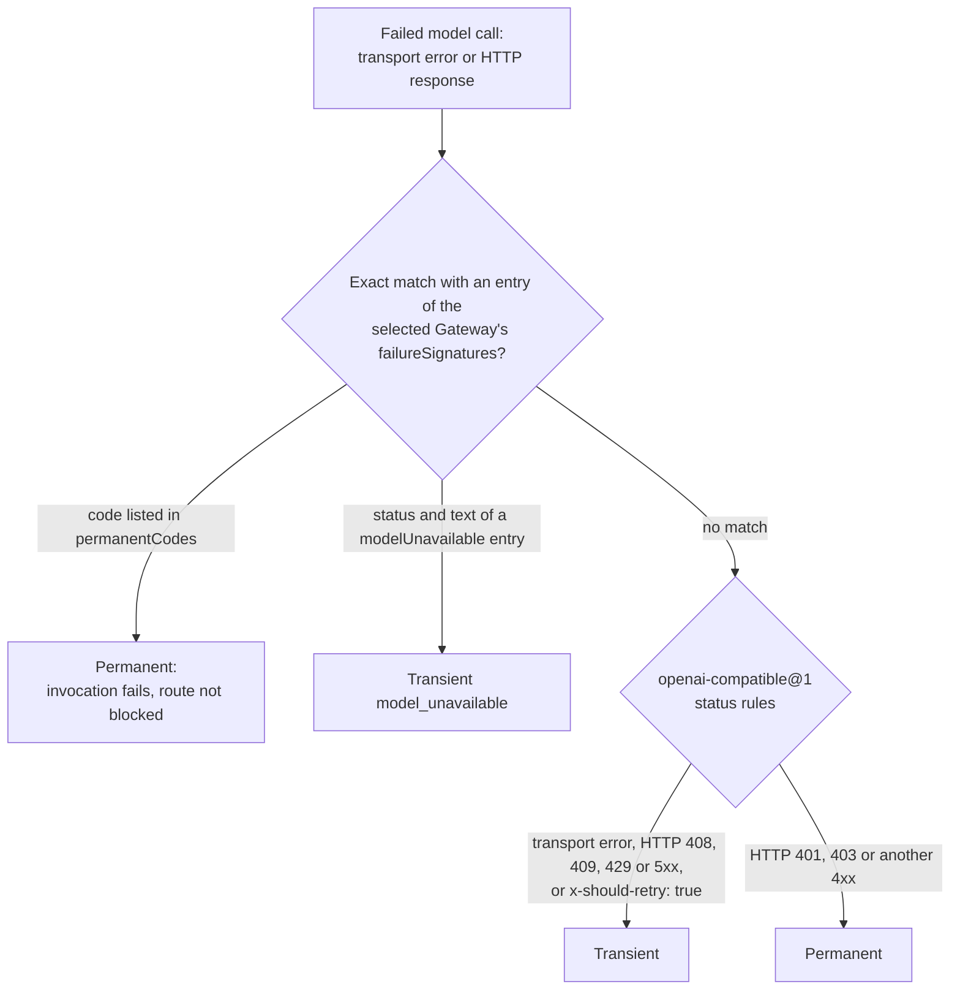

# Failure model

Requirement prefix: `FAIL` · [Specification index](../README.md)

## Purpose and scope

This document is the platform failure model and the failure registry. It owns:

- the outcome classes (transient, permanent, ambiguous, timeout and cancelled)
  that registry entries use to describe a failed external call or mutation;
- the two-layer classification of a failed LLM Gateway model call: the fixed
  `openai-compatible@1` status rules, the meaning of a Gateway's failure
  signatures, and the shared fixture that keeps the Server-side Planner and
  Runtime Worker classifiers identical;
- the deterministic failure mapping of Runtime label resolution and allocation
  adapter preparation, and the retryability of configuration mismatches;
- the failure registry: one row per external call or mutation, with its
  outcome classes and reconciliation, assembled from every domain document.

It leaves to other documents:

- the `failureSignatures` field schema, its bounds, its default and its
  forwarding to allocations: [Runtime configuration](../configuration/runtime-config.md);
- the Runtime Worker's classification of its final Gateway failure, the
  retryable flag it carries and Worker result failures:
  [Worker](../execution/worker.md);
- model-availability recovery, its recovery gate, leased probe and outcome
  reports: [Scheduler](../execution/scheduler.md);
- the failure behaviour, idempotent replay and reconciliation of each domain
  operation: the owning document, indexed under
  [Failure rules owned by other documents](#failure-rules-owned-by-other-documents);
- error and stop codes: [Errors](errors.md).

## Concepts

- **Outcome class**: the kind of result a failed call or mutation produced:
  transient, permanent, ambiguous, timeout or cancelled
  ([Outcome classes](#outcome-classes)).
- **Transient failure**: a failure classified as retryable because a later
  attempt may succeed.
- **Permanent failure**: a failure classified as non-retryable within its
  retryability scope.
- **Retryability scope**: what a classification is relative to: the same
  request, the same immutable configuration, or a fresh StageExecution.
- **Ambiguous outcome**: a result that does not prove whether a mutation
  committed or rolled back.
- **Status rules**: the fixed `openai-compatible@1` classification of
  transport errors, HTTP statuses and the `x-should-retry` hint.
- **Failure signature**: an exact provider-response match that an LLM Gateway
  declares in `failureSignatures`, either a `modelUnavailable` entry or a
  `permanentCodes` code.
- **`model_unavailable`**: the transient classification of a provider response
  that matches a `modelUnavailable` signature.
- **Shared classification fixture**: the test fixture both Gateway failure
  classifiers must agree on.
- **Boundary result**: the result that a label-resolution or
  adapter-preparation failure produces where it crosses a component boundary.
- **Preparation interruption**: a bounded failure of allocation preparation on
  the Runtime Agent in which no Planner starts and the whole reservation batch
  drains; its retryability depends on the cause (FAIL-R17, FAIL-R20, FAIL-R21).

Terms are defined once in the [glossary](../glossary.md).

## Model

### Outcome classes

| Class | Meaning |
| --- | --- |
| Transient (retryable) | A later attempt may succeed; malformed or missing Worker output, for example, is a retryable Worker failure because a fresh StageExecution may succeed ([WRK-R57](../execution/worker.md)). The classification travels as a retryable flag: for Worker failures, Workflow policy, not Runtime, decides whether the flag causes another attempt ([WRK-R20](../execution/worker.md)). |
| Permanent (non-retryable) | Repeating cannot succeed within the retryability scope: the same request ([CAN-R136](../tools/code-analysis.md)) or the same immutable configuration (FAIL-R20). A response whose provider error code is listed in the selected Gateway's `permanentCodes` fails the invocation (FAIL-R6). |
| Ambiguous | The caller cannot tell whether a mutation committed: a response lost after commit ([ART-R60](../artifacts/artifact-store.md)), an Artifact PUT transport failure or HTTP 5xx that does not prove rollback ([MEM-R69](../tools/memory.md)), an ambiguous Gateway or database result of a credential delete ([RCF-R53](../configuration/runtime-config.md)), or an ambiguous scan invocation outcome ([SCN-R207](../tools/scanners.md)). The owning document states how each is reconciled. |
| Timeout | A bound expired before an answer. An existing Stage deadline remains the outer authority over label resolution and adapter preparation (FAIL-R22). For model calls, HTTP 408 and transport timeouts are transient (FAIL-R2); a request the Gateway received but did not answer within the participant's own request timeout is reported `released`, is not resent and fails as transient ([SCH-R109](../execution/scheduler.md)). |
| Cancelled | The operation was stopped through Stage cancellation or abort. Existing Stage deadline, cancellation and abort bounds remain the outer authority over label resolution and adapter preparation (FAIL-R22); during model-availability recovery, cancellation and the admitted Stage wall-clock limit remain effective when manual retry reopens the window, and cancellation before a grant is known sends nothing ([SCH-R107](../execution/scheduler.md), [SCH-R110](../execution/scheduler.md)). |

### Gateway failure classification

A failed model call is classified first against the selected Gateway's
failure signatures, then by the protocol status rules.

## Requirements

### Gateway failure classification

**FAIL-R1.** Classification of a failed LLM Gateway model call has two layers:
the protocol's status rules and the provider-specific failure signatures of
the selected Gateway.

**FAIL-R2.** Status rules belong to the `openai-compatible@1` protocol and are
fixed in code. Transport errors, HTTP 408, 409, 429 and 5xx, and an explicit
`x-should-retry: true` hint are transient (FAIL-FAIL-1).

**FAIL-R3.** HTTP 401, 403 and every other 4xx status not listed in FAIL-R2
are permanent (FAIL-FAIL-1).

**FAIL-R4.** Provider-specific text belongs to the selected Gateway's
`failureSignatures`. The field's schema, bounds, default and forwarding to
allocations are owned by
[RCF-R19](../configuration/runtime-config.md) to
[RCF-R25](../configuration/runtime-config.md).

**FAIL-R5.** A `modelUnavailable` entry names an exact `status` plus either
`messageEquals` or `litellmWrapped` (the same text inside LiteLLM's observed
BadRequest wrapper). A response that matches an entry is classified as
transient `model_unavailable` (FAIL-FAIL-1).

**FAIL-R6.** `permanentCodes` name provider error codes. A response carrying a
listed code fails the invocation without blocking the route, whatever status
or hint accompanies it (FAIL-FAIL-1). Route blocking and recovery are owned by
[SCH-R105](../execution/scheduler.md) and
[SCH-R106](../execution/scheduler.md).

**FAIL-R7.** Signature matching is exact: substrings, prefixes and patterns are
never accepted, so arbitrary provider text cannot become an availability
failure.

**FAIL-R8.** Server-side Planners and Runtime Workers apply the same effective
set of failure signatures.

**FAIL-R9.** One shared fixture,
[`api/testdata/v1alpha1/gateway-failure-classification-cases.json`](../../../api/testdata/v1alpha1/gateway-failure-classification-cases.json),
keeps the Server-side Planner and Runtime Worker classifiers identical.

The Runtime Worker's classification of its final failure after the transport
attempt series, including the explicit `insufficient_quota`, `budget_exceeded`
and `context_length_exceeded` codes, is owned by
[WRK-R18](../execution/worker.md), as is the retryable flag it preserves under
`worker_gateway_unavailable` ([WRK-R19](../execution/worker.md)); the model
call and its transport attempt series are FAIL-WRK-1. Model-availability
recovery (the recovery gate, the leased probe, the `released` and `finished`
reports and the recording of observed outcomes) is owned by
[SCH-R105](../execution/scheduler.md) to
[SCH-R113](../execution/scheduler.md); the model call under the recovery gate
is FAIL-SCH-14.

### Runtime label resolution and adapter preparation

**FAIL-R10.** Failures of Runtime label resolution and adapter preparation map
deterministically to the boundary results in FAIL-R11 to FAIL-R19.

- **FAIL-R11.** An unknown Runtime label, a Run-selected Runtime-label conflict
  or an invalid referenced config at Run creation returns a public validation
  or conflict error, and no Run is created (FAIL-FAIL-2).
- **FAIL-R12.** An Agent-label conflict or a non-Agent-applicable assignment
  rejects the Operations mutation atomically (FAIL-FAIL-3).
- **FAIL-R13.** When a label or binding revision changes during reservation,
  the unprepared batch is released and placement retries the same
  StageExecution (FAIL-FAIL-4).
- **FAIL-R14.** When no live candidate supports the resolved adapter set, the
  result is temporary insufficient compatible capacity: the Stage remains
  `preparing` until its existing deadline or cancellation bound (FAIL-FAIL-4).
- **FAIL-R15.** When a candidate-specific Gateway or credential does not
  support the selected Worker ModelPolicy, that candidate edge is ineligible
  and other compatible capacity is considered (FAIL-FAIL-4).
- **FAIL-R16.** A missing or decryption-failed secret, a schema or digest
  mismatch, or an unsupported adapter in the AllocationSpec is a bounded
  preparation interruption: no Planner starts and the whole reservation batch
  drains (FAIL-FAIL-5).
- **FAIL-R17.** When a locally advertised adapter cannot construct because of a
  transient allocation resource error, the result is a retryable preparation
  interruption with the safe code `runtime_adapter_prepare_failed`
  (FAIL-FAIL-5).
- **FAIL-R18.** When a required proxy cannot service a Worker request, the
  result is the ordinary bounded model or tool failure, observable to Worker
  and Planner policy (FAIL-FAIL-6).
- **FAIL-R19.** An OTLP delivery, queue overflow or final flush failure is
  reflected in adapter metrics only; the semantic result and release continue
  (FAIL-FAIL-7).

**FAIL-R20.** Schema, digest, credential-kind and capability mismatches are
non-retryable for that immutable configuration (FAIL-FAIL-5).

**FAIL-R21.** A transient local construction failure is retryable
(FAIL-FAIL-5).

**FAIL-R22.** Existing Stage deadline, cancellation and abort bounds remain the
outer authority; label resolution introduces no unbounded wait (FAIL-FAIL-4,
FAIL-FAIL-5).

The Runtime Agent's validation of the exact typed settings against its frozen
capability snapshot, which yields the bounded preparation failure, and the
rule that remote OTLP or proxy availability is not a startup capability are
owned by [RTA-R42](../execution/runtime-agent.md) and
[RTA-R43](../execution/runtime-agent.md).

## Limits, failures and errors

Limits: this document owns no numeric limits.

Failure outcomes (registry [below](#failure-registry)):

- FAIL-FAIL-1: classification of a failed LLM Gateway response by the shared
  Server-side Planner and Runtime Worker classifiers (FAIL-R2, FAIL-R3,
  FAIL-R5, FAIL-R6); the model call and its transport attempt series are
  FAIL-WRK-1, and the model call under the recovery gate is FAIL-SCH-14.
- FAIL-FAIL-2: Runtime label resolution at Run creation (FAIL-R11).
- FAIL-FAIL-3: an Operations Agent-label assignment (FAIL-R12).
- FAIL-FAIL-4: reservation and placement of a StageExecution against its
  resolved labels, adapter set and Worker ModelPolicy (FAIL-R13 to FAIL-R15,
  FAIL-R22).
- FAIL-FAIL-5: allocation adapter preparation from an AllocationSpec
  (FAIL-R16, FAIL-R17, FAIL-R20 to FAIL-R22).
- FAIL-FAIL-6: a Worker request through a required HTTP proxy (FAIL-R18).
- FAIL-FAIL-7: OTLP telemetry delivery, queueing and final flush (FAIL-R19).

Error codes ([registry](errors.md)): `model_unavailable` (FAIL-R5) and
`runtime_adapter_prepare_failed` (FAIL-R17). `worker_gateway_unavailable`,
`worker_result_finalizer_failed` and `worker_output_limit_exceeded` are owned
by [Worker](../execution/worker.md); `memory_changed` by
[Memory](../tools/memory.md); `ArtifactConflict` by
[Artifact store](../artifacts/artifact-store.md).

### Failure rules owned by other documents

| Topic | Owner |
| --- | --- |
| Runtime Worker classification of the final Gateway failure after the transport attempt series; explicit quota, budget and context-length codes; no provider bodies or headers in errors | [WRK-R18](../execution/worker.md) |
| Worker result failures: retryable malformed or missing output, subtask mismatch, finalizer failure and exact-copy mismatch; `worker_output_limit_exceeded` on a `MAX_TOKENS` finish; non-retryable deterministic violations; Workflow policy owns any retry | [WRK-R19](../execution/worker.md), [WRK-R20](../execution/worker.md), [WRK-R57](../execution/worker.md) to [WRK-R59](../execution/worker.md) |
| Model-availability recovery: recovery gate, leased probe, idempotent failure reports, bounded automatic window and manual retry, abandoned attempts, `released` and `finished`, cancellation before a grant, Planner outcome recording, no ADK session restore after Runtime process loss | [SCH-R105](../execution/scheduler.md) to [SCH-R113](../execution/scheduler.md) |
| CAS response loss: a replayed consumed precondition fails with `ArtifactConflict` and the caller reconciles by reading | [ART-R60](../artifacts/artifact-store.md) |
| Memory append after an ambiguous Artifact PUT: same-bytes retry, exact-payload read-back, `memory_changed` | [MEM-R69](../tools/memory.md), [MEM-R70](../tools/memory.md) |
| LLM credential create: `Idempotency-Key`, durable operation record, startup recovery of the deterministic alias, unique-alias conformance, out-of-band drift | [RCF-R71](../configuration/runtime-config.md) to [RCF-R74](../configuration/runtime-config.md) |
| Credential-lifecycle barrier and an ambiguous credential delete that keeps the write intent prepared | [RCF-R52](../configuration/runtime-config.md), [RCF-R53](../configuration/runtime-config.md) |
| Typed-settings validation on the Runtime Agent as a bounded preparation failure; OTLP and proxy availability are not startup capabilities | [RTA-R42](../execution/runtime-agent.md), [RTA-R43](../execution/runtime-agent.md) |
| Workspace error retryability and error content | [WSP-R174](../tools/workspace.md), [WSP-R175](../tools/workspace.md) |
| Code-analysis error retryability, the child's memory-exhaustion exit status and error content | [CAN-R136](../tools/code-analysis.md) to [CAN-R138](../tools/code-analysis.md) |
| Project failures: owner-safe `404`, stale `If-Match`, atomic Run creation, idempotency replay and conflict, output publication, Project credentials | [PRJ-R4](../artifacts/projects.md), [PRJ-R5](../artifacts/projects.md), [PRJ-R25](../artifacts/projects.md), [PRJ-R26](../artifacts/projects.md), [PRJ-R99](../artifacts/projects.md), [PRJ-R58](../artifacts/projects.md), [PRJ-R85](../artifacts/projects.md), [PRJ-R86](../artifacts/projects.md) |
| Run and Project deletion failures and races, including a lost Project DELETE response | [DEL-R8](../artifacts/retention-and-deletion.md), [DEL-R10](../artifacts/retention-and-deletion.md), [DEL-R20](../artifacts/retention-and-deletion.md), [DEL-R21](../artifacts/retention-and-deletion.md), [DEL-R38](../artifacts/retention-and-deletion.md), [DEL-R47](../artifacts/retention-and-deletion.md), [DEL-R49](../artifacts/retention-and-deletion.md) |
| Owner Queue Pause racing normal Stage admission | [SCH-R156](../execution/scheduler.md) |
| Scan-plan persistence: deterministic create-only bindings and recovery of a lost write acknowledgement | [SCN-R200](../tools/scanners.md) to [SCN-R202](../tools/scanners.md) |
| Scan job recovery under a new Scheduler claim and after an ambiguous invocation outcome | [SCN-R206](../tools/scanners.md), [SCN-R207](../tools/scanners.md) |

## Invariants

These properties follow from the cited requirements, which are authoritative.

1. The Server-side Planner and Runtime Worker classifiers return the same
   classification for every case of the shared fixture (FAIL-R8, FAIL-R9);
   tests `TestClassifyGatewayFailureMatchesSharedFixture` in
   [`internal/gatewayrecovery/failure_test.go`](../../../internal/gatewayrecovery/failure_test.go)
   and `test_classification_matches_shared_fixture` in
   [`runtime/tests/test_gateway_error_classification.py`](../../../runtime/tests/test_gateway_error_classification.py).
2. Provider text becomes `model_unavailable` only through an exact
   `modelUnavailable` match (FAIL-R5, FAIL-R7).
3. A `permanentCodes` match never blocks the route (FAIL-R6).
4. Label resolution never waits beyond the Stage's deadline, cancellation and
   abort bounds (FAIL-R22).

## Failure registry

The registry has one row per external call or mutation whose failure
behaviour the specification defines. An entry ID is `FAIL-<area>-<n>`, where
`<area>` is the requirement prefix of the owning document; this document's
own entries are therefore `FAIL-FAIL-<n>`. Each row names the operation, its
outcomes by class (permanent, retryable, ambiguous, cancelled and timeout;
"not specified" where the owner says nothing) and the requirements that state
them. Domain documents cite the entry ID where they state the behaviour
instead of repeating it.

<!-- registry-table -->

| ID | Operation | Outcomes | Owner |
| --- | --- | --- | --- |
| `FAIL-API-1` | Public request with a JSON body over its bound or an Artifact over its 64 MiB limit | permanent: rejected with 413 request_too_large (or 413 artifact_too_large) and never reaches the handler's validation; retryable: not specified; ambiguous: not specified; cancelled: not specified; timeout: not specified | [public-api](../api/public-api.md) |
| `FAIL-API-2` | Cookie-authenticated non-safe request with a missing or mismatched Origin or X-CSRF-Token | rejected without side effect; client retry handling is UI-R34; retryable: not specified; ambiguous: not specified; cancelled: not specified; timeout: not specified | [API-R23](../api/public-api.md) |
| `FAIL-API-3` | PostgreSQL notification emitted by the workflow_run_events insert trigger | source transaction does not commit: the notification never becomes visible; lost or duplicated notification: bounded periodic catch-up from the subscription's last delivered sequence prevents any gap (the notification is only a coalescible wake-up hint); permanent: not specified; ambiguous: not specified; cancelled: not specified; timeout: not specified | [API-R55](../api/public-api.md) |
| `FAIL-API-4` | Live event delivery to a WebSocket client | duplicated delivery across disconnects: the client deduplicates by stream and cursor; gap: the client treats it as a resync, never inferring missing state; slow consumer filling the output queue: socket closed with WebSocket status 1013 (retryable overload semantics) instead of blocking Scheduler or Planner persistence, then the client resynchronizes; input or subscription limit exceeded: only that socket is closed or rejected; timeout: Server pings after 20 s without outbound traffic and closes a connection unanswered within 60 s; reconnect: bounded exponential backoff with full jitter from 500 ms up to 30 s, resuming from the last fully processed cursor, with explicit manual refresh always available; permanent: not specified; ambiguous: not specified; cancelled: not specified | [public-api](../api/public-api.md) |
| `FAIL-API-5` | Subscribing to or continuing the operations stream from a cursor | missed revision, unavailable cursor, cursor older than the latest 255 retained invalidations, or a Server restart that created another generation: resync_required, and the UI obtains another authenticated REST snapshot before continuing; permanent: not specified; ambiguous: not specified; cancelled: not specified; timeout: not specified | [public-api](../api/public-api.md) |
| `FAIL-ART-1` | CAS create or update of an artifact binding (write_artifact; private PUT with `If-None-Match: *` or a strong `If-Match`) | permanent: a stale expected revision returns ArtifactConflict; no new version is created; infrastructure never silently overwrites or semantically merges the winner; a write to a frozen binding returns artifact_frozen (409, retryable false) whatever its precondition. ambiguous: if the create or update committed but the response was lost, repeating the already-consumed precondition fails with ArtifactConflict and creates no new version; the caller reconciles through a current or exact read; the Server does not guess whether a different payload under the same stale precondition was an intended replay. retryable: a definite PostgreSQL transaction conflict (serialization failure or deadlock) returns 503 storage_transaction_conflict, retryable true, on the public and private APIs; the write committed nothing and the same precondition may be repeated. cancelled: not specified. timeout: not specified. | [artifact-store](../artifacts/artifact-store.md) |
| `FAIL-ART-2` | Workflow input initialization: recording the exact source version of every supplied input and forking it from UserScope or ProjectScope into RunScope `inputs/<slot>` | permanent: a failed initialization leaves no runnable partial RunArtifactSpace, and no Stage is selected until every fork succeeds and its exact source version is recorded. retryable: recovery retries the recorded exact source versions and never re-resolves a newer current UserScope or ProjectScope binding for the same Run. ambiguous: not specified. cancelled: not specified. timeout: not specified. | [artifact-store](../artifacts/artifact-store.md) |
| `FAIL-ART-3` | Allocation Artifact write through the private Artifact API after its StageExecution durably entered `finalizing` or `aborting` | permanent: rejected by the Server-side write fence even if the Worker or A2A Task has not stopped; waiting for allocation release is not conforming. Fence establishment is serialized with the complete Artifact mutation, so once the fence operation returns no earlier authorized write commits afterward. retryable: not specified. ambiguous: not specified. cancelled: not specified. timeout: not specified. | [artifact-store](../artifacts/artifact-store.md) |
| `FAIL-ART-4` | Applying a StageResult's Workflow-output mapping to `outputs/<slot>` | cancelled: if Run cancellation committed first, the StageResult may still be accepted for audit, but its Workflow-output mapping is not applied and it creates no Run output binding. permanent: not specified. retryable: not specified. ambiguous: not specified. timeout: not specified. | [ART-R91](../artifacts/artifact-store.md) |
| `FAIL-ART-5` | Concurrent first writes to the same scope, and concurrent writes of identical content to different bindings | contention: both writers observe the committed scope or blob after a uniqueness wait and do not return a false CAS conflict. permanent: not specified. retryable: not specified. ambiguous: not specified. cancelled: not specified. timeout: not specified. | [ART-R61](../artifacts/artifact-store.md) |
| `FAIL-ART-6` | StageResult acceptance, Workflow-output mapping, required-output freezing and WorkflowRun `running -> succeeded` (RunStore and ArtifactRegistry) | atomic: all steps are one PostgreSQL transaction, and a partially mapped terminal Run is never exposed; any future storage split must keep this contract. permanent: not specified. retryable: not specified. ambiguous: not specified. cancelled: not specified. timeout: not specified. | [ART-R92](../artifacts/artifact-store.md) |
| `FAIL-ART-7` | Paged private Artifact listing (`GET /private/v1/allocations/{allocation_id}/artifacts` with `limit` and an optional `cursor`; list_artifacts) | permanent: a missing or out-of-range `limit`, a malformed or non-canonical `cursor`, a cursor from another Namespace than the `namespace` filter, or a `cursor` combined with `namePrefix` returns 400 `invalid_request`, retryable false, before storage is read. concurrent change: keyset pagination returns every binding present for the whole traversal exactly once and never repeats one; a binding created or deleted during the traversal may or may not appear. retryable: a storage failure returns retryable `internal_error`; the read has no side effects and the same cursor may be repeated. ambiguous: not applicable, the listing is read-only. contract violation: the Runtime rejects a page over its limit, a short page with a `nextCursor`, a ref from another Namespace than requested, a versioned ref or a model-hidden binding as ArtifactTransportError instead of filtering it. cancelled: not specified. timeout: the Runtime Artifact client request timeout. | [artifact-store](../artifacts/artifact-store.md) |
| `FAIL-ASC-1` | Submission of a preparation attempt's Run for a prepare role | permanent: a non-retryable failure or exhausted attempts set the role to failed; an exhausted role or non-time budget closes admission, drains, and fails the Audit with preparation_failed or the budget's own reason. retryable: a known failure (failed authoritative Run, invalid or missing required output) starts a new attempt with a new (audit_id, workflow_role, role_attempt) identity if both the per-role maxRunAttempts and the cumulative Run budget allow. ambiguous: a lost submit acknowledgement never justifies another Run; recovery uses the same intent, Run and receipt with no speculative retry, and a process restart reuses the existing submission key. cancelled: Cancel closes admission, cancels and drains owned Runs, collects receipts, releases holds, then enters cancelled; cancellation and deletion never start dependent preparation. timeout: the Audit deadline pauses with deadline_exhausted while existing Runs drain and collect; child deadlines remain independent; first-Round acceptance waits for resumed admission. | [ASC-R31](../audits/scans.md) |
| `FAIL-ASC-2` | Collection of a preparation attempt's outputs and their atomic acceptance | permanent: exhausted attempts or a non-retryable failure leave the role `failed` with no accepted outputs; the failed attempt's diagnostic evidence remains in its receipt. retryable: an invalid or missing required output may consume another bounded attempt: a new role attempt if both per-role and cumulative budgets allow. ambiguous: uncertain collection never justifies another Run; collection I/O uncertainty stays in recovery until resolved; recover the same intent/Run/receipt; no speculative retry. cancelled: Cancel cancels and drains owned Runs and collects their receipts before releasing holds and entering cancelled; cancellation and deletion never start inventory or dependent preparation. timeout: pause or deadline may still collect completed outputs. On success all profile-mapped outputs are retained and accepted atomically, at most one attempt per role, and reused on resume, restart and later Rounds. | [ASC-R33](../audits/scans.md) |
| `FAIL-ASC-3` | Inventory phase: building the generated inventory and accepting the first Round | permanent: empty or invalid generated inventory fails the Audit with empty_inventory or invalid_inventory after dispatch closes and children drain, creating no Round, items, coverage success or report; for a direct-input profile empty or invalid inventory rejects start before the baseline transaction commits. retryable: not specified. ambiguous: not specified; worklist, tasks, first Round, initial-inventory link and coverage rows commit atomically and there is no partially accepted first Round. cancelled: cancellation and deletion never start inventory. timeout: during pause or deadline, first-Round acceptance waits for resumed admission. | [ASC-R48](../audits/scans.md) |
| `FAIL-ASC-4` | Decoding the scan settings artifact (scanplan.DecodeAuditScanSettings) and building the scan inventory (auditdomain.BuildOpenAPIScanInventory) | permanent: unknown fields, case aliases, duplicate keys, null structural fields and unsafe numbers are rejected with fixed diagnostics; missing operations or malformed settings reject the inventory atomically; missing values require a corrected new Audit because resume cannot rewrite the accepted input snapshot; correctly formed settings with unavailable path, body or authentication data or SQLMap parameters yield non-runnable items with gaps. retryable: not specified. ambiguous: not specified. cancelled: not specified. timeout: not specified. | [ASC-R109](../audits/scans.md) |
| `FAIL-ASC-5` | Pre-dispatch reproduction of the accepted scan preparation (PrepareOpenAPIScanTask) | permanent: a different operation, request, target, parameters, preparation identity or gap set fails the check. retryable: not specified. ambiguous: not specified. cancelled: not specified. timeout: not specified. | [ASC-R110](../audits/scans.md) |
| `FAIL-ASC-6` | Scanner execution in an Audit OpenAPI scan check Run | permanent: not specified separately from known failures. retryable: failures known to precede scanner invocation and known failed executions may use the bounded retry policy, each execution attempt recorded and charged to its budgets; no blanket one-attempt limit and ordinary Workflow retries stay enabled. ambiguous: a lost result after possible scanner execution must not silently become a fresh scan solely because collection sees a failed Run; the attempted execution and its gap are retained; automatic handling must be explicit in the pinned execution policy before activation; recovery reads the retained auditTask declaration to select the scanner's journal so surrounding Stage outcomes are not mistaken for scan attempts; a committed successful scan result is reused during recovery. cancelled: not specified. timeout: not specified. | [ASC-R141](../audits/scans.md) |
| `FAIL-ASC-7` | Trusted result assembly and Audit package publication after scanner completion | permanent: reports are retained for failures as well as for successful execution. retryable: collection, read and publication retries reuse the committed successful scan result and do not rerun the scanner. ambiguous: the interruption between scanner completion and package publication must be tested; the committed result is reused during recovery. cancelled: not specified. timeout: not specified. | [ASC-R145](../audits/scans.md) |
| `FAIL-AUD-1` | Read a persisted AuditProfile snapshot or Audit baseline at start, recovery or resume | permanent: a profile snapshot that omits role kinds or uses the former digest without role kinds fails validation at start and recovery; a baseline without the standards array or with null is invalid and cannot resume; the reader never infers roles, consults the current catalog or rewrites the snapshot. retryable: not specified. ambiguous: not specified. cancelled: not specified. timeout: not specified. | [audits](../audits/audits.md) |
| `FAIL-AUD-2` | Load and seed the curated Audit standard catalog from configs/audit-standards at Server startup | permanent: duplicate (scheme, version), unknown fields, duplicate JSON keys, symlinks, extra or archive-traversal members, excessive data, dangling mappings or unsupported license/disclosure pairs reject the load; the complete source tree is validated before any binding is written, so no partial catalog is seeded; a different current media type or digest for an existing identity is fatal catalog drift, never an implicit new revision. retryable: not specified. ambiguous: not specified. cancelled: not specified. timeout: not specified. | [audits](../audits/audits.md) |
| `FAIL-AUD-3` | Validate an AuditProfile's inventory.standardSelection at Server startup | permanent: a missing, duplicate, dangling or wrong-version selection fails Server startup before an Audit can start. retryable: not specified. ambiguous: not specified. cancelled: not specified. timeout: not specified. | [AUD-R71](../audits/audits.md) |
| `FAIL-AUD-4` | POST /v1/audits/{auditId}/start: pin the baseline and enter active | permanent: missing Server capabilities fail with audit_profile_unsupported; a disabled-finding profile that can emit proposals, or active-check capabilities under activeChecks: prohibited, are rejected; an invalid deadlineSeconds (outside 0..31,536,000, non-integer or explicit null) is invalid; a confirmed missing or mismatched pinned Workflow credential is a 400 validation error; the baseline freezes in one transaction. retryable: a Workflow credential lookup that cannot confirm presence or absence keeps its cause and commits nothing: credential recovery in progress returns 503 credential_recovery_required, a definite transaction conflict 503 storage_transaction_conflict after the start replay check, and any other storage failure a retryable 500 (RCF-R47). ambiguous: the request requires If-Match and Idempotency-Key; the optional override is part of the request digest, so reusing an idempotency key with a changed override is the permanent idempotency_conflict (API-R69), and omission and zero are distinct requests. cancelled: not specified. timeout: not specified. | [audits](../audits/audits.md) |
| `FAIL-AUD-5` | Retry a check item after an attempt fails | retryable: a bounded retry creates a new AuditExecution and AuditExecutionItem for every retried item and preserves every earlier receipt; the Controller may regroup ready retries without changing item identity or attempt history. permanent: not specified here (collection dispositions are in audits/execution.md). ambiguous: not specified. cancelled: not specified. timeout: not specified. | [AUD-R112](../audits/audits.md) |
| `FAIL-AUD-6` | Import an Audit package | permanent: unknown manifest fields, schema versions or package kinds are rejected; external data that is not materialized is rejected; a member whose declared size or SHA-256 digest does not match is never exposed, because both are checked before any bytes are exposed; packages above the hard limits are not accepted. retryable: not specified. ambiguous: not specified. cancelled: not specified. timeout: not specified. | [audits](../audits/audits.md) |
| `FAIL-AUD-7` | Validate and accept a worklist manifest as a Round | permanent: duplicate keys, missing or duplicate ordinals, unknown roles, absent package members, dependency gaps or limit violations reject the whole manifest atomically before the first child Run is created; the normalized manifest and its Round and Items commit together or not at all. retryable: not specified. ambiguous: not specified. cancelled: not specified. timeout: not specified. | [audits](../audits/audits.md) |
| `FAIL-AUD-8` | Generate an openapi-operations@1 inventory from a pinned OpenAPI document | permanent: a remote ref needed to resolve an enumerated Path Item, operation, parameter, security declaration or schema dependency rejects the entire inventory before dispatch; a number outside the exact integer range rejects the document; remote refs only in unsupported callbacks, webhooks or other non-selected surfaces are not followed and become named coverage gaps. retryable: not specified. ambiguous: not specified. cancelled: not specified. timeout: not specified. | [audits](../audits/audits.md) |
| `FAIL-AUD-9` | Run an Audit against its non-time budgets and optional time limit | permanent (non-time budget exhausted): dispatch closes and bounded finalization with explicit gaps is attempted; inability to form a structurally valid report yields failed, and an active Audit enters failed only after dispatch is closed and owned Runs are terminal and released. timeout (Audit time limit reached): admission pauses with stop reason deadline_exhausted, the dispatch hold is preserved and existing Runs drain and collect; Resume can restore the allowance. retryable: not specified. ambiguous: not specified. cancelled: not specified. | [audits](../audits/audits.md) |
| `FAIL-AUD-10` | POST /v1/audits/{auditId}/resume: return a paused Audit to active | permanent: refused unless the Audit is paused with an active Project, a pinned baseline, a current Round or persisted preparation/inventory phase and no frozen report candidate; terminal Audits never resume; a baseline without the standards array cannot resume. retryable: not specified. ambiguous: the request requires If-Match and Idempotency-Key; reusing an idempotency key with a changed override is the permanent idempotency_conflict (API-R69), and omission and zero are distinct requests. cancelled: not specified. timeout: not specified. | [audits](../audits/audits.md) |
| `FAIL-AUD-11` | Human report acceptance decision while the Audit is waiting_review | success (accepted): publishes exactly the frozen descriptors. permanent (rejected): the Audit fails. timeout (request expiry): the Audit fails; the decision uses its own expiry, not the Audit admission clock. cancelled: cancel and delete remain available during the decision. retryable: not specified. ambiguous: not specified. While the decision is pending, new finding reviews, finding imports and pause/resume are fenced so the reviewed bytes cannot drift. | [audits](../audits/audits.md) |
| `FAIL-AUX-1` | Child Run submission through a durable submission intent and the trusted Run Service | permanent: not specified. retryable: crash before child Run creation -> the durable intent retries; replay never consumes budget twice. ambiguous: Run created but response lost -> the same submission key returns the same associated Run; the association is committed with Run creation, so no label-only orphan exists. cancelled: cancel racing submission -> the Audit fence chooses and any committed Run joins the cancellation set; Project delete racing start/dispatch -> the Project deleting fence rejects new work. timeout: not specified. | [AUX-R26](../audits/execution.md) |
| `FAIL-AUX-2` | Collection and result import of a terminal child Run execution | permanent: invalid or incomplete result set -> one durable invalid receipt, no member accepted partially, each member requeued or settled under its remaining attempt policy; retained revisions over maxEvidenceBytes (including after a concurrent writer) -> non-retryable invalid-result receipt with evidence-budget-exhausted that links and charges nothing, never leaving the execution collecting; unvalidatable trusted data or content-only Store rejection -> collection-contract-invalid (REV-R154, FAIL-REV-9); import failure never rewrites Run success. retryable: crash after terminal Run before collection -> reconcile records the terminal version and one receipt; partial package materialization -> staging stays invisible and retry completes or records one invalid receipt; members retryable within policy return to ready. ambiguous: terminal event lost, duplicated or reordered -> Controller reads durable Run state and collects once. cancelled: cancelled Run -> execution-cancelled receipt and cancelled items settle. timeout: not specified. | [AUX-R33](../audits/execution.md) |
| `FAIL-AUX-3` | Audit-side retention of an Audit child Run's committed proposals and evidence during collection | permanent: proposal or evidence revision missing or no longer matching its receipt -> recorded as rejected and collection continues with the others; unexpected proposal receipt under a profile with findingConfirmation: disabled -> collection contract-invalid rather than admitting it (AUX-R92). retryable: the transfer is idempotent. ambiguous: not specified. cancelled: not specified. timeout: a collection attempt that reaches its deadline keeps the holds it committed and the next attempt retains only the rest. | [AUX-R49](../audits/execution.md) |
| `FAIL-AUX-4` | Controller claims and reconcile mutations | permanent: not specified. retryable: lost, duplicated or reordered wake hints cannot prevent progress; periodic reconciliation continues. ambiguous: a claim alone does not authorize stale commits, every mutation checks epoch or revision plus uniqueness constraints; two Controllers starting assessment -> unique execution identity admits one. cancelled: not specified. timeout: not specified beyond the claim's expiry/epoch fencing. | [AUX-R74](../audits/execution.md) |
| `FAIL-AUX-5` | Next-Round building from retained proposals | permanent: deterministic next-Round validation failure (including digest mismatch) -> dispatch closes and the Audit moves to finalizing with next_round_invalid; unreachable preparation state -> finalizes with next_round_contract_invalid, stop reason names the invariant, full error logged; proposal whose first unscheduled check cannot fit an empty Round -> skipped, and when only such proposals remain the Audit finalizes with proposal_inventory_limit_exceeded. retryable: transient failures, including failed blob storage I/O. ambiguous: not specified. cancelled: not specified. timeout: not specified. | [AUX-R66](../audits/execution.md) |
| `FAIL-AUX-6` | Change of the global maxConcurrentRuns setting against Audit dispatch reservations | ordering: the settings row and a dispatch reservation have a defined PostgreSQL ordering. decrease below an Audit's outstanding count: no child Run is cancelled and the Audit submits nothing until the count drains below the new window. increase: may wake Audit reconciliation; periodic reconciliation remains authoritative. permanent: not specified. ambiguous: not specified. cancelled: not specified. timeout: not specified. | [AUX-R6](../audits/execution.md) |
| `FAIL-AUX-7` | Worker death after a finding call in an Audit child Run | crash: a committed proposal receipt remains; an uncommitted proposal does not. permanent: not specified. retryable: not specified. ambiguous: not specified. cancelled: not specified. timeout: not specified. | [AUX-R76](../audits/execution.md) |
| `FAIL-AWC-1` | Placement and direct preparation of an allocation whose AllocationSpec pins a completion contract | permanent: placement requires a Runtime that advertises the contract in capabilities.completionContracts plus the selected toolset capability and fails closed otherwise; direct prepare rejects unknown or unsupported contracts; retained snapshots selecting audit-results@1 cannot be placed and must be recreated with the current catalog. retryable: retry and placement preserve the pinned choice and never downgrade silently to ordinary completion on an older Runtime. ambiguous: not specified. cancelled: not specified. timeout: not specified. | [AWC-R25](../audits/worker-completion.md) |
| `FAIL-AWC-2` | submit_check_result changes to the invocation-local result collection | permanent: an invalid call is rejected before the collection changes, consumes no item revision, never erases an earlier valid result and remains a real failed tool call; different content without the current expected_revision conflicts; a stale revision fails without mutation; a batch with a changed existing member conflicts and leaves the entire collection unchanged; submissions after the seal are rejected. retryable: identical canonical content repeated without a revision returns the existing receipt without incrementing it; a retry of an applied explicit update returns its receipt only when expected revision and content match that immediately preceding update; repeats and corrections consume normal tool budget. ambiguous: not specified. cancelled: cancellation discards unsealed partial data. timeout: not specified. | [worker-completion](../audits/worker-completion.md) |
| `FAIL-AWC-3` | Completion gate at a normal model finish with an incomplete collection | retryable: after at most two reminders the strategy returns retryable audit_result_incomplete with safe counts and missing identifiers; Stage and Audit policies decide whether a new attempt is submitted. permanent: hard budget, deadline, cancellation, write-fence and sandbox failures take precedence, grant no further reminder and trigger no publication; continuation cannot obtain capacity beyond model or tool limits. ambiguous: not specified. cancelled: a failed or cancelled main invocation cannot be converted into success merely because its collection is full; unsealed partial data is discarded. timeout: the monotonic Stage/Planner deadline bounds the whole invocation, is not reset by continuation and its failure takes precedence. | [worker-completion](../audits/worker-completion.md) |
| `FAIL-AWC-4` | Deterministic publication of the check-results package to the Server-declared result binding with create-only CAS | permanent: size and input-contract errors are non-retryable; different existing content is audit_result_publication_conflict, non-retryable for this contract and never overwritten; authentication, authorization and write-fence rejection are terminal for this publication and do not become transport retries; failures are translated at the Audit boundary and not recorded as LLM errors. retryable: transport errors are retryable and permit reconciliation by read-back and at most one additional write of the identical sealed bytes (at most two writes and two read-backs in total), with no model repair or re-execution. ambiguous: on a create conflict or ambiguous transport outcome a bounded exact-content read-back may recognize the same bytes and media type and return the exact revision. cancelled: if cancellation wins after the write the artifact may remain for diagnostics but implies neither Run success nor accepted Audit coverage. timeout: each request has its own requestTimeoutSeconds budget; all attempts stay under the Planner deadline and a cap of four request budgets plus one second; if success cannot be established the result is audit_result_publication_failed. | [worker-completion](../audits/worker-completion.md) |
| `FAIL-AWC-5` | Publication by a later Stage attempt in the same Run when a failed attempt already wrote the Run-scoped result binding | permanent: the later attempt first collects and seals its own complete set; different bytes, including changed proposal invocation identities, fail with audit_result_publication_conflict; existing bytes never seed the new collector; no automatic revision overwrite. retryable: equal bytes may be recognized; transparent recovery by Stage retry after publication is not promised; a fresh Audit-level retry creates a new child Run with a fresh result binding. ambiguous: not specified. cancelled: not specified. timeout: not specified. | [AWC-R97](../audits/worker-completion.md) |
| `FAIL-AWC-6` | Cancellation or session cleanup failure after the check-results ZIP was written | cancelled: completion diagnostics change to failed, preserving the recorded count and leaving the existing output intact; the artifact may remain for diagnostics without implying Run success or accepted Audit coverage; publishing these late facts does not complete the invocation a second time. permanent: not specified. retryable: not specified. ambiguous: not specified. timeout: not specified. | [AWC-R120](../audits/worker-completion.md) |
| `FAIL-AWC-7` | Decoding the `completion` object of a Runtime final or abort report or of live Worker State | permanent: an unknown kind or phase is malformed like any other invalid object and rejects the containing message as a whole, never only the object: a final or abort response is an invalid lifecycle response, the allocation gets the incomplete placeholder report with allocation_report_unavailable and the Stage result and termination are unchanged; a State read fails with non-retryable worker_state_response_invalid and the Planner State projection answers non-retryable worker_state_unavailable; the Runtime State endpoint never serves such a snapshot and answers 503 agent_state_unavailable. retryable: not specified. ambiguous: not specified. cancelled: not specified. timeout: not specified. | [AWC-R115](../audits/worker-completion.md) |
| `FAIL-BLB-1` | Acquire a transfer slot for a full-payload transfer, and client socket I/O while the slot is held | permanent: not specified; retryable: when every slot is taken the request fails promptly with a retryable capacity error, with no unbounded queue of bodies; ambiguous: not specified; cancelled: transfers honour cancellation; timeout: every client socket read or write while a slot is held has its own deadline; socket deadlines never cancel storage work, which has its own budget; a response that no longer needs the payload is written only after the slot is released | [BLB-R25](../artifacts/blob-storage.md) |
| `FAIL-BLB-2` | filesystem payload write: staging file, atomic publication of the upload candidate, then the short PostgreSQL registry transaction | permanent: if the registry transaction fails, the candidate is left for offline cleanup; retryable: not specified; ambiguous: if the outcome is ambiguous or the commit acknowledgement is lost, the candidate is left for offline cleanup and never eagerly unlinked; CAS response-loss behaviour is as defined in artifact-store.md; definite commit: unused deduplication candidates are best-effort removed, and losing concurrent writers' files are best-effort removed; cancelled: honoured, and not treated as absence of content; timeout: not specified | [BLB-R34](../artifacts/blob-storage.md) |
| `FAIL-BLB-3` | Verify an existing filesystem object (size and digest) before deduplicating against it | missing content, or a different unverified key installed by a concurrent writer: the complete upload candidate is atomically attached instead, existing revisions with the same SHA read the replacement bytes, and the displaced generation is kept for offline cleanup; corruption, permission or I/O errors and cancellation: not treated as absence, so no replacement; retryable: not specified; ambiguous: not specified; timeout: not specified | [BLB-R41](../artifacts/blob-storage.md) |
| `FAIL-BLB-4` | Unlink filesystem objects after the logical deletion is committed | permanent: the unlink failure is logged with a bounded reason, does not block the completed Run, Project or Audit deletion, and leaves a physical orphan for offline cleanup; retryable: not specified; ambiguous: not specified; cancelled: not specified; timeout: not specified | [BLB-R72](../artifacts/blob-storage.md) |
| `FAIL-BLB-5` | Read referenced payload content, including a read concurrent with registry deletion | permanent: missing or corrupt content produces an explicit non-success Artifact error, never an empty successful response, silent revision replacement or automatic Git refetch; prior Run outcomes, finding ratings and historical reports are not rewritten; concurrent deletion: the read either obtains its file handle or returns an explicit missing-content error, and a knowingly partial or mismatched successful payload is never delivered; retryable: not specified; ambiguous: not specified; cancelled: not specified; timeout: not specified | [BLB-R46](../artifacts/blob-storage.md) |
| `FAIL-BLB-6` | Process, pod, storage or volume failure affecting filesystem payloads | permanent: may leave a physical orphan or lose bytes; losing a filesystem volume (including an ephemeral emptyDir) may lose Artifact bytes even though metadata remains in PostgreSQL, and those payloads are reported as missing content; the flushes in the write path keep an operating-system crash on a durable volume from leaving a committed reference to an empty or unpublished object, but do not make an ephemeral volume durable (BLB-R63); no power-loss durability, automatic reconstruction or background reconciliation; a re-upload creates a new revision under normal CAS and, apart from the same-digest replacement of BLB-R41, cannot silently repair an old exact reference; retryable: not specified; ambiguous: not specified; cancelled: not specified; timeout: not specified | [BLB-R6](../artifacts/blob-storage.md) |
| `FAIL-BLB-7` | Payload backend validation at Server startup (filesystem probe and persisted backend-kind check) | permanent: an unknown backend fails validation; s3 returns an explicit unsupported-backend error; a read-only or inaccessible filesystem path fails startup; postgresql rejects a supplied blob path; a backend-kind mismatch fails explicitly and existing blobs are not copied or reinterpreted; selection never falls back to another backend; retryable: not specified; ambiguous: not specified; cancelled: not specified; timeout: not specified | [BLB-R10](../artifacts/blob-storage.md) |
| `FAIL-BLB-8` | Offline orphan cleanup with apply | interrupted: the command may need to be rerun, and no durable cleanup queue exists; missing referenced objects are reported without deleting their metadata; permanent: not specified; retryable: not specified; ambiguous: not specified; timeout: not specified | [BLB-R59](../artifacts/blob-storage.md) |
| `FAIL-CAN-1` | Continuing a code-analysis collection query with a cursor | workspace changed: retryable code_analysis_workspace_changed; the caller restarts the query without the cursor and two trees are never combined. Invalid, malformed, wrong-operation, cross-tool or cross-allocation cursor: fails closed with code_analysis_cursor_invalid (retryability not specified). Ambiguous, cancelled and timeout: not specified. | [CAN-R32](../tools/code-analysis.md) |
| `FAIL-CAN-2` | Trailmark child graph build or query over the framed local protocol | Any timeout, malformed frame, unexpected exit or memory-limit termination kills and reaps the complete child. Permanent: deterministic capacity failures, including request-time memory exhaustion reported by the child (exit status 71 when it cannot write that response), are non-retryable code_analysis_capacity_exceeded. Retryable: a definitely-unprocessed read-only operation may be replayed once after one clean child start/rebuild; unexpected child failure, including an unrecognized child death, is returned as retryable code_analysis_engine_failed only after that recovery attempt has failed. Ambiguous: none; the operation is read-only with no mutation or external side effect to reconcile. Cancelled: code_analysis_cancelled when the invocation is cancelled while an off-loop operation is being joined; cancellation during mirror materialization waits for it, registers any written mirror with the session and then propagates as cancellation, not a Toolset error. Timeout: code_analysis_build_timeout or code_analysis_query_timeout; an operation that exceeded its deadline is not automatically repeated and the next model call may cause a fresh build. | [CAN-R83](../tools/code-analysis.md) |
| `FAIL-CAN-3` | Graph child termination and mirror cleanup at allocation teardown | Graceful Worker terminalization: Runtime closes the session and reaps the child; the later release idempotently confirms the teardown and removes residual bounded state. Abort, lost lease, failed prepare or process shutdown: cancel analysis, kill and reap the child and remove the mirror before the slot can become reusable. Permanent: failure to confirm child termination or mirror cleanup leaves the Runtime fenced and it cannot return an apparently clean slot. Cancelled: an in-progress mirror materialization is awaited and its written mirror registered with the session before cancellation propagates. Retryable, ambiguous and timeout: not specified. | [CAN-R88](../tools/code-analysis.md) |
| `FAIL-CAN-4` | Annotation mutation: single-line insertion through WorkspaceWriter.update_text | Retryable: another writer committed between the read and the locked byte comparison, giving taint_annotation_workspace_changed; the change is never overwritten and there is no non-atomic read-then-write fallback. Conflict: the same @trace target with a different canonical body returns taint_annotation_conflict (retryability not specified). Ambiguous: a lost tool response after a committed write is reconciled by replay, which finds the exact canonical annotation in the adjacent block and returns changed=false. Cancelled: cancellation while Tree-sitter runs waits for the bounded worker thread before releasing session ownership and then reports cancellation (taint_annotation_cancelled, retryable); the commit is short and non-awaiting under the workspace lock, so cancellation happens before it or after a complete commit, never in the middle. Timeout: not specified. | [CAN-R124](../tools/code-analysis.md) |
| `FAIL-CAT-1` | Load and resolve the configuration set (startup load of both roots, and validation of the complete union during managed publication) | permanent: any invalid manifest, instruction ref or cross-document selector, an unknown or ambiguous selector, or a duplicate lookup key or instruction path invalidates the complete set, and no partially resolved in-memory configuration set is published; retryable: not specified; ambiguous: not specified; cancelled: not specified; timeout: not specified | [CAT-R24](../configuration/catalog.md) |
| `FAIL-CAT-2` | Managed publication of a ModelPolicy or LLMGatewayConfig version (managed-root file write by temporary file and hard link, then in-memory snapshot swap) | permanent: validation failure publishes nothing (all-or-nothing); the same identity with different normalized content conflicts; configuration drift (the reloaded roots differ from the loaded snapshot by an operator-root edit, addition or removal, or by a managed file the Server did not write) fails every publication with 409 configuration_drift, retryable false, and publishes nothing; publication resumes without a restart once the roots match the loaded snapshot again, or after a restart that loads the roots as they are (CAT-R74); retryable: retrying an identical identity and body under the required Idempotency-Key returns the already published version; ambiguous: no successful response is returned before the file and the in-memory snapshot are both published, a crash after file publication but before the snapshot swap is recovered by the ordinary startup load, a .tmp name left by a crash between link and unlink is ignored by that loader, a failure after the durable link in a running Server (temporary-name removal or directory flush) returns an error without swapping the snapshot and the next publication adopts that version and binds its Idempotency-Key as the startup load would (CAT-R74), and PostgreSQL audit loss cannot remove or reinterpret the YAML version; cancelled: not specified; timeout: not specified | [CAT-R58](../configuration/catalog.md), [CAT-R74](../configuration/catalog.md) |
| `FAIL-CTL-1` | Runtime Agent registration and re-registration | permanent: a retry that reuses the instance_id with a different CapabilitySnapshot is rejected; a request for a bound instance_id or allocation arriving through a different CA-valid principal is rejected; a second live instance_id of the same principal is rejected; missing required or unknown fields fail strict validation; a value outside the registration bounds that Operations shows (LIM-CTL-9) fails validation; a process with no passing WorkerRuntime or SandboxProfile, or whose Toolset capability snapshot is outside LIM-CTL-9, does not register an idle slot. retryable: registration with the same instance_id is idempotent; a fenced agent continues registration retries. ambiguous: a lost registration response is retried with the same instance_id and byte-identical snapshot. cancelled: not specified. timeout: the reregister heartbeat response never renews the Runtime watchdog, so if registration keeps failing the old local deadline still expires. | [CTL-R12](../execution/control-plane.md) |
| `FAIL-CTL-2` | Heartbeat request/ack/echo round trip | permanent: not specified. retryable: the agent keeps sending heartbeats with a strictly increasing sequence that is not reset across reconnects. ambiguous: when responses are lost the echoed ack stops advancing; duplicate, delayed or unknown acks, and acks issued by a former Control Plane process, never extend the Control Plane lease or the Runtime watchdog. cancelled: not specified. timeout: both sides expire the confirmed control lease (see FAIL-CTL-8). | [CTL-R44](../execution/control-plane.md) |
| `FAIL-CTL-3` | Stage preparation (prepare_stage: placement, reservation, Runtime initialization) | permanent: not specified as a separate class; after a failed batch is cleared Workflow policy decides whether to create a new attempt. retryable: no complete matching returns temporary insufficient compatible capacity (StageExecution stays preparing, no slot reserved, Scheduler bounded backoff); any initialization failure or incompatible Agent Card drains/releases every allocation of the batch, including ready ones, and the StageExecution moves through aborting with a retryable interrupted StageTermination whose code identifies the infrastructure error. ambiguous: a retry after a lost response observes the same in-memory reservation/preparation operation (idempotent per stage_execution_id) and cannot create a second Worker set. cancelled: Run cancellation bounds the capacity wait. timeout: an initialization timeout is handled as a failure; the Stage deadline bounds the capacity wait; when the abort deadline expires the execution becomes terminal. Loss of the Control Plane process uses the interruption and cleanup recovery path. | [CTL-R94](../execution/control-plane.md) |
| `FAIL-CTL-4` | Allocation-pinning transaction (label/binding revision verification and durable config snapshot) | permanent: not specified. retryable: if any revision changed or the recomputed settings no longer fit the selected adapter capabilities, Control Plane releases the unprepared reservation and retries placement for the same StageExecution; concurrent Agent-label or binding mutations serialize on the locked rows (pinning first: mutation affects the next allocation; mutation first: this allocation observes it). ambiguous: not specified; no AllocationSpec is sent before the transaction commits. cancelled: not specified. timeout: not specified. | [CTL-R90](../execution/control-plane.md) |
| `FAIL-CTL-5` | Worker finalization (finalize_stage / private finalize command) | permanent: not specified. retryable: idempotent for finalization_id; recovery reissues the same recorded finalization and then accepts the durable candidate even with incomplete reports. ambiguous: a lost finalize request is covered by the write fence: every matching allocated heartbeat receives drain until the Worker reports draining/fenced or the process exits. cancelled: not specified. timeout: each allocation gets an independent request timeout bounded by the durable Stage deadline; one failure does not cancel siblings and results are folded in deterministic logical-Agent order; if the Runtime cannot guarantee the Worker stopped by the deadline it exits, Control Plane records an incomplete report from observable facts and the Scheduler accepts the durable candidate. | [CTL-R118](../execution/control-plane.md) |
| `FAIL-CTL-6` | Worker abort (abort_stage / private abort command) | permanent: not specified. retryable: idempotent for abort_id; retries return the cached report when available; when the Runtime reconnects, reconciliation reissues the same abort before the slot may become idle. ambiguous: a lost abort request is covered by the write fence (drain on matching heartbeat). cancelled: the command does not depend on A2A CancelTask delivery. timeout: at the abort deadline an allocation that has not confirmed shutdown is marked lost and fenced, its reports are incomplete and the StageExecution becomes terminal deterministically; a still-disconnected agent's watchdog destroys the Worker or exits the process. | [CTL-R119](../execution/control-plane.md) |
| `FAIL-CTL-7` | Allocation release (release_stage / private Runtime release and heartbeat release action) | permanent: a cleanup failure keeps the Runtime Agent fenced and retains the allocation grant without rewriting the terminal Stage outcome. retryable: failed members remain fenced and independently retryable; Registry authority is removed only for members whose Runtime cleanup was acknowledged; Control Plane repeats the idempotent release action while a fenced agent keeps reporting the old allocation. ambiguous: a lost private release response leaves both sides retry-safe. cancelled: not specified. timeout: calls are concurrent with independent bounded request contexts under one cleanup deadline per batch (deadline owned by scheduler). | [CTL-R125](../execution/control-plane.md) |
| `FAIL-CTL-8` | Confirmed control lease expiry and observed/authoritative allocation mismatch | permanent: the active allocation is irreversibly reported lost; the StageExecution enters aborting with an interrupted StageTermination; a late ack cannot revive it and lease loss cannot become successful completion; late reports are accepted only as incomplete telemetry and never change the StageTermination. retryable: Workflow policy may retry with a new StageExecution and new allocation; the slot returns to service only after reconciliation, release and a fresh confirmed round trip. ambiguous: an observed idle slot during the bounded preparation transition is not loss. cancelled: not specified. timeout: lease expiry excludes the Runtime Agent from placement. | [CTL-R47](../execution/control-plane.md) |
| `FAIL-CTL-9` | Server restart (loss of the in-memory Runtime Agent Registry) | permanent: every affected preparing or running StageExecution is interrupted through durable aborting because its Planner is not resumable; no Worker is adopted. retryable: still-running agents re-register (existing instance_id if the process survived, new one otherwise); reported allocations are reconciled by ID: finalizing reissues finalization, aborting reissues abort, terminal or unknown is drained and released. ambiguous: acks from the former Control Plane process are not recognized; only echoing a new ack establishes a fresh lease. cancelled: not specified. timeout: not specified. | [CTL-R64](../execution/control-plane.md) |
| `FAIL-CTL-10` | Validation of the optional resource block of a final allocation report | permanent: a malformed or unrequested resource block is omitted, a safe diagnostic is retained and normal finalization continues; allocation identity and policy come from the Server's own envelope. retryable: duplicate finalization or abort returns the same cached report and persistence never double-counts it. ambiguous: not specified. cancelled: not specified. timeout: not specified. | [CTL-R136](../execution/control-plane.md) |
| `FAIL-DEL-1` | Terminal Run hard deletion (DELETE /v1/runs/{run_id}): one transaction over all Run-owned state plus affected Audit revisions | retryable after refetch: Run nonterminal or not yet released, or Audit-bound Run without a durable AuditCollectionReceipt -> conflict, nothing changes, no partial cleanup; the client retries only after a refetch shows the Run deletable, never against the same snapshot; Run becomes terminal while DELETE races -> one locked snapshot decides, client retries after refetch; rollback or rejected deletion -> Run and affected Audit revisions unchanged; browser removes the row only after Server success; permanent: not specified; ambiguous: not specified; cancelled: not specified; timeout: not specified | [retention-and-deletion](../artifacts/retention-and-deletion.md) |
| `FAIL-DEL-2` | Project deletion request (DELETE /v1/projects/{project_id} with current If-Match) | ambiguous (response lost): retry observes the existing deleting operation; reconciliation of an already-deleting Project returns its current deleting representation; permanent: not specified; retryable: not specified beyond reconciliation; cancelled: not specified; timeout: not specified | [DEL-R38](../artifacts/retention-and-deletion.md) |
| `FAIL-DEL-3` | Project deletion controller phases (eval fence, Audit cancellation/drain, Run cancellation, drain and allocation release, per-Run purge, ProjectScope purge, Project row removal) | retryable: cancel or release failure -> Project stays deleting and the controller retries; a failed attempt defers or releases its claim with a fresh bounded budget; crash or Server restart: operation is monotonic, idempotent and retryable at every phase, the durable phase is resumed and no Run is recreated; ambiguous: lifecycle uncertainty about external eval work blocks the purge rather than claiming external work was undone; timeout: claim bookkeeping and cancellation/drain use the controller operation budget, each Run purge and the final ProjectScope purge use a separate longer purge budget with the purge claim lease grown by the same amount, a failed attempt gets a fresh bounded budget; cancelled: not specified (owner or Audit queue pause never blocks the work); permanent: not specified; no response claims completion while an allocation or ProjectScope artifact is still retained | [retention-and-deletion](../artifacts/retention-and-deletion.md) |
| `FAIL-DEL-5` | External managed-eval producer submission arriving after the Project deletion fence | permanent: receives 409 and cannot recreate deleted attempts; retryable: not specified; ambiguous: not specified; cancelled: not specified; timeout: not specified | [DEL-R43](../artifacts/retention-and-deletion.md) |
| `FAIL-DEL-6` | Creation of a destination proposal hold (import) concurrent with hard deletion of the source Run | both serialize on the source Run before Audit, receipt/retention and Artifact locks; an import that commits first is included in the deletion's Audit revision invalidation; an import after committed deletion finds no live source (permanent); retryable, ambiguous, cancelled, timeout: not specified | [DEL-R33](../artifacts/retention-and-deletion.md) |
| `FAIL-EVF-1` | Adapter `preflight`: read-only resolution of capabilities, exact effective configuration and required pins | retryable (transient transport failure before preflight completes): no executable plan is left; permanent: not specified (unsupported or blocked members are reported with a reason as eligibility); ambiguous: not specified; cancelled: not specified; timeout: not specified | [EVF-R88](../evals/format.md) |
| `FAIL-EVF-2` | Adapter `submit` and `reconcile`: one member's external mutation (Contractor Run or Audit create/start) with a stable idempotency key | permanent: an existing key with changed request bytes is a conflict, and a changed body or key is rejected locally, never used as a retry; retryable: Server Stage retries and Audit child attempts stay inside the member, the runner changes no provider retry policy, and same-key replay protects against accidental duplicates; ambiguous (lost response): the submission is marked uncertain and reconciled by identical replay of the fsynced body and key or an authoritative receipt lookup, keeping the same Run ID and generating no new key, sample, Run or Audit; an unprovable outcome stops the member with submission_unknown; interrupted launch: resume verifies the immutable plan and journal and submits only unsubmitted members, preserving existing sample IDs and results; cancelled: not specified; timeout: not specified | [format](../evals/format.md) |
| `FAIL-EVF-3` | Adapter `observe` and `cancel` of a remote execution, including cancellation requested when wall or token observation limits are reached | cancelled: accepted cancellation is not proof of remote termination; budget limits stop further submissions and request cancellation of owned active executions; timeout (local observation timeout or cancellation request): a diagnostic and the last known provider state (or unknown) are recorded, the remote running/unknown state and the cancel receipt are retained, no terminal status is fabricated, and the remote action is never asserted undone or stopped; permanent: not specified; retryable: not specified; ambiguous: not specified | [format](../evals/format.md) |
| `FAIL-EVF-4` | Target lifecycle operations: per-member reset and cleanup, replay or Automate jobs | timeout: not proof that the job or target stopped; its receipt and actual cleanup outcome are retained; permanent: not specified; retryable: not specified; ambiguous: not specified; cancelled: not specified | [EVF-R123](../evals/format.md) |
| `FAIL-EVF-5` | Adapter `collect`: normalized outputs, evidence and usage of a member | permanent (failed Run): usable partial results are returned with their completeness, missing and invalid outputs stay explicit, and the result does not assert execution success; ambiguous (usage unknown): usage stays unavailable, not zero, and later authoritative recovery creates a new result revision linked by previous_result and a new comparison; retryable: not specified; cancelled: not specified; timeout: not specified | [format](../evals/format.md) |
| `FAIL-EVF-6` | Scorer or validator invocation over a result | permanent: the evaluator error is recorded separately from a succeeded Run, provider state is not rewritten, and artifacts are retained; an unavailable CLI is not a clean document; retryable: scoring is retried under a new Assessment without rerunning the model; ambiguous: not specified; cancelled: not specified; timeout: not specified | [format](../evals/format.md) |
| `FAIL-EVF-7` | Contractor input upload and source reuse as create-only evaluation Project artifacts | permanent (create-only conflict): a versionless ref is insufficient; the adapter resolves and verifies the exact revision (put_exact_project_artifact); retryable: not specified; ambiguous: not specified; cancelled: not specified; timeout: not specified | [EVF-R184](../evals/format.md) |
| `FAIL-EVF-8` | Publication of safe projections to owner Project artifacts and the per-experiment index CAS | permanent: a different body at the same create-only name fails explicitly; conflict: exact replay verifies bytes, digest and media type; ambiguous (lost write response): reconciled by recovering the exact public projection and index CAS, never blindly retried with a new logical identity, and without overwriting another experiment; retryable (publication failure): valid local results and a pending receipt remain, and publication resumes without repeating model execution; cancelled: not specified; timeout: not specified | [format](../evals/format.md) |
| `FAIL-EVM-1` | Mutating managed Eval requests and experiment commands (Idempotency-Key plus If-Match), including Start | permanent: a changed body, plan digest or requested revision under the same key is 409; missing CAS is 428; stale CAS is 412; a stale Start hash or revision is 409/412 without execution; a stop ruled out by progress is 409 eval_not_ready (or eval_pin_mismatch for another plan) and the browser drops it and refetches. retryable: a lost response or 5xx keeps the command for an exact replay; the same key and body replays the original receipt, not another launch, even after the revision advances and when racing the original request. ambiguous: a timed-out response is not an unaccepted command; recovery polls the command, then reads the experiment. cancelled: not specified. timeout: the browser does not generate a new key; it recovers as in the ambiguous case. | [managed-evals](../evals/managed-evals.md) |
| `FAIL-EVM-2` | Native plan preparation (Prepare command) | permanent: a confirmed preparation or configuration failure returns the experiment to draft with a retained safe diagnostic and no Run or Audit. retryable: an unknown infrastructure failure keeps Prepare pending in preparing, exposes eval_preparation_unavailable with action wait and retries through the coordinator; the internal cause reaches coordinator logging; a successful retry clears the transient diagnostic. ambiguous: not specified. cancelled: not specified. timeout: not specified. | [managed-evals](../evals/managed-evals.md) |
| `FAIL-EVM-3` | Coordinator claim (expiring owner/epoch lease) and remote reconciliation of submissions | permanent: not specified; a member whose reconciliation keeps failing stays outstanding and holds its in-flight slot without blocking admission or publication of other members, budget stops or drain, and its error is reported after the tick. retryable: reconciliation failures leave the experiment in its current active state for retry; an ordinary process restart reacquires the claim and reconciles automatically. ambiguous: durable intents and execution keys, not the lease alone, prevent duplicate side effects; a replacement holder first reconciles all uncertain submissions. cancelled: an intent committed before Pause or Cancel may still need remote reconciliation and stays counted as outstanding. timeout: on lease expiry a replacement holder takes over; a stale holder cannot commit transitions. | [managed-evals](../evals/managed-evals.md) |
| `FAIL-EVM-4` | Stopping and draining an experiment: Pause, Resume after budget expiry, Cancel, token and deadline thresholds, external Finalize and API cancellation | permanent: not specified. retryable: not specified. ambiguous: unknown outcomes stay unknown; pending members keep their original denominator and not-submitted reason; Pause resolves uncertain submissions before paused. cancelled: Cancel requests normal Run/Audit cancellation and stays cancelling until drain is confirmed; external Finalize and cancellation fence submissions, drain or cancel known accepted work and never claim remote termination. timeout: a reached token threshold stops new work and requests cancellation per the frozen policy, and active work may overshoot; expired remaining budget completes pending members as not submitted with the budget reason. | [managed-evals](../evals/managed-evals.md) |
| `FAIL-EVM-5` | Member submission creating an ordinary Run or Audit (native coordinator or external POST .../submissions) | permanent: not specified. retryable: a replay with the same key returns the same Run ID or Audit ID; retries never create a new sample. ambiguous: the creation intent and key are persisted before mutation; response loss never creates a new sample; an association is exposed as successful only once verified and durable. cancelled: not specified. timeout: not specified; a crash between Audit create and start resumes the same Audit using the distinct durable create and start receipts. | [managed-evals](../evals/managed-evals.md) |
| `FAIL-EVM-6` | Human UI Save and use: persist the immutable review, then post the exact selection under CAS | permanent: a selection CAS conflict leaves the review retained and the user must inspect the newer evidence; neither step reruns execution. retryable: not specified. ambiguous: not specified. cancelled: not specified. timeout: not specified. | [EVM-R161](../evals/managed-evals.md) |
| `FAIL-EVM-7` | Read-model view generation publication | permanent: not specified. retryable: the read model is rebuildable. ambiguous: not specified. cancelled: an interrupted projection leaves the last complete view visible with an explicit freshness flag; a candidate generation becomes visible atomically only when complete. timeout: not specified. | [EVM-R165](../evals/managed-evals.md) |
| `FAIL-EVM-8` | Paginated reads over a changing view snapshot, owner collection or member execution inventory | permanent: a changed view returns 409 eval_view_changed with the new snapshot ID and the client preserves filters and restarts pagination; a collection mutation invalidates the cursor and requires an explicit reload; a new child execution association invalidates the execution-list cursor for an explicit reload. retryable: not specified. ambiguous: not specified. cancelled: not specified. timeout: not specified. | [managed-evals](../evals/managed-evals.md) |
| `FAIL-EXE-1` | Podman container creation during allocation preparation | definite failure: a confirmed local engine preparation failure is an internal signal; allocation preparation reports `allocation_preparation_failed` through its existing retry classification (retryability is not decided here). permanent: unknown or incompatible combinations fail prepare without starting code. retryable: a retry of an identical prepare returns the resources the allocation already owns; a mismatching request remains a conflict. ambiguous: if the CLI times out before returning the container ID, the Runtime reconciles by the unique creation identity before retrying or cleaning up and never creates a second container blindly. cancelled: not specified. timeout: the preparation timeout is 30 seconds maximum by default, bounded by the allocation prepare/lease deadlines; a CLI timeout is reconciled as ambiguous. partial: a partial prepare removes its container before deleting project files; cleanup uncertainty fences the slot. | [EXE-R49](../tools/code-execution.md) |
| `FAIL-EXE-2` | `exec_command` execution | permanent: a `timeout_seconds` above the maximum is rejected as `sandbox_invalid_command` before launch and is not fatal to the allocation; a normal nonzero program exit is `completed` with its exit code, which is evidence for the Worker and not an infrastructure retry. retryable: commands are never automatically replayed or retried after an uncertain launch or outcome. ambiguous: CLI exit codes 125-127 become `sandbox_outcome_unknown`, the diagnostic streams are discarded and the allocation is terminated without retry; uncertain engine communication after launch stops the whole container. cancelled: invocation cancellation revokes execution immediately and the whole container is stopped. timeout: the whole container is stopped; it is not restarted and no other command runs in that allocation. lease loss: the owner aborts the launch at once and the guardian kills the container scope. Fatal execution infrastructure failures go through the Worker failure/termination path. Partial filesystem effects are not rolled back or labelled as a completed result. | [EXE-R85](../tools/code-execution.md) |
| `FAIL-EXE-3` | Descendant cleanup at command completion | permanent: a workload that leaves live descendants is terminated and reported as `sandbox_cleanup_failed`. ambiguous: if descendant cleanup cannot be confirmed, the Runtime stops the entire container and makes the allocation unusable rather than releasing workspace ownership. retryable, cancelled, timeout: not specified. | [EXE-R83](../tools/code-execution.md) |
| `FAIL-EXE-4` | Container stop on finalize, abort or lease loss | New commands are rejected first. The stop uses a finite grace and forced termination within the remaining lifecycle deadline, followed by engine-state verification. Host client cancellation alone never completes the stop, and a lost lease is not extended to finish a command. permanent, retryable, ambiguous, cancelled, timeout: not specified beyond this. | [EXE-R93](../tools/code-execution.md) |
| `FAIL-EXE-5` | Allocation release cleanup (tool close, container removal, project file and scratch disposal) | retryable: release is idempotent and retries join the owned cleanup task. timeout: the owned cleanup task is retained and the slot is fenced; only authoritative release confirmation makes the slot idle. permanent, ambiguous, cancelled: not specified. | [EXE-R98](../tools/code-execution.md) |
| `FAIL-EXE-6` | Runtime service death and host guardian liveness | timeout: when the Runtime-renewed liveness deadline expires, the guardian stops accepting commands and kills the entire scope through `cgroup.kill`. ambiguous: EOF or uncertainty on the guardian channel also kills the entire scope. Startup recovery later removes stopped orphan containers. permanent, retryable, cancelled: not specified. | [EXE-R102](../tools/code-execution.md) |
| `FAIL-EXE-7` | Podman startup capability probe | permanent: a failed probe omits `podman@1` and the dependent tool operation and never degrades to privileged Podman, host execution, memory storage or overlay; other usable profiles can remain available when the failed probe left no resources behind. ambiguous: unconfirmed probe cleanup keeps the Runtime fenced and unready. timeout and cancellation: owned by Runtime Agent (FAIL-RTA-1). retryable: not specified. | [EXE-R112](../tools/code-execution.md) |
| `FAIL-FAIL-1` | Classification of a failed LLM Gateway response by the shared Server-side Planner and Runtime Worker classifiers (openai-compatible@1 status rules plus the selected Gateway's failureSignatures); the model call and its transport attempt series are FAIL-WRK-1, and the model call under the recovery gate is FAIL-SCH-14 | permanent: HTTP 401, 403 and every other 4xx not listed as transient; a response whose provider error code is listed in permanentCodes fails the invocation without blocking the route, whatever status or hint accompanies it; retryable: transport errors, HTTP 408, 409, 429 and 5xx and an explicit x-should-retry: true hint are transient; a response exactly matching a modelUnavailable entry is transient model_unavailable; ambiguous: not specified by the classifiers (response loss within the transport attempt series is FAIL-WRK-1); cancelled: not specified by the classifiers; cancellation before a grant is known sends nothing (SCH-R110); timeout: HTTP 408 and transport timeouts are transient (FAIL-R2); a request the Gateway received but did not answer within the participant's own request timeout is reported released, is not resent and fails as transient (FAIL-SCH-14, SCH-R109) | [failure-model](failure-model.md) |
| `FAIL-FAIL-2` | Runtime label resolution and referenced-config validation at Run creation | permanent: an unknown Runtime label, a Run-selected Runtime-label conflict or an invalid referenced config returns a public validation or conflict error and no Run is created; retryable: not specified; ambiguous: not specified; cancelled: not specified; timeout: not specified | [FAIL-R11](failure-model.md) |
| `FAIL-FAIL-3` | Operations mutation assigning Runtime labels to a Runtime Agent | permanent: an Agent-label conflict or a non-Agent-applicable assignment rejects the mutation atomically; retryable: not specified; ambiguous: not specified; cancelled: not specified; timeout: not specified | [FAIL-R12](failure-model.md) |
| `FAIL-FAIL-4` | Reservation and placement of a StageExecution against its resolved Runtime labels, adapter set and Worker ModelPolicy | permanent: not specified (a candidate whose Gateway or credential does not support the selected Worker ModelPolicy is an ineligible candidate edge and other compatible capacity is considered); retryable: a label or binding revision change during reservation releases the unprepared batch and placement retries the same StageExecution; when no live candidate supports the resolved adapter set the result is temporary insufficient compatible capacity and the Stage remains preparing; ambiguous: not specified; cancelled: existing Stage cancellation and abort bounds remain the outer authority; timeout: the Stage remains preparing until its existing deadline, and label resolution introduces no unbounded wait | [failure-model](failure-model.md) |
| `FAIL-FAIL-5` | Allocation adapter preparation from an AllocationSpec on the Runtime Agent | bounded preparation interruption (FAIL-R16): a missing or decryption-failed secret, a schema or digest mismatch or an unsupported adapter in the AllocationSpec; no Planner starts and the whole reservation batch drains; permanent: schema, digest, credential-kind and capability mismatches are non-retryable for that immutable configuration (FAIL-R20); retryable: a locally advertised adapter that cannot construct because of a transient allocation resource error is a retryable preparation interruption with safe code runtime_adapter_prepare_failed, and transient local construction failure is retryable (FAIL-R17, FAIL-R21); a missing or decryption-failed secret: retryability not specified; ambiguous: not specified; cancelled: existing Stage cancellation and abort bounds remain the outer authority; timeout: the existing Stage deadline remains the outer authority (FAIL-R22) | [failure-model](failure-model.md) |
| `FAIL-FAIL-6` | Worker model or tool request through a required HTTP proxy | proxy cannot service the request: the ordinary bounded model or tool failure, observable to Worker and Planner policy; permanent: not specified beyond that ordinary failure; retryable: not specified beyond that ordinary failure; ambiguous: not specified; cancelled: not specified; timeout: not specified | [FAIL-R18](failure-model.md) |
| `FAIL-FAIL-7` | OTLP telemetry delivery, export queue and final flush | delivery failure, queue overflow or final flush failure: reflected in adapter metrics only; the semantic result and release continue; permanent: not specified beyond that; retryable: not specified; ambiguous: not specified; cancelled: not specified; timeout: not specified | [FAIL-R19](failure-model.md) |
| `FAIL-FND-1` | Finding proposal submission: a `finding` tool call submitted by Runtime through POST /private/v1/allocations/{allocation_id}/finding-proposals | retryable/ambiguous: a transport retry of the same event reuses the exact submission bytes; replay of (allocation_id, invocation_id, submission_id) with the same canonical digest returns the original receipt; the same client key with identical content is idempotent. permanent: a different digest, or changed content for the same client key, conflicts; a missing ADK function-call identity fails before submission; unknown or deprecated CWE IDs fail locally and never reach intake; a `limitations` value over 512 UTF-8 bytes is rejected before the receipt is published; an oversized finding (over 8 MiB encoded) fails explicitly; only a confirmed absent Run, StageExecution or Audit execution denies the grant, while a storage failure while reading that provenance keeps its cause and stays retryable. after the write fence: receipt replay remains readable, a new submission is rejected. atomicity: proposal Artifact, evidence verification, receipt and retention row commit in one PostgreSQL transaction; intake and the fence transition are serialized by the allocation write-authorization critical section. cancelled: not specified. timeout: not specified | [findings](../findings/findings.md) |
| `FAIL-FND-2` | Selection of captured HTTP evidence by `request_id` in the HTTP creation facade | permanent (repairable): an expired, incomplete or foreign request ID returns a repairable error and the caller may choose a current ID or omit it; a failed or incomplete exchange cannot be attached as successful evidence (owned by tools/http-caido.md HTP-R73); an oversized finding fails explicitly and evidence is never silently truncated; creating a finding never sends or replays traffic. retryable: not specified. ambiguous: not specified. cancelled: not specified. timeout: not specified | [findings](../findings/findings.md) |
| `FAIL-FND-3` | Finding collection publication (POST /v1/finding-collections): ZIP write to finding-collections/<clientKey> and publication receipt write to finding-collection-receipts/<clientKey> | validation first: the request is validated and normalized before any replay lookup; invalid selectors or more than 256 selectors are 400 and nothing is published. replay: the same clientKey and normalized request return the original exact ZIP (200) before sources or current reviews are looked up. permanent: a changed request under an existing clientKey conflicts; a pre-existing ZIP without the paired receipt conflicts; missing or inconsistent retained ZIP bytes fail explicitly; a missing or foreign source or receipt is 404; a stale finding revision is 409; package codec failures are bounded 422 codes; an unavailable exact document fails the entire publication; an oversized selection fails and can be explicitly narrowed; no failure produces a successful partial snapshot. retryable: if a transaction aborts before publication the explicit source IDs stay fixed and a retry validates the requested finding revisions again, capturing them or conflicting; concurrent snapshots use repeatable-read transactions with bounded retry on definite PostgreSQL serialization aborts. ambiguous: retries reuse an already published exact snapshot or a previously fixed selection, fail explicitly if that selection cannot be recovered exactly, and never recompute a newer collection under the same publication identity. atomicity: both writes commit together and the complete package is exposed atomically. cancelled: not specified. timeout: not specified | [findings](../findings/findings.md) |
| `FAIL-FND-4` | Runtime reader preparation: create-only materialization of collection documents into the current Run through the allocation ArtifactClient | retryable: `findings_collection_unavailable` and `findings_document_unavailable` only for a lost Artifact API transport or an Artifact API error marked retryable. permanent: an invalid or oversized collection and `findings_document_conflict` are non-retryable for the recorded Run snapshot. replay/conflict on a create-only write: the existing destination is read and its exact bytes, digest, MIME type and size verified; identical content is reused, different content fails without being overwritten. partial failure: ordinary unexposed intermediate artifacts may remain; a replay verifies and reuses them and existing Run cleanup owns them; `list_findings` is exposed only after every document has a verified exact ref. ambiguous: not specified beyond replay verification. cancelled: not specified. timeout: not specified | [findings](../findings/findings.md) |
| `FAIL-FND-5` | `list_findings` page read from the prepared collection | permanent: invalid arguments, an invalid collection or cursor (wrong version, malformed cursor, unknown receipt, changed filters or snapshot), missing or conflicting prepared artifacts and byte limits are distinct explicit failures; when one complete item cannot fit the tool returns an explicit limit error, never an empty page or truncated evidence or review arrays; codec errors reuse the bounded audit_* codes and never return source bytes in error text. retryable: not specified. ambiguous: not specified. cancelled: not specified. timeout: not specified | [findings](../findings/findings.md) |
| `FAIL-GIT-1` | Replacing the owner's Git SSH key (PUT /v1/settings/git-key) | permanent: a key that fails validation, exceeds 32 KiB (LIM-GIT-3) or is encrypted or passphrase-protected is rejected (encrypted keys get an explicit unsupported-format response; no passphrase prompt); validation happens before the previous value is replaced. Concurrent replacement or removal affects only subsequent imports; an already admitted import may finish with its captured key generation. retryable: not specified. ambiguous: not specified. cancelled: not specified. timeout: not specified. | [GIT-R40](../artifacts/git-import.md) |
| `FAIL-GIT-2` | Fetching and decoding a Git snapshot from a remote (connection, ref resolution, shallow fetch, in-memory decode, ZIP creation) | permanent: refused remotes or destinations, unknown or changed host keys (fail closed), ambiguous short refs, unsupported repository or object formats (including SHA-256), unsupported tree content, empty trees, exceeded import budgets and remotes that cannot provide a bounded selected-ref snapshot fail explicitly with a bounded public error code and publish nothing. retryable: not specified. Saturated Git admission is rejected promptly with the capacity error, 'without a queued request or buffered clone' (GIT-R70); this document does not specify whether it is retryable, and a saturated shared transfer slot follows BLB-R25. ambiguous: not specified. cancelled: network transfer and decoding are cancelled, both admission slots are released and no partial content is published. timeout: the 120-second whole-import deadline (LIM-GIT-6) triggers the same cancellation and slot release and is reported as a timeout error. | [GIT-R73](../artifacts/git-import.md) |
| `FAIL-GIT-3` | Publishing an import: preparing the selected blob backend and the short registry transaction that commits the Artifact revision and its Git-source record | permanent: a failed recheck of authority, ownership, Project lifecycle or CAS rejects the import with the existing ownership-not-found, CAS or blob error semantics, and no partial content is published. retryable: there is no automatic mutation retry; duplicate create or CAS retries do not advance the binding twice. ambiguous: the filesystem orphan and ambiguous-commit rules of blob storage apply (BLB-R35); a lost response is resolved through metadata inspection, and interrupted responses instruct clients to inspect metadata before retrying. cancelled: if cancellation races with a successful commit, the complete artifact may remain; otherwise a rejected or interrupted import publishes nothing. timeout: publication counts toward the 120-second whole-import deadline (LIM-GIT-6); the socket write of the metadata response has its own short deadline. | [GIT-R77](../artifacts/git-import.md) |
| `FAIL-HTP-1` | Sending one `http_request` attempt or redirect hop over the direct transport or the resolved `tool-http` proxy route | permanent: invalid input fails `http_request_invalid` before sending and is never resolved, forwarded or retried; a denied destination, whether found before sending, at connect time or by the proxy route, fails the non-retryable `http_target_denied`; a target 4xx/5xx is returned as a response record (data); only a `407` to a forwarded plain-HTTP request means the proxy refused the route; a failed `tool-http` route never falls back to the direct network. retryable: transport failure and `408`, `425`, `429`, `500`, `502`, `503`, `504` on idempotent methods are retried at most twice (waits 0.25 s and 0.5 s, a `Retry-After` of at most 5 s replaces a shorter wait); non-idempotent requests are not retried; a longer `Retry-After` or too little remaining deadline ends retrying and returns the last response as data or the transport failure as retryable `http_request_failed`. ambiguous: the reserved request ID is never reused after transport ambiguity. cancelled: the reserved request ID is never reused. timeout: expiry of the one call deadline fails with retryable `http_request_failed`. | [HTP-R55](../tools/http-caido.md) |
| `FAIL-HTP-2` | Writing the response body artifact after a request completes | permanent: not specified. retryable: not specified. ambiguous: an Artifact write whose response is lost never frees the reserved request ID for reuse. cancelled: a body committed before cancellation but never selected into the session remains an unreferenced reserved binding that `http_read_body` cannot recover and ordinary Artifact tools cannot enumerate. timeout: storing the body is not part of the call deadline. In every case prospective cookies become session state only after the full request and the body write succeed. | [HTP-R44](../tools/http-caido.md) |
| `FAIL-HTP-3` | `http_read_body` reading a stored response body | permanent: a missing, invalid or oversized stored body fails non-retryable `http_body_not_found`. retryable: a transient Artifact API or transport failure is retryable `http_request_failed`; the same request ID can be read again. ambiguous: not specified. cancelled: not specified. timeout: not specified. | [HTP-R69](../tools/http-caido.md) |
| `FAIL-HTP-4` | Caido read-only GraphQL queries and polling | permanent: schema drift becomes a bounded `caido_response_invalid` or `caido_request_failed` with server text discarded and never triggers a less constrained query; known domain failures become bounded results; a missing request or session is a `not_found` domain result. retryable: no transport retry. ambiguous: not specified. cancelled: not specified. timeout: a poll or wait lasts at most the allocation deadline and 60 s. | [HTP-R109](../tools/http-caido.md) |
| `FAIL-HTP-5` | Caido request detail: decoding both Blobs and storing the exchange artifact | permanent: a malformed partial response is `caido_response_invalid` and produces no selected artifact; a missing request or session is a bounded `not_found` domain result. Both Blobs are validated and decoded before one mutation that stores request and response in a single artifact, so no half-published pair exists. retryable: not specified. ambiguous: not specified. cancelled: not specified. timeout: not specified. | [HTP-R89](../tools/http-caido.md) |
| `FAIL-HTP-6` | Caido GraphQL mutations (scope creation, Replay, Automate, workflow runs) | permanent: known Caido domain failures become bounded `rejected` results whose `error_code` is the user-error type name; unknown variable values fail before a request; a denied destination fails `caido_target_denied` before any mutation. retryable: no mutation is retried automatically. ambiguous: a transport error after send has an unknown remote outcome and is returned as a non-retryable bounded failure; the Worker may inspect Caido state before another explicit call; the Replay tag is not reused after an ambiguous response loss. cancelled: the consumed tag is not reused. timeout: a Replay `timeout` describes only the bounded local observation window; it neither claims that Caido stopped nor starts a cleanup mutation. | [HTP-R108](../tools/http-caido.md) |
| `FAIL-HTP-7` | Creating `caido@1` while preparing an allocation | permanent: without its typed handle creation fails `caido_not_configured` and no ready Worker is created; placement already rejects a selected Caido Toolset whose adapter the effective labels do not resolve, and the Runtime repeats that check during prepare. retryable: not specified. ambiguous: not specified. cancelled: not specified. timeout: not specified. | [HTP-R114](../tools/http-caido.md) |
| `FAIL-MEM-1` | Memory note mutation (write_memory, append_memory) through hidden ArtifactStore CAS: create with an absent-binding precondition or update with the exact hidden revision | permanent: non-5xx API rejections retain their normal error mapping. retryable: a concurrent same-binding change returns memory_changed; MemoryTools never silently overwrites or semantically merges it. The model does not resolve the conflict with a revision: it calls a read/list operation and decides whether to retry the semantic mutation. ambiguous: an Artifact PUT transport failure or HTTP 5xx (a commit acknowledgement lost after commit can surface as internal_error) is ambiguous unless the response explicitly reports an authority or fence rejection or a CAS conflict; the wrapper retries only the same canonical bytes with the same If-Match: r, never re-reads and blindly appends again, and on a retry conflict reads current: an exact canonical-payload match means the first write committed, otherwise memory_changed; no Memory-specific idempotency record. cancelled: not specified. timeout: not specified. | [memory](../tools/memory.md) |
| `FAIL-MEM-2` | Memory note mutation in flight when Scheduler forms the terminal barrier (allocation-grant write fence for Worker mutations, durable finalizing or aborting transition for Planner mutations) | permanent: a mutation that does not linearize completely before its barrier fails as memory_forbidden and can never commit afterward. retryable: not specified. ambiguous: an explicit authority or fence rejection is not treated as ambiguous. cancelled: retry or escalation cannot revive an old wrapper. timeout: not specified. | [memory](../tools/memory.md) |
| `FAIL-MEM-3` | Memory note reads, lists, search and enumeration of the memory. prefix | permanent: an enumeration result of 129 bindings is rejected, never treated as a complete valid notebook. retryable: memory_unavailable (bounded infrastructure failure) is retryable; corrupt stored ordinal state (a duplicate, gap or otherwise impossible current ordinal set) also returns memory_unavailable but is never repaired from model input, so retrying cannot clear it. ambiguous: not specified. cancelled: Planner reads after its invocation is cancelled are rejected by its bound tool context. timeout: not specified. | [memory](../tools/memory.md) |
| `FAIL-OBS-1` | Delivery of execution reports to the Server and their collection into StageMetrics | retryable: repeated delivery is idempotent by report_id; permanent (a started participant produced no report): Scheduler records an incomplete placeholder with unknown fields; malformed or unknown Runtime adapter metrics: discarded as incomplete telemetry with a bounded safe diagnostic, cannot relabel attribution or block semantic terminalization and allocation release; late (after the StageExecution is terminal): may be retained as related telemetry, never mutates the frozen StageResult or StageTermination; ambiguous: not specified; cancelled: not specified; timeout: not specified. In every case collection is best-effort and cannot raise into the Planner or change a semantically valid StageResult or durable StageTermination. | [observability](observability.md) |
| `FAIL-OBS-2` | LLM call rejected by a Gateway quota (spend or rate state) | permanent and retryable: follows the ordinary bounded LLM error path; ModelPolicy call and token ceilings are enforced independently; ambiguous, cancelled, timeout: not specified | [OBS-R17](observability.md) |
| `FAIL-OBS-3` | A started tool call as recorded in the execution report | cancelled (while running, or still pending at Worker close): fails with the retryable tool_call_cancelled unless its toolset records a domain error; failed: recorded once with outcome failed and its error, an error code that is not an identifier or contains a long secret recorded as tool_call_failed; permanent, retryable, ambiguous, timeout: not specified beyond the recorded error | [observability](observability.md) |
| `FAIL-OBS-4` | Appending a finished span to a Planner or Worker exporter queue | overflow (a record would exceed 2,048 spans or 64 MiB): the span is dropped and counted (queueOverflow for Worker), adapter failures are incremented, model and tool execution are not blocked, and the Worker sender is woken to drain accepted spans when another whole span cannot fit before the byte threshold is reached; other outcomes: not specified | [observability](observability.md) |
| `FAIL-OBS-5` | Worker otlp-http@1 batch delivery to the OTLP collector | retryable (temporary transport failure, HTTP 429, 502, 503, 504): retried up to maxAttempts with the same payload and span IDs after Retry-After or equal-jitter exponential backoff, last allowed attempt counted as retryExhausted; permanent (other HTTP errors including 500, malformed or oversized acknowledgement): terminal, batch discarded and counted as nonRetryable; partial success: never retried, only rejectedSpans discarded and counted as collectorRejected, a warning with zero rejected spans is success; ambiguous (lost acknowledgement): remote acceptance unknown, retries can produce duplicates; cancelled: not retried, counted as cancelled; timeout (batch budget flushTimeoutSeconds expired or cannot fit the delay; each attempt bounded by min(requestTimeoutSeconds, flushTimeoutSeconds)): batch expires without another attempt, counted as deadlineExceeded. Subsequent batches proceed after a failed batch is discarded; provider error messages are not retained; a process crash may lose unflushed spans. | [observability](observability.md) |
| `FAIL-OBS-6` | Final telemetry flush at finalization or abort and exporter close | delivery error, timeout or unavailable backend: increments bounded adapter error metrics, never changes StageResult, StageTermination or release eligibility; timeout: one best-effort flush bounded by the configured timeout and the remaining finalization or abort deadline, the deadline bounding the entire Worker drain; cancelled: close cancels and joins any sender before erasing its queue and transport credentials, discarded spans counted as shutdown or cancelled; in all cases the Runtime returns the ExecutionReport regardless of export success; permanent, retryable, ambiguous: as FAIL-OBS-5 for each drained batch | [observability](observability.md) |
| `FAIL-OBS-7` | Planner telemetry export by the Server after the Planner returns | adapter creation, credential decryption, encoding, delivery, queue overflow or flush failure: supplementary, logged with a closed safe code and, when a Planner report identity exists, recorded as the telemetry.export tool outcome in the durable ExecutionReport; never changes the candidate, retry or escalation decision, StageTermination or allocation release; retryable: not retried (at most one OTLP request, the adapter does not retry); timeout: deadline is the minimum of the configured flush timeout, the remaining Stage deadline and the finalization bound; ambiguous, cancelled: not specified | [observability](observability.md) |
| `FAIL-OPS-1` | Server startup validation of process settings and performance/profiling switches | permanent: invalid effective configuration fails startup with a safe error; settings are validated before startup and never hot-reloaded; retryable: not specified; ambiguous: not specified; cancelled: not specified; timeout: not specified | [operations](../operations/operations.md) |
| `FAIL-OPS-2` | Paging the Operations snapshot through a pinned cursor | permanent: a cursor whose generation or revision is stale fails closed and the UI fetches a new snapshot; retryable: not specified; ambiguous: not specified; cancelled: not specified; timeout: not specified | [OPS-R26](../operations/operations.md) |
| `FAIL-OPS-3` | Edit labels dialog submission (replacement of a Runtime Agent principal's label set) | permanent: a changed revision requires an explicit reload and review before retry; cancelled: dismissing the dialog performs no mutation; retryable: not specified; ambiguous: not specified; timeout: not specified | [OPS-R44](../operations/operations.md) |
| `FAIL-OPS-4` | PUT /v1/operations/settings/scheduler | permanent: unknown or missing fields, a value outside 1..32 or a weak/multiple/malformed ETag (400) or an unsupported media type (415) fail without mutation; authentication failure uses 401 and a missing Operations capability uses 403; a well-formed stale revision returns 412 without mutation; success: replacing the resource with its existing value under the current revision returns that same resource without advancing the revision or emitting a false change notification; retryable, ambiguous, cancelled, timeout: not specified | [operations](../operations/operations.md) |
| `FAIL-OPS-5` | Process measurement readings (Server and Runtime process resources) | permanent: unsupported measurements are unknown with a bounded reason and never prevent startup or execution; retryable: not specified; ambiguous: not specified; cancelled: not specified; timeout: not specified | [OPS-R73](../operations/operations.md) |
| `FAIL-OPS-6` | Server restart while an allocation with a pinned collection instruction is prepared | restart: the allocation keeps its pinned collection instruction even if the Server restarts with metrics disabled; recovery may accept its final report through the existing report path; no remote command toggles collection mid-allocation; permanent, retryable, ambiguous, cancelled, timeout: not specified | [OPS-R83](../operations/operations.md) |
| `FAIL-OPS-7` | HTTP request accounting on public and private listeners | cancelled (panic or disconnect): the in-flight count is decremented exactly once; failures before headers are recorded safely; cancellation behaviour is preserved; permanent, retryable, ambiguous, timeout: not specified | [OPS-R102](../operations/operations.md) |
| `FAIL-OPS-8` | /readyz check of the working DB connection path | definite failure: /readyz returns 503 when the working DB connection path is unusable (retry class not specified); timeout: total DB wait at most 1 s (LIM-OPS-13); the check does not depend on metrics or a cached minute-old DB sample; retryable, ambiguous, cancelled: not specified | [operations](../operations/operations.md) |
| `FAIL-OPS-9` | Performance PostgreSQL collector connection and statistics/size queries | permanent/retryable: a startup or reconnect failure marks DB metrics unavailable without failing Server startup and is retried only on the next scheduled cycle, never immediately; missing privileges or visibility limits mark affected aggregates partial or unknown; timeout: per-attempt 250 ms, lock 100 ms, statement 750/1500 ms, client 1/2 s and 5 s per cycle, with earlier caller or shutdown deadlines winning; cancelled: shutdown deadlines win; ambiguous: not specified | [operations](../operations/operations.md) |
| `FAIL-OPS-10` | nvidia-smi GPU probe | permanent: an absent or non-executable binary disables the GPU reader and omits the gpu group as normal operation; driver failures and malformed output only invalidate GPU measurements; timeout: 2 s deadline, only GPU measurements are invalidated; cancelled: the probe inherits Server cancellation; retryable: the probe runs without retries; ambiguous: not specified | [operations](../operations/operations.md) |
| `FAIL-OPS-11` | Performance minute history writer (PostgreSQL) | retryable/backlog: at most 10 pending minute records; on overflow the oldest unwritten minutes are dropped and a loss diagnostic incremented, producing gaps; writes use idempotent keys; handlers and samplers never wait; an unavailable DB still allows current and in-memory reads; permanent, ambiguous, cancelled, timeout: not specified | [operations](../operations/operations.md) |
| `FAIL-OPS-12` | Telemetry-boundary validation of runtime.resources values | permanent: negative, NaN, infinite or overflowing values and inconsistent sample, boundary or peak combinations are rejected at the telemetry boundary; Runtime measurement failure and Runtime loss before reporting are FAIL-RTA-10, and Server-side validation and ingestion of the block, including its isolation from an otherwise valid report, is FAIL-CTL-10; retryable, ambiguous, cancelled, timeout: not specified | [OPS-R177](../operations/operations.md) |
| `FAIL-OPS-13` | Go diagnostic listener startup and profile requests | permanent: wildcard or non-loopback addresses and invalid ports are rejected and a listener that cannot bind fails startup cleanly; invalid, duplicate or out-of-range durations are rejected; a non-loopback Host gets 403; a busy CPU/trace slot gets 409 with no queue; cancelled: cancellation and shutdown release slots and stop active recording within the shutdown deadline; retryable, ambiguous, timeout: not specified | [operations](../operations/operations.md) |
| `FAIL-PER-1` | Liveness probe of the active Server's lease session (the dedicated connection holding the session-level advisory lease) | permanent (genuinely lost session): the single probe fails within the 10-second tolerance window; that is lease-session loss, and the active Server closes its listeners and cancels the Scheduler, after which the standby takes over. retryable (transient client-to-database stall): a probe may run for the whole tolerance window, so the stall completes late instead of being cancelled and dropping the lock-holding session. timeout: a probe runs at most the tolerance window; a genuinely lost session fails within it. disconnected host (connection not closed): server-side TCP keepalives (10 s idle, 5 s interval, 3 probes, 30 s user timeout) make PostgreSQL release the lease within about half a minute; because the tolerance window stays below that bound, the disconnected active Server stops before PostgreSQL releases the lock to a standby; behind a session pooler, the pooler's own client keepalive settings bound how long a vanished Server keeps the lease. ambiguous: not specified. cancelled: not specified. | [persistence](persistence.md) |
| `FAIL-PER-2` | A standby Server's lease acquisition probe | lease held elsewhere: the standby keeps serving /healthz, returns 503 from /readyz, has no private API and keeps polling. retryable (transient stall of the acquisition probe): the standby reconnects its lock-free session and keeps polling rather than exiting the process. permanent: not specified. ambiguous: not specified. cancelled: not specified. timeout: not specified. | [persistence](persistence.md) |
| `FAIL-PLN-1` | Planner Gateway model request by a model-backed Planner | permanent: invocation ends without a candidate with non-retryable planner_gateway_rejected (message names only the safe classification code); Scheduler records an interrupted StageTermination with retryable: false. retryable: a transient failure is retried inside the invocation under model-availability recovery; any other failed model request, such as a transient failure sent without a recovery authority or an unavailable recovery authority, ends with the retryable planner_gateway_unavailable; a successful response with missing or inconsistent token usage is a retryable invalid-response failure (planner_gateway_invalid_response) and cannot bypass the cumulative budget. ambiguous: not specified. cancelled: not specified. timeout: not specified (request timeouts belong to Scheduler model-availability recovery). | [PLN-R90](../execution/planners.md) |
| `FAIL-PLN-2` | Passthrough Planner's remote Worker invocation over A2A | success: an immediate A2A Message or terminal Task yields a candidate. INPUT_REQUIRED or AUTH_REQUIRED: invocation ends promptly with non-retryable worker_input_required or worker_auth_required, no candidate; Scheduler records an interrupted StageTermination through bounded aborting and applies on.interrupted. WorkerFailure: mapped deterministically to a failed candidate with the same safe error (Worker document). permanent/retryable classification beyond this: not specified. ambiguous: not specified. cancelled: not specified. timeout: not specified. | [PLN-R67](../execution/planners.md) |
| `FAIL-PLN-3` | Worker dispatch through execute_current_subtask (A2A WorkerInvoker) | invalid input (unknown or stale subtask ID, unknown Worker name): rejected before any A2A side effect. WorkerFailure: becomes the existing closed tool error of execute_current_subtask, marks the dispatch failed and leaves the Planner to reason or finish within remaining limits (Worker document, WRK-R39). cancelled: authoritative live lease loss cancels the dispatch context independently. timeout: the same Stage deadline applies to the dispatch. retryable: not specified. ambiguous: not specified. | [PLN-R39](../execution/planners.md) |
| `FAIL-PLN-4` | Planner model tool call (tool selection and finish) | a parallel or unknown tool selection is rejected before any Worker side effect and the model may correct it; an invalid finish call returns a bounded tool error so the model may correct it within the remaining budget. permanent: not specified. ambiguous: not specified. cancelled: not specified. timeout: not specified. | [PLN-R41](../execution/planners.md) |
| `FAIL-PLN-5` | Planner invocation ending without a valid candidate | budget exhaustion (model-call, token, Worker-call or deadline) without a valid terminal tool: stable stop code, no candidate; Scheduler enters bounded aborting with an interrupted StageTermination, phase running, retryable: true, without awaiting outstanding A2A Tasks (PLN-R85). handled exception: may become a failed candidate with a stable Planner error (PLN-R78). exception escaping the invocation, exhaustion before a valid finish, or loss of the active Server or Planner before any candidate is durable: interrupted StageTermination (PLN-R112). ambiguous: not specified. cancelled: not specified. | [PLN-R112](../execution/planners.md) |
| `FAIL-PLN-6` | A2A CancelTask of outstanding Tasks after the Planner produced a candidate | best effort: candidate delivery does not depend on CancelTask succeeding or on observing a terminal Task state; Scheduler's bounded finalizing path authoritatively stops the Worker allocations. permanent: not specified. retryable: not specified. ambiguous: not specified. timeout: not specified. | [PLN-R79](../execution/planners.md) |
| `FAIL-PLN-7` | Worker State snapshot read by a Planner projection tool (via WorkerStateReader) | any read failure: bounded, correctable Planner tool error; it does not rewrite an already returned WorkerResult, change subtask status or fail the Stage, and earlier compact observations remain usable. snapshot without a matching last_completed_invocation: tool fails closed instead of showing another invocation. no matching completion yet: worker_state_unavailable. changed state revision: cursor invalidated with worker_state_changed. retryable: not specified. ambiguous: not specified. cancelled: not specified. timeout: not specified. | [PLN-R62](../execution/planners.md) |
| `FAIL-PLN-8` | Planner Session recovery after Server process loss | completed session: returns its recorded candidate or failure without invoking ADK, the Gateway or a Worker again. still-running session: stable retryable invocation-in-progress error; the partial invocation is never resumed and Workflow policy decides whether a fresh StageExecution retries. permanent: not specified. ambiguous: not specified. cancelled: not specified. timeout: not specified. | [PLN-R107](../execution/planners.md) |
| `FAIL-PRJ-1` | Project metadata and target update: revision-checked PATCH of name, description and httpTarget, including attaching a RuntimeCredential | permanent: unknown or foreign Project -> owner-safe 404; stale If-Match -> 409 or 412 with no metadata mutation; credential missing or not usable by the requesting principal -> 404 not_found without existence disclosure. retryable: not specified. ambiguous: not specified. cancelled: not specified. timeout: not specified. | [PRJ-R4](../artifacts/projects.md) |
| `FAIL-PRJ-2` | Project Run creation (POST /v1/projects/{project_id}/runs) with exact input fork from ProjectScope to RunScope(run_id): inputs/<slot> | permanent: unknown or foreign Project -> owner-safe 404; missing or incompatible Project input -> Run creation fails atomically; same idempotency key used in another Project or with changed input -> the permanent idempotency_conflict (PRJ-R99, API-R69). retryable/replay: a duplicate idempotency replay returns the original Run and its Project membership (PRJ-R26). recovery: uses the recorded exact source and never follows a later Project binding. ambiguous: not specified beyond idempotent replay. cancelled: not specified. timeout: not specified. | [PRJ-R25](../artifacts/projects.md) |
| `FAIL-PRJ-3` | Project Workflow matching: loading every Project Artifact page before considering a unique MIME match | incomplete or cyclic pagination -> the UI displays an error with an explicit retry and supplies no partial match. permanent: not specified. ambiguous: not specified. cancelled: not specified. timeout: not specified. | [PRJ-R34](../artifacts/projects.md) |
| `FAIL-PRJ-4` | Automatic create-only output publication: controlled metadata fork RunScope(run_id): outputs/<slot>@<exact revision> -> ProjectScope(project_id): outputs/<slot> | destination already exists -> Run succeeds, publication records already_present; concurrent successful Runs race -> exactly one creates the destination, the other records a publication conflict, both Runs remain succeeded; permanent: a definite rejection (exact source unavailable, Project unavailable or deleting, any other non-transient error) -> Run succeeds, publication records one bounded failed result; retryable: a deadlock, serialization failure, lock, statement or pool timeout or lost connection records nothing and aborts the terminal Run transaction, which finalization recovery replays once per Run claim, idempotently against the same exact source; Scheduler counts each abort for the finalizing StageExecution in its own store operation, and after LIM-PRJ-4 counted aborts the next replay attempts no publication, records one bounded failed result (publication_attempts_exhausted) per present output and the Run succeeds; an abort that cannot be counted (database unavailable) does not consume the bound; Run cancelled or failed -> no publication; audit-managed publication mode -> publication suppressed. ambiguous: a lost commit acknowledgement is reconciled by the replay, which finds the Run already terminal; a lost acknowledgement of the count is not retried, so one abort is counted at most once. cancelled: claim loss during publication aborts the terminal transaction like a transient failure and is not counted; the next claim replays it. timeout: each replay is bounded by the Scheduler operation budget, and an abort at that deadline is counted under a fresh operation budget. | [PRJ-R58](../artifacts/projects.md) |
| `FAIL-PRJ-5` | Resolving the pinned Project HTTP target credential for a Project Run | credential missing at Run initialization -> Run remains non-runnable and fails initialization safely; credential disappears after the immutable Run pin -> normal resolved-secret failure with no fallback to another credential. retryable: not specified. ambiguous: not specified. cancelled: not specified. timeout: not specified. | [PRJ-R85](../artifacts/projects.md) |
| `FAIL-PRJ-6` | UI target dialog: create a RuntimeCredential from Basic/Bearer material, then CAS-update the Project httpTarget | credential creation succeeds but the Project CAS update fails -> the UI shows the safe active credential ID so the user can select it and retry without resubmitting the secret. permanent: not specified. ambiguous: not specified. cancelled: not specified. timeout: not specified. | [PRJ-R88](../artifacts/projects.md) |
| `FAIL-RCF-1` | LLM credential creation through the Gateway credential manager (LiteLLM POST /key/generate) | permanent: invalid gatewayPolicy (unknown fields, duplicate refs, empty model set, non-finite/zero/negative values, invalid duration) is rejected before any Gateway call; a missing, malformed or oversized manager response (token outside 1–16,384 bytes, key not starting with sk-, token_id not 64 lowercase hex) is rejected and no active row is inserted; a missing admin key binding makes creation unavailable with no fallback key or URL; out-of-band LiteLLM mutation is unsupported drift and produces a bounded operational error. retryable: the request requires an Idempotency-Key and the durable operation record (request hash, phase) is stored before the outbound call. ambiguous: if the process stops after LiteLLM created the key but before Contractor committed the encrypted token and token_id, startup recovery removes the deterministic alias and retries creation instead of creating an untracked second key. cancelled: not specified. timeout: management calls have finite connect and request timeouts; outcome not specified | [RCF-R72](../configuration/runtime-config.md) |
| `FAIL-RCF-2` | LLM credential deletion (Gateway POST /key/delete of remote_key_id, then deletion of the encrypted PostgreSQL row) | permanent: a credential still referenced returns credential_in_use with no side effect; a Gateway error retains the database record; already absent or a confirmed not found counts as success; a missing admin key binding makes deletion unavailable. retryable: deletion is idempotent. ambiguous: on an ambiguous Gateway or database result the encrypted row stays active and inspectable, the write intent stays prepared and new Run initialization is rejected until the same request or startup recovery resolves it; an unfinished deletion is completed before Server accepts Run or Operations traffic; Contractor never aborts a Run or substitutes another key. cancelled: not specified. timeout: management calls have finite connect and request timeouts; outcome not specified | [RCF-R53](../configuration/runtime-config.md) |
| `FAIL-RCF-3` | Just-in-time credential decryption for Planner construction and Control Plane allocation preparation | permanent: a decryption or authentication failure is a bounded internal configuration error and never falls back to plaintext, another credential or an unauthenticated request; its preparation-time mapping is owned by the failure model; Server startup requires the master key when any credential row exists. retryable: not specified. ambiguous: not specified. cancelled: not specified. timeout: not specified | [RCF-R45](../configuration/runtime-config.md) |
| `FAIL-RCF-4` | Run creation: resolving and pinning the default binding, Run-selected Runtime labels and credentials | permanent: a conflict between explicit Run-selected labels, an unknown label or invalid referenced config rejects Run creation; a YAML default naming a missing credential is not runnable unless a valid higher-precedence Run or Agent layer replaces it before prepare. retryable: not specified. ambiguous: concurrent rebinding is serialized by lexical row locks and revision compare-and-set, so the Run pins either the complete old or the complete new exact ref, never a mix; idempotency replay lookup happens before mutable dependency reads. cancelled: not specified. timeout: not specified | [RCF-R134](../configuration/runtime-config.md) |
| `FAIL-RCF-5` | RuntimeConfig publication | permanent: invalid documents (unknown fields or adapter versions, bounds, credential mismatch) are rejected before persistence. retryable: exact replay is looked up by idempotency key and canonical author-request digest before mutable Gateway resolution. ambiguous: a lost-response replay returns the already published version even if the Gateway catalog changed later. cancelled: not specified. timeout: not specified | [RCF-R91](../configuration/runtime-config.md) |
| `FAIL-RCF-6` | Label binding create, rebind and remove (compare-and-set on the binding revision) | permanent: a stale revision returns 412 without mutation; a rebind that would make any durable Agent label set internally conflicting is rejected atomically; the default binding rejects delete; removal requires the label to be absent from every Runtime Agent. retryable: idempotency replay does not consume a revision; delete is idempotent. ambiguous: rebinding installs the complete new exact ref or leaves the old binding intact; readers never observe a partial update. cancelled: not specified. timeout: not specified | [RCF-R130](../configuration/runtime-config.md) |
| `FAIL-RCF-7` | Replacement of a Runtime Agent principal's complete label set (compare-and-set) | permanent: a malformed, conflicting or non-Agent-applicable label set is rejected atomically by the mutation; a stale revision returns 412 without mutation; adapter-capability mismatch is not a mutation error and only makes a live instance ineligible. retryable: requires an idempotency key; replay does not consume a revision. ambiguous: not specified. cancelled: not specified. timeout: not specified | [RCF-R141](../configuration/runtime-config.md) |
| `FAIL-RCF-8` | Runtime-credential create and delete | permanent: same Idempotency-Key with a different body is the permanent idempotency_conflict (API-R69). retryable: same key and body return the original safe result (request authenticated by an HMAC stored only in the internal idempotency record); delete is idempotent through the durable tombstone and a repeat returns 204 with Idempotency-Replayed: true. ambiguous: response loss is resolved by replay as above. cancelled: not specified. timeout: not specified | [RCF-R177](../configuration/runtime-config.md) |
| `FAIL-RCF-9` | Completing the resolved configuration for a placement candidate during allocation resolution | permanent: not specified. retryable: a candidate lacking a required adapter is skipped; Control Plane tries another candidate or reports temporary insufficient compatible capacity, and Operations exposes a bounded safe reason when no connected slot can complete the configuration or adapter requirements. ambiguous: not specified. cancelled: not specified. timeout: not specified | [RCF-R181](../configuration/runtime-config.md) |
| `FAIL-RCF-10` | Validation of RuntimeSettings and provenance received in an AllocationSpec | permanent: unknown fields, duplicate JSON keys, an unrecognized exact adapter ref, multiple proxy credential variants or any secret in provenance fail closed before adapter or workspace construction. retryable: not specified. ambiguous: not specified. cancelled: not specified. timeout: not specified | [RCF-R164](../configuration/runtime-config.md) |
| `FAIL-REV-1` | Owner decision on an exact-subject review request (POST /v1/audits/{auditId}/reviews/{requestId}/decisions) | permanent: model text or an artifact claiming approval has no authority; a new subject revision requires a new decision; an expired request cannot authorize later execution; a historical or unavailable report request cannot decide a replacement report. retryable: the decision is accepted only through the owner-authenticated Audit API with CAS and idempotency. ambiguous: not specified. cancelled: owner cancellation, owner deletion or deletion of the owning Project that exits waiting_review expires the pending report request in the same Audit transition and records one review.expired event after the lifecycle event. timeout: every expiry is judged against the PostgreSQL clock under the request's lock (Controller, owner decision, finding-review creation or Resume), so process clock skew cannot end or extend authority; bounded expiry of a report request fails the Audit with a stable terminal reason; Resume and the Controller renew expired item requests with fresh exact-subject requests that require a new decision. | [REV-R27](../audits/review-and-reports.md) |
| `FAIL-REV-2` | Creation of an authorized execution intent for an approved Audit item | permanent: PostgreSQL rechecks that the item is still ready, the exact request was accepted, its digest still matches and its expiry is absent or in the future; an expired request cannot authorize later execution. retryable: not specified (renewal replaces expired requests with fresh ones that need a new decision). ambiguous: not specified. cancelled: not specified. timeout: expiry is compared against the PostgreSQL clock under the request's lock. | [REV-R42](../audits/review-and-reports.md) |
| `FAIL-REV-3` | Create or reuse a pending finding-triage request for the current finding revision (finding review endpoint) | idempotent: an existing pending request for the current finding revision may be reused. permanent: a completed request is never reopened or overwritten; pending requests for an earlier finding revision are expired when collection advances the finding revision. retryable: not specified. ambiguous: not specified. cancelled: not specified. timeout: not specified. | [REV-R64](../audits/review-and-reports.md) |
| `FAIL-REV-4` | Report reads (candidate, proposed, accepted) and report approval attempts | permanent: a read or approval whose retained descriptor does not match the artifact's actual media type, digest and byte length, or whose media type is not text/markdown (historical text/plain summaries are unsupported), is rejected and leaves report links, review decisions and Audit history unchanged; readers never relabel or rewrite artifacts. retryable: not specified. ambiguous: not specified. cancelled: not specified. timeout: not specified. | [REV-R77](../audits/review-and-reports.md) |
| `FAIL-REV-5` | Lineage write when accepting imported results (proposal keys to exact receipts, proposal-to-item relations, contributions) | permanent: references outside the authorized Audit or imported inputs are rejected. atomic: the lineage write and its acceptance commit atomically. replay: cannot create another contribution. retryable: not specified. ambiguous: not specified. cancelled: not specified. timeout: not specified. | [REV-R97](../audits/review-and-reports.md) |
| `FAIL-REV-6` | Acceptance of a direct verification (on import of an ordinary-Run proposal, or during trusted collection and assessment of an Audit Run) | permanent: an absent, unfrozen, malformed, ambiguous, mismatched or budget-exceeding opt-in output leaves the proposal unassessed and never turns Run success into evidence. replay: matches the current deterministic assessment identity derived from the destination Audit and the proposal receipt, validates stored content and adds no links or retained bytes; receipt-only assessment IDs are not recognized as repeats. retryable: not specified. ambiguous: not specified. cancelled: not specified. timeout: not specified. | [REV-R127](../audits/review-and-reports.md) |
| `FAIL-REV-7` | Import of an exact ordinary-Run proposal receipt into a destination Audit | replay: within one Audit reuses that Audit's records; each destination independently owns its finding, analyst review, assessment and evidence holds. concurrent source Run deletion: owned by FAIL-DEL-6. during a report decision: finding imports are fenced (AUD-R180). permanent: not specified. retryable: not specified. ambiguous: not specified. cancelled: not specified. timeout: not specified. | [REV-R138](../audits/review-and-reports.md) |
| `FAIL-REV-8` | Creation of Audit-managed frozen bindings (imported results, external evidence, generated reports) with their receipt or report-link transaction | crash: a binding may exist briefly as recovery staging before its receipt or report-link transaction commits; staging is not an acceptance signal and owner-facing projections expose only bindings with a committed AuditArtifactLink; crash replay accepts an existing binding only when its bytes, media type, size, exact source Run revision and import lineage all match. collision: never overwrites another result. permanent: not specified. retryable: not specified. ambiguous: not specified. cancelled: not specified. timeout: not specified. | [REV-R149](../audits/review-and-reports.md) |
| `FAIL-REV-9` | Trusted collection of an Audit child Run's exact terminal observation that cannot be committed | permanent: when the collector cannot validate pinned internal data, or the Store rejects the collection request by its content alone so that no retry can commit it, the collector records the bounded collection-contract-invalid disposition, settles the affected items as invalid with blocked coverage and preserves their prior requested and completed coverage arrays; a cleanup-safe technical outcome, never accepted evidence, after which Run deletion is allowed (DEL-R57, DEL-R58). retryable: not specified. ambiguous: not specified. cancelled: not specified. timeout: not specified. | [REV-R154](../audits/review-and-reports.md) |
| `FAIL-REV-10` | Report write and mandatory Audit revision CAS while the Audit is finalizing, concurrent with Run deletion | retryable: a conflict after an immutable report write can retry with identical bytes and exact refs before the mandatory revision CAS, because Run deletion preserves updatedAt while finalizing and Run availability is not part of the report payload. permanent: not specified. ambiguous: not specified. cancelled: not specified. timeout: not specified. | [REV-R156](../audits/review-and-reports.md) |
| `FAIL-REV-11` | Audit deletion (DELETE /v1/audits/{auditId}, or Audit deletion driven by Project deletion) | durable: deletion is a durable operation; intent is recorded in deletion_requested_at, so an in-progress cancellation deterministically continues to deleting instead of finishing as cancelled; cleanup runs regardless of owner or Audit queue pause; the purge runs only after dispatch is closed, owned Runs are cancelled, drained and collected and holds are released. permanent: not specified. retryable: not specified. ambiguous: not specified. cancelled: not specified. timeout: not specified. | [REV-R159](../audits/review-and-reports.md) |
| `FAIL-REV-12` | Revision-fenced pagination of Findings, Reviews and finding provenance | conflict: a concurrent change under the Findings or Reviews revision fence (count, page and finding hydration) returns the generic 409 conflict response; a change during provenance traversal returns a conflict; the client must restart (refresh explicitly starts a new context) rather than silently mixing histories; filter changes clear incompatible cursors and revision pins; the UI rejects mixed coverage revisions. permanent: not specified. ambiguous: not specified. cancelled: not specified. timeout: not specified. | [REV-R170](../audits/review-and-reports.md) |
| `FAIL-REV-13` | Report finalization of a finalizing Audit (page recording, artifact writes and the report commit or candidate) | retryable: an attempt that reaches its page budget, fails transiently or times out keeps every page it recorded, and the next attempt resumes after the last recorded page instead of rebuilding the report. ambiguous: a recorded page whose response was lost is found by the next attempt's page read; a lost candidate response is recognized by the frozen candidate pinned to the attempt's Audit revision. permanent: an incomplete item barrier, a report past its finding or size bound or an invalid pinned snapshot fails the Audit (FAIL-AUD-9). conflict: a revision change makes the recorded pages stale; the next page or the commit fails its revision check and the report is rebuilt from the new revision. cancelled: every exit from finalizing discards the recorded pages. timeout: the Controller operation timeout bounds one attempt. | [REV-R196](../audits/review-and-reports.md) |
| `FAIL-RTA-1` | Startup capability probe of one enabled factory (WorkerRuntime, Toolset, SandboxProfile, RuntimeAdapter) and opt-in Podman discovery | permanent: the factory or affected tool is unavailable and omitted; an optional failure does not prevent unrelated capabilities; a SandboxProfile probe cleanup failure is a failed probe; if no WorkerRuntime or no SandboxProfile passes, startup readiness fails and no idle slot registers; unconfirmed Podman cleanup prevents registration (not an optional omission). retryable: not specified (an environment change requires a restart, new instance_id and new probes). ambiguous: not specified. cancelled: the factory or affected tool is unavailable. timeout: the factory or affected tool is unavailable (12 s per factory, 30 s phase, 60 s Podman discovery). | [RTA-R15](../execution/runtime-agent.md) |
| `FAIL-RTA-2` | Worker self-termination after local confirmed-lease expiry (60 s without a new valid ack) | success: Worker aborted and destroyed within the shutdown grace, A2A identity, secrets and access context deactivated, allocation ID and cached report retained, slot fenced until release is acknowledged. timeout or termination cannot be guaranteed: the Runtime Agent process exits instead of reusing the slot. telemetry undeliverable: never waited for beyond the remaining grace deadline; the slot stays fenced. permanent, retryable, ambiguous, cancelled: not specified. | [RTA-R21](../execution/runtime-agent.md) |
| `FAIL-RTA-3` | Allocation preparation on the Runtime (AllocationSpec and typed settings validation, adapter construction, SandboxProfile scratch, Worker runtime and Agent Card) | bounded preparation failure before the Planner starts: malformed settings, a missing required secret, a digest mismatch, local adapter construction failure, a missing SandboxProfile implementation, failure to create the allocation directory, or an incompatible runtime or Agent Card. permanent: schema and digest mismatches (including template_digest_mismatch), credential-kind and capability mismatches, non-retryable for that immutable configuration (FAIL-R20). retryable: a transient local construction failure (FAIL-R17, FAIL-R21, runtime_adapter_prepare_failed). Other causes: retryability not specified. Remote OTLP or proxy unavailability is not a preparation failure (an unavailable required proxy surfaces as the ordinary bounded LLM or tool HTTP failure, FAIL-FAIL-6). ambiguous, cancelled, timeout: not specified here. Adapter preparation outcomes are shared with FAIL-FAIL-5; Control Plane batch handling is FAIL-CTL-3. | [RTA-R106](../execution/runtime-agent.md) |
| `FAIL-RTA-4` | Worker finalization on the Runtime (private finalize command) | ambiguous (response lost): repeating the same finalization_id returns the cached AllocationFinalReport even though the Worker already exited; a different finalization ID for the same draining allocation is rejected. timeout (Worker stop cannot be guaranteed by the supplied deadline): the Runtime exits its own process rather than reusing the slot; Control Plane then records an incomplete report from the facts it can observe, and Scheduler accepts the already durable candidate. permanent, retryable, cancelled: not specified. The Control Plane side of the same operation is FAIL-CTL-5. | [RTA-R88](../execution/runtime-agent.md) |
| `FAIL-RTA-5` | Allocation release cleanup on the Runtime (private release) | cleanup failure: the slot stays fenced and unavailable for placement, and an idempotent release retry repeats cleanup. ambiguous (release response lost): safe; neither side can infer an idle slot, the agent keeps reporting the old allocation as fenced and Control Plane repeats the idempotent release action. permanent, retryable classification, cancelled: not specified. timeout: not specified here (the allocation-wide cleanup deadline is owned by tools/workspace.md). The Control Plane side of the same operation is FAIL-CTL-7. | [RTA-R91](../execution/runtime-agent.md) |
| `FAIL-RTA-6` | Worker invocation for one A2A Task | retryable: an exception escaping the Worker invocation becomes a bounded retryable worker_execution_failed WorkerCompletion on a failed Task, never a Task left working or a provider or exception message. cancelled: CancelTask cancels only the invocation started by that Task ID; cancelling a Task rejected as worker_busy, already finished or never run leaves another Task's active invocation untouched. permanent, ambiguous, timeout: not specified. | [RTA-R82](../execution/runtime-agent.md) |
| `FAIL-RTA-7` | tool-subprocess proxy route through the bounded subprocess launcher | failure to prepare, launch or clean up the route: proxy_subprocess_failed, counted as a failed adapter operation; retryability not specified. permanent (fail-closed for that configuration): tool-subprocess with http-proxy-bearer@1 returns a bounded fail-closed tool error, never retried directly and never translated to Basic credentials. child outcome: the child's own exit code or output-limit breach reaches the calling tool unchanged. cancelled: cancelling the calling tool stops the child before the call ends; closing the adapter stops running children, removes their CA files and the call fails with proxy_subprocess_failed. timeout: a child timeout is reported by the tool as it would be without a proxy. retryable, ambiguous: not specified. | [RTA-R63](../execution/runtime-agent.md) |
| `FAIL-RTA-8` | Proxied model or tool HTTP request on a selected proxy target | fail-closed: a connection, authentication or TLS failure is returned as the bounded model or tool error and the same request is never retried directly (around the proxy). retryable: the model client may run the bounded same-route SDK retry series (WRK-R11 to WRK-R14); every physical attempt still uses the allocation proxy and is counted in adapter operation counters; transport-error retryability of model calls follows FAIL-R2. An unavailable required HTTP proxy produces the ordinary bounded LLM or tool HTTP failure and can affect the semantic Stage outcome (FAIL-FAIL-6). ambiguous, cancelled, timeout: not specified here. | [RTA-R67](../execution/runtime-agent.md) |
| `FAIL-RTA-9` | Telemetry flush during finalization, abort or lease-loss teardown | any delivery failure: best-effort; adapters are still closed after the bounded flush and teardown continues; lease loss: never waits for an exporter beyond the remaining local grace deadline and the Runtime stays fenced even when telemetry cannot be delivered. permanent, retryable, ambiguous, cancelled, timeout details: not specified here; OTLP delivery, queueing and final flush outcomes are FAIL-FAIL-7 (exporter semantics owned by platform/observability.md). | [RTA-R58](../execution/runtime-agent.md) |
| `FAIL-RTA-10` | Allocation resource measurement (sampler and accumulator) | any measurement failure: changes only resource completeness, never Worker report completeness or semantic outcomes. Runtime lost before reporting: the Server records unknown resources; there is no periodic delivery or crash recovery of the accumulator. cancelled: no sampler leaks after prepare failure, abort, watchdog drain or release. permanent, retryable, ambiguous, timeout: not specified. | [RTA-R98](../execution/runtime-agent.md) |
| `FAIL-RUN-1` | Run creation (POST /v1/runs) and create idempotency | permanent: invalid parameters (missing required, unknown, non-string) are rejected before the Run becomes schedulable; invalid label shape or bounds or a reserved caller key returns 400 and no Run, input fork or label row is created; reusing the Idempotency-Key with a different digest (including any changed label key or value) is the permanent idempotency conflict (`409 idempotency_conflict`, retryable false, API-R69) and the original Run is unchanged. retryable: a transient Agent Skill source-selection failure aborts Run creation (nothing committed); a Workflow credential lookup that cannot confirm presence or absence keeps its cause and creates nothing: credential recovery in progress returns 503 credential_recovery_required, a definite transaction conflict 503 storage_transaction_conflict and any other storage failure a retryable 500, while a confirmed missing or mismatched credential remains a 400 validation error (RCF-R47). ambiguous (lost response): a retry with the same owner, key and digest returns the existing Run and original labels without repeating label/Skill resolution, input forks or Scheduler notification; replay lookup and digest comparison precede mutable dependency reads, so replay succeeds even if a dependency (managed credential, Runtime-label binding including default) was later deleted. cancelled: not specified. timeout: not specified. | [RUN-R19](../execution/runs.md) |
| `FAIL-RUN-2` | Run initialization | permanent: an initialization error moves the Run to failed with a stable WorkflowRunError and no StageExecution; a committed missing Agent Skill source fails initialization with skill_artifact_not_found; a failed input initialization leaves no runnable partial RunArtifactSpace (FAIL-ART-2). retryable: recovery retries the recorded exact source versions and never re-resolves a newer current binding (FAIL-ART-2). ambiguous: not specified. cancelled: cancellation is accepted from initializing by compare-and-set. timeout: not specified. | [RUN-R27](../execution/runs.md) |
| `FAIL-RUN-3` | Model request interrupted by model unavailability during a live invocation | retryable: the Run enters waiting (an active, non-terminal state); the StageExecution keeps its lifecycle state and invocation identity; Runtime and modeled Planner clients retry only the interrupted model request with the same serialized input; tools and findings already produced are not replayed; RunStatus.recovery reports safe cause, timing and whether a manual retry is required; POST /v1/runs/{runId}/retry-gateway is owner-scoped and preserves the current invocation. permanent: not specified here (recovery gate owned by Scheduler). ambiguous: not specified. cancelled: cancellation is accepted from waiting. timeout: not specified here (recovery window owned by Scheduler). | [RUN-R31](../execution/runs.md) |
| `FAIL-RUN-4` | Run cancellation (POST /v1/runs/{runId}/cancel) | permanent: cancelling a terminal Run returns its existing terminal state without mutation; if the success transaction committed first, a later cancel is an idempotent no-op. retryable/ambiguous: repeating cancellation is idempotent (compare-and-set from initializing, pending, running or waiting); the first committed terminal transition wins regardless of message arrival time or volatile Planner state. When cancelling commits first: no new Stage or Workflow-output mapping; a finalizing StageExecution reaches its own terminal StageResult for audit only; preparing or running StageExecutions enter aborting with a cancelled StageTermination. timeout: an unreachable Runtime Agent cannot keep the Run in cancelling after its bounded Stage abort deadline; cancelling -> cancelled after all active StageExecutions are terminal and their Server-side routes and grants are released or durably fenced. cancelled: not applicable. | [RUN-R41](../execution/runs.md) |
| `FAIL-RUN-5` | Manual continuation of a failed Run (POST /v1/runs/{runId}/resume) | permanent: unavailable for initialization failures with no failed Stage, cancelled or succeeded Runs, incomplete cleanup, deleting Projects, already-published outputs, Audit-managed Runs and evaluation Runs; a further manual attempt must name the newer failed execution. ambiguous: the expected stageExecutionId is the durable idempotency identity; repeating the same request returns the same target even if that target has already failed (receipt unique per source execution). retryable: not specified. cancelled: not specified. timeout: not specified. | [RUN-R50](../execution/runs.md) |
| `FAIL-RUN-6` | Owner Run-list query with metadata-label selectors (GET /v1/runs?label=...) | permanent: an invalid selector fails the request with 400 and no partial interpretation; a valid selector with an unknown or unmatched pair returns an empty owner-scoped page. retryable: not specified. ambiguous: not specified. cancelled: not specified. timeout: not specified. | [RUN-R80](../execution/runs.md) |
| `FAIL-RUN-7` | Run detail read with optional metrics and Planner-plan readers | unavailable or malformed metrics: diagnostics are omitted without hiding healthy peers or the durable Run state; configured Planner-plan reader with a missing session or a read failure: the request fails; valid session without a plan: the optional field is omitted. retryable: not specified. ambiguous: not specified. cancelled: not specified. timeout: not specified. | [RUN-R90](../execution/runs.md) |
| `FAIL-RUN-8` | Repeat-draft projection (GET /v1/runs/{run_id}/repeat-draft) | permanent: a missing or invalid retained request fragment returns a blocking notice and no draft, and neither lineage nor current or effective configuration reconstructs the request; missing values and changed bindings are explicit stable notices; an Audit-managed Run returns only its owning Project/Audit context; reads never repair or rewrite retained data. retryable: not specified. ambiguous: not specified. cancelled: not specified. timeout: not specified. | [RUN-R101](../execution/runs.md) |
| `FAIL-RUN-9` | Export of WorkflowRun metadata labels to Planner and Worker telemetry | exporter failure: bounded best-effort telemetry failure; the semantic Run outcome is unchanged. permanent/retryable/ambiguous/cancelled/timeout: not specified. | [RUN-R77](../execution/runs.md) |
| `FAIL-SCH-1` | Runtime capacity placement for a Stage (Control Plane reports insufficient compatible capacity) | retryable: temporary; StageExecution stays preparing with no slot reserved, Scheduler retries with bounded backoff, releases its claim and moves the Run behind already-runnable peers, and no Workflow attempt is consumed (covers busy agents and capabilities not yet in the fleet); permanent: not specified; ambiguous: not specified; cancelled: cancellation ends the backoff; timeout: the execution deadline bounds the backoff | [SCH-R19](../execution/scheduler.md) |
| `FAIL-SCH-2` | Allocation batch initialization after atomic slot reservation | permanent or any failure, timeout or incompatible Agent Card: Control Plane drains and releases the whole batch, Scheduler receives no partial map and moves the StageExecution through aborting with a retryable interrupted StageTermination whose code identifies the infrastructure error; it becomes terminal when the batch is cleared or the abort deadline expires, then Workflow policy decides on a new attempt; failed-prepare cleanup shares one deadline across abort and release; ambiguous: not specified; cancelled: not specified | [SCH-R23](../execution/scheduler.md) |
| `FAIL-SCH-3` | StageContext resolution at StageExecution creation | permanent: a missing required binding is detected before allocation and takes the preparation abort path with a non-retryable interrupted StageTermination (code context_artifact_missing, phase preparing), without allocation, Planner or Session; missing optional bindings are recorded as absent; retryable: not specified; ambiguous: not specified; cancelled: not specified; timeout: not specified | [SCH-R17](../execution/scheduler.md) |
| `FAIL-SCH-4` | Planner invocation | exception escaping the invocation, exhaustion before a valid finish, or loss of the active Server or Planner before a durable candidate: interrupted StageTermination; hard model-call/token/Worker-call/deadline budget exhausted without a terminal tool: retryable running-phase interrupted StageTermination through aborting without awaiting outstanding A2A Tasks; PassthroughPlanner worker_input_required or worker_auth_required (non-retryable): Scheduler interrupts the Stage and applies on.interrupted; invalid claimed success: replaced by failed result_contract_violation; cancelled: Scheduler cancels the in-process invocation after recording aborting; ambiguous: not specified | [SCH-R37](../execution/scheduler.md) |
| `FAIL-SCH-5` | Durable terminal transition race: finalizing versus aborting compare-and-set from running | exactly one transition wins; a candidate arriving after aborting is retained only for diagnostics; after durable finalizing a later cancellation cannot replace the result; if Run cancelling committed first the StageResult is kept for audit without Workflow advance or output binding; other outcomes not specified | [SCH-R53](../execution/scheduler.md) |
| `FAIL-SCH-6` | A2A Task cancellation (CancelTask) during abort | best effort: neither a successful CancelTask response nor an observed terminal Task is required for progress, and neither can extend finalization or abort past its durable deadline; permanent, retryable, ambiguous, timeout: not specified | [SCH-R54](../execution/scheduler.md) |
| `FAIL-SCH-7` | Abort control command abort(abort_id, allocations, deadline) | retryable or repeated: idempotent for abort_id, retries return the cached report when available, recovery reuses the saved abort_id and deadline; timeout: deadline is the earlier of caller and stored deadline, and at the durable abort deadline any allocation without confirmed shutdown is marked lost and fenced, its reports are incomplete and the terminal state named by the StageTermination is committed deterministically; permanent: not specified; ambiguous: not specified; cancelled: not specified | [SCH-R57](../execution/scheduler.md) |
| `FAIL-SCH-8` | Finalize control command for a durable candidate | retryable, repeated or after restart: the same idempotent finalization is reissued with the saved finalization_id and deadline; timeout: bounded by the earlier of the caller deadline and the stored terminal deadline, and the durable candidate is accepted even if reports remain incomplete; permanent: not specified; ambiguous: not specified; cancelled: a later cancellation cannot replace the durable result | [SCH-R99](../execution/scheduler.md) |
| `FAIL-SCH-9` | Two-phase allocation release and terminal release recovery | permanent cleanup failure: Runtime Agent stays fenced, the failed release retains the allocation grant and the terminal Stage outcome is not rewritten; retryable: recovery retries a bounded least-recently-attempted batch, each still-live allocation independently, and a cleanup error never blocks claiming an unrelated Run; divergent grant provenance: reported, write-fenced and released once its named Stage is terminal or unknown, left to an active Stage's own release otherwise; timeout: each release batch has one cleanup deadline; ambiguous: lost private response is retry-safe (Control Plane); cancelled: not specified | [SCH-R71](../execution/scheduler.md) |
| `FAIL-SCH-10` | Stage progression transaction (complete source, apply output mapping, record transition decision, create target or terminalize Run) | atomic: all parts commit in one database transaction or none; after a crash recovery observes the old active source or the complete progression and never creates a second attempt for the same outcome; under Queue Pause the transaction is deferred while the durable candidate or termination, operation ID and deadline are retained; other outcomes not specified | [SCH-R78](../execution/scheduler.md) |
| `FAIL-SCH-11` | Allocation loss during an active StageExecution (confirmed lease expiry, Runtime Agent restart, runtime state mismatch) | irreversible: the StageExecution named by the loss enters aborting with an interrupted StageTermination carrying the specific loss reason (retryable for control lease expiry), then the declared interrupted policy (retry, escalation or Run failure) applies; a loss naming an already finished Stage interrupts nothing and its fenced grant is reclaimed by terminal release recovery; a late report is accepted only as incomplete telemetry and never becomes success; other outcomes not specified | [SCH-R93](../execution/scheduler.md) |
| `FAIL-SCH-12` | Server restart or process loss (WorkflowRun recovery) | durable snapshot, input forks, completed StageExecutions, accepted results and artifact versions survive; terminal executions are never rerun; finalizing reissues its finalization and accepts the candidate; preparing or running without a candidate abort with a retryable interrupted StageTermination; aborting resumes its idempotent abort; reported allocations are reconciled by ID before reuse; Workers are never adopted and Planner is never resumed | [SCH-R96](../execution/scheduler.md) |
| `FAIL-SCH-13` | Durable state the Scheduler cannot progress | one transaction ends the Run failed (or cancelled once cancellation owns it): preparing and running become interrupted with scheduler_state_invalid or unsupported_workflow_shape, aborting commits its stored StageTermination, finalizing accepts its candidate without progression or output binding; terminal release recovery then releases allocations and the Run becomes deletable | [SCH-R102](../execution/scheduler.md) |
| `FAIL-SCH-14` | Model call under the model-availability recovery gate | retryable: a retryable failure is recorded before resend, repeated failure reports are idempotent, one leased probe checks a blocked route and stale successes cannot reopen it, the automatic window is bounded and manual retry reopens it; permanent: finished is reported only for an observed non-retryable response; timeout: a request the Gateway received but did not answer within workerRequestTimeout or plannerTimeout is reported released, not resent, and fails as transient; cancelled: an abandoned granted attempt, of a Runtime Worker or of a Server-side Planner on a detached context, re-delivers its idempotent update as bounded best effort and reports released if no outcome exists, never a Gateway failure; a write-fenced allocation or a cancelling Run may still deliver succeeded, finished or released but not acquire or failed; cancellation before a known grant sends nothing and leaves the lease to expire or to the end of the Stage, whose transaction relinquishes every probe its Run holds; ambiguous: reported as released | [SCH-R108](../execution/scheduler.md) |
| `FAIL-SCH-15` | Recording an observed model outcome (Server-side Planner database write) | retryable: transient database failures are retried a bounded number of times; permanent: the model reply or permanent rejection is kept and its usage charged even when recording fails, and the route and waits reconcile on a later update, probe lease expiry or end of the Stage; ambiguous: not specified; cancelled: not specified; timeout: not specified | [SCH-R111](../execution/scheduler.md) |
| `FAIL-SCH-16` | Run claim renewal | claim loss interrupts both ordinary work and cleanup; renewal racing a terminal Run transition treats it as completion; a claim cannot be silently stolen before expiry; cancelling Planner execution does not cancel renewal; other outcomes not specified | [SCH-R119](../execution/scheduler.md) |
| `FAIL-SCH-17` | Concurrency setting update and its application to the supervisor | commit immediately before process failure: observed by the restarted Server; lost wake hint: bounded periodic refresh reconciles the value; the HTTP response does not promise that a new lane has acquired Runtime capacity; permanent, retryable, cancelled, timeout: not specified | [SCH-R133](../execution/scheduler.md) |
| `FAIL-SCH-18` | Owner queue control update (PUT /v1/queue/control) | repeating the same desired state is idempotent; a strong If-Match is required for an existing representation; the update is serialized with normal Stage admission so a process that observed an older state cannot start a new semantic Stage after pause commits; a placement made durable before the pause commit is discarded when admission observes the pause: its rows, its admission probe reservation and its live reservation go together and resume places the Stage again as the same attempt; a failed discard keeps the placement durable and live for the next claim to reuse; a commit that fails after the live reservation was dropped leaves rows without grants, which the next claim aborts with retryable control_plane_state_lost; in-flight HTTP and model calls are not suspended; stale-precondition response, timeout: not specified | [SCH-R146](../execution/scheduler.md) |
| `FAIL-SCN-1` | Create the tool-invocation.<hex-key> receipt with If-None-Match before tool launch | permanent: an existing started or malformed receipt gives tool_outcome_unknown with no launch; an existing receipt with a different input digest gives tool_input_conflict with no launch; an existing completed receipt with the same input is replayed with no new tool call. retryable: not specified. ambiguous: a receipt write with an ambiguous result prevents launch. cancelled: not specified. timeout: not specified. | [SCN-R32](../tools/scanners.md) |
| `FAIL-SCN-2` | Terminal CAS update of the invocation receipt to completed or failed | permanent: not specified. retryable: not specified. ambiguous: tool_outcome_unknown; no success declaration and no rescan. cancelled: on user cancel, lease loss or abort with fenced final persistence, the started receipt prevents a rescan. timeout: not specified. | [SCN-R36](../tools/scanners.md) |
| `FAIL-SCN-3` | Create-only publication of the tool Worker report and verification of additional artifact revisions (512 KiB read bound) | permanent: tool_report_failed; no rescan; the receipt retains the failure if writable; inaccessible or mismatched additional revisions fail as tool_report_failed. retryable: no (retryable=false). ambiguous: not specified. cancelled: not specified. timeout: not specified. | [SCN-R45](../tools/scanners.md) |
| `FAIL-SCN-4` | Completed receipt replay on another allocation | permanent: an invalid or unavailable saved ref gives tool_outcome_unknown, never a new tool call or a substitution of the latest mutable binding; a valid replay publishes fresh WorkerState with zero new tool or model calls and reuses the exact report and additional artifacts. retryable: not specified. ambiguous: not specified. cancelled: not specified. timeout: not specified. | [SCN-R47](../tools/scanners.md) |
| `FAIL-SCN-5` | Invocation of the tool callable by a tool@1 Worker | permanent: invalid input gives tool_input_invalid with no process launch; a tool exception gives tool_execution_failed; invalid output gives tool_output_invalid; a tool-reported failure publishes the diagnostic report and returns a nonretryable WorkerFailure. retryable: no; all failures use bounded fixed messages and retryable=false. ambiguous: not specified (terminal receipt ambiguity is FAIL-SCN-2). cancelled: user cancel, lease loss or abort cancels the task and joins child cleanup; a started receipt prevents a rescan if final persistence is fenced. timeout: tool_timeout; tool cancellation and cleanup are awaited. | [SCN-R48](../tools/scanners.md) |
| `FAIL-SCN-6` | Shared target-policy check of a scanner Worker before scanner launch | permanent: the refusal is reported as scan_target_denied, or scan_target_unresolved when the host did not resolve (codes owned here; policy decisions in SEC-R78), without an exit code; scan-plan@1 records the job as incomplete, never as completed coverage. retryable: no; a tool@1 Worker reporting either code ends with a nonretryable WorkerFailure, retryable=false (SCN-R48, SCN-R49). ambiguous: not specified. cancelled: not specified. timeout: not specified. | [SCN-R56](../tools/scanners.md) |
| `FAIL-SCN-7` | scan_sqlmap request mode: request artifact retrieval, validation, request.http materialization and scanner execution | permanent: an inaccessible artifact, wrong media type or invalid request fails before scanner launch with a fixed diagnostic that omits the supplied request data. retryable: not specified. ambiguous: not specified. cancelled: cancellation and allocation close remove the temporary request and output files after child cleanup is joined. timeout: artifact retrieval and file materialization share the scanner deadline; timeout removes the temporary files after child cleanup is joined. | [SCN-R60](../tools/scanners.md) |
| `FAIL-SCN-8` | scan_ffuf: wordlist retrieval and validation, and the ffuf scan | permanent: versionless, inaccessible, hidden or wrong-media-type wordlist refs are rejected before launch; a configured tool-http or tool-subprocess proxy route fails with scan_proxy_unsupported; request errors after retry give scan_request_failed; missing or incomplete progress gives scan_incomplete; malformed results give invalid_scanner_output; process failure and output overflow keep their own error codes. retryable: ffuf may retry a failed HTTP request once (LIM-SCN-68) without another rate-limiter tick, within the overall Runtime deadline; the scan_ffuf failure codes are not retryable as a tool@1 Worker failure (nonretryable WorkerFailure, retryable=false; SCN-R48, SCN-R49). ambiguous: repeated delivery reuses the durable report and does not automatically repeat an unknown scan. cancelled: cancellation and allocation close remove the list and scanner scratch after joining child cleanup. timeout: retrieval, validation and execution share the scan deadline; timeout keeps its own error code and removes the list and scratch after joining child cleanup. | [SCN-R83](../tools/scanners.md) |
| `FAIL-SCN-9` | Create-only Artifact writes of the canonical scan plan and derived SQLMap request artifacts before dispatch | permanent: conflicting content is not overwritten. retryable: not specified. ambiguous: a lost write acknowledgement is recovered only when the existing immutable bytes match. cancelled: not specified. timeout: not specified. | [SCN-R202](../tools/scanners.md) |
| `FAIL-SCN-10` | Sequential dispatch of a scan job to its tool@1 Worker through the ordinary Worker invoker | permanent: the job outcome follows the Worker error code table (failed, unavailable or incomplete); tool_execution_failed without a report reference is classified from the job's own deterministic report binding, and remains failed if that binding cannot be resolved. retryable: completed, failed, unavailable, incomplete and unknown jobs are not silently restarted. ambiguous: further dispatch stops in that attempt and the remaining jobs receive an incomplete outcome; the possible scan is not claimed finished or repeated. cancelled: on a new Scheduler claim a previously started job becomes unknown and completed records are preserved; only pending jobs remain eligible. timeout: a timeout is an incomplete outcome. | [SCN-R206](../tools/scanners.md) |
| `FAIL-SCN-11` | Recovery of a scan-plan@1 session | permanent: changed bytes, revisions or ownership of the source snapshot, persisted plan or derived input Artifact refs fail explicitly; a durably completed session returns its previously validated aggregate result. retryable: not specified. ambiguous: no exactly-once remote scanner execution is promised across an acknowledgement failure. cancelled: not specified. timeout: not specified. | [SCN-R208](../tools/scanners.md) |
| `FAIL-SEC-1` | Server startup read of a bootstrap secret file (credential master key file, LLM Gateway admin binding and key files, local-auth file) | permanent: a missing, malformed, non-regular, symlinked, group-readable or world-readable file, or one not owned by the Server's effective UID or root, is rejected; a FIFO, device or file swapped in between the path check and the open is refused instead of blocking startup (the open never follows a symlink or waits for a FIFO writer); retryable: not specified; ambiguous: not specified; cancelled: not specified; timeout: not specified | [SEC-R24](security.md) |
| `FAIL-SEC-2` | Model call through the LLM Gateway with a RuntimeSettings token that expires during a long allocation | permanent: fails through the ordinary bounded Gateway error path; the active settings snapshot is never silently replaced; retryable: not specified; ambiguous: not specified; cancelled: not specified; timeout: not specified | [SEC-R34](security.md) |
| `FAIL-SEC-3` | Local login attempt | permanent: a raw JSON body over 8 KiB is rejected before password verification, including when Content-Length is absent; an unknown username and a bad password get one generic failure response; retryable: failed attempts beyond the limiter return 429 with a bounded Retry-After and create no account lockout; ambiguous: not specified; cancelled: not specified; timeout: not specified. Note (client-IP attribution, not an outcome class): an X-Forwarded-For chain the proxy did not populate, or one containing an unparseable hop, degrades to the proxy address rather than failing login (SEC-R55) | [SEC-R51](security.md) |
| `FAIL-SEC-4` | Runtime tool request to a destination (http-tools@1, every scan@1 operation, request-bound caido@1 actions) checked by the target policy | permanent: a host failing the shared syntax rule (percent-escapes, sub-delimiters, IPv6 zone identifiers) is non-retryable invalid input (http_request_invalid, caido_request_invalid or the scanner's input error) before any resolver, proxy or GraphQL call; a denial before sending, at connect time or by the proxy route is the non-retryable http_target_denied; scanner target-policy refusals are registered by Scanners as FAIL-SCN-6; Caido reports the non-retryable caido_target_denied before any GraphQL mutation; retryable: not specified; ambiguous: not specified; cancelled: not specified; timeout: not specified | [SEC-R78](security.md) |
| `FAIL-SKL-1` | Bundled SkillCatalog initialization (create-only owner artifact writes at Server startup) | permanent: an invalid bundled source is a startup configuration error, detected for the whole discovered set before the first write; an existing binding with another digest or media type is reported as bounded seed_drift, stays current, and the Server still becomes ready. conflict: when two Server processes initialize concurrently, ordinary Artifact create CAS selects one winner; the loser re-reads current and reports in_sync or seed_drift and never overwrites. crash/restart: create-only writes make startup crash-safe and never roll back an Artifact API update. retryable, ambiguous, cancelled, timeout: not specified | [SKL-R54](../tools/skills.md) |
| `FAIL-SKL-2` | Skill source selection in the Run-creation transaction | retryable: a transient failure of the source-selection transaction commits no Run or idempotency row and is a retryable POST /v1/runs failure. permanent: a missing source is committed as a durable missing-source result with the Run and deterministically fails its initialization with skill_artifact_not_found. replay: Run-creation idempotency replay returns the already selected revisions or the same missing-source failure even if UserScope current advances. ambiguous, cancelled, timeout: not specified | [SKL-R69](../tools/skills.md) |
| `FAIL-SKL-3` | Exact skill read, validation and fork into RunScope during Run initialization | permanent: skill_artifact_not_found, skill_media_type_invalid, a package validator code or skill_fork_conflict (ERR-R5) terminally fail Run initialization; the Run never becomes schedulable and records a stable code and the logical ref without body, host path or parser exception. retryable: transient exact reads or forks (skill_artifact_unavailable, skill_fork_failed; ERR-R6, ERR-R7) leave the Run initializing and follow the Scheduler recovery of an input fork (FAIL-ART-2), using only the committed source outcome and never re-selecting current. ambiguous, cancelled, timeout: not specified | [SKL-R106](../tools/skills.md) |
| `FAIL-SKL-4` | Runtime fetch, verification, validation, extraction and loading of skills during allocation preparation | retryable: skill_artifact_unavailable for transient exact private reads. permanent: skill_digest_mismatch and package validator codes (non-retryable for the recorded Run snapshot); skill_runtime_unsupported (non-retryable placement or configuration failure); codes per ERR-R9. Any preparation failure creates no ready Worker, Planner or A2A Task and follows existing Stage preparation termination and retry. ambiguous, cancelled, timeout: not specified | [SKL-R109](../tools/skills.md) |
| `FAIL-SKL-5` | Model-issued native Skill call (list_skills, load_skill, load_skill_resource) | permanent (per call): a call whose reserved charge would exceed the disclosure budget returns bounded SKILL_DISCLOSURE_LIMIT before activation or content lookup, reveals no partial content and still counts against maxToolCalls and ModelPolicy limits; oversize, absolute, backslash or dot-segment arguments return bounded INVALID_ARGUMENTS; a native load or resource error is an ordinary bounded Worker tool error that cannot bypass policy, and its reservation is not refunded. retryable, ambiguous, cancelled, timeout: not specified | [SKL-R100](../tools/skills.md) |
| `FAIL-SKL-6` | Removal of allocation-local Skill state at allocation release | permanent: a cleanup failure keeps Runtime fenced under the existing release contract. retryable, ambiguous, cancelled, timeout: not specified | [SKL-R103](../tools/skills.md) |
| `FAIL-SYS-1` | Worker drain (A2A Tasks) of a Stage when Scheduler-owned cancellation or interruption wins before `finalizing` | cancelled (Scheduler-owned cancellation or interruption wins before `finalizing`): Scheduler stores StageTermination, fences writes, performs a bounded best-effort drain and reaches `cancelled` or `interrupted` without waiting for terminal A2A Task state. timeout: the drain is bounded and best-effort. transient, permanent, ambiguous: not specified. See also FAIL-SCH-6 (A2A Task cancellation) and FAIL-SCH-7 (abort control command). | [SYS-R22](../overview.md) |
| `FAIL-SYS-2` | Committing a WorkflowRun cancel transition versus its success transition on the durable Run row | cancelled: Cancel and success serialize on the durable Run row; the first committed transition wins. transient, permanent, ambiguous, timeout: not specified. See also FAIL-RUN-4 (Run cancellation). | [SYS-R24](../overview.md) |
| `FAIL-TLS-1` | Toolset startup probe of an exported tool's prerequisites (local executables, libraries, compatible versions, an external validator) | success: the tool is included in the Toolset capability. prerequisite failed (including an operation that could only return `validator unavailable`): the factory omits that tool from the Toolset capability while retaining independent tools that passed their own prerequisites; if no exported tool passes, the Toolset ref is not advertised (TLS-R15). timeout, cancellation or unexpected exception: the affected tool is unavailable and unrelated capabilities are still advertised (FAIL-RTA-1, RTA-R15). permanent/retryable classification: not specified | [TLS-R17](../tools/toolsets.md) |
| `FAIL-TPL-1` | Configuration resolution of a selected ModelPolicy against its model consumer, and of an ExecutionConfig profile against every Stage that references it | permanent: an incompatible ModelPolicy fails configuration resolution before Run execution; a missing or incompatible ExecutionConfig profile rejects the consuming Workflow, and later edits cannot reinterpret an existing Run; retryable: not specified; ambiguous: not specified; cancelled: not specified; timeout: not specified | [agent-templates](../configuration/agent-templates.md) |
| `FAIL-TPL-2` | Runtime Agent allocation preparation from the resolved AgentTemplate in AllocationSpec (SandboxProfile implementation check and instruction, policy and template digest verification) | permanent: a digest mismatch fails preparation with non-retryable template_digest_mismatch, and Runtime Agent never recomputes a new identity or fetches replacement configuration content; a missing SandboxProfile implementation makes Runtime Agent reject allocation preparation (retryability not specified); retryable: not specified; ambiguous: not specified; cancelled: not specified; timeout: not specified | [agent-templates](../configuration/agent-templates.md) |
| `FAIL-TPL-3` | Credential existence re-check during Run initialization for executionConfig credential selections (including immutable Workflow defaults) | permanent: a missing credential makes that selection unrunnable; the Workflow is not rewritten or hidden; retryable: not specified; ambiguous: not specified; cancelled: not specified; timeout: not specified | [TPL-R75](../configuration/agent-templates.md) |
| `FAIL-UI-1` | Domain API request (typed JSON or direct Artifact) answered with 401 or 403 | permanent: an authoritative 401 clears the in-memory CSRF token, authenticated session and protected query cache and returns the user to sign-in; a late 401 from a request started with an older CSRF token does not invalidate a newer login; 403 and failed login attempts never invalidate the session; a 403 on a safe request stays 403 with no retry. retryable: after a 403 on an unsafe request the SPA re-reads the session once; if another tab replaced the session and the CSRF token changed, a request guarded by an idempotency key or conditional header is retried once, other mutations ask the user to try again with the refreshed token; if the token did not change (an unrelated origin or capability denial) the request stays 403 with no retry loop and no session invalidation. ambiguous: not specified. cancelled: not specified. timeout: not specified | [UI-R34](../ui/ui.md) |
| `FAIL-UI-2` | Unsafe mutation sent through the transport adapter | success: affected query keys are invalidated and refetched; only the subsequent Server response establishes displayed state; no optimistic update of execution lifecycle, published configuration or credential state. permanent: success and error envelopes are mapped into one bounded client error type without logging response bodies or secrets. retryable: the adapter never retries an unsafe mutation with a new idempotency key. ambiguous: not specified. cancelled: not specified. timeout: not specified | [UI-R21](../ui/ui.md) |
| `FAIL-UI-3` | Workflow version inventory load on an exact Workflow detail route | permanent and retryable: the exact contract of the URL version stays available with an explicit retry; the URL version is never replaced; Latest and Earlier labels require a complete numeric family containing that version. ambiguous: not specified. cancelled: not specified. timeout: not specified | [UI-R70](../ui/ui.md) |
| `FAIL-UI-4` | Run creation from a Run draft, including a repeat draft | ambiguous (lost response): replay of the unchanged request uses the same draft idempotency identity; a new repeat draft uses a fresh identity; ambiguous-response recovery and exact-request idempotency are unchanged by the setup drawer; Close and Escape cannot dismiss setup while the submission is pending. after creation: a configured Scheduler retry is shown as an attempt within the existing Run and a terminal failure has no implied retry. permanent: not specified. cancelled: not specified. timeout: not specified | [UI-R88](../ui/ui.md) |
| `FAIL-UI-5` | Scheduler settings save from the Operations Settings card | revision conflict: the UI refetches and shows the newly saved value instead of silently overwriting another operator's change; committed change elsewhere: a typed Operations invalidation with resource schedulerSettings and no resource ID is a process-local hint on which the UI refetches the authoritative singleton (UI-R165); validation outcomes are owned by operations/operations.md. ambiguous: not specified. cancelled: not specified. timeout: not specified | [UI-R166](../ui/ui.md) |
| `FAIL-UI-6` | Audit workspace, coverage and activity reads | refresh error: retained snapshot counts are identified as retained; unavailable counts remain unknown; coverage pages collected under mixed summary revisions are rejected (REV-R172, owned by audits/review-and-reports.md); activity continuation error: settled events stay visible; after a mutation or browser reconnect the UI refetches immediately; the 409 revision fence is owned by audits/review-and-reports.md. cancelled: not specified. timeout: not specified | [UI-R147](../ui/ui.md) |
| `FAIL-UI-7` | Label binding, Agent-label and RuntimeConfig publication mutations from Operations dialogs | stale revision: further writes are blocked until the authoritative binding is explicitly reloaded; reload preserves the proposal for review and retry, even when another operator moved the binding, and never silently submits it. permanent (publication error): the unpublished proposal is retained. retryable: binding and Agent-label mutations use independent idempotency keys plus revision preconditions (UI-R161); after a stale revision another write is blocked until an explicit reload and review (UI-R162); an unsafe mutation is never retried with a new idempotency key (UI-R21). rejected credential submission: secret fields are cleared. ambiguous: not specified. cancelled: not specified. timeout: not specified | [UI-R162](../ui/ui.md) |
| `FAIL-UI-8` | WebSocket Operations notifications | process-generation or revision gap: the UI refetches the authoritative REST snapshot; notifications are hints only and no mutation is sent over WebSocket. permanent, ambiguous, cancelled, timeout: not specified | [UI-R29](../ui/ui.md) |
| `FAIL-UIJ-1` | Audit draft form loading every page of Project Artifacts before automatic input selection | permanent: not specified; retryable: a failed inventory page offers retry and cannot establish a unique match, so it cannot cause an automatic preselection; ambiguous: not specified; cancelled: not specified; timeout: not specified | [UIJ-R72](../ui/journeys.md) |
| `FAIL-UIJ-2` | Audit Start, Continue, Cancel and Delete mutations from the Audit controls | permanent: not specified (Server remains authoritative for preconditions, UIJ-R83); retryable: not specified; ambiguous: not specified; cancelled: closing or dismissing the time-limit dialog before confirmation sends no mutation, and dismissing the Cancel or Delete confirmation changes nothing; timeout: not specified | [journeys](../ui/journeys.md) |
| `FAIL-UIJ-3` | Finding decision edit from finding detail (verdict, severity, rationale, duplicate, reopen) | permanent (conflict on a stale edit): the UI refetches the current state and never silently overwrites another decision; retryable: not specified; ambiguous: not specified; cancelled: not specified; timeout: not specified | [UIJ-R89](../ui/journeys.md) |
| `FAIL-UIJ-4` | Review decision (approval or rejection) offered from review navigation | permanent (missing subject or mismatched revision): an unavailable/stale state is shown without an actionable decision; permanent (conflict): evidence is refreshed without replaying the mutation; retryable: not specified; ambiguous: not specified; cancelled: not specified; timeout: not specified | [journeys](../ui/journeys.md) |
| `FAIL-UIJ-5` | Artifact update in the file journey (US-09) | permanent (update conflict): the UI offers a way to inspect the current state or choose a new name and never results in a silent overwrite; retryable: not specified; ambiguous: not specified; cancelled: not specified; timeout: not specified | [UIJ-R99](../ui/journeys.md) |
| `FAIL-UIJ-6` | Project deletion submitted from a Project card or the Project secondary actions | permanent (stale Project revision): requires refreshed data and a new confirmation; retryable: not specified; ambiguous: not specified here (a lost DELETE response is FAIL-DEL-2); cancelled: not specified; timeout: not specified. Note: while deletion is pending, repeat submission is disabled and a link to deletion status is shown (UIJ-R30). | [journeys](../ui/journeys.md) |
| `FAIL-WFL-1` | Outcome of one Stage attempt (StageExecution) — a StageResult selecting `succeeded` or `failed`, or a StageTermination selecting `interrupted` — handled by the Stage's declared `on` transition | permanent: the outcome follows its declared action; a `failed` or `interrupted` transition using `next` or `fail` follows that action regardless of the `retryable` flag, and a `retry` whose source is not retryable evaluates `then` (gating owned by SCH-R80, SCH-R82). retryable: `retry` creates a new StageExecution of the same Stage with the next attempt number, a `previous_execution_id` pointing to the prior attempt and, after successful preparation, new allocations, Planner instance and Planner Session, up to `maxAttempts` counting the initial attempt (LIM-WFL-5), then `then` is evaluated; the prior attempt is never reopened; no retry delay or backoff. escalation: `escalate` creates a new StageExecution regardless of `retryable`, up to its own `maxAttempts` (LIM-SCH-5), then evaluates `then` (SCH-R84, SCH-R87, SCH-R88); the prior attempt is never reopened. ambiguous: not specified. cancelled: once the Run is `cancelling`, Stage cancellation does not evaluate `on` transitions; `cancelled` is not an `on` key and is handled only by the WorkflowRun cancellation path. timeout: not specified. | [workflows](../configuration/workflows.md) |
| `FAIL-WRK-1` | LLM Gateway model call (Chat Completions transport attempt series) by the Worker, result finalizer or terminal summarizer | retryable: connection loss, timeouts and HTTP 408/409/429/5xx are retried by the client up to max_retries=3, honoring retry-after-ms, Retry-After and x-should-retry (a finite delay over 120 s stops retries; an invalid or nonpositive delay uses bounded exponential backoff with jitter); every attempt keeps the same Gateway route and never bypasses a configured proxy; after the series the final failure is classified retryable and wrapped as worker_gateway_unavailable (worker_summarization_failed for the summarizer) with the flag preserved, and Workflow policy decides any fresh StageExecution. permanent: other HTTP errors (including 400, 401, 403, 404, 413, 422) and explicit insufficient_quota, budget_exceeded or context_length_exceeded codes are non-retryable; wrapping never grants another semantic attempt; provider bodies and headers are not retained. ambiguous: a response lost after the Gateway accepted it may cause repeated Gateway work and billing; only the final received response's usage is counted and Gateway-side quotas are the hard authority; a received response the adapter rejects is a failed model call whose usage is still counted. cancelled: an enclosing Stage cancellation can stop the series; cancellation propagates through the existing lifecycle (WRK-R159). timeout: one outer deadline of requestTimeoutSeconds + 60 s caps the series including retry waits, and a Stage deadline can stop it earlier; connection timeouts are retryable. | [WRK-R18](../execution/worker.md) |
| `FAIL-WRK-2` | Constructing a Gateway request from ADK content (adapter) | permanent: local, deterministic worker_gateway_invalid_request with retryable false; an unsupported inline content part fails closed. retryable: not specified. ambiguous: not specified. cancelled: not specified. timeout: not specified. | [WRK-R21](../execution/worker.md) |
| `FAIL-WRK-3` | Result-finalizer provider call (exactly one per ordinary completion) | retryable: missing or malformed output, including an invalid provider structured response (worker_result_missing, worker_result_invalid), subtask mismatch (worker_result_subtask_mismatch), exact-copy mismatch (worker_result_finalizer_mismatch), internal finalizer boundary failure (worker_result_finalizer_failed) and a MAX_TOKENS finish (worker_output_limit_exceeded; tokens accounted, truncated text never accepted, no unbudgeted continuation); provider connection failures, timeouts and HTTP 408/409/429/5xx keep worker_gateway_unavailable with the retryable Gateway classification of FAIL-WRK-1; no repair or retry loop and never a second finalizer call; Workflow policy owns any retry. permanent: provider failures with other HTTP errors and request, authorization and context or quota errors keep worker_gateway_unavailable with the non-retryable Gateway classification of FAIL-WRK-1. unclassified: an unsupported provider structured response fails closed with a bounded stable Worker error; its code and retryability are not specified beyond that. ambiguous: as FAIL-WRK-1. cancelled: not specified. timeout: as FAIL-WRK-1. | [WRK-R57](../execution/worker.md) |
| `FAIL-WRK-4` | Allocation-local ADK session create, State carry, snapshot, bounding and delete | permanent: failure to create, snapshot, bound or delete a session fences the Worker from subsequent work; carried values that cannot be copied or encoded safely, or exceed 4 MiB, fail closed. cancelled: snapshot and isolated-session deletion run inside the cancellation-shielded invocation finalizer, and State committed by ADK is snapshotted after cancellation too. cleanup: finalize, abort and release retry cleanup idempotently; the slot is not reused until sessions, carried values, app/user maps and session identifiers are cleared. timeout: if bounded cleanup cannot prove this before the control deadline, the allocation remains fenced and the Runtime process is not reused. retryable: not specified. ambiguous: not specified. | [WRK-R76](../execution/worker.md) |
| `FAIL-WRK-5` | Observation extraction (ObservationExtractor) and Worker State export | permanent: an extractor failure is a safe instrumentation error that sets observation completeness false and cannot change or fabricate the tool result; a failed or cancelled tool call increments safe metrics only and claims no file read or change; an observation or State export failure can reduce telemetry completeness but cannot invent a semantic Worker success or artifact ref. retryable: not specified. ambiguous: not specified. cancelled: see permanent. timeout: not specified. | [WRK-R85](../execution/worker.md) |
| `FAIL-WRK-6` | Terminal summarizer call (exactly one logical call) | retryable: missing, invalid, mismatched or oversized output, or exhaustion of the summarizer's independent budget, returns worker_summarization_failed with a more specific bounded cause in metrics. permanent: provider authorization, invalid-request and context or quota failures keep their non-retryable Gateway classification under worker_summarization_failed; Runtime never retries the summarizer, resumes the normal Worker or attempts semantic repair. ambiguous: as FAIL-WRK-1. cancelled: cancellation winning before the result stops the call and produces no WorkerResult; normal bounded abort semantics apply. timeout: as FAIL-WRK-1. | [WRK-R152](../execution/worker.md) |
| `FAIL-WSP-1` | Source hydration during prepare: reading exact source artifacts through the allocation Artifact API and scanning and extracting each ZIP under its target | permanent: unsafe names, duplicates, special entries, target escape or overlap, size mismatch, corrupt compressed data, compression bomb or a bound violation rejects the whole allocation; corrupt compressed data is non-retryable workspace_source_invalid whichever codec reports it; retryable: transient Artifact transport and disk availability errors are retryable; ambiguous: not specified; cancelled: not specified; timeout: deadline exhaustion rejects the whole allocation. On any failure the partial prepare closes clients and deletes the private session and the Runtime does not report ready. | [WSP-R46](../tools/workspace.md) |
| `FAIL-WSP-2` | Overlay state import during prepare (read, decode, validate and replay the cumulative state) | permanent: malformed state is non-retryable (workspace_state_invalid); imported state must match the actual base and its result digest is recomputed before it is applied, and each operation is checked structurally during replay; retryable: transient Artifact transport errors are retryable; ambiguous: not specified; cancelled: not specified; timeout: not specified. | [WSP-R116](../tools/workspace.md) |
| `FAIL-WSP-3` | Local direct workspace acquisition, read and mutation | permanent: argument, path, type, match and quota validation precedes mutation; observed disappearance, replacement or type changes produce a bounded safe failure, never a fallback to cached contents or an infinite rescan; a limit violation yields workspace_limit_exceeded without stale data, hidden partial success or deletion of external outputs; retryable: disk availability errors are retryable; ambiguous: an unconfirmed mutation or cleanup leaves the workspace unavailable/fenced, an old memory tree is not evidence that disk state was restored, and recovery is limited to the operation's own effects; cancelled: cancellation does not release ownership of an in-flight mutation, let cleanup race it or hand off the workspace before confirmed stop/removal; timeout: bounded by operation_timeout_seconds, and a timed-out wait retains ownership of the physical I/O and disposal task until it ends without resetting saved finalize/abort deadlines. | [WSP-R78](../tools/workspace.md) |
| `FAIL-WSP-4` | Local direct atomic text replacement commit (rename relative to opened directory descriptors) | permanent: a failed commit removes its private temporary file; single-file replacement is atomic and there is no crash-atomic multi-file transaction; retryable: not specified; ambiguous: not specified; cancelled: not specified; timeout: not specified. | [WSP-R96](../tools/workspace.md) |
| `FAIL-WSP-5` | Overlay mutation and change operations under the session lock | permanent: exception-atomic; retryable: not specified; ambiguous: not specified; cancelled: cancellation-atomic; timeout: not specified. | [WSP-R99](../tools/workspace.md) |
| `FAIL-WSP-6` | Overlay auto-export writes of state and diff through the allocation Artifact API | permanent: invalid state, quota and fence failures are classified by their stable cause; if either write fails no terminal success is returned and the checkpoint does not advance; retryable: temporary Artifact API failures produce retryable workspace_export_failed; ambiguous: a partial artifact revision is harmless because Scheduler never selects it; cancelled: no export occurs for invocation cancellation, forced abort/cancel or lost lease; timeout: not specified. | [WSP-R151](../tools/workspace.md) |
| `FAIL-WSP-7` | Release cleanup task and workspace disposal (Toolset close, project workspace disposal, scratch SandboxProfile cleanup, RuntimeAdapter rollback) | permanent: a cleanup failure fences/drains the Runtime process, is reported safely and does not block Scheduler progress for other Runtime Agents; retryable: a later release attempt may retry physical cleanup under its own finite release budget while joining the retained task; ambiguous: when abort or lease-loss teardown cannot be confirmed the fail-closed process-exit rule applies; cancelled: not specified; timeout: when the cleanup deadline expires the request returns a retryable cleanup failure, the slot remains fenced and the still-owned task is retained; a retry joins that exact task instead of starting a second removal. | [WSP-R170](../tools/workspace.md) |
| `FAIL-WSP-8` | Runtime startup cleanup of stale marker-owned workspace directories | permanent: a stale directory that cannot be removed is logged and retained, marker included, for the next start and does not block initialization or later allocations; retryable: not specified; ambiguous: not specified; cancelled: not specified; timeout: not specified. | [WSP-R166](../tools/workspace.md) |

<!-- /registry-table -->
